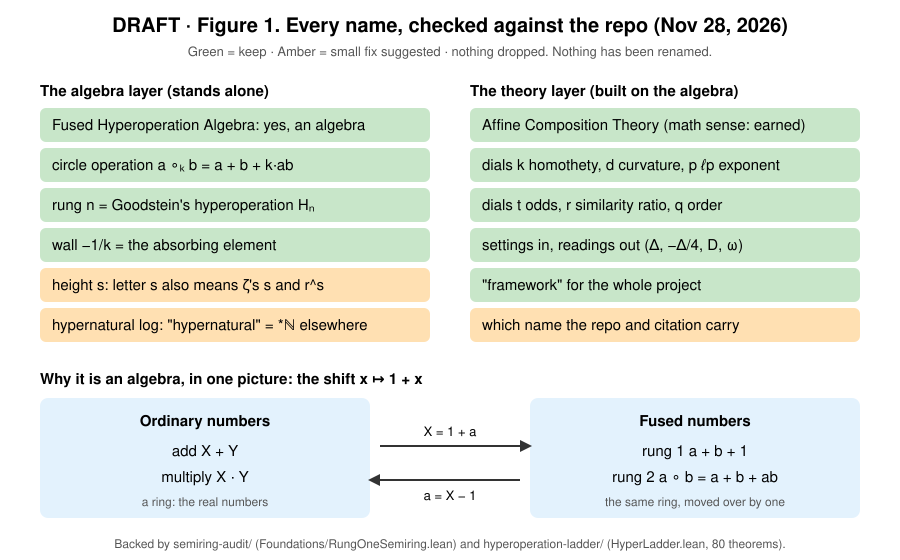

# DRAFT · Naming review: every name checked against the work (Nov 28, 2026)

**DRAFT.** Nothing here has been renamed or pushed. Every change below is Brennan's call.

Asked for by Brennan on a voice call, Nov 28: he felt he had "misnamed and misthought of everything", and asked "does it qualify as an algebra or not? Just straight out", whether "the term algebra there might be a bit large", and whether a physics theory needs an experimentally confirmed prediction.
Builds on, and does not repeat: `names-review/` (Nov 25 symbols and letters), `theory-name/` and `theory-name/LAYERS.md` (Nov 26 theory name and the two layers), `affine-names/` (dial names), `hyperoperation-ladder/`, `semiring-audit/`, `dial-map/` (in the repo).

## Verdict

The names mostly fit the work. It is an algebra, "theory" is earned in the mathematical sense but not yet in the physics sense, and three names want a small fix. Nothing needs dropping.

## The two straight answers

**Is it an algebra? Yes.** In mathematics an "algebra" (universal algebra) is a set with operations that obey stated laws, which is why Boolean algebra and max-plus algebra are called algebras. The circle operation a ∘ₖ b is associative and commutative with identity 0, and has an inverse away from the wall, so it is a commutative group there. Rung 1 (a + b + 1) and rung 2 (∘₁) together are a commutative ring: rung 2 distributes over rung 1 (`semiring-audit/`, `Foundations/RungOneSemiring.lean`). Through the shift X = 1 + a it is the real numbers' own ring moved over by one (Figure 1, bottom). Two limits: it is not an "algebra over a field" in the linear-algebra sense (like a Clifford algebra), and rungs 3 and up lose associativity, as ordinary powers do (`hyperoperation-ladder/`, 80 Lean theorems). Neither makes the word too large. Max-plus algebra is a semiring and carries the word without complaint.

**Does a physics theory need a confirmed prediction? Partly.** A scientific theory is *accepted* once its new predictions survive experiment. But physicists also use "theory" for a worked-out mathematical structure before any test (string theory has no confirmed prediction), and "framework" for a general language that theories are written in (quantum field theory is a framework, the Standard Model a theory inside it). In mathematics a theory needs no experiment at all: group theory is its definitions and theorems. So Affine Composition Theory is a theory in the math sense today, with over 3,000 Lean-checked theorems. The physics bridges are proposals until one of their new predictions is tested. The repo's own score (`DEPENDENCY-MAP.md`) is 4 of 22 quantum-gravity prerequisites met.

## Every name

| Name | Verdict | Backed by | Why |
|---|---|---|---|
| Fused Hyperoperation Algebra (the algebra layer, repo and citation title) | Keep | `theory-name/LAYERS.md`, `semiring-audit/`, `hyperoperation-ladder/` | It is an algebra (above), and whole rungs are exactly Goodstein's hyperoperations Hₙ under the shift, so "Hyperoperation" is earned. |
| "Fused" | Keep | `names-review/NAMING-COLLISIONS.md` (Fused row) | It means one thing: an ordinary operation conjugated by x ↦ 1 + x (x ↦ 1 + kx with the dial). Clash with computing's fused multiply-add is already listed. Brennan kept it on Nov 26. |
| Affine Composition Theory (the theory layer) | Keep | `theory-name/README.md` | The core law composes homotheties, which are affine maps, and the dial names come from affine geometry. Earned as a math theory. Known gaps, already written down: p has no affine name, and with d ≠ 0 the maps are projective. A Nov 28 phrase search again found no field by this name (a 2026 control-theory paper has a lemma called "principle of affine composition", a neighbour, not a clash). |
| "Framework" for the whole project | Keep | repo README (used about 130 times across the write-ups) | Plain English for a base others build on, and the physics sense above fits too. Not a taken technical term. |
| Which name the project carries | **Adjust (his call, at 1.0)** | repo README line 15, `CITATION.cff`, `.zenodo.json` | Brennan wants the project named for the framework. Today the repo and both citation files carry the algebra's name (the base layer), not the whole framework's. The options: leave it as is; or name the project "Affine Composition" (or "Affine Composition Theory"), with Fused Hyperoperation Algebra named as its base layer. A rename touches the published DOI record, so it waits for the 1.0 decision. |
| "Research program" | Not used, nothing to change | none | No file uses it. Lakatos's sense is about a line of work with a fixed core, not team size, so one person can run one, but nothing needs that name. |
| circle operation ∘ₖ | Keep | `names-review/RENAME-PLAN.md` | Ring theory's own name (Perlis, Jacobson; mathlib). The old name mult-add survives only in the citation abstract, which can change at 1.0. |
| rung n | Keep, gloss it | `hyperoperation-ladder/README.md` | Rung n is exactly Hₙ, same numbering (rung 1 is shifted addition, rung 2 the circle operation). The standard word for the index is "rank"; one glossary line covers it. |
| height s (fractional rungs) | **Adjust** | `fractional-rungs/`, `height-flow/`, `zoom-dial/README.md` | Two clashes. Inside the repo, s is also Riemann's ζ(s) and the zoom dial's exponent rᵢˢ. Outside, in tetration "height" means the number of levels in the tower, not the operation's rank. Lightest fix: keep "height s" and add both clashes to NAMING-COLLISIONS. A fuller fix: call it "fractional rank", which extends the standard word. |
| hypernatural logarithm and exponential | **Adjust** | `e/README.md`, `named-functions/` | "Hypernatural numbers" (*ℕ) are a standard object in nonstandard analysis (Di Nasso and others), so the word will be misread. It replaced "supernatural" on Nov 26, which clashed with the super-logarithm. A plain option that says what it is: "height-s logarithm ln_s" and "height-s exponential". At minimum, add a collision row. |
| wall −1/k | Keep, gloss it | `names-review/README.md` glossary | It is the absorbing element: a ∘ₖ (−1/k) = −1/k for every a. One glossary line. |
| k, homothety dial | Keep | `affine-names/` | Standard affine name; k on the quantity being composed (`names-review/` item 2). |
| d, curvature dial | Keep | Coleman–McGuinness 1991 | Their letter, their sign. The extended law's "c" from the bridges study is this same d. |
| p, ℓp exponent | Keep | `shape-dial-survey/` | Standard. On prime pages p is a prime; context separates them, but one collision row would help. |
| t odds, r similarity ratio, q order dial | Keep | `dial-map`, `fractal-dials/`, `order-dial/` | r is Hutchinson's and Moran's word; q matches the quantum plane yx = q·xy; the old q = k + 1 is already retired. |
| C, cubic form (derived from k and d) | Keep | `dial-map` | Fubini–Pick cubic form; already marked derived, so it is not one of the seven dials. |
| settings (inputs) and readings (outputs: Δ, curvature −Δ/4, D, holonomy ω) | Keep | `affine-names/`, `dial-map` | A reading is what mathematicians call an invariant; Δ is the standard discriminant and ω the standard holonomy. |
| Hypercube Composition Theory | Already retired (Nov 26) | `theory-name/README.md` | Still shows as the project label on this task's card; that label is out of date. |

## Where I am unsure

- The clash checks are web searches on Nov 28, not a guarantee.
- "Fractional rank" and "height-s logarithm" are descriptive suggestions; I found no other use of either, but did not search the tetration forums deeply.
- I did not count every file that uses s, height or hypernatural; the clash claims rest on the three folders named above.

## Sources

- Hyperoperation ranks and tetration's "height": https://en.wikipedia.org/wiki/Hyperoperation, https://en.wikipedia.org/wiki/Tetration
- Hypernatural numbers in nonstandard analysis: Di Nasso, https://arxiv.org/pdf/1501.05755 ; https://arxiv.org/pdf/1312.5059
- Neighbour, not a clash: https://arxiv.org/pdf/2602.14537 ("principle of affine composition")
