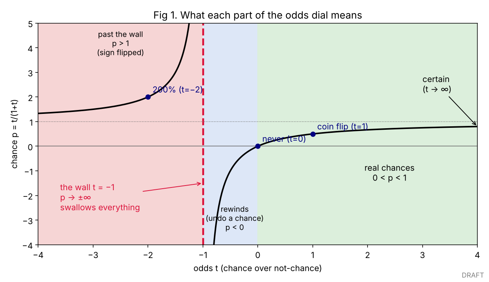
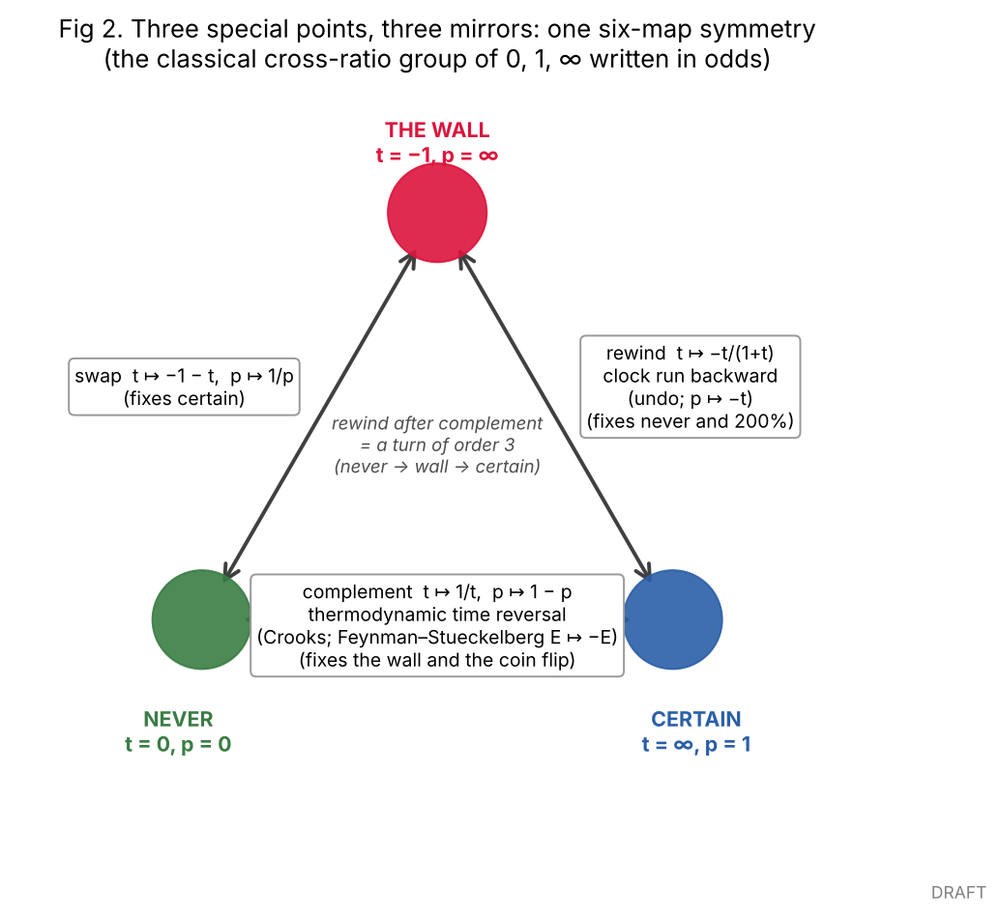
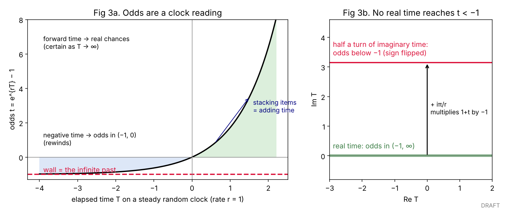
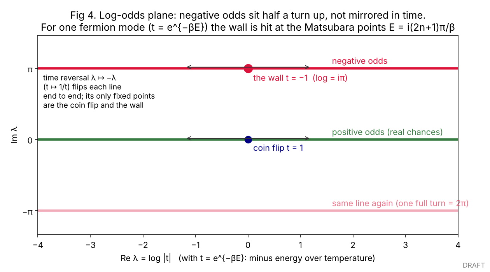
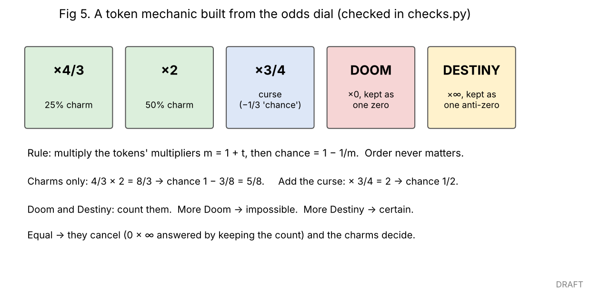

# Negative odds, the wall at −1, and the arrow of time (DRAFT)

**DRAFT, Nov 27 2026.** Part of Affine Composition Theory (repo: fused-hyperoperation-algebra). Asked for by Brennan on a
voice call: look at the negative side of the odds dial, and especially the point −1, "and see if we can discover anything
just by looking at that point"; then "the negative might mean a different time, a different arrow of time ... could we
link the two concepts together ... it may even be literally fundamentally the same thing."

Checks: `checks.py` → `checks_output.txt`, **37 of 37 pass** (exact fractions, numpy, a Poisson simulation).
Lean: `lean/NegativeOdds.lean`, **22 theorems**, core Lean 4.37.0-rc1 against `FusedAlgebra.Base`, compiles clean, no
`sorry`. Pictures: `figures.py` → `figures/`.

## The result in two sentences

The point −1 is the third special point of the odds dial, on equal footing with "never" and "certain": one six-map
symmetry swaps the three around, and −1 is the only point that every kind of combining leaves stuck. Negative odds
between −1 and 0 really are time running backward on a steady random clock, but the thermodynamic arrow of time acts
differently (it turns odds t into 1/t), so the two reversals are siblings in one known symmetry, not literally the same
thing.

## 1. What each part of the dial means

Odds t is chance over not-chance, and the chance is p = t/(1 + t). Independent items stack by t ∘₁ s = t + s + ts
(the union rule; check 1, Lean `odds_union`).

| Odds t | Chance p | What it is |
|---|---|---|
| t > 0 | 0 < p < 1 | ordinary chances; t = 0 never, t = 1 a coin flip, t → ∞ certain |
| −1 < t < 0 | p < 0 | **rewinds**: the undo of an ordinary chance. The undo of odds t has "chance" exactly −t (Lean `prob_rewind`). A −1/3 chance cancels a 1/4 chance: ¼ + (−⅓) − (¼)(−⅓) = 0 |
| t = −1 | p = ±∞ | **the wall**, the absorbing element of ∘₁ (already in the repo as the wall −1/k) |
| t < −1 | p > 1 | **past the wall**: an ordinary chance with a sign bit flipped. t = −2 (p = 200%) is its own undo: two of them stack to "never" (Lean `two_hundred_twice`). Two items past the wall always give a positive lift (Lean `past_wall_pair`), so the sign cancels in pairs |

In the lift u = 1 + t, stacking is plain multiplication. The positive half (u > 0) is the ordinary chances and their
undos; the negative half (u < 0) adds exactly one sign; the wall is u = 0, the one number with no inverse. So the whole
negative side of the dial brings in only two new things: undo, and a sign.

## 2. The wall, looked at closely

- **It swallows union** (t ∘₁ −1 = −1 for every t), **it is fixed by the complement** (1/(−1) = −1), and therefore
  **it swallows intersection too** (Lean `wall_absorbs`, `mirror_fixes_wall`, `wall_absorbs_inter`). Never (0) swallows
  only intersection and certain (∞) swallows only union; the wall is the one point every operation leaves stuck.
- **The complement swaps the two negative regions**: chance below zero (−1 < t < 0) mirrors to chance above 100%
  (t < −1). The complement's two fixed points on the real line are t = 1 (the coin flip; the odds-dial survey's N1) and
  t = −1 (the wall).
- **Divide by zero.** Wall meets certain is 0 × ∞ in the lift: plain arithmetic gives no answer. Keeping the count of
  zeros does: write each multiplier as (coefficient, net zeros) and multiply coefficients while adding counts (Lean
  `Kept`, `doom_destiny`; check 12). This is Brennan's founding wish ("invert and get an answer when I divide by zero"
  by saving information) in its simplest working form. The bookkeeping itself is the standard valuation, or leading term
  of a Laurent series; known.

## 3. Three special points, one six-map symmetry

Never (0), certain (∞) and the wall (−1) are the three corners of a triangle, and three mirrors swap them in pairs
(checks 7; Lean `rewind_rewind`, `prob_mirror`, `prob_third`, `third_swaps`, `rewind_fixed`):

- **Complement** t ↦ 1/t (p ↦ 1 − p) swaps never and certain and fixes the wall.
- **Rewind** t ↦ −t/(1 + t) (the quasi-inverse, the repo's "way back") swaps certain and the wall and fixes never.
- **Swap** t ↦ −1 − t (p ↦ 1/p) swaps never and the wall and fixes certain.

Rewind after complement is a turn of order 3 (Lean `turn_order_three`) and the six maps form a group. Written in chance
p this is the classical cross-ratio (anharmonic) group of 0, 1, ∞, so the structure is known; what this page adds is the
reading on the odds dial, with the wall as the third corner.

## 4. Is the negative side a different arrow of time?

**Partly, and exactly where it holds.**

**Yes, between −1 and 0.** A steady random clock (ticks at rate r) gives "at least one tick in time T" odds
t = e^{rT} − 1. Stacking independent items is adding time, and running the clock backward is rewinding: t(−T) = rewind of
t(T) (checks 8, with a 200,000-run Poisson simulation). So −1 < t < 0 is literally negative elapsed time, and the wall is
the infinite past. The clock reading is already in the repo (`probability-entanglement/` §6); the backward half is the new
look here.

**No, below −1.** No real time reaches t < −1. It takes half a turn of imaginary time (T + iπ/r), which multiplies the
lift by −1: a sign, not a direction of time (fig 3b).

**The thermodynamic arrow is a different mirror.** Reversing a process turns its forward/backward odds t into 1/t
(detailed balance; Crooks's theorem P(+σ)/P(−σ) = e^σ), and so does flipping energy, E ↦ −E, which is the
Feynman–Stueckelberg "negative energy runs backward in time" (checks 10). That map keeps the sign of t. In log-odds it is
λ ↦ −λ, whose only fixed points are the coin flip (λ = 0) and the wall (λ = iπ).

**The link, as one statement.** Clock reversal and process reversal are the rewind and complement mirrors of the same
triangle (section 3). Composed, they make the order-3 turn never → wall → certain. A third face of the same thing: turning
the sign of k while negating the value is clock reversal, x₋ₖ(H) = −xₖ(−H) for xₖ(H) = (e^{kH} − 1)/k (checks 9; Lean
`flip_is_minus_rewind`). That is Tsallis's q ↔ 2 − q duality and the repo's flip φₖ = −(quasi-inverse), both known.

**The strongest form, tested.** "Literally the same thing" does not hold: the two reversals are different maps (one fixes
the wall, the other fixes never). What does hold is that they come from one structure, the six-map symmetry of never,
certain and the wall. That structure is classical.

**A physical anchor for the wall.** For one fermion level, t = e^{−βE} is the Boltzmann odds, p = t/(1 + t) is the
Fermi–Dirac filling, and Z = 1 + t vanishes at the wall: the single-level Lee–Yang zero. t = −1 is reached at
E = i(2n + 1)π/β, the fermionic Matsubara points (check 11). Bosons put their wall at t = +1 instead. Known physics.

## 5. Where negative odds are already used

- **Quantum mechanics.** Wigner's quasi-probability (1932) goes negative; Dirac (1942) and Bartlett (1945) argued that
  negative probabilities are fine in the middle of a calculation if every observable answer lands in [0, 1]; Feynman's
  essay "Negative probability" (1987) made the same case with worked examples. Negativity of the Wigner function is now
  measured as a resource for quantum speed-up (Veitch, Ferrie, Gross and Emerson 2012). Fermion simulations meet negative
  weights as the sign problem (Troyer and Wiese 2005 showed the general case is NP-hard): the sign sector of section 1.
- **Probability itself.** The Lovász Local Lemma, the standard tool for "can every bad event be avoided?", is the
  independent-set polynomial evaluated at negative fugacity −p (Scott and Sokal 2005). Its limit is Shearer's bound
  (1985), the first zero on the negative axis, the −1/4 the odds-dial survey already met. So the rewind region is where
  that lemma lives.
- **Half coins.** Székely (2005) built a signed "half of a coin": two independent copies add up to a fair coin, but the
  half coin has some negative probabilities.

## 6. Game design

The odds dial gives a token system with three useful properties (check 12):

1. **Order never matters.** Give each token a multiplier m = 1 + t and read the chance as 1 − 1/∏m. It is exactly
   p + q − pq stacking, so players multiply small fractions instead of computing unions.
2. **Curses cancel charms exactly.** A ×3/4 curse (a −1/3 "chance") undoes a ×4/3 charm (25%). Every charm has one exact
   counter-curse, the rewind.
3. **Doom and Destiny.** Doom is ×0 and Destiny is ×∞, kept as counts. More Doom: impossible. More Destiny: certain.
   Equal counts cancel and the ordinary tokens decide. This answers the 0 × ∞ that would otherwise break the table, and
   it is the same "keep the count" move as section 2.

Two things to know before using it. A total multiplier at or below 1 gives a chance at or below zero, which a game should
read as "can't happen" (so the voice assistant's "can never happen" curse works once you clamp, but the wall t = −1
itself is not "never"; it is Doom). And a single ×(−1) token (200%) flips a sign that only pairs undo, which could be a
parity mechanic but is easy to make confusing.

## 7. Is odds a fundamental dial?

This page leans toward Brennan's game-maker instinct: on the clock, odds are read off rate × time, so t is set by the
structure that produces it. It does not settle the dial audit.

## Verdict

- **Math: not a lead.** Every structure here is classical: the wall is the absorbing element, the six maps are the
  cross-ratio group, the clock is the logarithm of the law, and the k-flip is Tsallis's duality.
- **Arrow of time: a tidy, exact dictionary, not a lead toward new physics.** Negative odds between −1 and 0 are
  backward clock time; the thermodynamic arrow is the complement; both are mirrors of one triangle. Worth one picture in
  the dial map. It predicts nothing new.
- **Game design: a real lead worth playtesting.** Exact counter-curses, order-free stacking and Doom/Destiny counting
  are simple to teach and come with a proof that they never contradict each other.

## Assumptions

- Items are independent (the union rule needs it). The clock reading assumes a steady rate (a Poisson clock).
- Lean works in `Lean.Grind.Field`, where 1/0 = 0; theorems carry the nonzero hypotheses they need, and the statements
  about ∞ (certain) are limits checked numerically, not proved in Lean.
- The Crooks and Matsubara statements are checked numerically on examples, not proved here.
- Game-design claims are arithmetic only; nothing has been playtested.

## Known vs new

| Piece | Status | Source |
|---|---|---|
| Wall −1/k absorbs; quasi-inverse; flip x/(1 + kx) | known, already in repo | `operations-catalog/`, `FusedAlgebra.Base` |
| Odds union law; complement 1/t; t = 1 fixed point | known, already in repo | `odds-dial-survey/` |
| Six maps permuting 0, 1, ∞ | known (classical cross-ratio group) | any projective geometry text |
| Wall as third corner; rewind region = undos; sign sector; "every operation leaves the wall stuck" | our reading of known algebra | this page |
| Clock t = e^{rT} − 1 | reading already in repo | `probability-entanglement/` §6 |
| Negative odds in (−1, 0) = negative clock time | elementary; our reading | this page |
| Process reversal t ↦ 1/t | known | Crooks 1999; Stueckelberg 1941; Feynman 1949 |
| x₋ₖ(H) = −xₖ(−H) | known (q ↔ 2 − q duality) | Tsallis 1988; repo `information-theory-full/` |
| Fermion level: wall = Lee–Yang zero = Matsubara points | known | Matsubara 1955 |
| Negative probabilities | known | Wigner 1932; Dirac 1942; Bartlett 1945; Feynman 1987; Székely 2005 |
| Local Lemma at negative fugacity | known | Shearer 1985; Scott and Sokal 2005 |
| Doom/Destiny counting resolves 0 × ∞ | known bookkeeping (valuation); the game use is ours | this page |
| Token mechanic | ours, untested in play | this page |

## Files

- `README.md` (this page, DRAFT)
- `checks.py` → `checks_output.txt` (37 checks)
- `figures.py` → `figures/fig1_regions.png` … `fig5_tokens.png`
- `lean/NegativeOdds.lean` (22 theorems; compile with `LEAN_PATH` pointing at a built `lean-library`)
