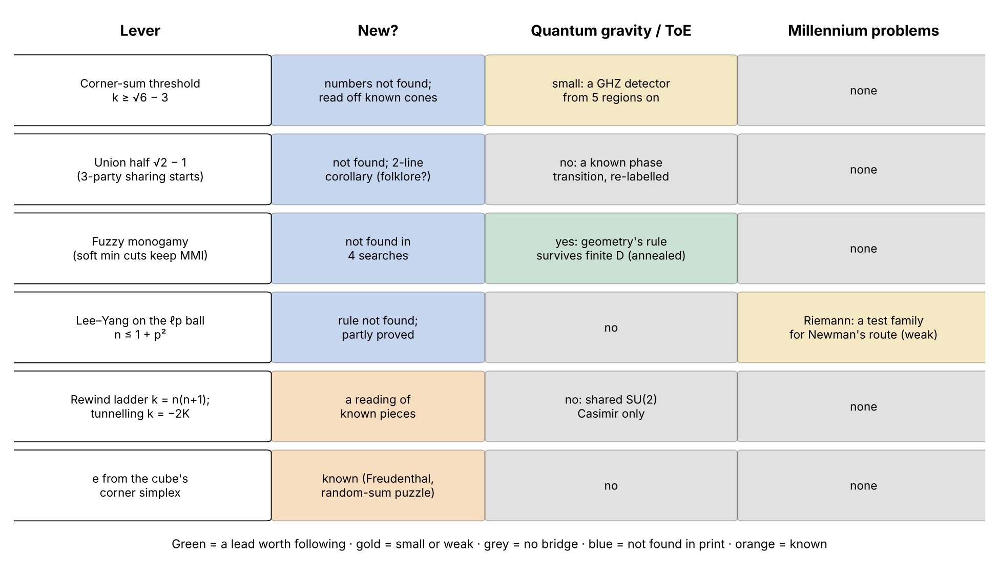
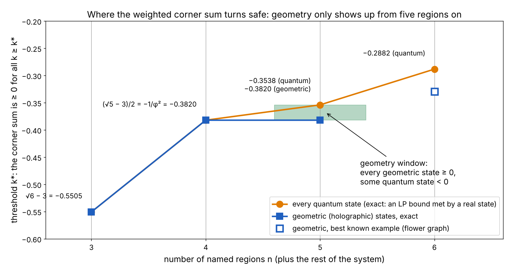
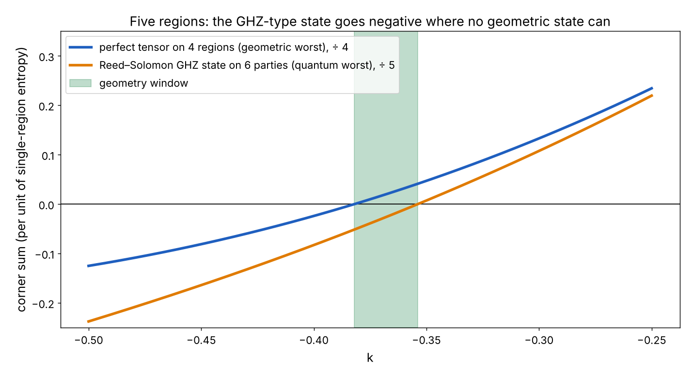
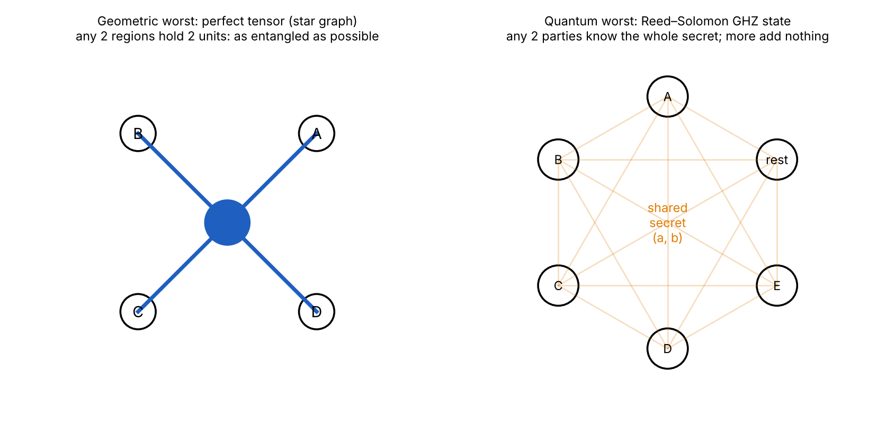
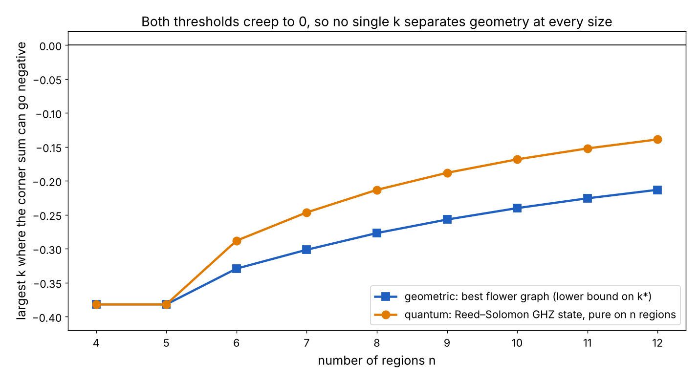
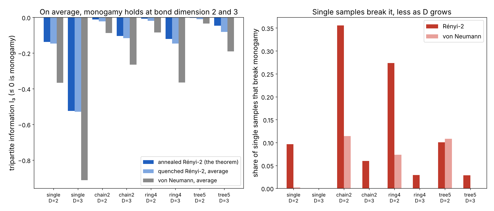
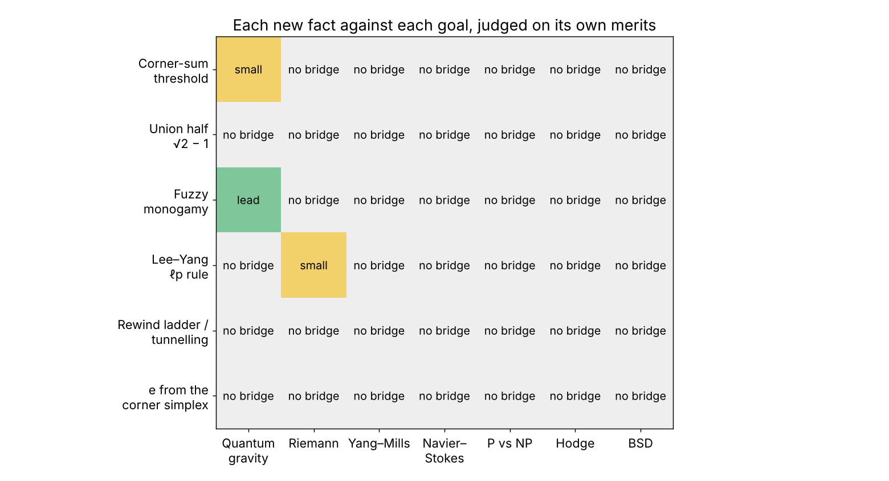

# New facts as levers: quantum gravity first, then the Millennium problems (DRAFT)

**Why this page exists.** Brennan's design principle (Nov 26, 2026, his words): "if we discover a new fact that is not in
print, we should try to apply it to our goals, the main goal being quantum gravity and the theory of everything." He
asked for the k-dial survey's corner-sum threshold to be tried this way, then the other facts we found, and then the
Millennium Prize problems.

**The result in plain words.** One fact opens a lead worth following: **fuzzy monogamy** (softened minimal cuts never
break the monogamy rule). It says a rule that signals a geometric spacetime survives at finite bond dimension, in the
annealed sense, and our new numerics show it also holds on average for real random tensor networks while single samples
break it. The **corner-sum threshold** grew into something sharper than before: from five regions on it tells geometric
states from other quantum states (a "geometry window" between −0.382 and −0.354), but the numbers are read off two
known cones, so it is a small diagnostic, not a step toward quantum gravity's hard parts. **No lever opens a lead on any
Millennium problem.** One weak conduit goes to the Riemann thread (the Lee–Yang ℓp rule as a test family for Newman's
Lee–Yang route).

Files: `checks.py` (20/20 pass, `checks_output.txt`), `figures.py` → `figures/`, `thresholds.py` (the LPs),
`flowers.py`, `families.py`, `graphsearch.py`, `rtn_check.py` (each saves a `.json`).
Colour key in the pictures: **blue = ours / not found in print**, **orange = already known**, green = a lead.

*Figure 0. Every candidate lever, whether it is new, and what it does for quantum gravity and the Millennium problems.*

---

## 1. The levers (every result in the repo marked "not found in print", plus the two Brennan named)

Grepped Nov 26 across `README.md`, `topics/*/README.md`, the survey drafts and `/mnt/project-files/math-theory`.

| # | Lever | Where it's written | Literature check done | Holds up as new? |
|---|---|---|---|---|
| L1 | Corner-sum threshold: S_A+S_B+S_C + k(pairs) + k²S_ABC ≥ 0 for every quantum state exactly when k ≥ √6 − 3 | `homothety-dial-survey/` C11, N3 | one search (Nov 26) + four here | **The numbers are not in print as far as we found, but they follow from known cones** (section 2) |
| L2 | Union half √2 − 1: three-party sharing (I₃ < 0) starts there for equal neighbours | `odds-dial-survey/` N2 | searches listed there + one here | Not found; a two-line corollary of Headrick 2010, so likely folklore |
| L3 | Fuzzy monogamy: Ising free energies / annealed Rényi-2 entropies of tensor networks obey MMI at every softness; Potts breaks it | `holographic-entropy-cube/` third pass | four searches there + two here | **Not found** |
| L4 | Lee–Yang on the ℓp ball: all zeros real iff n ≤ 1 + p² (or p even) | `lee-yang/`, `shape-dial-survey/` N3 | searches there | Rule not found; partly proved (breaking side; n ≤ p + 1; p = 4 cases; top strip boxed) |
| L5 | Fused rewind ladder k = n(n+1) (barrier) and averaged tunnelling composing by ∘ₖ with k = −2K | `tunnelling/` | sources named there | A reading of known pieces (spherical functions; Anderson et al. 1980; Matsui 1993), not a new fact |
| L6 | e from where the cube meets the corner simplex (Σ 1/n! = e) | `hypersphere/` section 2 | — | **Known**: Freudenthal's staircase triangulation (n! simplices of volume 1/n!) and the random-sum puzzle. Ours is only the sorting "e belongs to the simplex, π and i to the sphere" |
| — | Smaller items: Lucas-weighted (k, d) corner formula; horn-map constant c₁ ≈ −10.75 − 63.25i of e^x − 1; the dependent-cause gap in decrement paths; the (a, b, 0)-class identification; the Mallows reading | `lucas-weights/`, `dynamical-systems/`, `decrement-paths/`, survey pages | searches there | Small; none touches spacetime, so they were not run through the goals below |

The five-region "one sign in corner weights" pattern from `polar-recast/` was a candidate too, but it is Proposition 3 of
Hernández-Cuenca, Hubeny and Jia (arXiv:2309.06296), so it is known and left out.

---

## 2. Lever L1, the corner-sum threshold, pushed to more regions

**What was done.** For n named regions plus the rest of the system O, the corner sum is
f_k = Σ over nonempty sets I of named regions of k^(|I|−1) S_I. For each n we solved linear programs: the smallest
f_k can be over (a) every vector obeying subadditivity and strong subadditivity with purification (an outer bound for
**all** quantum states), and (b) the same plus monogamy and, at n = 5, three of the eight facet orbits of the
five-region holographic cone (Hernández-Cuenca 2019, Table 1; an outer bound for **geometric** states). Where an actual
state meets the LP's bound, the threshold is exact.

*Figure 1. The threshold k* (the corner sum is ≥ 0 for all k ≥ k*) as the number of regions grows. Orange: every
quantum state. Blue: geometric states. They agree at three and four regions and split at five.*

| n | all quantum states | geometric states | worst state |
|---|---|---|---|
| 3 | √6 − 3 = −0.55051 (exact) | the same | perfect tensor on 4 parties (it is geometric) |
| 4 | (√5 − 3)/2 = −1/φ² = −0.38197 (exact) | the same | perfect tensor on 4 of the regions; φ is the golden ratio |
| 5 | **−0.35383** (exact; root of k⁴ + 10k³ + 20k² + 20k + 5) | **(√5 − 3)/2 = −0.38197** (exact) | quantum: the Reed–Solomon GHZ state; geometric: the 4-leg perfect tensor |
| 6 | −0.28817 (exact) | between −0.382 and −0.288; best example −0.3293 (a flower graph) | quantum: Reed–Solomon GHZ on 6 regions |

**Why the five-region numbers are exact.** The quantum LP's minimiser is S_I = min(|I|, 2, 6 − |I|), and that vector
belongs to a real state: |ψ⟩ = (1/5) Σ over a, b in F₅ of |a + b·x₁, …, a + b·x₅, b⟩, the codewords of a [6, 2]
Reed–Solomon code (any two parties know the whole secret (a, b); more add nothing). `checks.py` Q1 builds it and computes
its entropies directly. On the geometric side the LP with three facet orbits already lands on −0.38197, which the 4-leg
perfect tensor (a star graph, so geometric) meets; the three missing facet orbits can only shrink the cone further, so the
value cannot change.

*Figure 2. Five regions. The GHZ-type state (orange) goes negative for k up to −0.354; every geometric state stays
≥ 0 above −0.382 (blue is the worst one). Green: the geometry window.*

*Figure 3. The two states that set the thresholds. Left: the perfect tensor, as entangled as possible. Right: the
Reed–Solomon GHZ state, a shared secret that any two parties already hold.*

**Larger n.** Both thresholds creep toward 0 (Figure 4): the GHZ-type states roughly like 1.6/n, the best geometric
examples (flower graphs, the extreme rays Czech and Shuai conjecture for averaged entropies) more slowly. So no single k
separates geometry at every size. 2,000 random graph models per setting at n = 5 and 6 never went negative above the
flower roots (`graphsearch.json`); that is weak evidence, since random graphs sit far from the extremes.

*Figure 4. Largest k where the corner sum can go negative, for the best geometric examples (blue) and for GHZ-type
quantum states (orange). Blue is a lower bound only beyond n = 5.*

**What it means for quantum gravity.** In the corner-sum family, geometry is invisible until five regions. There the
first states it rules out are GHZ-like ones: a secret spread so that small groups already hold all of it. That matches
what is already believed about holographic states (they carry little GHZ-type entanglement; perfect tensors, the HaPPY
code's building block, are the extreme geometric case). So the threshold gives a one-number test, a negative corner sum
in the window means "not a geometric state", but it adds no constraint the five-region holographic cone did not already
contain, and it says nothing about dynamics, Einstein's equations, Newton's constant or how area laws arise.
Entanglement-builds-spacetime arguments (Van Raamsdonk; ER = EPR; Jacobson's entanglement equilibrium) rest on
bipartite entanglement and the area law, which this family does not touch.

**Verdict on L1: a small, sharp diagnostic; not a lead toward quantum gravity.** The n = 5 split is worth one line on the
k-dial page; it is a corollary of known structure (section 6), not new physics.

---

## 3. Lever L3, fuzzy monogamy, tested on real random tensor networks

The theorem (`holographic-entropy-cube/`, third pass) covers the **annealed** Rényi-2 entropy, the Ising free energy.
Physical states have quenched entropies, and von Neumann rather than Rényi-2. So we built actual states from random
Gaussian tensors on four small networks at bond dimension D = 2 and 3 (3,000 samples each) and measured I₃.

*Figure 5. Left: I₃ averaged three ways; ≤ 0 is monogamy. Right: the share of single samples that break it.*

- The annealed Rényi-2 I₃ is ≤ 0 on every network, as the theorem says.
- The **quenched** average is ≤ 0 on every network too (not covered by the theorem; numerical).
- Single samples break monogamy often at D = 2 (up to 36% for Rényi-2, 11% for von Neumann) and much less at D = 3.

**What it means for quantum gravity.** Monogamy of mutual information is a necessary condition for a state to have a
classical geometric dual (Hayden, Headrick and Maloney 2013). The usual derivations hold at infinite bond dimension, the
classical-gravity limit. L3 is an exact statement that the rule survives the thermal smearing of the minimal surface at
any finite bond dimension, in the annealed ensemble, and the new numerics say it also survives on average. It also
gives a sharp boundary: the two-state replica symmetry of Rényi-2 is what protects it (Potts, the analogue for higher
Rényi entropies, breaks it). This is the kind of statement quantum-gravity work wants: what of geometry survives
quantum (finite-N) corrections. It is still far from von Neumann entropies of real holographic theories.

**Verdict on L3: a lead worth following.** It is exact, not found in print, and points at a live question. Next steps,
in order: (1) prove or break monogamy for the quenched Rényi-2 average; (2) the five-region facets for fuzzy cuts (items
4–7 still open); (3) compare with known quantum corrections to Ryu–Takayanagi (Faulkner–Lewkowycz–Maldacena) to see
whether bulk entanglement can break it.

---

## 4. The other levers against quantum gravity

- **L2, the union half √2 − 1.** It marks where the entanglement wedge of A with B₁B₂ connects while neither half
  connects alone, a known phase transition (Headrick 2010) at one symmetric point. **No lead.**
- **L4, Lee–Yang on the ℓp ball.** A statement about spin models' partition-function zeros; no route to spacetime.
  **No lead.**
- **L5, rewind ladder k = n(n+1).** The same numbers appear in loop quantum gravity's area spectrum √(j(j+1)), but both
  come from the SU(2) Casimir, so the match is shared representation theory, not a bridge. **No lead.**
- **L6, e from the corner simplex.** Regge calculus and causal dynamical triangulations build spacetime from simplices,
  and the 1/n! volumes appear there, but that is standard. **No lead.**

---

## 5. Each Millennium problem in turn

*Figure 6. Each lever against each goal. Only quantum gravity gets a lead (L3) and a small diagnostic (L1); Riemann gets
one weak conduit (L4).*

- **Riemann.** L4 is the only real contact. Newman (1976) tied the Riemann hypothesis to the Lee–Yang theorem: ξ is the
  Fourier transform of a positive even kernel, and the de Bruijn–Newman programme asks when such transforms keep only real
  zeros. The ℓp-ball family is a new set of kernels with a sharp real-zero rule, so it could serve as a calibration family
  for that machinery (inferred, not tested). It does not touch ξ's own kernel. **Weak; passed to the running Riemann
  thread through the coordinator, not pursued here.** L1–L3, L5, L6: no contact.
- **Yang–Mills and the mass gap.** L3 uses Griffiths' inequalities, which also hold in some lattice gauge models, but the
  mass gap needs exponential decay of correlations in a four-dimensional continuum non-abelian theory, and monogamy of
  boundary entropies says nothing about that. L4's Lee–Yang zeros concern magnetic fields in spin models, not the pure
  gauge theory. **No lead** (consistent with the earlier verdict).
- **Navier–Stokes.** None of the levers has the shape of a fluid equation or an energy cascade; the entropy inequalities
  are static constraints, not dynamics. **No lead.**
- **P vs NP.** L1 is a linear program over a cone, which is easy; nothing here gives a lower bound on circuits or a
  hardness reduction. **No lead.**
- **Hodge.** No lever touches algebraic cycles or cohomology. **No lead.**
- **Birch and Swinnerton-Dyer.** No lever touches L-functions or rational points on elliptic curves. **No lead.**
- **Poincaré** is solved and was skipped.

---

## 6. Literature: is the threshold already known?

- **Czech and Shuai, "Holographic cone of average entropies"** (arXiv:2112.00763) conjecture the holographic cone of
  averaged entropies, with perfect tensors and EPR pairs as extreme cases and "flower" graphs between.
- **Fadel and Hernández-Cuenca, "Symmetrized holographic entropy cone"** (Phys. Rev. D 105, 086008, 2022;
  arXiv:2112.03862) symmetrize both cones. The symmetrized quantum cone is known for all n (Pippenger) and its extreme
  rays are S̃_k = min(k, l): exactly our Reed–Solomon GHZ vectors. The symmetrized holographic cone's rays are star
  graphs with one heavy leg (our flower graphs).
- Neither paper writes a one-parameter weighted corner sum or these thresholds; searches for a √6 − 3 or weighted
  three-region inequality found nothing. **So the numbers are ours as stated, but they are read straight off known
  cones**, and when the worst state is fully symmetric they are corollaries of those papers. Treat them as "probably
  folklore-level once someone asks".
- Fuzzy monogamy: Hayden et al. 2016 (arXiv:1601.01694) set up the Ising map and treat finite-D corrections; Qi, Yang and
  You 2017 (arXiv:1703.06533) evaluate Rényi-2 mutual information by the same map. Neither proves monogamy at finite D by
  Griffiths' inequalities; two more searches here found nothing.

Searches run here (Nov 26, 2026): weighted three-party entropy sum with √6 and perfect tensors; finite-bond-dimension
Rényi-2 monogamy with Griffiths; tripartite information onset with √2 − 1; the five-region cone's facets; symmetrized
holographic versus quantum cones; monogamy of mutual information with Ising free energies and GHS; Pólya, Newman and
the Riemann ξ.

## 7. What to do next

1. **L3 (lead):** attempt the quenched Rényi-2 monogamy proof; the numerics in Figure 5 are the target.
2. **L1:** get the remaining five-region facet orbits (6–8) and the six-region cone to pin the n = 6 geometric threshold.
3. **L4:** the Riemann thread decides whether the ℓp family is worth using as a calibration set.

## The polishing step

Three roots are recomputed with mpmath at 30 digits (checks P1–P3): √6 − 3, (√5 − 3)/2 = −1/φ², and the five-region
quantum root −0.3538307955298137265. Cost under a second.

## Assumptions

- Quantum thresholds use the outer cone from subadditivity and strong subadditivity with purification; they are exact
  only where an explicit state meets the bound (n = 3, 4, 5, 6 all do).
- Geometric thresholds: exact for n = 3, 4 (the holographic cone is subadditivity plus monogamy there) and n = 5 (three
  of eight facet orbits suffice, because a geometric state meets the bound). For n ≥ 6 only lower bounds from flower
  graphs are given.
- The five-region facet orbits were transcribed from the ar5iv rendering of Hernández-Cuenca 2019, Table 1; orbits 6–8
  were not retrieved.
- The random-tensor-network check uses complex Gaussian tensors, four small networks, D = 2, 3, 3,000 samples per
  setting; the quenched result is numerical only.
- The Riemann and other Millennium verdicts are judgements, not theorems; the Riemann conduit is inferred and untested.

## Known vs new

| Item | Status | Source |
|---|---|---|
| Holographic cone for ≤ 5 regions; perfect tensors as extreme rays | Known | Bao et al. 2015 (arXiv:1505.07839); Hernández-Cuenca 2019 (arXiv:1903.09148) |
| Symmetrized quantum cone with rays min(k, l); symmetrized holographic cone | Known | Pippenger; Fadel and Hernández-Cuenca 2022; Czech and Shuai 2021 |
| Reed–Solomon (MDS) states and their entropy vectors | Known (standard coding theory) | — |
| Corner-sum thresholds √6 − 3, −1/φ², −0.3538 and the five-region geometry window | **Ours as stated; corollaries of the known cones** | this page, checks T1–H5, P1–P3 |
| Fuzzy monogamy theorem | **Ours (not found in print)** | `holographic-entropy-cube/` |
| Quenched average obeys monogamy on small random networks | **Ours, numerical** | this page, R1–R3, `rtn_check.json` |
| e from the corner simplex | Known | Freudenthal triangulation; random-sum puzzle |
| Lee–Yang link to the Riemann hypothesis | Known | Newman 1976 (Proc. AMS 61) |
