# DRAFT · What ties the new pieces together, and what we can build with them

**DRAFT, Nov 27 2026.** Part of Affine Composition Theory, built on Fused Hyperoperation Algebra. Not reviewed.
Asked for by Brennan (voice, Nov 27): "can we look at some things we've found that are kind of new and see if there's
anything that kind of ties together?", "I'm trying to see if we can build anything with the new things", and "It doesn't
have to be a North Star problem, just curious if we can do anything new, even more new … with our new stuff … in tandem."

Checks: [`checks.py`](checks.py) → [`checks_output.txt`](checks_output.txt), **24 of 24 pass** (numpy, scipy, sympy;
counts in exact rational arithmetic). Numbers: [`union_ifs.py`](union_ifs.py) → `union_ifs.json`. Pictures:
[`figures.py`](figures.py) → [`figures/`](figures/). No Lean in this pass (no Lean toolchain in this workspace).
Colour key: **green = built and tested here, blue = our earlier pieces, orange = known.**

## The answer first

**Yes, three of our new pieces snap together into something we can build: a union fractal.** Take the union rule
(k = −1 / box size, from the set-operations page), use slabs in *different* boxes, and repeat. The shared-centre entropy
rule from the chaos page then predicts the fractal's dimension exactly, and the classic formula (Moran's equation) gets
it wrong whenever two slabs share a box. We built four of these fractals and measured them; the measurements follow our
formula, not Moran's.

**Is it a lead?** A modest one, worth one more step. *Round 2 (section 5): now a theorem on the line, holds in the plane numerically, and fits learning rules and moving averages. Round 7 (section 11): proved in the plane too. Round 8 (section 12): a literature check found the line formula already in print for generic parameters (Bárány and Verma 2025), and a general no-collision test now proves the exact size for a dense set of parameters, for any number of classes of any sizes, on the line and in the plane. Round 9 (section 13): the formula fails exactly where two different words collide, and there the size really drops; a concrete break loses at least 0.033. Round 10 (section 14): the exact size of a break is proved, with no counting, for a dense set of breaks (an example: 0.4232693 where the formula says 0.4531865); the original break is pinned to within 0.00000014. Round 11 (section 15): no second collision in any run of up to 10,000 copies of λ, so the original break's size is pinned to about 4,810 digits; still not exact, and section 15.5 says why. Round 12 (section 16): one search can now prove a whole range of stretches at once, which settles every bad pair whose stretch lies in proved ranges covering 72.7% of the windows, for any number of copies of λ; the search can only get stuck on a measure-zero set where two points of the fractal line up, and that is why the original break is still not exact.* It is a new closed formula that turns "which maps share a centre"
into a dimension, it uses only base pieces (the dial k as box size, centres, order), and it is testable. It is not a
new mechanism: the reason it holds sits inside Hochman's 2014 theory of self-similar sets with exact overlaps. A second,
smaller build answers an open question on the Carnot page: the parabola means every heat-type engine closes in on its
limit at exactly Carnot's rate.

*Figure 1. The new pieces and how they connect. Two ties carried a build (green). One is a reading only (holographic
states always have a non-positive triple overlap). The other new pieces showed no tie worth building on this pass.*

---

## 1. The pieces we started from

Every result the repo marks "not found in print", "ours" or "maybe folklore", gathered from
[`new-facts-levers/`](../new-facts-levers/README.md) (which already lists L1 to L11), the write-ups since, and the
derived-dial catalogue Brennan asked to include.

| Piece | Where | Status in the repo |
|---|---|---|
| Union at the core: a ∘ₖ b is a union in a box, k = −1/(box size); pair dial and triple overlap | `shape-set-operations/` | ours as stated |
| E(k) = (1 + k)^(1/k) + k/(1 + k), mean draws to pass 1 | `shape-set-operations/` (L7) | general formula not found |
| Entropy of affine branches from shared centres (trace monoid) | `chaos-composition/` §6 (L11) | not found; likely folklore |
| The order dial q is an on/off switch for entropy | `chaos-composition/` §6 | ours, probably folklore |
| Heat-type low-dissipation engines on the parabola d = k²/4 − 1 | `carnot-cascade/` | ours |
| Lee–Yang on the ℓp ball (every even p proved) | `lee-yang/` (L4) | rule not found |
| Fuzzy monogamy; corner-sum thresholds | `holographic-entropy-cube/`, `new-facts-levers/` (L3, L1) | not found; thresholds are corollaries of known cones |
| Klein-bottle flow: one sweep, spin loses its sign | `klein-flow/` | one item new to us |
| Derived dials, e.g. curvature −Δ/4 (Δ = k² − 4d), zoom = dimension | `dial-audit/`, `dial-catalog/` | readings |

## 2. Build 1: the union fractal

### The construction

From the set-operations page, joining a slab of size a to a slab of size x, independently, inside a box of size M gives
a union of size

  x ∘ₖ a = a + x − a·x/M,  with k = −1/M.

As a map of x, that is a straight-line map with slope s = 1 − a/M, and it pulls everything toward one point: **x = M, the
box completely full** (check U2). That point is its centre. From the order-dial page, two such maps commute exactly when
they share a centre, which here means **the same box**; otherwise the two orders differ by a1·a2·(M1 − M2)/(M1·M2)
(check U3).

So pick a few slabs, put them in boxes, and keep joining at random. The points you can reach form a fractal.

*Figure 2. Example A: two slabs in box 1, one in box 3. Top: each map squeezes the whole range toward its own "box full"
point. Bottom: the fractal. The two box-1 maps commute, so many different words land on the same point.*

### Counting what you can reach

From the chaos page, maps that share a centre form a trace monoid, and Cartier and Foata (1969) count it: with mᵢ maps in
box i, the number of different composite maps of length n is the tⁿ coefficient of 1/μ(t), where
μ(t) = 1 + Σᵢ [(1 − t)^mᵢ − 1]. We counted the distinct composite maps exactly, as fractions, for four families up to
length 11. They match the formula every time (checks U4 to U7).

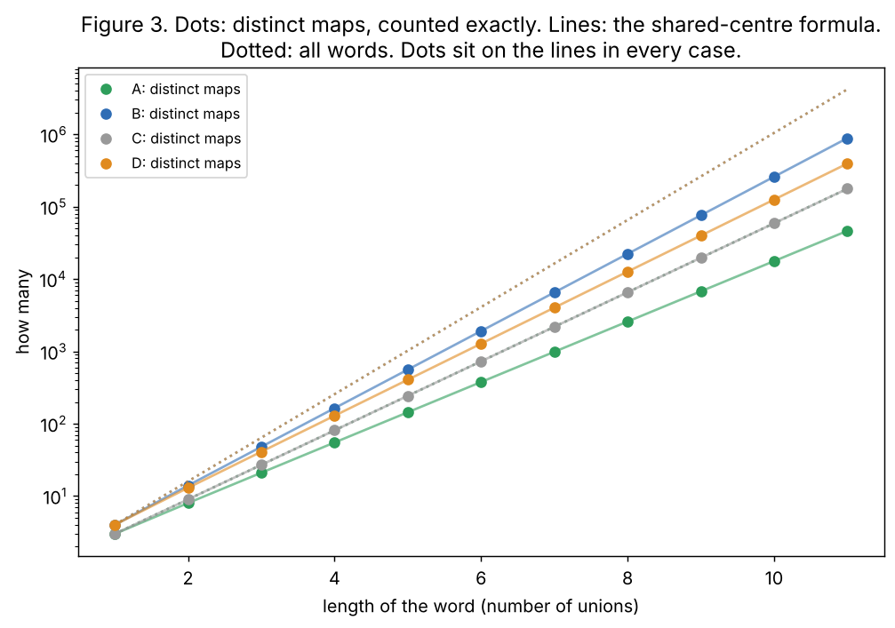

*Figure 3. Dots: distinct maps, counted exactly. Lines: the shared-centre formula. Dotted: all words. In example D only
395,033 of 4,194,304 words of length 11 give different maps.*

### The dimension formula

Weight each map by its shrink factor to the power D and run the same count. The dimension is where the weighted count
stops shrinking, which gives

  **1 + Σ over boxes [ ∏ over that box's maps (1 − sᵢ^D) − 1 ] = 0.**

With one map per box this is exactly Moran's equation Σ sᵢ^D = 1 (check U8). When two or more maps share a box it gives
a smaller number, because those maps stop creating new points when you swap their order.

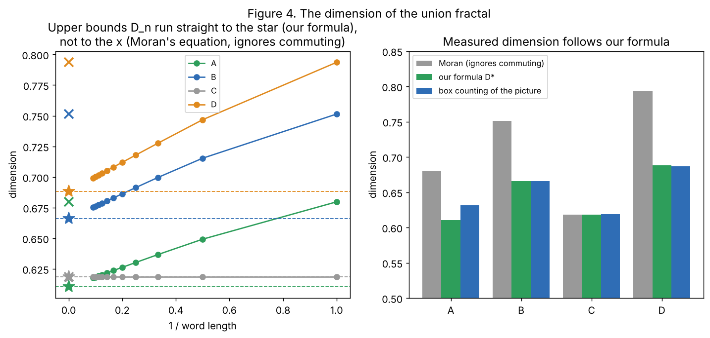

*Figure 4. Left: the upper bounds D_n run straight to our formula (stars) as words get longer, not to Moran's value
(crosses). Right: box counting of the actual picture.*

| Example | Moran (ignores commuting) | Our formula D* | D_n extrapolated | Box counting |
|---|---|---|---|---|
| A: two in box 1, one in box 3 | 0.680 | **0.610** | 0.610 | 0.632 |
| B: two boxes, two maps each | 0.751 | **0.666** | 0.666 | 0.666 |
| C: three boxes, one map each | 0.618 | **0.618** | 0.618 | 0.619 |
| D: three in box 1, one in box 5 | 0.794 | **0.688** | 0.688 | 0.687 |

**What is proved and what is not.** The upper bound is proved: the fractal is covered by its images under the distinct
maps of length n, so its dimension is at most D_n for every n, and D_n falls to D* (checks U9, U10). That the dimension
*equals* D* is supported by the box counts (check U11) and is what Hochman's theorem (Annals 2014) leads one to expect,
since rational data keep distinct maps far enough apart. *Round 2 (section 5) writes that lower bound out.*

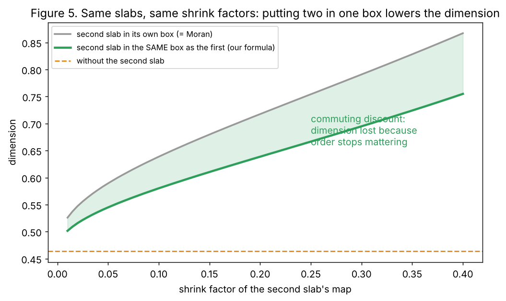

*Figure 5. The commuting discount. Same slabs, same shrink factors: putting the second slab in the first slab's box
(green) instead of its own box (grey) lowers the dimension by up to about 0.1.*

### What it ties together

- **Set operations** give the maps (union in a box) and say what the centre is: the box full.
- **The order dial** says which maps commute: same box.
- **The chaos page's shared-centre rule** gives the count, and with weights, the dimension.
- **The dial audit** says the zoom is the dimension D, the one number the ratio dial r owns. So this is a recipe that
  reads the zoom off the k dial: each box is one value of k, and the pattern of how many maps share each k fixes D.
- **The q switch** fits too: the in-between amounts come in fixed steps from which maps share a box, not from a smooth
  dial.

### Is it a lead?

**A modest lead, worth one more step.** *[Round 8 correction: the formula is in print for generic parameters on the line, Bárány and Verma 2025; see section 12.]* For: it is a closed formula we did not find stated, it is exact where tested,
it predicts a visible effect (the commuting discount), and it is built from base pieces only. Against: it is a special
case of a known general theory (dimension of self-similar sets is set by the semigroup the maps generate, and here that
semigroup is a trace monoid), so it adds a clean formula, not a new mechanism. Next steps, in order: (1) write the lower
bound from Hochman's theorem; (2) put the count and the upper bound in Lean; (3) try the same recipe on the full plane
laws (k and d together), where maps are Möbius rather than straight lines and commute when they share both walls.

## 3. Build 2: what "discriminant 4" means on the Carnot parabola

The Carnot page placed the heat-type low-dissipation engines (Schmiedl and Seifert's η_C/(2 − γη_C)) on the parabola
d = k²/4 − 1 and left one question open: does "discriminant 4" mean anything physical? Read with the curvature dial from
the derived-dial catalogue, −Δ/4, the parabola is the leaf of **curvature exactly −1** (check C1).

That has a plain physical meaning. In the cascade coordinate β = ln(T_hot/T_cold), each of these efficiencies obeys
dη/dβ = ½(1 + kη + dη²) (check C2), and near its limit the gap closes at rate ½√Δ (check C5). With Δ = 4 that rate is 1,
so **every heat-type engine closes in on its limit like e^(−β), the same rate at which Carnot's waste fraction T_cold/T_hot
shrinks** (check C3). Curzon–Ahlborn sits at curvature −1/4 and closes at half that rate (check C4).

*Figure 6. Left: the heat-type engines run along the curvature −1 leaf from parity to velocity addition. Right: their
gaps all fall at Carnot's rate (dashed); Curzon–Ahlborn falls at half rate (dotted).*

**Is it a lead?** No, but it closes the Carnot page's open question with a clear statement: discriminant 4 is "Carnot
speed". It is two lines of calculus once the parabola is known.

## 4. Pairs we looked at that didn't build

- **Fuzzy monogamy with the pair dial.** Read entropies as sizes: each pair of regions gets a pair dial
  k = −I(A:B)/(S_A·S_B), and the triple overlap is the tripartite information I₃. Monogamy then says geometric states
  always have a non-positive triple overlap, so their three-way union never exceeds the one-dial prediction. That is a
  restatement of monogamy (Hayden, Headrick and Maloney 2013), not a new constraint. Reading only.
- **Chaos entropy with the Lee–Yang dial gas.** The shared-centre polynomial μ(t) is the dial gas at k = 0 on the
  "doesn't commute" graph, so its smallest root is a hard-core gas zero. That root is known to be real and dominant
  (Scott and Sokal 2005, cited from memory), so the tie organises but predicts nothing here.
- **Lee–Yang, Klein flow, why-i, E(k).** Each pair shares a theme (sign flips, stopping times) but no construction used
  two of them at once on this pass.

## Assumptions

- Union maps use rational slabs and boxes; distinct composites were counted exactly to length 11 (four families).
- The dimension formula assumes different words give different maps unless commuting forces equality. The chaos page
  showed this can fail at special slopes (an accidental collision at slopes 1/2, 1/3, 1/5); the examples here were
  checked exactly and have none.
- Box counting uses the images of the box-full points under all length-11 maps, at 6 middle scales; it is an estimate.
- The Carnot reading uses the heat-type family exactly as on the Carnot page.

## Known vs new

| Item | Status | Source |
|---|---|---|
| Union in a box, k = −1/M | Ours as stated | `shape-set-operations/` |
| Affine maps commute iff they share a centre | Known | `order-dial/` |
| Trace monoid count, Cartier–Foata polynomial | Known | Cartier and Foata 1969 |
| Exact overlaps and dimension of self-similar sets | Known | Hochman, Annals of Math. 180 (2014); Ngai and Wang 2001 |
| Moran's equation | Known | Moran 1946 |
| Dimension formula 1 + Σ[∏(1 − sᵢ^D) − 1] = 0 for maps sharing centres in classes | ~~Not found in print~~ **[Round 8 correction] Known on the line for generic parameters**: Bárány and Verma, arXiv:2507.05835 (2025); a three-map case in Bárány and Szvák, Math. Nachr. 294 (2021). Our earlier searches missed them. | this page, checks U1–U11; section 12 |
| The commuting discount (Figure 5) | Ours, numerical consequence of the formula | this page |
| Heat-type engines' gap closes at rate e^(−β); discriminant 4 = curvature −1 | Ours; two lines from known forms | this page, checks C1–C5; Schmiedl and Seifert 2008 |
| Monogamy as a non-positive triple overlap | Known (restatement) | Hayden, Headrick, Maloney 2013 |

Searches run (Nov 27): self-similar sets with commuting homotheties and exact overlaps; dimension with Möbius functions
or Cartier–Foata. They found Hochman's work and the exact-overlaps literature, nothing on this class with this formula.

- Hochman, "On self-similar sets with overlaps and inverse theorems for entropy": https://arxiv.org/pdf/1212.1873
- Hochman, ICM survey "Dimension theory of self-similar sets and measures": https://math.huji.ac.il/~mhochman/preprints/icm-4.pdf

---

## 5. Round 2: more rigorous, and more places it applies (DRAFT)

Asked for by Brennan (voice, Nov 27): "let's just keep looking at this and seeing if we can make it more rigorous and
more useful", "when I say more useful, more applicable to other scenarios."

Checks: [`checks2.py`](checks2.py) → [`checks2_output.txt`](checks2_output.txt), **22 of 22 pass**. Numbers:
[`round2.py`](round2.py) → `round2.json`. Pictures: [`figures2.py`](figures2.py). Lean:
[`lean/NewTies.lean`](lean/NewTies.lean), 10 theorems (12 after round 3), core Lean, no `sorry`. Not compiled in the
workspace that wrote it; **compiled clean on Nov 27 in the shared library** as `FusedAlgebra.Topics.NewTies` (namespace
`CircleOp.NewTies`), all 12 theorems including the three `decide` counts, no proof changed.

### The result in plain words

**On the line the formula is now a theorem.** For straight-line shrinking maps with rational (or algebraic) numbers and
no accidental collisions, the fractal's dimension is exactly the smaller of 1 and our D*: the upper bound needs nothing,
and the lower bound comes from a free piece of the fractal plus Hochman's 2014 theorem. **It carries over** to maps that
flip, to turning maps in the plane (numerically), and its counting part to the plane laws (k, d). **One real scenario
fits it exactly:** Rescorla–Wagner learning, and any moving average with several rates, where same-target updates
commute and the learner forgets their order. Still a modest lead: a clean, now-rigorous tool with real uses, not a new
mechanism.

### 5.1 The theorem

**Setting.** Maps fᵢ(x) = cᵢ + sᵢ(x − cᵢ) on the line with 0 < |sᵢ| < 1, sorted into classes by centre (a union in a box is
the case cᵢ = box size, sᵢ = 1 − slab/box). Write Pⱼ(D) = ∏ over class j of (1 − |sᵢ|^D) and
μ(D) = 1 + Σⱼ [Pⱼ(D) − 1]. D* is the root of μ(D) = 0 (at least two classes; one class gives a single point).

**Theorem.** (a) dim K ≤ min(1, D*), always. (b) If every cᵢ and sᵢ is algebraic (for example rational) and different
shared-centre words never give the same map (no accidental collisions), then dim K = min(1, D*).

**Proof of (a).** Maps with one centre commute (Lean `same_centre_commute`), so every word equals a word of the trace
monoid. Weighted Cartier–Foata: Σ over traces g of |s_g|^D·tⁿ⁽ᵍ⁾ = 1/μ_D(t), with μ_D(t) = 1 + Σⱼ[∏(1 − t|sᵢ|^D) − 1].
Each Pⱼ(D) grows with D, so for D > D* we have μ_D(1) > 0; μ_D(t) falls as t grows, so it stays positive on [0, 1] and
the series converges at t = 1. Its tail at length n goes to 0, and the length-n images cover K, so the D-dimensional
measure of K is 0. Hence dim K ≤ D for every D > D*. Collisions only shrink the cover, so (a) needs no assumption.

**Proof of (b), lower bound.** Single out class 1. Let N be the monoid of the other classes, and let S be the set of words
u·v with u a nonempty word in class 1 and v a nonempty element of N. Every element built from S splits uniquely at its
class-1 blocks (normal form in a free product), so S generates a **free** monoid. Take the finitely many generators S_L
up to length L. With no accidental collisions, the IFS S_L has no exact overlaps; its numbers are algebraic; so by
Hochman's theorem (Annals of Math. 180, 2014: on the line, algebraic parameters and no exact overlaps give
dim = min(1, similarity dimension)) its attractor has dimension min(1, s_L), where Σ over S_L of |s_g|^(s_L) = 1. That
attractor sits inside K. As L grows the sum fills out to (1/P₁ − 1)(1/Q − 1), with Q = 1 + Σ_{j≥2}(Pⱼ − 1) from Cartier–Foata
for N (it converges at D* because Q(D*) = 1 − P₁(D*) > 0). Setting it to 1 is the same as P₁ + Q = 1 (Lean
`lower_bound_key`), which is μ(D) = 0. So s_L rises to D*, and dim K ≥ min(1, D*). ∎

*Figure 7. The squeeze, computed. Lower bounds from the free piece (solid) climb and upper bounds (dashed) fall onto the
same line. At L = 10 every lower bound is within 0.0001 of D*. The free piece was checked exactly: e.g. 15,625
words of its generators give 15,625 different maps.*

**What the hypothesis costs.** "No accidental collisions" can fail at special numbers (the chaos page found one at
slopes 1/2, 1/3, 1/5; this round found one among Möbius maps at length 4, check G5). For given rational numbers it can
be checked exactly up to any length, but not for all lengths at once. Kittle and Kogler (2026, reported in search
results, not read) claim the exact-overlaps conjecture on the line, which would remove the "algebraic" condition.

### 5.2 Where it holds

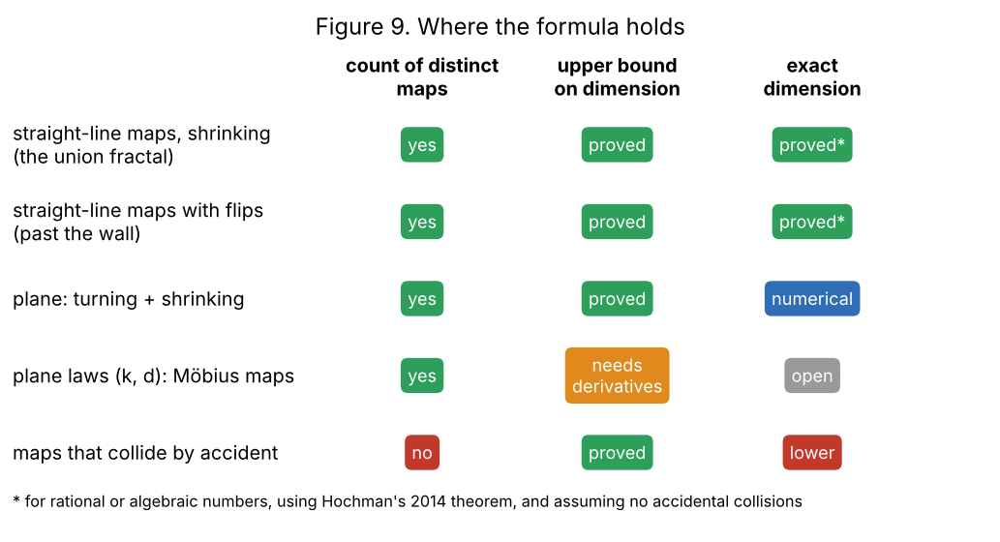

*Figure 9. Green: proved. Blue: numerical. Orange/grey: the formula does not apply as it stands.*

- **Flips (slopes below 0, past the wall).** Nothing changes: use |s|. Count and upper bound checked (G1, G2).
- **The plane.** Turning-and-shrinking maps z ↦ c + λ(z − c) with complex λ commute exactly when they share a centre, so
  the same count and formula hold with |λ| in place of s and min(2, D*) as the cap. Upper bound proved the same way;
  the lower bound needs Hochman's higher-dimensional theorem, whose extra conditions we haven't checked. Numerically it
  fits (Figure 8): D* = 1.191, box counting 1.194, Moran 1.251. [Round 7: the lower bound is now proved; the true dimension
  is between 1.19061 and 1.19064, and exactly D* for a nearby example; see section 11.]
- **Plane laws (k, d).** Each law's maps are Möbius maps fixing that law's two walls, so maps from one law commute and
  the count is the same shared-centre count (G6, two examples). The dimension is not given by this closed formula,
  because Möbius maps don't shrink by one fixed factor; it needs Bowen's equation with derivatives. Open.
- **Commuting that isn't by classes.** For straight-line maps, "commute" is always "same centre", so classes are all
  there is. Maps that commute without being classes (e.g. acting on separate coordinates) need the general
  Cartier–Foata polynomial over the commuting graph; not done.

*Figure 8. Left: the plane version, four maps about three centres; two share centre 0 and one of those also turns.
Right: the dimension follows our formula, not Moran's.*

### 5.3 A real scenario: learning rules and moving averages

The Rescorla–Wagner rule (psychology's standard model of conditioning, also the "delta rule" of machine learning) updates
an associative strength by V ← V + rate·(target − V). That is a stretch about the target with slope 1 − rate: our maps
exactly, with the target as the centre. Trials that aim at the same target commute, whatever their rates; trials aiming
at different targets don't. The same holds for any exponential moving average whose smoothing rate changes.

We tested three trial types: reward with a bright cue (rate 0.8), reward with a dim cue (rate 0.85), no reward
(rate 0.75). Counted exactly: after 11 trials the learner can be in only 46,368 different states, out of 177,147 trial
histories (every other Fibonacci number, S1). So **the learner's state can carry at most 1.39 bits of history per trial,
not log₂3 = 1.58**, and with trials in random order it keeps about 1.28 bits per trial (S2). The reachable strengths
form a fractal of dimension 0.610.

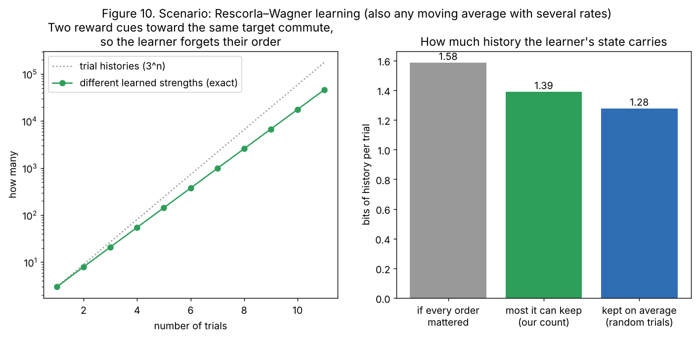

*Figure 10. Left: different learned strengths (exact) against trial histories. Right: bits of history the state can
carry per trial.*

**Why it's useful.** It gives a closed answer to "how much of its past can a moving average or delta-rule learner
remember, and how finely must you read its state to recover it", and it says what helps: giving each update its own
target restores order information; varying only the rate does not. That the order of same-target updates is lost is
elementary; the exact count and the dimension are what the formula adds.

### 5.4 Lead or not

**A modest lead, now on firmer ground.** For: a real theorem on the line (given Hochman), the same picture in the plane,
the counting part for every plane law, and a scenario where it applies exactly. Against: the mechanism is Hochman's and
Cartier–Foata's; ours is the closed formula, the free-piece proof and the reading. Next, if wanted: (1) compile the Lean
file (done: it compiles in the shared library); (2) the plane lower bound via Hochman's higher-dimensional theorem; (3) Bowen's equation for the plane laws, to see
whether the shared-centre count still sets a clean dimension there.

### Known vs new, round 2

| Item | Status | Source |
|---|---|---|
| Hochman's theorem: algebraic parameters, no exact overlaps ⇒ dim = min(1, s-dim) | Known | Hochman 2014 (as stated in his ICM survey) |
| Normal form in free products; Cartier–Foata weighted count | Known | standard; Cartier and Foata 1969 |
| Theorem: dim K = min(1, D*) for shared-centre classes (algebraic, no accidental collisions) | ~~Not found in print~~ **[Round 8 correction] Partly known**: the same formula holds for generic parameters (Bárány and Verma 2025). Ours: the proof route through free first-return pieces, and the exact cases | this page, L1–L4; section 12 |
| Plane version, counting for plane laws | Ours; plane dimension numerical | G3–G6 |
| Rescorla–Wagner as stretches about the target | Known form (Rescorla and Wagner 1972) | — |
| Exact state count and bits-per-trial for mixed-rate learners | Ours (as stated); elementary consequence | S1–S3 |
| Exact-overlaps conjecture on the line | Reported proved, not checked | Kittle and Kogler 2026 (arXiv:2610.10511, from a search result) |

---

## 6. Round 3 (DRAFT): the plane laws, which ones keep the formula

Brennan asked to work out the dimension for the plane laws (k, d) next. This section does that. Everything here is
DRAFT. The checks are in `checks3.py` (18/18 pass, output in `checks3_output.txt`), the numbers in `planelaws.py`
and `planelaws_sweep.py`, the pictures in `figures3.py`.

### 6.1 The answer in two sentences

Laws that share a wall lie on one straight line in the (k, d) plane, and that line touches the border d = k²/4. When all
the maps share their repelling wall (they sit on one such tangent line), the union fractal straightens out into the line
case and the formula D* is exact; when they don't, D* is still a proved upper bound, and the true dimension is lower,
climbing back toward D* as the repelling walls move away.

### 6.2 The setup

A plane law with dials k, d combines a and x as x ↦ (x + a + k·a·x)/(1 − d·a·x). For fixed a that is a Möbius map, matrix
[[1 + k·a, a], [−d·a, 1]]. Its two fixed points, the **walls**, are the roots of d·x² + k·x + 1 = 0, the same for every a.
So every map of one law has the same two walls, one attracting and one repelling. That is the plane-law version of a
shared centre: maps of one law commute, maps of different laws don't (unless they share both walls).

The union rule of rounds 1–2 is the line d = 0, where one wall has gone off to infinity.

### 6.3 Tangent lines (new reading)

Fix a wall w. The laws that have w as a wall are the (k, d) with d·w² + k·w + 1 = 0, a straight line. That line touches
the border d = k²/4 (where the two walls merge) at exactly one point, k = −2/w, d = 1/w² (T1, and Lean `wall_line_tangent`:
k²w² + 4kw + 4 = (kw + 2)²). So:

- **Each wall is a tangent line of the border.** Every law off the border sits on two tangent lines, one for each wall.
- The d = 0 axis is the tangent line "at infinity": the affine laws all share the wall ∞. That is why the line case works.
- Velocity addition (k = 0, d = 1) and the union rule in the unit box (k = −1, d = 0) both lie on the tangent line for the
  wall 1 (T3).

*Figure 11. The (k, d) plane. Grey curve: the border d = k²/4. Coloured lines: laws sharing the wall w, one line per w,
each touching the border once. The horizontal axis d = 0 is the shared wall ∞ (the affine case).*

### 6.4 Result P1: on a common tangent line, the formula is exact

**Statement (DRAFT, ours).** Take several plane laws that share their repelling wall w, with distinct attracting walls,
and any number of maps per law. Change coordinates by y = 1/(x − w). Every map becomes a straight-line map, and its slope
is its multiplier at its attracting wall (T4–T5, exact fractions). So the union fractal is exactly a round-2 union
fractal on the line, and its dimension is min(1, D*) with D* computed from the multipliers, under the same hypothesis as
round 2 (algebraic parameters, no accidental collisions).

**Why.** In the y coordinate the shared wall w goes to ∞, so every map fixes ∞
and is affine. This is standard; what's ours is reading it on the dial plane as "lie on one tangent line".

**Check.** Two laws with repelling wall 3 and attracting walls 1 and −1; the first law gives two maps (multipliers 1/5 and 3/20), the second one map (multiplier 1/4): box count 0.605 vs D* 0.610 (T7). The
cruder bound from the largest derivative gives 0.95 (T8), so the straightening is doing real work.

### 6.5 Result P2: off a common tangent, D* is an upper bound

**Statement (DRAFT, ours).** Take plane laws with different repelling walls. Suppose that for each law no attracting wall
lies between its attracting wall and its repelling wall (with two laws: the repelling walls sit on opposite sides,
each beyond its own attracting wall). [Round 4 note: wording tightened; with a third law whose attracting wall sits in
the middle, a map can stretch by more than its multiplier and D* is no longer a ceiling.] Then on that hull every map
contracts by at most its multiplier at its attracting wall, so dim ≤ min(1, D*) (T10, from
f′(x) = λ·(f(x) − q)² / (x − q)², with q the repelling wall).

The count of distinct composites is still the shared-centre count from round 1 (T6, T9), so only the sizes change, not
the combinatorics. The true dimension is the critical exponent of the Poincaré series over the trace monoid (Bowen's
equation). There is no closed form; we computed it.

| Repelling walls | Measured dim (box) | Poincaré estimate D_n | D* (upper bound) |
|---|---|---|---|
| ±2 | 0.395 | 0.396 | 0.610 |
| ±3 | 0.445 | 0.454 | 0.610 |
| ±12 | 0.555 | 0.568 | 0.610 |
| shared (3) | 0.605 | — | 0.610 |

Sweep (T12): same maps, first law repelling from q and second from −q, D_n = 0.340, 0.392, 0.451, 0.507, 0.545, 0.567, 0.587, 0.602, 0.612 for
q = 1.5, 2, 3, 5, 8, 12, 20, 40, 100. It climbs to D* as the walls move to infinity, which is the line case again.

*Figure 12. Left: two union fractals with the same multipliers and the same attracting walls 1 and −1. Top: both laws
repel from 3 (shared wall, formula exact). Bottom: they repel from 3 and −3 (no shared wall, smaller). Right: dimension
against how far the repelling walls ±q are, rising toward the formula's value, which is the upper bound.*

### 6.6 What this means in plain terms

The shared-centre count (how many different results you can get) works for every plane law. The size formula works
exactly when everything is pushed away from one common point, which on the dial map means "all on one tangent line". When
the maps are pulled toward different points, the pieces bend and get smaller than the formula says, by an amount that
depends on how close those points are. The formula is then a ceiling, not the answer.

### 6.7 Lean

Two more identities are in `lean/NewTies.lean`: `fixes_wall` (the map fixes w exactly when d·w² + k·w + 1 = 0) and
`wall_line_tangent` (the wall line touches the border). That makes 12 theorems in the file (13 after round 4). **Compiled clean on Nov 27 in the shared library** build (`FusedAlgebra.Topics.NewTies`), and the topic file itself is built by CI's topic Lean step. **[Round 5: all theorems build, see 8.3.]**

### 6.8 Lead or not

**The lead continues, modestly.** For: a clean, checkable classification of which plane laws keep the formula (exact on a
common tangent line, upper bound off it), and the tangent-line picture is a new and simple way to read the (k, d) map.
Against: the straightening is a standard Möbius fact, and off the tangent line there is no closed formula, only a bound
and numbers. Next, if wanted: (1) prove the lower bound off the tangent line (it needs a nonlinear version of Hochman's
theorem, which exists for some analytic families); (2) the plane lower bound for complex similarities.

### Known vs new, round 3

| Item | Status | Source |
|---|---|---|
| Möbius maps with a common fixed point conjugate to affine maps | Known | standard |
| Bowen's equation / Poincaré critical exponent for conformal IFS | Known | Bowen 1979; Mauldin and Urbański |
| Laws sharing a wall lie on a tangent line of d = k²/4 | **Ours** (elementary) | T1, `wall_line_tangent` |
| P1: exact formula on a common tangent line | **Ours** (from round 2 + standard conjugation) | T4–T7 |
| P2: D* upper bound off the tangent line, numbers and sweep | **Ours** (bound proved, values numerical) | T9–T12 |

---

## 7. Round 4 (DRAFT): the true dimension off the tangent line

Brennan asked to prove the true size off the tangent line, where round 3 had only a ceiling and numbers. This section
does it. Everything here is DRAFT. Checks: `checks4.py` (13/13 pass, output in `checks4_output.txt`). Bounds:
`offline.py`. Level-n cross-check: `dn_levels.py`. Pictures: `figures4.py`. Lean: one more
theorem, `two_law_threshold`, in `lean/NewTies.lean` (13 in all), compiled clean on Nov 27 in the shared library.

### 7.1 The answer in two sentences

Off the tangent line the dimension is still set by the shared-centre count, but each word is weighted by how much it
really stretches instead of by its multipliers; that is a theorem, resting on a 2021 theorem of Solomyak and Takahashi.
We can compute that number with proved bounds to within 0.002, and it is always strictly below the line-case formula:
0.381 at walls ±2, 0.441 at ±3, 0.559 at ±12, against 0.610.

### 7.2 Result P3: what the dimension is (DRAFT, ours, conditional)

**Setting.** Plane laws, each with an attracting wall and a repelling wall, any number of maps per law, all multipliers
positive. Let M be the trace monoid of round 1 (maps of one law commute, different laws don't). For a word w in M let
f_w be its map and ‖f_w′‖ the largest stretch of f_w on the hull of the attracting walls. Define

  **δ = the critical exponent of Σ_{w ∈ M} ‖f_w′‖^t** (the t where this sum switches from infinite to finite).

**Hypotheses.** (H1) the laws' dials and the maps' parameters are algebraic numbers; (H2) there is a closed interval V
with every attracting wall inside it and every repelling wall outside it (each map then sends V strictly inside itself);
(H3) no accidental collisions: different words of M give different maps; (H4) at least two laws.

**Statement.** dim K = min(1, δ).

**Proof (four steps).**

1. *Upper bound.* K is covered by the images of the hull under the distinct words of length n. Möbius maps that send V
   inside itself have bounded distortion on the hull (their poles stay outside V), so each image has length at most a
   fixed constant times ‖f_w′‖. For t > δ the sum converges, so its tail goes to 0 and the t-dimensional measure of K
   is 0. So dim K ≤ δ. (Standard covering argument.)
2. *Free pieces.* Use round 2's first-return pieces: S = {u·v : u a nonempty word of law 1, v a nonempty word in the
   other laws}. They generate a free monoid inside M (round 2, combinatorial), and every word of M splits uniquely as
   (other-law prefix)·(word in S)·(law-1 suffix). Because the maps preserve V, their matrices preserve a cone strictly,
   so stretches multiply up to fixed constants (standard quasi-multiplicativity). The two outer factors have smaller
   critical exponents (law 1 alone: 0; the other laws: at most that of S, because S contains u·v for every v), so
   **δ = the critical exponent of the free monoid generated by S**.
3. *Finite pieces.* Let S_L be the pieces with u and v of length at most L. Their critical exponents δ_L increase to δ.
   This is the finite-approximation property of pressure for infinite conformal systems (Mauldin and Urbański 1996). It
   uses only bounded distortion, not any separation condition.
4. *The cited theorem.* Normalise each matrix of S_L by the square root of its determinant (positive by assumption): the
   entries stay algebraic. By (H3) and step 2 the matrices generate a free semigroup. They send V strictly inside itself
   (a strictly invariant cone, i.e. uniform hyperbolicity), and the attractor is not a point (H4). Solomyak and
   Takahashi (IMRN 2021, Theorem 1.7, with their remark that algebraic entries plus a free semigroup give the strong
   Diophantine property) then give dim K_L = min(1, δ_L), where their s_A/2 is our δ_L. Since K_L ⊂ K,
   dim K ≥ min(1, δ_L) for every L, so dim K ≥ min(1, δ). ∎

**Who proved what.** Steps 1–3 are standard tools; step 4 is Solomyak and Takahashi's theorem, applied to pieces that only
our round-2 construction makes free. The statement for shared-centre plane laws, and the reduction, are ours. We read
their abstract and the statement of Theorem 1.7 and the algebraic remark (arXiv:1902.11059); we did not check their proof.
Christodoulou and Jurga (Trans. AMS 2026) extend that theorem; we did not read it. (H3) is checked, not proved: the 10
pieces of S_2 at walls ±3 give 1000 different maps for their 1000 words of length 3 (U3). [Round 5: now checked to length 14 for these examples, and proved for a family, see 8.2.]

On the tangent line δ equals D* (round 3, P1), so P3 contains P1. In the line case (affine maps) it is round 2's theorem.

### 7.3 Result P4: computing δ, with proved bounds (DRAFT, ours)

A word of M is a chain of **blocks** (maximal runs of one law). A block of law i with multiplier λ, applied at a point y,
stretches by exactly

  **λ · ((1 − z)/(1 − λz))²**, where z = (y − p)/(y − q) for that law's walls p, q (U1, exact fractions).

So it gets its full multiplier only at its own attracting wall (z = 0), and less the further away it works. After a switch,
a law's block always receives its input from the previous law's block, which has pushed the point toward the *other*
attracting wall. At walls ±3, law 1 blocks only ever receive points in [−1, −0.71] and law 2 blocks only in [0.78, 1]
(Figure 14). Bounding each block's factor above and below by the extreme z over where it can receive points (remembering
the previous block's law and size) gives two switching matrices; δ lies between the t-values where their spectral
radius is 1. With two laws and no memory this is the round-2 rule x₁·x₂ = 1 (Lean `two_law_threshold`).

**Statement.** Under the round-3 P2 geometry (for each law no attracting wall lies between its two walls), δ is strictly
below D* whenever the laws don't all share their repelling wall, and the bounds below are proved.

| Repelling walls | Proved bracket for δ | D* (line case) | Level-n estimate, extrapolated |
|---|---|---|---|
| ±2 | 0.3812 to 0.3817 | 0.6104 | 0.382 |
| ±3 | 0.4407 to 0.4417 | 0.6104 | 0.441 |
| ±12 | 0.5583 to 0.5597 | 0.6104 | 0.559 |
| ±10⁷ | 0.61037 (closes) | 0.6104 | — |

**What makes the bracket a proof.** The block formula is exact; the input regions are outer bounds (iterated to a fixed
point, and checked on 900 random words, U4); sums are cut at block degree 40 with the tail bounded by the pure-multiplier
tail; and a larger matrix gives a larger spectral radius (Perron–Frobenius). Strictness: every switch costs a factor
below 1 on an irreducible matrix, so the spectral radius at D* is below 1. Caveat: the arithmetic is double precision, not
interval arithmetic; the bracket widths are far larger than rounding, but an interval-arithmetic rerun would make it
airtight. [Round 5: done, see 8.1. The certified brackets are a hair wider.]

**Cross-check.** The direct level-n estimates fall slowly, roughly like 1/n (at ±3: 0.459 at n = 7, 0.450 at n = 14).
Extrapolating linearly in 1/n lands inside or within 0.002 of every bracket (U6). The round-3 box counts (0.395, 0.445,
0.555) sit a little high or low for the same finite-resolution reason; the brackets replace them.

*Figure 13. The thin blue band is the proved bracket for the true dimension, against how far away the repelling walls
are. Dashed: the line-case formula, which is the ceiling. Orange: box counts. Grey: level-n estimates from n = 7 down
to n = 14, still falling toward the band.*

*Figure 14. Why bent maps make a smaller fractal (walls ±3). Top: where each law's blocks receive their points, always
on the far side, near the other law's wall. Bottom: the stretch a block achieves divided by its multiplier, by where it
is applied. It is 1 only at its own wall and well below 1 in the shaded regions where blocks really work.*

### 7.4 What this means in plain terms

The count of different outcomes is the same everywhere: the shared-centre count from round 1. What changes off the
tangent line is how big each outcome's piece is. Each law does its work on points the other law has just pulled away, so
it never gets to stretch fully, and the fractal is thinner. Now that thinning has an exact meaning and can be computed
to three decimals with a proof.

### 7.5 Lead or not

**Still a lead, and a better-founded one.** For: the dimension of every shared-centre union fractal on the line and for
plane laws is now characterised by one theorem (exact formula on a tangent line, a computable critical exponent off it,
with proved brackets), and the shared-centre count is what feeds both. Against: the hard analysis is Solomyak and
Takahashi's and Hochman's; ours is the construction that makes their theorems apply, the formulas, and the computations.
Next, if wanted: (1) rerun the brackets in interval arithmetic; (2) prove (H3) for a family, not just check it; (3) the
plane (complex) lower bound, which needs a different cited theorem.

### Known vs new, round 4

| Item | Status | Source |
|---|---|---|
| dim = min(1, critical exponent) for free algebraic SL₂ projective systems with an invariant interval | Known | Solomyak and Takahashi, IMRN 2021, Thm 1.7 (statement read, proof not checked) |
| Finite approximation of pressure for infinite conformal systems | Known | Mauldin and Urbański 1996 |
| Bounded distortion, cone quasi-multiplicativity, covering upper bound | Known | standard |
| P3: dim K = min(1, δ) for shared-centre plane laws via free first-return pieces | **Ours** (conditional on the cited theorem and H1–H4) | 7.2 |
| Block stretch formula λ((1−z)/(1−λz))² | Elementary | U1 |
| P4: proved brackets, strictly below D* off the tangent line | **Ours** (double precision) | U4–U9, `offline.py` |

---

## 8. Round 5 (DRAFT): airtight bounds, no collisions proved for a family, Lean builds

Brennan asked to make the bounds airtight. Checks: `checks5.py` (14/14 pass, output in `checks5_output.txt`).

### 8.1 Certified brackets

`exact_bounds.py` redoes section 7.3 so that no rounded number enters a claimed inequality. Walls, multipliers, block
multipliers, input regions and z-ranges are exact fractions (regions rounded outward, which only widens them). Powers
and sums use ball arithmetic (python-flint's arb, 128 bits), which returns guaranteed enclosures. The spectral-radius
claims are certified by a test vector v > 0 (the Collatz–Wielandt test): if T·v < v in every entry, the spectral radius
is below 1 and the sum converges; if T·v > v in every entry, it is above 1 and the sum diverges.

| Repelling walls | Certified bracket for δ | Round 4 (double precision) | D* |
|---|---|---|---|
| ±2 | **0.3810 to 0.3818** | 0.3812 to 0.3817 | 0.6104 |
| ±3 | **0.4405 to 0.4418** | 0.4407 to 0.4417 | 0.6104 |
| ±12 | **0.5581 to 0.5599** | 0.5583 to 0.5597 | 0.6104 |

That D* lies above each upper end is certified too (the shared-centre function is negative there, V1).

### 8.2 No accidental collisions: proved for a family (DRAFT, ours)

Theorem P3 needed (H3): different words give different maps. Two things are now known.

**For the round-4 examples it holds up to length 14.** All 832,040 maps of length 14 are different at walls ±2, ±3 and
±12. Checked by exact arithmetic modulo the prime 2⁶¹ − 1: maps that differ there differ for real, and the count can
never exceed the shared-centre count, so equality rules collisions out (`collisions_modp.py`, V6). This is a check to
length 14, not a proof for all lengths.

**For a family it is proved, by a two-prime ping-pong.** Criterion: rational walls and multipliers, and primes p₁, …, p_r
such that

1. every multiplier has negative p-adic valuation for each chosen prime, so in the p-adic numbers every block pulls
   *toward its repelling wall*;
2. within each law, the valuation vectors of its multipliers are linearly independent;
3. for each chosen prime there are disjoint p-adic balls U_i around the repelling walls such that every law-i block sends
   every other U_j, and a base point x₀, into U_i (an exact check, `pingpong.py`).

**Proof.** Suppose two different words give the same map; take a shortest such pair. Evaluate at x₀ in the p-adic
numbers: a word lands in the ball of its outermost law, so both outermost blocks have the same law i. If the two
blocks have the same multiplier, they are the same map, and by (2) the same block, so cancel them and get a shorter
pair. Otherwise their ratio C is a law-i map other than the identity. By (2) some chosen prime gives C a nonzero
valuation, so C or its inverse pulls p-adically into U_i. But the two remainders start in another law, so they land in
some U_j (j ≠ i), or stay at x₀. Neither is in U_i: a contradiction. ∎

**Example where everything holds.** Walls ±21/5 (law 1: attracting 1, repelling 21/5; law 2: attracting −1, repelling
−21/5), law-1 multipliers 5/18 and 5/24, law-2 multiplier 7/24, primes 2 and 3, base point 0. The criterion holds exactly
(V2). The valuation step is Lean `valuations_separate`. So (H1)–(H4) all hold, and Theorem P3 gives, resting only on the
cited theorems:

  **dim K is between 0.5551 and 0.5585** (certified, V5), against the line-case formula D* = 0.7236.

This is the first union fractal off the tangent line whose dimension is pinned down with no unchecked assumption of
ours. The round-4 examples (multiplier 1/5 has no 2-adic pull) are not covered by this criterion. [Round 6: walls ±2 and ±12 are now proved by another 2-adic argument, and walls ±3 for a large free part; see section 10.]

### 8.3 Lean builds

The Lean toolchain could be downloaded this time (from GitHub releases; the lean-lang.org host is still blocked).
`lean/NewTies.lean` builds with Lean 4.37.0-rc1, the repo's pinned version: **16 theorems, no errors, no sorry, only the
standard axioms** (propext, Classical.choice, Quot.sound). Output in `lean/compile_output.txt` (V7). New this round:
`valuations_separate`, `xor_is_half_box_union`, `and_from_or`.

### 8.4 Who proved what, round 5

Ball arithmetic is python-flint's; the Collatz–Wielandt test and p-adic ping-pong are standard tools. The certified
numbers, the criterion and its proof, and the fully covered example are ours (DRAFT). Theorem P3 still rests on
Solomyak and Takahashi's theorem, whose proof we did not check.

---

## 9. Round 5 (DRAFT): is there a family? Intersect, disjoint and XOR fractals

Brennan asked: "Is this possibly a new family of objects? Intersect fractal… disjoint fractal?" Script: `boolean.py`.
Checks V8–V12.

### 9.1 The answer in two sentences

They're one family, not several: intersect, union and symmetric difference each pull a set's density toward a fixed
point (empty, full and half), so mixing them gives exactly our union fractal with centres at 0, 1 and 1/2. A disjoint
fractal doesn't exist, because adding without overlap is a plain shift with no fixed point, so nothing shrinks.

### 9.2 The Boolean reading

Let X be a random set of density x in a box of size 1, and A an independent random set of density a. Any Boolean
combination f(X, A) has a density that is a straight-line function of x. Of the 16 possible f, 12 depend on x. Each of
those pulls x toward a point, its centre. Exactly **7** have a centre that does not move with a (V8):

| Step | New density | Pulls toward |
|---|---|---|
| X AND A (intersect), X AND NOT A (difference) | a·x, (1 − a)·x | 0, empty |
| X XOR A, X XNOR A (symmetric difference) | a + x − 2ax, 1 − a − x + 2ax | 1/2, half |
| X OR A, X OR NOT A (union) | a + x − ax, 1 − a + ax | 1, full |
| NOT X (complement) | 1 − x | 1/2, but it doesn't shrink |

Steps with the same centre commute, steps with different centres don't (round 1). So repeated random AND/OR/XOR steps
are a union fractal with up to three centres, and every theorem from rounds 1–4 applies as it stands (XOR with a > 1/2
flips, which round 2 already covered). The other four steps (NAND, NOR and two more) have centres that move with a, so
they don't commute with each other and fall outside the family.

*Figure 15. For each Boolean step that keeps x, the density it pulls toward, against the density a it combines with.
Thick lines: the steps whose target never moves (empty, half, full). Dashed: steps whose target moves with a.*

### 9.3 How the combining rules fit together

- **XOR is union in a smaller box.** In a box of size 1, XOR with density a is a + x − 2ax, which is exactly union in a
  box of size 1/2 (Lean `xor_is_half_box_union`). In the fused law a ∘ₖ b = a + b + k·ab, union in a box of size M is
  k = −1/M, so XOR is k = −2. Every k < 0 is union in a box of size −1/k; k > 0 works the same way with negative
  parameters (centre −1/k below zero).
- **Intersect is union seen from the outside.** By De Morgan, intersecting with density a is complement, then union
  with density 1 − a, then complement (Lean `and_from_or`). It is not one rung up after all: as a step on densities it is
  the same kind of map, centred at the empty set.
- **All of them are multiplication in disguise.** Every fused law turns into plain multiplication in the coordinate
  u = 1 + kx (V9). That is why each one is a stretch about one point.
- **Disjoint union (k = 0) gives no fractal.** It is x ↦ x + a, a shift with slope 1. Shifts never shrink, have no fixed
  point, and repeated shifts run off to infinity. So there is no attractor (V9).

### 9.4 Examples

- **Union plus intersect is round 1's example A.** OR with densities 4/5 and 17/20 plus AND with 1/4 is example A moved
  by y = (3 − x)/2: the same counts to length 11 and the same D* = 0.610 (V10). So the dimension theorem of round 2
  applies to it as it stands.
- **All three.** OR with 4/5 and 17/20, AND with 3/13, XOR with 9/22 and 15/26: D* = 0.901. The densities reachable match
  the shared-centre count up to 8 steps; at 9 steps there are two fewer than the count, from accidental collisions (V12).
- **Collisions come from parameter coincidences, not from a rule.** With simple slopes they are common. For example
  OR with slope 1/5 and XOR with slopes 1/6 and 1/7 collide at 4 steps because r·s₁·s₂ − r·s₂ + s₁ − s₂ = 0 for those
  numbers (V11). Where collisions happen, D* is only a ceiling. So for the XOR member, the no-collision condition is a
  real hypothesis to check case by case.

*Figure 16. The densities a set can reach by repeated random Boolean steps. Top: union and intersect (round 1's example A
after a shift). Bottom: union, intersect and XOR together. Dotted lines: the three centres, empty, half and full.*

### 9.5 New family, renaming, or a mix?

**A mix, and mostly a renaming.** The objects are the union fractals of round 1. Intersect and XOR fractals are members,
just with the centre at empty or half, and the disjoint fractal does not exist. What is new (as far as one literature
search shows) is the Boolean reading: exactly which set operations generate union fractals (the seven fixed-centre steps
above), and that XOR is union in a half-size box. The fair-coin case (AND and OR with density 1/2 give x/2 and (x + 1)/2)
is binary expansion, which is classical; its D* is 1 and its attractor is all of [0, 1].

**Lead or not.** This is not a lead by itself. It is a useful reading that widens where the theorem applies: any process
that repeatedly mixes a quantity with fresh independent pieces by AND, OR or XOR (masks, dropout-style corruption,
coverage, random sets) has a union-fractal state space, with the exact count and dimension from rounds 1–5.

### Known vs new, round 5

| Item | Status | Source |
|---|---|---|
| Ball arithmetic; Collatz–Wielandt test; p-adic ping-pong | Known tools | python-flint/arb; standard |
| Certified brackets for δ | **Ours** | 8.1, V1, V5 |
| Two-prime ping-pong criterion for no collisions, and its proof | **Ours** (DRAFT) | 8.2, V2 |
| Fully covered example: dim between 0.5551 and 0.5585 | **Ours**, resting on Solomyak–Takahashi | 8.2, V5 |
| Lean file builds (16 theorems) | Done | 8.3, V7 |
| Densities of Boolean combinations of independent sets are affine | Known (elementary probability) | — |
| The seven fixed-centre Boolean steps; XOR = union in a half box; the Boolean family = union fractals | **Ours** (elementary; not found in one search) | 9.2–9.3, V8–V9 |
| Fair coins give binary expansion | Known | classical |

---

## 10. Round 6 (DRAFT): no accidental collisions for the original examples

Brennan said "Yes, prove it": prove that different words never give the same map for the original examples (walls ±2,
±3 and ±12), not only for the round-5 family. Script: `nocollide.py`. Checks: `checks6.py`, 13/13 (V1–V11). Figures
17–18. Lean: six more theorems, 22 in all, all build.

### 10.1 The answer in two sentences

At walls ±2 and ±12 it is now proved for every word: different words always give different maps, so those two
dimensions (0.3810 to 0.3818 and 0.5581 to 0.5599) rest only on the cited theorem. At walls ±3 it is proved for a large
part of the system, which proves the dimension is between 0.426 and 0.4418; whether it holds for every word at ±3 is
still open (no collisions up to length 14).

### 10.2 The examples, and the first two steps (all three walls)

Law 1 has walls 1 (attracting) and Q (repelling) and letters a, b with multipliers 1/5 and 3/20. Law 2 has walls −1 and −Q
and one letter c with multiplier 1/4. In the coordinate z₁ = (y − 1)/(y − Q) a run of law 1 is z₁ ↦ λz₁, and in
z₂ = (y + 1)/(y + Q) a run of law 2 is z₂ ↦ 4^(−k) z₂. Words are runs alternating between the laws; a and b commute.

Suppose two different words give the same map, and take a shortest such pair.

1. **The last run (the one applied last) has the same law in both words.** Every law-1 run sends [−1, 1] into
   J₁ = [7/9, 1] (walls ±3; [11/13, 1] at ±2, [41/63, 1] at ±12) and every law-2 run into J₂ = [−1, −5/7]. These are
   disjoint and miss 0, so evaluating at 0 tells which law came last (V1).
2. **Cancel.** If both last runs are law 2, they are powers of c; take one c off both and get a shorter pair. If both are
   law 1 and both contain an a (or both a b), take it off. So in a shortest pair the last runs are a^α and b^β with
   α, β ≥ 1, and what's left, u₁ and u₂, ends in law 2 (or is empty). The two maps differ by the ratio map C, which
   multiplies z₁ by ρ = 5^α · (3/20)^β. (If one remainder is empty, evaluating at 1 gives a contradiction: C fixes 1,
   but a word ending in law 2 sends 1 into J₂.)

So everything comes down to showing u₁ and u₂ can't satisfy u₁ = C ∘ u₂.

### 10.3 Theorem P5: every even Q, all words (DRAFT, ours)

**Statement.** For every even whole number Q ≥ 2 (so walls ±2 and ±12), different words of the trace monoid give
different maps.

**Proof of the last step.** Work in the 2-adic numbers and start every word at the point −Q. Let κ = 4Q/(Q + 1)², the
cross-ratio of the four walls. For even Q, κ is divisible by 8 and 1 − κ is a 2-adic unit (Lean `even_Q_square_odd`;
V3 checks every even Q to 40, and that no odd Q passes). Then three facts hold:

1. Every law-1 run keeps the point from coming 2-adically close to −1. Runs containing b multiply z₁ by at least 4 in
   2-adic size, which puts the point at a fixed 2-adic distance from −1. A run of a's alone multiplies z₁ by
   5^(−α) ≡ 1 (mod 4), which barely moves it (Lean `five_pow_mod_four`).
2. Every law-2 run then multiplies z₂ by at least 4 in 2-adic size, so it pulls the point into a small 2-adic ball
   around −Q.
3. On that ball z₁ has one fixed 2-adic size.

So every word that ends in law 2, and the empty word, sends −Q to the same 2-adic level of z₁ (Figure 17). But C
multiplies z₁ by ρ, whose 2-adic size is 4^β with β ≥ 1. So u₁(−Q) and C(u₂(−Q)) are on different levels, which
contradicts u₁ = C ∘ u₂ (Lean `levels_differ`). ∎

V4 checks the single level directly on all 1,188 words with up to four runs at Q = 2, 4, 6 and 12.

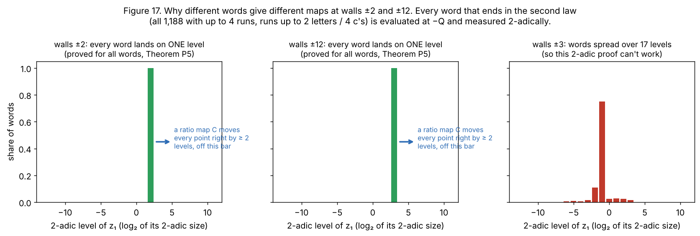

*Figure 17. Each bar is the share of words (ending in the second law) that land at a given 2-adic level of z₁ when started
at −Q. At walls ±2 and ±12 every word lands on one level, and the ratio map C moves any point at least two levels to
the right, so two different words can never agree. At walls ±3 the words spread over 17 levels, so this proof can't
work there.*

### 10.4 Walls ±3: what's proved, and what's in the way

**Why the 2-adic proof fails at ±3.** For odd Q the cross-ratio κ is not divisible by 2 (at ±3, κ = 3/4). A run with
exactly one b can then put the point arbitrarily close to −1 in the 2-adic sense, because the powers 5^(−α) come
arbitrarily close to any number that is 1 mod 4. The next law-2 run then sends it to almost any 2-adic level (V5,
Figure 17, right).

**Theorem P6 (walls ±3, DRAFT, ours).** Different words give different maps whenever every law-2 run other than the last-applied run
is either odd, or even with a length not divisible by 10 and sitting directly on a law-1 run of at least two letters.

**Proof of the last step.** Two places do the work.

- **5-adic.** The four walls are different mod 5. Every law-1 run multiplies z₁ by at least 5 in 5-adic size, so it lands
  5-adically near 3. An odd c-run multiplies z₂ by 4^(−k) ≡ −1 (mod 5) (Lean `four_pow_odd_mod_five`), which sends
  points near 3 to points near infinity, where z₁ has 5-adic size 1 (V6). An allowed even c-run multiplies z₂ by a number
  that is 1 mod 5 but not mod 25 (Lean `four_pow_even_mod_five`), which leaves z₁ at size exactly 5 because the run
  underneath moved it at least two levels. So every allowed word ending in law 2, started at −3, lands at 5-adic size 1
  or 5 (V7 checks this on every allowed word with up to four runs). C multiplies z₁ by 5-adic size 5^(β−α), so if α and
  β differ by 2 or more, the two sides can't agree.
- **Real.** If α and β differ by at most 1, then ρ is (3/4)^β, 5·(3/4)^β or (3/4)^β/5. For u₁ = C ∘ u₂, ρ would have to
  lie between 12/13 and 13/12, because both sides land in J₂, where z₁ only ranges from 6/13 to 1/2. None of the three
  families ever does: 5·(3/4)⁵ ≈ 1.19 and 5·(3/4)⁶ ≈ 0.89 straddle the window (V2, Lean `window_miss`). ∎

Without the restriction the 5-adic levels spread too. For example, b followed by c⁸ lands at size 25 and b followed by
c¹⁸ at size 125 (V8).

**What this proves about the dimension.** Pieces made of one law-1 run followed by one allowed law-2 run form a free
system (P6), with the same walls and algebraic numbers, so Theorem P3 applies to it as it stands. Its fractal sits inside
the full one. Rerunning the certified lower bound of round 5 with the excluded runs left out gives

  **dim K at walls ±3 is at least 0.426** (213/500, certified by a Collatz–Wielandt vector in ball arithmetic, V9),

with no assumption of ours. The upper end, 0.4418, never needed the no-collision condition. Allowing every even run would
give 0.4405, the round-5 lower end, so the excluded runs account for the whole gap.

**What's still open at ±3.** Whether every word at ±3 gives a different map. Any collision would have to use the
excluded pattern (an even c-run on a single letter, or a c-run whose length is a multiple of 10) somewhere before its last run, and
none exists up to length 14 (round 5, V10). The 2-adic obstruction above is real. Exponents can be tuned to make 2-adic
coincidences arbitrarily good, so a proof for all words at ±3 would need a new idea, not a longer computation. This has
the flavour of known hard freeness problems for 2×2 rational matrices. We have not found it in print for this family.

### 10.5 The original examples' dimensions, as they stand now

| Walls | Proved (resting only on Solomyak–Takahashi) | If no collisions at ±3 | Line-case formula D* |
|---|---|---|---|
| ±2 | **0.3810 to 0.3818** | — | 0.6104 |
| ±3 | **0.426 to 0.4418** | 0.4405 to 0.4418 | 0.6104 |
| ±12 | **0.5581 to 0.5599** | — | 0.6104 |

*Figure 18. Green: what is now proved with no assumption of ours. At ±2 and ±12 the bands are the round-5 certified
brackets, made unconditional by Theorem P5. At ±3 the lower end comes from the free part of the system (Theorem P6).
Orange: the tighter ±3 range that would follow from no collisions at ±3.*

### 10.6 Lead or not

**A consolidation, not a new lead.** For: two of the three original examples now have fully proved dimensions. The proof
is short (real ping-pong, cancellation, one 2-adic level). It covers every even Q at once, and the third example is pinned
within 0.016. Against: it is specific to these multipliers. The open case at ±3 looks hard, and solving it would only
tighten one number by 0.015.

### 10.7 Lean

`lean/NewTies.lean` now has 22 theorems and builds with Lean 4.37.0-rc1, with no sorry and standard axioms only. Output
is in `lean/compile_output.txt` (V11). New this round: `five_pow_mod_four`, `even_Q_square_odd`, `levels_differ`,
`four_pow_odd_mod_five`, `four_pow_even_mod_five` and `window_miss`. They cover the arithmetic steps. The p-adic geometry
is in the prose proof, and core Lean has no p-adic numbers.

### 10.8 Who proved what, round 6

Real and p-adic ping-pong are standard tools. Theorem P5 and its proof, Theorem P6 and its proof, and the certified
lower bound at ±3 are ours (DRAFT). The dimension statements still rest on Solomyak and Takahashi's theorem
(IMRN 2021), whose proof we did not check.

### Known vs new, round 6

| Item | Status | Source |
|---|---|---|
| Ping-pong in the reals and p-adics | Known tools | standard |
| No collisions at walls ±2, ±12 (every even Q) | **Ours** (DRAFT) | 10.3, V3–V4 |
| No collisions at walls ±3 for the allowed class | **Ours** (DRAFT) | 10.4, V6–V8 |
| Dimension at ±3 at least 0.426, unconditional | **Ours**, resting on Solomyak–Takahashi | 10.4, V9 |
| No collisions at ±3 for every word | Open (checked to length 14) | 10.4, V10 |

---

## 11. Round 7 (DRAFT): the true size of the plane union fractal

Brennan said "Let's keep going!", and the biggest open piece was the plane (complex) union fractal of round 2, whose
size was only estimated at about 1.19. Script: `plane.py` → `plane.json`. Checks: `checks7.py`, 14/14 (W1–W13).
Figures 19–22. Lean: seven more theorems, 29 in all, all build.

### 11.1 The answer in two sentences

The original plane union fractal's dimension is now proved to lie between 1.19061 and 1.19064, a range under 0.00003
wide that sits right under the formula's D* = 1.190636. For a nearby example (classes 2 and 3 shrink by 3/10 instead of
1/3) the dimension is proved to equal the formula exactly, D* = 1.12928, with every step proved.

### 11.2 The examples and the theorem

Maps z ↦ c + λ(z − c) turn and shrink about a centre c; maps with the same centre commute, maps with different centres
don't. The words are the trace monoid M = ℕ² ∗ ℕ ∗ ℕ: runs alternating between three classes.

| Class | Centre | Original (round 2) | Modified (round 7) |
|---|---|---|---|
| 1 | 0 | a: (1+i)/4 (turns 45°), b: 3/10 | same |
| 2 | 1 | i/3 | 3i/10 |
| 3 | i | 1/3 | 3/10 |

**Theorem P7 (DRAFT, ours, resting on Hochman 2015).** Let K be the attractor of a finite set of turn-and-shrink maps
with Gaussian-rational (more generally algebraic) λ and c, grouped into classes by centre, with at least two classes
and some product of first-return pieces turning by an angle other than 0° or 180°. Let D* be the root of
1 + Σ_classes (Π(1 − |λ|^s) − 1) = 0. Then:

1. dim K ≤ D* always (round 2).
2. If different words of M give different maps, dim K = min(2, D*).
3. If only the words whose class-1 runs lie in a set U never collide, dim K ≥ min(2, s_U), where s_U is the root of
   S_U(s) · (Q(s) − 1) = 1, with S_U the sum of |λ_u|^s over u in U and Q the growth series of the other classes.

**Proof.** (1) is the round-2 covering argument; similarities have no distortion. For (2) and (3), use round 2's
first-return pieces S = {u·v : u a nonempty class-1 run, v a nonempty word in the other classes}. They generate a free
monoid inside M, so if no words collide, the finite sets S_L (runs up to length L) have no exact overlaps. Their
coefficients are Gaussian rationals, and the piece a·(class-3 map) turns by 45°, so the pieces fix no line (W8, Lean
`rot45_no_invariant_line`). Hochman's Corollary 1.7 (arXiv:1503.09043) says an algebraic, linearly irreducible
self-similar system with no exact overlaps has dimension min(d, similarity dimension). So dim K ≥ min(2, s-dim S_L) for
every L. The similarity dimensions increase to the root of (P₁ − 1)(Q − 1) = 1, which is D* because
1/P_M = 1/P₁ + 1/Q − 1 for a free product (W7, Lean `first_return_threshold`). For (3), take u in U only. ∎

We read the statements of Hochman's Theorem 1.4 and Corollaries 1.6–1.7 and his definitions of linear irreducibility,
exact overlaps and algebraic systems; we did not check his proof.

### 11.3 No collisions: three steps

Suppose two different words give the same map, and take a shortest such pair.

1. **The outer run has the same class in both words (complex ping-pong).** There is an invariant disc B, and covers of
   the three class pieces X₁, X₂, X₃ by discs with exact rational centres and radii, such that no disc of one class
   meets a disc of another (Figure 19; W1, W2: smallest gap 0.24 for the original, 0.31 for the modified). Every
   non-identity run of class j sends every class piece into X_j. Start both words at a point of a class piece whose
   class differs from both words' innermost (first-applied) runs; the image lands in the piece of the outer class.
2. **Cancel.** Runs of classes 2 and 3 are powers of one map, so one can be taken off both words. In class 1, take off
   the common a's and b's. What's left is either impossible by step 1, or **a^d · g′ = b^e · h′** with d, e ≥ 1, where
   g′ and h′ have outer runs in class 2 or 3 (or are empty). Class-1 maps are z ↦ λz, so this says
   h′(z) = ρ · g′(z) for every z, with ρ = λ₁^d · λ₂^(−e).
3. **The last step.**
   - *Modified example: 3-adic, all words.* Measure how many times 3 divides each number (3 stays prime in the Gaussian
     integers, Lean `gauss_mod3_no_zero_divisors`). Every coefficient has no 3 in its denominator, so every map keeps
     3-adic integers. A class-2 map is 1 + (3i/10)(z − 1), so it sends any 3-adic integer to 1 plus a multiple of 3,
     and class 3 likewise to i. So g′(1) and h′(1) are 3-adic units (valuation 0). But λ₁ = (1+i)/4 is a unit and
     λ₂ = 3/10 has one factor 3, so ρ has valuation −e ≤ −1. Then h′(1) = ρ · g′(1) is impossible (Figure 20; W3, W4;
     Lean `units_mod3`, `three_adic_levels_differ`). ∎
   - *Original example: geometry, for e ≤ 6.* Here classes 2 and 3 grow 3-adically (1/3), and no prime works (W4 shows
     the 3-adic values spread over 19 levels). Instead, h′(z₀) and g′(z₀) both lie in X₂ ∪ X₃, so ρ would be a ratio of
     two points of the covers. An exact disc test rules this out for every d whenever e ≤ 6: pairs with small d are
     checked disc by disc, and for larger d the ratio is too small (Lean `tail_bound`, `sqrt_two_upper`; W10). So words
     whose class-1 runs have at most 6 b's never collide. For e ≥ 7 a few pairs, the first (d, e) = (8, 7), land inside
     the covers (Figure 21, red; W11). Those are the only cases left open.

The trace counts match the number of different maps for every word up to length 11 in both examples, 2,107,560 at
length 11 (W5, hashed mod two primes; a match mod p proves the maps differ over the Gaussian rationals).

### 11.4 The numbers

| Example | Proved dimension | Formula D* (certified) | Earlier estimates |
|---|---|---|---|
| Original | **1.19061 to 1.19064** (class-1 runs with ≤ 6 b's; 1.0186 from pure a-runs alone) | 1.190635 to 1.190636 | box count 1.194; Moran 1.251 |
| Modified | **exactly D* = 1.12928** | 1.129279 (bracket width 10⁻⁶) | — |

All brackets use interval arithmetic (mpmath); the covers use exact fractions with √2 bounded by 99/70.

*Figure 19. The two plane union fractals, coloured by the class of the last map applied, with the certified disc
covers of the three class pieces (faint circles) and the invariant disc (dashed). No circle of one colour meets a circle
of another.*

*Figure 20. The arithmetic step. In the modified example every word whose outer run is class 2 or 3 sends 1 to a
3-adic unit (one bar), and the ratio ρ shifts the valuation by e ≥ 1. In the original the values spread out.*

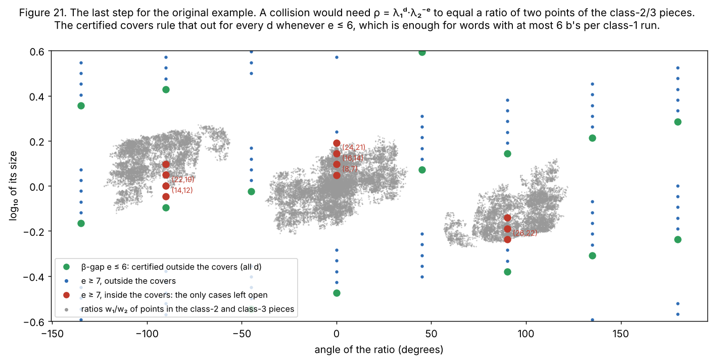

*Figure 21. The original example's last step. Grey: ratios of points of the class-2 and class-3 pieces. Green: the
ratios ρ = λ₁^d λ₂^(−e) with e ≤ 6, all certified outside the covers. Red: the few with e ≥ 7 that land inside, the
only open cases.*

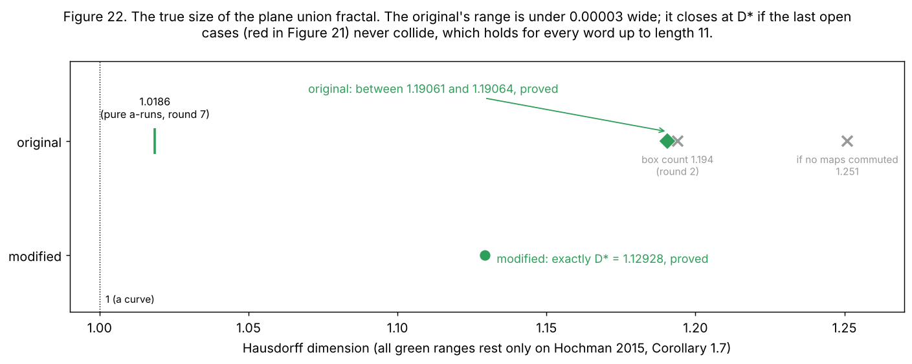

*Figure 22. What is proved. The original's range is too narrow to draw as a bar; the diamond marks it.*

### 11.5 Lead or not

**A solid result, but a consolidation, not a new lead.** For: the plane version of the formula is now a theorem with
an example where every step is proved, and the round-2 example is pinned to five decimals. The proof mixes complex
ping-pong with 3-adic arithmetic, and step 3 is short. Against: the mechanism is Hochman's, as on the line. Closing the
original's last 0.00003 would need a new idea for a handful of ratio cases, and it changes no conclusion.

### 11.6 Lean

`lean/NewTies.lean` now has 29 theorems and builds with Lean 4.37.0-rc1, with no sorry and standard axioms only
(`lean/compile_output.txt`). New this round: `gauss_mod3_no_zero_divisors`, `units_mod3`, `three_adic_levels_differ`,
`sqrt_two_upper`, `tail_bound`, `rot45_no_invariant_line`, `first_return_threshold`. They cover the arithmetic. The disc
covers are certified in Python with exact fractions, and the 3-adic and complex geometry is in the prose proof.

### 11.7 Who proved what, round 7

Ping-pong, cancellation and p-adic valuations are standard tools. Theorem P7's reduction, the modified example and its
3-adic proof, the certified covers, and the e ≤ 6 exclusion for the original are ours (DRAFT). Both dimension
statements rest on Hochman's Corollary 1.7 (arXiv:1503.09043), whose proof we did not check.

### Known vs new, round 7

| Item | Status | Source |
|---|---|---|
| Algebraic + irreducible + no exact overlaps ⇒ dim = min(d, s-dim) | Known (Hochman 2015, Cor. 1.7) | cited |
| Plane formula: dim K = min(2, D*) when no words collide | **Ours** (DRAFT), resting on Hochman | 11.2 |
| Modified example: no collisions, dim = D* = 1.12928 | **Ours** (DRAFT) | 11.3, W1–W7 |
| Original example: dim between 1.19061 and 1.19064 | **Ours** (DRAFT) | 11.3, W10–W12 |
| Original example: no collisions for every word | Open (checked to length 11) | 11.3, W5, W11 |

---

## 12. Round 8 (DRAFT): what's in print, and the exact size for whole families

Brennan asked whether we had actually contributed, then "can we show this more generally, for a larger range of
cases?" This round answers both. Script: `general.py` → `general.json`. Checks: `checks8.py`, 13/13 (X1–X11).
Figures 23–26. Lean: eight more theorems, 37 in all, all build.

### 12.1 The answer in two sentences

The exact size (dimension = the formula's D*) is now proved for a dense set of parameters, for any number of classes
with any number of maps in each, on the line and in the plane, as long as every map shrinks by more than a set factor.
On the line the formula was already known for "almost every" choice of parameters (Bárány and Verma 2025), but that
kind of theorem can't decide any one example; ours names the examples and proves them, and the plane version is not in
print as far as we can find.

### 12.2 What's in print

A second, wider search (Nov 27) found work our first two searches missed. It changes how earlier rounds should be read,
and the earlier tables are now marked "[Round 8 correction]".

| Paper | What it proves | What it leaves open |
|---|---|---|
| Bárány and Szvák, Math. Nachr. 294 (2021) 657–671, arXiv:1902.04028 | Three maps αx, βx, γx + 1 − γ (two share centre 0): dimension solves α^s + β^s + γ^s − α^sβ^s = 1 for α outside a set of dimension 0 | Which α are exceptional |
| Bárány and Verma, arXiv:2507.05835 (2025, preprint) | Line, any grouping into classes by centre: the same D* equation, for parameters outside an exceptional set of smaller dimension; also the measures | Any specific example; the plane |
| Kittle and Kogler, arXiv:2610.10511 (Oct 2026, preprint) | Every finite system of maps on the line with no exact overlaps has dimension min(1, similarity dimension) | Deciding whether a given system has exact overlaps |
| Hochman, Annals 180 (2014); arXiv:1503.09043 (2015) | Algebraic parameters, no exact overlaps ⇒ dim = min(d, similarity dimension); in the plane also needs "no fixed line" | Same |
| Rapaport, arXiv:2001.01332; Solomyak (2024); Christodoulou and Jurga (Trans. AMS 2026) | Algebraic contractions; Möbius and projective systems (relevant to rounds 3–4) | — |

Not found in print: the plane version (Theorem P7), the plane laws P1–P4, any proof that specific examples have no
collisions, the certified numbers, and reading the words as a trace monoid. So on the line the open question was
never the formula but **which examples it holds for**, and that is what this round answers.

### 12.3 Theorem P8: one test that rules out collisions

Setting: maps z ↦ c + λ(z − c) with rational (line) or Gaussian-rational (plane) c and λ, |λ| < 1, grouped into classes
by centre c₁, …, c_N. A prime p is **good for class i** when no centre or multiplier has p in its denominator, every
multiplier of every other class is divisible by p, and every other centre differs from c_i by a p-adic unit.

**Theorem P8 (DRAFT, ours).** Different words give different maps if:

- **(A) separation.** Some set Y is sent into itself by every map, and the class pieces X_i = ∪ g(Y), over non-identity
  words g in class i alone, are pairwise disjoint; and
- **(B) arithmetic.** For each class with two or more maps, the valuations of its multipliers at its good primes admit
  no integer relation Σ w_m v_p(λ_m) = 0 (for all good p) in which some w_m are positive and some negative.

**Proof.** Take a shortest pair of different words W, W′ giving the same map.

1. *Same outer class.* For any y in Y, W(y) = s(rest(y)) with rest(y) in Y and s W's outer (last-applied) run, so W(y)
   lies in the piece of W's outer class. The pieces are disjoint, so both words end in the same class i.
2. *Cancel.* Write W = u·g′ and W′ = u′·h′, with u, u′ the outer class-i runs and g′, h′ the rest. Class-i maps commute,
   so take the common part of u and u′ off both (maps are invertible). By shortness the exponent vectors of u and u′
   now have disjoint supports. If one is empty, the words have different outer classes, ruled out by step 1. So both
   are nonempty, and w = exponents(u) − exponents(u′) has mixed signs. (A class with one map can't get here.) The
   equal maps say h′(z) − c_i = ρ·(g′(z) − c_i) for every z, with ρ = Π λ_m^(w_m).
3. *The good prime.* Take z = c_j with j ≠ i, and p good for i. Every map keeps p-adic integers. If g′ is empty,
   g′(z) − c_i = c_j − c_i, a unit. Otherwise g′'s outer map has some centre c_k ≠ c_i and a multiplier divisible by p,
   so g′(z) ≡ c_k mod p and g′(z) − c_i is again a unit (Lean `good_prime_unit`). Same for h′. So v_p(ρ) = 0 for every
   good p: w is a mixed-sign relation, which (B) forbids. ∎

**Testing (B) is linear algebra.** The relations form a subspace K. If dim K = 0, (B) holds. If dim K = 1, (B) holds
exactly when K's spanning vector is one-signed. If dim K ≥ 2, (B) fails: K minus 0 is connected, it can't sit inside
the two sign-orthants without meeting both (K = −K), and a mixed rational vector exists because mixed is an open
condition (X8). So a class of k maps needs good primes whose valuations have rank at least k − 1.

**Lemma A′ (separation for free).** Let δ and D be the smallest and largest distances between centres, and suppose every
|λ| ≤ ε with ε(4D + δ) < δ. Then (A) holds with Y the disc about c₁ of radius R = D(1 + ε)/(1 − ε).
*Proof.* A map with centre c_j sends Y into the disc about c₁ of radius D(1 + ε) + εR = R. A non-identity class-j word
shrinks by at most ε about c_j, so X_j lies in the disc about c_j of radius ε(R + D) = 2εD/(1 − ε). Two such discs miss
when 4εD/(1 − ε) < δ, which is ε(4D + δ) < δ (X1, X2; Lean `lemmaA_invariant`, `lemmaA_key`). ∎

### 12.4 Corollary P9: a dense family for every pattern of class sizes

**Corollary P9 (DRAFT, ours).** Fix N ≥ 2 integer centres on the line (or Gaussian-integer centres in the plane) and
class sizes k₁, …, k_N ≥ 1. Give each class i its own k_i − 1 odd primes (all different; in the plane take primes
≡ 3 mod 4), none dividing a difference of centres. Choose multipliers λ_{i,1}, …, λ_{i,k_i}, with none of these primes
in a denominator, such that:

1. every |λ| < δ/(4D + δ);
2. every multiplier is divisible by every prime of every other class;
3. for m < k_i, λ_{i,m} is divisible by class i's m-th prime and by none of its other primes, and λ_{i,k_i} by none.

Then different words give different maps. So on the line dim K = min(1, D*) (round 2's theorem, resting on Hochman
2014; Kittle and Kogler's corollary gives it too), and in the plane, if some multiplier is not real,
dim K = min(2, D*) (Theorem P7, resting on Hochman 2015). Such multipliers are dense in the box |λ| < δ/(4D + δ).

*Proof.* (A) is Lemma A′. For (B), class i's own primes are good for it by (2), and at them the valuation matrix has its
m-th prime dividing only the m-th multiplier, so every relation vanishes on the first k_i − 1 coordinates and is a
multiple of the last unit vector, one-signed (Lean `diagonal_kernel`). Extra good primes only shrink the relations.
Density: each condition fixes a residue class mod a product of the chosen primes, and fractions m/2ⁿ with m in a fixed
class come within that product over 2ⁿ of any target (Lean `exists_near`; X10). ∎

Figure 23 shows the recipe for one member; X9 checks it on 100. For centres 0, 1, …, N − 1 on the line the box is
|λ| < 1/(4N − 3), and the primes need only be at least N (Lean `centres_distinct_mod`).

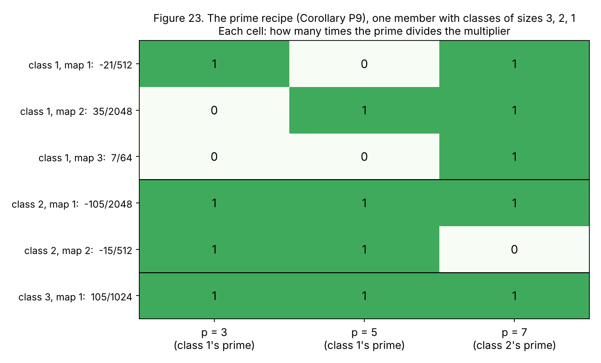

*Figure 23. Corollary P9's recipe for one member with classes of sizes 3, 2 and 1. Class 1 gets two primes (3 and 5),
class 2 one (7), class 3 none. Each multiplier carries its own prime once, its classmates' primes never, and all the
other classes' primes. That pattern is what makes every collision impossible.*

*Figure 25. One slice of the family on the line: class 1's two multipliers λ and μ vary, classes 2 and 3 are fixed at
3/32. Every dot has its dimension proved equal to D* (colour). Only denominator 2⁷ is drawn; finer denominators fill
the dashed box.*

### 12.5 How far the test reaches beyond the dense family

Lemma A′ is the cautious way to get (A). The certified disc covers of round 7 (exact fractions, any number of classes)
reach much larger multipliers, and with them larger dimensions. We sampled three random families and certified each
member (`general.py`, G3), then confirmed no collisions by hashing every word up to length 6 or 7 mod two primes.

| Family | Setting | Members | Pass (B) | Pass (A) and (B) | Collision-free (checked) | D* of passing members |
|---|---|---|---|---|---|---|
| F1 | plane, centres 0, 1, i; class 1 has two maps | 40 | 40 | 33 | 33 of 33 | 0.62 to 1.41 |
| F2 | plane, 4 classes, centres 0, 1, i, 1 + i | 40 | 40 | 25 | 25 of 25 | 0.88 to 1.48 |
| F3 | line, centres 0, 1, 2 | 40 | 40 | 27 | 27 of 27 | 0.62 to 1.06 |
| G4 | line, two classes of two maps, good primes 3 and 5 | 1 | 1 | 1 | yes | 0.58357 |
| G5 | Corollary P9, 14 class patterns, line and plane | 42 | 42 | 42 | 42 of 42 | 0.38 to 0.69 |

Every member that passes has its dimension proved equal to min(d, D*). A member that fails (A) is not shown to collide;
the test is just silent there. The round-7 examples: MOD passes (B) at the prime 3; ORIG has no good prime at all,
which is why round 7 needed geometry for it (X3).

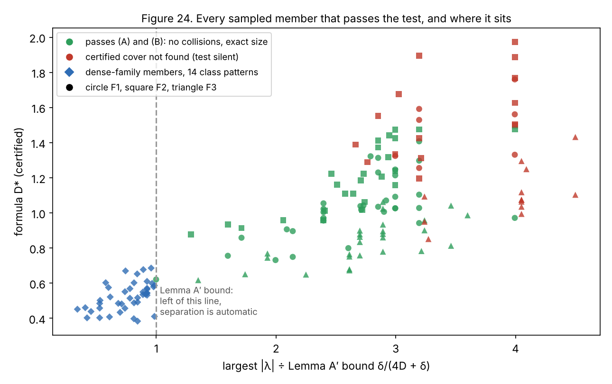

*Figure 24. Every sampled member, placed by how large its biggest multiplier is compared with Lemma A′'s bound (left of
the dashed line, separation is automatic) and by its formula value D*. Green: the test proves no collisions and the
exact size. Red: no certified cover found, so the test is silent. Blue: Corollary P9's dense family.*

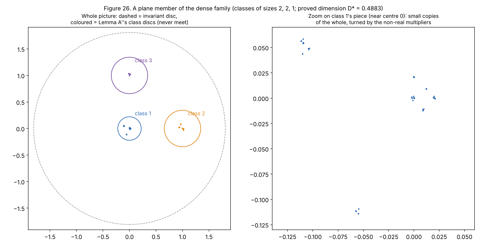

*Figure 26. A plane member of the dense family (classes of sizes 2, 2, 1), coloured by the class of the last map. The
coloured discs are Lemma A′'s class discs and never meet; the zoom shows small turned copies of the whole.*

### 12.6 What this means in plain terms

Before this round we had two worked examples. Now there is a recipe: pick centres, pick how many maps share each
centre, give each class a few primes, and choose small multipliers carrying those primes in the right pattern. Every
such system obeys the formula exactly, with a proof, and such systems sit arbitrarily close to any small-multiplier
system you name. With certified covers the same test also handles bigger multipliers one example at a time, in seconds.

### 12.7 What it contributes, and what would make it a lead

**What's proved and ours:** Theorem P8 (a checkable no-collision test for any number of classes, line or plane),
Lemma A′, Corollary P9 (an explicit dense family for every pattern, with proofs), and 128 more certified examples. On the
line this complements Bárány and Verma: their theorem says the formula holds outside a small exceptional set; ours
names explicit parameters proved to be outside it. In the plane, Theorem P7 with P9 is, as far as we can find, the
first statement of the formula and the first proved cases.

**What would make it a lead:** (1) dropping the smallness condition, for instance proving that every system meeting (A)
by any route and (B) obeys the formula, with (A) checked by the round-7 covers; (2) a converse, showing which rational
parameters do collide, which would describe Bárány and Verma's exceptional set explicitly; (3) the round-6 open case,
±3 for all words, which (B) can't reach because no good prime exists there. Item (2) is the most interesting to experts,
because nobody can currently name the exceptional parameters.

### 12.8 Lean

`lean/NewTies.lean` now has 37 theorems and builds with Lean 4.37.0-rc1, with no sorry and standard axioms only
(`lean/compile_output.txt`). New this round: `lemmaA_invariant`, `lemmaA_key`, `two_maps_one_prime`, `diagonal_kernel`,
`good_prime_unit`, `centres_distinct_mod`, `exists_near`, `g4_small`. They cover the algebra of Lemma A′, the kernel step
for Corollary P9's recipe, the good-prime congruence and the density step. The p-adic and geometric steps are in the
prose proof and the Python checks.

### 12.9 Who proved what, round 8

Ping-pong, cancellation, p-adic valuations and the Chinese remainder theorem are standard tools. Theorem P8, Lemma A′,
Corollary P9 and the certified family members are ours (DRAFT). The dimension statements rest on Hochman's theorems
(2014 on the line, Corollary 1.7 of arXiv:1503.09043 in the plane), and on the line also follow from Kittle and Kogler's
corollary; we read those statements and did not check their proofs. The line formula itself, for generic parameters,
is Bárány and Verma's (2025), with a three-map case in Bárány and Szvák (2021).

### Known vs new, round 8

| Item | Status | Source |
|---|---|---|
| Line formula for generic parameters | **Known** (Bárány and Verma 2025; three maps: Bárány and Szvák 2021) | 12.2 |
| No exact overlaps ⇒ dim = min(1, s), every line system | Known (Kittle and Kogler 2026, preprint) | 12.2 |
| Theorem P8: valuation-and-separation test for no collisions | **Ours** (DRAFT) | 12.3, X3–X8 |
| Lemma A′: separation when ε(4D + δ) < δ | **Ours** (DRAFT, elementary) | 12.3, X1, X2 |
| Corollary P9: explicit dense family, every pattern, line and plane | **Ours** (DRAFT) | 12.4, X7, X9, X10 |
| 128 certified family members and G4 | **Ours** (DRAFT) | 12.5, X5–X7 |
| Plane formula and its proved cases | **Ours** (DRAFT); not found in print | 11, 12.4 |

---

## 13. Round 9 (DRAFT): exactly which cases break the formula

Brennan said "Let's keep pushing!" Section 12.7 named the most interesting open question: which parameters break the
formula? Script: `breaks.py` → `breaks.json`. Checks: `checks9.py`, 12/12 (Y1–Y12). Figures 27–30. Lean: four more
theorems, 41 in all, all build.

### 13.1 The answer in two sentences

The formula fails exactly when two different words give the same map, and whenever that happens the true size is
strictly smaller than D*, by an amount we can compute. So the breaking cases form an explicit, thin set (a countable union
of equations among the parameters), and we found one inside the separated region where the size drops from
D* = 0.50353 to at most 0.47048.

### 13.2 Theorem P10: a collision always costs size

**Theorem P10 (DRAFT, ours as stated).** Take any shared-centre system on the line or in the plane, with any real or
complex parameters and at least two classes. If two different words (different elements of the trace monoid M) give
the same map, then dim K ≤ s_c < D*, and s_c can be computed (below).

**Proof.**

1. *Move the collision into the free part.* Round 2's first-return pieces S = {u·v : u a nonempty run in class 1, v a
   nonempty word in the other classes} form a free monoid S*. If W ≠ W′ give the same map, so do a·W·v and a·W′·v for a
   class-1 map a and a map v of another class. Both lie in S*, and they are still different, because a trace monoid
   cancels on both sides. So two different words X ≠ Y over the alphabet S give the same map.
2. *Every map has a representative avoiding one word.* Order words over S by length, then alphabetically (S is
   countable, so this is a well-order). Say Y is the larger. Replacing any occurrence of Y by X keeps the map and makes
   the word smaller (Lean `replace_shortens`), so every map of S* is the map of a word with no Y in it.
3. *Count.* Every element of M factors uniquely as (word in the other classes)·(element of S*)·(class-1 run), so the
   distinct maps are bounded by Q(s)·A(s)·P₁(s), where A sums |λ_w|^s over words avoiding Y. Cover K by the images
   W(K) over a cut set at scale r; replacing each W by its representative keeps the cover, so dim K is at most the point
   where this series starts to converge. Q and P₁ converge near D*. For A, split a word into blocks of length n = |Y|;
   no block is Y, so the blocks of length n contribute at most f(s)ⁿ − |λ_Y|^s each, where f(s) = Σ_S |λ|^s =
   (P₁ − 1)(Q − 1). At s = D*, f = 1, so this is 1 − |λ_Y|^(D*) < 1 and A converges there, and also a little below D*
   by continuity. So **s_c ≤ the root of f(s)ⁿ − |λ_Y|^s = 1, which is below D*.** ∎

When the collision is between two single pieces (n = 1) it spreads: a·X·w and a·Y·w collide for every class-1 run a
and every word w of the other classes, so a whole family of pieces, of weight P₁(s)Q(s)|λ_Y|^s, can be dropped. That
gives the sharper bound **root of f(s) − P₁(s)Q(s)|λ_Y|^s = 1.**

### 13.3 Corollary P11: exactly where the formula holds

**Corollary P11 (DRAFT, ours as stated).** Suppose D* ≤ d (d = 1 on the line, 2 in the plane).

- *Line, algebraic parameters:* dim K = D* exactly when no two different words collide (P10 one way, round 2's theorem
  with Hochman 2014 the other). *Any real parameters:* the same, if Kittle and Kogler's corollary (preprint) holds.
- *Plane, algebraic parameters with a non-real multiplier:* the same (P10 and Theorem P7).
- *The breaking set is thin.* For any fixed distinct centres, the multipliers where some collision happens form a
  countable union of proper algebraic subsets, so they have measure zero and lower dimension.
- *Inside the separated region* (for example every |λ| < δ/(4D + δ)), every collision has the normal form of P8's step 2:
  two class-i runs with different letters on top of words from other classes. So a break needs a class with two or
  more maps; systems with one map per class never break there.

*Proof of thinness.* Pick small multipliers that are algebraically independent (no polynomial relation over the
centres). Lemma A′ applies, so a collision would have P8's normal form λ^u (g′(c_j) − c_i) = λ^(u′) (h′(c_j) − c_i),
a polynomial identity. Independence makes it hold as polynomials, so we may set every other class's multipliers to 0.
Then g′(c_j) becomes the centre c_k of g′'s outer map (or c_j), and we get λ^u (c_k − c_i) = λ^(u′) (c_k′ − c_i)
with u ≠ u′: two different monomials with nonzero coefficients, impossible. So each "these two words agree" equation
is a nonzero polynomial in the multipliers, and its zero set is proper. ∎

This says which parameters are Bárány and Verma's exceptions, at least when D* ≤ 1: precisely the collision set. Their
theorem shows the exceptions are small; P11 names them. The principle "exact overlaps cost dimension, otherwise you get
the full value" is the standard one for self-similar sets. What's ours is carrying it to shared-centre classes, where
the full value is D* rather than Moran's root, and the description of the breaks.

### 13.4 A concrete break, and how much it costs

Line, centres 0, 1, 2. Class 1 about 0: λ = 19/200 and μ = 1/20. Class 2 about 1: ν = 1/19. Class 3 about 2:
κ = 1/10. All are below Lemma A′'s bound 1/9, so this sits inside the separated region (Lean `example_in_box`).

Shrinking by 1/19 toward 1 and then by 19/200 toward 0 is **the same map** as shrinking by 1/10 toward 2 and then by
1/20 toward 0: both send z to (18 + z)/200 (Figure 27; Lean `example_slopes`, `example_collision`). It is P8's normal
form with ρ = λ/μ = 19/10 = 2 − κ. Every such break lies on the surface λ = μ(2 − κ), ν = κ/(2 − κ).

| Quantity | Value | How |
|---|---|---|
| Formula D* | 0.5035322 | certified root (interval arithmetic) |
| Upper bound, one duplicate piece | 0.4964260 | P10, n = 1 |
| **Upper bound, whole family** | **0.4704834** | P10, family bound |
| Lower bound | 0.4367041 | the subsystem without μ never collides (one map per class, P8), plus Hochman |
| **Proved drop below the formula** | **at least 0.0330** | |

The counts back this up (Figure 28). We counted the different maps among all words of each length, hashed mod two
primes, and compared them with a prediction that assumes this one break and its family are the only collisions. The
prediction matches exactly at every length from 1 to 9 (76,096 maps at length 9, against 151,316 words). So we
conjecture the true size is the family bound, 0.47048; proving it would mean showing no other collision happens.

*Figure 27. The break. Two routes (blue: toward 1 then toward 0; orange: toward 2 then toward 0) land on exactly the
same interval [0.090, 0.100] with the same scaling, so they are the same map.*

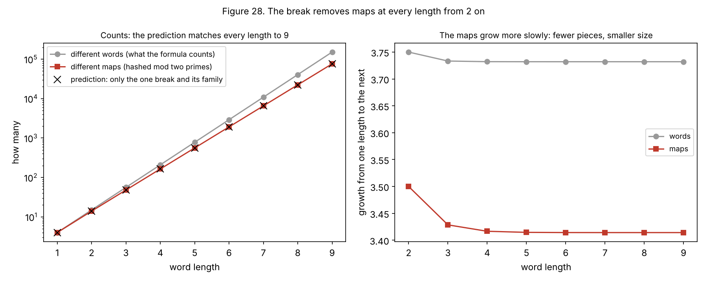

*Figure 28. Left: words (grey) against different maps (red); the crosses are the prediction from this one break, and
they match at every length. Right: the maps grow by about 3.41 per step against 3.73 for words. Fewer pieces means a
smaller fractal.*

*Figure 29. The whole collision surface inside the separated region, drawn over μ and κ (then λ and ν are fixed by the
break). Colour: the proved drop below the formula, between 0.017 and 0.035 everywhere. The circle is Figure 27's example.*

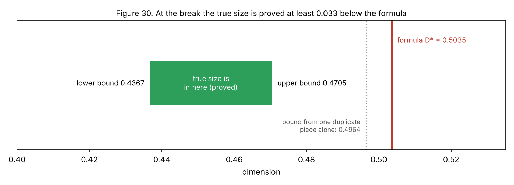

*Figure 30. What is proved at the example: the true size sits in the green bar, wholly below the formula's value.*

### 13.5 What this means in plain terms

The formula counts every word as a different piece. It is right exactly when that's true. When two different words
land on the same piece, the fractal has fewer pieces than the formula thinks, and it really is smaller, by a margin we
can bound. Those coincidences need an exact equation among the parameters, so they're rare, and when the pieces are
kept apart they can only happen inside a class of two or more maps.

### 13.6 Is it a lead?

**Yes, a real one.** It turns a published "almost every parameter" theorem into an exact description of where the
formula fails, with a computable drop, and it comes with a worked example where everything but the last digits is
proved. What would take it further: (1) prove the example's size equals the family bound 0.47048 (show no other
collision occurs), which would give the first exact size of a broken case [Round 10 update: done for a dense set of breaks, and the original is pinned to within 1.4 × 10⁻⁷; section 14] [Round 11 update: the original is pinned to within 1.8 × 10⁻⁴⁸¹¹, not exact; section 15] [Round 12 update: every bad pair in proved ranges covering 72.7% of the windows is settled for all run lengths; still not exact; section 16]; (2) list which equations can occur inside
the separated region, so the breaking set is described surface by surface; (3) the same picture for the plane laws of
rounds 3–4, where the maps are Möbius rather than straight-line.

### 13.7 Lean

`lean/NewTies.lean` now has 41 theorems and builds with Lean 4.37.0-rc1, with no sorry and standard axioms only
(`lean/compile_output.txt`). New this round: `example_slopes`, `example_collision`, `example_in_box`,
`replace_shortens`. They pin down the concrete break and the termination step of P10. The covering and counting steps
are in the prose proof and the interval checks.
All 41 also compile clean in the shared library (`FusedAlgebra.Topics.NewTies`, namespace `CircleOp.NewTies`, no proof
changed), mirrored on Nov 27. In the repo's CI, `checks5.py` to `checks9.py` all run (CI installs python-flint).
The Lean lines of rounds 5 and 6 (V7, V11) test the 16- and 22-theorem file of those rounds, so CI reports them as
known stale (`tools/checks_known_stale.txt`); `checks9.py` Y11 checks the current 41-theorem build.

### 13.8 Who proved what, round 9

Cut-set covers, word reduction by a well-order, and "exact overlaps cost dimension" are standard ideas. Theorem P10 for
shared-centre classes, the family bound, Corollary P11's description and its thinness proof, the concrete break and
its certified numbers are ours (DRAFT). The "holds" direction rests on Hochman (2014 on the line, 2015 in the plane) and,
for non-algebraic parameters on the line, on Kittle and Kogler's preprint; we read those statements and did not check
their proofs.

### Known vs new, round 9

| Item | Status | Source |
|---|---|---|
| Exact overlaps lower the dimension of a self-similar set | Known principle | standard |
| P10: any collision ⇒ dim ≤ s_c < D*, with the block and family bounds | **Ours** (DRAFT) | 13.2, Y3–Y6 |
| P11: dim = D* exactly when no collision (D* ≤ d); breaking set thin and in normal form | **Ours** (DRAFT), resting on Hochman (and Kittle–Kogler for real parameters) | 13.3, Y7, Y8 |
| Concrete break inside the separated region, drop at least 0.033 | **Ours** (DRAFT) | 13.4, Y1, Y2, Y5 |
| Its exact size equals the family bound 0.47048 | Conjecture (counts match to length 9). [Round 10 update: still open, now pinned to [0.47048331, 0.47048344]; exact for a dense set of other breaks, section 14] [Round 11 update: still open; no second collision in runs of up to 10,000 copies of λ, gap 1.8 × 10⁻⁴⁸¹¹, section 15] [Round 12 update: still open; settled at once for every bad pair with stretch in ranges covering 72.7% of the windows, section 16] | 13.4, Y9 |

---

## 14. Round 10 (DRAFT): the exact size of a break, without counting

Asked for by Brennan (Nov 27): "What's not proved yet: the break's exact size … Let's define it exactly", then
"Without having to count". Script: [`exact.py`](exact.py) → `exact.json`. Checks: [`checks10.py`](checks10.py) →
[`checks10_output.txt`](checks10_output.txt), **12 of 12 pass**. Pictures: [`figures10.py`](figures10.py).
Lean: 53 theorems, builds, no sorry.

### 14.1 The answer in three sentences

**The exact size of a break is now proved, by a short argument with no counting, for a dense set of breaks:** it is the
root of one explicit equation (the family bound of Round 9). For a concrete break, the "3-adic break", that root is
0.4232693, where the formula guessed 0.4531865. The original 19/200 break is not covered (its two numerators share no
prime), but the same argument now pins its size between 0.47048331 and 0.47048344, where Round 9 had 0.4367 to 0.4705.

### 14.2 Theorem P12

*Setting.* On the line: centres 0, 1, 2; class 1 = {λ, μ} about 0; one map ν about 1 (letter N); one map κ about 2
(letter K); all multipliers in (0, 1). The **collision surface** is λ = μ(2 − κ), ν = κ/(2 − κ). Every point of it
breaks the formula, because (aλ)(νw) = (aμ)(κw) for every class-1 run a and every N/K word w (Lean:
`surface_slopes`, `surface_intercept`).

**Theorem P12 (DRAFT, ours).** Take a rational point (μ, κ) of the collision surface with

- **(I) separate landing zones:** 2λ < 1 − ν and 1 + ν < 2 − 2κ;
- **(II) enough push:** (2 − κ)(1 − κ) > 1, i.e. κ < (3 − √5)/2 ≈ 0.382 (Lean: `push_general` for κ ≤ 1/3);
- **(P) a shared prime:** some odd prime p divides the numerators of both μ and κ.

Then

  **dim K = min(1, s_F) exactly**, where s_F is the root of  (P₁ − 1)(Q − 1) − P₁ Q (μκ)^s = 1,
  with P₁ = 1/((1 − λ^s)(1 − μ^s)) and Q = 1/(1 − ν^s − κ^s).

And s_F < D*, so the size really drops (Round 9). Points with (P) are dense in the region where (I) and (II) hold
(numerators divisible by p are dense), so the exact formula holds on a dense subset of that part of the surface.

### 14.3 The proof

**Step 0: the reduced pieces.** Round 9's first-return pieces are u·v with u a nonempty class-1 run and v a nonempty
N/K word. Throw away the duplicated family, the pieces whose run u contains μ and whose word v starts with K. Call what
is left S′. Every thrown-away piece equals a kept one as a map, so nothing is lost, and Round 9's covering argument
(Theorem P10) gives dim K ≤ s_F, where s_F is where the weight of S′ crosses 1. That weight is
(Λ − 1)(Q − 1) + Λ(M − 1)ν^s Q with Λ = 1/(1 − λ^s), M = 1/(1 − μ^s), which equals the formula above (check X4).
What is left is the lower bound: show that **different words in S′ never give the same map.**

**Step 1: cancel.** Suppose two different words in S′ give the same map. Cancel their longest common beginning (maps are
invertible). Class-1 letters commute, so what can be left at the front is one of three shapes:

1. one side starts with a class-1 letter and the other with N or K (or is empty);
2. both start with N/K letters, one with N and the other with K;
3. one side is λ^a g′ and the other μ^b h′ with a, b ≥ 1, where g′ and h′ start with N or K.

In shape 3 the rule that defines S′ matters: the μ-side's run contained μ, so h′ starts with **N**.

**Step 2: zones (hypothesis I).** Every map sends [0, 2] into itself. A word whose last-applied (outermost) letter is
about 0, about 1 or about 2 lands in the zone [0, 2λ], [1 − ν, 1 + ν] or [2 − 2κ, 2]. By (I) these are disjoint, so
shapes 1 and 2 are impossible (an empty word is the identity, which no nonempty word equals).

**Step 3: the shared prime forces equal powers (hypothesis P).** Every multiplier is divisible by p, so every letter is
the constant map "its centre" mod p. So g′(1) ≡ 1 or 2 and h′(1) ≡ 1 mod p: both are p-adic units (p is odd). The two
sides send 1 to λ^a g′(1) and μ^b h′(1), with p-adic valuations a·v_p(λ) and b·v_p(μ). On the surface
v_p(λ) = v_p(μ) ≥ 1, so **a = b** (Lean: `equal_powers`).

**Step 4: the push (hypothesis II).** With a = b, the equation says h′ = ρ·g′ with ρ = (λ/μ)^a = (2 − κ)^a ≥ 2 − κ.
h′ lands in the N-zone. If g′ starts with N, ρ·g′ lands in ρ·[1 − ν, 1 + ν], which starts past 1 + ν because
(2 − κ)(1 − ν) > 1 + ν, and that is (II) (with ν = κ/(2 − κ) it reads (2 − κ)(1 − κ) > 1). If g′ starts with K, ρ·g′
lands beyond 2 − 2κ > 1 + ν. Either way no overlap (Lean: `push_grows`, `push_clear`). So shape 3 is impossible too.
Figure 31 is this step.

**Step 5: Hochman.** Take the finitely many pieces of S′ of length at most L. By Steps 1–4 they have no exact overlaps,
and their multipliers are rational, so Hochman's theorem (Ann. Math. 2014, algebraic parameters, no exact overlaps)
gives their attractor dimension min(1, s_L), where s_L is the root of their weight. Their attractor sits inside K, and
s_L rises to s_F as L grows. So dim K ≥ min(1, s_F). With Step 0, **dim K = min(1, s_F).** ∎

No step counts maps. The only numbers computed are the certified root s_F and certified checks of (I) and (II).

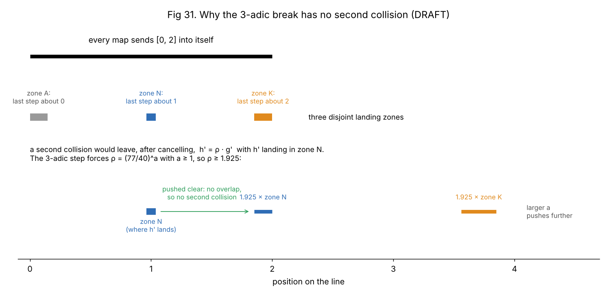

*Figure 31. Steps 2 and 4 for the 3-adic break. Top: the three landing zones are disjoint. Bottom: a second collision
would need a copy of a zone stretched by ρ ≥ 1.925 to overlap the N-zone, and it lands clear of it.*

### 14.4 The 3-adic break: an exact number

μ = 3/80 and κ = 3/40 put λ = 231/3200 and ν = 3/77 on the surface. Every multiplier has exactly one factor of 3. The
two routes (231/3200 about 0)∘(3/77 about 1) and (3/80 about 0)∘(3/40 about 2) are the same map z ↦ (9z + 222)/3200.
(I) holds (462·77 < 74·3200 and 80·40 < 74·77), and (II) holds (77·37 > 40·40). All are exact checks, in Lean too.

| | value | status |
|---|---|---|
| the formula's guess D* | 0.4531865 | certified (interval arithmetic) |
| **the true size** | **0.4232693** (in [0.42326931, 0.42326932]) | **proved exact** (P12) plus a certified root |
| collision-free subsystem (old-style lower bound) | 0.3918 | certified, superseded |

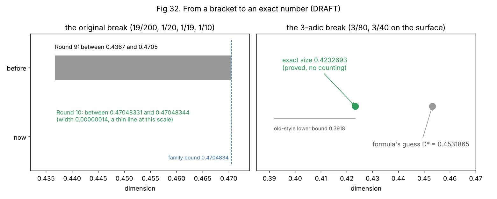

*Figure 32. Left: the original break went from a bracket of width 0.034 (grey) to one of width 0.00000014 (green, a thin
line at this scale). Right: the 3-adic break's size is exact, 0.030 below the formula.*

### 14.5 Where on the surface this applies

Hypotheses (I) and (II) hold on a large part of the surface: κ up to 0.38 and μ up to about 0.24 (Figure 33). Inside it,
every rational point whose two numerators share an odd prime is exactly solved. Such points crowd in on every point.
For example, μ_p = p/(20p + 1) and κ_p = p/(10p + 1) are exactly solved for every odd prime p and close in on the
original break (1/20, 1/10). Their exact sizes 0.46572 (p = 3), 0.46760, 0.46841, …, 0.47047 (p = 1009) climb toward
0.4704834 (check X9). That is a picture, not a proof for the limit point: dimension need not be continuous.

*Figure 33. The collision surface over (μ, κ). Coloured: (I) and (II) hold, so P12 applies at every point with a shared
odd prime; colour is the proved loss D* − s_F (0.012 to 0.072). Star: the 3-adic break. Cross: the original break.
Rings: exactly solved points closing in on it.*

### 14.6 The original break: pinned, not exact

For the original (19/200, 1/20, 1/19, 1/10) both numerators of μ and κ are 1, so Step 3 has no prime to work with. Without
it, a and b need not be equal and the stretch is ρ = λ^a/μ^b = 1.9^a · 20^(b−a). That can land in one of two bad windows,
[0.9, 1.11] (the N-zone against itself) or [0.474, 0.585] (the K-zone against the N-zone), where Step 4 says nothing.
The first time this happens is a = 13, b = 10: λ¹³/μ¹⁰ ≈ 0.5257 (Lean: `original_first_bad`; Figure 34).

So run the same proof on the reduced pieces whose class-1 run has **at most 12 copies of λ**. In Step 1, a is at most the
λ-power of a run, so a ≤ 12, and no ratio with a ≤ 12 hits a window (exact check for every b). That subsystem has no
exact overlaps, and Hochman gives a certified lower bound:

  **0.47048331 ≤ dim K ≤ 0.47048344** (gap at most 1.4 × 10⁻⁷).

This is not exact. What is missing is only the runs with 13 or more copies of λ (weight about λ^(13s) ≈ 6 × 10⁻⁷). The
first bad ratio is suggestive: ρ ≈ 10/19 would make "ρ times the K-map" equal the N-map exactly. 10/19 is never a ratio
of powers of 19/200 and 1/20, so no new collision is forced, but the ratio comes close. Closing the gap needs a different
argument for those runs: a deeper look inside the zones, or a 2-adic, 5-adic or 19-adic step.

*Figure 34. For the original break, each dot is a possible stretch λ^a/μ^b. Blue dots miss the bad windows, so
Step 4 still works. The first red dot is at a = 13, so the proof covers runs with up to 12 copies of λ.*

### 14.7 Lean

`lean/NewTies.lean` now has **53 theorems** and builds with Lean 4.37.0-rc1, with no sorry and standard axioms only.
New this round: `surface_slopes`, `surface_intercept` (every surface point collides), `threeadic_slopes`,
`threeadic_intercept`, `threeadic_valuations`, `threeadic_zones`, `threeadic_push` (the example's hypotheses),
`push_general` ((II) for κ ≤ 1/3), `equal_powers` (Step 3), `push_grows`, `push_clear` (Step 4), and
`original_first_bad` (where the original's proof stops). Steps 1 and 5 are in the prose. Step 5 cites Hochman.

### 14.8 Is it a lead?

**Yes, still a real one, and it got stronger.** Round 9 showed where the formula breaks and that the size drops. Round 10
says *exactly what the size becomes*, as the root of a closed equation, on a dense set of breaks, by a half-page argument:
cancel, separate, use a shared prime, push. What it contributes: an exact dimension for self-similar sets with exact
overlaps of this shared-centre kind, at points where the naive formula is provably wrong, plus a near-exact answer for
the original example. What would take it further:

1. **Close the original break**, by handling runs with 13 or more copies of λ (14.6). [Round 11 update: done up to 10,000 copies; the rest is open, section 15]
2. **Remove (P)**: prove the formula at every rational point of the surface, or find a point where a second collision
   really happens. If one exists, the size there drops below s_F.
3. **Other surfaces**: breaks that involve longer words, or two classes of two maps, using the same four steps.

### 14.9 Who proved what, round 10

Cancelling a common prefix, ping-pong zones, p-adic units and "pass to a subsystem with no exact overlaps, then apply
Hochman" are standard tools. The general strategy of computing a dimension through a free subsystem is in the spirit of
the finite-type and weak-separation literature (Ngai–Wang, Lau–Ngai). We did not run a fresh literature search this
round. Ours (DRAFT): the reduced language S′ for shared-centre breaks, Theorem P12 with its shared-prime step, the exact
value 0.4232693 for the 3-adic break, the bounded-run lower bound and the bracket [0.47048331, 0.47048344] for the
original break. Hochman's theorem is used as stated; we did not check its proof.

### Known vs new, round 10

| Item | Status | Source |
|---|---|---|
| Hochman: algebraic parameters + no exact overlaps ⇒ dim = min(1, similarity dim) | Known | Hochman 2014 |
| P12: exact size s_F on the collision surface under (I), (II), (P) | **Ours** (DRAFT) | 14.2–14.3, X1–X8 |
| 3-adic break: exact size 0.4232693 (formula 0.4531865) | **Ours** (DRAFT) | 14.4, X3 |
| Exactly solved points are dense where (I), (II) hold | **Ours** (DRAFT) | 14.5, X9, X11 |
| Original break: 0.47048331 ≤ dim ≤ 0.47048344 | **Ours** (DRAFT), not exact | 14.6, X10 |
| Original break: size exactly 0.4704834 | Open (Round 9's conjecture, now within 1.4 × 10⁻⁷) | 14.6 |

## 15. Round 11 (DRAFT): the original break, closed run by run but not exactly

Asked for by Brennan (Nov 27), answering "Should I try to close the original break exactly next?" with "Yes".
Scripts: [`original.py`](original.py) → `original_descent.json`, log [`original_output.txt`](original_output.txt);
[`original_bracket.py`](original_bracket.py) → `original_bracket.json`. Checks: [`checks11.py`](checks11.py) →
[`checks11_output.txt`](checks11_output.txt), **8 of 8 pass**. Pictures: [`figures11.py`](figures11.py).
Lean: three-line facts written in [`lean/Round11.lean`](lean/Round11.lean) but **not built** (no Lean toolchain could
be installed in this session); `NewTies.lean` is unchanged at 53 built theorems. [Round 12 update: the coordinator reports that `Round11.lean` builds clean in the repo and is now the
library module Topics.NewTies11.]

### 15.1 The answer in four sentences

**The original break is not closed exactly.** What is now proved: no second collision happens in any run with up to
10,000 copies of λ. Each of the 1,406 "bad pairs" Round 10 could not handle was settled by an exact search in rational
arithmetic. So the size agrees with the predicted 0.4704834398630828674… to about 4,810 decimal places (proved bracket width
1.8 × 10⁻⁴⁸¹¹). What still stands between that and "exactly 0.4704834…" is the infinitely many bad pairs beyond 10,000.
No single argument covers them yet, and section 15.5 says why.

Exactness is the same question as "no second collision": with no second collision Round 10's Step 5 gives the size
exactly, and if a second collision existed anywhere among the reduced pieces, Round 9's covering argument would push the
size strictly below s_F.

### 15.2 A simpler picture of the maps

Rescale by y = z/18, so [0, 2] becomes I = [0, 1/9]. The four letters become

  l: y ↦ λy,  m: y ↦ μy,  N: y ↦ (y + 1)/19,  K: y ↦ (y + 1)/10.

Two things become visible. First, **N is exactly 10/19 times K**, as functions. That is why the first bad ratio sits next
to 10/19 (Round 10, 14.6). Second, every word is "a scaling plus a sum": its slope is the product of its letters' slopes,
and its value at 0 is the sum of the partial products at its N and K positions. All of these are fractions built from
2, 5 and 19 only, and each term is at most a tenth of the one before.

### 15.3 How each bad pair is settled

After Round 10's cancelling (14.3, Step 1), a second collision needs reduced words h′ and g′ with **μ^b·h′ = λ^a·g′**,
where h′ starts with N, g′ starts with N or K, and the stretch ρ = λ^a/μ^b lies in a bad window ([0.9, 1.11] or
[0.474, 0.585]). For a fixed pair (a, b) this is one equation, h′ = ρ·g′, and the script searches for every solution:

- **Peel letters off the front.** If h = x·h₁ then h₁ = x⁻¹∘A∘g; if g = y·g₁ then h = (A∘y)∘g₁. Every solution is a path
  of such steps, starting from A = "multiply by ρ".
- **Cut a branch** when it cannot lead anywhere. Every word maps I into I. So if A(I) misses I there is no solution. If h is
  used up, A(I) must cover I; if g is used up, A(I) must sit inside I.
- **Walk only reduced words.** The letters' bookkeeping enforces: λ before μ inside a run, a run containing μ is never
  followed by K, and a word never ends inside a run. Check X2 compares this with a direct parse of every word up to length 7.
- **Remember visited states**, so the walk cannot loop.

"No collision" is returned only when **every branch was cut**. That is a proof for that pair, with no floating point and
no length limit on the words.

The search is not guaranteed to finish in general: two different infinite words can share a limit point, and the search
can follow such a pair forever. For every one of the 1,406 bad pairs it did finish, within 3,774 nodes and depth 99.
Two checks guard against a silent bug. A second search, written separately (breadth-first, another peeling rule), agrees
on 246 pairs (X5). And the search finds planted collisions: 300 of 300 random ones, plus the known collision of the
unreduced pieces (X6).

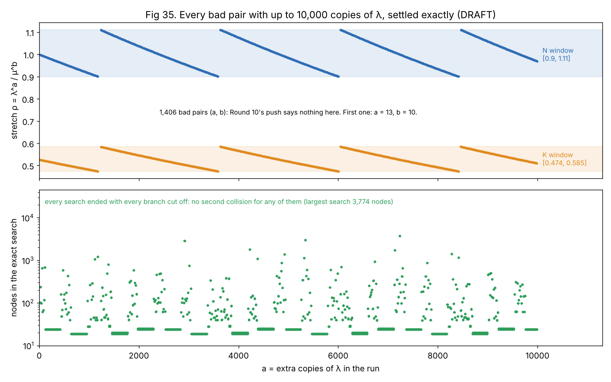

*Figure 35. Top: the stretch of every bad pair with up to 10,000 copies of λ. They come in long runs: (14k, 11k) drifts
through the N window as k grows, because λ¹⁴/μ¹¹ ≈ 0.99876. Bottom: how big each exact search was. Every one ended with
all branches cut, so none of these pairs gives a second collision.*

### 15.4 The bracket

The reduced pieces whose runs have at most 10,000 copies of λ have no exact overlaps: Round 10's push handles every pair
outside the windows, and 15.3 handles every pair inside. Hochman's theorem then gives a lower bound. Round 9's covering
argument gives the upper bound s_F. Both roots are certified with interval arithmetic at 4,980 digits (X8 also re-derives
Round 10's bracket from the same code):

  **0.47048343986308286742625771445802570830… − 1.8 × 10⁻⁴⁸¹¹ ≤ dim K ≤ s_F = 0.47048343986308286742625771445802570830…**

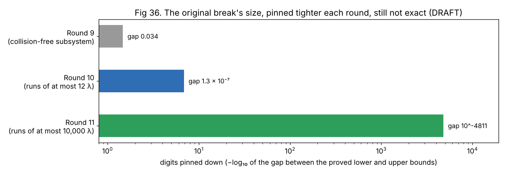

*Figure 36. The gap between what is proved below and above, round by round: 0.034 (Round 9), 1.3 × 10⁻⁷ (Round 10),
1.8 × 10⁻⁴⁸¹¹ (now). Still a gap, so still not exact.*

### 15.5 Why it does not close

One more cancel turns each bad pair into: **can h + 1 = σ·(g + 1)** for two reduced words h and g, where σ = ρ or 19ρ/10?

- **σ is never 1.** Its 19-adic valuation is a or a + 1 (X7; Lean `rho_ne_one`, unbuilt). That rules out the trivial
  solution, not the others.
- **σ comes as close to 1 as you like.** log λ / log μ is irrational, so the ratios λ^a/μ^b are dense. Within 10,000 the
  closest is a = 2413, b = 1896, |σ − 1| ≈ 1.6 × 10⁻⁴ (Figure 37). Near σ = 1 a zone argument has no room to push.
- **Real sizes alone cannot decide it.** If σ were allowed to be any real number near 1, the equation would have solutions
  for a dense set of σ. So any proof has to use the arithmetic of the actual σ, as the search does one pair at a time.
- **The prime-by-prime arguments stall.** Round 10's p-adic step needs a prime dividing both numerators, and here both are 1. At 19,
  N divides by 19, so N's pull the valuation the wrong way. At 2 and 5, a run of bare N's leaves the valuation unchanged
  and can make terms cancel (1 + 1/19 = 20/19 is divisible by 4, and longer stretches of N's pick up more factors of 2). In each case the "smallest
  term wins" argument breaks on bare-N stretches.

In number-theory terms, each bad pair is an S-unit equation (S = {2, 5, 19}) with an unbounded number of terms. The
general finiteness theorems for such equations fix the number of terms, so they do not apply directly.

*Figure 37. How close σ gets to 1, pair by pair (grey), and the closest so far (red). It keeps dropping, so no fixed
margin separates σ from 1, and each new pair has to be searched on its own.*

### 15.6 Is it a lead?

**Yes, the line of work is still a lead. This round's contribution is a sharper fact plus a clear obstacle, not a new
theorem.** It contributes three things:

1. A proof that no second collision occurs in any run of up to 10,000 copies of λ.
2. A size pinned to 4,810 digits, against Round 10's 7.
3. An exact reformulation of what is left: one S-unit-type equation per bad pair.

It would close the original break, and become a theorem, with any one of:

1. [Round 12 update: tried in section 16, as ranges of stretches; it proves 72.7% of the windows and provably cannot reach a measure-zero line-up set.] **A uniform argument for σ near 1.** For example, show that the search tree's shape stops depending on a once
   |σ − 1| is small, and handle that shape symbolically. The node counts in Figure 35 stay small and repeat in bands,
   which hints at this.
2. **A p-adic idea that survives bare-N stretches.** For example, work with blocks N^j as single letters and use a
   valuation at a prime dividing 19^j − 1.
3. **A second collision found.** If some bad pair beyond 10,000 really collides, the size is strictly below 0.4704834.
   That would be a surprise and a result in its own right.

### 15.7 Who proved what, round 11

The peel-and-prune search is a standard exact method (it is how one decides whether two words in a contracting
semigroup coincide). Hochman 2014 is used as stated. S-unit equations and their finiteness theorems (Evertse,
Schlickewei, Schmidt) are known, and we only point out that they do not apply directly. Ours (DRAFT): the y-model,
the reduction of the original break to one equation per bad pair, the exact settlement of all 1,406 bad pairs with up to
10,000 copies of λ, the bracket of width 1.8 × 10⁻⁴⁸¹¹, and the diagnosis in 15.5. No fresh literature search this round.

### Known vs new, round 11

| Item | Status | Source |
|---|---|---|
| Hochman: algebraic parameters + no exact overlaps ⇒ dim = min(1, similarity dim) | Known | Hochman 2014 |
| No second collision in runs of up to 10,000 copies of λ (all 1,406 bad pairs) | **Ours** (DRAFT), computer-assisted, exact | 15.3, X2–X6 |
| Original break: dim within 1.8 × 10⁻⁴⁸¹¹ of 0.47048343986308… | **Ours** (DRAFT), certified | 15.4, X8 |
| Exactness ⇔ no second collision anywhere among the reduced pieces | **Ours** (DRAFT), from Rounds 9–10 | 15.1 |
| Original break: size exactly 0.4704834… | **Open** | 15.5 |

## 16. Round 12 (DRAFT): whole ranges of bad pairs at once, and where that stops

Asked for by Brennan (Nov 27): "I really want this to be a new theorem. Can we use a best fit rule to find the line as a
step function and then test to see if the function works?" Scripts: [`cover12.py`](cover12.py) → `cover12.json`, log
[`cover12_output.txt`](cover12_output.txt); [`cluster12.py`](cluster12.py) → `cluster12_*.txt`. Checks:
[`checks12.py`](checks12.py) → [`checks12_output.txt`](checks12_output.txt), **9 of 9 pass**. Pictures:
[`figures12.py`](figures12.py). No new Lean this round.

### 16.1 The answer in five sentences

**The step-function idea works, and it gives a real theorem, but not the whole one.** Theorem 12.1: no bad pair whose
stretch ρ lies in an explicit union of 1,861 ranges has a second collision, for every number of copies of λ, not
just up to 10,000. Those ranges cover 73.5% of the N window and 72.0% of the K window, so in the long run at least
72.7% of all bad pairs are settled at once. Theorem 12.2 (proved by hand) says exactly where the method must stop: a
range search can only get stuck at stretches where two points of the fractal line up, x = ρ·y, and that set R is closed
with measure zero. But R is nearly one-dimensional inside the clusters, so finer and finer steps only nibble at it, and
the original break is still not proved exact.

Testing the steps is not cheating. Each step is guessed (by halving), then proved by an exact search that is valid for
every stretch in the step at once. A wrong guess just fails to prove; it can never prove something false.

### 16.2 How one search covers a whole range

Round 11 settled one bad pair at a time: a search for words h′, g′ with h′ = ρ·g′, peeling letters off the front and
cutting dead branches. The new step keeps ρ as an unknown:

- **The map stays exact in ρ.** After any sequence of peels the current map is A(ρ) = (ρS, ρT + U), slope and offset,
  with S, T, U exact fractions. Peeling is the same algebra as before.
- **A branch is cut only if it is dead for every ρ in the range.** The tests ("A(I) misses I", "A(I) does not cover
  I", "A(I) is not inside I") involve a maximum of two linear functions of ρ, a minimum of two, or one linear function.
  Those are convex, concave or linear, so checking the two ends of the range is exact.
- **A step is proved** when every branch is cut and no branch ends in the identity. Then no stretch in the range has a
  solution, and in particular no bad pair with its stretch there has a second collision.
- **The step function itself** comes from halving: start from 64 equal ranges per window, try each one with a budget
  of 4,000 nodes, and halve whatever fails, down to width 2⁻¹⁷ ≈ 7.6 × 10⁻⁶.

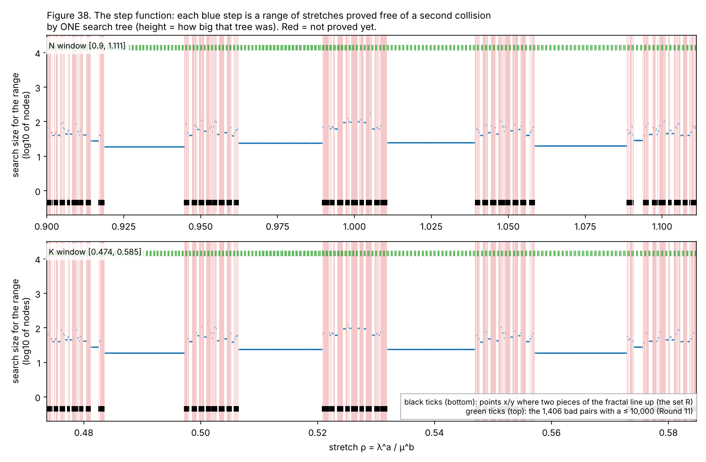

*Figure 38. The step function. Each blue step is a range of stretches proved free of a second collision by one search
tree, drawn at the height of that tree's size. Red is not proved. The red parts are clusters near 0.9·(20/19)^k and their
mirrors, and the black ticks at the bottom show why: they are points where two pieces of the fractal line up. The K window is a scaled copy of the N window, because
N = (10/19)·K as maps. No proved range needed more than 273 search nodes.*

### 16.3 Theorem 12.1 (DRAFT, computer-assisted): every bad pair in the proved ranges

**Theorem 12.1.** Let C be the union of the 1,861 ranges listed in `cover12.json` (they cover 73.5% of
[0.9, 10/9] and 72.0% of [9/19, 100/171], the same to three digits whether measured in ρ or in log ρ). If (a, b) is a bad pair with
λ^a/μ^b in C, then μ^b·h′ = λ^a·g′ has no solution in reduced words. So that pair gives no second collision.

*Proof.* For each range the search above cut every branch, in exact rational arithmetic, with no hit, so no ρ in the
range has a solution. ∎

**Corollary 12.1a (how many pairs).** Order the bad pairs by a. The share whose stretch lies in C tends to the
log-measure share of C, which is 72.7%. *Why:* each a gives at most one b per window (each window is narrower than one
step of b in log ρ), and a·log λ mod log 20 is equidistributed (Weyl), because log λ / log μ is irrational (19 divides
λ's numerator and not μ's). Check Y5 sees it already among the 1,406 pairs with a ≤ 10,000: 1,030 of them (73.3%) lie
in C, against 72.7% predicted.

Together with Round 11, **the only bad pairs still open have a > 10,000 and a stretch outside C.**

### 16.4 Theorem 12.2 (DRAFT, by hand): where the steps must pile up

Call R the set of ratios x/y where x is a point of the fractal coded by an infinite reduced word starting with N, and
y one coded by an infinite reduced word starting with N or K. (In the y-model the fractal is the attractor Λ of the four
letters, which is K rescaled.)

**Theorem 12.2.** (1) R is closed and has Lebesgue measure zero; its dimension is at most 2·s_F ≈ 0.941. (2) If a closed
range J avoids R, halving J often enough always reaches ranges whose searches all finish. (3) At a point of R where two
pieces touch at an endpoint, such as 18/19, the search never finishes on any range containing it.

*Proof.* (1) The codings form a closed set of infinite words, and coding is continuous, so the two point sets are compact
and so is R. Λ is a self-similar set, so its box dimension equals its Hausdorff dimension (Falconer), which is at most
s_F < 1/2 by Round 9's covering argument. So Λ × Λ has upper box dimension at most 2s_F < 1. The map (x, y) ↦ x/y is
Lipschitz there, because y ≥ 1/19. Its image therefore has upper box dimension below 1 and measure zero, and R sits
inside it.
(2) Suppose halving never finishes. Then there are nested ranges shrinking to some ρ₀ in J whose search trees are
infinite. Each tree branches finitely, so each has an infinite uncut branch (König). Passing to a subsequence on which
the first n choices agree, for every n, gives one infinite pair of words (h, g) whose prefixes are never cut at ρ₀. The
"is it cut" tests are strict, so "not cut" passes to the limit. A branch with one word finished cannot go on forever:
if h is finished, covering I needs slope at least 1 and each g-peel divides the slope by at least 10; if g is finished,
fitting inside I needs slope at most 1 and each h-peel multiplies it by at least 10. So both words are infinite, and
h_n(I) meets ρ₀·g_n(I) for every n while both shrink to points. That means h(∞) = ρ₀·g(∞), so ρ₀ is in R, which is a
contradiction.
(3) At 18/19 the identity N(N(0)) = (18/19)·N(1/9) makes the left end of the piece NN touch the right end of the
scaled piece N. The branch h = NN m^n, g = N K^n keeps the touching point for every n, so it is never cut (check Y6). Its
states never repeat: after peeling NNm^(p−2) and NK^(q−1) the slope is ρ·19·20^(p−2)/10^(q−1), and these are all
different. ∎

So the picture Brennan asked for is exactly right: **on any closed range that avoids R, finitely many steps do it; the
steps get shorter and shorter only as they approach R.** Checks Y3 and Y8 confirm that no touching point and no sampled
ratio point of R falls inside a proved step.

*Figure 39. One cluster up close. The red gaps sit on the black ticks, the points of R; between them, steps close.
18/19 is one of the touching points.*

### 16.5 Why this does not finish the proof

- **A bigger search does not help.** In a cluster, raising the budget from 2,000 to 8,000 nodes leaves exactly the same
  ranges unproved (check Y9). An unproved range contains a point of R, so no budget is enough.
- **Finer steps help, but very slowly.** The unproved share of the cluster 0.944–0.963 falls like (width)^0.083
  (Figure 40). That is what a set of dimension about 0.92 does, consistent with the bound 0.941. Halving the unproved
  share would take ranges about 4,000 times narrower.
- **Bad pairs keep landing near R.** The stretches of bad pairs are dense, and R has points in every cluster. So
  infinitely many bad pairs sit in unproved ranges, however fine the steps.
- **A 2D search fails for a clear reason.** I also tried letting the offset vary freely, so a region in the (slope,
  offset) plane could be proved at once and loops could be closed. It fails right away: every 2D region near the
  clusters contains real solutions, and those are not collisions only because their ρ is not of the form λ^a/μ^b. A
  proof has to keep ρ on the line it starts on.

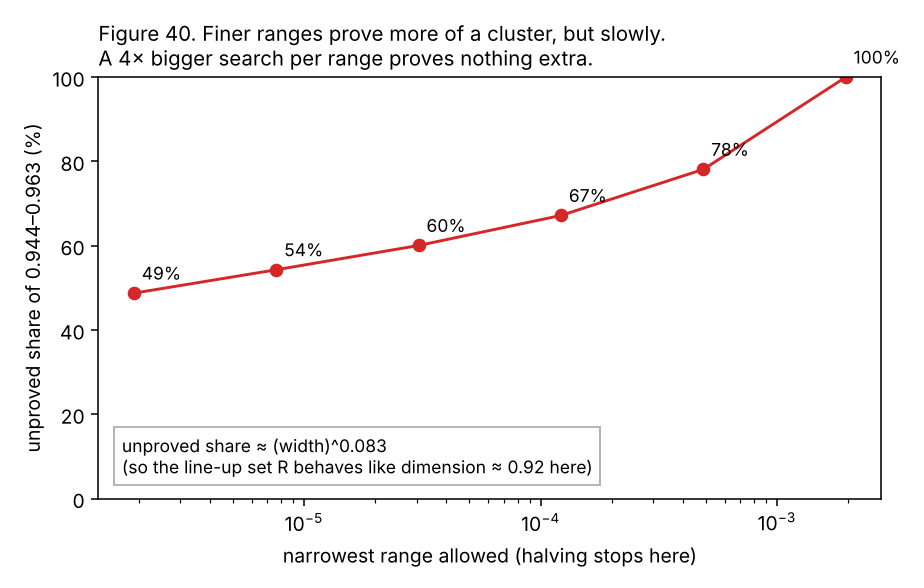

*Figure 40. Finer ranges prove more of a cluster, but slowly. The fitted power says the line-up set R behaves like a set
of dimension about 0.92 there.*

### 16.6 Is it a lead?

**Yes. This round gives a new theorem, not just more cases.** It contributes three things:

1. **Theorem 12.1:** 72.7% of all bad pairs (in the long run, by log measure) have no second collision, for every
   number of copies of λ. Round 11 needed one search per pair and stopped at 10,000.
2. **Theorem 12.2:** a sharp description of where any search of this kind must fail. It fails on a closed,
   measure-zero line-up set R, and only there.
3. **A clean statement of what is left:** the original break is exact if and only if no bad pair with stretch outside C
   has a second collision, and every such pair is either decidable by a finite search (stretch off R) or sits exactly on R.

It would become the full theorem with one of these:

1. **Bad stretches stay a safe distance from R.** For example dist(λ^a/μ^b, R) ≥ c·e^(−Ca). Then each pair's search has
   depth O(a), and a symbolic version of the search could handle all pairs at once.
2. **A uniform argument at the line-ups.** Near a touching point the search follows two infinite tails, such as m^n
   against K^n at 18/19. If the side branches off every tail could be cut uniformly, the clusters would close. The
   catch is that R has infinitely many touching points, not finitely many.
3. **A second collision found.** That would show the size drops below 0.4704834, which is a result in its own right.

### 16.7 Who proved what, round 12

Interval (parametric) branch-and-bound is a standard technique. König's lemma, Weyl equidistribution, Falconer's
"box = Hausdorff for self-similar sets", and box dimension of products and Lipschitz images are all known. Ours (DRAFT):
the range version of the peel-and-prune search, the certificate covering 72.7% of the windows (Theorem 12.1 and its
corollary), the line-up set R and Theorem 12.2, the diagnosis in 16.5, and the 2D negative result. No fresh literature
search this round.

### Known vs new, round 12

| Item | Status | Source |
|---|---|---|
| Branch-and-bound over a parameter range; König; Weyl; box = Hausdorff for self-similar sets | Known | standard |
| Theorem 12.1: no second collision for every bad pair with stretch in C (72.7% by log measure), all a | **Ours** (DRAFT), computer-assisted, exact | 16.3, Y1–Y4, Y7 |
| Corollary 12.1a: in the long run at least 72.7% of bad pairs are settled | **Ours** (DRAFT) | 16.3, Y5 |
| Theorem 12.2: range searches get stuck only on the closed, measure-zero line-up set R (dim ≤ 2s_F) | **Ours** (DRAFT), by hand | 16.4, Y3, Y6, Y8 |
| Original break: size exactly 0.4704834… | **Open** | 16.5 |
