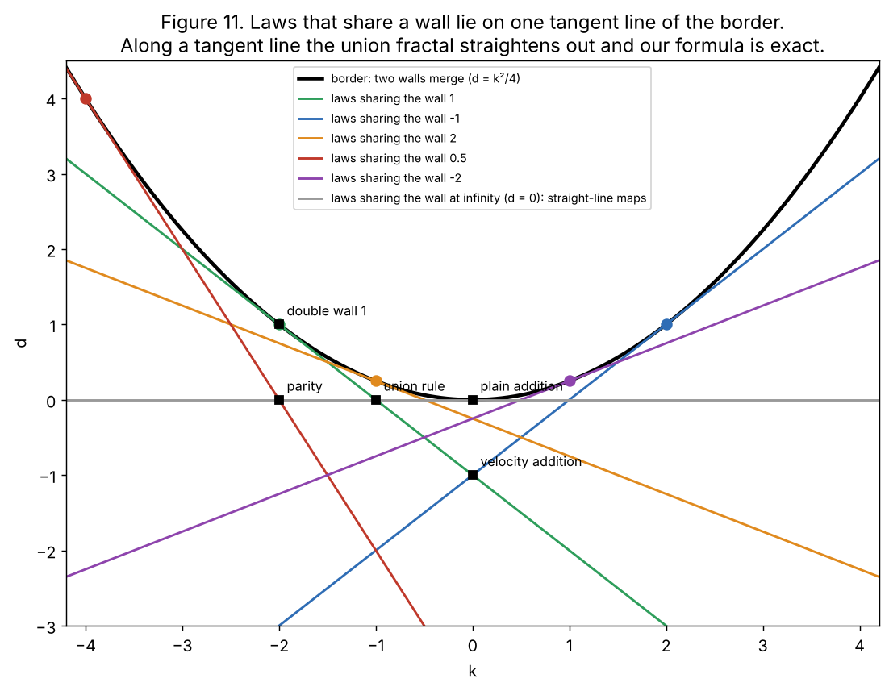
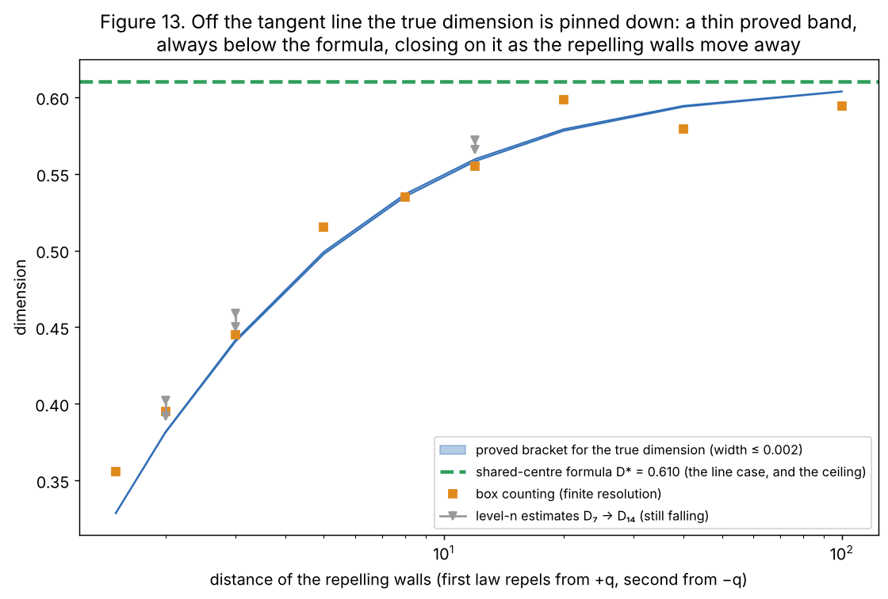
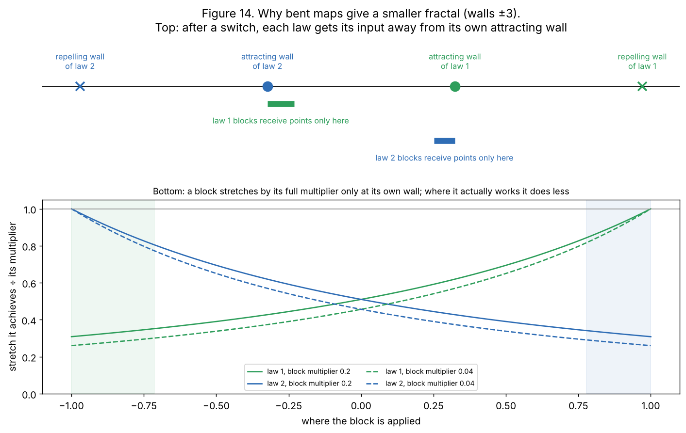
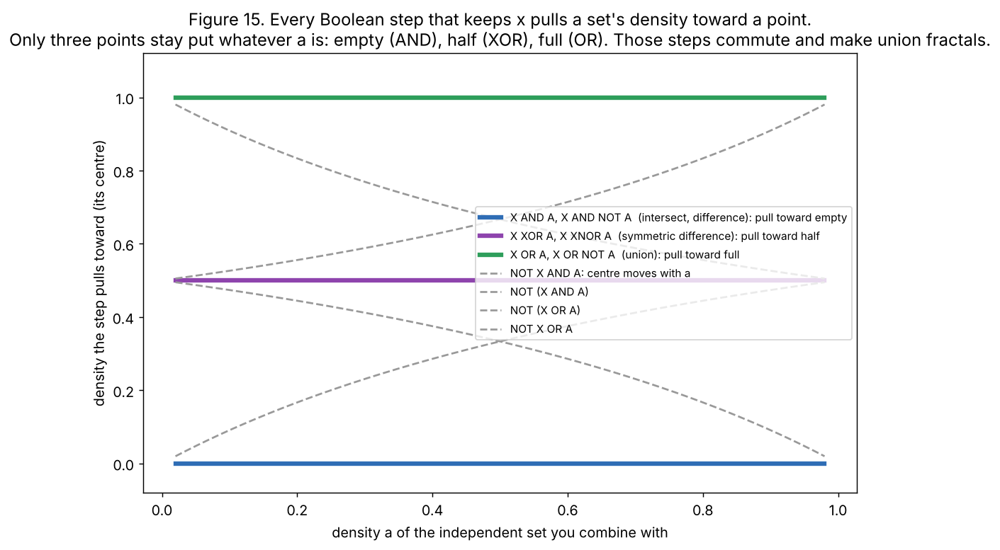
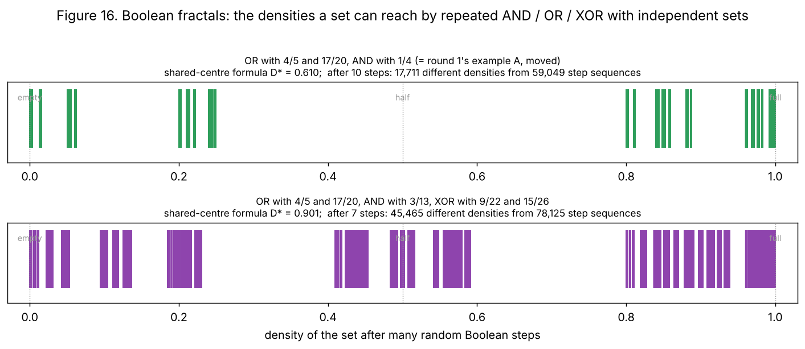

# DRAFT · What ties the new pieces together, and what we can build with them

**DRAFT, Nov 27 2026.** Part of Affine Composition Theory, built on Fused Hyperoperation Algebra. Not reviewed.
Asked for by Brennan (voice, Nov 27): "can we look at some things we've found that are kind of new and see if there's
anything that kind of ties together?", "I'm trying to see if we can build anything with the new things", and "It doesn't
have to be a North Star problem, just curious if we can do anything new, even more new … with our new stuff … in tandem."

Checks: [`checks.py`](checks.py) → [`checks_output.txt`](checks_output.txt), **24 of 24 pass** (numpy, scipy, sympy;
counts in exact rational arithmetic). Numbers: [`union_ifs.py`](union_ifs.py) → `union_ifs.json`. Pictures:
[`figures.py`](figures.py) → [`figures/`](figures/). No Lean in this pass (no Lean toolchain in this workspace).
Colour key: **green = built and tested here, blue = our earlier pieces, orange = known.**

## The answer first

**Yes, three of our new pieces snap together into something we can build: a union fractal.** Take the union rule
(k = −1 / box size, from the set-operations page), use slabs in *different* boxes, and repeat. The shared-centre entropy
rule from the chaos page then predicts the fractal's dimension exactly, and the classic formula (Moran's equation) gets
it wrong whenever two slabs share a box. We built four of these fractals and measured them; the measurements follow our
formula, not Moran's.

**Is it a lead?** A modest one, worth one more step. *Round 2 (section 5): now a theorem on the line, holds in the plane numerically, and fits learning rules and moving averages.* It is a new closed formula that turns "which maps share a centre"
into a dimension, it uses only base pieces (the dial k as box size, centres, order), and it is testable. It is not a
new mechanism: the reason it holds sits inside Hochman's 2014 theory of self-similar sets with exact overlaps. A second,
smaller build answers an open question on the Carnot page: the parabola means every heat-type engine closes in on its
limit at exactly Carnot's rate.

*Figure 1. The new pieces and how they connect. Two ties carried a build (green). One is a reading only (holographic
states always have a non-positive triple overlap). The other new pieces showed no tie worth building on this pass.*

---

## 1. The pieces we started from

Every result the repo marks "not found in print", "ours" or "maybe folklore", gathered from
[`new-facts-levers/`](../new-facts-levers/README.md) (which already lists L1 to L11), the write-ups since, and the
derived-dial catalogue Brennan asked to include.

| Piece | Where | Status in the repo |
|---|---|---|
| Union at the core: a ∘ₖ b is a union in a box, k = −1/(box size); pair dial and triple overlap | `shape-set-operations/` | ours as stated |
| E(k) = (1 + k)^(1/k) + k/(1 + k), mean draws to pass 1 | `shape-set-operations/` (L7) | general formula not found |
| Entropy of affine branches from shared centres (trace monoid) | `chaos-composition/` §6 (L11) | not found; likely folklore |
| The order dial q is an on/off switch for entropy | `chaos-composition/` §6 | ours, probably folklore |
| Heat-type low-dissipation engines on the parabola d = k²/4 − 1 | `carnot-cascade/` | ours |
| Lee–Yang on the ℓp ball (every even p proved) | `lee-yang/` (L4) | rule not found |
| Fuzzy monogamy; corner-sum thresholds | `holographic-entropy-cube/`, `new-facts-levers/` (L3, L1) | not found; thresholds are corollaries of known cones |
| Klein-bottle flow: one sweep, spin loses its sign | `klein-flow/` | one item new to us |
| Derived dials, e.g. curvature −Δ/4 (Δ = k² − 4d), zoom = dimension | `dial-audit/`, `dial-catalog/` | readings |

## 2. Build 1: the union fractal

### The construction

From the set-operations page, joining a slab of size a to a slab of size x, independently, inside a box of size M gives
a union of size

  x ∘ₖ a = a + x − a·x/M,  with k = −1/M.

As a map of x, that is a straight-line map with slope s = 1 − a/M, and it pulls everything toward one point: **x = M, the
box completely full** (check U2). That point is its centre. From the order-dial page, two such maps commute exactly when
they share a centre, which here means **the same box**; otherwise the two orders differ by a1·a2·(M1 − M2)/(M1·M2)
(check U3).

So pick a few slabs, put them in boxes, and keep joining at random. The points you can reach form a fractal.

*Figure 2. Example A: two slabs in box 1, one in box 3. Top: each map squeezes the whole range toward its own "box full"
point. Bottom: the fractal. The two box-1 maps commute, so many different words land on the same point.*

### Counting what you can reach

From the chaos page, maps that share a centre form a trace monoid, and Cartier and Foata (1969) count it: with mᵢ maps in
box i, the number of different composite maps of length n is the tⁿ coefficient of 1/μ(t), where
μ(t) = 1 + Σᵢ [(1 − t)^mᵢ − 1]. We counted the distinct composite maps exactly, as fractions, for four families up to
length 11. They match the formula every time (checks U4 to U7).

*Figure 3. Dots: distinct maps, counted exactly. Lines: the shared-centre formula. Dotted: all words. In example D only
395,033 of 4,194,304 words of length 11 give different maps.*

### The dimension formula

Weight each map by its shrink factor to the power D and run the same count. The dimension is where the weighted count
stops shrinking, which gives

  **1 + Σ over boxes [ ∏ over that box's maps (1 − sᵢ^D) − 1 ] = 0.**

With one map per box this is exactly Moran's equation Σ sᵢ^D = 1 (check U8). When two or more maps share a box it gives
a smaller number, because those maps stop creating new points when you swap their order.

*Figure 4. Left: the upper bounds D_n run straight to our formula (stars) as words get longer, not to Moran's value
(crosses). Right: box counting of the actual picture.*

| Example | Moran (ignores commuting) | Our formula D* | D_n extrapolated | Box counting |
|---|---|---|---|---|
| A: two in box 1, one in box 3 | 0.680 | **0.610** | 0.610 | 0.632 |
| B: two boxes, two maps each | 0.751 | **0.666** | 0.666 | 0.666 |
| C: three boxes, one map each | 0.618 | **0.618** | 0.618 | 0.619 |
| D: three in box 1, one in box 5 | 0.794 | **0.688** | 0.688 | 0.687 |

**What is proved and what is not.** The upper bound is proved: the fractal is covered by its images under the distinct
maps of length n, so its dimension is at most D_n for every n, and D_n falls to D* (checks U9, U10). That the dimension
*equals* D* is supported by the box counts (check U11) and is what Hochman's theorem (Annals 2014) leads one to expect,
since rational data keep distinct maps far enough apart. *Round 2 (section 5) writes that lower bound out.*

*Figure 5. The commuting discount. Same slabs, same shrink factors: putting the second slab in the first slab's box
(green) instead of its own box (grey) lowers the dimension by up to about 0.1.*

### What it ties together

- **Set operations** give the maps (union in a box) and say what the centre is: the box full.
- **The order dial** says which maps commute: same box.
- **The chaos page's shared-centre rule** gives the count, and with weights, the dimension.
- **The dial audit** says the zoom is the dimension D, the one number the ratio dial r owns. So this is a recipe that
  reads the zoom off the k dial: each box is one value of k, and the pattern of how many maps share each k fixes D.
- **The q switch** fits too: the in-between amounts come in fixed steps from which maps share a box, not from a smooth
  dial.

### Is it a lead?

**A modest lead, worth one more step.** For: it is a closed formula we did not find stated, it is exact where tested,
it predicts a visible effect (the commuting discount), and it is built from base pieces only. Against: it is a special
case of a known general theory (dimension of self-similar sets is set by the semigroup the maps generate, and here that
semigroup is a trace monoid), so it adds a clean formula, not a new mechanism. Next steps, in order: (1) write the lower
bound from Hochman's theorem; (2) put the count and the upper bound in Lean; (3) try the same recipe on the full plane
laws (k and d together), where maps are Möbius rather than straight lines and commute when they share both walls.

## 3. Build 2: what "discriminant 4" means on the Carnot parabola

The Carnot page placed the heat-type low-dissipation engines (Schmiedl and Seifert's η_C/(2 − γη_C)) on the parabola
d = k²/4 − 1 and left one question open: does "discriminant 4" mean anything physical? Read with the curvature dial from
the derived-dial catalogue, −Δ/4, the parabola is the leaf of **curvature exactly −1** (check C1).

That has a plain physical meaning. In the cascade coordinate β = ln(T_hot/T_cold), each of these efficiencies obeys
dη/dβ = ½(1 + kη + dη²) (check C2), and near its limit the gap closes at rate ½√Δ (check C5). With Δ = 4 that rate is 1,
so **every heat-type engine closes in on its limit like e^(−β), the same rate at which Carnot's waste fraction T_cold/T_hot
shrinks** (check C3). Curzon–Ahlborn sits at curvature −1/4 and closes at half that rate (check C4).

*Figure 6. Left: the heat-type engines run along the curvature −1 leaf from parity to velocity addition. Right: their
gaps all fall at Carnot's rate (dashed); Curzon–Ahlborn falls at half rate (dotted).*

**Is it a lead?** No, but it closes the Carnot page's open question with a clear statement: discriminant 4 is "Carnot
speed". It is two lines of calculus once the parabola is known.

## 4. Pairs we looked at that didn't build

- **Fuzzy monogamy with the pair dial.** Read entropies as sizes: each pair of regions gets a pair dial
  k = −I(A:B)/(S_A·S_B), and the triple overlap is the tripartite information I₃. Monogamy then says geometric states
  always have a non-positive triple overlap, so their three-way union never exceeds the one-dial prediction. That is a
  restatement of monogamy (Hayden, Headrick and Maloney 2013), not a new constraint. Reading only.
- **Chaos entropy with the Lee–Yang dial gas.** The shared-centre polynomial μ(t) is the dial gas at k = 0 on the
  "doesn't commute" graph, so its smallest root is a hard-core gas zero. That root is known to be real and dominant
  (Scott and Sokal 2005, cited from memory), so the tie organises but predicts nothing here.
- **Lee–Yang, Klein flow, why-i, E(k).** Each pair shares a theme (sign flips, stopping times) but no construction used
  two of them at once on this pass.

## Assumptions

- Union maps use rational slabs and boxes; distinct composites were counted exactly to length 11 (four families).
- The dimension formula assumes different words give different maps unless commuting forces equality. The chaos page
  showed this can fail at special slopes (an accidental collision at slopes 1/2, 1/3, 1/5); the examples here were
  checked exactly and have none.
- Box counting uses the images of the box-full points under all length-11 maps, at 6 middle scales; it is an estimate.
- The Carnot reading uses the heat-type family exactly as on the Carnot page.

## Known vs new

| Item | Status | Source |
|---|---|---|
| Union in a box, k = −1/M | Ours as stated | `shape-set-operations/` |
| Affine maps commute iff they share a centre | Known | `order-dial/` |
| Trace monoid count, Cartier–Foata polynomial | Known | Cartier and Foata 1969 |
| Exact overlaps and dimension of self-similar sets | Known | Hochman, Annals of Math. 180 (2014); Ngai and Wang 2001 |
| Moran's equation | Known | Moran 1946 |
| Dimension formula 1 + Σ[∏(1 − sᵢ^D) − 1] = 0 for maps sharing centres in classes | **Not found in print** (two searches); upper bound proved here, equality numerical | this page, checks U1–U11 |
| The commuting discount (Figure 5) | Ours, numerical consequence of the formula | this page |
| Heat-type engines' gap closes at rate e^(−β); discriminant 4 = curvature −1 | Ours; two lines from known forms | this page, checks C1–C5; Schmiedl and Seifert 2008 |
| Monogamy as a non-positive triple overlap | Known (restatement) | Hayden, Headrick, Maloney 2013 |

Searches run (Nov 27): self-similar sets with commuting homotheties and exact overlaps; dimension with Möbius functions
or Cartier–Foata. They found Hochman's work and the exact-overlaps literature, nothing on this class with this formula.

- Hochman, "On self-similar sets with overlaps and inverse theorems for entropy": https://arxiv.org/pdf/1212.1873
- Hochman, ICM survey "Dimension theory of self-similar sets and measures": https://math.huji.ac.il/~mhochman/preprints/icm-4.pdf

---

## 5. Round 2: more rigorous, and more places it applies (DRAFT)

Asked for by Brennan (voice, Nov 27): "let's just keep looking at this and seeing if we can make it more rigorous and
more useful", "when I say more useful, more applicable to other scenarios."

Checks: [`checks2.py`](checks2.py) → [`checks2_output.txt`](checks2_output.txt), **22 of 22 pass**. Numbers:
[`round2.py`](round2.py) → `round2.json`. Pictures: [`figures2.py`](figures2.py). Lean:
[`lean/NewTies.lean`](lean/NewTies.lean), 10 theorems (12 after round 3), core Lean, no `sorry`. Not compiled in the
workspace that wrote it; **compiled clean on Nov 27 in the shared library** as `FusedAlgebra.Topics.NewTies` (namespace
`CircleOp.NewTies`), all 12 theorems including the three `decide` counts, no proof changed.

### The result in plain words

**On the line the formula is now a theorem.** For straight-line shrinking maps with rational (or algebraic) numbers and
no accidental collisions, the fractal's dimension is exactly the smaller of 1 and our D*: the upper bound needs nothing,
and the lower bound comes from a free piece of the fractal plus Hochman's 2014 theorem. **It carries over** to maps that
flip, to turning maps in the plane (numerically), and its counting part to the plane laws (k, d). **One real scenario
fits it exactly:** Rescorla–Wagner learning, and any moving average with several rates, where same-target updates
commute and the learner forgets their order. Still a modest lead: a clean, now-rigorous tool with real uses, not a new
mechanism.

### 5.1 The theorem

**Setting.** Maps fᵢ(x) = cᵢ + sᵢ(x − cᵢ) on the line with 0 < |sᵢ| < 1, sorted into classes by centre (a union in a box is
the case cᵢ = box size, sᵢ = 1 − slab/box). Write Pⱼ(D) = ∏ over class j of (1 − |sᵢ|^D) and
μ(D) = 1 + Σⱼ [Pⱼ(D) − 1]. D* is the root of μ(D) = 0 (at least two classes; one class gives a single point).

**Theorem.** (a) dim K ≤ min(1, D*), always. (b) If every cᵢ and sᵢ is algebraic (for example rational) and different
shared-centre words never give the same map (no accidental collisions), then dim K = min(1, D*).

**Proof of (a).** Maps with one centre commute (Lean `same_centre_commute`), so every word equals a word of the trace
monoid. Weighted Cartier–Foata: Σ over traces g of |s_g|^D·tⁿ⁽ᵍ⁾ = 1/μ_D(t), with μ_D(t) = 1 + Σⱼ[∏(1 − t|sᵢ|^D) − 1].
Each Pⱼ(D) grows with D, so for D > D* we have μ_D(1) > 0; μ_D(t) falls as t grows, so it stays positive on [0, 1] and
the series converges at t = 1. Its tail at length n goes to 0, and the length-n images cover K, so the D-dimensional
measure of K is 0. Hence dim K ≤ D for every D > D*. Collisions only shrink the cover, so (a) needs no assumption.

**Proof of (b), lower bound.** Single out class 1. Let N be the monoid of the other classes, and let S be the set of words
u·v with u a nonempty word in class 1 and v a nonempty element of N. Every element built from S splits uniquely at its
class-1 blocks (normal form in a free product), so S generates a **free** monoid. Take the finitely many generators S_L
up to length L. With no accidental collisions, the IFS S_L has no exact overlaps; its numbers are algebraic; so by
Hochman's theorem (Annals of Math. 180, 2014: on the line, algebraic parameters and no exact overlaps give
dim = min(1, similarity dimension)) its attractor has dimension min(1, s_L), where Σ over S_L of |s_g|^(s_L) = 1. That
attractor sits inside K. As L grows the sum fills out to (1/P₁ − 1)(1/Q − 1), with Q = 1 + Σ_{j≥2}(Pⱼ − 1) from Cartier–Foata
for N (it converges at D* because Q(D*) = 1 − P₁(D*) > 0). Setting it to 1 is the same as P₁ + Q = 1 (Lean
`lower_bound_key`), which is μ(D) = 0. So s_L rises to D*, and dim K ≥ min(1, D*). ∎

*Figure 7. The squeeze, computed. Lower bounds from the free piece (solid) climb and upper bounds (dashed) fall onto the
same line. At L = 10 every lower bound is within 0.0001 of D*. The free piece was checked exactly: e.g. 15,625
words of its generators give 15,625 different maps.*

**What the hypothesis costs.** "No accidental collisions" can fail at special numbers (the chaos page found one at
slopes 1/2, 1/3, 1/5; this round found one among Möbius maps at length 4, check G5). For given rational numbers it can
be checked exactly up to any length, but not for all lengths at once. Kittle and Kogler (2026, reported in search
results, not read) claim the exact-overlaps conjecture on the line, which would remove the "algebraic" condition.

### 5.2 Where it holds

*Figure 9. Green: proved. Blue: numerical. Orange/grey: the formula does not apply as it stands.*

- **Flips (slopes below 0, past the wall).** Nothing changes: use |s|. Count and upper bound checked (G1, G2).
- **The plane.** Turning-and-shrinking maps z ↦ c + λ(z − c) with complex λ commute exactly when they share a centre, so
  the same count and formula hold with |λ| in place of s and min(2, D*) as the cap. Upper bound proved the same way;
  the lower bound needs Hochman's higher-dimensional theorem, whose extra conditions we haven't checked. Numerically it
  fits (Figure 8): D* = 1.191, box counting 1.194, Moran 1.251.
- **Plane laws (k, d).** Each law's maps are Möbius maps fixing that law's two walls, so maps from one law commute and
  the count is the same shared-centre count (G6, two examples). The dimension is not given by this closed formula,
  because Möbius maps don't shrink by one fixed factor; it needs Bowen's equation with derivatives. Open.
- **Commuting that isn't by classes.** For straight-line maps, "commute" is always "same centre", so classes are all
  there is. Maps that commute without being classes (e.g. acting on separate coordinates) need the general
  Cartier–Foata polynomial over the commuting graph; not done.

*Figure 8. Left: the plane version, four maps about three centres; two share centre 0 and one of those also turns.
Right: the dimension follows our formula, not Moran's.*

### 5.3 A real scenario: learning rules and moving averages

The Rescorla–Wagner rule (psychology's standard model of conditioning, also the "delta rule" of machine learning) updates
an associative strength by V ← V + rate·(target − V). That is a stretch about the target with slope 1 − rate: our maps
exactly, with the target as the centre. Trials that aim at the same target commute, whatever their rates; trials aiming
at different targets don't. The same holds for any exponential moving average whose smoothing rate changes.

We tested three trial types: reward with a bright cue (rate 0.8), reward with a dim cue (rate 0.85), no reward
(rate 0.75). Counted exactly: after 11 trials the learner can be in only 46,368 different states, out of 177,147 trial
histories (every other Fibonacci number, S1). So **the learner's state can carry at most 1.39 bits of history per trial,
not log₂3 = 1.58**, and with trials in random order it keeps about 1.28 bits per trial (S2). The reachable strengths
form a fractal of dimension 0.610.

*Figure 10. Left: different learned strengths (exact) against trial histories. Right: bits of history the state can
carry per trial.*

**Why it's useful.** It gives a closed answer to "how much of its past can a moving average or delta-rule learner
remember, and how finely must you read its state to recover it", and it says what helps: giving each update its own
target restores order information; varying only the rate does not. That the order of same-target updates is lost is
elementary; the exact count and the dimension are what the formula adds.

### 5.4 Lead or not

**A modest lead, now on firmer ground.** For: a real theorem on the line (given Hochman), the same picture in the plane,
the counting part for every plane law, and a scenario where it applies exactly. Against: the mechanism is Hochman's and
Cartier–Foata's; ours is the closed formula, the free-piece proof and the reading. Next, if wanted: (1) compile the Lean
file (done: it compiles in the shared library); (2) the plane lower bound via Hochman's higher-dimensional theorem; (3) Bowen's equation for the plane laws, to see
whether the shared-centre count still sets a clean dimension there.

### Known vs new, round 2

| Item | Status | Source |
|---|---|---|
| Hochman's theorem: algebraic parameters, no exact overlaps ⇒ dim = min(1, s-dim) | Known | Hochman 2014 (as stated in his ICM survey) |
| Normal form in free products; Cartier–Foata weighted count | Known | standard; Cartier and Foata 1969 |
| Theorem: dim K = min(1, D*) for shared-centre classes (algebraic, no accidental collisions) | **Not found in print**; our proof from known pieces | this page, L1–L4 |
| Plane version, counting for plane laws | Ours; plane dimension numerical | G3–G6 |
| Rescorla–Wagner as stretches about the target | Known form (Rescorla and Wagner 1972) | — |
| Exact state count and bits-per-trial for mixed-rate learners | Ours (as stated); elementary consequence | S1–S3 |
| Exact-overlaps conjecture on the line | Reported proved, not checked | Kittle and Kogler 2026 (arXiv:2610.10511, from a search result) |

---

## 6. Round 3 (DRAFT): the plane laws, which ones keep the formula

Brennan asked to work out the dimension for the plane laws (k, d) next. This section does that. Everything here is
DRAFT. The checks are in `checks3.py` (18/18 pass, output in `checks3_output.txt`), the numbers in `planelaws.py`
and `planelaws_sweep.py`, the pictures in `figures3.py`.

### 6.1 The answer in two sentences

Laws that share a wall lie on one straight line in the (k, d) plane, and that line touches the border d = k²/4. When all
the maps share their repelling wall (they sit on one such tangent line), the union fractal straightens out into the line
case and the formula D* is exact; when they don't, D* is still a proved upper bound, and the true dimension is lower,
climbing back toward D* as the repelling walls move away.

### 6.2 The setup

A plane law with dials k, d combines a and x as x ↦ (x + a + k·a·x)/(1 − d·a·x). For fixed a that is a Möbius map, matrix
[[1 + k·a, a], [−d·a, 1]]. Its two fixed points, the **walls**, are the roots of d·x² + k·x + 1 = 0, the same for every a.
So every map of one law has the same two walls, one attracting and one repelling. That is the plane-law version of a
shared centre: maps of one law commute, maps of different laws don't (unless they share both walls).

The union rule of rounds 1–2 is the line d = 0, where one wall has gone off to infinity.

### 6.3 Tangent lines (new reading)

Fix a wall w. The laws that have w as a wall are the (k, d) with d·w² + k·w + 1 = 0, a straight line. That line touches
the border d = k²/4 (where the two walls merge) at exactly one point, k = −2/w, d = 1/w² (T1, and Lean `wall_line_tangent`:
k²w² + 4kw + 4 = (kw + 2)²). So:

- **Each wall is a tangent line of the border.** Every law off the border sits on two tangent lines, one for each wall.
- The d = 0 axis is the tangent line "at infinity": the affine laws all share the wall ∞. That is why the line case works.
- Velocity addition (k = 0, d = 1) and the union rule in the unit box (k = −1, d = 0) both lie on the tangent line for the
  wall 1 (T3).

*Figure 11. The (k, d) plane. Grey curve: the border d = k²/4. Coloured lines: laws sharing the wall w, one line per w,
each touching the border once. The horizontal axis d = 0 is the shared wall ∞ (the affine case).*

### 6.4 Result P1: on a common tangent line, the formula is exact

**Statement (DRAFT, ours).** Take several plane laws that share their repelling wall w, with distinct attracting walls,
and any number of maps per law. Change coordinates by y = 1/(x − w). Every map becomes a straight-line map, and its slope
is its multiplier at its attracting wall (T4–T5, exact fractions). So the union fractal is exactly a round-2 union
fractal on the line, and its dimension is min(1, D*) with D* computed from the multipliers, under the same hypothesis as
round 2 (algebraic parameters, no accidental collisions).

**Why.** In the y coordinate the shared wall w goes to ∞, so every map fixes ∞
and is affine. This is standard; what's ours is reading it on the dial plane as "lie on one tangent line".

**Check.** Two laws with repelling wall 3 and attracting walls 1 and −1; the first law gives two maps (multipliers 1/5 and 3/20), the second one map (multiplier 1/4): box count 0.605 vs D* 0.610 (T7). The
cruder bound from the largest derivative gives 0.95 (T8), so the straightening is doing real work.

### 6.5 Result P2: off a common tangent, D* is an upper bound

**Statement (DRAFT, ours).** Take plane laws with different repelling walls. Suppose that for each law no attracting wall
lies between its attracting wall and its repelling wall (with two laws: the repelling walls sit on opposite sides,
each beyond its own attracting wall). [Round 4 note: wording tightened; with a third law whose attracting wall sits in
the middle, a map can stretch by more than its multiplier and D* is no longer a ceiling.] Then on that hull every map
contracts by at most its multiplier at its attracting wall, so dim ≤ min(1, D*) (T10, from
f′(x) = λ·(f(x) − q)² / (x − q)², with q the repelling wall).

The count of distinct composites is still the shared-centre count from round 1 (T6, T9), so only the sizes change, not
the combinatorics. The true dimension is the critical exponent of the Poincaré series over the trace monoid (Bowen's
equation). There is no closed form; we computed it.

| Repelling walls | Measured dim (box) | Poincaré estimate D_n | D* (upper bound) |
|---|---|---|---|
| ±2 | 0.395 | 0.396 | 0.610 |
| ±3 | 0.445 | 0.454 | 0.610 |
| ±12 | 0.555 | 0.568 | 0.610 |
| shared (3) | 0.605 | — | 0.610 |

Sweep (T12): same maps, first law repelling from q and second from −q, D_n = 0.340, 0.392, 0.451, 0.507, 0.545, 0.567, 0.587, 0.602, 0.612 for
q = 1.5, 2, 3, 5, 8, 12, 20, 40, 100. It climbs to D* as the walls move to infinity, which is the line case again.

*Figure 12. Left: two union fractals with the same multipliers and the same attracting walls 1 and −1. Top: both laws
repel from 3 (shared wall, formula exact). Bottom: they repel from 3 and −3 (no shared wall, smaller). Right: dimension
against how far the repelling walls ±q are, rising toward the formula's value, which is the upper bound.*

### 6.6 What this means in plain terms

The shared-centre count (how many different results you can get) works for every plane law. The size formula works
exactly when everything is pushed away from one common point, which on the dial map means "all on one tangent line". When
the maps are pulled toward different points, the pieces bend and get smaller than the formula says, by an amount that
depends on how close those points are. The formula is then a ceiling, not the answer.

### 6.7 Lean

Two more identities are in `lean/NewTies.lean`: `fixes_wall` (the map fixes w exactly when d·w² + k·w + 1 = 0) and
`wall_line_tangent` (the wall line touches the border). That makes 12 theorems in the file (13 after round 4). **Compiled clean on Nov 27 in the shared library** build (`FusedAlgebra.Topics.NewTies`), and the topic file itself is built by CI's topic Lean step. **[Round 5: all theorems build, see 8.3.]**

### 6.8 Lead or not

**The lead continues, modestly.** For: a clean, checkable classification of which plane laws keep the formula (exact on a
common tangent line, upper bound off it), and the tangent-line picture is a new and simple way to read the (k, d) map.
Against: the straightening is a standard Möbius fact, and off the tangent line there is no closed formula, only a bound
and numbers. Next, if wanted: (1) prove the lower bound off the tangent line (it needs a nonlinear version of Hochman's
theorem, which exists for some analytic families); (2) the plane lower bound for complex similarities.

### Known vs new, round 3

| Item | Status | Source |
|---|---|---|
| Möbius maps with a common fixed point conjugate to affine maps | Known | standard |
| Bowen's equation / Poincaré critical exponent for conformal IFS | Known | Bowen 1979; Mauldin and Urbański |
| Laws sharing a wall lie on a tangent line of d = k²/4 | **Ours** (elementary) | T1, `wall_line_tangent` |
| P1: exact formula on a common tangent line | **Ours** (from round 2 + standard conjugation) | T4–T7 |
| P2: D* upper bound off the tangent line, numbers and sweep | **Ours** (bound proved, values numerical) | T9–T12 |

---

## 7. Round 4 (DRAFT): the true dimension off the tangent line

Brennan asked to prove the true size off the tangent line, where round 3 had only a ceiling and numbers. This section
does it. Everything here is DRAFT. Checks: `checks4.py` (13/13 pass, output in `checks4_output.txt`). Bounds:
`offline.py`. Level-n cross-check: `dn_levels.py`. Pictures: `figures4.py`. Lean: one more
theorem, `two_law_threshold`, in `lean/NewTies.lean` (13 in all), compiled clean on Nov 27 in the shared library.

### 7.1 The answer in two sentences

Off the tangent line the dimension is still set by the shared-centre count, but each word is weighted by how much it
really stretches instead of by its multipliers; that is a theorem, resting on a 2021 theorem of Solomyak and Takahashi.
We can compute that number with proved bounds to within 0.002, and it is always strictly below the line-case formula:
0.381 at walls ±2, 0.441 at ±3, 0.559 at ±12, against 0.610.

### 7.2 Result P3: what the dimension is (DRAFT, ours, conditional)

**Setting.** Plane laws, each with an attracting wall and a repelling wall, any number of maps per law, all multipliers
positive. Let M be the trace monoid of round 1 (maps of one law commute, different laws don't). For a word w in M let
f_w be its map and ‖f_w′‖ the largest stretch of f_w on the hull of the attracting walls. Define

  **δ = the critical exponent of Σ_{w ∈ M} ‖f_w′‖^t** (the t where this sum switches from infinite to finite).

**Hypotheses.** (H1) the laws' dials and the maps' parameters are algebraic numbers; (H2) there is a closed interval V
with every attracting wall inside it and every repelling wall outside it (each map then sends V strictly inside itself);
(H3) no accidental collisions: different words of M give different maps; (H4) at least two laws.

**Statement.** dim K = min(1, δ).

**Proof (four steps).**

1. *Upper bound.* K is covered by the images of the hull under the distinct words of length n. Möbius maps that send V
   inside itself have bounded distortion on the hull (their poles stay outside V), so each image has length at most a
   fixed constant times ‖f_w′‖. For t > δ the sum converges, so its tail goes to 0 and the t-dimensional measure of K
   is 0. So dim K ≤ δ. (Standard covering argument.)
2. *Free pieces.* Use round 2's first-return pieces: S = {u·v : u a nonempty word of law 1, v a nonempty word in the
   other laws}. They generate a free monoid inside M (round 2, combinatorial), and every word of M splits uniquely as
   (other-law prefix)·(word in S)·(law-1 suffix). Because the maps preserve V, their matrices preserve a cone strictly,
   so stretches multiply up to fixed constants (standard quasi-multiplicativity). The two outer factors have smaller
   critical exponents (law 1 alone: 0; the other laws: at most that of S, because S contains u·v for every v), so
   **δ = the critical exponent of the free monoid generated by S**.
3. *Finite pieces.* Let S_L be the pieces with u and v of length at most L. Their critical exponents δ_L increase to δ.
   This is the finite-approximation property of pressure for infinite conformal systems (Mauldin and Urbański 1996). It
   uses only bounded distortion, not any separation condition.
4. *The cited theorem.* Normalise each matrix of S_L by the square root of its determinant (positive by assumption): the
   entries stay algebraic. By (H3) and step 2 the matrices generate a free semigroup. They send V strictly inside itself
   (a strictly invariant cone, i.e. uniform hyperbolicity), and the attractor is not a point (H4). Solomyak and
   Takahashi (IMRN 2021, Theorem 1.7, with their remark that algebraic entries plus a free semigroup give the strong
   Diophantine property) then give dim K_L = min(1, δ_L), where their s_A/2 is our δ_L. Since K_L ⊂ K,
   dim K ≥ min(1, δ_L) for every L, so dim K ≥ min(1, δ). ∎

**Who proved what.** Steps 1–3 are standard tools; step 4 is Solomyak and Takahashi's theorem, applied to pieces that only
our round-2 construction makes free. The statement for shared-centre plane laws, and the reduction, are ours. We read
their abstract and the statement of Theorem 1.7 and the algebraic remark (arXiv:1902.11059); we did not check their proof.
Christodoulou and Jurga (Trans. AMS 2026) extend that theorem; we did not read it. (H3) is checked, not proved: the 10
pieces of S_2 at walls ±3 give 1000 different maps for their 1000 words of length 3 (U3). [Round 5: now checked to length 14 for these examples, and proved for a family, see 8.2.]

On the tangent line δ equals D* (round 3, P1), so P3 contains P1. In the line case (affine maps) it is round 2's theorem.

### 7.3 Result P4: computing δ, with proved bounds (DRAFT, ours)

A word of M is a chain of **blocks** (maximal runs of one law). A block of law i with multiplier λ, applied at a point y,
stretches by exactly

  **λ · ((1 − z)/(1 − λz))²**, where z = (y − p)/(y − q) for that law's walls p, q (U1, exact fractions).

So it gets its full multiplier only at its own attracting wall (z = 0), and less the further away it works. After a switch,
a law's block always receives its input from the previous law's block, which has pushed the point toward the *other*
attracting wall. At walls ±3, law 1 blocks only ever receive points in [−1, −0.71] and law 2 blocks only in [0.78, 1]
(Figure 14). Bounding each block's factor above and below by the extreme z over where it can receive points (remembering
the previous block's law and size) gives two switching matrices; δ lies between the t-values where their spectral
radius is 1. With two laws and no memory this is the round-2 rule x₁·x₂ = 1 (Lean `two_law_threshold`).

**Statement.** Under the round-3 P2 geometry (for each law no attracting wall lies between its two walls), δ is strictly
below D* whenever the laws don't all share their repelling wall, and the bounds below are proved.

| Repelling walls | Proved bracket for δ | D* (line case) | Level-n estimate, extrapolated |
|---|---|---|---|
| ±2 | 0.3812 to 0.3817 | 0.6104 | 0.382 |
| ±3 | 0.4407 to 0.4417 | 0.6104 | 0.441 |
| ±12 | 0.5583 to 0.5597 | 0.6104 | 0.559 |
| ±10⁷ | 0.61037 (closes) | 0.6104 | — |

**What makes the bracket a proof.** The block formula is exact; the input regions are outer bounds (iterated to a fixed
point, and checked on 900 random words, U4); sums are cut at block degree 40 with the tail bounded by the pure-multiplier
tail; and a larger matrix gives a larger spectral radius (Perron–Frobenius). Strictness: every switch costs a factor
below 1 on an irreducible matrix, so the spectral radius at D* is below 1. Caveat: the arithmetic is double precision, not
interval arithmetic; the bracket widths are far larger than rounding, but an interval-arithmetic rerun would make it
airtight. [Round 5: done, see 8.1. The certified brackets are a hair wider.]

**Cross-check.** The direct level-n estimates fall slowly, roughly like 1/n (at ±3: 0.459 at n = 7, 0.450 at n = 14).
Extrapolating linearly in 1/n lands inside or within 0.002 of every bracket (U6). The round-3 box counts (0.395, 0.445,
0.555) sit a little high or low for the same finite-resolution reason; the brackets replace them.

*Figure 13. The thin blue band is the proved bracket for the true dimension, against how far away the repelling walls
are. Dashed: the line-case formula, which is the ceiling. Orange: box counts. Grey: level-n estimates from n = 7 down
to n = 14, still falling toward the band.*

*Figure 14. Why bent maps make a smaller fractal (walls ±3). Top: where each law's blocks receive their points, always
on the far side, near the other law's wall. Bottom: the stretch a block achieves divided by its multiplier, by where it
is applied. It is 1 only at its own wall and well below 1 in the shaded regions where blocks really work.*

### 7.4 What this means in plain terms

The count of different outcomes is the same everywhere: the shared-centre count from round 1. What changes off the
tangent line is how big each outcome's piece is. Each law does its work on points the other law has just pulled away, so
it never gets to stretch fully, and the fractal is thinner. Now that thinning has an exact meaning and can be computed
to three decimals with a proof.

### 7.5 Lead or not

**Still a lead, and a better-founded one.** For: the dimension of every shared-centre union fractal on the line and for
plane laws is now characterised by one theorem (exact formula on a tangent line, a computable critical exponent off it,
with proved brackets), and the shared-centre count is what feeds both. Against: the hard analysis is Solomyak and
Takahashi's and Hochman's; ours is the construction that makes their theorems apply, the formulas, and the computations.
Next, if wanted: (1) rerun the brackets in interval arithmetic; (2) prove (H3) for a family, not just check it; (3) the
plane (complex) lower bound, which needs a different cited theorem.

### Known vs new, round 4

| Item | Status | Source |
|---|---|---|
| dim = min(1, critical exponent) for free algebraic SL₂ projective systems with an invariant interval | Known | Solomyak and Takahashi, IMRN 2021, Thm 1.7 (statement read, proof not checked) |
| Finite approximation of pressure for infinite conformal systems | Known | Mauldin and Urbański 1996 |
| Bounded distortion, cone quasi-multiplicativity, covering upper bound | Known | standard |
| P3: dim K = min(1, δ) for shared-centre plane laws via free first-return pieces | **Ours** (conditional on the cited theorem and H1–H4) | 7.2 |
| Block stretch formula λ((1−z)/(1−λz))² | Elementary | U1 |
| P4: proved brackets, strictly below D* off the tangent line | **Ours** (double precision) | U4–U9, `offline.py` |

---

## 8. Round 5 (DRAFT): airtight bounds, no collisions proved for a family, Lean builds

Brennan asked to make the bounds airtight. Checks: `checks5.py` (14/14 pass, output in `checks5_output.txt`).

### 8.1 Certified brackets

`exact_bounds.py` redoes section 7.3 so that no rounded number enters a claimed inequality. Walls, multipliers, block
multipliers, input regions and z-ranges are exact fractions (regions rounded outward, which only widens them). Powers
and sums use ball arithmetic (python-flint's arb, 128 bits), which returns guaranteed enclosures. The spectral-radius
claims are certified by a test vector v > 0 (the Collatz–Wielandt test): if T·v < v in every entry, the spectral radius
is below 1 and the sum converges; if T·v > v in every entry, it is above 1 and the sum diverges.

| Repelling walls | Certified bracket for δ | Round 4 (double precision) | D* |
|---|---|---|---|
| ±2 | **0.3810 to 0.3818** | 0.3812 to 0.3817 | 0.6104 |
| ±3 | **0.4405 to 0.4418** | 0.4407 to 0.4417 | 0.6104 |
| ±12 | **0.5581 to 0.5599** | 0.5583 to 0.5597 | 0.6104 |

That D* lies above each upper end is certified too (the shared-centre function is negative there, V1).

### 8.2 No accidental collisions: proved for a family (DRAFT, ours)

Theorem P3 needed (H3): different words give different maps. Two things are now known.

**For the round-4 examples it holds up to length 14.** All 832,040 maps of length 14 are different at walls ±2, ±3 and
±12. Checked by exact arithmetic modulo the prime 2⁶¹ − 1: maps that differ there differ for real, and the count can
never exceed the shared-centre count, so equality rules collisions out (`collisions_modp.py`, V6). This is a check to
length 14, not a proof for all lengths.

**For a family it is proved, by a two-prime ping-pong.** Criterion: rational walls and multipliers, and primes p₁, …, p_r
such that

1. every multiplier has negative p-adic valuation for each chosen prime, so in the p-adic numbers every block pulls
   *toward its repelling wall*;
2. within each law, the valuation vectors of its multipliers are linearly independent;
3. for each chosen prime there are disjoint p-adic balls U_i around the repelling walls such that every law-i block sends
   every other U_j, and a base point x₀, into U_i (an exact check, `pingpong.py`).

**Proof.** Suppose two different words give the same map; take a shortest such pair. Evaluate at x₀ in the p-adic
numbers: a word lands in the ball of its outermost law, so both outermost blocks have the same law i. If the two
blocks have the same multiplier, they are the same map, and by (2) the same block, so cancel them and get a shorter
pair. Otherwise their ratio C is a law-i map other than the identity. By (2) some chosen prime gives C a nonzero
valuation, so C or its inverse pulls p-adically into U_i. But the two remainders start in another law, so they land in
some U_j (j ≠ i), or stay at x₀. Neither is in U_i: a contradiction. ∎

**Example where everything holds.** Walls ±21/5 (law 1: attracting 1, repelling 21/5; law 2: attracting −1, repelling
−21/5), law-1 multipliers 5/18 and 5/24, law-2 multiplier 7/24, primes 2 and 3, base point 0. The criterion holds exactly
(V2). The valuation step is Lean `valuations_separate`. So (H1)–(H4) all hold, and Theorem P3 gives, resting only on the
cited theorems:

  **dim K is between 0.5551 and 0.5585** (certified, V5), against the line-case formula D* = 0.7236.

This is the first union fractal off the tangent line whose dimension is pinned down with no unchecked assumption of
ours. The round-4 examples (multiplier 1/5 has no 2-adic pull) are not covered by this criterion.

### 8.3 Lean builds

The Lean toolchain could be downloaded this time (from GitHub releases; the lean-lang.org host is still blocked).
`lean/NewTies.lean` builds with Lean 4.37.0-rc1, the repo's pinned version: **16 theorems, no errors, no sorry, only the
standard axioms** (propext, Classical.choice, Quot.sound). Output in `lean/compile_output.txt` (V7). New this round:
`valuations_separate`, `xor_is_half_box_union`, `and_from_or`.

### 8.4 Who proved what, round 5

Ball arithmetic is python-flint's; the Collatz–Wielandt test and p-adic ping-pong are standard tools. The certified
numbers, the criterion and its proof, and the fully covered example are ours (DRAFT). Theorem P3 still rests on
Solomyak and Takahashi's theorem, whose proof we did not check.

---

## 9. Round 5 (DRAFT): is there a family? Intersect, disjoint and XOR fractals

Brennan asked: "Is this possibly a new family of objects? Intersect fractal… disjoint fractal?" Script: `boolean.py`.
Checks V8–V12.

### 9.1 The answer in two sentences

They're one family, not several: intersect, union and symmetric difference each pull a set's density toward a fixed
point (empty, full and half), so mixing them gives exactly our union fractal with centres at 0, 1 and 1/2. A disjoint
fractal doesn't exist, because adding without overlap is a plain shift with no fixed point, so nothing shrinks.

### 9.2 The Boolean reading

Let X be a random set of density x in a box of size 1, and A an independent random set of density a. Any Boolean
combination f(X, A) has a density that is a straight-line function of x. Of the 16 possible f, 12 depend on x. Each of
those pulls x toward a point, its centre. Exactly **7** have a centre that does not move with a (V8):

| Step | New density | Pulls toward |
|---|---|---|
| X AND A (intersect), X AND NOT A (difference) | a·x, (1 − a)·x | 0, empty |
| X XOR A, X XNOR A (symmetric difference) | a + x − 2ax, 1 − a − x + 2ax | 1/2, half |
| X OR A, X OR NOT A (union) | a + x − ax, 1 − a + ax | 1, full |
| NOT X (complement) | 1 − x | 1/2, but it doesn't shrink |

Steps with the same centre commute, steps with different centres don't (round 1). So repeated random AND/OR/XOR steps
are a union fractal with up to three centres, and every theorem from rounds 1–4 applies as it stands (XOR with a > 1/2
flips, which round 2 already covered). The other four steps (NAND, NOR and two more) have centres that move with a, so
they don't commute with each other and fall outside the family.

*Figure 15. For each Boolean step that keeps x, the density it pulls toward, against the density a it combines with.
Thick lines: the steps whose target never moves (empty, half, full). Dashed: steps whose target moves with a.*

### 9.3 How the combining rules fit together

- **XOR is union in a smaller box.** In a box of size 1, XOR with density a is a + x − 2ax, which is exactly union in a
  box of size 1/2 (Lean `xor_is_half_box_union`). In the fused law a ∘ₖ b = a + b + k·ab, union in a box of size M is
  k = −1/M, so XOR is k = −2. Every k < 0 is union in a box of size −1/k; k > 0 works the same way with negative
  parameters (centre −1/k below zero).
- **Intersect is union seen from the outside.** By De Morgan, intersecting with density a is complement, then union
  with density 1 − a, then complement (Lean `and_from_or`). It is not one rung up after all: as a step on densities it is
  the same kind of map, centred at the empty set.
- **All of them are multiplication in disguise.** Every fused law turns into plain multiplication in the coordinate
  u = 1 + kx (V9). That is why each one is a stretch about one point.
- **Disjoint union (k = 0) gives no fractal.** It is x ↦ x + a, a shift with slope 1. Shifts never shrink, have no fixed
  point, and repeated shifts run off to infinity. So there is no attractor (V9).

### 9.4 Examples

- **Union plus intersect is round 1's example A.** OR with densities 4/5 and 17/20 plus AND with 1/4 is example A moved
  by y = (3 − x)/2: the same counts to length 11 and the same D* = 0.610 (V10). So the dimension theorem of round 2
  applies to it as it stands.
- **All three.** OR with 4/5 and 17/20, AND with 3/13, XOR with 9/22 and 15/26: D* = 0.901. The densities reachable match
  the shared-centre count up to 8 steps; at 9 steps there are two fewer than the count, from accidental collisions (V12).
- **Collisions come from parameter coincidences, not from a rule.** With simple slopes they are common. For example
  OR with slope 1/5 and XOR with slopes 1/6 and 1/7 collide at 4 steps because r·s₁·s₂ − r·s₂ + s₁ − s₂ = 0 for those
  numbers (V11). Where collisions happen, D* is only a ceiling. So for the XOR member, the no-collision condition is a
  real hypothesis to check case by case.

*Figure 16. The densities a set can reach by repeated random Boolean steps. Top: union and intersect (round 1's example A
after a shift). Bottom: union, intersect and XOR together. Dotted lines: the three centres, empty, half and full.*

### 9.5 New family, renaming, or a mix?

**A mix, and mostly a renaming.** The objects are the union fractals of round 1. Intersect and XOR fractals are members,
just with the centre at empty or half, and the disjoint fractal does not exist. What is new (as far as one literature
search shows) is the Boolean reading: exactly which set operations generate union fractals (the seven fixed-centre steps
above), and that XOR is union in a half-size box. The fair-coin case (AND and OR with density 1/2 give x/2 and (x + 1)/2)
is binary expansion, which is classical; its D* is 1 and its attractor is all of [0, 1].

**Lead or not.** This is not a lead by itself. It is a useful reading that widens where the theorem applies: any process
that repeatedly mixes a quantity with fresh independent pieces by AND, OR or XOR (masks, dropout-style corruption,
coverage, random sets) has a union-fractal state space, with the exact count and dimension from rounds 1–5.

### Known vs new, round 5

| Item | Status | Source |
|---|---|---|
| Ball arithmetic; Collatz–Wielandt test; p-adic ping-pong | Known tools | python-flint/arb; standard |
| Certified brackets for δ | **Ours** | 8.1, V1, V5 |
| Two-prime ping-pong criterion for no collisions, and its proof | **Ours** (DRAFT) | 8.2, V2 |
| Fully covered example: dim between 0.5551 and 0.5585 | **Ours**, resting on Solomyak–Takahashi | 8.2, V5 |
| Lean file builds (16 theorems) | Done | 8.3, V7 |
| Densities of Boolean combinations of independent sets are affine | Known (elementary probability) | — |
| The seven fixed-centre Boolean steps; XOR = union in a half box; the Boolean family = union fractals | **Ours** (elementary; not found in one search) | 9.2–9.3, V8–V9 |
| Fair coins give binary expansion | Known | classical |
