# DRAFT · What ties the new pieces together, and what we can build with them

> **Names:** some words or symbols on this page (fused, rung, wall, trace monoid) also mean something else in standard math, physics or computing, or inside this project. [NAMING-COLLISIONS.md](../../NAMING-COLLISIONS.md) says which meaning is in play.

**DRAFT, Nov 27 2026.** Part of Affine Composition Theory, built on Fused Hyperoperation Algebra. Not reviewed.
Asked for by Brennan (voice, Nov 27): "can we look at some things we've found that are kind of new and see if there's
anything that kind of ties together?", "I'm trying to see if we can build anything with the new things", and "It doesn't
have to be a North Star problem, just curious if we can do anything new, even more new … with our new stuff … in tandem."

Checks: [`checks.py`](checks.py) → [`checks_output.txt`](checks_output.txt), **24 of 24 pass** (numpy, scipy, sympy;
counts in exact rational arithmetic). Numbers: [`union_ifs.py`](union_ifs.py) → `union_ifs.json`. Pictures:
[`figures.py`](figures.py) → [`figures/`](figures/). No Lean in this pass (no Lean toolchain in this workspace).
Colour key: **green = built and tested here, blue = our earlier pieces, orange = known.**

## The answer first

**Yes, three of our new pieces snap together into something we can build: a union fractal.** Take the union rule
(k = −1 / box size, from the set-operations page), use slabs in *different* boxes, and repeat. The shared-centre entropy
rule from the chaos page then predicts the fractal's dimension exactly, and the classic formula (Moran's equation) gets
it wrong whenever two slabs share a box. We built four of these fractals and measured them; the measurements follow our
formula, not Moran's.

**Is it a lead?** A modest one, worth one more step. *Round 2 (section 5): now a theorem on the line, holds in the plane numerically, and fits learning rules and moving averages. Round 7 (section 11): proved in the plane too. Round 8 (section 12): a literature check found the line formula already in print for generic parameters (Bárány and Verma 2025), and a general no-collision test now proves the exact size for a dense set of parameters, for any number of classes of any sizes, on the line and in the plane. Round 9 (section 13): the formula fails exactly where two different words collide, and there the size really drops; a concrete break loses at least 0.033. Round 10 (section 14): the exact size of a break is proved, with no counting, for a dense set of breaks (an example: 0.4232693 where the formula says 0.4531865); the original break is pinned to within 0.00000014. Round 11 (section 15): no second collision in any run of up to 10,000 copies of λ, so the original break's size is pinned to about 4,810 digits; still not exact, and section 15.5 says why. Round 12 (section 16): one search can now prove a whole range of stretches at once, which settles every bad pair whose stretch lies in proved ranges covering 72.7% of the windows, for any number of copies of λ; the search can only get stuck on a measure-zero set where two points of the fractal line up, and that is why the original break is still not exact. Round 13 (section 17): a second collision puts the stretch exactly on that line-up set, and every bad pair with up to a million copies of λ stays a positive distance from it, so the size is pinned to about 480,965 digits; the distances shrink the way random numbers' would, so this route cannot close the proof with current tools. Round 14 (section 18): an arithmetic route through the sizes of the terms at 2, 5 and 19 does not close it either; it reduces every bad pair to one ratio-free question (which stretches a trip off the line can return to), finds only 9 such stretches in every search, and adds a fast third check for a + b ≤ 2,000. Round 15 (section 19): no quantity built from real sizes can stop a trip off the line (proved); the whole question is now one conjecture about the fingerprint of a single number per word, which would make the original break exact, is proved for words with up to two N or K letters, and has no exception among 32 million words searched. Round 16 (section 20): two more cases of that conjecture are now theorems (computer-assisted, with Matveev's bound and lattice reduction): no three-letter word has fingerprint 1, and no two two-letter words share one; longer words still rest on the searches. Round 17 (section 21): three letters against two is now a theorem too (computer-assisted, Matveev's bound, lattice reduction and an exact 2-adic logarithm, without Yu's p-adic theorem); three against three and longer words still rest on the searches. Round 18 (section 22): three against three is a theorem too (computer-assisted, with a new by-hand bound on the factors 19 in the numerator), so the conjecture now holds for every pair of words with at most three N/K letters each, and an independent recheck confirms Rounds 16 and 17; four letters and longer still rest on the searches. Round 19 (section 23): four letters is done too (computer-assisted, with a by-hand bound on the factors 19 for four letters), so the conjecture holds for every pair of words with at most four N/K letters each; at five letters that bound fails (proved for one family), so the next length needs a 19-adic tool such as Yu's theorem, not just more computation. Round 20 (section 24): an independent session redid rounds 18 and 19 from the statements alone and confirms them; at five letters every unbounded case has one two-logarithm 19-adic form, which a published bound and an exact digit argument handle, so five letters looks like a bigger run of the same method rather than a new idea (judgement, not run). Round 21 (section 25): Brennan's levels 1, 2, 4, 8 are really the four letters' powers of 2, but they come from the example's chosen numbers and cannot cap the lengths; and one statement about 2, 5 and 19, that 1 + 19 = 20 is the only balance with word-shaped sides (searched, open), is proved to give the conjecture at every length. Round 22 (section 26): an independent session confirms round 21's
reduction; of the one statement, two numbers against one is proved by hand (only 19 + 1 = 20), two against two is
Theorem 16.2 extended to a simple cone of ratios and holds to 300 digits, and the general case is still open.* It is a new closed formula that turns "which maps share a centre"
into a dimension, it uses only base pieces (the dial k as box size, centres, order), and it is testable. It is not a
new mechanism: the reason it holds sits inside Hochman's 2014 theory of self-similar sets with exact overlaps. A second,
smaller build answers an open question on the Carnot page: the parabola means every heat-type engine closes in on its
limit at exactly Carnot's rate.

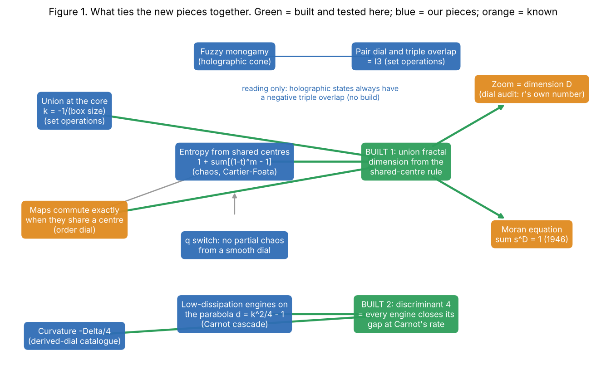

*Figure 1. The new pieces and how they connect. Two ties carried a build (green). One is a reading only (holographic
states always have a non-positive triple overlap). The other new pieces showed no tie worth building on this pass.*

---

## 1. The pieces we started from

Every result the repo marks "not found in print", "ours" or "maybe folklore", gathered from
[`new-facts-levers/`](../new-facts-levers/README.md) (which already lists L1 to L11), the write-ups since, and the
derived-dial catalogue Brennan asked to include.

| Piece | Where | Status in the repo |
|---|---|---|
| Union at the core: a ∘ₖ b is a union in a box, k = −1/(box size); pair dial and triple overlap | `shape-set-operations/` | ours as stated |
| E(k) = (1 + k)^(1/k) + k/(1 + k), mean draws to pass 1 | `shape-set-operations/` (L7) | general formula not found |
| Entropy of affine branches from shared centres (trace monoid) | `chaos-composition/` §6 (L11) | not found; likely folklore |
| The order dial q is an on/off switch for entropy | `chaos-composition/` §6 | ours, probably folklore |
| Heat-type low-dissipation engines on the parabola d = k²/4 − 1 | `carnot-cascade/` | ours |
| Lee–Yang on the ℓp ball (every even p proved) | `lee-yang/` (L4) | rule not found |
| Fuzzy monogamy; corner-sum thresholds | `holographic-entropy-cube/`, `new-facts-levers/` (L3, L1) | not found; thresholds are corollaries of known cones |
| Klein-bottle flow: one sweep, spin loses its sign | `klein-flow/` | one item new to us |
| Derived dials, e.g. curvature −Δ/4 (Δ = k² − 4d), zoom = dimension | `dial-audit/`, `dial-catalog/` | readings |

## 2. Build 1: the union fractal

### The construction

From the set-operations page, joining a slab of size a to a slab of size x, independently, inside a box of size M gives
a union of size

  x ∘ₖ a = a + x − a·x/M,  with k = −1/M.

As a map of x, that is a straight-line map with slope s = 1 − a/M, and it pulls everything toward one point: **x = M, the
box completely full** (check U2). That point is its centre. From the order-dial page, two such maps commute exactly when
they share a centre, which here means **the same box**; otherwise the two orders differ by a1·a2·(M1 − M2)/(M1·M2)
(check U3).

So pick a few slabs, put them in boxes, and keep joining at random. The points you can reach form a fractal.

*Figure 2. Example A: two slabs in box 1, one in box 3. Top: each map squeezes the whole range toward its own "box full"
point. Bottom: the fractal. The two box-1 maps commute, so many different words land on the same point.*

### Counting what you can reach

From the chaos page, maps that share a centre form a trace monoid, and Cartier and Foata (1969) count it: with mᵢ maps in
box i, the number of different composite maps of length n is the tⁿ coefficient of 1/μ(t), where
μ(t) = 1 + Σᵢ [(1 − t)^mᵢ − 1]. We counted the distinct composite maps exactly, as fractions, for four families up to
length 11. They match the formula every time (checks U4 to U7).

*Figure 3. Dots: distinct maps, counted exactly. Lines: the shared-centre formula. Dotted: all words. In example D only
395,033 of 4,194,304 words of length 11 give different maps.*

### The dimension formula

Weight each map by its shrink factor to the power D and run the same count. The dimension is where the weighted count
stops shrinking, which gives

  **1 + Σ over boxes [ ∏ over that box's maps (1 − sᵢ^D) − 1 ] = 0.**

With one map per box this is exactly Moran's equation Σ sᵢ^D = 1 (check U8). When two or more maps share a box it gives
a smaller number, because those maps stop creating new points when you swap their order.

*Figure 4. Left: the upper bounds D_n run straight to our formula (stars) as words get longer, not to Moran's value
(crosses). Right: box counting of the actual picture.*

| Example | Moran (ignores commuting) | Our formula D* | D_n extrapolated | Box counting |
|---|---|---|---|---|
| A: two in box 1, one in box 3 | 0.680 | **0.610** | 0.610 | 0.632 |
| B: two boxes, two maps each | 0.751 | **0.666** | 0.666 | 0.666 |
| C: three boxes, one map each | 0.618 | **0.618** | 0.618 | 0.619 |
| D: three in box 1, one in box 5 | 0.794 | **0.688** | 0.688 | 0.687 |

**What is proved and what is not.** The upper bound is proved: the fractal is covered by its images under the distinct
maps of length n, so its dimension is at most D_n for every n, and D_n falls to D* (checks U9, U10). That the dimension
*equals* D* is supported by the box counts (check U11) and is what Hochman's theorem (Annals 2014) leads one to expect,
since rational data keep distinct maps far enough apart. *Round 2 (section 5) writes that lower bound out.*

*Figure 5. The commuting discount. Same slabs, same shrink factors: putting the second slab in the first slab's box
(green) instead of its own box (grey) lowers the dimension by up to about 0.1.*

### What it ties together

- **Set operations** give the maps (union in a box) and say what the centre is: the box full.
- **The order dial** says which maps commute: same box.
- **The chaos page's shared-centre rule** gives the count, and with weights, the dimension.
- **The dial audit** says the zoom is the dimension D, the one number the ratio dial r owns. So this is a recipe that
  reads the zoom off the k dial: each box is one value of k, and the pattern of how many maps share each k fixes D.
- **The q switch** fits too: the in-between amounts come in fixed steps from which maps share a box, not from a smooth
  dial.

### Is it a lead?

**A modest lead, worth one more step.** *[Round 8 correction: the formula is in print for generic parameters on the line, Bárány and Verma 2025; see section 12.]* For: it is a closed formula we did not find stated, it is exact where tested,
it predicts a visible effect (the commuting discount), and it is built from base pieces only. Against: it is a special
case of a known general theory (dimension of self-similar sets is set by the semigroup the maps generate, and here that
semigroup is a trace monoid), so it adds a clean formula, not a new mechanism. Next steps, in order: (1) write the lower
bound from Hochman's theorem; (2) put the count and the upper bound in Lean; (3) try the same recipe on the full plane
laws (k and d together), where maps are Möbius rather than straight lines and commute when they share both walls.

## 3. Build 2: what "discriminant 4" means on the Carnot parabola

The Carnot page placed the heat-type low-dissipation engines (Schmiedl and Seifert's η_C/(2 − γη_C)) on the parabola
d = k²/4 − 1 and left one question open: does "discriminant 4" mean anything physical? Read with the curvature dial from
the derived-dial catalogue, −Δ/4, the parabola is the leaf of **curvature exactly −1** (check C1).

That has a plain physical meaning. In the cascade coordinate β = ln(T_hot/T_cold), each of these efficiencies obeys
dη/dβ = ½(1 + kη + dη²) (check C2), and near its limit the gap closes at rate ½√Δ (check C5). With Δ = 4 that rate is 1,
so **every heat-type engine closes in on its limit like e^(−β), the same rate at which Carnot's waste fraction T_cold/T_hot
shrinks** (check C3). Curzon–Ahlborn sits at curvature −1/4 and closes at half that rate (check C4).

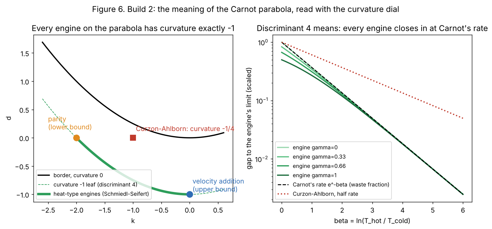

*Figure 6. Left: the heat-type engines run along the curvature −1 leaf from parity to velocity addition. Right: their
gaps all fall at Carnot's rate (dashed); Curzon–Ahlborn falls at half rate (dotted).*

**Is it a lead?** No, but it closes the Carnot page's open question with a clear statement: discriminant 4 is "Carnot
speed". It is two lines of calculus once the parabola is known.

## 4. Pairs we looked at that didn't build

- **Fuzzy monogamy with the pair dial.** Read entropies as sizes: each pair of regions gets a pair dial
  k = −I(A:B)/(S_A·S_B), and the triple overlap is the tripartite information I₃. Monogamy then says geometric states
  always have a non-positive triple overlap, so their three-way union never exceeds the one-dial prediction. That is a
  restatement of monogamy (Hayden, Headrick and Maloney 2013), not a new constraint. Reading only.
- **Chaos entropy with the Lee–Yang dial gas.** The shared-centre polynomial μ(t) is the dial gas at k = 0 on the
  "doesn't commute" graph, so its smallest root is a hard-core gas zero. That root is known to be real and dominant
  (Scott and Sokal 2005, cited from memory), so the tie organises but predicts nothing here.
- **Lee–Yang, Klein flow, why-i, E(k).** Each pair shares a theme (sign flips, stopping times) but no construction used
  two of them at once on this pass.

## Assumptions

- Union maps use rational slabs and boxes; distinct composites were counted exactly to length 11 (four families).
- The dimension formula assumes different words give different maps unless commuting forces equality. The chaos page
  showed this can fail at special slopes (an accidental collision at slopes 1/2, 1/3, 1/5); the examples here were
  checked exactly and have none.
- Box counting uses the images of the box-full points under all length-11 maps, at 6 middle scales; it is an estimate.
- The Carnot reading uses the heat-type family exactly as on the Carnot page.

## Known vs new

| Item | Status | Source |
|---|---|---|
| Union in a box, k = −1/M | Ours as stated | `shape-set-operations/` |
| Affine maps commute iff they share a centre | Known | `order-dial/` |
| Trace monoid count, Cartier–Foata polynomial | Known | Cartier and Foata 1969 |
| Exact overlaps and dimension of self-similar sets | Known | Hochman, Annals of Math. 180 (2014); Ngai and Wang 2001 |
| Moran's equation | Known | Moran 1946 |
| Dimension formula 1 + Σ[∏(1 − sᵢ^D) − 1] = 0 for maps sharing centres in classes | ~~Not found in print~~ **[Round 8 correction] Known on the line for generic parameters**: Bárány and Verma, arXiv:2507.05835 (2025); a three-map case in Bárány and Szvák, Math. Nachr. 294 (2021). Our earlier searches missed them. | this page, checks U1–U11; section 12 |
| The commuting discount (Figure 5) | Ours, numerical consequence of the formula | this page |
| Heat-type engines' gap closes at rate e^(−β); discriminant 4 = curvature −1 | Ours; two lines from known forms | this page, checks C1–C5; Schmiedl and Seifert 2008 |
| Monogamy as a non-positive triple overlap | Known (restatement) | Hayden, Headrick, Maloney 2013 |

Searches run (Nov 27): self-similar sets with commuting homotheties and exact overlaps; dimension with Möbius functions
or Cartier–Foata. They found Hochman's work and the exact-overlaps literature, nothing on this class with this formula.

- Hochman, "On self-similar sets with overlaps and inverse theorems for entropy": https://arxiv.org/pdf/1212.1873
- Hochman, ICM survey "Dimension theory of self-similar sets and measures": https://math.huji.ac.il/~mhochman/preprints/icm-4.pdf

---

## 5. Round 2: more rigorous, and more places it applies (DRAFT)

Asked for by Brennan (voice, Nov 27): "let's just keep looking at this and seeing if we can make it more rigorous and
more useful", "when I say more useful, more applicable to other scenarios."

Checks: [`checks2.py`](checks2.py) → [`checks2_output.txt`](checks2_output.txt), **22 of 22 pass**. Numbers:
[`round2.py`](round2.py) → `round2.json`. Pictures: [`figures2.py`](figures2.py). Lean:
[`lean/NewTies.lean`](lean/NewTies.lean), 10 theorems (12 after round 3), core Lean, no `sorry`. Not compiled in the
workspace that wrote it; **compiled clean on Nov 27 in the shared library** as `FusedAlgebra.Topics.NewTies` (namespace
`CircleOp.NewTies`), all 12 theorems including the three `decide` counts, no proof changed.

### The result in plain words

**On the line the formula is now a theorem.** For straight-line shrinking maps with rational (or algebraic) numbers and
no accidental collisions, the fractal's dimension is exactly the smaller of 1 and our D*: the upper bound needs nothing,
and the lower bound comes from a free piece of the fractal plus Hochman's 2014 theorem. **It carries over** to maps that
flip, to turning maps in the plane (numerically), and its counting part to the plane laws (k, d). **One real scenario
fits it exactly:** Rescorla–Wagner learning, and any moving average with several rates, where same-target updates
commute and the learner forgets their order. Still a modest lead: a clean, now-rigorous tool with real uses, not a new
mechanism.

### 5.1 The theorem

**Setting.** Maps fᵢ(x) = cᵢ + sᵢ(x − cᵢ) on the line with 0 < |sᵢ| < 1, sorted into classes by centre (a union in a box is
the case cᵢ = box size, sᵢ = 1 − slab/box). Write Pⱼ(D) = ∏ over class j of (1 − |sᵢ|^D) and
μ(D) = 1 + Σⱼ [Pⱼ(D) − 1]. D* is the root of μ(D) = 0 (at least two classes; one class gives a single point).

**Theorem.** (a) dim K ≤ min(1, D*), always. (b) If every cᵢ and sᵢ is algebraic (for example rational) and different
shared-centre words never give the same map (no accidental collisions), then dim K = min(1, D*).

**Proof of (a).** Maps with one centre commute (Lean `same_centre_commute`), so every word equals a word of the trace
monoid. Weighted Cartier–Foata: Σ over traces g of |s_g|^D·tⁿ⁽ᵍ⁾ = 1/μ_D(t), with μ_D(t) = 1 + Σⱼ[∏(1 − t|sᵢ|^D) − 1].
Each Pⱼ(D) grows with D, so for D > D* we have μ_D(1) > 0; μ_D(t) falls as t grows, so it stays positive on [0, 1] and
the series converges at t = 1. Its tail at length n goes to 0, and the length-n images cover K, so the D-dimensional
measure of K is 0. Hence dim K ≤ D for every D > D*. Collisions only shrink the cover, so (a) needs no assumption.

**Proof of (b), lower bound.** Single out class 1. Let N be the monoid of the other classes, and let S be the set of words
u·v with u a nonempty word in class 1 and v a nonempty element of N. Every element built from S splits uniquely at its
class-1 blocks (normal form in a free product), so S generates a **free** monoid. Take the finitely many generators S_L
up to length L. With no accidental collisions, the IFS S_L has no exact overlaps; its numbers are algebraic; so by
Hochman's theorem (Annals of Math. 180, 2014: on the line, algebraic parameters and no exact overlaps give
dim = min(1, similarity dimension)) its attractor has dimension min(1, s_L), where Σ over S_L of |s_g|^(s_L) = 1. That
attractor sits inside K. As L grows the sum fills out to (1/P₁ − 1)(1/Q − 1), with Q = 1 + Σ_{j≥2}(Pⱼ − 1) from Cartier–Foata
for N (it converges at D* because Q(D*) = 1 − P₁(D*) > 0). Setting it to 1 is the same as P₁ + Q = 1 (Lean
`lower_bound_key`), which is μ(D) = 0. So s_L rises to D*, and dim K ≥ min(1, D*). ∎

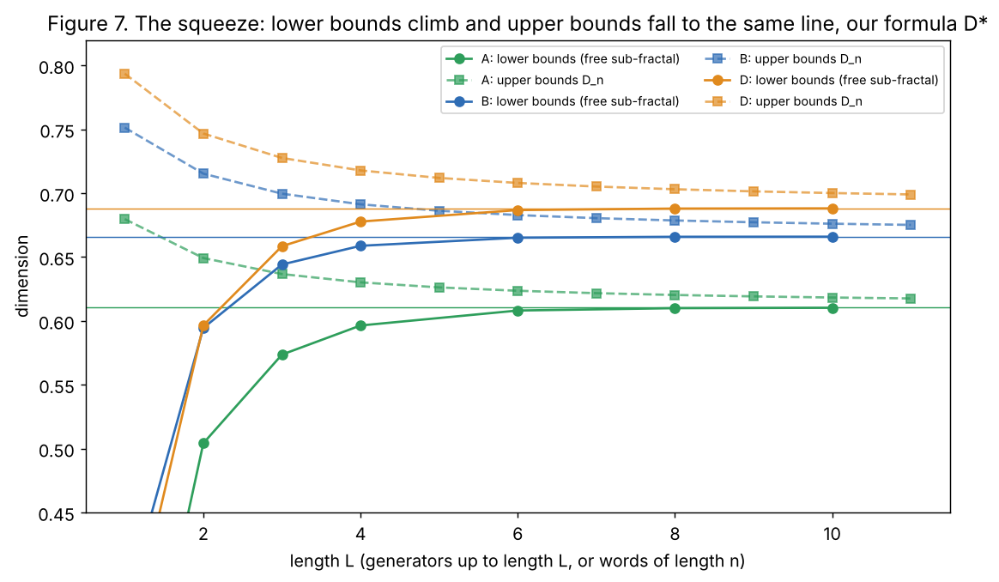

*Figure 7. The squeeze, computed. Lower bounds from the free piece (solid) climb and upper bounds (dashed) fall onto the
same line. At L = 10 every lower bound is within 0.0001 of D*. The free piece was checked exactly: e.g. 15,625
words of its generators give 15,625 different maps.*

**What the hypothesis costs.** "No accidental collisions" can fail at special numbers (the chaos page found one at
slopes 1/2, 1/3, 1/5; this round found one among Möbius maps at length 4, check G5). For given rational numbers it can
be checked exactly up to any length, but not for all lengths at once. Kittle and Kogler (2026, reported in search
results, not read) claim the exact-overlaps conjecture on the line, which would remove the "algebraic" condition.

### 5.2 Where it holds

*Figure 9. Green: proved. Blue: numerical. Orange/grey: the formula does not apply as it stands.*

- **Flips (slopes below 0, past the wall).** Nothing changes: use |s|. Count and upper bound checked (G1, G2).
- **The plane.** Turning-and-shrinking maps z ↦ c + λ(z − c) with complex λ commute exactly when they share a centre, so
  the same count and formula hold with |λ| in place of s and min(2, D*) as the cap. Upper bound proved the same way;
  the lower bound needs Hochman's higher-dimensional theorem, whose extra conditions we haven't checked. Numerically it
  fits (Figure 8): D* = 1.191, box counting 1.194, Moran 1.251. [Round 7: the lower bound is now proved; the true dimension
  is between 1.19061 and 1.19064, and exactly D* for a nearby example; see section 11.]
- **Plane laws (k, d).** Each law's maps are Möbius maps fixing that law's two walls, so maps from one law commute and
  the count is the same shared-centre count (G6, two examples). The dimension is not given by this closed formula,
  because Möbius maps don't shrink by one fixed factor; it needs Bowen's equation with derivatives. Open.
- **Commuting that isn't by classes.** For straight-line maps, "commute" is always "same centre", so classes are all
  there is. Maps that commute without being classes (e.g. acting on separate coordinates) need the general
  Cartier–Foata polynomial over the commuting graph; not done.

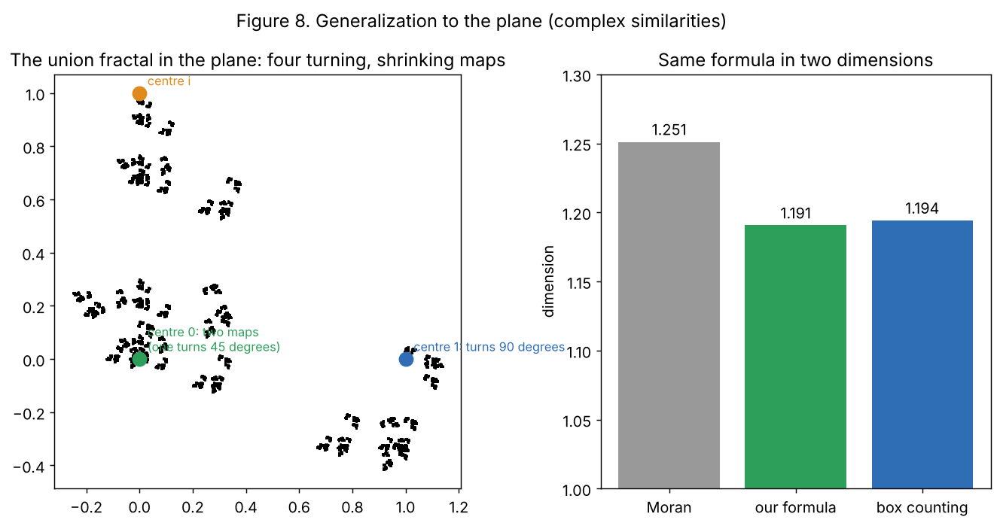

*Figure 8. Left: the plane version, four maps about three centres; two share centre 0 and one of those also turns.
Right: the dimension follows our formula, not Moran's.*

### 5.3 A real scenario: learning rules and moving averages

The Rescorla–Wagner rule (psychology's standard model of conditioning, also the "delta rule" of machine learning) updates
an associative strength by V ← V + rate·(target − V). That is a stretch about the target with slope 1 − rate: our maps
exactly, with the target as the centre. Trials that aim at the same target commute, whatever their rates; trials aiming
at different targets don't. The same holds for any exponential moving average whose smoothing rate changes.

We tested three trial types: reward with a bright cue (rate 0.8), reward with a dim cue (rate 0.85), no reward
(rate 0.75). Counted exactly: after 11 trials the learner can be in only 46,368 different states, out of 177,147 trial
histories (every other Fibonacci number, S1). So **the learner's state can carry at most 1.39 bits of history per trial,
not log₂3 = 1.58**, and with trials in random order it keeps about 1.28 bits per trial (S2). The reachable strengths
form a fractal of dimension 0.610.

*Figure 10. Left: different learned strengths (exact) against trial histories. Right: bits of history the state can
carry per trial.*

**Why it's useful.** It gives a closed answer to "how much of its past can a moving average or delta-rule learner
remember, and how finely must you read its state to recover it", and it says what helps: giving each update its own
target restores order information; varying only the rate does not. That the order of same-target updates is lost is
elementary; the exact count and the dimension are what the formula adds.

### 5.4 Lead or not

**A modest lead, now on firmer ground.** For: a real theorem on the line (given Hochman), the same picture in the plane,
the counting part for every plane law, and a scenario where it applies exactly. Against: the mechanism is Hochman's and
Cartier–Foata's; ours is the closed formula, the free-piece proof and the reading. Next, if wanted: (1) compile the Lean
file (done: it compiles in the shared library); (2) the plane lower bound via Hochman's higher-dimensional theorem; (3) Bowen's equation for the plane laws, to see
whether the shared-centre count still sets a clean dimension there.

### Known vs new, round 2

| Item | Status | Source |
|---|---|---|
| Hochman's theorem: algebraic parameters, no exact overlaps ⇒ dim = min(1, s-dim) | Known | Hochman 2014 (as stated in his ICM survey) |
| Normal form in free products; Cartier–Foata weighted count | Known | standard; Cartier and Foata 1969 |
| Theorem: dim K = min(1, D*) for shared-centre classes (algebraic, no accidental collisions) | ~~Not found in print~~ **[Round 8 correction] Partly known**: the same formula holds for generic parameters (Bárány and Verma 2025). Ours: the proof route through free first-return pieces, and the exact cases | this page, L1–L4; section 12 |
| Plane version, counting for plane laws | Ours; plane dimension numerical | G3–G6 |
| Rescorla–Wagner as stretches about the target | Known form (Rescorla and Wagner 1972) | — |
| Exact state count and bits-per-trial for mixed-rate learners | Ours (as stated); elementary consequence | S1–S3 |
| Exact-overlaps conjecture on the line | Reported proved, not checked | Kittle and Kogler 2026 (arXiv:2610.10511, from a search result) |

---

## 6. Round 3 (DRAFT): the plane laws, which ones keep the formula

Brennan asked to work out the dimension for the plane laws (k, d) next. This section does that. Everything here is
DRAFT. The checks are in `checks3.py` (18/18 pass, output in `checks3_output.txt`), the numbers in `planelaws.py`
and `planelaws_sweep.py`, the pictures in `figures3.py`.

### 6.1 The answer in two sentences

Laws that share a wall lie on one straight line in the (k, d) plane, and that line touches the border d = k²/4. When all
the maps share their repelling wall (they sit on one such tangent line), the union fractal straightens out into the line
case and the formula D* is exact; when they don't, D* is still a proved upper bound, and the true dimension is lower,
climbing back toward D* as the repelling walls move away.

### 6.2 The setup

A plane law with dials k, d combines a and x as x ↦ (x + a + k·a·x)/(1 − d·a·x). For fixed a that is a Möbius map, matrix
[[1 + k·a, a], [−d·a, 1]]. Its two fixed points, the **walls**, are the roots of d·x² + k·x + 1 = 0, the same for every a.
So every map of one law has the same two walls, one attracting and one repelling. That is the plane-law version of a
shared centre: maps of one law commute, maps of different laws don't (unless they share both walls).

The union rule of rounds 1–2 is the line d = 0, where one wall has gone off to infinity.

### 6.3 Tangent lines (new reading)

Fix a wall w. The laws that have w as a wall are the (k, d) with d·w² + k·w + 1 = 0, a straight line. That line touches
the border d = k²/4 (where the two walls merge) at exactly one point, k = −2/w, d = 1/w² (T1, and Lean `wall_line_tangent`:
k²w² + 4kw + 4 = (kw + 2)²). So:

- **Each wall is a tangent line of the border.** Every law off the border sits on two tangent lines, one for each wall.
- The d = 0 axis is the tangent line "at infinity": the affine laws all share the wall ∞. That is why the line case works.
- Velocity addition (k = 0, d = 1) and the union rule in the unit box (k = −1, d = 0) both lie on the tangent line for the
  wall 1 (T3).

*Figure 11. The (k, d) plane. Grey curve: the border d = k²/4. Coloured lines: laws sharing the wall w, one line per w,
each touching the border once. The horizontal axis d = 0 is the shared wall ∞ (the affine case).*

### 6.4 Result P1: on a common tangent line, the formula is exact

**Statement (DRAFT, ours).** Take several plane laws that share their repelling wall w, with distinct attracting walls,
and any number of maps per law. Change coordinates by y = 1/(x − w). Every map becomes a straight-line map, and its slope
is its multiplier at its attracting wall (T4–T5, exact fractions). So the union fractal is exactly a round-2 union
fractal on the line, and its dimension is min(1, D*) with D* computed from the multipliers, under the same hypothesis as
round 2 (algebraic parameters, no accidental collisions).

**Why.** In the y coordinate the shared wall w goes to ∞, so every map fixes ∞
and is affine. This is standard; what's ours is reading it on the dial plane as "lie on one tangent line".

**Check.** Two laws with repelling wall 3 and attracting walls 1 and −1; the first law gives two maps (multipliers 1/5 and 3/20), the second one map (multiplier 1/4): box count 0.605 vs D* 0.610 (T7). The
cruder bound from the largest derivative gives 0.95 (T8), so the straightening is doing real work.

### 6.5 Result P2: off a common tangent, D* is an upper bound

**Statement (DRAFT, ours).** Take plane laws with different repelling walls. Suppose that for each law no attracting wall
lies between its attracting wall and its repelling wall (with two laws: the repelling walls sit on opposite sides,
each beyond its own attracting wall). [Round 4 note: wording tightened; with a third law whose attracting wall sits in
the middle, a map can stretch by more than its multiplier and D* is no longer a ceiling.] Then on that hull every map
contracts by at most its multiplier at its attracting wall, so dim ≤ min(1, D*) (T10, from
f′(x) = λ·(f(x) − q)² / (x − q)², with q the repelling wall).

The count of distinct composites is still the shared-centre count from round 1 (T6, T9), so only the sizes change, not
the combinatorics. The true dimension is the critical exponent of the Poincaré series over the trace monoid (Bowen's
equation). There is no closed form; we computed it.

| Repelling walls | Measured dim (box) | Poincaré estimate D_n | D* (upper bound) |
|---|---|---|---|
| ±2 | 0.395 | 0.396 | 0.610 |
| ±3 | 0.445 | 0.454 | 0.610 |
| ±12 | 0.555 | 0.568 | 0.610 |
| shared (3) | 0.605 | — | 0.610 |

Sweep (T12): same maps, first law repelling from q and second from −q, D_n = 0.340, 0.392, 0.451, 0.507, 0.545, 0.567, 0.587, 0.602, 0.612 for
q = 1.5, 2, 3, 5, 8, 12, 20, 40, 100. It climbs to D* as the walls move to infinity, which is the line case again.

*Figure 12. Left: two union fractals with the same multipliers and the same attracting walls 1 and −1. Top: both laws
repel from 3 (shared wall, formula exact). Bottom: they repel from 3 and −3 (no shared wall, smaller). Right: dimension
against how far the repelling walls ±q are, rising toward the formula's value, which is the upper bound.*

### 6.6 What this means in plain terms

The shared-centre count (how many different results you can get) works for every plane law. The size formula works
exactly when everything is pushed away from one common point, which on the dial map means "all on one tangent line". When
the maps are pulled toward different points, the pieces bend and get smaller than the formula says, by an amount that
depends on how close those points are. The formula is then a ceiling, not the answer.

### 6.7 Lean

Two more identities are in `lean/NewTies.lean`: `fixes_wall` (the map fixes w exactly when d·w² + k·w + 1 = 0) and
`wall_line_tangent` (the wall line touches the border). That makes 12 theorems in the file (13 after round 4). **Compiled clean on Nov 27 in the shared library** build (`FusedAlgebra.Topics.NewTies`), and the topic file itself is built by CI's topic Lean step. **[Round 5: all theorems build, see 8.3.]**

### 6.8 Lead or not

**The lead continues, modestly.** For: a clean, checkable classification of which plane laws keep the formula (exact on a
common tangent line, upper bound off it), and the tangent-line picture is a new and simple way to read the (k, d) map.
Against: the straightening is a standard Möbius fact, and off the tangent line there is no closed formula, only a bound
and numbers. Next, if wanted: (1) prove the lower bound off the tangent line (it needs a nonlinear version of Hochman's
theorem, which exists for some analytic families); (2) the plane lower bound for complex similarities.

### Known vs new, round 3

| Item | Status | Source |
|---|---|---|
| Möbius maps with a common fixed point conjugate to affine maps | Known | standard |
| Bowen's equation / Poincaré critical exponent for conformal IFS | Known | Bowen 1979; Mauldin and Urbański |
| Laws sharing a wall lie on a tangent line of d = k²/4 | **Ours** (elementary) | T1, `wall_line_tangent` |
| P1: exact formula on a common tangent line | **Ours** (from round 2 + standard conjugation) | T4–T7 |
| P2: D* upper bound off the tangent line, numbers and sweep | **Ours** (bound proved, values numerical) | T9–T12 |

---

## 7. Round 4 (DRAFT): the true dimension off the tangent line

Brennan asked to prove the true size off the tangent line, where round 3 had only a ceiling and numbers. This section
does it. Everything here is DRAFT. Checks: `checks4.py` (13/13 pass, output in `checks4_output.txt`). Bounds:
`offline.py`. Level-n cross-check: `dn_levels.py`. Pictures: `figures4.py`. Lean: one more
theorem, `two_law_threshold`, in `lean/NewTies.lean` (13 in all), compiled clean on Nov 27 in the shared library.

### 7.1 The answer in two sentences

Off the tangent line the dimension is still set by the shared-centre count, but each word is weighted by how much it
really stretches instead of by its multipliers; that is a theorem, resting on a 2021 theorem of Solomyak and Takahashi.
We can compute that number with proved bounds to within 0.002, and it is always strictly below the line-case formula:
0.381 at walls ±2, 0.441 at ±3, 0.559 at ±12, against 0.610.

### 7.2 Result P3: what the dimension is (DRAFT, ours, conditional)

**Setting.** Plane laws, each with an attracting wall and a repelling wall, any number of maps per law, all multipliers
positive. Let M be the trace monoid of round 1 (maps of one law commute, different laws don't). For a word w in M let
f_w be its map and ‖f_w′‖ the largest stretch of f_w on the hull of the attracting walls. Define

  **δ = the critical exponent of Σ_{w ∈ M} ‖f_w′‖^t** (the t where this sum switches from infinite to finite).

**Hypotheses.** (H1) the laws' dials and the maps' parameters are algebraic numbers; (H2) there is a closed interval V
with every attracting wall inside it and every repelling wall outside it (each map then sends V strictly inside itself);
(H3) no accidental collisions: different words of M give different maps; (H4) at least two laws.

**Statement.** dim K = min(1, δ).

**Proof (four steps).**

1. *Upper bound.* K is covered by the images of the hull under the distinct words of length n. Möbius maps that send V
   inside itself have bounded distortion on the hull (their poles stay outside V), so each image has length at most a
   fixed constant times ‖f_w′‖. For t > δ the sum converges, so its tail goes to 0 and the t-dimensional measure of K
   is 0. So dim K ≤ δ. (Standard covering argument.)
2. *Free pieces.* Use round 2's first-return pieces: S = {u·v : u a nonempty word of law 1, v a nonempty word in the
   other laws}. They generate a free monoid inside M (round 2, combinatorial), and every word of M splits uniquely as
   (other-law prefix)·(word in S)·(law-1 suffix). Because the maps preserve V, their matrices preserve a cone strictly,
   so stretches multiply up to fixed constants (standard quasi-multiplicativity). The two outer factors have smaller
   critical exponents (law 1 alone: 0; the other laws: at most that of S, because S contains u·v for every v), so
   **δ = the critical exponent of the free monoid generated by S**.
3. *Finite pieces.* Let S_L be the pieces with u and v of length at most L. Their critical exponents δ_L increase to δ.
   This is the finite-approximation property of pressure for infinite conformal systems (Mauldin and Urbański 1996). It
   uses only bounded distortion, not any separation condition.
4. *The cited theorem.* Normalise each matrix of S_L by the square root of its determinant (positive by assumption): the
   entries stay algebraic. By (H3) and step 2 the matrices generate a free semigroup. They send V strictly inside itself
   (a strictly invariant cone, i.e. uniform hyperbolicity), and the attractor is not a point (H4). Solomyak and
   Takahashi (IMRN 2021, Theorem 1.7, with their remark that algebraic entries plus a free semigroup give the strong
   Diophantine property) then give dim K_L = min(1, δ_L), where their s_A/2 is our δ_L. Since K_L ⊂ K,
   dim K ≥ min(1, δ_L) for every L, so dim K ≥ min(1, δ). ∎

**Who proved what.** Steps 1–3 are standard tools; step 4 is Solomyak and Takahashi's theorem, applied to pieces that only
our round-2 construction makes free. The statement for shared-centre plane laws, and the reduction, are ours. We read
their abstract and the statement of Theorem 1.7 and the algebraic remark (arXiv:1902.11059); we did not check their proof.
Christodoulou and Jurga (Trans. AMS 2026) extend that theorem; we did not read it. (H3) is checked, not proved: the 10
pieces of S_2 at walls ±3 give 1000 different maps for their 1000 words of length 3 (U3). [Round 5: now checked to length 14 for these examples, and proved for a family, see 8.2.]

On the tangent line δ equals D* (round 3, P1), so P3 contains P1. In the line case (affine maps) it is round 2's theorem.

### 7.3 Result P4: computing δ, with proved bounds (DRAFT, ours)

A word of M is a chain of **blocks** (maximal runs of one law). A block of law i with multiplier λ, applied at a point y,
stretches by exactly

  **λ · ((1 − z)/(1 − λz))²**, where z = (y − p)/(y − q) for that law's walls p, q (U1, exact fractions).

So it gets its full multiplier only at its own attracting wall (z = 0), and less the further away it works. After a switch,
a law's block always receives its input from the previous law's block, which has pushed the point toward the *other*
attracting wall. At walls ±3, law 1 blocks only ever receive points in [−1, −0.71] and law 2 blocks only in [0.78, 1]
(Figure 14). Bounding each block's factor above and below by the extreme z over where it can receive points (remembering
the previous block's law and size) gives two switching matrices; δ lies between the t-values where their spectral
radius is 1. With two laws and no memory this is the round-2 rule x₁·x₂ = 1 (Lean `two_law_threshold`).

**Statement.** Under the round-3 P2 geometry (for each law no attracting wall lies between its two walls), δ is strictly
below D* whenever the laws don't all share their repelling wall, and the bounds below are proved.

| Repelling walls | Proved bracket for δ | D* (line case) | Level-n estimate, extrapolated |
|---|---|---|---|
| ±2 | 0.3812 to 0.3817 | 0.6104 | 0.382 |
| ±3 | 0.4407 to 0.4417 | 0.6104 | 0.441 |
| ±12 | 0.5583 to 0.5597 | 0.6104 | 0.559 |
| ±10⁷ | 0.61037 (closes) | 0.6104 | — |

**What makes the bracket a proof.** The block formula is exact; the input regions are outer bounds (iterated to a fixed
point, and checked on 900 random words, U4); sums are cut at block degree 40 with the tail bounded by the pure-multiplier
tail; and a larger matrix gives a larger spectral radius (Perron–Frobenius). Strictness: every switch costs a factor
below 1 on an irreducible matrix, so the spectral radius at D* is below 1. Caveat: the arithmetic is double precision, not
interval arithmetic; the bracket widths are far larger than rounding, but an interval-arithmetic rerun would make it
airtight. [Round 5: done, see 8.1. The certified brackets are a hair wider.]

**Cross-check.** The direct level-n estimates fall slowly, roughly like 1/n (at ±3: 0.459 at n = 7, 0.450 at n = 14).
Extrapolating linearly in 1/n lands inside or within 0.002 of every bracket (U6). The round-3 box counts (0.395, 0.445,
0.555) sit a little high or low for the same finite-resolution reason; the brackets replace them.

*Figure 13. The thin blue band is the proved bracket for the true dimension, against how far away the repelling walls
are. Dashed: the line-case formula, which is the ceiling. Orange: box counts. Grey: level-n estimates from n = 7 down
to n = 14, still falling toward the band.*

*Figure 14. Why bent maps make a smaller fractal (walls ±3). Top: where each law's blocks receive their points, always
on the far side, near the other law's wall. Bottom: the stretch a block achieves divided by its multiplier, by where it
is applied. It is 1 only at its own wall and well below 1 in the shaded regions where blocks really work.*

### 7.4 What this means in plain terms

The count of different outcomes is the same everywhere: the shared-centre count from round 1. What changes off the
tangent line is how big each outcome's piece is. Each law does its work on points the other law has just pulled away, so
it never gets to stretch fully, and the fractal is thinner. Now that thinning has an exact meaning and can be computed
to three decimals with a proof.

### 7.5 Lead or not

**Still a lead, and a better-founded one.** For: the dimension of every shared-centre union fractal on the line and for
plane laws is now characterised by one theorem (exact formula on a tangent line, a computable critical exponent off it,
with proved brackets), and the shared-centre count is what feeds both. Against: the hard analysis is Solomyak and
Takahashi's and Hochman's; ours is the construction that makes their theorems apply, the formulas, and the computations.
Next, if wanted: (1) rerun the brackets in interval arithmetic; (2) prove (H3) for a family, not just check it; (3) the
plane (complex) lower bound, which needs a different cited theorem.

### Known vs new, round 4

| Item | Status | Source |
|---|---|---|
| dim = min(1, critical exponent) for free algebraic SL₂ projective systems with an invariant interval | Known | Solomyak and Takahashi, IMRN 2021, Thm 1.7 (statement read, proof not checked) |
| Finite approximation of pressure for infinite conformal systems | Known | Mauldin and Urbański 1996 |
| Bounded distortion, cone quasi-multiplicativity, covering upper bound | Known | standard |
| P3: dim K = min(1, δ) for shared-centre plane laws via free first-return pieces | **Ours** (conditional on the cited theorem and H1–H4) | 7.2 |
| Block stretch formula λ((1−z)/(1−λz))² | Elementary | U1 |
| P4: proved brackets, strictly below D* off the tangent line | **Ours** (double precision) | U4–U9, `offline.py` |

---

## 8. Round 5 (DRAFT): airtight bounds, no collisions proved for a family, Lean builds

Brennan asked to make the bounds airtight. Checks: `checks5.py` (14/14 pass, output in `checks5_output.txt`).

### 8.1 Certified brackets

`exact_bounds.py` redoes section 7.3 so that no rounded number enters a claimed inequality. Walls, multipliers, block
multipliers, input regions and z-ranges are exact fractions (regions rounded outward, which only widens them). Powers
and sums use ball arithmetic (python-flint's arb, 128 bits), which returns guaranteed enclosures. The spectral-radius
claims are certified by a test vector v > 0 (the Collatz–Wielandt test): if T·v < v in every entry, the spectral radius
is below 1 and the sum converges; if T·v > v in every entry, it is above 1 and the sum diverges.

| Repelling walls | Certified bracket for δ | Round 4 (double precision) | D* |
|---|---|---|---|
| ±2 | **0.3810 to 0.3818** | 0.3812 to 0.3817 | 0.6104 |
| ±3 | **0.4405 to 0.4418** | 0.4407 to 0.4417 | 0.6104 |
| ±12 | **0.5581 to 0.5599** | 0.5583 to 0.5597 | 0.6104 |

That D* lies above each upper end is certified too (the shared-centre function is negative there, V1).

### 8.2 No accidental collisions: proved for a family (DRAFT, ours)

Theorem P3 needed (H3): different words give different maps. Two things are now known.

**For the round-4 examples it holds up to length 14.** All 832,040 maps of length 14 are different at walls ±2, ±3 and
±12. Checked by exact arithmetic modulo the prime 2⁶¹ − 1: maps that differ there differ for real, and the count can
never exceed the shared-centre count, so equality rules collisions out (`collisions_modp.py`, V6). This is a check to
length 14, not a proof for all lengths.

**For a family it is proved, by a two-prime ping-pong.** Criterion: rational walls and multipliers, and primes p₁, …, p_r
such that

1. every multiplier has negative p-adic valuation for each chosen prime, so in the p-adic numbers every block pulls
   *toward its repelling wall*;
2. within each law, the valuation vectors of its multipliers are linearly independent;
3. for each chosen prime there are disjoint p-adic balls U_i around the repelling walls such that every law-i block sends
   every other U_j, and a base point x₀, into U_i (an exact check, `pingpong.py`).

**Proof.** Suppose two different words give the same map; take a shortest such pair. Evaluate at x₀ in the p-adic
numbers: a word lands in the ball of its outermost law, so both outermost blocks have the same law i. If the two
blocks have the same multiplier, they are the same map, and by (2) the same block, so cancel them and get a shorter
pair. Otherwise their ratio C is a law-i map other than the identity. By (2) some chosen prime gives C a nonzero
valuation, so C or its inverse pulls p-adically into U_i. But the two remainders start in another law, so they land in
some U_j (j ≠ i), or stay at x₀. Neither is in U_i: a contradiction. ∎

**Example where everything holds.** Walls ±21/5 (law 1: attracting 1, repelling 21/5; law 2: attracting −1, repelling
−21/5), law-1 multipliers 5/18 and 5/24, law-2 multiplier 7/24, primes 2 and 3, base point 0. The criterion holds exactly
(V2). The valuation step is Lean `valuations_separate`. So (H1)–(H4) all hold, and Theorem P3 gives, resting only on the
cited theorems:

  **dim K is between 0.5551 and 0.5585** (certified, V5), against the line-case formula D* = 0.7236.

This is the first union fractal off the tangent line whose dimension is pinned down with no unchecked assumption of
ours. The round-4 examples (multiplier 1/5 has no 2-adic pull) are not covered by this criterion. [Round 6: walls ±2 and ±12 are now proved by another 2-adic argument, and walls ±3 for a large free part; see section 10.]

### 8.3 Lean builds

The Lean toolchain could be downloaded this time (from GitHub releases; the lean-lang.org host is still blocked).
`lean/NewTies.lean` builds with Lean 4.37.0-rc1, the repo's pinned version: **16 theorems, no errors, no sorry, only the
standard axioms** (propext, Classical.choice, Quot.sound). Output in `lean/compile_output.txt` (V7). New this round:
`valuations_separate`, `xor_is_half_box_union`, `and_from_or`.

### 8.4 Who proved what, round 5

Ball arithmetic is python-flint's; the Collatz–Wielandt test and p-adic ping-pong are standard tools. The certified
numbers, the criterion and its proof, and the fully covered example are ours (DRAFT). Theorem P3 still rests on
Solomyak and Takahashi's theorem, whose proof we did not check.

---

## 9. Round 5 (DRAFT): is there a family? Intersect, disjoint and XOR fractals

Brennan asked: "Is this possibly a new family of objects? Intersect fractal… disjoint fractal?" Script: `boolean.py`.
Checks V8–V12.

### 9.1 The answer in two sentences

They're one family, not several: intersect, union and symmetric difference each pull a set's density toward a fixed
point (empty, full and half), so mixing them gives exactly our union fractal with centres at 0, 1 and 1/2. A disjoint
fractal doesn't exist, because adding without overlap is a plain shift with no fixed point, so nothing shrinks.

### 9.2 The Boolean reading

Let X be a random set of density x in a box of size 1, and A an independent random set of density a. Any Boolean
combination f(X, A) has a density that is a straight-line function of x. Of the 16 possible f, 12 depend on x. Each of
those pulls x toward a point, its centre. Exactly **7** have a centre that does not move with a (V8):

| Step | New density | Pulls toward |
|---|---|---|
| X AND A (intersect), X AND NOT A (difference) | a·x, (1 − a)·x | 0, empty |
| X XOR A, X XNOR A (symmetric difference) | a + x − 2ax, 1 − a − x + 2ax | 1/2, half |
| X OR A, X OR NOT A (union) | a + x − ax, 1 − a + ax | 1, full |
| NOT X (complement) | 1 − x | 1/2, but it doesn't shrink |

Steps with the same centre commute, steps with different centres don't (round 1). So repeated random AND/OR/XOR steps
are a union fractal with up to three centres, and every theorem from rounds 1–4 applies as it stands (XOR with a > 1/2
flips, which round 2 already covered). The other four steps (NAND, NOR and two more) have centres that move with a, so
they don't commute with each other and fall outside the family.

*Figure 15. For each Boolean step that keeps x, the density it pulls toward, against the density a it combines with.
Thick lines: the steps whose target never moves (empty, half, full). Dashed: steps whose target moves with a.*

### 9.3 How the combining rules fit together

- **XOR is union in a smaller box.** In a box of size 1, XOR with density a is a + x − 2ax, which is exactly union in a
  box of size 1/2 (Lean `xor_is_half_box_union`). In the fused law a ∘ₖ b = a + b + k·ab, union in a box of size M is
  k = −1/M, so XOR is k = −2. Every k < 0 is union in a box of size −1/k; k > 0 works the same way with negative
  parameters (centre −1/k below zero).
- **Intersect is union seen from the outside.** By De Morgan, intersecting with density a is complement, then union
  with density 1 − a, then complement (Lean `and_from_or`). It is not one rung up after all: as a step on densities it is
  the same kind of map, centred at the empty set.
- **All of them are multiplication in disguise.** Every fused law turns into plain multiplication in the coordinate
  u = 1 + kx (V9). That is why each one is a stretch about one point.
- **Disjoint union (k = 0) gives no fractal.** It is x ↦ x + a, a shift with slope 1. Shifts never shrink, have no fixed
  point, and repeated shifts run off to infinity. So there is no attractor (V9).

### 9.4 Examples

- **Union plus intersect is round 1's example A.** OR with densities 4/5 and 17/20 plus AND with 1/4 is example A moved
  by y = (3 − x)/2: the same counts to length 11 and the same D* = 0.610 (V10). So the dimension theorem of round 2
  applies to it as it stands.
- **All three.** OR with 4/5 and 17/20, AND with 3/13, XOR with 9/22 and 15/26: D* = 0.901. The densities reachable match
  the shared-centre count up to 8 steps; at 9 steps there are two fewer than the count, from accidental collisions (V12).
- **Collisions come from parameter coincidences, not from a rule.** With simple slopes they are common. For example
  OR with slope 1/5 and XOR with slopes 1/6 and 1/7 collide at 4 steps because r·s₁·s₂ − r·s₂ + s₁ − s₂ = 0 for those
  numbers (V11). Where collisions happen, D* is only a ceiling. So for the XOR member, the no-collision condition is a
  real hypothesis to check case by case.

*Figure 16. The densities a set can reach by repeated random Boolean steps. Top: union and intersect (round 1's example A
after a shift). Bottom: union, intersect and XOR together. Dotted lines: the three centres, empty, half and full.*

### 9.5 New family, renaming, or a mix?

**A mix, and mostly a renaming.** The objects are the union fractals of round 1. Intersect and XOR fractals are members,
just with the centre at empty or half, and the disjoint fractal does not exist. What is new (as far as one literature
search shows) is the Boolean reading: exactly which set operations generate union fractals (the seven fixed-centre steps
above), and that XOR is union in a half-size box. The fair-coin case (AND and OR with density 1/2 give x/2 and (x + 1)/2)
is binary expansion, which is classical; its D* is 1 and its attractor is all of [0, 1].

**Lead or not.** This is not a lead by itself. It is a useful reading that widens where the theorem applies: any process
that repeatedly mixes a quantity with fresh independent pieces by AND, OR or XOR (masks, dropout-style corruption,
coverage, random sets) has a union-fractal state space, with the exact count and dimension from rounds 1–5.

### Known vs new, round 5

| Item | Status | Source |
|---|---|---|
| Ball arithmetic; Collatz–Wielandt test; p-adic ping-pong | Known tools | python-flint/arb; standard |
| Certified brackets for δ | **Ours** | 8.1, V1, V5 |
| Two-prime ping-pong criterion for no collisions, and its proof | **Ours** (DRAFT) | 8.2, V2 |
| Fully covered example: dim between 0.5551 and 0.5585 | **Ours**, resting on Solomyak–Takahashi | 8.2, V5 |
| Lean file builds (16 theorems) | Done | 8.3, V7 |
| Densities of Boolean combinations of independent sets are affine | Known (elementary probability) | — |
| The seven fixed-centre Boolean steps; XOR = union in a half box; the Boolean family = union fractals | **Ours** (elementary; not found in one search) | 9.2–9.3, V8–V9 |
| Fair coins give binary expansion | Known | classical |

---

## 10. Round 6 (DRAFT): no accidental collisions for the original examples

Brennan said "Yes, prove it": prove that different words never give the same map for the original examples (walls ±2,
±3 and ±12), not only for the round-5 family. Script: `nocollide.py`. Checks: `checks6.py`, 13/13 (V1–V11). Figures
17–18. Lean: six more theorems, 22 in all, all build.

### 10.1 The answer in two sentences

At walls ±2 and ±12 it is now proved for every word: different words always give different maps, so those two
dimensions (0.3810 to 0.3818 and 0.5581 to 0.5599) rest only on the cited theorem. At walls ±3 it is proved for a large
part of the system, which proves the dimension is between 0.426 and 0.4418; whether it holds for every word at ±3 is
still open (no collisions up to length 14).

### 10.2 The examples, and the first two steps (all three walls)

Law 1 has walls 1 (attracting) and Q (repelling) and letters a, b with multipliers 1/5 and 3/20. Law 2 has walls −1 and −Q
and one letter c with multiplier 1/4. In the coordinate z₁ = (y − 1)/(y − Q) a run of law 1 is z₁ ↦ λz₁, and in
z₂ = (y + 1)/(y + Q) a run of law 2 is z₂ ↦ 4^(−k) z₂. Words are runs alternating between the laws; a and b commute.

Suppose two different words give the same map, and take a shortest such pair.

1. **The last run (the one applied last) has the same law in both words.** Every law-1 run sends [−1, 1] into
   J₁ = [7/9, 1] (walls ±3; [11/13, 1] at ±2, [41/63, 1] at ±12) and every law-2 run into J₂ = [−1, −5/7]. These are
   disjoint and miss 0, so evaluating at 0 tells which law came last (V1).
2. **Cancel.** If both last runs are law 2, they are powers of c; take one c off both and get a shorter pair. If both are
   law 1 and both contain an a (or both a b), take it off. So in a shortest pair the last runs are a^α and b^β with
   α, β ≥ 1, and what's left, u₁ and u₂, ends in law 2 (or is empty). The two maps differ by the ratio map C, which
   multiplies z₁ by ρ = 5^α · (3/20)^β. (If one remainder is empty, evaluating at 1 gives a contradiction: C fixes 1,
   but a word ending in law 2 sends 1 into J₂.)

So everything comes down to showing u₁ and u₂ can't satisfy u₁ = C ∘ u₂.

### 10.3 Theorem P5: every even Q, all words (DRAFT, ours)

**Statement.** For every even whole number Q ≥ 2 (so walls ±2 and ±12), different words of the trace monoid give
different maps.

**Proof of the last step.** Work in the 2-adic numbers and start every word at the point −Q. Let κ = 4Q/(Q + 1)², the
cross-ratio of the four walls. For even Q, κ is divisible by 8 and 1 − κ is a 2-adic unit (Lean `even_Q_square_odd`;
V3 checks every even Q to 40, and that no odd Q passes). Then three facts hold:

1. Every law-1 run keeps the point from coming 2-adically close to −1. Runs containing b multiply z₁ by at least 4 in
   2-adic size, which puts the point at a fixed 2-adic distance from −1. A run of a's alone multiplies z₁ by
   5^(−α) ≡ 1 (mod 4), which barely moves it (Lean `five_pow_mod_four`).
2. Every law-2 run then multiplies z₂ by at least 4 in 2-adic size, so it pulls the point into a small 2-adic ball
   around −Q.
3. On that ball z₁ has one fixed 2-adic size.

So every word that ends in law 2, and the empty word, sends −Q to the same 2-adic level of z₁ (Figure 17). But C
multiplies z₁ by ρ, whose 2-adic size is 4^β with β ≥ 1. So u₁(−Q) and C(u₂(−Q)) are on different levels, which
contradicts u₁ = C ∘ u₂ (Lean `levels_differ`). ∎

V4 checks the single level directly on all 1,188 words with up to four runs at Q = 2, 4, 6 and 12.

*Figure 17. Each bar is the share of words (ending in the second law) that land at a given 2-adic level of z₁ when started
at −Q. At walls ±2 and ±12 every word lands on one level, and the ratio map C moves any point at least two levels to
the right, so two different words can never agree. At walls ±3 the words spread over 17 levels, so this proof can't
work there.*

### 10.4 Walls ±3: what's proved, and what's in the way

**Why the 2-adic proof fails at ±3.** For odd Q the cross-ratio κ is not divisible by 2 (at ±3, κ = 3/4). A run with
exactly one b can then put the point arbitrarily close to −1 in the 2-adic sense, because the powers 5^(−α) come
arbitrarily close to any number that is 1 mod 4. The next law-2 run then sends it to almost any 2-adic level (V5,
Figure 17, right).

**Theorem P6 (walls ±3, DRAFT, ours).** Different words give different maps whenever every law-2 run other than the last-applied run
is either odd, or even with a length not divisible by 10 and sitting directly on a law-1 run of at least two letters.

**Proof of the last step.** Two places do the work.

- **5-adic.** The four walls are different mod 5. Every law-1 run multiplies z₁ by at least 5 in 5-adic size, so it lands
  5-adically near 3. An odd c-run multiplies z₂ by 4^(−k) ≡ −1 (mod 5) (Lean `four_pow_odd_mod_five`), which sends
  points near 3 to points near infinity, where z₁ has 5-adic size 1 (V6). An allowed even c-run multiplies z₂ by a number
  that is 1 mod 5 but not mod 25 (Lean `four_pow_even_mod_five`), which leaves z₁ at size exactly 5 because the run
  underneath moved it at least two levels. So every allowed word ending in law 2, started at −3, lands at 5-adic size 1
  or 5 (V7 checks this on every allowed word with up to four runs). C multiplies z₁ by 5-adic size 5^(β−α), so if α and
  β differ by 2 or more, the two sides can't agree.
- **Real.** If α and β differ by at most 1, then ρ is (3/4)^β, 5·(3/4)^β or (3/4)^β/5. For u₁ = C ∘ u₂, ρ would have to
  lie between 12/13 and 13/12, because both sides land in J₂, where z₁ only ranges from 6/13 to 1/2. None of the three
  families ever does: 5·(3/4)⁵ ≈ 1.19 and 5·(3/4)⁶ ≈ 0.89 straddle the window (V2, Lean `window_miss`). ∎

Without the restriction the 5-adic levels spread too. For example, b followed by c⁸ lands at size 25 and b followed by
c¹⁸ at size 125 (V8).

**What this proves about the dimension.** Pieces made of one law-1 run followed by one allowed law-2 run form a free
system (P6), with the same walls and algebraic numbers, so Theorem P3 applies to it as it stands. Its fractal sits inside
the full one. Rerunning the certified lower bound of round 5 with the excluded runs left out gives

  **dim K at walls ±3 is at least 0.426** (213/500, certified by a Collatz–Wielandt vector in ball arithmetic, V9),

with no assumption of ours. The upper end, 0.4418, never needed the no-collision condition. Allowing every even run would
give 0.4405, the round-5 lower end, so the excluded runs account for the whole gap.

**What's still open at ±3.** Whether every word at ±3 gives a different map. Any collision would have to use the
excluded pattern (an even c-run on a single letter, or a c-run whose length is a multiple of 10) somewhere before its last run, and
none exists up to length 14 (round 5, V10). The 2-adic obstruction above is real. Exponents can be tuned to make 2-adic
coincidences arbitrarily good, so a proof for all words at ±3 would need a new idea, not a longer computation. This has
the flavour of known hard freeness problems for 2×2 rational matrices. We have not found it in print for this family.

### 10.5 The original examples' dimensions, as they stand now

| Walls | Proved (resting only on Solomyak–Takahashi) | If no collisions at ±3 | Line-case formula D* |
|---|---|---|---|
| ±2 | **0.3810 to 0.3818** | — | 0.6104 |
| ±3 | **0.426 to 0.4418** | 0.4405 to 0.4418 | 0.6104 |
| ±12 | **0.5581 to 0.5599** | — | 0.6104 |

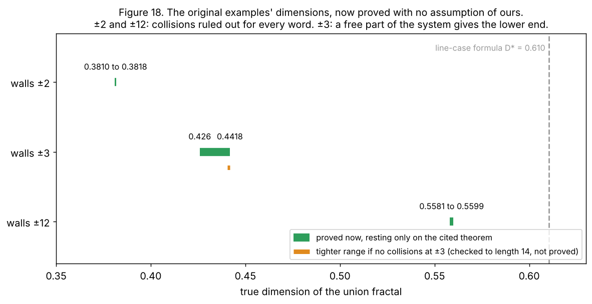

*Figure 18. Green: what is now proved with no assumption of ours. At ±2 and ±12 the bands are the round-5 certified
brackets, made unconditional by Theorem P5. At ±3 the lower end comes from the free part of the system (Theorem P6).
Orange: the tighter ±3 range that would follow from no collisions at ±3.*

### 10.6 Lead or not

**A consolidation, not a new lead.** For: two of the three original examples now have fully proved dimensions. The proof
is short (real ping-pong, cancellation, one 2-adic level). It covers every even Q at once, and the third example is pinned
within 0.016. Against: it is specific to these multipliers. The open case at ±3 looks hard, and solving it would only
tighten one number by 0.015.

### 10.7 Lean

`lean/NewTies.lean` now has 22 theorems and builds with Lean 4.37.0-rc1, with no sorry and standard axioms only. Output
is in `lean/compile_output.txt` (V11). New this round: `five_pow_mod_four`, `even_Q_square_odd`, `levels_differ`,
`four_pow_odd_mod_five`, `four_pow_even_mod_five` and `window_miss`. They cover the arithmetic steps. The p-adic geometry
is in the prose proof, and core Lean has no p-adic numbers.

### 10.8 Who proved what, round 6

Real and p-adic ping-pong are standard tools. Theorem P5 and its proof, Theorem P6 and its proof, and the certified
lower bound at ±3 are ours (DRAFT). The dimension statements still rest on Solomyak and Takahashi's theorem
(IMRN 2021), whose proof we did not check.

### Known vs new, round 6

| Item | Status | Source |
|---|---|---|
| Ping-pong in the reals and p-adics | Known tools | standard |
| No collisions at walls ±2, ±12 (every even Q) | **Ours** (DRAFT) | 10.3, V3–V4 |
| No collisions at walls ±3 for the allowed class | **Ours** (DRAFT) | 10.4, V6–V8 |
| Dimension at ±3 at least 0.426, unconditional | **Ours**, resting on Solomyak–Takahashi | 10.4, V9 |
| No collisions at ±3 for every word | Open (checked to length 14) | 10.4, V10 |

---

## 11. Round 7 (DRAFT): the true size of the plane union fractal

Brennan said "Let's keep going!", and the biggest open piece was the plane (complex) union fractal of round 2, whose
size was only estimated at about 1.19. Script: `plane.py` → `plane.json`. Checks: `checks7.py`, 14/14 (W1–W13).
Figures 19–22. Lean: seven more theorems, 29 in all, all build.

### 11.1 The answer in two sentences

The original plane union fractal's dimension is now proved to lie between 1.19061 and 1.19064, a range under 0.00003
wide that sits right under the formula's D* = 1.190636. For a nearby example (classes 2 and 3 shrink by 3/10 instead of
1/3) the dimension is proved to equal the formula exactly, D* = 1.12928, with every step proved.

### 11.2 The examples and the theorem

Maps z ↦ c + λ(z − c) turn and shrink about a centre c; maps with the same centre commute, maps with different centres
don't. The words are the trace monoid M = ℕ² ∗ ℕ ∗ ℕ: runs alternating between three classes.

| Class | Centre | Original (round 2) | Modified (round 7) |
|---|---|---|---|
| 1 | 0 | a: (1+i)/4 (turns 45°), b: 3/10 | same |
| 2 | 1 | i/3 | 3i/10 |
| 3 | i | 1/3 | 3/10 |

**Theorem P7 (DRAFT, ours, resting on Hochman 2015).** Let K be the attractor of a finite set of turn-and-shrink maps
with Gaussian-rational (more generally algebraic) λ and c, grouped into classes by centre, with at least two classes
and some product of first-return pieces turning by an angle other than 0° or 180°. Let D* be the root of
1 + Σ_classes (Π(1 − |λ|^s) − 1) = 0. Then:

1. dim K ≤ D* always (round 2).
2. If different words of M give different maps, dim K = min(2, D*).
3. If only the words whose class-1 runs lie in a set U never collide, dim K ≥ min(2, s_U), where s_U is the root of
   S_U(s) · (Q(s) − 1) = 1, with S_U the sum of |λ_u|^s over u in U and Q the growth series of the other classes.

**Proof.** (1) is the round-2 covering argument; similarities have no distortion. For (2) and (3), use round 2's
first-return pieces S = {u·v : u a nonempty class-1 run, v a nonempty word in the other classes}. They generate a free
monoid inside M, so if no words collide, the finite sets S_L (runs up to length L) have no exact overlaps. Their
coefficients are Gaussian rationals, and the piece a·(class-3 map) turns by 45°, so the pieces fix no line (W8, Lean
`rot45_no_invariant_line`). Hochman's Corollary 1.7 (arXiv:1503.09043) says an algebraic, linearly irreducible
self-similar system with no exact overlaps has dimension min(d, similarity dimension). So dim K ≥ min(2, s-dim S_L) for
every L. The similarity dimensions increase to the root of (P₁ − 1)(Q − 1) = 1, which is D* because
1/P_M = 1/P₁ + 1/Q − 1 for a free product (W7, Lean `first_return_threshold`). For (3), take u in U only. ∎

We read the statements of Hochman's Theorem 1.4 and Corollaries 1.6–1.7 and his definitions of linear irreducibility,
exact overlaps and algebraic systems; we did not check his proof.

### 11.3 No collisions: three steps

Suppose two different words give the same map, and take a shortest such pair.

1. **The outer run has the same class in both words (complex ping-pong).** There is an invariant disc B, and covers of
   the three class pieces X₁, X₂, X₃ by discs with exact rational centres and radii, such that no disc of one class
   meets a disc of another (Figure 19; W1, W2: smallest gap 0.24 for the original, 0.31 for the modified). Every
   non-identity run of class j sends every class piece into X_j. Start both words at a point of a class piece whose
   class differs from both words' innermost (first-applied) runs; the image lands in the piece of the outer class.
2. **Cancel.** Runs of classes 2 and 3 are powers of one map, so one can be taken off both words. In class 1, take off
   the common a's and b's. What's left is either impossible by step 1, or **a^d · g′ = b^e · h′** with d, e ≥ 1, where
   g′ and h′ have outer runs in class 2 or 3 (or are empty). Class-1 maps are z ↦ λz, so this says
   h′(z) = ρ · g′(z) for every z, with ρ = λ₁^d · λ₂^(−e).
3. **The last step.**
   - *Modified example: 3-adic, all words.* Measure how many times 3 divides each number (3 stays prime in the Gaussian
     integers, Lean `gauss_mod3_no_zero_divisors`). Every coefficient has no 3 in its denominator, so every map keeps
     3-adic integers. A class-2 map is 1 + (3i/10)(z − 1), so it sends any 3-adic integer to 1 plus a multiple of 3,
     and class 3 likewise to i. So g′(1) and h′(1) are 3-adic units (valuation 0). But λ₁ = (1+i)/4 is a unit and
     λ₂ = 3/10 has one factor 3, so ρ has valuation −e ≤ −1. Then h′(1) = ρ · g′(1) is impossible (Figure 20; W3, W4;
     Lean `units_mod3`, `three_adic_levels_differ`). ∎
   - *Original example: geometry, for e ≤ 6.* Here classes 2 and 3 grow 3-adically (1/3), and no prime works (W4 shows
     the 3-adic values spread over 19 levels). Instead, h′(z₀) and g′(z₀) both lie in X₂ ∪ X₃, so ρ would be a ratio of
     two points of the covers. An exact disc test rules this out for every d whenever e ≤ 6: pairs with small d are
     checked disc by disc, and for larger d the ratio is too small (Lean `tail_bound`, `sqrt_two_upper`; W10). So words
     whose class-1 runs have at most 6 b's never collide. For e ≥ 7 a few pairs, the first (d, e) = (8, 7), land inside
     the covers (Figure 21, red; W11). Those are the only cases left open.

The trace counts match the number of different maps for every word up to length 11 in both examples, 2,107,560 at
length 11 (W5, hashed mod two primes; a match mod p proves the maps differ over the Gaussian rationals).

### 11.4 The numbers

| Example | Proved dimension | Formula D* (certified) | Earlier estimates |
|---|---|---|---|
| Original | **1.19061 to 1.19064** (class-1 runs with ≤ 6 b's; 1.0186 from pure a-runs alone) | 1.190635 to 1.190636 | box count 1.194; Moran 1.251 |
| Modified | **exactly D* = 1.12928** | 1.129279 (bracket width 10⁻⁶) | — |

All brackets use interval arithmetic (mpmath); the covers use exact fractions with √2 bounded by 99/70.

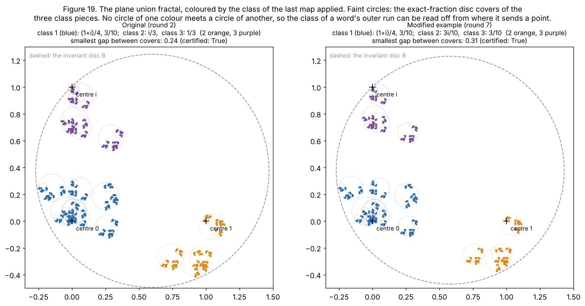

*Figure 19. The two plane union fractals, coloured by the class of the last map applied, with the certified disc
covers of the three class pieces (faint circles) and the invariant disc (dashed). No circle of one colour meets a circle
of another.*

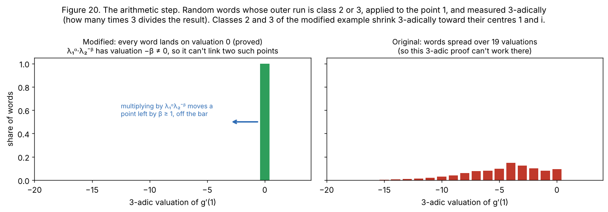

*Figure 20. The arithmetic step. In the modified example every word whose outer run is class 2 or 3 sends 1 to a
3-adic unit (one bar), and the ratio ρ shifts the valuation by e ≥ 1. In the original the values spread out.*

*Figure 21. The original example's last step. Grey: ratios of points of the class-2 and class-3 pieces. Green: the
ratios ρ = λ₁^d λ₂^(−e) with e ≤ 6, all certified outside the covers. Red: the few with e ≥ 7 that land inside, the
only open cases.*

*Figure 22. What is proved. The original's range is too narrow to draw as a bar; the diamond marks it.*

### 11.5 Lead or not

**A solid result, but a consolidation, not a new lead.** For: the plane version of the formula is now a theorem with
an example where every step is proved, and the round-2 example is pinned to five decimals. The proof mixes complex
ping-pong with 3-adic arithmetic, and step 3 is short. Against: the mechanism is Hochman's, as on the line. Closing the
original's last 0.00003 would need a new idea for a handful of ratio cases, and it changes no conclusion.

### 11.6 Lean

`lean/NewTies.lean` now has 29 theorems and builds with Lean 4.37.0-rc1, with no sorry and standard axioms only
(`lean/compile_output.txt`). New this round: `gauss_mod3_no_zero_divisors`, `units_mod3`, `three_adic_levels_differ`,
`sqrt_two_upper`, `tail_bound`, `rot45_no_invariant_line`, `first_return_threshold`. They cover the arithmetic. The disc
covers are certified in Python with exact fractions, and the 3-adic and complex geometry is in the prose proof.

### 11.7 Who proved what, round 7

Ping-pong, cancellation and p-adic valuations are standard tools. Theorem P7's reduction, the modified example and its
3-adic proof, the certified covers, and the e ≤ 6 exclusion for the original are ours (DRAFT). Both dimension
statements rest on Hochman's Corollary 1.7 (arXiv:1503.09043), whose proof we did not check.

### Known vs new, round 7

| Item | Status | Source |
|---|---|---|
| Algebraic + irreducible + no exact overlaps ⇒ dim = min(d, s-dim) | Known (Hochman 2015, Cor. 1.7) | cited |
| Plane formula: dim K = min(2, D*) when no words collide | **Ours** (DRAFT), resting on Hochman | 11.2 |
| Modified example: no collisions, dim = D* = 1.12928 | **Ours** (DRAFT) | 11.3, W1–W7 |
| Original example: dim between 1.19061 and 1.19064 | **Ours** (DRAFT) | 11.3, W10–W12 |
| Original example: no collisions for every word | Open (checked to length 11) | 11.3, W5, W11 |

---

## 12. Round 8 (DRAFT): what's in print, and the exact size for whole families

Brennan asked whether we had actually contributed, then "can we show this more generally, for a larger range of
cases?" This round answers both. Script: `general.py` → `general.json`. Checks: `checks8.py`, 13/13 (X1–X11).
Figures 23–26. Lean: eight more theorems, 37 in all, all build.

### 12.1 The answer in two sentences

The exact size (dimension = the formula's D*) is now proved for a dense set of parameters, for any number of classes
with any number of maps in each, on the line and in the plane, as long as every map shrinks by more than a set factor.
On the line the formula was already known for "almost every" choice of parameters (Bárány and Verma 2025), but that
kind of theorem can't decide any one example; ours names the examples and proves them, and the plane version is not in
print as far as we can find.

### 12.2 What's in print

A second, wider search (Nov 27) found work our first two searches missed. It changes how earlier rounds should be read,
and the earlier tables are now marked "[Round 8 correction]".

| Paper | What it proves | What it leaves open |
|---|---|---|
| Bárány and Szvák, Math. Nachr. 294 (2021) 657–671, arXiv:1902.04028 | Three maps αx, βx, γx + 1 − γ (two share centre 0): dimension solves α^s + β^s + γ^s − α^sβ^s = 1 for α outside a set of dimension 0 | Which α are exceptional |
| Bárány and Verma, arXiv:2507.05835 (2025, preprint) | Line, any grouping into classes by centre: the same D* equation, for parameters outside an exceptional set of smaller dimension; also the measures | Any specific example; the plane |
| Kittle and Kogler, arXiv:2610.10511 (Oct 2026, preprint) | Every finite system of maps on the line with no exact overlaps has dimension min(1, similarity dimension) | Deciding whether a given system has exact overlaps |
| Hochman, Annals 180 (2014); arXiv:1503.09043 (2015) | Algebraic parameters, no exact overlaps ⇒ dim = min(d, similarity dimension); in the plane also needs "no fixed line" | Same |
| Rapaport, arXiv:2001.01332; Solomyak (2024); Christodoulou and Jurga (Trans. AMS 2026) | Algebraic contractions; Möbius and projective systems (relevant to rounds 3–4) | — |

Not found in print: the plane version (Theorem P7), the plane laws P1–P4, any proof that specific examples have no
collisions, the certified numbers, and reading the words as a trace monoid. So on the line the open question was
never the formula but **which examples it holds for**, and that is what this round answers.

### 12.3 Theorem P8: one test that rules out collisions

Setting: maps z ↦ c + λ(z − c) with rational (line) or Gaussian-rational (plane) c and λ, |λ| < 1, grouped into classes
by centre c₁, …, c_N. A prime p is **good for class i** when no centre or multiplier has p in its denominator, every
multiplier of every other class is divisible by p, and every other centre differs from c_i by a p-adic unit.

**Theorem P8 (DRAFT, ours).** Different words give different maps if:

- **(A) separation.** Some set Y is sent into itself by every map, and the class pieces X_i = ∪ g(Y), over non-identity
  words g in class i alone, are pairwise disjoint; and
- **(B) arithmetic.** For each class with two or more maps, the valuations of its multipliers at its good primes admit
  no integer relation Σ w_m v_p(λ_m) = 0 (for all good p) in which some w_m are positive and some negative.

**Proof.** Take a shortest pair of different words W, W′ giving the same map.

1. *Same outer class.* For any y in Y, W(y) = s(rest(y)) with rest(y) in Y and s W's outer (last-applied) run, so W(y)
   lies in the piece of W's outer class. The pieces are disjoint, so both words end in the same class i.
2. *Cancel.* Write W = u·g′ and W′ = u′·h′, with u, u′ the outer class-i runs and g′, h′ the rest. Class-i maps commute,
   so take the common part of u and u′ off both (maps are invertible). By shortness the exponent vectors of u and u′
   now have disjoint supports. If one is empty, the words have different outer classes, ruled out by step 1. So both
   are nonempty, and w = exponents(u) − exponents(u′) has mixed signs. (A class with one map can't get here.) The
   equal maps say h′(z) − c_i = ρ·(g′(z) − c_i) for every z, with ρ = Π λ_m^(w_m).
3. *The good prime.* Take z = c_j with j ≠ i, and p good for i. Every map keeps p-adic integers. If g′ is empty,
   g′(z) − c_i = c_j − c_i, a unit. Otherwise g′'s outer map has some centre c_k ≠ c_i and a multiplier divisible by p,
   so g′(z) ≡ c_k mod p and g′(z) − c_i is again a unit (Lean `good_prime_unit`). Same for h′. So v_p(ρ) = 0 for every
   good p: w is a mixed-sign relation, which (B) forbids. ∎

**Testing (B) is linear algebra.** The relations form a subspace K. If dim K = 0, (B) holds. If dim K = 1, (B) holds
exactly when K's spanning vector is one-signed. If dim K ≥ 2, (B) fails: K minus 0 is connected, it can't sit inside
the two sign-orthants without meeting both (K = −K), and a mixed rational vector exists because mixed is an open
condition (X8). So a class of k maps needs good primes whose valuations have rank at least k − 1.

**Lemma A′ (separation for free).** Let δ and D be the smallest and largest distances between centres, and suppose every
|λ| ≤ ε with ε(4D + δ) < δ. Then (A) holds with Y the disc about c₁ of radius R = D(1 + ε)/(1 − ε).
*Proof.* A map with centre c_j sends Y into the disc about c₁ of radius D(1 + ε) + εR = R. A non-identity class-j word
shrinks by at most ε about c_j, so X_j lies in the disc about c_j of radius ε(R + D) = 2εD/(1 − ε). Two such discs miss
when 4εD/(1 − ε) < δ, which is ε(4D + δ) < δ (X1, X2; Lean `lemmaA_invariant`, `lemmaA_key`). ∎

### 12.4 Corollary P9: a dense family for every pattern of class sizes

**Corollary P9 (DRAFT, ours).** Fix N ≥ 2 integer centres on the line (or Gaussian-integer centres in the plane) and
class sizes k₁, …, k_N ≥ 1. Give each class i its own k_i − 1 odd primes (all different; in the plane take primes
≡ 3 mod 4), none dividing a difference of centres. Choose multipliers λ_{i,1}, …, λ_{i,k_i}, with none of these primes
in a denominator, such that:

1. every |λ| < δ/(4D + δ);
2. every multiplier is divisible by every prime of every other class;
3. for m < k_i, λ_{i,m} is divisible by class i's m-th prime and by none of its other primes, and λ_{i,k_i} by none.

Then different words give different maps. So on the line dim K = min(1, D*) (round 2's theorem, resting on Hochman
2014; Kittle and Kogler's corollary gives it too), and in the plane, if some multiplier is not real,
dim K = min(2, D*) (Theorem P7, resting on Hochman 2015). Such multipliers are dense in the box |λ| < δ/(4D + δ).

*Proof.* (A) is Lemma A′. For (B), class i's own primes are good for it by (2), and at them the valuation matrix has its
m-th prime dividing only the m-th multiplier, so every relation vanishes on the first k_i − 1 coordinates and is a
multiple of the last unit vector, one-signed (Lean `diagonal_kernel`). Extra good primes only shrink the relations.
Density: each condition fixes a residue class mod a product of the chosen primes, and fractions m/2ⁿ with m in a fixed
class come within that product over 2ⁿ of any target (Lean `exists_near`; X10). ∎

Figure 23 shows the recipe for one member; X9 checks it on 100. For centres 0, 1, …, N − 1 on the line the box is
|λ| < 1/(4N − 3), and the primes need only be at least N (Lean `centres_distinct_mod`).

*Figure 23. Corollary P9's recipe for one member with classes of sizes 3, 2 and 1. Class 1 gets two primes (3 and 5),
class 2 one (7), class 3 none. Each multiplier carries its own prime once, its classmates' primes never, and all the
other classes' primes. That pattern is what makes every collision impossible.*

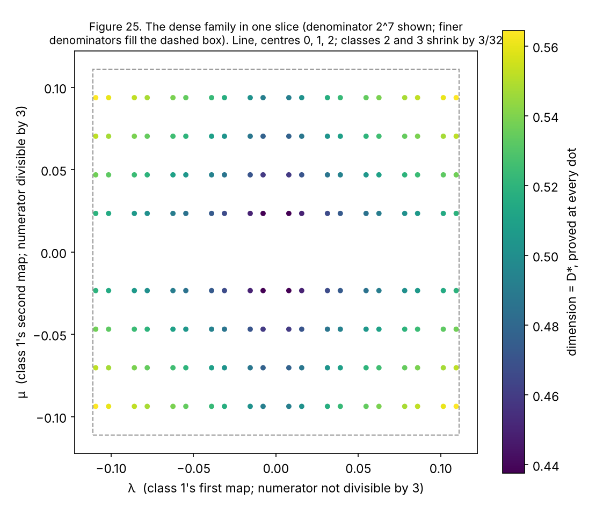

*Figure 25. One slice of the family on the line: class 1's two multipliers λ and μ vary, classes 2 and 3 are fixed at
3/32. Every dot has its dimension proved equal to D* (colour). Only denominator 2⁷ is drawn; finer denominators fill
the dashed box.*

### 12.5 How far the test reaches beyond the dense family

Lemma A′ is the cautious way to get (A). The certified disc covers of round 7 (exact fractions, any number of classes)
reach much larger multipliers, and with them larger dimensions. We sampled three random families and certified each
member (`general.py`, G3), then confirmed no collisions by hashing every word up to length 6 or 7 mod two primes.

| Family | Setting | Members | Pass (B) | Pass (A) and (B) | Collision-free (checked) | D* of passing members |
|---|---|---|---|---|---|---|
| F1 | plane, centres 0, 1, i; class 1 has two maps | 40 | 40 | 33 | 33 of 33 | 0.62 to 1.41 |
| F2 | plane, 4 classes, centres 0, 1, i, 1 + i | 40 | 40 | 25 | 25 of 25 | 0.88 to 1.48 |
| F3 | line, centres 0, 1, 2 | 40 | 40 | 27 | 27 of 27 | 0.62 to 1.06 |
| G4 | line, two classes of two maps, good primes 3 and 5 | 1 | 1 | 1 | yes | 0.58357 |
| G5 | Corollary P9, 14 class patterns, line and plane | 42 | 42 | 42 | 42 of 42 | 0.38 to 0.69 |

Every member that passes has its dimension proved equal to min(d, D*). A member that fails (A) is not shown to collide;
the test is just silent there. The round-7 examples: MOD passes (B) at the prime 3; ORIG has no good prime at all,
which is why round 7 needed geometry for it (X3).

*Figure 24. Every sampled member, placed by how large its biggest multiplier is compared with Lemma A′'s bound (left of
the dashed line, separation is automatic) and by its formula value D*. Green: the test proves no collisions and the
exact size. Red: no certified cover found, so the test is silent. Blue: Corollary P9's dense family.*

*Figure 26. A plane member of the dense family (classes of sizes 2, 2, 1), coloured by the class of the last map. The
coloured discs are Lemma A′'s class discs and never meet; the zoom shows small turned copies of the whole.*

### 12.6 What this means in plain terms

Before this round we had two worked examples. Now there is a recipe: pick centres, pick how many maps share each
centre, give each class a few primes, and choose small multipliers carrying those primes in the right pattern. Every
such system obeys the formula exactly, with a proof, and such systems sit arbitrarily close to any small-multiplier
system you name. With certified covers the same test also handles bigger multipliers one example at a time, in seconds.

### 12.7 What it contributes, and what would make it a lead

**What's proved and ours:** Theorem P8 (a checkable no-collision test for any number of classes, line or plane),
Lemma A′, Corollary P9 (an explicit dense family for every pattern, with proofs), and 128 more certified examples. On the
line this complements Bárány and Verma: their theorem says the formula holds outside a small exceptional set; ours
names explicit parameters proved to be outside it. In the plane, Theorem P7 with P9 is, as far as we can find, the
first statement of the formula and the first proved cases.

**What would make it a lead:** (1) dropping the smallness condition, for instance proving that every system meeting (A)
by any route and (B) obeys the formula, with (A) checked by the round-7 covers; (2) a converse, showing which rational
parameters do collide, which would describe Bárány and Verma's exceptional set explicitly; (3) the round-6 open case,
±3 for all words, which (B) can't reach because no good prime exists there. Item (2) is the most interesting to experts,
because nobody can currently name the exceptional parameters.

### 12.8 Lean

`lean/NewTies.lean` now has 37 theorems and builds with Lean 4.37.0-rc1, with no sorry and standard axioms only
(`lean/compile_output.txt`). New this round: `lemmaA_invariant`, `lemmaA_key`, `two_maps_one_prime`, `diagonal_kernel`,
`good_prime_unit`, `centres_distinct_mod`, `exists_near`, `g4_small`. They cover the algebra of Lemma A′, the kernel step
for Corollary P9's recipe, the good-prime congruence and the density step. The p-adic and geometric steps are in the
prose proof and the Python checks.

### 12.9 Who proved what, round 8

Ping-pong, cancellation, p-adic valuations and the Chinese remainder theorem are standard tools. Theorem P8, Lemma A′,
Corollary P9 and the certified family members are ours (DRAFT). The dimension statements rest on Hochman's theorems
(2014 on the line, Corollary 1.7 of arXiv:1503.09043 in the plane), and on the line also follow from Kittle and Kogler's
corollary; we read those statements and did not check their proofs. The line formula itself, for generic parameters,
is Bárány and Verma's (2025), with a three-map case in Bárány and Szvák (2021).

### Known vs new, round 8

| Item | Status | Source |
|---|---|---|
| Line formula for generic parameters | **Known** (Bárány and Verma 2025; three maps: Bárány and Szvák 2021) | 12.2 |
| No exact overlaps ⇒ dim = min(1, s), every line system | Known (Kittle and Kogler 2026, preprint) | 12.2 |
| Theorem P8: valuation-and-separation test for no collisions | **Ours** (DRAFT) | 12.3, X3–X8 |
| Lemma A′: separation when ε(4D + δ) < δ | **Ours** (DRAFT, elementary) | 12.3, X1, X2 |
| Corollary P9: explicit dense family, every pattern, line and plane | **Ours** (DRAFT) | 12.4, X7, X9, X10 |
| 128 certified family members and G4 | **Ours** (DRAFT) | 12.5, X5–X7 |
| Plane formula and its proved cases | **Ours** (DRAFT); not found in print | 11, 12.4 |

---

## 13. Round 9 (DRAFT): exactly which cases break the formula

Brennan said "Let's keep pushing!" Section 12.7 named the most interesting open question: which parameters break the
formula? Script: `breaks.py` → `breaks.json`. Checks: `checks9.py`, 12/12 (Y1–Y12). Figures 27–30. Lean: four more
theorems, 41 in all, all build.

### 13.1 The answer in two sentences

The formula fails exactly when two different words give the same map, and whenever that happens the true size is
strictly smaller than D*, by an amount we can compute. So the breaking cases form an explicit, thin set (a countable union
of equations among the parameters), and we found one inside the separated region where the size drops from
D* = 0.50353 to at most 0.47048.

### 13.2 Theorem P10: a collision always costs size

**Theorem P10 (DRAFT, ours as stated).** Take any shared-centre system on the line or in the plane, with any real or
complex parameters and at least two classes. If two different words (different elements of the trace monoid M) give
the same map, then dim K ≤ s_c < D*, and s_c can be computed (below).

**Proof.**

1. *Move the collision into the free part.* Round 2's first-return pieces S = {u·v : u a nonempty run in class 1, v a
   nonempty word in the other classes} form a free monoid S*. If W ≠ W′ give the same map, so do a·W·v and a·W′·v for a
   class-1 map a and a map v of another class. Both lie in S*, and they are still different, because a trace monoid
   cancels on both sides. So two different words X ≠ Y over the alphabet S give the same map.
2. *Every map has a representative avoiding one word.* Order words over S by length, then alphabetically (S is
   countable, so this is a well-order). Say Y is the larger. Replacing any occurrence of Y by X keeps the map and makes
   the word smaller (Lean `replace_shortens`), so every map of S* is the map of a word with no Y in it.
3. *Count.* Every element of M factors uniquely as (word in the other classes)·(element of S*)·(class-1 run), so the
   distinct maps are bounded by Q(s)·A(s)·P₁(s), where A sums |λ_w|^s over words avoiding Y. Cover K by the images
   W(K) over a cut set at scale r; replacing each W by its representative keeps the cover, so dim K is at most the point
   where this series starts to converge. Q and P₁ converge near D*. For A, split a word into blocks of length n = |Y|;
   no block is Y, so the blocks of length n contribute at most f(s)ⁿ − |λ_Y|^s each, where f(s) = Σ_S |λ|^s =
   (P₁ − 1)(Q − 1). At s = D*, f = 1, so this is 1 − |λ_Y|^(D*) < 1 and A converges there, and also a little below D*
   by continuity. So **s_c ≤ the root of f(s)ⁿ − |λ_Y|^s = 1, which is below D*.** ∎

When the collision is between two single pieces (n = 1) it spreads: a·X·w and a·Y·w collide for every class-1 run a
and every word w of the other classes, so a whole family of pieces, of weight P₁(s)Q(s)|λ_Y|^s, can be dropped. That
gives the sharper bound **root of f(s) − P₁(s)Q(s)|λ_Y|^s = 1.**

### 13.3 Corollary P11: exactly where the formula holds

**Corollary P11 (DRAFT, ours as stated).** Suppose D* ≤ d (d = 1 on the line, 2 in the plane).

- *Line, algebraic parameters:* dim K = D* exactly when no two different words collide (P10 one way, round 2's theorem
  with Hochman 2014 the other). *Any real parameters:* the same, if Kittle and Kogler's corollary (preprint) holds.
- *Plane, algebraic parameters with a non-real multiplier:* the same (P10 and Theorem P7).
- *The breaking set is thin.* For any fixed distinct centres, the multipliers where some collision happens form a
  countable union of proper algebraic subsets, so they have measure zero and lower dimension.
- *Inside the separated region* (for example every |λ| < δ/(4D + δ)), every collision has the normal form of P8's step 2:
  two class-i runs with different letters on top of words from other classes. So a break needs a class with two or
  more maps; systems with one map per class never break there.

*Proof of thinness.* Pick small multipliers that are algebraically independent (no polynomial relation over the
centres). Lemma A′ applies, so a collision would have P8's normal form λ^u (g′(c_j) − c_i) = λ^(u′) (h′(c_j) − c_i),
a polynomial identity. Independence makes it hold as polynomials, so we may set every other class's multipliers to 0.
Then g′(c_j) becomes the centre c_k of g′'s outer map (or c_j), and we get λ^u (c_k − c_i) = λ^(u′) (c_k′ − c_i)
with u ≠ u′: two different monomials with nonzero coefficients, impossible. So each "these two words agree" equation
is a nonzero polynomial in the multipliers, and its zero set is proper. ∎

This says which parameters are Bárány and Verma's exceptions, at least when D* ≤ 1: precisely the collision set. Their
theorem shows the exceptions are small; P11 names them. The principle "exact overlaps cost dimension, otherwise you get
the full value" is the standard one for self-similar sets. What's ours is carrying it to shared-centre classes, where
the full value is D* rather than Moran's root, and the description of the breaks.

### 13.4 A concrete break, and how much it costs

Line, centres 0, 1, 2. Class 1 about 0: λ = 19/200 and μ = 1/20. Class 2 about 1: ν = 1/19. Class 3 about 2:
κ = 1/10. All are below Lemma A′'s bound 1/9, so this sits inside the separated region (Lean `example_in_box`).

Shrinking by 1/19 toward 1 and then by 19/200 toward 0 is **the same map** as shrinking by 1/10 toward 2 and then by
1/20 toward 0: both send z to (18 + z)/200 (Figure 27; Lean `example_slopes`, `example_collision`). It is P8's normal
form with ρ = λ/μ = 19/10 = 2 − κ. Every such break lies on the surface λ = μ(2 − κ), ν = κ/(2 − κ).

| Quantity | Value | How |
|---|---|---|
| Formula D* | 0.5035322 | certified root (interval arithmetic) |
| Upper bound, one duplicate piece | 0.4964260 | P10, n = 1 |
| **Upper bound, whole family** | **0.4704834** | P10, family bound |
| Lower bound | 0.4367041 | the subsystem without μ never collides (one map per class, P8), plus Hochman |
| **Proved drop below the formula** | **at least 0.0330** | |

The counts back this up (Figure 28). We counted the different maps among all words of each length, hashed mod two
primes, and compared them with a prediction that assumes this one break and its family are the only collisions. The
prediction matches exactly at every length from 1 to 9 (76,096 maps at length 9, against 151,316 words). So we
conjecture the true size is the family bound, 0.47048; proving it would mean showing no other collision happens.

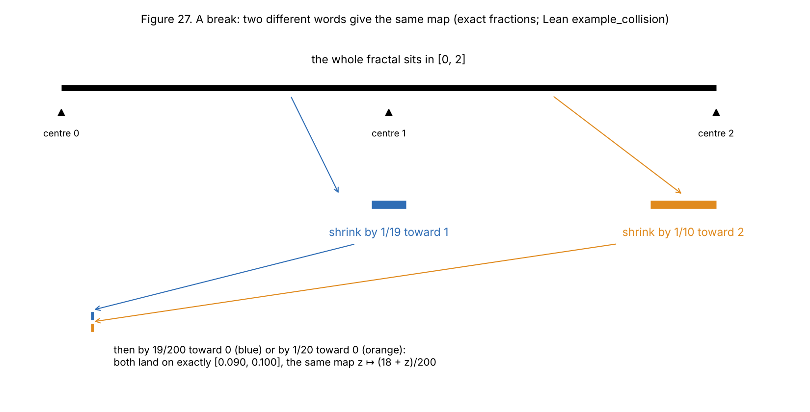

*Figure 27. The break. Two routes (blue: toward 1 then toward 0; orange: toward 2 then toward 0) land on exactly the
same interval [0.090, 0.100] with the same scaling, so they are the same map.*

*Figure 28. Left: words (grey) against different maps (red); the crosses are the prediction from this one break, and
they match at every length. Right: the maps grow by about 3.41 per step against 3.73 for words. Fewer pieces means a
smaller fractal.*

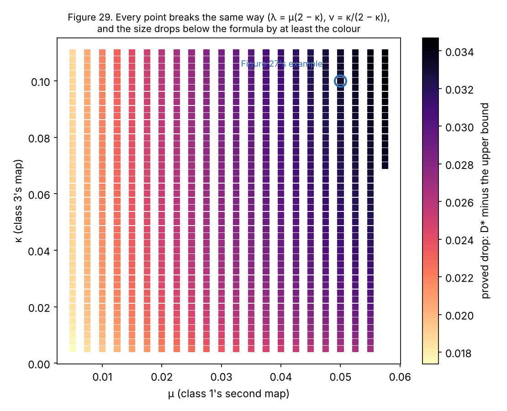

*Figure 29. The whole collision surface inside the separated region, drawn over μ and κ (then λ and ν are fixed by the
break). Colour: the proved drop below the formula, between 0.017 and 0.035 everywhere. The circle is Figure 27's example.*

*Figure 30. What is proved at the example: the true size sits in the green bar, wholly below the formula's value.*

### 13.5 What this means in plain terms

The formula counts every word as a different piece. It is right exactly when that's true. When two different words
land on the same piece, the fractal has fewer pieces than the formula thinks, and it really is smaller, by a margin we
can bound. Those coincidences need an exact equation among the parameters, so they're rare, and when the pieces are
kept apart they can only happen inside a class of two or more maps.

### 13.6 Is it a lead?

**Yes, a real one.** It turns a published "almost every parameter" theorem into an exact description of where the
formula fails, with a computable drop, and it comes with a worked example where everything but the last digits is
proved. What would take it further: (1) prove the example's size equals the family bound 0.47048 (show no other
collision occurs), which would give the first exact size of a broken case [Round 10 update: done for a dense set of breaks, and the original is pinned to within 1.4 × 10⁻⁷; section 14] [Round 11 update: the original is pinned to within 1.8 × 10⁻⁴⁸¹¹, not exact; section 15] [Round 12 update: every bad pair in proved ranges covering 72.7% of the windows is settled for all run lengths; still not exact; section 16]; (2) list which equations can occur inside
the separated region, so the breaking set is described surface by surface; (3) the same picture for the plane laws of
rounds 3–4, where the maps are Möbius rather than straight-line.

### 13.7 Lean

`lean/NewTies.lean` now has 41 theorems and builds with Lean 4.37.0-rc1, with no sorry and standard axioms only
(`lean/compile_output.txt`). New this round: `example_slopes`, `example_collision`, `example_in_box`,
`replace_shortens`. They pin down the concrete break and the termination step of P10. The covering and counting steps
are in the prose proof and the interval checks.
All 41 also compile clean in the shared library (`FusedAlgebra.Topics.NewTies`, namespace `CircleOp.NewTies`, no proof
changed), mirrored on Nov 27. In the repo's CI, `checks5.py` to `checks9.py` all run (CI installs python-flint).
The Lean lines of rounds 5 and 6 (V7, V11) test the 16- and 22-theorem file of those rounds, so CI reports them as
known stale (`tools/checks_known_stale.txt`); `checks9.py` Y11 checks the current 41-theorem build.

### 13.8 Who proved what, round 9

Cut-set covers, word reduction by a well-order, and "exact overlaps cost dimension" are standard ideas. Theorem P10 for
shared-centre classes, the family bound, Corollary P11's description and its thinness proof, the concrete break and
its certified numbers are ours (DRAFT). The "holds" direction rests on Hochman (2014 on the line, 2015 in the plane) and,
for non-algebraic parameters on the line, on Kittle and Kogler's preprint; we read those statements and did not check
their proofs.

### Known vs new, round 9

| Item | Status | Source |
|---|---|---|
| Exact overlaps lower the dimension of a self-similar set | Known principle | standard |
| P10: any collision ⇒ dim ≤ s_c < D*, with the block and family bounds | **Ours** (DRAFT) | 13.2, Y3–Y6 |
| P11: dim = D* exactly when no collision (D* ≤ d); breaking set thin and in normal form | **Ours** (DRAFT), resting on Hochman (and Kittle–Kogler for real parameters) | 13.3, Y7, Y8 |
| Concrete break inside the separated region, drop at least 0.033 | **Ours** (DRAFT) | 13.4, Y1, Y2, Y5 |
| Its exact size equals the family bound 0.47048 | Conjecture (counts match to length 9). [Round 10 update: still open, now pinned to [0.47048331, 0.47048344]; exact for a dense set of other breaks, section 14] [Round 11 update: still open; no second collision in runs of up to 10,000 copies of λ, gap 1.8 × 10⁻⁴⁸¹¹, section 15] [Round 12 update: still open; settled at once for every bad pair with stretch in ranges covering 72.7% of the windows, section 16] [Round 13 update: still open; no second collision for any bad pair with a ≤ 10⁶, gap 6.0 × 10⁻⁴⁸⁰⁹⁶⁶, section 17] [Round 14 update: still open; reduced to one ratio-free conjecture (14.4), section 18] [Round 15 update: still open; would follow from Conjecture 15.3 (fingerprints), proved for up to two N/K letters, section 19] [Round 16 update: still open; Conjecture 15.3 now proved for all pairs with at most two N/K letters and for three letters against one, section 20] [Round 17 update: still open; Conjecture 15.3 now also proved for three N/K letters against two, section 21] [Round 18 update: still open; Conjecture 15.3 now proved for every pair with at most three N/K letters each, section 22] [Round 19 update: still open; Conjecture 15.3 now proved for every pair with at most four N/K letters each, section 23] [Round 20 update: still open; rounds 18 and 19 independently rechecked, and the 19-adic step for five letters scoped and done for the family that broke the bound, section 24] [Round 21 update: still open; reduced at every length to one statement about 2, 5 and 19 (Conjecture 21.2, searched, open), section 25] [Round 22 update: still open; that reduction independently rechecked, and 21.2 proved for two numbers against one, section 26] | 13.4, Y9 |

---

## 14. Round 10 (DRAFT): the exact size of a break, without counting

Asked for by Brennan (Nov 27): "What's not proved yet: the break's exact size … Let's define it exactly", then
"Without having to count". Script: [`exact.py`](exact.py) → `exact.json`. Checks: [`checks10.py`](checks10.py) →
[`checks10_output.txt`](checks10_output.txt), **12 of 12 pass**. Pictures: [`figures10.py`](figures10.py).
Lean: 53 theorems, builds, no sorry.

### 14.1 The answer in three sentences

**The exact size of a break is now proved, by a short argument with no counting, for a dense set of breaks:** it is the
root of one explicit equation (the family bound of Round 9). For a concrete break, the "3-adic break", that root is
0.4232693, where the formula guessed 0.4531865. The original 19/200 break is not covered (its two numerators share no
prime), but the same argument now pins its size between 0.47048331 and 0.47048344, where Round 9 had 0.4367 to 0.4705.

### 14.2 Theorem P12

*Setting.* On the line: centres 0, 1, 2; class 1 = {λ, μ} about 0; one map ν about 1 (letter N); one map κ about 2
(letter K); all multipliers in (0, 1). The **collision surface** is λ = μ(2 − κ), ν = κ/(2 − κ). Every point of it
breaks the formula, because (aλ)(νw) = (aμ)(κw) for every class-1 run a and every N/K word w (Lean:
`surface_slopes`, `surface_intercept`).

**Theorem P12 (DRAFT, ours).** Take a rational point (μ, κ) of the collision surface with

- **(I) separate landing zones:** 2λ < 1 − ν and 1 + ν < 2 − 2κ;
- **(II) enough push:** (2 − κ)(1 − κ) > 1, i.e. κ < (3 − √5)/2 ≈ 0.382 (Lean: `push_general` for κ ≤ 1/3);
- **(P) a shared prime:** some odd prime p divides the numerators of both μ and κ.

Then

  **dim K = min(1, s_F) exactly**, where s_F is the root of  (P₁ − 1)(Q − 1) − P₁ Q (μκ)^s = 1,
  with P₁ = 1/((1 − λ^s)(1 − μ^s)) and Q = 1/(1 − ν^s − κ^s).

And s_F < D*, so the size really drops (Round 9). Points with (P) are dense in the region where (I) and (II) hold
(numerators divisible by p are dense), so the exact formula holds on a dense subset of that part of the surface.

### 14.3 The proof

**Step 0: the reduced pieces.** Round 9's first-return pieces are u·v with u a nonempty class-1 run and v a nonempty
N/K word. Throw away the duplicated family, the pieces whose run u contains μ and whose word v starts with K. Call what
is left S′. Every thrown-away piece equals a kept one as a map, so nothing is lost, and Round 9's covering argument
(Theorem P10) gives dim K ≤ s_F, where s_F is where the weight of S′ crosses 1. That weight is
(Λ − 1)(Q − 1) + Λ(M − 1)ν^s Q with Λ = 1/(1 − λ^s), M = 1/(1 − μ^s), which equals the formula above (check X4).
What is left is the lower bound: show that **different words in S′ never give the same map.**

**Step 1: cancel.** Suppose two different words in S′ give the same map. Cancel their longest common beginning (maps are
invertible). Class-1 letters commute, so what can be left at the front is one of three shapes:

1. one side starts with a class-1 letter and the other with N or K (or is empty);
2. both start with N/K letters, one with N and the other with K;
3. one side is λ^a g′ and the other μ^b h′ with a, b ≥ 1, where g′ and h′ start with N or K.

In shape 3 the rule that defines S′ matters: the μ-side's run contained μ, so h′ starts with **N**.

**Step 2: zones (hypothesis I).** Every map sends [0, 2] into itself. A word whose last-applied (outermost) letter is
about 0, about 1 or about 2 lands in the zone [0, 2λ], [1 − ν, 1 + ν] or [2 − 2κ, 2]. By (I) these are disjoint, so
shapes 1 and 2 are impossible (an empty word is the identity, which no nonempty word equals).

**Step 3: the shared prime forces equal powers (hypothesis P).** Every multiplier is divisible by p, so every letter is
the constant map "its centre" mod p. So g′(1) ≡ 1 or 2 and h′(1) ≡ 1 mod p: both are p-adic units (p is odd). The two
sides send 1 to λ^a g′(1) and μ^b h′(1), with p-adic valuations a·v_p(λ) and b·v_p(μ). On the surface
v_p(λ) = v_p(μ) ≥ 1, so **a = b** (Lean: `equal_powers`).

**Step 4: the push (hypothesis II).** With a = b, the equation says h′ = ρ·g′ with ρ = (λ/μ)^a = (2 − κ)^a ≥ 2 − κ.
h′ lands in the N-zone. If g′ starts with N, ρ·g′ lands in ρ·[1 − ν, 1 + ν], which starts past 1 + ν because
(2 − κ)(1 − ν) > 1 + ν, and that is (II) (with ν = κ/(2 − κ) it reads (2 − κ)(1 − κ) > 1). If g′ starts with K, ρ·g′
lands beyond 2 − 2κ > 1 + ν. Either way no overlap (Lean: `push_grows`, `push_clear`). So shape 3 is impossible too.
Figure 31 is this step.

**Step 5: Hochman.** Take the finitely many pieces of S′ of length at most L. By Steps 1–4 they have no exact overlaps,
and their multipliers are rational, so Hochman's theorem (Ann. Math. 2014, algebraic parameters, no exact overlaps)
gives their attractor dimension min(1, s_L), where s_L is the root of their weight. Their attractor sits inside K, and
s_L rises to s_F as L grows. So dim K ≥ min(1, s_F). With Step 0, **dim K = min(1, s_F).** ∎

No step counts maps. The only numbers computed are the certified root s_F and certified checks of (I) and (II).

*Figure 31. Steps 2 and 4 for the 3-adic break. Top: the three landing zones are disjoint. Bottom: a second collision
would need a copy of a zone stretched by ρ ≥ 1.925 to overlap the N-zone, and it lands clear of it.*

### 14.4 The 3-adic break: an exact number

μ = 3/80 and κ = 3/40 put λ = 231/3200 and ν = 3/77 on the surface. Every multiplier has exactly one factor of 3. The
two routes (231/3200 about 0)∘(3/77 about 1) and (3/80 about 0)∘(3/40 about 2) are the same map z ↦ (9z + 222)/3200.
(I) holds (462·77 < 74·3200 and 80·40 < 74·77), and (II) holds (77·37 > 40·40). All are exact checks, in Lean too.

| | value | status |
|---|---|---|
| the formula's guess D* | 0.4531865 | certified (interval arithmetic) |
| **the true size** | **0.4232693** (in [0.42326931, 0.42326932]) | **proved exact** (P12) plus a certified root |
| collision-free subsystem (old-style lower bound) | 0.3918 | certified, superseded |

*Figure 32. Left: the original break went from a bracket of width 0.034 (grey) to one of width 0.00000014 (green, a thin
line at this scale). Right: the 3-adic break's size is exact, 0.030 below the formula.*

### 14.5 Where on the surface this applies

Hypotheses (I) and (II) hold on a large part of the surface: κ up to 0.38 and μ up to about 0.24 (Figure 33). Inside it,
every rational point whose two numerators share an odd prime is exactly solved. Such points crowd in on every point.
For example, μ_p = p/(20p + 1) and κ_p = p/(10p + 1) are exactly solved for every odd prime p and close in on the
original break (1/20, 1/10). Their exact sizes 0.46572 (p = 3), 0.46760, 0.46841, …, 0.47047 (p = 1009) climb toward
0.4704834 (check X9). That is a picture, not a proof for the limit point: dimension need not be continuous.

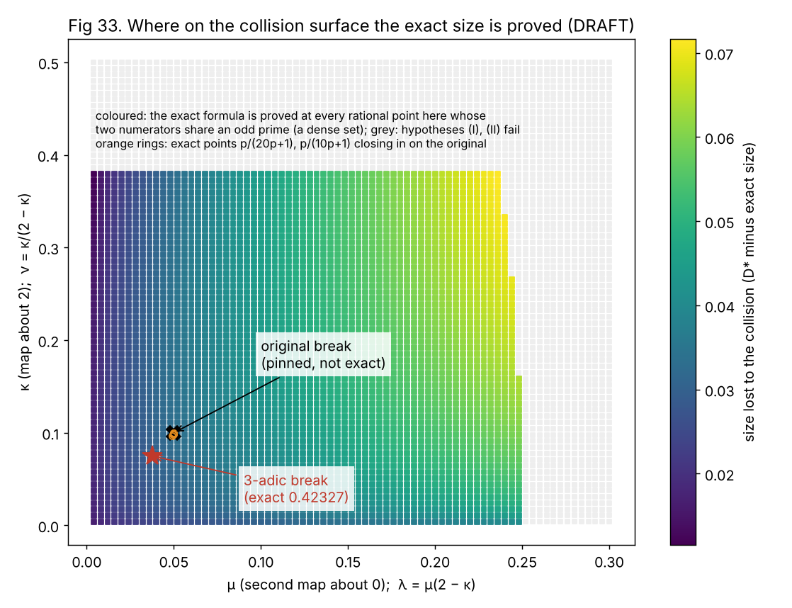

*Figure 33. The collision surface over (μ, κ). Coloured: (I) and (II) hold, so P12 applies at every point with a shared
odd prime; colour is the proved loss D* − s_F (0.012 to 0.072). Star: the 3-adic break. Cross: the original break.
Rings: exactly solved points closing in on it.*

### 14.6 The original break: pinned, not exact

For the original (19/200, 1/20, 1/19, 1/10) both numerators of μ and κ are 1, so Step 3 has no prime to work with. Without
it, a and b need not be equal and the stretch is ρ = λ^a/μ^b = 1.9^a · 20^(b−a). That can land in one of two bad windows,
[0.9, 1.11] (the N-zone against itself) or [0.474, 0.585] (the K-zone against the N-zone), where Step 4 says nothing.
The first time this happens is a = 13, b = 10: λ¹³/μ¹⁰ ≈ 0.5257 (Lean: `original_first_bad`; Figure 34).

So run the same proof on the reduced pieces whose class-1 run has **at most 12 copies of λ**. In Step 1, a is at most the
λ-power of a run, so a ≤ 12, and no ratio with a ≤ 12 hits a window (exact check for every b). That subsystem has no
exact overlaps, and Hochman gives a certified lower bound:

  **0.47048331 ≤ dim K ≤ 0.47048344** (gap at most 1.4 × 10⁻⁷).

This is not exact. What is missing is only the runs with 13 or more copies of λ (weight about λ^(13s) ≈ 6 × 10⁻⁷). The
first bad ratio is suggestive: ρ ≈ 10/19 would make "ρ times the K-map" equal the N-map exactly. 10/19 is never a ratio
of powers of 19/200 and 1/20, so no new collision is forced, but the ratio comes close. Closing the gap needs a different
argument for those runs: a deeper look inside the zones, or a 2-adic, 5-adic or 19-adic step.

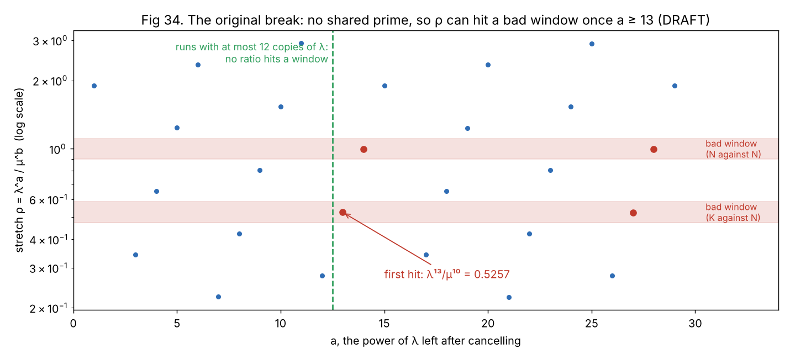

*Figure 34. For the original break, each dot is a possible stretch λ^a/μ^b. Blue dots miss the bad windows, so
Step 4 still works. The first red dot is at a = 13, so the proof covers runs with up to 12 copies of λ.*

### 14.7 Lean

`lean/NewTies.lean` now has **53 theorems** and builds with Lean 4.37.0-rc1, with no sorry and standard axioms only.
New this round: `surface_slopes`, `surface_intercept` (every surface point collides), `threeadic_slopes`,
`threeadic_intercept`, `threeadic_valuations`, `threeadic_zones`, `threeadic_push` (the example's hypotheses),
`push_general` ((II) for κ ≤ 1/3), `equal_powers` (Step 3), `push_grows`, `push_clear` (Step 4), and
`original_first_bad` (where the original's proof stops). Steps 1 and 5 are in the prose. Step 5 cites Hochman.

### 14.8 Is it a lead?

**Yes, still a real one, and it got stronger.** Round 9 showed where the formula breaks and that the size drops. Round 10
says *exactly what the size becomes*, as the root of a closed equation, on a dense set of breaks, by a half-page argument:
cancel, separate, use a shared prime, push. What it contributes: an exact dimension for self-similar sets with exact
overlaps of this shared-centre kind, at points where the naive formula is provably wrong, plus a near-exact answer for
the original example. What would take it further:

1. **Close the original break**, by handling runs with 13 or more copies of λ (14.6). [Round 11 update: done up to 10,000 copies; the rest is open, section 15]
2. **Remove (P)**: prove the formula at every rational point of the surface, or find a point where a second collision
   really happens. If one exists, the size there drops below s_F.
3. **Other surfaces**: breaks that involve longer words, or two classes of two maps, using the same four steps.

### 14.9 Who proved what, round 10

Cancelling a common prefix, ping-pong zones, p-adic units and "pass to a subsystem with no exact overlaps, then apply
Hochman" are standard tools. The general strategy of computing a dimension through a free subsystem is in the spirit of
the finite-type and weak-separation literature (Ngai–Wang, Lau–Ngai). We did not run a fresh literature search this
round. Ours (DRAFT): the reduced language S′ for shared-centre breaks, Theorem P12 with its shared-prime step, the exact
value 0.4232693 for the 3-adic break, the bounded-run lower bound and the bracket [0.47048331, 0.47048344] for the
original break. Hochman's theorem is used as stated; we did not check its proof.

### Known vs new, round 10

| Item | Status | Source |
|---|---|---|
| Hochman: algebraic parameters + no exact overlaps ⇒ dim = min(1, similarity dim) | Known | Hochman 2014 |
| P12: exact size s_F on the collision surface under (I), (II), (P) | **Ours** (DRAFT) | 14.2–14.3, X1–X8 |
| 3-adic break: exact size 0.4232693 (formula 0.4531865) | **Ours** (DRAFT) | 14.4, X3 |
| Exactly solved points are dense where (I), (II) hold | **Ours** (DRAFT) | 14.5, X9, X11 |
| Original break: 0.47048331 ≤ dim ≤ 0.47048344 | **Ours** (DRAFT), not exact | 14.6, X10 |
| Original break: size exactly 0.4704834 | Open (Round 9's conjecture, now within 1.4 × 10⁻⁷) | 14.6 |

## 15. Round 11 (DRAFT): the original break, closed run by run but not exactly

Asked for by Brennan (Nov 27), answering "Should I try to close the original break exactly next?" with "Yes".
Scripts: [`original.py`](original.py) → `original_descent.json`, log [`original_output.txt`](original_output.txt);
[`original_bracket.py`](original_bracket.py) → `original_bracket.json`. Checks: [`checks11.py`](checks11.py) →
[`checks11_output.txt`](checks11_output.txt), **8 of 8 pass**. Pictures: [`figures11.py`](figures11.py).
Lean: three-line facts written in [`lean/Round11.lean`](lean/Round11.lean) but **not built** (no Lean toolchain could
be installed in this session); `NewTies.lean` is unchanged at 53 built theorems. [Round 12 update: the coordinator reports that `Round11.lean` builds clean in the repo and is now the
library module Topics.NewTies11.]

### 15.1 The answer in four sentences

**The original break is not closed exactly.** What is now proved: no second collision happens in any run with up to
10,000 copies of λ. Each of the 1,406 "bad pairs" Round 10 could not handle was settled by an exact search in rational
arithmetic. So the size agrees with the predicted 0.4704834398630828674… to about 4,810 decimal places (proved bracket width
1.8 × 10⁻⁴⁸¹¹). What still stands between that and "exactly 0.4704834…" is the infinitely many bad pairs beyond 10,000.
No single argument covers them yet, and section 15.5 says why.

Exactness is the same question as "no second collision": with no second collision Round 10's Step 5 gives the size
exactly, and if a second collision existed anywhere among the reduced pieces, Round 9's covering argument would push the
size strictly below s_F.

### 15.2 A simpler picture of the maps

Rescale by y = z/18, so [0, 2] becomes I = [0, 1/9]. The four letters become

  l: y ↦ λy,  m: y ↦ μy,  N: y ↦ (y + 1)/19,  K: y ↦ (y + 1)/10.

Two things become visible. First, **N is exactly 10/19 times K**, as functions. That is why the first bad ratio sits next
to 10/19 (Round 10, 14.6). Second, every word is "a scaling plus a sum": its slope is the product of its letters' slopes,
and its value at 0 is the sum of the partial products at its N and K positions. All of these are fractions built from
2, 5 and 19 only, and each term is at most a tenth of the one before.

### 15.3 How each bad pair is settled

After Round 10's cancelling (14.3, Step 1), a second collision needs reduced words h′ and g′ with **μ^b·h′ = λ^a·g′**,
where h′ starts with N, g′ starts with N or K, and the stretch ρ = λ^a/μ^b lies in a bad window ([0.9, 1.11] or
[0.474, 0.585]). For a fixed pair (a, b) this is one equation, h′ = ρ·g′, and the script searches for every solution:

- **Peel letters off the front.** If h = x·h₁ then h₁ = x⁻¹∘A∘g; if g = y·g₁ then h = (A∘y)∘g₁. Every solution is a path
  of such steps, starting from A = "multiply by ρ".
- **Cut a branch** when it cannot lead anywhere. Every word maps I into I. So if A(I) misses I there is no solution. If h is
  used up, A(I) must cover I; if g is used up, A(I) must sit inside I.
- **Walk only reduced words.** The letters' bookkeeping enforces: λ before μ inside a run, a run containing μ is never
  followed by K, and a word never ends inside a run. Check X2 compares this with a direct parse of every word up to length 7.
- **Remember visited states**, so the walk cannot loop.

"No collision" is returned only when **every branch was cut**. That is a proof for that pair, with no floating point and
no length limit on the words.

The search is not guaranteed to finish in general: two different infinite words can share a limit point, and the search
can follow such a pair forever. For every one of the 1,406 bad pairs it did finish, within 3,774 nodes and depth 99.
Two checks guard against a silent bug. A second search, written separately (breadth-first, another peeling rule), agrees
on 246 pairs (X5). And the search finds planted collisions: 300 of 300 random ones, plus the known collision of the
unreduced pieces (X6).

*Figure 35. Top: the stretch of every bad pair with up to 10,000 copies of λ. They come in long runs: (14k, 11k) drifts
through the N window as k grows, because λ¹⁴/μ¹¹ ≈ 0.99876. Bottom: how big each exact search was. Every one ended with
all branches cut, so none of these pairs gives a second collision.*

### 15.4 The bracket

The reduced pieces whose runs have at most 10,000 copies of λ have no exact overlaps: Round 10's push handles every pair
outside the windows, and 15.3 handles every pair inside. Hochman's theorem then gives a lower bound. Round 9's covering
argument gives the upper bound s_F. Both roots are certified with interval arithmetic at 4,980 digits (X8 also re-derives
Round 10's bracket from the same code):

  **0.47048343986308286742625771445802570830… − 1.8 × 10⁻⁴⁸¹¹ ≤ dim K ≤ s_F = 0.47048343986308286742625771445802570830…**

*Figure 36. The gap between what is proved below and above, round by round: 0.034 (Round 9), 1.3 × 10⁻⁷ (Round 10),
1.8 × 10⁻⁴⁸¹¹ (now). Still a gap, so still not exact.*

### 15.5 Why it does not close

One more cancel turns each bad pair into: **can h + 1 = σ·(g + 1)** for two reduced words h and g, where σ = ρ or 19ρ/10?

- **σ is never 1.** Its 19-adic valuation is a or a + 1 (X7; Lean `rho_ne_one`, unbuilt). That rules out the trivial
  solution, not the others.
- **σ comes as close to 1 as you like.** log λ / log μ is irrational, so the ratios λ^a/μ^b are dense. Within 10,000 the
  closest is a = 2413, b = 1896, |σ − 1| ≈ 1.6 × 10⁻⁴ (Figure 37). Near σ = 1 a zone argument has no room to push.
- **Real sizes alone cannot decide it.** If σ were allowed to be any real number near 1, the equation would have solutions
  for a dense set of σ. So any proof has to use the arithmetic of the actual σ, as the search does one pair at a time.
- **The prime-by-prime arguments stall.** Round 10's p-adic step needs a prime dividing both numerators, and here both are 1. At 19,
  N divides by 19, so N's pull the valuation the wrong way. At 2 and 5, a run of bare N's leaves the valuation unchanged
  and can make terms cancel (1 + 1/19 = 20/19 is divisible by 4, and longer stretches of N's pick up more factors of 2). In each case the "smallest
  term wins" argument breaks on bare-N stretches.

In number-theory terms, each bad pair is an S-unit equation (S = {2, 5, 19}) with an unbounded number of terms. The
general finiteness theorems for such equations fix the number of terms, so they do not apply directly.

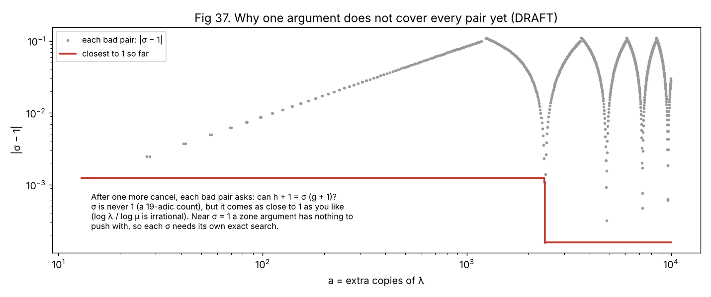

*Figure 37. How close σ gets to 1, pair by pair (grey), and the closest so far (red). It keeps dropping, so no fixed
margin separates σ from 1, and each new pair has to be searched on its own.*

### 15.6 Is it a lead?

**Yes, the line of work is still a lead. This round's contribution is a sharper fact plus a clear obstacle, not a new
theorem.** It contributes three things:

1. A proof that no second collision occurs in any run of up to 10,000 copies of λ.
2. A size pinned to 4,810 digits, against Round 10's 7.
3. An exact reformulation of what is left: one S-unit-type equation per bad pair.

It would close the original break, and become a theorem, with any one of:

1. [Round 12 update: tried in section 16, as ranges of stretches; it proves 72.7% of the windows and provably cannot reach a measure-zero line-up set.] **A uniform argument for σ near 1.** For example, show that the search tree's shape stops depending on a once
   |σ − 1| is small, and handle that shape symbolically. The node counts in Figure 35 stay small and repeat in bands,
   which hints at this.
2. **A p-adic idea that survives bare-N stretches.** For example, work with blocks N^j as single letters and use a
   valuation at a prime dividing 19^j − 1.
3. **A second collision found.** If some bad pair beyond 10,000 really collides, the size is strictly below 0.4704834.
   That would be a surprise and a result in its own right.

### 15.7 Who proved what, round 11

The peel-and-prune search is a standard exact method (it is how one decides whether two words in a contracting
semigroup coincide). Hochman 2014 is used as stated. S-unit equations and their finiteness theorems (Evertse,
Schlickewei, Schmidt) are known, and we only point out that they do not apply directly. Ours (DRAFT): the y-model,
the reduction of the original break to one equation per bad pair, the exact settlement of all 1,406 bad pairs with up to
10,000 copies of λ, the bracket of width 1.8 × 10⁻⁴⁸¹¹, and the diagnosis in 15.5. No fresh literature search this round.

### Known vs new, round 11

| Item | Status | Source |
|---|---|---|
| Hochman: algebraic parameters + no exact overlaps ⇒ dim = min(1, similarity dim) | Known | Hochman 2014 |
| No second collision in runs of up to 10,000 copies of λ (all 1,406 bad pairs) | **Ours** (DRAFT), computer-assisted, exact | 15.3, X2–X6 |
| Original break: dim within 1.8 × 10⁻⁴⁸¹¹ of 0.47048343986308… | **Ours** (DRAFT), certified | 15.4, X8 |
| Exactness ⇔ no second collision anywhere among the reduced pieces | **Ours** (DRAFT), from Rounds 9–10 | 15.1 |
| Original break: size exactly 0.4704834… | **Open** | 15.5 |

## 16. Round 12 (DRAFT): whole ranges of bad pairs at once, and where that stops

Asked for by Brennan (Nov 27): "I really want this to be a new theorem. Can we use a best fit rule to find the line as a
step function and then test to see if the function works?" Scripts: [`cover12.py`](cover12.py) → `cover12.json`, log
[`cover12_output.txt`](cover12_output.txt); [`cluster12.py`](cluster12.py) → `cluster12_*.txt`. Checks:
[`checks12.py`](checks12.py) → [`checks12_output.txt`](checks12_output.txt), **9 of 9 pass**. Pictures:
[`figures12.py`](figures12.py). No new Lean this round.

### 16.1 The answer in five sentences

**The step-function idea works, and it gives a real theorem, but not the whole one.** Theorem 12.1: no bad pair whose
stretch ρ lies in an explicit union of 1,861 ranges has a second collision, for every number of copies of λ, not
just up to 10,000. Those ranges cover 73.5% of the N window and 72.0% of the K window, so in the long run at least
72.7% of all bad pairs are settled at once. Theorem 12.2 (proved by hand) says exactly where the method must stop: a
range search can only get stuck at stretches where two points of the fractal line up, x = ρ·y, and that set R is closed
with measure zero. But R is nearly one-dimensional inside the clusters, so finer and finer steps only nibble at it, and
the original break is still not proved exact.

Testing the steps is not cheating. Each step is guessed (by halving), then proved by an exact search that is valid for
every stretch in the step at once. A wrong guess just fails to prove; it can never prove something false.

### 16.2 How one search covers a whole range

Round 11 settled one bad pair at a time: a search for words h′, g′ with h′ = ρ·g′, peeling letters off the front and
cutting dead branches. The new step keeps ρ as an unknown:

- **The map stays exact in ρ.** After any sequence of peels the current map is A(ρ) = (ρS, ρT + U), slope and offset,
  with S, T, U exact fractions. Peeling is the same algebra as before.
- **A branch is cut only if it is dead for every ρ in the range.** The tests ("A(I) misses I", "A(I) does not cover
  I", "A(I) is not inside I") involve a maximum of two linear functions of ρ, a minimum of two, or one linear function.
  Those are convex, concave or linear, so checking the two ends of the range is exact.
- **A step is proved** when every branch is cut and no branch ends in the identity. Then no stretch in the range has a
  solution, and in particular no bad pair with its stretch there has a second collision.
- **The step function itself** comes from halving: start from 64 equal ranges per window, try each one with a budget
  of 4,000 nodes, and halve whatever fails, down to width 2⁻¹⁷ ≈ 7.6 × 10⁻⁶.

*Figure 38. The step function. Each blue step is a range of stretches proved free of a second collision by one search
tree, drawn at the height of that tree's size. Red is not proved. The red parts are clusters near 0.9·(20/19)^k and their
mirrors, and the black ticks at the bottom show why: they are points where two pieces of the fractal line up. The K window is a scaled copy of the N window, because
N = (10/19)·K as maps. No proved range needed more than 273 search nodes.*

### 16.3 Theorem 12.1 (DRAFT, computer-assisted): every bad pair in the proved ranges

**Theorem 12.1.** Let C be the union of the 1,861 ranges listed in `cover12.json` (they cover 73.5% of
[0.9, 10/9] and 72.0% of [9/19, 100/171], the same to three digits whether measured in ρ or in log ρ). If (a, b) is a bad pair with
λ^a/μ^b in C, then μ^b·h′ = λ^a·g′ has no solution in reduced words. So that pair gives no second collision.

*Proof.* For each range the search above cut every branch, in exact rational arithmetic, with no hit, so no ρ in the
range has a solution. ∎

**Corollary 12.1a (how many pairs).** Order the bad pairs by a. The share whose stretch lies in C tends to the
log-measure share of C, which is 72.7%. *Why:* each a gives at most one b per window (each window is narrower than one
step of b in log ρ), and a·log λ mod log 20 is equidistributed (Weyl), because log λ / log μ is irrational (19 divides
λ's numerator and not μ's). Check Y5 sees it already among the 1,406 pairs with a ≤ 10,000: 1,030 of them (73.3%) lie
in C, against 72.7% predicted.

Together with Round 11, **the only bad pairs still open have a > 10,000 and a stretch outside C.**

### 16.4 Theorem 12.2 (DRAFT, by hand): where the steps must pile up

Call R the set of ratios x/y where x is a point of the fractal coded by an infinite reduced word starting with N, and
y one coded by an infinite reduced word starting with N or K. (In the y-model the fractal is the attractor Λ of the four
letters, which is K rescaled.)

**Theorem 12.2.** (1) R is closed and has Lebesgue measure zero; its dimension is at most 2·s_F ≈ 0.941. (2) If a closed
range J avoids R, halving J often enough always reaches ranges whose searches all finish. (3) At a point of R where two
pieces touch at an endpoint, such as 18/19, the search never finishes on any range containing it.

*Proof.* (1) The codings form a closed set of infinite words, and coding is continuous, so the two point sets are compact
and so is R. Λ is a self-similar set, so its box dimension equals its Hausdorff dimension (Falconer), which is at most
s_F < 1/2 by Round 9's covering argument. So Λ × Λ has upper box dimension at most 2s_F < 1. The map (x, y) ↦ x/y is
Lipschitz there, because y ≥ 1/19. Its image therefore has upper box dimension below 1 and measure zero, and R sits
inside it.
(2) Suppose halving never finishes. Then there are nested ranges shrinking to some ρ₀ in J whose search trees are
infinite. Each tree branches finitely, so each has an infinite uncut branch (König). Passing to a subsequence on which
the first n choices agree, for every n, gives one infinite pair of words (h, g) whose prefixes are never cut at ρ₀. The
"is it cut" tests are strict, so "not cut" passes to the limit. A branch with one word finished cannot go on forever:
if h is finished, covering I needs slope at least 1 and each g-peel divides the slope by at least 10; if g is finished,
fitting inside I needs slope at most 1 and each h-peel multiplies it by at least 10. So both words are infinite, and
h_n(I) meets ρ₀·g_n(I) for every n while both shrink to points. That means h(∞) = ρ₀·g(∞), so ρ₀ is in R, which is a
contradiction.
(3) At 18/19 the identity N(N(0)) = (18/19)·N(1/9) makes the left end of the piece NN touch the right end of the
scaled piece N. The branch h = NN m^n, g = N K^n keeps the touching point for every n, so it is never cut (check Y6). Its
states never repeat: after peeling NNm^(p−2) and NK^(q−1) the slope is ρ·19·20^(p−2)/10^(q−1), and these are all
different. ∎

So the picture Brennan asked for is exactly right: **on any closed range that avoids R, finitely many steps do it; the
steps get shorter and shorter only as they approach R.** Checks Y3 and Y8 confirm that no touching point and no sampled
ratio point of R falls inside a proved step.

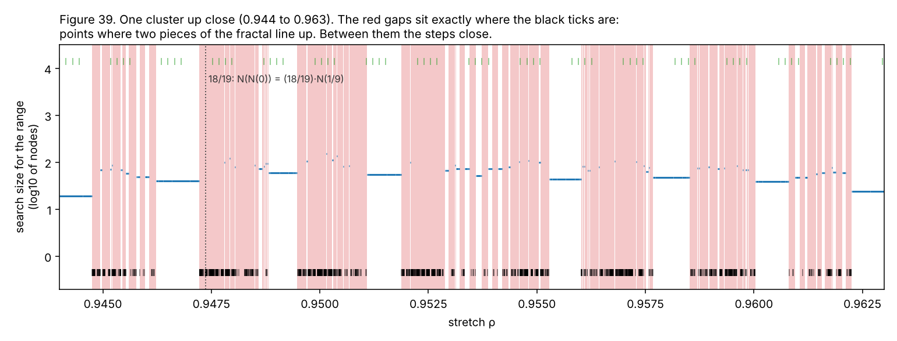

*Figure 39. One cluster up close. The red gaps sit on the black ticks, the points of R; between them, steps close.
18/19 is one of the touching points.*

### 16.5 Why this does not finish the proof

- **A bigger search does not help.** In a cluster, raising the budget from 2,000 to 8,000 nodes leaves exactly the same
  ranges unproved (check Y9). An unproved range contains a point of R, so no budget is enough.
- **Finer steps help, but very slowly.** The unproved share of the cluster 0.944–0.963 falls like (width)^0.083
  (Figure 40). That is what a set of dimension about 0.92 does, consistent with the bound 0.941. Halving the unproved
  share would take ranges about 4,000 times narrower.
- **Bad pairs keep landing near R.** The stretches of bad pairs are dense, and R has points in every cluster. So
  infinitely many bad pairs sit in unproved ranges, however fine the steps.
- **A 2D search fails for a clear reason.** I also tried letting the offset vary freely, so a region in the (slope,
  offset) plane could be proved at once and loops could be closed. It fails right away: every 2D region near the
  clusters contains real solutions, and those are not collisions only because their ρ is not of the form λ^a/μ^b. A
  proof has to keep ρ on the line it starts on.

*Figure 40. Finer ranges prove more of a cluster, but slowly. The fitted power says the line-up set R behaves like a set
of dimension about 0.92 there.*

### 16.6 Is it a lead?

**Yes. This round gives a new theorem, not just more cases.** It contributes three things:

1. **Theorem 12.1:** 72.7% of all bad pairs (in the long run, by log measure) have no second collision, for every
   number of copies of λ. Round 11 needed one search per pair and stopped at 10,000.
2. **Theorem 12.2:** a sharp description of where any search of this kind must fail. It fails on a closed,
   measure-zero line-up set R, and only there.
3. **A clean statement of what is left:** the original break is exact if and only if no bad pair with stretch outside C
   has a second collision, and every such pair is either decidable by a finite search (stretch off R) or sits exactly on R.

It would become the full theorem with one of these:

1. [Round 13 update: tested in section 17; it holds with enormous room for every a ≤ 10⁶, but the distances behave like random numbers', so a proof for all a is out of reach.] **Bad stretches stay a safe distance from R.** For example dist(λ^a/μ^b, R) ≥ c·e^(−Ca). Then each pair's search has
   depth O(a), and a symbolic version of the search could handle all pairs at once.
2. **A uniform argument at the line-ups.** Near a touching point the search follows two infinite tails, such as m^n
   against K^n at 18/19. If the side branches off every tail could be cut uniformly, the clusters would close. The
   catch is that R has infinitely many touching points, not finitely many.
3. **A second collision found.** That would show the size drops below 0.4704834, which is a result in its own right.

### 16.7 Who proved what, round 12

Interval (parametric) branch-and-bound is a standard technique. König's lemma, Weyl equidistribution, Falconer's
"box = Hausdorff for self-similar sets", and box dimension of products and Lipschitz images are all known. Ours (DRAFT):
the range version of the peel-and-prune search, the certificate covering 72.7% of the windows (Theorem 12.1 and its
corollary), the line-up set R and Theorem 12.2, the diagnosis in 16.5, and the 2D negative result. No fresh literature
search this round.

### Known vs new, round 12

| Item | Status | Source |
|---|---|---|
| Branch-and-bound over a parameter range; König; Weyl; box = Hausdorff for self-similar sets | Known | standard |
| Theorem 12.1: no second collision for every bad pair with stretch in C (72.7% by log measure), all a | **Ours** (DRAFT), computer-assisted, exact | 16.3, Y1–Y4, Y7 |
| Corollary 12.1a: in the long run at least 72.7% of bad pairs are settled | **Ours** (DRAFT) | 16.3, Y5 |
| Theorem 12.2: range searches get stuck only on the closed, measure-zero line-up set R (dim ≤ 2s_F) | **Ours** (DRAFT), by hand | 16.4, Y3, Y6, Y8 |
| Original break: size exactly 0.4704834… | **Open** | 16.5 |

## 17. Round 13 (DRAFT): how close bad stretches come to the line-up set

Asked for by Brennan (Nov 27): "Great idea!", in reply to "Should I test whether bad stretches always stay a safe
distance from the line-up set? It's the most direct route to the full theorem." Scripts: [`rdist13.py`](rdist13.py)
(distance to R), [`dist13.py`](dist13.py) → `dist13.json`, [`control13.py`](control13.py) → `control13.json` (both
large and not committed; compact versions in [`dist13_summary.json`](dist13_summary.json) and
[`control13_summary.json`](control13_summary.json) from [`summarize13.py`](summarize13.py)), [`safe13.py`](safe13.py) and
[`resolve13.py`](resolve13.py) → [`safe13.json`](safe13.json), [`bracket13.py`](bracket13.py) →
[`bracket13.json`](bracket13.json). Checks: [`checks13.py`](checks13.py) →
[`checks13_output.txt`](checks13_output.txt), **6 of 6 pass**. Pictures: [`figures13.py`](figures13.py). No new Lean.

### 17.1 The answer in five sentences

**There is no fixed safe distance, but every bad pair we checked stays far above the floor a proof would need, and that
alone settles a hundred times more of them than before.** Theorem 13.1 (by hand): a second collision forces the stretch
to lie exactly on the line-up set R, so a bad pair is settled as soon as its distance to R is shown to be positive.
Theorem 13.2 (computer-assisted): that distance is positive, in fact at least a^(−14.5), for all 140,680 bad pairs
with a ≤ 1,000,000, which pins the original break's size to about 480,965 digits instead of Round 11's 4,810. But the
distance keeps shrinking (closest approach 2⁻⁶³ by a = 55, 2⁻¹³⁷ by a = 1,119, 2⁻²⁵⁴ by a = 771,011), and bad
stretches come near R exactly as often as random numbers do. So they behave like random points, which heuristically
means none ever lands on R, but turning that into a proof is a problem of the same type as Erdős's open conjecture
about powers of 2 in base 3.

### 17.2 Theorem 13.1 (DRAFT, by hand): a collision lands on R

R is Round 12's line-up set: the ratios x/y with x a point of the fractal coded by an infinite reduced word starting
with N, and y one starting with N or K (first letter outermost; after m only m or N may follow).

**Theorem 13.1.** (1) If a bad pair (a, b) has a second collision, its stretch ρ = λ^a/μ^b lies in R. (2) ρ lies in R
exactly when the two pieces of the fractal coded m^b N… and l^a N… or l^a K… share a point.

*Proof.* (1) A second collision is a pair of finite reduced words h (starting with N) and g (starting with N or K) with
h = ρ·g as maps; this is the search's end state h⁻¹ ∘ ρ ∘ g = identity. Add the tail m^∞ to both (m may follow any
letter, and 0 is its fixed point). Then x = h(0) and y = g(0) are fractal points of the required kinds, and x = ρ·y,
so ρ = x/y is in R. (2) ρ = x/y means μ^b·x = λ^a·y, that is m^b(x) = l^a(y), and the words m^b N…, l^a N… and
l^a K… are all reduced. ∎

So **a positive distance from R settles a pair**. The converse fails: R also holds points that are not collisions,
such as 18/19, where two pieces only touch.

Two facts halve the work. R splits as R_N ∪ R_K by the first letter of y, R_N fills out exactly the N window
[0.9, 10/9], and R_K = (10/19)·R_N fills out the K window, because K = (19/10)·N as maps. And a bad pair (a, b) in the
K window has a twin (a+1, b+1) in the N window, with stretch λ/μ = 1.9 times larger and distance to R exactly 1.9
times larger. So every near miss shows up twice (the paired dots in Figure 41), and the two windows are one problem.

### 17.3 Measuring the distance, two ways

- **Distance by branch and bound** (`rdist13.py`). Cover R by pairs of fractal pieces u, v. A pair can only produce
  ratios in [min u / max v, max u / min v], which gives a lower bound on the distance, and the genuine point u(0)/v(0)
  gives an upper bound. Split the most promising pair, best first, until the two bounds are within a factor 2. It
  never needed more than 3,019 pieces, takes about 2 ms per pair, and costs the same for any a. Arithmetic is to 120
  digits, which is at least 10³³ times finer than every bound reported; the 12 closest pairs were redone in exact
  rational arithmetic and agree (check Z4).
- **Safe radius by the Round 12 range search** (`safe13.py`, `resolve13.py`). Run the range search without its memo on
  [ρ − 2⁻ᵏ, ρ + 2⁻ᵏ] for k = 4, 5, …; without the memo, a point of R in the range would give an infinite branch, so
  the first k that finishes proves there is no point of R within 2⁻ᵏ. This was done for all 1,406 pairs with
  a ≤ 10,000, in exact arithmetic. The two methods never contradict each other and agree within a factor 4 on the 30
  closest pairs (check Z5).

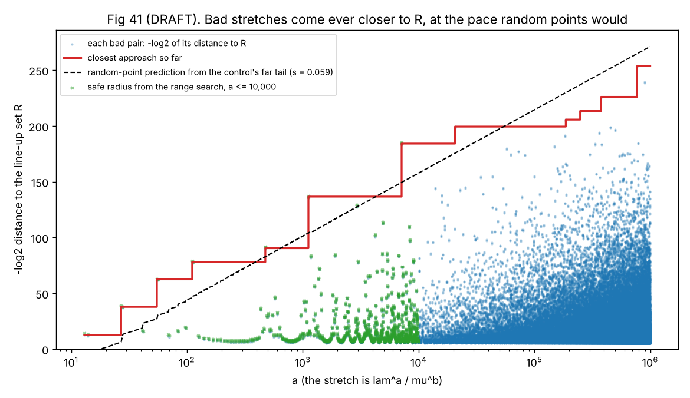

*Figure 41. How close each bad pair's stretch comes to R, against a. Higher means closer. Red: the closest approach so
far, which keeps climbing, so there is no fixed safe distance. Dashed: where the closest of that many random stretches
would be expected. Green crosses: the safe radius proved by the range search for a ≤ 10,000, on top of the blue dots.*

### 17.4 Theorem 13.2 (DRAFT, computer-assisted): a hundred times further

**Theorem 13.2.** Every one of the 140,680 bad pairs with a ≤ 1,000,000 has dist(λ^a/μ^b, R) ≥ a^(−14.5) > 0, so none
has a second collision. The original break's size therefore lies within 6.0 × 10⁻⁴⁸⁰⁹⁶⁶ of
s_F = 0.47048343986308286742….

*Proof.* The lower bounds of 17.3 (`dist13.json`, summarized in `dist13_summary.json`) and Theorem 13.1 settle every
pair. Round 11's bracket argument (Hochman 2014 applied to the pieces with runs of at most k copies of λ, with the pairs
outside the windows handled by Round 10) then applies with k = 10⁶. The gap is bounded by the mean value theorem in
interval arithmetic (`bracket13.py`); the same script at k = 10,000 reproduces Round 11's 1.77 × 10⁻⁴⁸¹¹. ∎

### 17.5 Is there a safe floor?

- **No fixed floor.** The closest approach keeps shrinking as a grows (Figure 41).
- **But far above the floor Round 12 asked for.** Section 16.6 said a floor like c·e^(−Ca) would do. Every pair with
  a ≤ 10⁶ is at least 2^(−1.43a) away, and every pair with a > 1,000 at least 2^(−0.13a), so the exponential floor
  holds with enormous room. Even the polynomial floor a^(−14.5) holds.
- **Exactly like random numbers.** 50,000 random stretches in the same windows sit at the same distances (Figure 42).
  Below 2⁻¹⁰: 49.6% of bad pairs and 49.7% of random stretches. Below 2⁻⁸⁰: 1.67% and 1.67%. Below 2⁻¹⁵⁰: 0.100% and
  0.098%.
- **R acts like a set of dimension about 0.94.** The share below δ falls like δ^0.09 at moderate δ and δ^0.058 far
  out. A random point near a set of dimension d does that with exponent 1 − d, so d ≈ 0.94, matching the upper bound
  2·s_F ≈ 0.941 of Theorem 12.2. This suggests (heuristic, not proved) that the bound is sharp.
- **What randomness predicts.** The closest of 140,680 random stretches would be about 2⁻²⁷¹; the bad pairs reached
  2⁻²⁵⁴. If the pattern continues, the expected number of bad pairs closer than a^(−t) is finite exactly when t > 17.1,
  and the expected number landing exactly on R is zero. So the heuristic says: the break is exact, and from some point
  on every bad pair keeps a distance of at least a^(−17.1−ε).

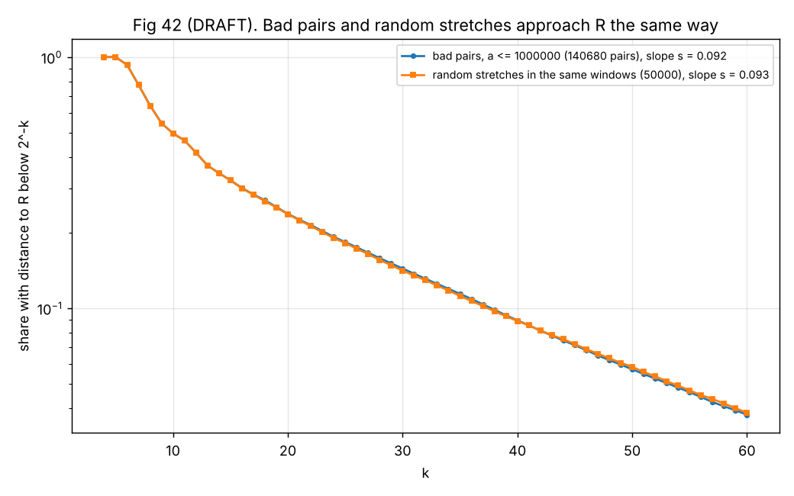

*Figure 42. The share of stretches closer to R than 2⁻ᵏ. Bad pairs (blue) and random stretches (orange) lie on top of
each other: as far as distance to R goes, the bad stretches behave like random numbers.*

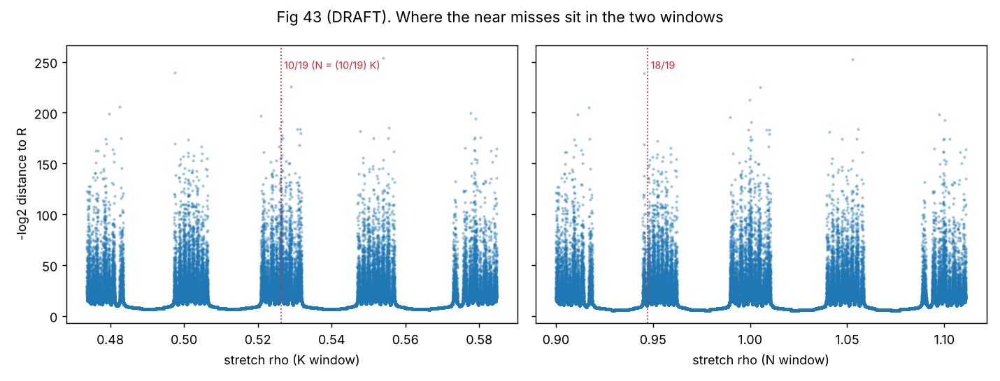

*Figure 43. Where the near misses sit. Each window shows the same pattern (the K window is the N window scaled by
10/19). Near misses happen inside the clusters, where R is thick; between them the stretches are far from R, which is
where Round 12's ranges already closed.*

### 17.6 What number theory could promise

- **One point at a time: yes.** For any single algebraic point x of R (18/19, or any finite ratio h(0)/g(0)), Baker's
  theorem on linear forms in logarithms bounds |a·log λ − b·log μ − log x| below by a power of a. So the bad stretches
  keep a polynomially shrinking distance from that point, the same shape as the data. But R has uncountably many
  points, most of them not algebraic, so this does not cover R.
- **Almost every rotation: yes, but not ours.** For a fixed set of measure zero, almost every rotation number gives an
  orbit that never touches it, since the bad rotation numbers form a countable union of null sets. Our rotation number
  is the specific number log λ / log 20, so this is evidence, not proof.
- **Ours: the same type as known open problems.** Whether one specific multiplicative orbit avoids one specific
  Cantor-like set is the shape of Erdős's conjecture that 2ⁿ has a digit 2 in base 3 for every n > 8, and of
  Furstenberg's ×2, ×3 questions. The nearest proved results (Shmerkin 2019 and Wu 2019 on Furstenberg's intersection
  conjecture) bound the dimension of intersections of such sets, not whether a single orbit point lands in one.

### 17.7 Is it a lead?

**Yes, in two ways, and the route itself hits a known wall.**

1. **Theorem 13.2 is a concrete gain.** No second collision for any run of up to a million copies of λ (Round 11 stopped
   at 10,000), and the size pinned to about 480,965 digits. The method costs about 2 ms per pair whatever a is, so it
   goes as far as anyone cares to run it.
2. **Theorem 13.1 is a clean target for others.** The original break is exact if the fractal pieces m^b N… and
   l^a N…/l^a K… never share a point for a bad pair. That is a question about one fractal and one orbit, and it can be
   attacked without our search.
3. **The distance route cannot finish the proof with current tools.** Bad stretches look exactly like random numbers
   near R, so no argument about how close they get will tell them apart from the random case. What would make it a
   lead: an argument that uses the exact arithmetic of a collision, the identity h = ρ·g between maps with rational
   coefficients (for example the size of its terms in 19-adic or 5-adic terms), rather than closeness. Or a structural
   fact that the points of R near the orbit are algebraic of bounded height, so that Baker's theorem applies.

### 17.8 Who proved what, round 13

Branch and bound, the mean value theorem, interval arithmetic, Baker's theorem, the countable-union argument, Erdős's
ternary conjecture and the Shmerkin and Wu theorems are all known. Ours (DRAFT): Theorem 13.1, the two-sided distance
algorithm for R, Theorem 13.2 with the 480,965-digit bracket, the random-control comparison and the dimension estimate
for R. No fresh literature search this round beyond recalling those standard results.

### Known vs new, round 13

| Item | Status | Source |
|---|---|---|
| Branch and bound; mean value theorem; Baker's theorem; Erdős ternary conjecture (open); Shmerkin, Wu 2019 | Known | standard |
| Theorem 13.1: a second collision puts the stretch on R; R as shared points of two fractal pieces | **Ours** (DRAFT), by hand | 17.2, Z1, Z2 |
| Theorem 13.2: no second collision for any bad pair with a ≤ 10⁶; size within 6.0 × 10⁻⁴⁸⁰⁹⁶⁶ | **Ours** (DRAFT), computer-assisted | 17.3–17.4, Z3–Z6 |
| Bad stretches approach R like random numbers; R behaves like dimension ≈ 0.94 | **Ours** (DRAFT), measured | 17.5, Figures 41–43 |
| A uniform safe floor for all a, hence an exact original break | **Open** | 17.6 |

## 18. Round 14 (DRAFT): looking for an arithmetic reason a second collision can't happen

Asked for by Brennan (Nov 27): "I'm headed off for bed, you have my authorization to increment the version and follow any
thread you deem worthy", with the thread chosen as: look for a reason a second collision can't happen, from the exact
sizes of its terms at the primes 2, 5 and 19. Scripts: [`psi14.py`](psi14.py) → [`psi14.json`](psi14.json),
[`nb14.py`](nb14.py) → `nb14.json` (not committed, rebuilt in a few seconds), [`unif14.py`](unif14.py) →
[`unif14.json`](unif14.json). Checks: [`checks14.py`](checks14.py) → [`checks14_output.txt`](checks14_output.txt),
**7 of 7 pass**. Pictures: [`figures14.py`](figures14.py). No new Lean. Everything below was worked out by Claude in this
round; nothing here has been checked by a person yet.

### 18.1 The answer in five sentences

**It does not work as a proof.** The exact sizes of the terms do rule things out: they give a clean ratio-free form of the
problem (Theorem 14.1), forbid some word endings outright (Lemma 14.2), and show that a bad pair has exactly one way to
leave the line, at the stretch 1/rho, whose 19-adic size is -a (Lemma 14.3). Every collision that has been found, in an
exhaustive search of 29 million words and in a search over all stretches at once, comes back at one of 9 stretches whose
19-adic size is between -2 and 2, nowhere near the a >= 13 a bad pair needs (Figures 44 and 46). But turning "only these
9" into a proof means solving an equation in powers of 2, 5 and 19 with no bound on the number of terms, and neither the
real sizes nor the prime sizes, alone or together, bound it: the search over all stretches still grows about 3.5 times per
letter. So the open part is now one ratio-free statement (Conjecture 14.4), of the same kind as Rounds 11 and 13 found.

### 18.2 The ratio-free form

Write a word's map as w(y) = s_w y + t_w (letters as in Round 13: l = (19/200, 0), m = (1/20, 0), N = (1/19, 1/19),
K = (1/10, 1/10)) and put psi(w) = t_w / s_w = -w^{-1}(0).

**Theorem 14.1 (by hand).** psi(w) is the sum, over the positions i of N and K in w, of R_{>i}, the product of
1/s_x over the letters after i. It obeys psi(wx) = psi(w)/s_x + d_x and psi(xw) = psi(w) + d_x/s_w (d = 1 for N and K, 0
for l and m). Two words satisfy h = rho g as maps exactly when psi(h) = psi(g) and s_h/s_g = rho. So the bad pair (a, b)
has a second collision exactly when some h starting with N and some g have equal psi and s_h/s_g = lambda^a/mu^b.

*Why:* h = rho g means s_h = rho s_g and t_h = rho t_g; divide. The sum formula is the right recursion unrolled.

psi never sees rho: rho only enters through how many of each letter the two words have. Leading l and m letters do not
change psi, and a common last letter cancels, so it is enough to look at pairs with different last letters.

### 18.3 What the sizes at each prime rule out

**Lemma 14.2 (by hand, 2-adic).** If h ends in l or m then psi(h) is divisible by 4 as a 2-adic number; if g ends in K
then psi(g) is odd. So a word ending in l or m never has the same psi as one ending in K. *Why:* psi is a 2-adic integer
(only 19 divides denominators); ending in l multiplies by 200/19, ending in m by 20, and ending in K gives 10 psi + 1.
Checked on all 107,614 reduced words up to 9 letters (Q2).

**Lemma 14.3 (by hand).** Read h = m^b N... and g = l^a N... (or l^a K...) from the left, one letter at a time, peeling
from h when the size ratio a of the two prefixes is at least 1 and from g otherwise. The neighbour map
T = (prefix of g)^{-1} o (prefix of h) stays linear, T(y) = alpha y, until the first N or K is peeled, and that can only
happen when alpha lies in [9/19, 19/9]. For a bad pair, rho = lambda^a/mu^b lies in the windows of Round 13, and then the
only possible moment is alpha = mu^b/lambda^a = 1/rho, with 19-adic size -a. *Why:* stopping early on the h side would need
lambda^(a-i)/rho in [1, 19/9] with i < a, but lambda^(a-i) <= 0.095; on the g side, mu^(j-b)/rho in [9/19, 1) with j < b,
but mu^(j-b) >= 20. Checked exactly on 6 record pairs and in floating point on all 140,680 bad pairs with a <= 10^6 (Q7).

So a second collision for (a, b) is the same as **one trip off the line, starting at the stretch 1/rho, that comes back to
the line exactly.** Coming back means b(alpha) = (alpha t_P - t_Q)/s_Q = 0 for the words P and Q read during the trip, so
alpha = t_Q/t_P, and since alpha is a stretch, t_Q/t_P must have no prime factors other than 2, 5 and 19.

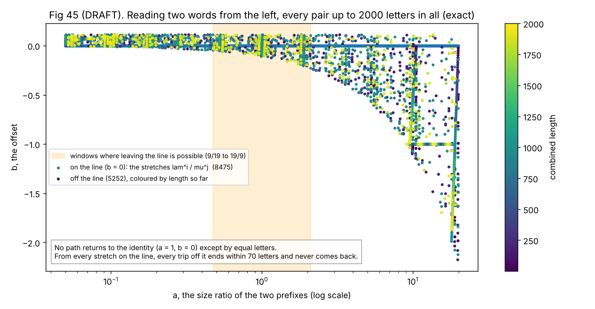

*Figure 45. Every pair of reduced words, read together from the left, up to 2,000 letters in all, in exact rational
arithmetic (Q4). Blue: on the line (b = 0). Coloured: off the line. Trips only leave the line inside the shaded window.
From each of the 8,474 stretches on the line, every trip off it was then followed to its end with no length limit: all end
within 70 letters and none comes back. By Lemma 14.3 that settles the 160 bad pairs with a + b <= 2,000 (a <= 1,119) in
about two seconds, a third independent method after Rounds 11 and 13.*

### 18.4 What the searches found

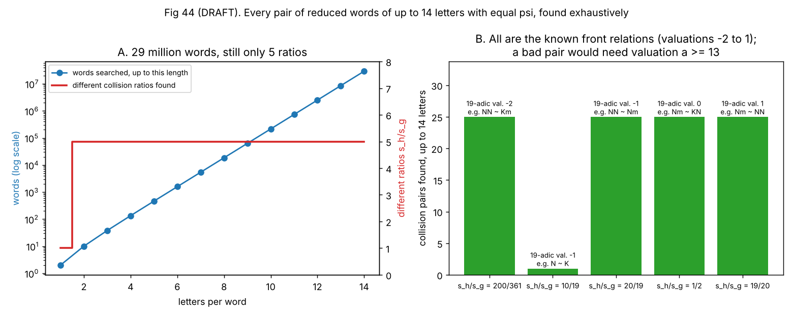

*Figure 44. All 29,246,206 reduced words of up to 14 letters starting with N or K, with psi compared exactly (hashing modulo
two primes, then rational arithmetic on every candidate; Q3). Only 5 ratios s_h/s_g ever occur: 10/19 (N ~ K), 20/19,
19/20, 200/361 and 1/2. These are the front relations already known. Their 19-adic sizes run from -2 to 1. A bad pair needs
L_h + n_g >= 14 letters, so the shortest shapes it could use are inside this search.*

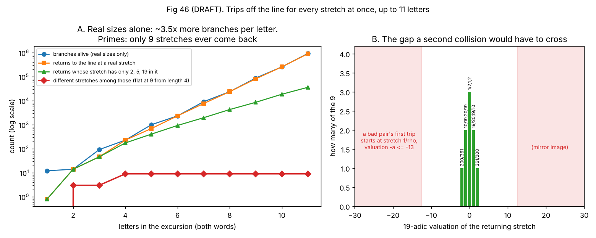

*Figure 46. Trips off the line for every stretch alpha at once (unif14.py): instead of fixing alpha, keep the interval of
alpha for which every step passed the real-size cut. A: the real cut alone lets the search grow about 3.5 times per letter
(930,746 branches at 11 letters), and 1.28 million of them come back to the line at some real stretch. Asking that the
stretch be made of 2, 5 and 19 only removes all but 71,232, and those use only **9** stretches, all present by 4 letters and
none new up to 11 (Q6). B: their 19-adic sizes are between -2 and 2; a bad pair's trip starts at size -a <= -13.*

### 18.5 Where it stops

**Conjecture 14.4 (open).** Every trip off the line that comes back to it does so at one of the 9 stretches
1, 19/10, 10/19, 20/19, 19/20, 361/200, 200/361, 2, 1/2. (Equivalently: every psi-collision comes from the front relations.)

By Lemma 14.3 this would settle every bad pair at once: no second collision for any a, so the original break is exactly
s_F. It is checked for trips of up to 11 letters and words of up to 14 letters, uniformly in the stretch.

Why the prime sizes don't prove it: coming back is a vanishing sum of terms that are each a product of 2, 5 and 19, with as
many terms as the trip has N and K letters. For a fixed number of terms, the subspace theorem (Evertse, Schlickewei and
Schmidt, 2002) gives finitely many solutions up to scaling, but here the number is unbounded and the scaling is free.
Term by term, the 2- and 5-adic sizes fall along the word, which gives Lemma 14.2, but long runs of bare N letters have equal
sizes and never cancel 19-adically, so they survive every prime cut (this is what keeps the search in Figure 46 growing).
The real sizes say where a trip can go but never that it must stop. A proof would need a new way to combine both ends:
for example, a finite automaton in the style of the finite type condition (Ngai and Wang, 2001). Figure 46 shows that no
such automaton exists over all stretches at once, because the set of stretches where trips survive behaves like Round 13's
line-up set R, of dimension about 0.94.

### 18.6 Is it a lead?

**What it contributes:** the problem is now ratio-free and one-dimensional in the right sense. Every bad pair is one trip
from one stretch, and the whole question is which stretches trips can return to (Conjecture 14.4). There is also a third,
fast, exact check of the original collisions (Figure 45: every bad pair with a + b <= 2,000 in about two seconds) and a full
list of short psi-collisions.

**What it does not do:** prove the theorem. It is not a lead toward a proof by itself; it would become one if someone found
a quantity that is bounded along every trip and has finitely many values. That is the missing piece, and none of the sizes
tried here (real, 2-adic, 5-adic, 19-adic) is such a quantity.

## 19. Round 15 (DRAFT): looking for a quantity that stays bounded off the line

Asked for by Brennan (Nov 27, with the overnight go-ahead in section 18), with the thread chosen as: look for a quantity
that stays bounded on every path off the line, be exact about what's proved and what's only searched, and aim for a new
theorem. Scripts: [`kappa15.py`](kappa15.py) → [`kappa15.json`](kappa15.json), [`sparse15.py`](sparse15.py) →
[`sparse15.json`](sparse15.json). Checks: [`checks15.py`](checks15.py) → [`checks15_output.txt`](checks15_output.txt),
**8 of 8 pass**. Pictures: [`figures15.py`](figures15.py). No new Lean. Everything below was worked out by Claude in this
round; nothing here has been checked by a person yet.

### 19.1 The answer in five sentences

**There is no such quantity among the real sizes, and that is now a theorem: every path off the line is pinned to one
straight line set by two numbers, psi(P) and psi(Q) (Lemma 15.1).** So the whole question is arithmetic, and it comes down
to one statement about the single number psi(w) of each word: two words have the same psi up to powers of 2, 5 and 19 only
when three explicit front relations make them so (Conjecture 15.3). If that holds, no bad pair ever has a second collision,
for any a, so the original break is exactly s_F (Corollary 15.4, by hand). The conjecture's first case, words with at most
two N or K letters, is proved by hand (Theorem 15.5), and the rest is searched two ways, with no exception among 29.2 million
words to 14 letters and 3.2 million words with long runs of l and m. **It is not a proof:** the general case is an equation
in powers of 2, 5 and 19 with unboundedly many terms, the same wall as Round 14, but now stated as one clean conjecture.

### 19.2 Real sizes give one line per pair, not a bounded quantity

Notation as in section 18: a word's map is w(y) = s_w y + t_w and psi(w) = t_w / s_w. On a trip off the line, after reading
words P (from h) and Q (from g), the neighbour map is T = Q^{-1} o P, written T(y) = a y + b.

**Lemma 15.1 (by hand).** T(y) = a y + a psi(P) - psi(Q) with a = s_P / s_Q. So every state lies on the line
b = psi(P) a - psi(Q). The real cut (b <= 1/9 and b + a/9 >= 0) is the same as
psi(Q)/(psi(P) + 1/9) <= a <= (psi(Q) + 1/9)/psi(P), and the trip is back on the line (b = 0) exactly when a = psi(Q)/psi(P).

*Why:* Q^{-1}(P(y)) = (s_P y + t_P - t_Q)/s_Q; write t = psi s. Checked exactly on 400 random pairs (Q1).

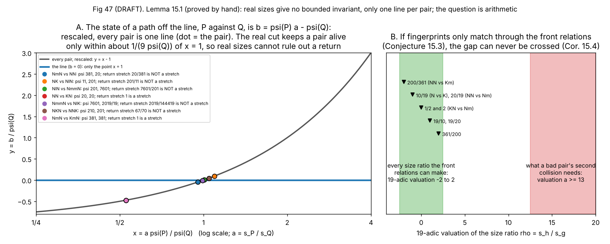

*Figure 47. A: rescaled by psi(Q), every pair is the same line y = x - 1, and coming back is the single point x = 1. The real
cut keeps a pair alive only within about 1/(9 psi(Q)) of that point, and psi grows with every N or K letter, so the real
sizes squeeze trips toward the return point instead of away from it. That is why no bounded, finitely-valued quantity can
come from them. What decides is whether psi(Q)/psi(P) is a stretch at all (made of 2, 5 and 19 only); in the sample pairs
it is only for NN vs KN and NmN vs KmN, both front relations. B: the size ratios the front relations can make have 19-adic
size between -2 and 2; a bad pair's second collision needs a >= 13.*

So the quantity worth tracking is not a size but a **fingerprint**: write psi(w) as a fraction and remove every factor 2, 5
and 19. Call what is left kappa(w). A trip can come back only if kappa(P) = kappa(Q), because a stretch has fingerprint 1.

### 19.3 Where equal fingerprints come from

**Proposition 15.2 (by hand).** For every word w:

- psi(Kw) = psi(Nw), and psi(NNw) = psi(KNw) = psi(Nmw) = psi(Kmw) = psi(w) + 20/s_w;
- mK = lN and ml = lm as maps;
- leading l and m do not change psi; a trailing l multiplies psi by 200/19 and a trailing m by 20.

*Why:* psi(xw) = psi(w) + d_x/s_w and psi(wx) = psi(w)/s_x + d_x (section 18). Checked exactly on 400 random words (Q2).

These give a **canonical form**: drop leading l and m; make the first letter N; if the second letter is N, make it m;
rewrite mK to lN and ml to lm until nothing changes; drop trailing l and m. The canonical form has the same fingerprint as
the word (checked on all 107,616 reduced words to 10 letters ending in N or K, Q3).

**Conjecture 15.3 (open, searched).** Two reduced words have the same fingerprint only if they have the same canonical form.

This is stronger than Conjecture 14.4 (a return needs psi(Q)/psi(P) to be a stretch, not just any product of 2, 5 and 19),
and it implies 14.4 by the argument of Corollary 15.4.

**Corollary 15.4 (by hand, assuming Conjecture 15.3).** No bad pair has a second collision, for any a. So the original
break is exactly s_F.

*Why:* by Theorem 14.1 a second collision is h = Nu and g = Nv or Kv with psi(h) = psi(g) and s_h/s_g = rho, where rho has
19-adic size a >= 13. Equal psi gives equal fingerprints, so by 15.3 the same canonical form. The canonical moves keep psi
exactly except the trailing strip, which multiplies by (200/19)^L 20^M; since 200/19 and 20 are multiplicatively independent,
equal psi forces equal trailing counts L and M. So h and g differ only by the front moves and by mK/lN, ml/lm swaps. The
swaps keep s; the front moves change only the first two letters, among N, K, NN, KN, Nm, Km, whose sizes have 19-adic
sizes 1, 0, 2, 1, 1, 0 (as 1/s). So s_h/s_g has 19-adic size between -2 and 2, never a >= 13. Checked on every pair of
reduced words to 9 letters with equal psi (68,443 pairs): all share the canonical form before the trailing strip, and their
size ratios are exactly the 9 return stretches of Conjecture 14.4 and of unif14.json (Q6).

### 19.4 The first case, proved

**Theorem 15.5 (by hand).** Among words ending in N or K with at most two N or K letters, psi is a product of powers of 2, 5
and 19 (fingerprint 1) only for N, K, NN and KN, with any leading l, m. So no such word shares a fingerprint with N.

*Why:* with one N or K letter, psi = 1. With two, psi = 1 + c, where c = r (200/19)^L 20^M, r = 19 for a final N and 10 for
a final K, and L, M count the l and m letters between them. If L = M = 0: 1 + 19 = 20 (a unit: NN, KN) and 1 + 10 = 11
(not). If L + M >= 1, c has 2-adic size at least 2 and 5-adic size at least 1, so the numerator of 1 + c is odd and not a
multiple of 5; it would have to be a power of 19.
- If c has 19 in its denominator, c = A/19^e with A prime to 19, and the numerator 19^e + A is prime to 19, so it would be
  1, which it is not.
- If c = 19^f A with f >= 1, then 1 + c is 1 more than a multiple of 19, so again it would be 1.
- If f = 0, then 1 + 2^x 5^y = 19^E is impossible modulo 3 (2 and 5 are -1 and 19 is 1 modulo 3, so the left side is 0 or 2).

Checked by brute force for every such word with runs up to 60 and every 1 + 2^x 5^y with x <= 300, y <= 300 (Q5); the
search to 14 letters finds no other unit words at all (Q4).

### 19.5 What the searches found

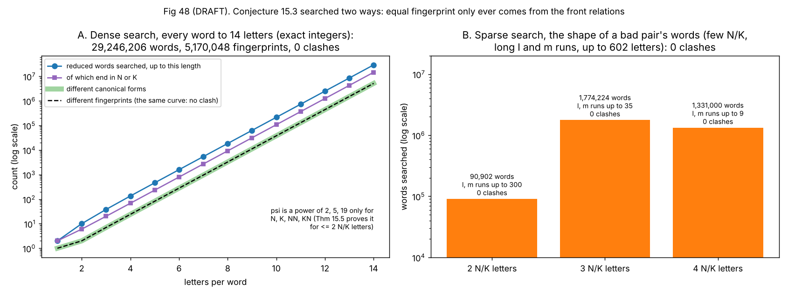

*Figure 48. A: every reduced word up to 14 letters, starting with N or K, in exact integer arithmetic: 29,246,206 words,
14,623,104 ending in N or K, 5,170,048 fingerprints and exactly 5,170,048 canonical forms at the end, and the two counts agree
at every length, so no clash (Q4, with an independent recount to 9 letters). At most 4 words share a fingerprint. B: words
with 2, 3 or 4 N/K letters and l, m runs of up to 300, 35 and 9 letters (up to 602 letters long), the shape a bad pair's
words take as a grows: 3,196,127 words, no clash (Q7). With the canonical form switched off, or with its second-letter rule
left out, the same detector finds tens of thousands of clashes at once (Q8), so a clash would have been seen.*

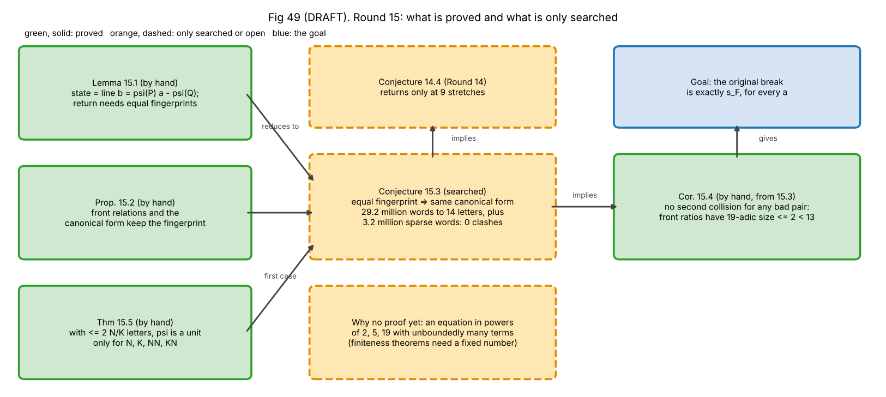

*Figure 49. Green, solid: proved by hand. Orange, dashed: searched only, or open. Everything between the searches and the
goal is proved; the one missing link is Conjecture 15.3.*

### 19.6 Where it stops

Conjecture 15.3 for words with k letters N or K asks that a sum of k products of 2, 5 and 19 never equal another such sum,
up to a product of 2, 5 and 19, except through the front relations. For each fixed k this is a unit equation of the kind
the subspace theorem (Evertse, Schlickewei and Schmidt, 2002) makes finite, but not explicit, and k is unbounded. Theorem 15.5
does k <= 2 by hand with congruences modulo 3 and 19. The natural next step is k = 3 by the same kind of argument; the sparse
search says there is no exception there with runs up to 35, and a case analysis like 19.4 may finish it. A proof for every k
would need a new idea.

### 19.7 Is it a lead?

**Yes, a lead toward a theorem, of a specific kind.** The open part of the original break is now one self-contained
statement about a single function on words, Conjecture 15.3, whose consequence for the original break is proved
(Corollary 15.4), whose first case is proved (Theorem 15.5), and which holds in two independent searches with no exception.
It also explains why the earlier routes stalled: Lemma 15.1 shows the real sizes can never stop a trip. It does not prove
the theorem, and the remaining step is hard in a known way.

### 19.8 Who proved what, round 15

Lemma 15.1, Proposition 15.2, Corollary 15.4 (from Conjecture 15.3) and Theorem 15.5: proved by hand by Claude this round,
and checked by computer (Q1 to Q6). Conjecture 15.3: searched by computer only. Not checked by a person, and not checked
against the literature this round.

## 20. Round 16 (DRAFT): the fingerprint conjecture for three letters, and every pair of two-letter words

Asked for by Brennan (Nov 27, with the overnight go-ahead in section 18), with the thread chosen as: try to prove
Conjecture 15.3 for words with three N or K letters, and see whether the method generalizes. Scripts:
[`baker16.py`](baker16.py) → [`baker16.json`](baker16.json), [`pairs16.py`](pairs16.py) → [`pairs16.json`](pairs16.json).
Checks: [`checks16.py`](checks16.py) → [`checks16_output.txt`](checks16_output.txt), **7 of 7 pass**. Pictures:
[`figures16.py`](figures16.py). No new Lean. The reductions below were worked out by Claude in this round; the two deep
tools they rest on are published theorems (section 20.6); nothing here has been checked by a person yet.

### 20.1 The answer in five sentences

**Two new cases of the conjecture are now theorems (computer-assisted).** No word with three N or K letters has
fingerprint 1, so none can stand in for N (Theorem 16.1). No two different reduced words with two N or K letters share a
fingerprint (Theorem 16.2), so together with Theorem 15.5 the conjecture holds for every pair of words with at most two
N/K letters. Both proofs go the same way: the sizes at 2, 5 and 19 force all but two terms of the equation to be small, then
a published lower bound for linear forms in logarithms (Matveev) caps the exponents at about 10^12 to 10^17, lattice
reduction cuts that to a few dozen, and exact arithmetic checks the rest (Figures 50 and 51). It does not yet reach three
letters against two or three, or longer words, which still rest on the searches (Figure 52).

### 20.2 Theorem 16.1: three letters never give fingerprint 1

Take a word x1 u1 x2 u2 x3 (x1 = N without loss; leading l, m do not change psi and trailing ones multiply it by a power of
2, 5 and 19). Let u_i hold L_i letters l and M_i letters m, A_i = (200/19)^L_i 20^M_i, P_i = 2^(3L_i+2M_i) 5^(2L_i+M_i),
and r = 19 for N, 10 for K. By the recursion of section 18,

  psi = 1 + r3 A2 (1 + r2 A1),  that is,  19^(L1+L2) psi = 19^(L1+L2) + r3 19^L1 P2 + r2 r3 P1 P2.

**Theorem 16.1 (computer-assisted).** psi is never a product of powers of 2, 5 and 19.

*Proof.* Two cases.

- **Case I: x3 = N and u2 is empty.** Then psi = 20 + c with c = 19 r2 A1. Comparing 2-adic sizes, psi has at most two
  factors 2 unless v2(c) = 2, and at most one factor 5 unless v5(c) = 1; those exceptions are the words N m N N and N K N
  (psi = 7240 and 210, not units). So psi = 2^al 5^be 19^ga with al <= 2, be <= 1, and
  Lambda = log(psi / c) = log(1 + 20/c) is a positive linear form in log 2, log 5, log 19, smaller than 10^-H / 9 with
  H = L1 + M1, and with coefficients at most 3H + 5.
- **Case II: otherwise.** Then psi - 1 = r3 A2 (1 + r2 A1) has positive 2-adic and 5-adic size, so psi is odd and prime to 5:
  psi = 19^E with E >= 1. Now the sizes at each prime pin the word down:
  - at 2 and 5: the factors 2 and 5 of r3 P2 all divide 19^E - 1, and v2(19^E - 1) <= 2 + log2 E, v5(19^E - 1) <= 1 + log5 E
    (Q3), so the second gap u2 is short: L2 and M2 grow at most like log E;
  - at 19: 19^E - 1 is prime to 19, which forces L1 <= 2.
  So in 19^(L1+L2+E) = 19^(L1+L2) + r3 19^L1 P2 + r2 r3 P1 P2 the first two terms on the right are at most polynomial in E,
  and Lambda = log(19^(L1+L2+E) / (r2 r3 P1 P2)) lies strictly between 0 and 2 (1 + 380 E^2) / 19^E.

In both cases Lambda is a nonzero linear form in log 2, log 5 and log 19 that is exponentially small in the exponents.
Matveev's theorem bounds the exponents: E <= 5.1 × 10^12 in Case II, H <= 6.5 × 10^12 in Case I. Lattice reduction
(LLL, de Weger's lemma, exact arithmetic) cuts this to E <= 10 and H <= 7 in three rounds. An exact check of every case
below those bounds (204 candidates) finds no solution. ∎ As a separate check, brute force over all 114,244 three-letter
words with runs up to 12 finds no unit psi (Q1).

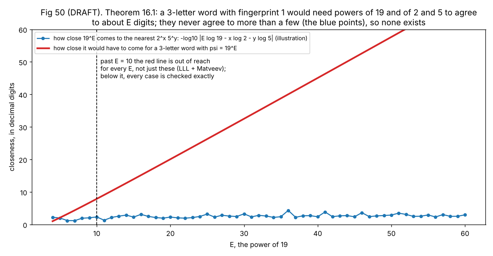

*Figure 50. Why it works. A three-letter word with psi = 19^E would need a power of 19 to match a product of 2s and 5s to
about E decimal places (red). Powers of 19 never come within more than a few places of such products (blue, the nearest
match for each E). The two curves part at E of about 5. Matveev's theorem and the lattice reduction make "never" exact for
every E, not just the ones drawn.*

### 20.3 Theorem 16.2: no two two-letter words share a fingerprint

A reduced word with two N/K letters is N l^L m^M x, with x = K only when M = 0 (because mK = lN). Its psi is T / 19^L with
T = 19^L + r P, and its fingerprint is K = T / 19^g, g = v19(T). (T is prime to 10 except for NN, whose fingerprint is 1.)

**Theorem 16.2 (computer-assisted).** Different reduced two-letter words have different fingerprints. With Theorem 15.5,
Conjecture 15.3 holds for every pair of words with at most two N/K letters.

*Proof.* Suppose two words share K.
1. K = 19^(L-g) + rP/19^g for each word. If D = (L - g) - (L' - g') is 0, the second terms agree, and unique factorisation
   gives the same word or the pair mK ~ lN, which is not reduced. So D is not 0.
2. **The 2-adic step.** K is 19^(L-g) modulo 2^mu, mu = v2(rP), and likewise for the other word, so 19^D is 1 modulo
   2^min(mu, mu'). Hence min(mu, mu') <= 2 + log2 |D|. So one of the two words is short: H_s = L + M <= 1 + log2(|D|)/2,
   while |D| <= 3H + 2 for the longer one's H.
3. For the longer word, Lambda = log(19^g K / (rP)) = log(1 + 19^L / (rP)) lies in (0, 10^-H / 10). This is a linear form
   in log 19, log 2, log 5 and log K, where K comes from the short word.

Matveev's theorem (four logarithms) gives H <= 1.5 × 10^17, so H_s <= 30. For each of the 526 short words, an LLL
reduction with its own K cuts H to at most 39. An exact comparison of all 860 two-letter words with H <= 39 finds no shared
fingerprint. ∎ No clash either among 2,627 words up to H = 70 (Q5).

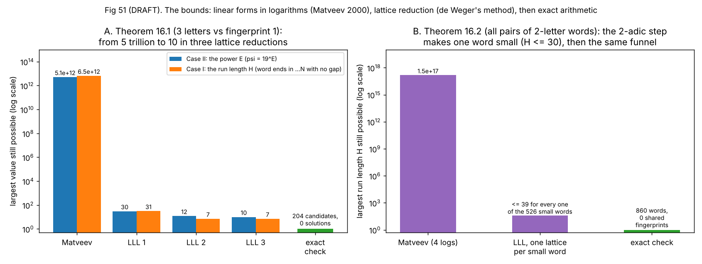

*Figure 51. The bounds at each stage. A: Theorem 16.1, from Matveev's 5 trillion to 10 in three lattice reductions, then 204
exact cases. B: Theorem 16.2, from 1.5 × 10^17 to at most 39 with one lattice per short word, then 860 words compared
exactly.*

**Corollary 16.3 (by hand, from 15.5, 16.1 and 16.2).** A second collision for a bad pair cannot use two words that each
have at most two N/K letters, or a word with three against one with one. *Why:* equal psi gives equal fingerprints, so the
same canonical form, and then the argument of Corollary 15.4 caps the 19-adic size of the size ratio at 2 < 13.

### 20.4 Where the conjecture stands

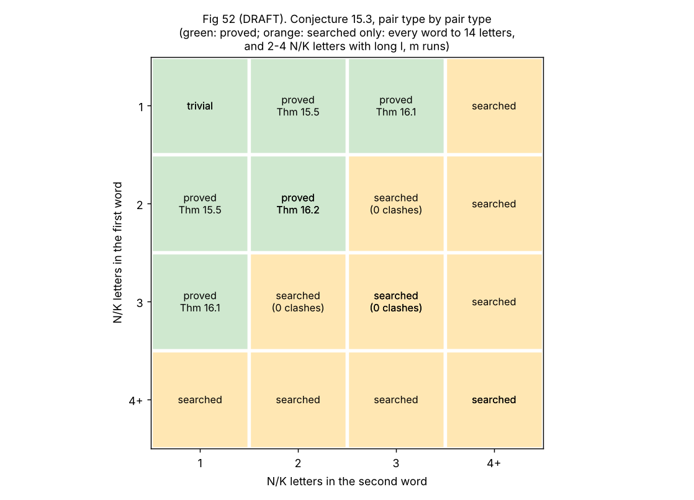

*Figure 52. Pair types by number of N/K letters. Green: proved (Theorems 15.5, 16.1, 16.2). Orange: searched only, with no
exception (every word to 14 letters, and 2 to 4 N/K letters with l, m runs up to 300, 35 and 9).*

### 20.5 Does the method generalize?

**For each fixed number of N/K letters, probably yes, with more work. For all lengths at once, no.** This is an assessment,
not a proof. The method works when the 2-, 5- and 19-adic sizes force all but two terms to be small. Each new N/K letter
adds a term, and the terms of psi have increasing 2- and 5-adic sizes along the word, so the same congruences peel off one
gap at a time. Two things change past the cases done here:
- **p-adic bounds are needed.** In three letters against two, the 2-adic step needs v2(19^m K - 1) for a fixed K that is not
  1. That is bounded only by a p-adic lower bound for linear forms in logarithms (Yu's theorem), not by the simple formula
  used here.
- **The casework multiplies.** Runs of bare N letters (empty gaps) do not raise the 2- and 5-adic sizes, so each pattern of
  empty gaps is its own case.

Each fixed length then becomes a finite, if growing, computation. The whole conjecture is an equation with unboundedly many
terms, and these tools give bounds that grow with the number of terms. So the full statement, and with it the exact size of
the original break, still needs a new idea or a structure these words have that general sums of powers do not.

### 20.6 Is it a lead?

**Yes.** For the first time, part of the open statement is proved outright rather than searched. The proved cases are the
ones the searches say are the most constrained, and the method is a standard, checkable one. It also shows that
three-letters-against-two is the next case within reach, with p-adic bounds added. It is not the full theorem, and the step
from fixed lengths to all lengths is the same wall as before.

### 20.7 Who proved what, round 16

- **Published theorems used:**
  - Matveev's lower bound for linear forms in logarithms (E. M. Matveev, 2000), in the form of Bugeaud, Mignotte and Siksek
    (2006, Theorem 9.4).
  - LLL lattice reduction (Lenstra, Lenstra and Lovász, 1982).
  - de Weger's reduction lemma (B. M. M. de Weger, 1989).
- **Claude, this round:** the reductions in 20.2 and 20.3 (the cases, the 2-, 5- and 19-adic steps, and the bounds on the
  small terms), the computations, and Corollary 16.3. Everything is computer-checked (Q1 to Q7); the LLL output is
  checked exactly for reducedness.
- **Not yet:** checked by a person, or checked against the literature on S-unit equations.

## 21. Round 17 (DRAFT): three N/K letters against two

Asked for by Brennan (Nov 27, with the overnight go-ahead in section 18), with the thread chosen as: try words with three
N/K letters against words with two, and say what a proof for all lengths would need. Scripts:
[`lattice17.py`](lattice17.py) (a fast exact lattice reduction), [`pairs17.py`](pairs17.py) → [`pairs17.json`](pairs17.json).
Checks: [`checks17.py`](checks17.py) → [`checks17_output.txt`](checks17_output.txt), **9 of 9 pass**. Pictures:
[`figures17.py`](figures17.py). No new Lean. The reduction below was worked out by Claude in this round; the deep tool it
rests on is a published theorem (section 21.8); nothing here has been checked by a person yet.

### 21.1 The answer in five sentences

**Three letters against two is now a theorem (computer-assisted).** No word with three N or K letters shares a fingerprint
with a word with two, unless it is a two-letter word in disguise (it starts N N, and N N = N m) (Theorem 17.1). So
Conjecture 15.3 now holds for every pair where one word has at most two N/K letters and the other at most three
(Figure 55). The proof splits each time into "the two-letter word is short" or "the three-letter word is short"; Matveev's
bound caps every gap at about 10^62, and lattice reduction plus an exact 2-adic logarithm cut that to 25 in four rounds,
below which 141,752 three-letter words are compared exactly with every two-letter word (Figure 53). Yu's p-adic theorem,
which section 20.5 expected to need, was not needed, and a small slip in Round 16's use of Matveev's bound is corrected
here with no change to its results (section 21.5).

### 21.2 The two kinds of three-letter word

As in section 20, a reduced two-letter word is V = N l^L' m^M' x' with T' = 19^L' + r'P', and its fingerprint is
K(V) = T'/19^g'. A reduced three-letter word is W = N u1 x2 u2 x3, where u_i holds L_i letters l and M_i letters m
(H_i = L_i + M_i), x_i = K only when M_i = 0, and W does not start N N. Its psi is T3 / 19^(L1+L2), with

  T3 = 19^(L1+L2) + r3 P2 T_pre,   where T_pre = 19^L1 + r2 P1 is the T of the front part N u1 x2.

Two easy facts carry most of the weight (Q1, Q2):
- **F1.** For a two-letter word, g' = v19(T') is 0 or 1. (By hand: 200 is 10 and 20 is 1 modulo 19.) So T' <= 19 K.
- **Two types.** In *Type A* (all words except those ending in a bare N, x3 = N with u2 empty), r3 P2 is divisible by 10,
  so T3 and T_pre are prime to 10. In *Type B* (W = N u1 x2 N), T3 = 20·19^L1 + 19 r2 P1.

### 21.3 Theorem 17.1 and its proof

**Theorem 17.1 (computer-assisted).** A reduced word with three N/K letters that does not start N N never has the same
fingerprint as a word with two N/K letters. With Theorems 15.5, 16.1 and 16.2: Conjecture 15.3 holds for every pair of
words where one has at most two N/K letters and the other at most three.

*Proof.* Suppose K(W) = K(V) = K, and let X be the largest of H1, H2, H'. K is not 1 (Theorems 15.5 and 16.1).

1. **One shared small number.** Each fingerprint is a product of powers of 2, 5, 19 times (1 + a small number):
   19^g3 K = r2 r3 P1 P2 (1 + e3) and 19^g' K = r'P' (1 + e'), with e3 <= 0.11·10^-H1 and e' <= 0.1·10^-H' (Q3).
   Dividing, Lambda3 = log(19^(g'-g3) r2 r3 P1 P2 / (r'P')) is a linear form in log 2, log 5, log 19, smaller than
   0.11·10^-min(H1, H'), with coefficients at most 6X + 6. It is not 0: otherwise 19^L2 + r3 P2 would be a product of
   2s, 5s and 19s, so u2 x3 would be a bare N (Theorem 15.5), which is Type B. Type B has the same kind of form, Lambda_B,
   and it is not 0 either: Lambda_B = 0 would force three equations on the exponents that contradict each other (Q4; spelled out in 22.2).
   So **min(H1, H') <= m1**, where m1 comes from a lattice reduction in log 19, log 2, log 5.
2. **The 2-adic step (Type A).** Modulo 2^v2(r3 P2), K is a power of 19 (from W); modulo 2^v2(r'P') it is another power of 19
   (from V). So 19^D = 1 modulo the smaller of the two powers of 2, where D is the difference of the exponents. D is not 0:
   otherwise T_pre would be a product of 2s, 5s and 19s, so the front part would be N N (Theorem 15.5), which is excluded. Since
   v2(19^D - 1) <= 2 + log2 |D| and |D| <= 5X + 3, **min(H2, H') <= m2 = (2 + log2(5X + 3)) / 2**.
3. **Case V short: H' <= max(m1, m2).** Then K is one of finitely many numbers. For each one:
   - W's first gap: Lambda1 = log(19^g3 K / (r2 r3 P1 P2)) lies in (0, 0.11·10^-H1) and is a linear form in log 19, log 2,
     log 5 and log K, so a lattice reduction with that K bounds H1 (the same lattice serves Type B);
   - W's second gap: K·19^m = 1 modulo 2^v2(r3 P2), with v2(r3 P2) >= 2 H2 and |m| <= 4X + 3. The exact 2-adic logarithm of
     K tells us the most binary places K·19^m and 1 can share over that range (Figure 54), and so bounds H2.
4. **Case W short: H1 <= m1 and H2 <= m2.** Then 10·20^H' <= T' <= 19 K <= 19 T3 <= 19·381·200^(m1+m2), which caps H'.

To start, Matveev's theorem (with three, four and five logarithms; the five-logarithm form, log(19^g3 K / (r3 P2 T_pre)), is
only needed for this first step) shows every bound above is at most a constant times (1 + log(6X + 6))^4, so X <= 1.1 × 10^62.
Then each round feeds the current X into steps 1 to 4:

| Round | Start X | m1 | m2 | V short: H', H1, H2 | W short: H' | New X |
|---|---|---|---|---|---|---|
| 1 | 1.1 × 10^62 | 129 | 105 | 129, 195, 194 (8,644 lattices, one per two-letter word) | 416 | 416 |
| 2 | 416 | 11 | 6 | 11, 17, 17 | 32 | 32 |
| 3 | 32 | 9 | 4 | 9, 14, 14 | 25 | 25 |
| 4 | 25 | 9 | 4 | 9, 14, 14 | 25 | 25 |

Below X = 25, all 141,752 three-letter words are compared exactly with all 376 two-letter words: no shared fingerprint. As a
test that the comparison can see a clash, the 350 disguised words N N u2 x3 are all found to match N m u2 x3. ∎ (Q6, Q7;
Q8 repeats a smaller search with psi computed straight from the letters as maps.)

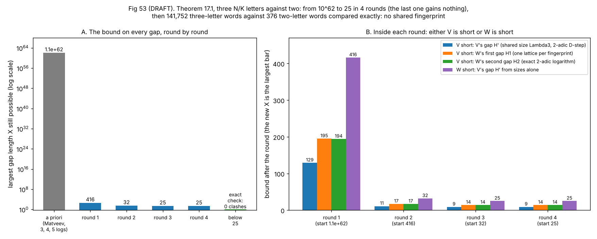

*Figure 53. A: the bound on every gap, from 10^62 (Matveev) to 25 in four rounds of lattice reduction, then the exact check.
B: inside each round, the bound in each case. "V short" uses one lattice and one 2-adic logarithm per two-letter word;
"W short" uses sizes alone, and it is the one that stops at 25.*

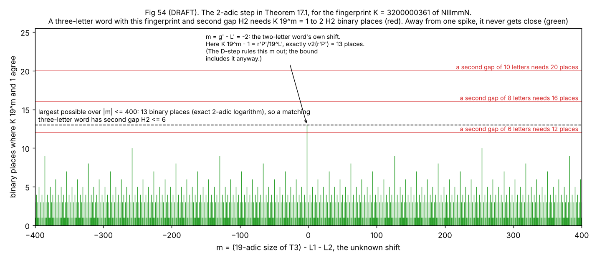

*Figure 54. The 2-adic step for one fingerprint (from N l l l m m N). A three-letter word sharing it, with a second gap of
H2 letters, needs K·19^m = 1 to 2·H2 binary places (red lines) for some shift m. Apart from one spike, which is the two-letter
word's own shift and is at most 3H' + 1 places tall, K·19^m never gets close (green). The exact 2-adic logarithm finds the
tallest bar over any range of m without trying them all.*

**Corollary 17.2 (by hand, from 16.2 and 17.1).** A second collision for a bad pair cannot use a word with three N/K letters
against a word with two. *Why:* as in Corollary 16.3, equal psi gives equal fingerprints, so (Theorems 16.2 and 17.1) the same
canonical form, and the argument of Corollary 15.4 applies.

### 21.4 Why Yu's theorem was not needed

Section 20.5 said the 2-adic step would need a p-adic lower bound for linear forms in logarithms (Yu's theorem), because
v2(19^m K - 1) has no simple formula when K is not 1. It turned out not to. The 2-adic numbers 19^x (x a 2-adic integer)
are exactly the numbers that are 1 or 3 modulo 8. If K is 5 or 7 modulo 8, K·19^m and 1 share at most 2 binary places.
Otherwise 1/K has an exact 2-adic logarithm to base 19, which we compute digit by digit. Then v2(19^m K - 1) is 2 plus
the number of final binary digits m shares with that logarithm (1 if it shares none), and the most over a range of m is
read off directly (Q5 checks this against brute force). That gives the bound on the second gap in every reduction round.
Before the first round an a priori bound is needed, and there an ordinary (archimedean) linear form in five logarithms,
Lambda2 = log(19^g3 K / (r3 P2 T_pre)), does the job with Matveev's theorem. So Yu's theorem is a natural tool here, as suggested, but not a necessary one for
this case. It may still be needed for longer words, where more than one gap can hide behind the 2-adic step at once.

### 21.5 A correction to Round 16

Matveev's theorem, in the form we cite (Bugeaud, Mignotte and Siksek 2006, Theorem 9.4), bounds |a^b ... - 1|, not the
logarithm of that product. Rounds 16 and 17 apply it to the logarithm. The two differ by at most a factor 2 when they are
small, which adds log 2 to one side and moves the first bounds by at most 1. Round 17 uses the corrected form throughout.
Q9 redoes Round 16's reductions from the corrected starting bounds, and each lands inside the range Round 16 checked exactly
(E <= 10, H <= 7, H <= 39), so Theorems 16.1 and 16.2 stand as stated.

### 21.6 Where the conjecture stands

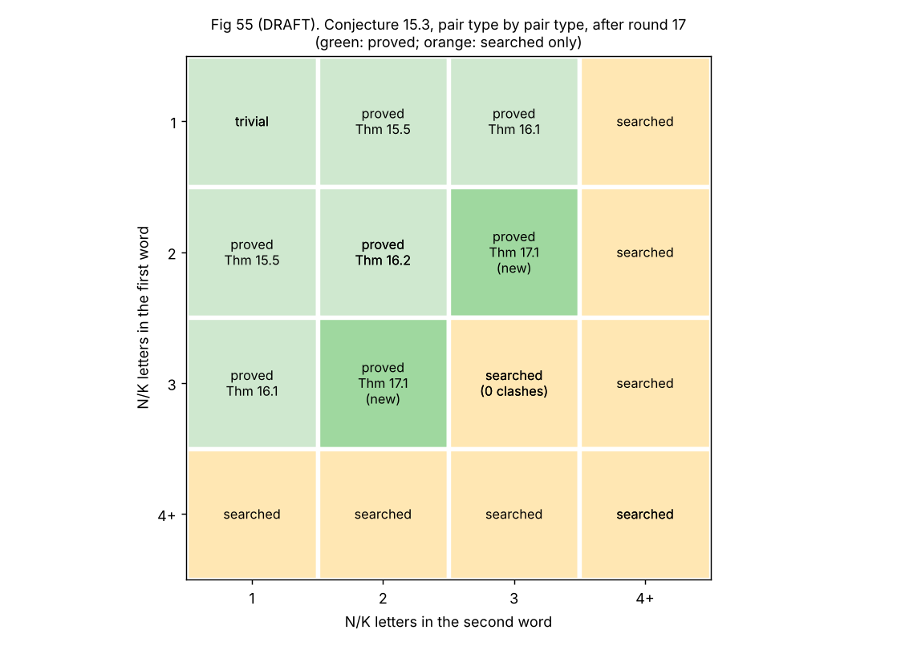

*Figure 55. Pair types by number of N/K letters, after round 17. Green: proved (Theorems 15.5, 16.1, 16.2 and now 17.1).
Orange: searched only, with no exception.*

**What a proof for all lengths would need (my judgement, not proved).** Every case so far is one equation in powers of 2,
5 and 19 with a fixed number of terms, settled by bounds that grow with that number, so no finite run of rounds like this
reaches every length. A proof for all lengths would need a statement uniform in the number of letters, most likely a
"peeling" lemma: from the fingerprint alone, read off the last gap and the last letter, and so reduce to a shorter word and
finish by induction. The obstacle is the unknown 19-adic shift (the m and D of this round): it is unbounded even for three
letters, [Round 18 correction: overstated, since the 19-adic size of T is at most 2 for three letters, F2 in 22.3; see 22.5], and every round so far has controlled it with a lower bound for linear forms in logarithms whose constants grow
with the length. So the missing ingredient is a way to control that shift without such bounds, for example a structural
reason the 19-adic size of T stays tied to the gaps. I do not see one yet.

### 21.7 Is it a lead?

**Yes.** It is the first proved case where both words have at least two N/K letters and their numbers differ, and it
went through with the published tools plus one exact computation, without the p-adic theory section 20.5 expected to need.
It makes three letters against three the next case within reach, by the same split with one more gap. It does not change
the overall picture of section 20.5: each fixed length is a finite computation, and all lengths at once still needs a new
idea, such as the peeling lemma above.

### 21.8 Who proved what, round 17

- **Published theorems used:**
  - Matveev's lower bound for linear forms in logarithms (E. M. Matveev, 2000), in the form of Bugeaud, Mignotte and Siksek
    (2006, Theorem 9.4), for the first bound only.
  - LLL lattice reduction (Lenstra, Lenstra and Lovász, 1982), here in Cohen's exact integer version (H. Cohen, *A Course in
    Computational Algebraic Number Theory*, 1993, Algorithm 2.6.7).
  - de Weger's reduction lemma (B. M. M. de Weger, 1989).
  - The 2-adic size of 19^D - 1 (the classical "lifting the exponent" fact) and the structure of the 2-adic units.
- **Considered and not needed:** Yu's p-adic lower bound for linear forms in logarithms (Kunrui Yu, 2007).
- **Claude, this round:** the reduction in 21.3 (the two types, the shared small number and why it is not 0, the 2-adic
  step, the case split, the a priori bound), the exact 2-adic logarithm step, the computations, Corollary 17.2 and the
  correction in 21.5. Everything is computer-checked (Q1 to Q9); each lattice output is checked exactly for reducedness.
- **Not yet:** checked by a person, or checked against the literature on S-unit equations.

## 22. Round 18 (DRAFT): an independent recheck, and three N/K letters against three

Asked for by the project's coordinator, under Brennan's overnight go-ahead (section 18): first have Rounds 16 and 17 redone
independently and compare the bounds, then try three-letter words against three-letter words. Scripts:
[`pairs18.py`](pairs18.py) → [`pairs18.json`](pairs18.json) (the proof, about 65 seconds, peak memory about 64 MB).
Checks: [`checks18.py`](checks18.py) → [`checks18_output.txt`](checks18_output.txt), **10 of 10 pass** (about 2 minutes, peak
memory about 73 MB). Pictures: [`figures18.py`](figures18.py). The referee's own scripts and logs are kept as they ran in
[`referee18/`](referee18/). No new Lean. Nothing here has been checked by a person yet.

### 22.1 The answer in five sentences

**Three letters against three is now a theorem (computer-assisted), and an independent recheck confirms Rounds 16 and 17.**
No two different reduced words with three N or K letters share a fingerprint (Theorem 18.1), so Conjecture 15.3 now holds
for every pair of words with at most three N/K letters each (Figure 59). The proof needed a new by-hand fact, F2: the
numerator T of a three-letter word has at most two factors 19, which lets one word's size cap the other's without listing
fingerprints. Matveev's bound starts at about 2 × 10^29, lattice reduction brings it to 44 in three rounds, and all 226,965
reduced three-letter words with H1 + H2 <= 44 then have different fingerprints (Figure 58). Separately, an independent Claude
session redid Theorems 16.1, 16.2 and 17.1 from their statements alone, without reading this thread's code; its bounds agree
closely with ours, every theorem holds, and the five small gaps it found in the write-up are fixed in 22.2 (Figure 56).

### 22.2 The independent recheck

**How it was done.** A separate Claude session (a subagent, started this round) was given only the definitions (the four
letters as maps, psi, the fingerprint) and the statements of Theorems 16.1, 16.2 and 17.1, and asked to redo each proof:
Matveev's constants, every lattice step, the 2-adic step and the final bound. It did not see pairs16.py, pairs17.py or
lattice17.py. It wrote its own lattice reduction (checked against python-flint's LLL in its own test) and its own exact
2-adic logarithm, and computed psi straight from the maps as well as from the closed forms. Its scripts and logs are in
`referee18/` (16.1: `t161.py`; 16.2: `t162.py`; 17.1: `t171.py`; brute force: `brute.py 70 14`; unit tests: `test_checks.py`,
`test_lll.py`). They need mpmath, and `test_lll.py` also needs python-flint; they are not part of the repository's checks.

| | Matveev start: ours / referee | Lattice rounds: ours / referee | Exact check: ours / referee |
|---|---|---|---|
| 16.1, Case II (psi = 19^E) | E <= 5.06 × 10^12 / 4.94 × 10^12 | 10 / 45, 11, 10 | E <= 10 / E <= 10, plus all 3,486 words with H1 + H2 <= 13 |
| 16.1, Case I (W = N u1 x2 N) | H <= 6.45 × 10^12 / not needed | 7 / none | H <= 7 / settled by an elementary size argument |
| 16.2 (two against two) | H <= 1.53 × 10^17 / 1.46 × 10^17 | long word 39 / 59, 12, 10, 9, 9 | 860 words / 64 words, plus 2,626 by brute force |
| 17.1 (three against two) | X <= 1.15 × 10^62 / 1.12 × 10^62 | 416, 32, 25, 25 / 506, 39, 30, 28, 28 | 141,752 vs 376 / 9,256 vs 1,709, plus 18,090 vs 2,626 |

Our starting bounds are the log-form-corrected ones of section 21.5. The small differences in the starts come from how each
side rounds the heights and the factor for the logarithmic form; the different later numbers come from different but equally
valid case splits (for example, the referee's 16.2 lattices use only the short words whose 2-adic size can matter, and in
17.1 it used a 5-adic step where we used a 2-adic one, 90 against 105 in round 1). No conclusion changes.

**The five gaps it found in the write-up, and what we do about them.** None is an error in a result.
1. *17.1, step 2: "D is not 0" should cite Theorem 15.5.* It does now (21.3 step 2 rests on it: T_pre a product of 2s, 5s and
   19s forces the front part to be N N, by Theorem 15.5).
2. *17.1, step 1: why Lambda_B is not 0 should be spelled out.* Lambda_B = 0 means 20·19^(L1-1)/(r2 P1) = 19^L'/(r'P').
   Write a = 1 if r2 = 19 (else 0) and a' likewise for r'. Comparing powers of 19 gives L1 = L' + a - a' + 1; putting that
   into the powers of 2 gives 2M' = 2M1 + 2a - 2a' + 1, even on the left and odd on the right. So Lambda_B is never 0.
3. *17.1, the 2-adic logarithm: excluding the shift D = 0 matters only for sharpness.* Right: our bound includes that shift
   (Figure 54 marks it), so it is valid either way; excluding it would only tighten H2 in round 1 (the referee gets 8 instead
   of 194), with no change to the final bound.
4. *17.1, step 4 needs T' <= 19 K, which needs F1.* F1 is stated in 21.2 and checked in Q1 of checks17.py.
5. *17.1, Type B: the 2-adic congruence of step 2 fails for N m N N and N K N N, whose numerators have extra factors 2.* Right,
   and that is why step 2 is for Type A only; Type B goes through Lambda_B, which carries the extra 2s and 5s in delta.

It also noticed two ways our proofs are stronger than stated: in 16.1, Case II forces E even, r3 = 10 impossible and
L1 + L2 <= 2, and Case I can be done without Matveev at all (the 2-adic and 5-adic sizes cap psi, and a power of 19 soon
outgrows that cap); and a
5-adic version of the D-step is slightly sharper than the 2-adic one. Round 18 uses the better of the two (22.4).

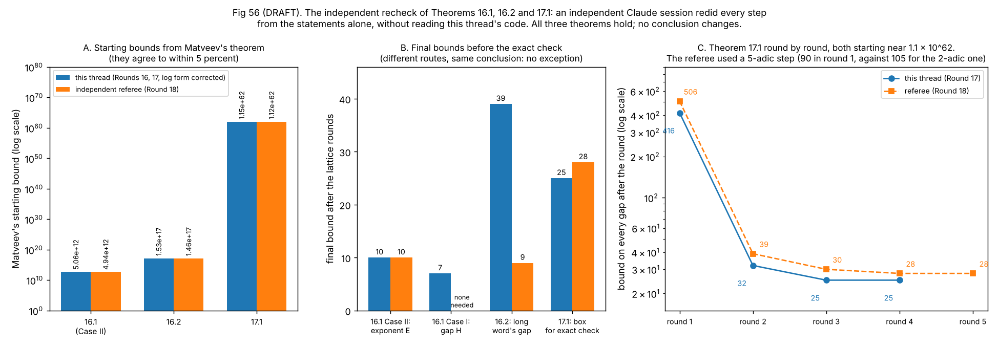

*Figure 56. Our bounds (blue) against the referee's (orange). A: the starting bounds from Matveev's theorem agree to within 5
percent. B: the final bounds before the exact checks differ, because the case splits differ, but each side's exact check
covers its own bound and finds no exception. C: Theorem 17.1 round by round.*

### 22.3 F2: a three-letter numerator has at most two factors 19

**Lemma F2 (by hand).** For every reduced three-letter word, v19(T3) <= 2.

*Proof.* T3 is the sum of three terms, 19^(L1+L2), r3 P2 19^L1 and r3 P2 r2 P1, with 19-adic sizes t1 = L1 + L2,
t2 = v(r3) + L1 and t3 = v(r2) + v(r3), where v(r) is 1 for r = 19 and 0 for r = 10 (P is prime to 19). If one size is
smallest on its own, v19(T3) is that size, at most t3 <= 2. If t2 = t3 is smallest, the last two terms are r3 P2 T_pre and
v19(T3) <= v(r3) + v19(T_pre) <= 1 + 1 by F1 (a tie with t1 here would need L1 = 0, r2 = 10 and 19 | T_pre, but then
T_pre = 1 + 10·20^M1 is 11 modulo 19). In the remaining ties t1 takes part, which forces L1 + L2 <= 2; modulo 19,
200 is 10 and 20 is 1, so P is 10^L, and the leading parts of the tied terms add up to 11, 6 or 16 modulo 19, never 0.
So v19(T3) is the tied size, at most 2. ∎ (Q1 runs through all eight tie cases and then computes v19(T3) directly for
277,202 words.)

**Why it matters, and a correction to 21.6.** Section 21.6 called the unknown 19-adic shift "unbounded even for three
letters". That was overstated: for three letters, T3 = 19^g K with g <= 2, so the shift g - L1 - L2 is unbounded only through
the gap lengths themselves. F2 is what makes this round work: it caps the {2, 5, 19}-part of T3 at 2^3 · 5 · 19^2 = 14,440, so
once one word is short, its fingerprint is small and the other word's size is capped, with no list of fingerprints and no
per-fingerprint lattices (compare step 3 of 21.3). With more letters the largest 19-adic size found grows: 3 for four letters
and 5 for five and six, in small searches (Figure 57). Whether each fixed number of letters has a bound is not proved.

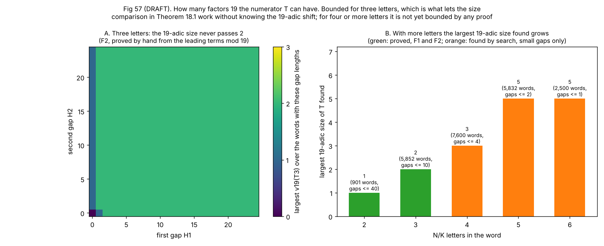

*Figure 57. A: for three letters the largest number of factors 19 in T3, over all words with given gap lengths, is never
more than 2 (F2). B: the largest found for each number of N/K letters (green: proved for two and three; orange: search only,
small gaps).*

### 22.4 Theorem 18.1 and its proof

As in 21.2, a reduced three-letter word is W = N u1 x2 u2 x3 with T3 = 19^(L1+L2) + r3 P2 T_pre and T_pre = 19^L1 + r2 P1.
Write T3 = S·K, where K is the fingerprint and S = 2^e2 5^e5 19^g. In Type A, S = 19^g; in Type B (W = N u1 x2 N, so
H2 = 0), T3 = 20·19^L1 + 19 r2 P1 and 2^e2 5^e5 <= 40 (e2 = 3 only for N m N N; Q2).

**Theorem 18.1 (computer-assisted).** Two different reduced words with three N/K letters, neither starting N N, never have
the same fingerprint. With Theorems 15.5, 16.1, 16.2 and 17.1: Conjecture 15.3 holds for every pair of words with at most
three N/K letters each.

*Proof.* Suppose W and W' are different and share K. Name them so that H1 <= H1', and let X be the largest of the four gaps.

1. **One shared small number for the first gaps.** Each numerator is a product of 2s, 5s and 19s times (1 + a small number):
   T3 = D1 (1 + e), where D1 = r2 r3 P1 P2 in Type A and 19 r2 P1 in Type B, and 0 < e <= 0.11·10^-H1 (Q3). Since
   S K = D1 (1 + e) and S' K = D1' (1 + e'), Lambda11 = log(S' D1 / (S D1')) = log((1 + e')/(1 + e)) is a linear form in
   log 2, log 5, log 19, smaller than 0.11·10^-H1, with coefficients at most 6X + 6 (F2 keeps the 19s small).
   It is not 0. If both words are Type A, Lambda11 = 0 says 19^L1 T_suf/(r2 r3 P1 P2) is the same for both, where T_suf is
   the T of the back part N u2 x3; T_suf is prime to 10, so the back parts share a fingerprint and are equal (Theorem 16.2),
   and then the front parts are equal by the *prefix lemma*: 19^L/(rP) determines the gap and the letter, because the only
   other solution of the exponent equations is m K = l N, which is not reduced (Q5). If both are Type B, the prefix lemma
   applies at once. If one is Type A and the other Type B, T_suf would be a product of 2s, 5s and 19s, so the back part would
   be a bare N (Theorem 15.5), which is Type B. So **H1 <= m11**, from one lattice reduction in log 19, log 2, log 5.
2. **One form per front part.** If W is Type B, its second gap is empty and W is short already. If W is Type A,
   T3 = r3 P2 T_pre (1 + e2) with 0 < e2 <= 0.1·10^-H2 (Q3), so Lambda21 = log(S' r3 P2 T_pre / (S D1')) is smaller than
   0.11·10^-min(H2, H1'). It is a linear form in log 19, log 2, log 5 and log T_pre, and it is not 0 (otherwise T_pre would be
   a product of 2s, 5s and 19s, so the front part would be N N, by Theorem 15.5). W's front part has H1 <= m11, so there are
   finitely many T_pre; one lattice reduction for each gives **H2 <= m21 or H1' <= m21**.
3. **The D-step (both Type A).** Modulo 2^v2(r3 P2) and modulo 5^v5(r3 P2), K is 19^(L1+L2-g) (from W), and likewise for W'.
   So 19^D = 1 modulo the smaller powers of 2 and of 5, with D = (L1 + L2 - g) - (L1' + L2' - g') and |D| <= 2X + 2 by F2
   (Q6, Q7). D is not 0: otherwise r3 P2 T_pre/19^g = r3' P2' T_pre'/19^g', so the front parts share a fingerprint and are
   equal (Theorem 16.2), and then the back parts are equal by the prefix lemma. Since v2(r3 P2) >= 2 H2, v5(r3 P2) >= H2,
   v2(19^D - 1) <= 2 + log2 |D| and v5(19^D - 1) <= 1 + log5 |D|, **min(H2, H2') <= m2**, the smaller of the two bounds.
4. **The case split.** Steps 1 to 3 always leave one word *short*: W with H1 <= m11 and H2 <= m21 (or H2 = 0 in Type B, or
   H2 <= m2), or W' with H1' <= m21 and H2' <= m2 (or H2' = 0). Its gaps add up to at most
   s = max(m11 + m21, m11 + m2, m21 + m2).
5. **Size caps the other word.** For every three-letter word, 100·20^(H1+H2) <= T3 <= 401·200^(H1+H2) and S <= 14,440 (F2
   and Q2, Q4). So the other word satisfies 100·20^(its H1+H2) <= S·K <= 14,440·T3(short word) <= 14,440·401·200^s.

To start, Matveev's theorem with three and four logarithms (the four-logarithm form has log T_pre <= 3.0 + 5.3 H1) shows every
bound above is at most a constant times (1 + log(6X + 6))^2, so X <= 2.1 × 10^29. Then each round feeds X into steps 1 to 5:

| Round | Start X | m11 | m21 (front parts tried) | m2 | Short word: s | Other word: H1 + H2 | New X |
|---|---|---|---|---|---|---|---|
| 1 | 2.1 × 10^29 | 65 | 99 (2,276) | 43 | 164 | 293 | 293 |
| 2 | 293 | 11 | 17 (89) | 4 | 28 | 53 | 53 |
| 3 | 53 | 9 | 14 (64) | 3 | 23 | 44 | 44 |
| 4 | 44 | 9 | 14 (64) | 3 | 23 | 44 | 44 |

So both words have H1 + H2 <= 44. All 226,965 reduced three-letter words with H1 + H2 <= 44 (1,079 of them Type B) have 226,965
different fingerprints. As a test that the comparison can see a clash, 386,100 disguised words (a gap ending in m followed
by K, which is the same as one more l followed by N) are all found, each matching its reduced form. ∎ (Q8 reproduces the whole
chain from scratch; Q9 tests the lattice step against brute force; Q10 repeats the exact comparison and adds 15,750 words
with psi computed straight from the letters as maps.)

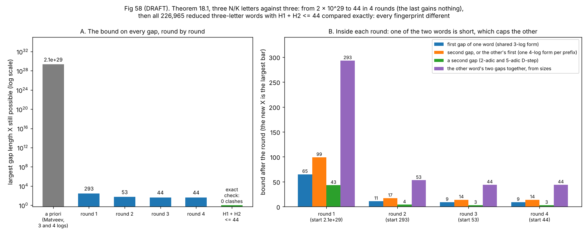

*Figure 58. A: the bound on every gap, from 2 × 10^29 (Matveev) to 44 in three rounds, then the exact check. B: inside each
round, the four bounds. The size step (purple) is always the largest, and it is the one that stops at 44.*

**Corollary 18.2 (by hand, from 18.1).** A second collision for a bad pair cannot use two words with three N/K letters each.
*Why:* as in Corollaries 16.3 and 17.2, equal psi gives equal fingerprints, so (Theorem 18.1) the same reduced word, and the
argument of Corollary 15.4 applies.

**Why Yu's theorem was not needed again.** The p-adic steps here are about 19^D - 1, where D is a whole number and the
2-adic and 5-adic sizes have exact formulas (Q6). A p-adic linear form with an unknown fingerprint inside, the case Yu's
theorem is for, never comes up, because F2 lets the size step replace the per-fingerprint 2-adic step of Round 17.

### 22.5 Where the conjecture stands

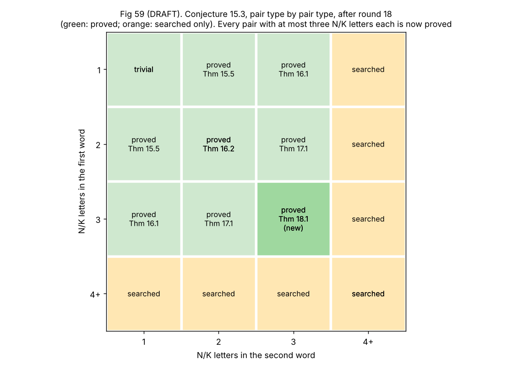

*Figure 59. Pair types by number of N/K letters, after round 18. Every pair with at most three N/K letters each is proved
(green); pairs involving four or more are searched only, with no exception.*

**What a proof for all lengths would need (my judgement, not proved; this revises 21.6).** Round 18 suggests a recipe for
each fixed length: bound the 19-adic size of T for that many letters (F1 and F2 for two and three), then run one lattice
step per gap with a size step at the end. I expect the same mod-19 casework to bound the 19-adic size for four letters
(the search finds at most 3) and for each fixed number of letters, but the number of tie cases grows, and the lattice
steps multiply (one per front part, then one per front part of the front part), so each length is a larger finite
computation. That is a proof for each length in turn, not for all at once. All lengths together would still need
something uniform: either a bound on the 19-adic size of T that does not grow with the number of letters (the search says
it does grow: 1, 2, 3, 5 for two to five letters), or the "peeling" lemma of 21.6 that reads the last gap off the
fingerprint. I see neither yet.

### 22.6 Is it a lead?

**Yes, a solid one for this question, and still not the whole answer.** Conjecture 15.3 is now proved for every pair of
words with at most three N/K letters each, by a method that came out simpler than Round 17's (no list of fingerprints),
thanks to a new by-hand fact (F2). Theorems 16.1, 16.2 and 17.1 now also have an independent recheck. What it does not do:
make the original break exact, which needs the conjecture for words of every length (section 19). The next case, four
letters, looks within reach by the same recipe once its 19-adic size is bounded.

### 22.7 Who proved what, round 18

- **Published theorems used:** Matveev's lower bound for linear forms in logarithms (E. M. Matveev, 2000), in the form of
  Bugeaud, Mignotte and Siksek (2006, Theorem 9.4), for the first bound only; LLL lattice reduction (Lenstra, Lenstra and
  Lovász, 1982) in Cohen's exact integer version (1993, Algorithm 2.6.7); de Weger's reduction lemma (1989); the classical
  formulas for the 2-adic and 5-adic sizes of 19^D - 1.
- **Considered and not needed:** Yu's p-adic lower bound for linear forms in logarithms (Kunrui Yu, 2007).
- **The independent recheck:** a separate Claude session, started this round and given only the definitions and the
  statements, redid Theorems 16.1, 16.2 and 17.1 with its own code (22.2). That is an independent computation, not a check by
  a person.
- **Claude, this thread:** Lemma F2, the reduction in 22.4 (the shared form for the first gaps and why it is not 0, the
  per-front-part forms, the 2-adic and 5-adic D-step, the case split, the size step, the a priori bound), the computations,
  Corollary 18.2, and the fixes in 22.2. Everything is computer-checked (Q1 to Q10); each lattice output is checked exactly
  for reducedness.
- **Not yet:** checked by a person, or checked against the literature on S-unit equations.

---

## 23. Round 19 (DRAFT): four N/K letters against one, two, three and four

Asked for by the project's coordinator, under Brennan's overnight go-ahead (section 18): four-letter words against two and
three, then against four if the by-hand bound on factors of 19 carries over; and if that bound needs a genuinely new idea,
say so instead of pushing the search. Script: [`pairs19.py`](pairs19.py) → [`pairs19.json`](pairs19.json) (the proof, about
7.5 minutes on 4 cores; peak memory about 160 MB in the main process, under 1 GB in all). Checks: [`checks19.py`](checks19.py)
→ [`checks19_output.txt`](checks19_output.txt), **10 of 10 pass** (about 5 minutes). Pictures: [`figures19.py`](figures19.py).
No new Lean. Nothing here has been checked by a person yet.

### 23.1 The answer in five sentences

**Four letters is now done too (computer-assisted): Conjecture 15.3 holds for every pair of words with at most four N/K
letters each (Figure 63).** The by-hand bound carries over: the numerator T of a four-letter word has at most three factors
19 (F3, 23.2), and at most 2^4 · 5 from 2 and 5. With it, the Round 18 recipe goes through for four against one, two, three
and four (Theorems 19.1 to 19.3), using a new general step that reads a known back part of a word 2-adically, and a lemma
(Lemma N) that says none of the linear forms can be exactly 0. Matveev's bound starts at 10^29, 10^62 and 10^112; lattice
reduction and exact 2-adic logarithms bring the gaps down to 50, 55 and 59, and then 106,624,096 four-letter words (plus all
shorter ones) are compared exactly with every possible partner, with no clash (Figure 61). **For five letters the by-hand
bound fails** (23.6): there the factors 19 in T are unbounded, so the next length needs a 19-adic tool (Yu's theorem and a
19-adic lattice step) rather than more of the same computation, and I stopped there, as asked.

### 23.2 F3: a four-letter numerator has at most three factors 19 (by hand)

Write a reduced word with n items as N x1 ... xn and expand the recursion:

  T = sum over j = 0..n of 19^(A_j) · (product over i > j of r_i P_i),    A_j = L_1 + ... + L_j.

Term j has 19-adic size t_j = A_j + (number of N among x_(j+1) ... x_n), and modulo 19 its unit part is the product over
i > j of c_i 10^(L_i), where c = 1 for N and 10 for K (because 200 = 10 and 20 = 1 modulo 19, the m's never matter).
The last term has t_0 = number of N letters <= n. So g = v19(T) is the smallest t_j, unless the terms of smallest size have
unit parts that add up to 0 modulo 19.

**F3.** For n = 3 (four letters), g <= 3.
*Proof.* The smallest size is at most t_0 <= 3, so every tied term has A_j <= 3, and only gap lengths L <= 3 before the last
tied term matter (an L of 4 or more makes every later term bigger than 3; later L's only multiply all tied unit parts by the
same unit). That leaves 2^3 choices of N/K and L1, L2, L3 in {0, ..., 4}, with 4 standing for "4 or more". In all 226
patterns with a tie, the tied unit parts never add to 0 modulo 19, so g = min t_j <= 3. ∎ (Q1, which also computes g for all
78,964 four-letter words with gap sum up to 14: 3 is reached, never more; Figure 60A.)

**The 2- and 5-parts (by hand).** T = 19^(A_3) + r3 P3 T_2 is prime to 10 unless x3 = N with no gap. If x3 is N with no gap and x2 is not:
T = 20 · 19^A + 19 r2 P2 T_1 with T_1 prime to 10, so e2 = min(2, v2(r2 P2)) unless v2(r2 P2) = 2, which is x2 = m N; then
T = 20 (362 · 19^L1 + 361 r1 P1), which gives e2 = 3, or e2 = 4 exactly when x1 = K (362 + 3610 = 4 · 993). Likewise
e5 <= 1. If x2 = x3 = N with no gaps, T = 381 · 19^L1 + 361 r1 P1 is prime to 10. So 2^e2 5^e5 <= 80, reached only by
N K m N N, and S = 2^e2 5^e5 19^g <= 80 · 19^3 = 548,720. (Q2, over 144,228 words.)

### 23.3 The steps, and why none of the forms is 0

Split a word at an item p: the front part is x_1 ... x_(p-1), the back part sigma is x_(p+1) ... x_n, and Q_p is the product
of r_k P_k over k >= p. Then exactly (Q3)

  T = Q_p · T(front) + 19^(A_p) · T(sigma),   so   T = Q_p T(front) (1 + eta) with 0 < log(1 + eta) < 0.112 · 10^-h_p.

* **Front step P(p, p').** If W and W' share K, then Lambda = log(S' Q_p T(front) / (S Q'_p' T'(front))) is smaller than
  0.112 · 10^-min(h_p, h'_p'). It is a linear form in log 19, log 2, log 5 and the logarithms of the two front parts' T,
  with coefficients at most 9X + 20 (F3 keeps the 19s small). With the front parts known, exact LLL (de Weger's lemma)
  bounds min(h_p, h'_p'); otherwise Matveev's bound does.
* **Back step S(p, p').** Modulo 2^v2(Q_p), T is 19^(A_p) T(sigma). If v2(Q_p) and v5(Q_p) are bigger than the 2- and
  5-sizes e, f of T(sigma), then K = 19^(A_p + g_sigma - g) kappa(sigma) modulo 2^(v2(Q_p) - e), where kappa is T without
  its 2s, 5s and 19s (Q4). Comparing the two words, 19^m kappa(sigma)/kappa(sigma') = 1 modulo the smaller power of 2, with
  |m| <= 3X + 8, and an exact 2-adic discrete logarithm (Q5) bounds min(h_p, h'_p'), since v2(r_p P_p) >= 2 h_p. With both
  back parts empty this is Round 18's D-step. The new thing is that the back part can be any known word.
* **Size step.** 10^n 20^(sum of gaps) <= T <= 1.12 · 19^n · 200^(sum of gaps) (Q3), and T(other) = S(other) K <=
  S_max(other) · T(short), with S_max = 1, 19, 14,440 and 548,720 for one to four letters.

**Lemma N.** For two different reduced words with at most four N/K letters and the same fingerprint, no front-step form
Lambda is 0, and in a back step with kappa(sigma) = kappa(sigma'), m is not 0.
*Proof.* If Lambda = 0, then T(front) / T'(front) is a product of 2s, 5s and 19s, so the front parts (at most three
letters each) share a fingerprint and are the same word, by Theorems 15.5, 16.1, 16.2, 17.1 and 18.1. Then Lambda = 0 says
19^L T(sigma) / (r P Q(sigma)) is the same for both words, where (r, L, M) is the item at the split. So the back parts share
a fingerprint, and (same theorems) they are either the same, or one is the other with a leading N N in place of N m. In the
second case T(sigma)/Q(sigma) changes by 20/19 (Q6). Now look at a2 - 2 a5 + a19 modulo 2, for a number 2^a2 5^a5 19^a19: it
is odd for every 19^L/(rP) and odd for 20/19 (Q6), so the second case is impossible (the two sides differ by an even
amount). In the first case 19^L/(rP) is the same for both, and that fixes the item (the prefix lemma of 22.4; Q6), so the
words are equal. If m = 0 in a back step with kappa(sigma) = kappa(sigma'), the same algebra (K minus the 19-power part,
times the 2- and 5-parts) gives T(front) / T'(front) a product of 2s, 5s and 19s and then Lambda = 0, which is the first
case. ∎ This lemma leans on the earlier computer-assisted theorems for at most three letters, so they come first (18.1 before 19.3, 17.1 before 19.2), and on Proposition 15.2 (psi(NNw) = psi(Nmw)) for the leading N N case. [Round 20: wording added after the independent recheck, 24.2.]

### 23.4 Theorems 19.1 to 19.3

**Theorem 19.1 (computer-assisted).** No reduced word with four N/K letters has fingerprint 1, and none shares a fingerprint
with a reduced two-letter word.
*Proof.* Fingerprint 1 means T = S <= 548,720, while T >= 1000 · 20^(sum of gaps); so the gaps add up to at most 2, and
none of those 105 words has fingerprint 1. Against a two-letter word V = N y1: P(1,1) gives min(x1, y1) <= a, the D-step
min(x3, y1) <= c, and P(2,1) for each front part x1 gives min(x2, y1) <= b. So V is short (y1 <= max(a, b, c)) or W is in
the box (a, b, c), and the size step caps the other one.

**Theorem 19.2 (computer-assisted).** No reduced four-letter word shares a fingerprint with a reduced three-letter word.
*Proof.* W = N x1 x2 x3, V = N y1 y2. P(1,1): x1 <= a or y1 <= a. The D-step: x3 <= c or y2 <= c. Four cases:
(I) x1 <= a, x3 <= c: P(2,1) gives x2 <= b (W short) or y1 <= b, and then the back step with x3 known gives W in (a, d, c)
or V in (b, d). (II) x1 <= a, y2 <= c: P(2,1) gives V in (b, c), or x2 <= b and the back step with y2 known gives W in
(a, b, d) or V in (d, c). (III) y1 <= a, x3 <= c: P(1,2) for each front part y1 gives V in (a, b), or x1 <= b and the back
step gives W in (b, d, c) or V in (a, d). (IV) V in (a, c). Here d is the back-step bound over all one-item back parts with
gap <= c.

**Theorem 19.3 (computer-assisted).** No two different reduced four-letter words share a fingerprint.
*Proof.* The case tree is Figure 62: after P(1,1) (call W the word with x1 <= a), the D-step and P(2,1), each branch uses one
back step with a one-item back part (bound d) and, where two gaps are still open, a back step with two known one-item back
parts (S11) or with a known two-item back part against an empty one (S02). The first round uses Matveev's bound with four
and five logarithms in place of those last steps, since the back parts are still too many.

**Corollary 19.4 (from 19.1 to 19.3 with Theorems 15.5 to 18.1).** Conjecture 15.3 holds for every pair of words with at
most four N/K letters each, and (as in Corollary 18.2) a second collision for a bad pair cannot use two such words.

To start, Matveev's theorem for the front steps and the closed-form D-step show that every bound is at most a constant times
(1 + log(9X + 20))^k, so X <= X* (Q7). Each round then runs the trees above:

| Pair | Matveev start X* | Rounds (bound on every gap after each) | Last round: a, b, c, d (f) | Exact check |
|---|---|---|---|---|
| 4 against 2 | 2.1 × 10^29 | 369, 61, 50, 50 | 9, 14, 4, – | 2-letter words up to gap 50; 4-letter words up to gap sum 27 |
| 4 against 3 | 2.1 × 10^62 | 4.0 × 10^18, 269, 68, 59, 55, 55 | 9, 14, 4, 6 | 3-letter words up to gap sum 55; 4-letter up to 44 |
| 4 against 4 | 4.8 × 10^112 | 4.0 × 10^40, 1.0 × 10^23, 371, 74, 66, 61, 59, 59 | 9, 14, 4, 6 (10, 8) | 4-letter words up to gap sum 59 |

In round 3 of four against four the two-gap back steps run exactly (950,950 back-part pairs each); from then on everything
is exact. **The exact check:** all 666,435 different words in the short boxes of the last rounds go into one table (2,762,934
with repeats; the one-letter word N is in it too), and then every reduced two-letter word up to gap 50 (1,376), every
three-letter word up to gap sum 55 (516,782) and every four-letter word up to gap sum 59 (106,624,096) is compared with it.
No two different words share a fingerprint. As a test that the comparison can see a clash, 1,926,110 disguised words (a gap
ending in m before K, or a leading N N) are all found as their reduced forms. ∎ (Q8 reproduces the bound chains; Q9 tests
the four-logarithm lattice step against brute force; Q10 checks the JSON and, independently, all words with one to four
letters up to small gap sums, plus 2,548 raw four-letter words, gaps up to two letters, with psi computed straight from the letters as maps.)

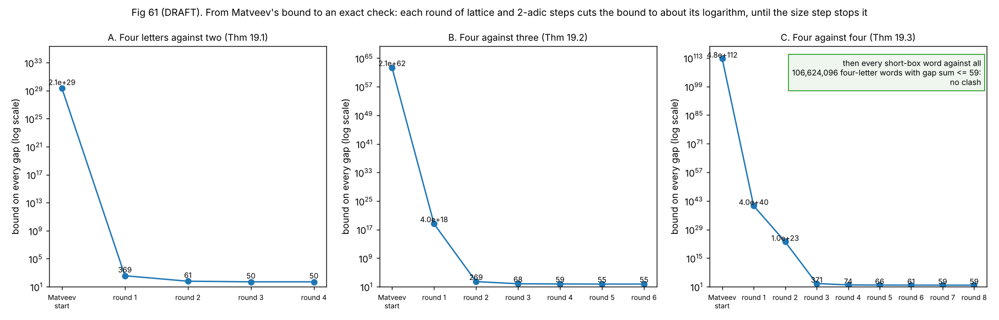

*Figure 61. The bound on every gap, round by round, for four letters against two, three and four. Each round cuts the bound
to about its logarithm until the size step stops it.*

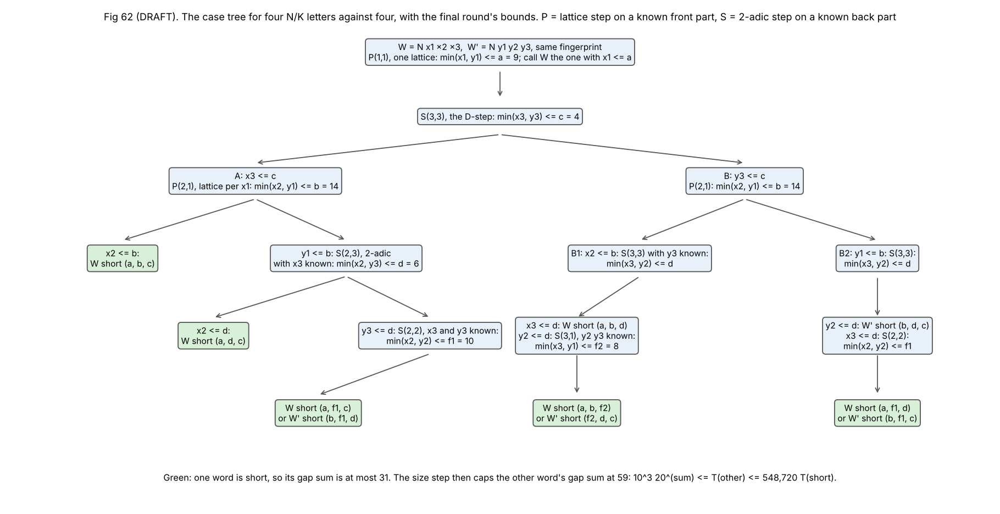

*Figure 62. The case tree for four against four, with the last round's numbers. P: lattice step on a known front part;
S: 2-adic step on a known back part. Every leaf (green) leaves one word short.*

### 23.5 Where the conjecture stands

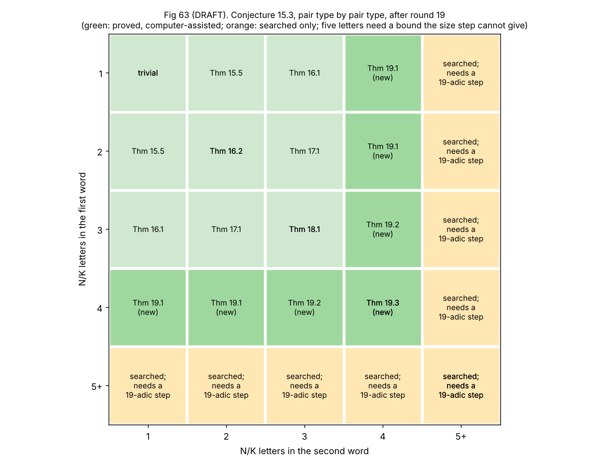

*Figure 63. Pair types by number of N/K letters, after round 19. Every pair with at most four N/K letters each is proved;
pairs with five or more are searched only.*

### 23.6 Five letters: the by-hand bound fails, and what that means

The same casework for five letters (four items, L up to 5) finds 12 tie patterns, out of 3,838, whose leading units cancel
modulo 19 (Q1). One of them is N K l K K, which gives a clean family: for W = N K l K K m^M N,

  T = 19 + 19 · 20^M · T3,   T3 = T(N K l K K) = -1 modulo 361,

so g = 1 + v19(1 + 20^M T3) = 2 + v19(M - mu), where mu is the 19-adic number with 20^mu = -1/T3 (it exists because powers
of 20 fill out 1 + 19 Z_19, and v19(20^x - 1) = 1 + v19(x)). So g is 3 at M = 0, 4 at M = 38, 5 at M = 5092, and it has no
bound (Figure 60B). **This is proved, by hand, for that family.**

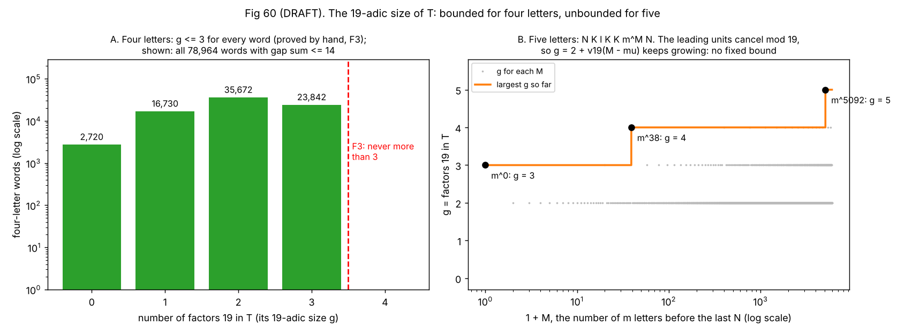

*Figure 60. A: for four letters g is at most 3 (F3); all words with gap sum up to 14. B: five letters, N K l K K m^M N: g
for each M (grey) and the largest so far (orange). It grows, slowly, without bound.*

**What that means (my judgement, not proved).** The size step needs S(other) bounded, and for five letters it is not. What
would replace it is a bound g <= C + C' log X for five-letter words, which is enough for the size step, since the loss
is then only logarithmic. Getting it means bounding a 19-adic linear form in logarithms (in the family above,
v19(M - mu); in general, sums like 20^M + 200^L · unit), which is what Yu's p-adic theorem does, followed by a 19-adic
lattice reduction to make it small. Those are published tools, standard in S-unit work, but a new layer here, with its own
case analysis over the cancelling patterns, and the trees grow again (a fifth gap, more front and back parts). So five
letters is a larger project of the same kind, not a matter of running this script longer; and all lengths at once would
still need something uniform that I do not see (22.5). As the coordinator asked, I stopped at four letters and report this
instead of pushing the search.

### 23.7 Is it a lead?

**Yes, and a solid one for this question.** The fingerprint conjecture now holds for every pair of words with at most four
N/K letters each, by a method that came out general: one front step and one back step for each split of a word, a size
step, and a lemma (N) that every form is nonzero, which reduces to the shorter cases already proved. That is a proof for
each length in turn, and this round shows exactly where the next length gets harder (the 19s stop being bounded at five
letters). It still does not make the original break exact, which needs every length (section 19).

### 23.8 Who proved what, round 19

- **Published theorems used:** Matveev's lower bound for linear forms in logarithms (E. M. Matveev, 2000), in the form of
  Bugeaud, Mignotte and Siksek (2006, Theorem 9.4), for the first bound and for the early rounds; LLL lattice reduction
  (Lenstra, Lenstra and Lovász, 1982) in Cohen's exact integer version (1993, Algorithm 2.6.7); de Weger's reduction lemma
  (1989); the classical formulas for the 2-adic, 5-adic and 19-adic sizes of 19^D - 1 and 20^x - 1.
- **Earlier rounds used:** Theorems 15.5, 16.1, 16.2, 17.1 and 18.1 (Lemma N needs them) and the prefix lemma of 22.4.
- **Considered and not needed for four letters:** Yu's p-adic lower bound (Kunrui Yu, 2007). For five letters it looks needed.
- **Claude, this thread:** F3 and the 2- and 5-part bound, the five-letter family and its unbounded 19s, the splitting
  identity with the general back step, Lemma N, the case trees for 4 against 1, 2, 3 and 4, the a priori bounds, the
  computations, and Corollary 19.4. Everything is computer-checked (Q1 to Q10); each lattice output is checked exactly for
  reducedness. Not checked by an independent session this round.
- **Not yet:** checked by a person, or checked against the literature on S-unit equations.

## 24. Round 20 (DRAFT): an independent recheck of rounds 18 and 19, and the 19-adic step for five letters

*DRAFT, Nov 27. Done under Brennan's overnight go-ahead, at the coordinator's suggestion: first an independent recheck of
Theorems 18.1 and 19.1 to 19.3, then a scoping of the 19-adic route that section 23.6 said five letters would need. Files:
`referee20/` (the referee's brief, scripts, logs and report), `adic20.py` + `adic20.json` + `adic20_notes.md`,
`checks20.py` (7 checks), `figures20.py`, figures 64 to 67.*

### 24.1 The answer in five sentences

An independent session, given only the definitions and the statements, redid Theorems 18.1, 19.1, 19.2 and 19.3 with its
own code and its own case splits: **all hold**, with no counterexample and no false step (Figure 64). At five letters the
factor-19 bound fails in exactly 12 patterns, and **all 12 have one shape**: T = 19^A3 (1 + 20^M u), so g = A3 + 1 +
v19(M - mu(u)), a two-logarithm 19-adic form with one integer exponent. A published two-logarithm bound (Bugeaud and
Laurent 1996) covers it, so Yu's many-logarithm theorem is not needed; it bounds g for every M, but linearly in the size of
the front and about ten thousand times too big. For a fixed front, a simple 19-adic digit argument gives the **exact**
largest g over all M up to any bound B, and it is always within 4 of A3 + 1 + log_19 B (Figures 65 and 66). So the 19-adic
step is feasible and cheap, and five letters looks like a bigger run of the round-19 method, not a new idea (my judgement,
Figure 67); I did not run it.

### 24.2 The independent recheck

**How it was done.** As in round 18: a separate Claude session (a subagent) got only `referee20/BRIEF.md`: the letters as
maps, psi, the fingerprint, reduced words, the earlier theorems it could take as proved (15.5, 16.1, 16.2, 17.1), and the
statements to recheck (F2, Theorem 18.1, F3, the 2- and 5-part bound, Lemma N, Theorems 19.1 to 19.3, and the five-letter
family). It did not open sections 22 and 23, pairs18/19, checks18/19 or figures18/19. It wrote its own Matveev bounds, its
own lattice steps (python-flint's LLL, each output checked exactly), its own 2-adic tree and its own hashed exact
comparison. Its report is `referee20/REPORT.md` (saved by this thread, unchanged), with scripts and logs beside it; they
need mpmath and python-flint and are not part of the repository's checks.

| Item | Referee | Ours |
|---|---|---|
| F2: v19(T) <= 2 for three letters | holds (exact residues mod 19^4) | by hand |
| F3: v19(T) <= 3 for four letters | holds (exact residues mod 19^5) | by hand + 226 cases |
| 2^e2 5^e5 <= 80 for four letters, only N K m N N | holds (exact residues mod 2^7 5^3) | by hand |
| 18.1, three against three | start 6.4e45; rounds 422, 42, 33; 80,291 words, no clash | every gap <= 44; 226,965 words |
| 19.1, four against two | start 6.4e45; rounds 558, 50, 38 | start 2.1e29; 369, 61, 50, 50 |
| 19.2, four against three | start 2.8e62; rounds 765, 59, 47, 45 | start 2.1e62; 4.0e18, 269, 68, 59, 55, 55 |
| 19.3, four against four | start 1.55e79; rounds 1.57e19, 263, 61, 51, 49; 39,039,480 words, no clash | start 4.8e112; ...; 59; 106,624,096 words |
| the five-letter family | holds; first M with g = 3, 4, 5, 6: 0, 38, 5,092, 25,669 | 3, 4, 5 at 0, 38, 5,092 |

The referee bounds the gap sum of each word, we bound each gap, so the counts are not comparable; each side's exact check
covers its own last bound. As an extra check it ran the comparison at our bound 59 and got exactly our 106,624,096
four-letter words, with all two- and three-letter words to 60 added: no clash, and only N has fingerprint 1. Its start for
four against four is smaller than ours (1.55e79 against 4.8e112) because it splits the first steps differently; a start only
has to be finite.

**What it found in the write-up, and what we do about it.** None is an error in a result.
1. *Order of proof.* Lemma N leans on the shorter theorems, so 18.1 must come before 19.3 and 17.1 before 19.2. That is the
   order in which they are proved here; section 23.3 now says so (the lemma's last sentence).
2. *The rewrite N N z -> N (z + m) is used and not stated.* Lemma N's second case ("a leading N N in place of N m") uses it.
   It keeps psi exactly: it is Proposition 15.2 (psi(NNw) = psi(Nmw)), which we now cite there.
3. *Fingerprint 1 in 19.1 needs no Baker theory* (T = S <= 548,720 forces gap sum <= 2). Agreed; that is how 23.4 proves it.
4. *Everything rests on the S bounds* (F2, F3 and the 2- and 5-part bound): they feed the size step, the 2-adic step and
   the exact check. Agreed; the referee rechecked all three by a different method (exact residues), which is the strongest
   kind of confirmation we have for them.

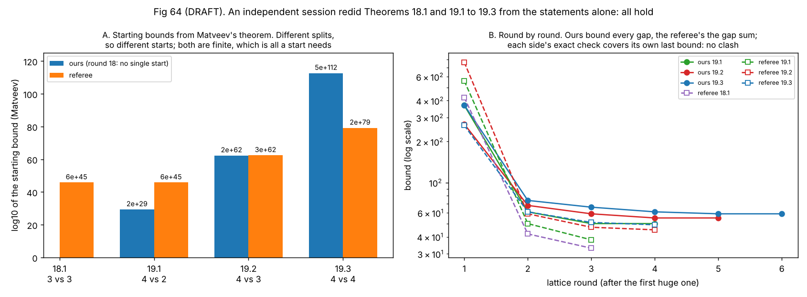

*Figure 64. Our bounds against the referee's. A: the starting bounds from Matveev's theorem (round 18 has no single start).
B: the lattice rounds after the first; solid ours (every gap), dashed the referee's (gap sum).*

### 24.3 The 19-adic form for five letters

**Proposition 20.1 (by hand, with the casework of 23.6).** Of the 3,838 tie patterns for five letters, the 12 whose leading
units cancel modulo 19 all have tied terms 0, 1 and 4 and a bare last N (no l before it). In each, the front x1 x2 x3 has
fixed letters and fixed l-counts adding to A3, and the only free gaps are M (the m's before the last N) and the m-counts of
the front's N-items (0 to 3 of them). Writing T3 for the front's T, v19(T3) = A3 - 1, u = T3 / 19^(A3 - 1) = -1 modulo 19,
and exactly

  T = 19^A3 + 19 · 20^M · T3 = 19^A3 (1 + 20^M u),   so   **g = A3 + 1 + v19(M - mu(u)),  where 20^mu = -1/u in Z_19.**

*Why:* the expansion of 23.2 with the tie pattern fixed; 20 = 1 + 19, so 20^x runs over 1 + 19 Z_19 and v19(20^x - 1) =
1 + v19(x). Every other five-letter word has g equal to its smallest term size, at most 4. (Checked: Q1, and the identity on
600 random words with T and mu computed independently, Q2.) In logarithms the form is Lambda = M log_19 20 + log_19(-u): two
19-adic logarithms, one integer exponent, and u depends only on the front. Round 19's family N K l K K m^M N is the pattern
with no free front gap (A3 = 1, u = 220,209). The 12 patterns are in Figure 66.

### 24.4 What the published bound gives

**Proposition 20.2 (a published theorem, applied).** For every word of the 12 patterns whose u is not a product of 2s and 5s
(true for all 13,517 fronts of 24.5),
g <= A3 + 0.337 · E^2 · log 20 · max(log u, log 19), with E = max(log E' + log log 19 + 0.4, 10, 10 log 19) and
E' = M / max(log u, log 19) + 1 / log 20.

This is the two-logarithm p-adic bound of Bugeaud and Laurent (1996) with p = 19, eta1 = 20, b1 = M, eta2 = -u, b2 = 1,
degree 1 (20 and -u are 19-units, both 1 mod 19, and multiplicatively independent because u has a prime factor other than 2
and 5, checked for every front used; Q6). **We took its exact form and constant from two later papers that restate it (arXiv 2401.06555, Lemma 2.2, and
arXiv 2606.18500, Theorem 2.3), which agree; we did not see the 1996 paper.** Some citations have p^f - 1 = 18 where these
have 1; that reading makes every bound 18 times larger and changes nothing below. For the family it gives g <= 10,771 for
every M up to 10^13 and g <= 652,697 for M up to 10^100.

So the bound is **linear in the size of the front** and only polylogarithmic in M. On its own it is useless for the size step
(it would let 19^g grow like a power of the front), but it is exactly what the first, Matveev, stage needs: g enters the
front-step forms only as the coefficient of log 19, so a bound like this keeps the starting bounds finite.

### 24.5 The digit step: the exact answer for a fixed front

**The argument (by hand).** For a fixed front, mu is a fixed 19-adic number. v19(M - mu) >= k means M = mu modulo 19^k. So
over 0 <= M <= B, the largest v19(M - mu) is the largest k with (mu mod 19^k) <= B, and it is reached at M = mu mod 19^k.
Computing mu modulo 19^k is a 19-adic discrete logarithm, done digit by digit and checked by exponentiation.

**Proposition 20.3 (computed, exact).**
- For N K l K K m^M N: the first M with g = 4, 5, 6, 7, 8 are 38; 5,092; 25,669; 1,459,200; 43,552,883 (each checked on T
  itself), and the largest g over M <= 10^100, 10^200, 10^300 is 80, 159 and 236 (Q4; also redone with independent code).
- For every front of the 12 patterns whose free front gaps add up to at most 30 (13,517 fronts): the largest g over
  M <= 10^2, 10^100, 10^200, 10^300 is 9, 87, 164 and 242, and each is reached. For every front, the largest k is within 4 of
  log_19 B (Q5, Figure 66B).
- The digit argument agrees with brute force for every front with free front gaps <= 2 and every M <= 3,000 (Q3), and for
  the family up to M = 10^5.

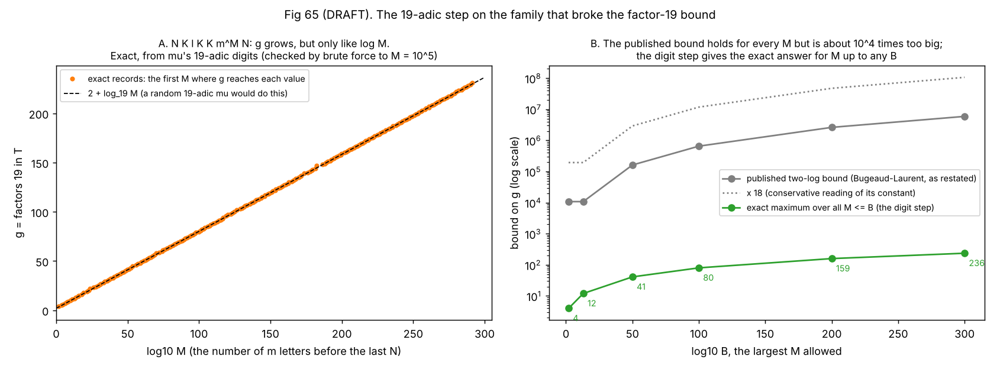

*Figure 65. A: the family's records (orange) lie on 2 + log_19 M (dashed), as they would for a random 19-adic mu: g grows,
but only like log M. B: the published bound (grey) holds for every M but is about ten thousand times the true maximum
(green), which the digit step gives exactly for M up to any B.*

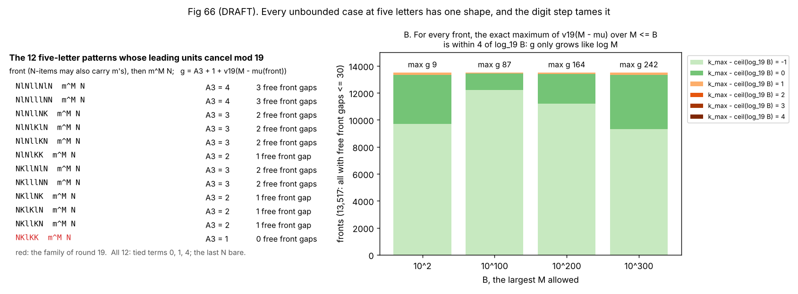

*Figure 66. A: the 12 cancelling patterns (red: round 19's family). B: for every front, how far the exact maximum of
v19(M - mu) over M <= B sits above log_19 B: never more than 4.*

### 24.6 Is five letters feasible? (my judgement, not proved)

Yes, as far as the 19s go. The chain would be: Proposition 20.2 as the input to Matveev's theorem for 5 against 1 to 5 (my
rough guess for the start of 5 against 5 is 10^150 to 10^250, extrapolated, not computed); lattice rounds on the fronts and
2-adic steps on the backs as in round 19; then, once a round has fixed the front, the digit step gives the exact g for every
M up to the round's bound, in milliseconds, so 19^g costs the size step only about log B, an additive amount, and the size
step closes as before (Q7). What remains is the round-19 work again, bigger: a by-hand 2- and 5-part bound for five letters,
the trees with a third middle gap, and an exact check of about 10^10 words (100 to 300 times round 19's), which is hours in
this Python and needs care with memory. That is a larger run of a method that works, not a new idea. All lengths at once
would still need something uniform that I do not see (22.5, 23.6).

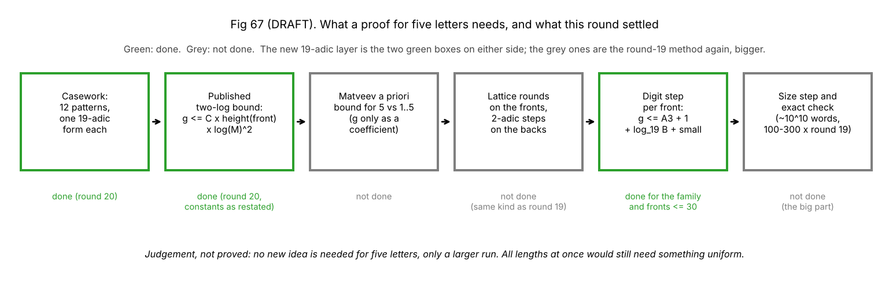

*Figure 67. What a proof for five letters needs. Green: done this round. Grey: the round-19 method again, bigger.*

**A correction to 23.6.** It said five letters would need Yu's p-adic theorem and a 19-adic lattice reduction. Neither is
needed: every unbounded case is a two-logarithm form, so the older two-logarithm bound suffices, and for a fixed front the
reduction is the digit step above, with no lattice. Its estimate g <= C + C' log X is right for a fixed front (the log is
log_19 of the bound on M), but not uniformly over all fronts, where the published bound grows with the front's size.

### 24.7 Is it a lead?

**Yes, and it got firmer.** Two things moved. The four-letter theorems now have an independent confirmation, by a different
case split and different code, which is the strongest check short of a person. And the obstacle at five letters turned out to
be small: one form, a published bound and a digit argument, all now in hand for the family that broke the bound. The
conjecture is still proved only up to four letters, and the original break still needs every length (section 19).

### 24.8 Who proved what, round 20

- **The referee (an independent Claude session, this round):** the recheck of F2, F3, the 2- and 5-part bound, Lemma N,
  Theorems 18.1 and 19.1 to 19.3 and the family, with its own code (`referee20/`). It used Matveev's theorem (BMS 2006,
  Theorem 9.4), LLL (python-flint) with exact checks, and its own 2-adic and exact steps.
- **Published theorem used:** the two-logarithm p-adic bound of Y. Bugeaud and M. Laurent (J. Number Theory 61, 1996), in
  the form restated in arXiv 2401.06555 (Lemma 2.2) and arXiv 2606.18500 (Theorem 2.3); the paper itself not seen.
- **Claude, this thread and a worker it started:** the 12-pattern shape and Proposition 20.1, the digit argument and
  Proposition 20.3, the application in Proposition 20.2, the feasibility judgement, and checks Q1 to Q7 (the family's
  numbers redone with separate code).
- **Not yet:** checked by a person; the five-letter theorems themselves are not proved.

## 25. Round 21 (DRAFT): the levels 1, 2, 4, 8, and one statement about 2, 5 and 19 for every length

*DRAFT, Nov 27. Brennan asked whether the powers behind the problem give an idea for every length, and whether they follow
the division-algebra levels 1, 2, 4, 8 (real numbers, complex numbers, quaternions, octonions). If they did, there would
be one more level and then none, because Hurwitz's theorem allows no normed division algebra past dimension 8, and that
might cap the problem. Files: `explore21.py` + `explore21.json`, `checks21.py` (6 checks), `figures21.py`, figures 68 to 70.*

### 25.1 The answer in five sentences

The 1, 2, 4, 8 is really in the numbers: the four letters N, K, m, l stretch by 19, 10, 20 and 200, and their powers of 2
are exactly 1, 2, 4 and 8 (Figure 68A). It comes from the example's chosen multipliers, not from the problem: on the
collision surface the four powers of 2 are always 1, 2^a, 2^b, 2^(a+b), so they double only for the choice made in 13.4,
and the other known break gives 1, 8, 16, 128 (Proposition 21.1). It labels the four letters, which are all in use already
(l is the 8), not lengths or dimensions, so it cannot cap the lengths and there is no higher level to come: a coincidence,
not a lead. The powers do give something for every length: a word's terms step down by fixed ratios, and among all
balanced sums of products of 2, 5 and 19, the only one whose two sides step down that way is 1 + 19 = 20 (searched to
4 terms a side and 10^15; without that shape there are 18,852 such sums to 10^9). Proved by hand: if that holds for every
size (Conjecture 21.2), Conjecture 15.3 holds at every length (Theorem 21.5); this moves the open step to one clean
statement, it does not remove it.

### 25.2 The levels 1, 2, 4, 8

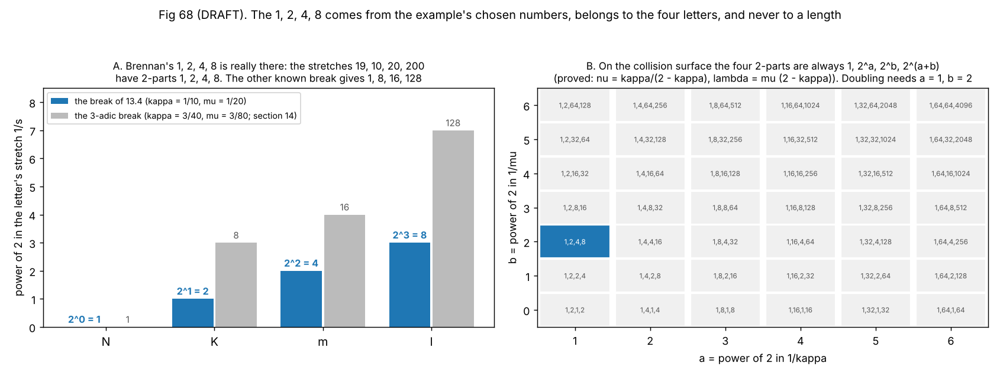

*Figure 68. A: the power of 2 in each letter's stretch 1/s, for the break of 13.4 (blue: 1, 2, 4, 8) and the 3-adic break
of section 14 (grey: 1, 8, 16, 128). B: on the collision surface the four powers are 1, 2^a, 2^b, 2^(a+b); only a = 1, b = 2
doubles.*

**Proposition 21.1 (by hand).** On the collision surface (13.4) nu = kappa/(2 - kappa) and lambda = mu (2 - kappa). If
1/kappa has 2-adic valuation a >= 0 and 1/mu has b, then the stretches 1/nu, 1/kappa, 1/mu, 1/lambda (letters N, K, m, l)
have 2-adic valuations 0, a, b and a + b. [Round 22: the referee's wording; round 21 had a >= 1 and "factors of 2", but
a >= 0 is enough and b and a + b need not be counts of factors.]

*Why:* write kappa = p/(2^a q) with p and q odd; then 2 - kappa = (2^(a+1) q - p)/(2^a q) has an odd numerator, so the same
2-adic size as kappa, so nu has 2-adic size 0 and lambda has the sizes of mu and kappa added. Checked on 810 surface points
(Q1). The break of 13.4 has kappa = 1/10 (a = 1) and mu = 1/20 (b = 2), so 1, 2, 4, 8; its powers of 5 are 1, 5, 5, 25,
which do not double. The 3-adic break has kappa = 3/40 (a = 3) and mu = 3/80 (b = 4), so 1, 8, 16, 128.

**What the levels would predict, and why they don't.** Hurwitz's theorem is about multiplying vectors in R^n with the
length multiplying too; it stops at n = 8. Nothing here multiplies vectors: every number in this problem is a rational
number on a line (the topic's plane version is a second setting, not a next level), and the 1, 2, 4, 8 is attached to the
four letters, which every word of every length uses. If the levels capped the lengths, something should stop or start
after some length. Nothing does:
- the one built-in collision, N N w = N m w (Proposition 15.2), holds for every w; checked at every length to 25 (Q2);
- the 129,904 canonical words up to 11 letters have 129,904 different fingerprints (Q2), and Figure 48 has the same to
  14 letters: lengths 9 to 14 behave exactly like 1 to 8;
- the "8" is already taken by the letter l, so no level is waiting.

So this is a coincidence of the example's numbers (my judgement, with the reasons above). The hypersphere thread's
division-algebra checks are about that topic's products and norms; I found no bridge from them to these words.

### 25.3 Every collision is a balanced sum of products of 2, 5 and 19

By Theorem 14.1, psi(w) is a sum of terms tau_0 > tau_1 > ..., one for each N or K, where tau_i is the product of 1/s over
the letters after the i-th N or K. The ratio of neighbouring terms is the product of s over the letters from just after one
N or K up to and including the next:

  tau_(i+1)/tau_i = 19^L / (r 200^L 20^M),   L letters l, M letters m, r = 19 (next letter N) or 10 (next letter K),

a **word ratio**, at most 1/10. Two words have the same fingerprint when S' psi(W) = S psi(W') for products S, S' of 2, 5
and 19; clearing the powers of 19 in the denominators, that is a **balance**: a sum of products of 2, 5 and 19 equal to
another such sum. Call a list **word-shaped** if, largest first, each neighbouring ratio is a product of one or more word
ratios. Any sub-list of a word's terms is word-shaped (Q5).

**Conjecture 21.2 (open, searched).** Let two word-shaped lists of products of 2, 5 and 19 have equal sums, with no
smaller balance inside (no nonempty proper part of the numbers, taken from both sides, balances). Then either each list
is one number, the same, or the lists are 19c, c and 20c.

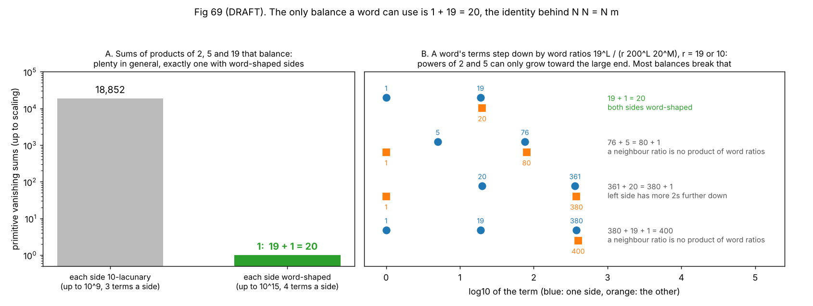

*Figure 69. A: primitive balances (up to scaling): 18,852 with each side merely 10-lacunary (numbers up to 10^9, 3 terms a
side), exactly one with each side word-shaped (up to 10^15, 4 terms a side). B: four of them on a log scale; only
19 + 1 = 20 has both sides stepping down by word ratios.*

What the search found (`explore21.py`, Q3 and Q4):
- word-shaped balances, every list of up to 4 numbers a side with numbers up to 10^15 (11,722,261 sums): only 19 + 1 = 20;
- balances with each side only 10-lacunary, up to 3 a side and 10^9: 18,852, e.g. 76 + 5 = 80 + 1, 125 + 4 = 128 + 1,
  361 + 20 = 380 + 1, 380 + 19 + 1 = 400;
- balances whose sides only obey the 2- and 5-size rule of a word (going down a side, the powers of 2 and of 5 never grow),
  up to 3 a side and 10^8: 319, e.g. 380 + 19 + 1 = 400 and 125 + 5 = 128 + 2.

The last line answers the coordinator's question whether the 2-adic and 5-adic sizes together with the 19-adic one
constrain every length at once: the 2- and 5-sizes alone do not; what kills those 319 is that every step of a word carries
a factor 19 or 10, which is a joint condition on all three primes.

### 25.4 Conjecture 21.2 gives every length

**Lemma 21.3 (by hand).** Let W and W' be canonical words (19.3) with S' psi(W) = S psi(W'), and suppose Conjecture 21.2
holds for the smallest balance inside that contains the largest term. Then the leading terms agree: S' tau_0 = S tau'_0.

*Proof.* W and W' are nonempty (psi = 0 only for a word with no N or K, and then both are empty). Write the balance as
sum of a_i = sum of b_j with a_i = S' tau_i, b_j = S tau'_j, and say the largest number is x = a_0 >= b_0 (the other case
is the same). Take a balancing subfamily P that contains x and is minimal by inclusion (it need not be unique). P is
primitive: a proper balancing part Q of P cannot contain x, and then P minus Q is a smaller balancing part containing x.
Each side of P is a sub-list of one word's terms, so word-shaped. By 21.2, P is one number each side or 19c, c against 20c.
- One each side: x = b_j <= b_0 <= x, so a_0 = b_0.
- 19c, c against 20c: since x is the largest, x = 20c, so 19c and c are among the b's. As b_0 <= 20c and the b's drop by
  at least 10 at each step, 19c = b_0 (otherwise b_0 >= 190c). Then c = b_j with b_j/b_0 = 1/19. That needs j = 1
  (b_2 <= b_0/100) and a word ratio of exactly 1/19, and the only one is "the next letter is N, with nothing between":
  each l adds 1 to the 19-adic size and a final N takes 1 away, so there is no l and the final letter is N, and then the
  2-adic size rules out any m. So W' starts N N, which a canonical word never does. ∎

**Lemma 21.4 (by hand).** Let W = N u and W' = N u' be canonical words with t_u = t_(u') and the same canonical form,
c(u) = c(u'). Then u = u'.

*Proof.* Write u = l^a m^b y v with y the second N or K of W, and u' = l^(a') m^(b') y' v'. From t_(xw) = s_x t_w + t_x
and t_x = s_x for N and K, t_u = lambda^a mu^b (s_y/s_N) t_(Nv). The canonical form of u is that of N v; if v starts with N
the front move N N -> N m keeps psi and divides s by 20/19, and the swaps and the trailing strip keep t, so
t_(Nv) = (20/19)^d t_(c(u)) with d = 1 if v starts with N and 0 if not. So the hypotheses give

  lambda^(a - a') mu^(b - b') (s_y/s_(y')) (20/19)^(d - d') = 1.

Comparing the powers of 19, 2 and 5 (lambda = 19/(2^3 5^2), mu = 1/(2^2 5), s_N/s_K = 10/19), the only solutions are
a = a', b = b', y = y', d = d', or a - a' = +-1, b - b' = -+1 with y and y' different, and the latter puts an m right
before a K (for example u' = l^(a-1) m^(b+1) K ...), which a canonical word never has (mK -> lN). So a, b, y and d agree.
If d = 0, c(u) is N v itself, so v = v'. If d = 1, v = N z and c(u) is N m z with the m pushed right: past the l's at the
start of z (ml -> lm), then it stops before an m or an N, giving N l^j m z_2, or it meets a K, giving N l^(j+1) N z_3 (and
if z is empty, c(u) = N). The shapes differ at the letter after the l's and each gives z back, so z = z'. ∎ (Q6 also
checks the statement directly on all 38,047 canonical words N u up to 10 letters.)

**Theorem 21.5 (by hand).** If Conjecture 21.2 holds, Conjecture 15.3 holds for every pair of words. More precisely, 21.2
for balances with one side at most k numbers and the other at most k' gives 15.3 for every pair of words with at most k
and k' letters N or K. (This reduces 15.3 to 21.2; since 21.2 is only searched, it does not make 15.3 a theorem at any
new size.)

*Proof.* By induction on the number of N and K letters. It is enough to take W and W' canonical (the canonical form keeps
the fingerprint) with S' psi(W) = S psi(W'). Lemma 21.3 gives S'/s_u = S/s_(u') (tau_0 = 1/s_u for W = N u), and since
psi(N u) = psi(u) + 1/s_u, also S' psi(u) = S psi(u'). If u is empty, psi(u') = 0, so u' has no N or K, and being the
tail of a canonical word it is empty: W = W'. Otherwise u and u' have the same fingerprint and one N or K fewer, so by
induction c(u) = c(u'); and t_u = psi(u) s_u = psi(u') s_(u') = t_(u') from the two equations. Lemma 21.4 gives u = u'. The
balances used never have more numbers than the words have N or K letters. ∎

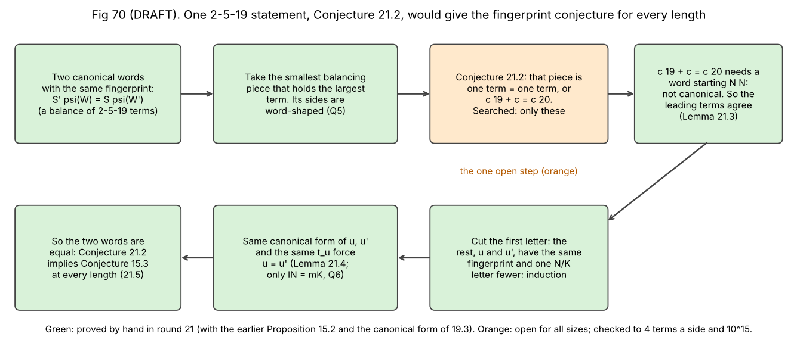

*Figure 70. The chain of Theorem 21.5. Green: proved by hand in this round, with Proposition 15.2 and the canonical form
of 19.3. Orange: Conjecture 21.2, open for all sizes and searched to 4 numbers a side and 10^15.*

### 25.5 Where it stops

Conjecture 21.2 is a statement about balances with any number of terms. For a fixed number it is a unit equation, which
the subspace theorem makes finite but not explicit, and the bottom of a balance can be peeled off by 2- and 5-adic sizes
one step at a time, but each step costs a logarithm, as in rounds 16 to 19; the 319 balances above show that the 2- and
5-sizes alone cannot do it. 21.2 is also stronger than 15.3 (it allows any word-shaped lists, not only a word's terms),
so a counterexample to 21.2 would not disprove 15.3. What is new is the shape of the problem: the identity 1 + 19 = 20,
the same one behind N N = N m, is the only balance a collision can use, and the words enter only through the shape of
neighbouring ratios.

### 25.6 Is it a lead?

- **The levels 1, 2, 4, 8: no.** The pattern is real but comes from the example's choice kappa = 1/10, mu = 1/20, labels
  the four letters and not lengths, and changes with the break; Hurwitz's bound has no counterpart here.
- **Conjecture 21.2: a modest lead.** It is one statement about the primes 2, 5 and 19 with no words in it, it implies
  the conjecture at every length by an argument proved here, and the search finds nothing against it. Proving it for
  every size still needs a new idea of the kind 19.6 describes; fixed sizes of it are the kind of case rounds 16 to 19
  did by computer, and would give an independent route to those results.

### 25.7 Who proved what

| Piece | Who |
|---|---|
| Pointing at the levels 1, 2, 4, 8 and asking whether they cap the problem | **Brennan** |
| Finding where 1, 2, 4, 8 sits in the numbers (the letters' powers of 2), Proposition 21.1 | **Ours** (DRAFT), by hand, Q1 |
| Words of every length behave alike past 8 letters | Proposition 15.2 and Figure 48 (round 15), Q2 here |
| Conjecture 21.2 and its search | **Ours** (DRAFT), computed, Q3 and Q4 |
| Lemmas 21.3 and 21.4, Theorem 21.5 (21.2 implies 15.3 at every length) | **Ours** (DRAFT), by hand, with Q5 and Q6 checking the facts used; independently rechecked in round 22 (section 26) |
| Theorem 14.1, Proposition 15.2, the canonical form, Conjecture 15.3 | Rounds 14 and 15 (sections 18 and 19) |
| Hurwitz's theorem (1898) | Classical, cited only |
| The subspace theorem (Evertse, Schlickewei and Schmidt 2002) | Published, cited only |

## 26. Round 22 (DRAFT): an independent recheck of round 21, and the smallest cases of Conjecture 21.2

*Round 22, DRAFT. Brennan's go-ahead after round 21 ("Yes let's do it!!"). Code: `explore22.py`, `checks22.py` (5/5, a few
seconds, under 0.1 GB), `figures22.py`; the referee's files are in `referee22/`. Pictures: Figures 71 and 72.*

### 26.1 The short answer

An independent session redid Proposition 21.1, Lemmas 21.3 and 21.4, Theorem 21.5 and the search for Conjecture 21.2 from
their statements alone, and confirms all of them (with wording fixes, now applied in section 25). So the reduction of
Conjecture 15.3 at every length to Conjecture 21.2 now stands rechecked. Of 21.2 itself, the smallest open case, two
numbers against one, is now proved by hand (Proposition 22.1): 19 + 1 = 20 is the only such balance. Two against two turns
out to be a direct extension of Theorem 16.2 (two two-letter words), and nothing is found to 300 digits; three-number
sides show nothing new to 35 digits. Every larger size is still a computation of the round-16 kind at best, and all sizes
at once still need a new idea.

### 26.2 The recheck

The referee worked from a brief with the statements only and did not open section 25 or the round-21 code
(`referee22/BRIEF.md`, `referee22/REPORT.md`).

| Item | Verdict | Extra |
|---|---|---|
| Proposition 21.1 | Holds | a >= 0 is enough; 138,283 random cases |
| Search for 21.2 | Reproduced, nothing new | 4 a side to 10^15, 5 a side to 10^12, 6 a side to 10^10 |
| Lemma 21.3 | Holds, with wording fixes | the minimal balancing part is primitive; W, W' nonempty |
| Lemma 21.4 | Holds | all 443,520 canonical words to length 12 checked |
| Theorem 21.5 | Holds | still conditional on 21.2 |

The referee also checked that all 443,520 canonical words up to 12 letters have different fingerprints (round 21 had
129,904 up to 11), and that the number phi(s) = v2(s) - 2 v5(s) - v19(s) of a word counts its N and K letters.

### 26.3 The word-shaped ratios form a cone

**Proposition 22.2 (by hand).** Write u = 19/10 and w = 1/20. Every product of 2, 5 and 19 is 2^j u^E w^F for exactly one
triple of integers (j, E, F) (the change of coordinates has determinant 1). A word ratio is 2 u^e w^f with f >= 1 and
-1 <= e <= f - 1, and each such pair (e, f) is exactly one word ratio: e = f - 1 is "l^e, then K", and e <= f - 2 is
"l^(e+1) m^(f-e-2), then N" ("l^L m^M, then K" with M >= 1 is the same number as "l^(L+1) m^(M-1), then N", the move
mK = lN). So a product of j word ratios is 2^j u^E w^F with

  F >= j   and   -j <= E <= F - j,

and every such point is reached. In plain powers: rho = 19^E / (2^A 5^B) is a product of word ratios exactly when
B <= A <= 2B, E <= A - B and E <= 2B - A - 1, and then j = 2B - A - E (the referee's phi, counted on 1/rho).

*Why:* since 10 * 20 = 200, 2 u^L w^(L+M+1) = 19^L / (10 * 200^L 20^M), the K step, and dividing by u gives
19^(L-1) / (200^L 20^M), the N step. Adding j pairs (e_i, f_i), each with f_i >= 1 and -1 <= e_i <= f_i - 1, gives
exactly F >= j and -j <= E <= F - j. Writing F = B - E and j = 2B - A - E turns these into the plain-power form.
Checked: 240 word ratios each appear once; products of up to 4 fill exactly the 160 cone points with F <= 8, which agree
with round 21's word-shaped test (Q1).

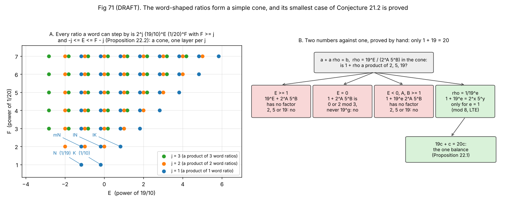

*Figure 71. A: the cone of Proposition 22.2 in the coordinates (E, F), one layer for each number j of word ratios
multiplied; N, K, mN, lN and lK marked. B: the case split of Proposition 22.1, which leaves only 1 + 19 = 20.*

### 26.4 Two numbers against one

**Proposition 22.1 (by hand).** If a + a rho = b with a, b products of 2, 5 and 19 and rho word-shaped, then rho = 1/19,
so the balance is 19c + c = 20c.

*Proof.* We need 1 + rho to be a product of 2, 5 and 19. Write rho = 19^E / (2^A 5^B) in the cone (so A >= B, and B >= 1
unless A = B = 0).
- E >= 1: then B >= 2, and 1 + rho = (19^E + 2^A 5^B)/(2^A 5^B), whose numerator has no factor 2, 5 or 19 and is more
  than 1. No.
- E = 0: then B >= 1, and the numerator 1 + 2^A 5^B is 0 or 2 mod 3 (as 2 and 5 are -1 mod 3), while a power of 19 is
  1 mod 3. No.
- E = -e < 0 with B >= 1: the numerator 1 + 19^e 2^A 5^B has no factor 2, 5 or 19 and is more than 1. No.
- rho = 1/19^e: we need 1 + 19^e = 2^x 5^y. For e even, 1 + 19^e is 2 mod 8 and 2 mod 5, so x = 1, y = 0, impossible.
  For e odd, 19^e + 1 = 20 (19^(e-1) - 19^(e-2) + ... + 1) and the second factor is a sum of e odd numbers, so odd:
  x = 2; by lifting the exponent, y = v5(19 + 1) + v5(e) = 1 + v5(e), and 5^(v5(e)) <= e. So 19^e + 1 <= 4 * 5 e = 20 e, which forces e = 1. ∎

Checked: the facts used, for e < 400 and A, B in range, and directly among 34,990 cone ratios up to 10^60 (Q2).

### 26.5 Two numbers against two

A balance a(1 + rho) = b(1 + rho') with no smaller balance inside means 1 + rho and 1 + rho' have the same fingerprint
(Section 25.3; one number each side matching is the trivial case, and 19 + 1 = 20 cannot sit inside a 2-against-2
balance, since it would leave one number against none). With rho = n/d in lowest terms, the fingerprint of 1 + rho is that
of n + d, so 2 against 2 says exactly:

  **the map rho -> fingerprint(n + d) is one-to-one on the cone** (except that rho = 1/19 gives fingerprint 1, which 22.1
  already covers).

On the layer j = 1, rho is a single word ratio, and a word with two N/K letters has psi = tau_0 (1 + rho); so on that
layer the statement is Theorem 16.2 (different two-letter words have different fingerprints), with Theorem 15.5 for the
unit case. Q3 checks that the j = 1 fingerprints are those of psi. So
2 against 2 is Theorem 16.2 extended from one layer of the cone to all of it. It is a four-term unit equation
(n + d = S (n' + d')): finite by the subspace theorem, but with no explicit bound in general. The round-16 method (a
2-adic step, Matveev's bound and lattice reduction) would handle it one layer at a time, and the case "rho = 1/(19^e 2^A
5^B)" has e unbounded and needs the two-logarithm 19-adic step of round 20 as well. That is feasible but heavy, and it
would not prove anything new about Conjecture 15.3, which round 19 already proved up to 4 letters against 4.

**Search** (`explore22.py B`): all 4,241,264 cone ratios with numerator and denominator up to 10^300 have different
fingerprints of n + d, and 1 + rho is a unit only for rho = 1/19 (Q3).

### 26.6 Three numbers on a side

A three-number side, scaled so its largest number is 1, is 1 + rho_1 + rho_1 rho_2 with rho_1, rho_2 in the cone. The
search (`explore22.py C`) took every pair with d1 d2 up to 10^35 (2,890,174 sides) and compared fingerprints against each
other and against all one- and two-number sides: 17,607 pairs share a fingerprint, and every one has a smaller balance
inside (it contains 19 + 1 = 20), so none is primitive (Q4). This adds depth to round 21's search (4 a side, numbers to
10^15) on three-number sides only.

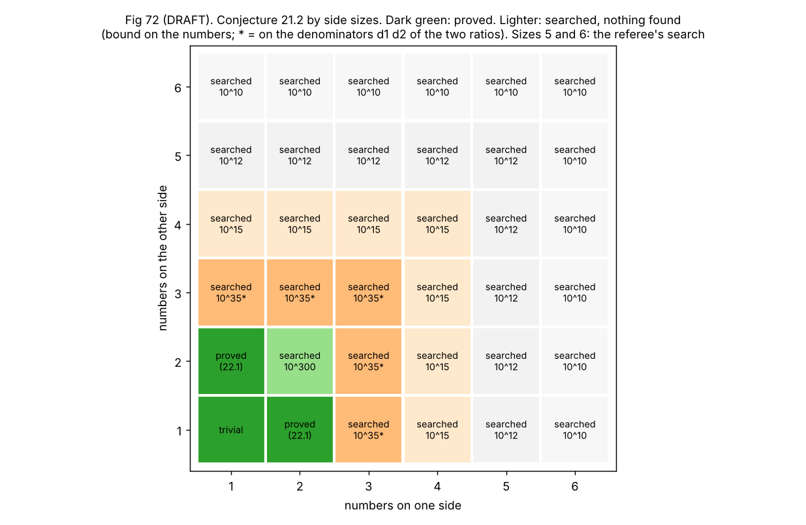

*Figure 72. Conjecture 21.2 by the sizes of its two sides. Dark green: proved (1 against 1 is trivial, 2 against 1 is
Proposition 22.1). Lighter: searched with nothing found; the label gives the bound on the numbers (* = on d1 d2). Sizes 5
and 6 are the referee's searches.*

### 26.7 Where it stops, and is it a lead?

- **Proved:** Theorem 21.5 is now independently rechecked, so all lengths really do reduce to Conjecture 21.2. Of 21.2,
  sizes (1, 1) and (2, 1) are proved by hand.
- **Not proved:** (2, 2) is a clean extension of Theorem 16.2 but needs the Baker and lattice machinery plus a 19-adic
  step; (3, *) and up are unit equations with more terms, harder at each size. A proof of every size at once needs an
  idea that sees the factor 19 or 10 at every step of a word, which neither the subspace theorem nor the 2- and 5-sizes
  supply (section 25.5).
- **Lead?** Still a modest one. The recheck makes the reduction solid, and the cone (22.2) gives the problem a simple
  shape that the next attempt can use; but nothing in this round brings an all-sizes proof closer, and it is not yet a new
  theorem about the original break.

### 26.8 Who proved what

| Piece | Who |
|---|---|
| The go-ahead to push on round 21 | **Brennan** |
| Recheck of Proposition 21.1, Lemmas 21.3 and 21.4, Theorem 21.5 and the 21.2 search, with wording fixes | Independent referee session (DRAFT), `referee22/` |
| Proposition 22.2 (the cone) | **Ours** (DRAFT), by hand, Q1; not independently refereed |
| Proposition 22.1 (2 against 1) | **Ours** (DRAFT), by hand, Q2; not independently refereed |
| 2 against 2 is Theorem 16.2 on the whole cone; searches to 10^300 and (three a side) 10^35 | **Ours** (DRAFT), computed, Q3 and Q4 |
| Theorems 15.5 and 16.2, the 19-adic step | Rounds 15, 16 and 20 |
| Lifting the exponent; the subspace theorem; Matveev's bound | Classical / published, cited only |
