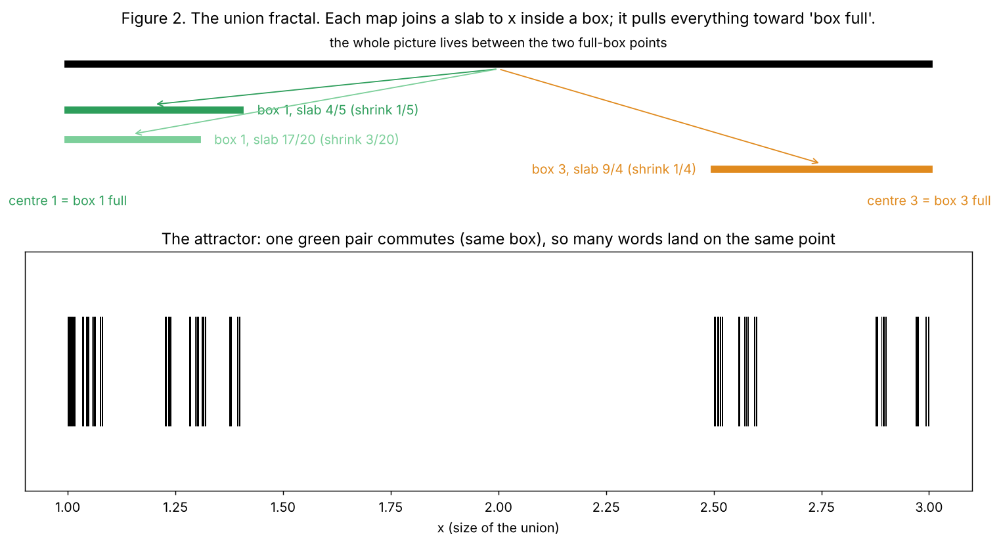

# DRAFT · What ties the new pieces together, and what we can build with them

**DRAFT, Nov 27 2026.** Part of Affine Composition Theory, built on Fused Hyperoperation Algebra. Not reviewed.
Asked for by Brennan (voice, Nov 27): "can we look at some things we've found that are kind of new and see if there's
anything that kind of ties together?", "I'm trying to see if we can build anything with the new things", and "It doesn't
have to be a North Star problem, just curious if we can do anything new, even more new … with our new stuff … in tandem."

Checks: [`checks.py`](checks.py) → [`checks_output.txt`](checks_output.txt), **24 of 24 pass** (numpy, scipy, sympy;
counts in exact rational arithmetic). Numbers: [`union_ifs.py`](union_ifs.py) → `union_ifs.json`. Pictures:
[`figures.py`](figures.py) → [`figures/`](figures/). No Lean in this pass (no Lean toolchain in this workspace).
Colour key: **green = built and tested here, blue = our earlier pieces, orange = known.**

## The answer first

**Yes, three of our new pieces snap together into something we can build: a union fractal.** Take the union rule
(k = −1 / box size, from the set-operations page), use slabs in *different* boxes, and repeat. The shared-centre entropy
rule from the chaos page then predicts the fractal's dimension exactly, and the classic formula (Moran's equation) gets
it wrong whenever two slabs share a box. We built four of these fractals and measured them; the measurements follow our
formula, not Moran's.

**Is it a lead?** A modest one, worth one more step. It is a new closed formula that turns "which maps share a centre"
into a dimension, it uses only base pieces (the dial k as box size, centres, order), and it is testable. It is not a
new mechanism: the reason it holds sits inside Hochman's 2014 theory of self-similar sets with exact overlaps. A second,
smaller build answers an open question on the Carnot page: the parabola means every heat-type engine closes in on its
limit at exactly Carnot's rate.

*Figure 1. The new pieces and how they connect. Two ties carried a build (green). One is a reading only (holographic
states always have a non-positive triple overlap). The other new pieces showed no tie worth building on this pass.*

---

## 1. The pieces we started from

Every result the repo marks "not found in print", "ours" or "maybe folklore", gathered from
[`new-facts-levers/`](../new-facts-levers/README.md) (which already lists L1 to L11), the write-ups since, and the
derived-dial catalogue Brennan asked to include.

| Piece | Where | Status in the repo |
|---|---|---|
| Union at the core: a ∘ₖ b is a union in a box, k = −1/(box size); pair dial and triple overlap | `shape-set-operations/` | ours as stated |
| E(k) = (1 + k)^(1/k) + k/(1 + k), mean draws to pass 1 | `shape-set-operations/` (L7) | general formula not found |
| Entropy of affine branches from shared centres (trace monoid) | `chaos-composition/` §6 (L11) | not found; likely folklore |
| The order dial q is an on/off switch for entropy | `chaos-composition/` §6 | ours, probably folklore |
| Heat-type low-dissipation engines on the parabola d = k²/4 − 1 | `carnot-cascade/` | ours |
| Lee–Yang on the ℓp ball (every even p proved) | `lee-yang/` (L4) | rule not found |
| Fuzzy monogamy; corner-sum thresholds | `holographic-entropy-cube/`, `new-facts-levers/` (L3, L1) | not found; thresholds are corollaries of known cones |
| Klein-bottle flow: one sweep, spin loses its sign | `klein-flow/` | one item new to us |
| Derived dials, e.g. curvature −Δ/4 (Δ = k² − 4d), zoom = dimension | `dial-audit/`, `dial-catalog/` | readings |

## 2. Build 1: the union fractal

### The construction

From the set-operations page, joining a slab of size a to a slab of size x, independently, inside a box of size M gives
a union of size

  x ∘ₖ a = a + x − a·x/M,  with k = −1/M.

As a map of x, that is a straight-line map with slope s = 1 − a/M, and it pulls everything toward one point: **x = M, the
box completely full** (check U2). That point is its centre. From the order-dial page, two such maps commute exactly when
they share a centre, which here means **the same box**; otherwise the two orders differ by a1·a2·(M1 − M2)/(M1·M2)
(check U3).

So pick a few slabs, put them in boxes, and keep joining at random. The points you can reach form a fractal.

*Figure 2. Example A: two slabs in box 1, one in box 3. Top: each map squeezes the whole range toward its own "box full"
point. Bottom: the fractal. The two box-1 maps commute, so many different words land on the same point.*

### Counting what you can reach

From the chaos page, maps that share a centre form a trace monoid, and Cartier and Foata (1969) count it: with mᵢ maps in
box i, the number of different composite maps of length n is the tⁿ coefficient of 1/μ(t), where
μ(t) = 1 + Σᵢ [(1 − t)^mᵢ − 1]. We counted the distinct composite maps exactly, as fractions, for four families up to
length 11. They match the formula every time (checks U4 to U7).

*Figure 3. Dots: distinct maps, counted exactly. Lines: the shared-centre formula. Dotted: all words. In example D only
395,033 of 4,194,304 words of length 11 give different maps.*

### The dimension formula

Weight each map by its shrink factor to the power D and run the same count. The dimension is where the weighted count
stops shrinking, which gives

  **1 + Σ over boxes [ ∏ over that box's maps (1 − sᵢ^D) − 1 ] = 0.**

With one map per box this is exactly Moran's equation Σ sᵢ^D = 1 (check U8). When two or more maps share a box it gives
a smaller number, because those maps stop creating new points when you swap their order.

*Figure 4. Left: the upper bounds D_n run straight to our formula (stars) as words get longer, not to Moran's value
(crosses). Right: box counting of the actual picture.*

| Example | Moran (ignores commuting) | Our formula D* | D_n extrapolated | Box counting |
|---|---|---|---|---|
| A: two in box 1, one in box 3 | 0.680 | **0.610** | 0.610 | 0.632 |
| B: two boxes, two maps each | 0.751 | **0.666** | 0.666 | 0.666 |
| C: three boxes, one map each | 0.618 | **0.618** | 0.618 | 0.619 |
| D: three in box 1, one in box 5 | 0.794 | **0.688** | 0.688 | 0.687 |

**What is proved and what is not.** The upper bound is proved: the fractal is covered by its images under the distinct
maps of length n, so its dimension is at most D_n for every n, and D_n falls to D* (checks U9, U10). That the dimension
*equals* D* is supported by the box counts (check U11) and is what Hochman's theorem (Annals 2014) leads one to expect,
since rational data keep distinct maps far enough apart; **we have not written out that lower-bound proof**.

*Figure 5. The commuting discount. Same slabs, same shrink factors: putting the second slab in the first slab's box
(green) instead of its own box (grey) lowers the dimension by up to about 0.1.*

### What it ties together

- **Set operations** give the maps (union in a box) and say what the centre is: the box full.
- **The order dial** says which maps commute: same box.
- **The chaos page's shared-centre rule** gives the count, and with weights, the dimension.
- **The dial audit** says the zoom is the dimension D, the one number the ratio dial r owns. So this is a recipe that
  reads the zoom off the k dial: each box is one value of k, and the pattern of how many maps share each k fixes D.
- **The q switch** fits too: the in-between amounts come in fixed steps from which maps share a box, not from a smooth
  dial.

### Is it a lead?

**A modest lead, worth one more step.** For: it is a closed formula we did not find stated, it is exact where tested,
it predicts a visible effect (the commuting discount), and it is built from base pieces only. Against: it is a special
case of a known general theory (dimension of self-similar sets is set by the semigroup the maps generate, and here that
semigroup is a trace monoid), so it adds a clean formula, not a new mechanism. Next steps, in order: (1) write the lower
bound from Hochman's theorem; (2) put the count and the upper bound in Lean; (3) try the same recipe on the full plane
laws (k and d together), where maps are Möbius rather than straight lines and commute when they share both walls.

## 3. Build 2: what "discriminant 4" means on the Carnot parabola

The Carnot page placed the heat-type low-dissipation engines (Schmiedl and Seifert's η_C/(2 − γη_C)) on the parabola
d = k²/4 − 1 and left one question open: does "discriminant 4" mean anything physical? Read with the curvature dial from
the derived-dial catalogue, −Δ/4, the parabola is the leaf of **curvature exactly −1** (check C1).

That has a plain physical meaning. In the cascade coordinate β = ln(T_hot/T_cold), each of these efficiencies obeys
dη/dβ = ½(1 + kη + dη²) (check C2), and near its limit the gap closes at rate ½√Δ (check C5). With Δ = 4 that rate is 1,
so **every heat-type engine closes in on its limit like e^(−β), the same rate at which Carnot's waste fraction T_cold/T_hot
shrinks** (check C3). Curzon–Ahlborn sits at curvature −1/4 and closes at half that rate (check C4).

*Figure 6. Left: the heat-type engines run along the curvature −1 leaf from parity to velocity addition. Right: their
gaps all fall at Carnot's rate (dashed); Curzon–Ahlborn falls at half rate (dotted).*

**Is it a lead?** No, but it closes the Carnot page's open question with a clear statement: discriminant 4 is "Carnot
speed". It is two lines of calculus once the parabola is known.

## 4. Pairs we looked at that didn't build

- **Fuzzy monogamy with the pair dial.** Read entropies as sizes: each pair of regions gets a pair dial
  k = −I(A:B)/(S_A·S_B), and the triple overlap is the tripartite information I₃. Monogamy then says geometric states
  always have a non-positive triple overlap, so their three-way union never exceeds the one-dial prediction. That is a
  restatement of monogamy (Hayden, Headrick and Maloney 2013), not a new constraint. Reading only.
- **Chaos entropy with the Lee–Yang dial gas.** The shared-centre polynomial μ(t) is the dial gas at k = 0 on the
  "doesn't commute" graph, so its smallest root is a hard-core gas zero. That root is known to be real and dominant
  (Scott and Sokal 2005, cited from memory), so the tie organises but predicts nothing here.
- **Lee–Yang, Klein flow, why-i, E(k).** Each pair shares a theme (sign flips, stopping times) but no construction used
  two of them at once on this pass.

## Assumptions

- Union maps use rational slabs and boxes; distinct composites were counted exactly to length 11 (four families).
- The dimension formula assumes different words give different maps unless commuting forces equality. The chaos page
  showed this can fail at special slopes (an accidental collision at slopes 1/2, 1/3, 1/5); the examples here were
  checked exactly and have none.
- Box counting uses the images of the box-full points under all length-11 maps, at 6 middle scales; it is an estimate.
- The Carnot reading uses the heat-type family exactly as on the Carnot page.

## Known vs new

| Item | Status | Source |
|---|---|---|
| Union in a box, k = −1/M | Ours as stated | `shape-set-operations/` |
| Affine maps commute iff they share a centre | Known | `order-dial/` |
| Trace monoid count, Cartier–Foata polynomial | Known | Cartier and Foata 1969 |
| Exact overlaps and dimension of self-similar sets | Known | Hochman, Annals of Math. 180 (2014); Ngai and Wang 2001 |
| Moran's equation | Known | Moran 1946 |
| Dimension formula 1 + Σ[∏(1 − sᵢ^D) − 1] = 0 for maps sharing centres in classes | **Not found in print** (two searches); upper bound proved here, equality numerical | this page, checks U1–U11 |
| The commuting discount (Figure 5) | Ours, numerical consequence of the formula | this page |
| Heat-type engines' gap closes at rate e^(−β); discriminant 4 = curvature −1 | Ours; two lines from known forms | this page, checks C1–C5; Schmiedl and Seifert 2008 |
| Monogamy as a non-positive triple overlap | Known (restatement) | Hayden, Headrick, Maloney 2013 |

Searches run (Nov 27): self-similar sets with commuting homotheties and exact overlaps; dimension with Möbius functions
or Cartier–Foata. They found Hochman's work and the exact-overlaps literature, nothing on this class with this formula.

- Hochman, "On self-similar sets with overlaps and inverse theorems for entropy": https://arxiv.org/pdf/1212.1873
- Hochman, ICM survey "Dimension theory of self-similar sets and measures": https://math.huji.ac.il/~mhochman/preprints/icm-4.pdf
