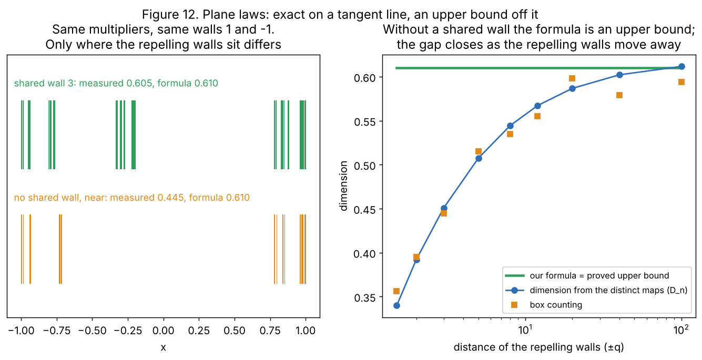

# DRAFT · What ties the new pieces together, and what we can build with them

**DRAFT, Nov 27 2026.** Part of Affine Composition Theory, built on Fused Hyperoperation Algebra. Not reviewed.
Asked for by Brennan (voice, Nov 27): "can we look at some things we've found that are kind of new and see if there's
anything that kind of ties together?", "I'm trying to see if we can build anything with the new things", and "It doesn't
have to be a North Star problem, just curious if we can do anything new, even more new … with our new stuff … in tandem."

Checks: [`checks.py`](checks.py) → [`checks_output.txt`](checks_output.txt), **24 of 24 pass** (numpy, scipy, sympy;
counts in exact rational arithmetic). Numbers: [`union_ifs.py`](union_ifs.py) → `union_ifs.json`. Pictures:
[`figures.py`](figures.py) → [`figures/`](figures/). No Lean in this pass (no Lean toolchain in this workspace).
Colour key: **green = built and tested here, blue = our earlier pieces, orange = known.**

## The answer first

**Yes, three of our new pieces snap together into something we can build: a union fractal.** Take the union rule
(k = −1 / box size, from the set-operations page), use slabs in *different* boxes, and repeat. The shared-centre entropy
rule from the chaos page then predicts the fractal's dimension exactly, and the classic formula (Moran's equation) gets
it wrong whenever two slabs share a box. We built four of these fractals and measured them; the measurements follow our
formula, not Moran's.

**Is it a lead?** A modest one, worth one more step. *Round 2 (section 5): now a theorem on the line, holds in the plane numerically, and fits learning rules and moving averages.* It is a new closed formula that turns "which maps share a centre"
into a dimension, it uses only base pieces (the dial k as box size, centres, order), and it is testable. It is not a
new mechanism: the reason it holds sits inside Hochman's 2014 theory of self-similar sets with exact overlaps. A second,
smaller build answers an open question on the Carnot page: the parabola means every heat-type engine closes in on its
limit at exactly Carnot's rate.

*Figure 1. The new pieces and how they connect. Two ties carried a build (green). One is a reading only (holographic
states always have a non-positive triple overlap). The other new pieces showed no tie worth building on this pass.*

---

## 1. The pieces we started from

Every result the repo marks "not found in print", "ours" or "maybe folklore", gathered from
[`new-facts-levers/`](../new-facts-levers/README.md) (which already lists L1 to L11), the write-ups since, and the
derived-dial catalogue Brennan asked to include.

| Piece | Where | Status in the repo |
|---|---|---|
| Union at the core: a ∘ₖ b is a union in a box, k = −1/(box size); pair dial and triple overlap | `shape-set-operations/` | ours as stated |
| E(k) = (1 + k)^(1/k) + k/(1 + k), mean draws to pass 1 | `shape-set-operations/` (L7) | general formula not found |
| Entropy of affine branches from shared centres (trace monoid) | `chaos-composition/` §6 (L11) | not found; likely folklore |
| The order dial q is an on/off switch for entropy | `chaos-composition/` §6 | ours, probably folklore |
| Heat-type low-dissipation engines on the parabola d = k²/4 − 1 | `carnot-cascade/` | ours |
| Lee–Yang on the ℓp ball (every even p proved) | `lee-yang/` (L4) | rule not found |
| Fuzzy monogamy; corner-sum thresholds | `holographic-entropy-cube/`, `new-facts-levers/` (L3, L1) | not found; thresholds are corollaries of known cones |
| Klein-bottle flow: one sweep, spin loses its sign | `klein-flow/` | one item new to us |
| Derived dials, e.g. curvature −Δ/4 (Δ = k² − 4d), zoom = dimension | `dial-audit/`, `dial-catalog/` | readings |

## 2. Build 1: the union fractal

### The construction

From the set-operations page, joining a slab of size a to a slab of size x, independently, inside a box of size M gives
a union of size

  x ∘ₖ a = a + x − a·x/M,  with k = −1/M.

As a map of x, that is a straight-line map with slope s = 1 − a/M, and it pulls everything toward one point: **x = M, the
box completely full** (check U2). That point is its centre. From the order-dial page, two such maps commute exactly when
they share a centre, which here means **the same box**; otherwise the two orders differ by a1·a2·(M1 − M2)/(M1·M2)
(check U3).

So pick a few slabs, put them in boxes, and keep joining at random. The points you can reach form a fractal.

*Figure 2. Example A: two slabs in box 1, one in box 3. Top: each map squeezes the whole range toward its own "box full"
point. Bottom: the fractal. The two box-1 maps commute, so many different words land on the same point.*

### Counting what you can reach

From the chaos page, maps that share a centre form a trace monoid, and Cartier and Foata (1969) count it: with mᵢ maps in
box i, the number of different composite maps of length n is the tⁿ coefficient of 1/μ(t), where
μ(t) = 1 + Σᵢ [(1 − t)^mᵢ − 1]. We counted the distinct composite maps exactly, as fractions, for four families up to
length 11. They match the formula every time (checks U4 to U7).

*Figure 3. Dots: distinct maps, counted exactly. Lines: the shared-centre formula. Dotted: all words. In example D only
395,033 of 4,194,304 words of length 11 give different maps.*

### The dimension formula

Weight each map by its shrink factor to the power D and run the same count. The dimension is where the weighted count
stops shrinking, which gives

  **1 + Σ over boxes [ ∏ over that box's maps (1 − sᵢ^D) − 1 ] = 0.**

With one map per box this is exactly Moran's equation Σ sᵢ^D = 1 (check U8). When two or more maps share a box it gives
a smaller number, because those maps stop creating new points when you swap their order.

*Figure 4. Left: the upper bounds D_n run straight to our formula (stars) as words get longer, not to Moran's value
(crosses). Right: box counting of the actual picture.*

| Example | Moran (ignores commuting) | Our formula D* | D_n extrapolated | Box counting |
|---|---|---|---|---|
| A: two in box 1, one in box 3 | 0.680 | **0.610** | 0.610 | 0.632 |
| B: two boxes, two maps each | 0.751 | **0.666** | 0.666 | 0.666 |
| C: three boxes, one map each | 0.618 | **0.618** | 0.618 | 0.619 |
| D: three in box 1, one in box 5 | 0.794 | **0.688** | 0.688 | 0.687 |

**What is proved and what is not.** The upper bound is proved: the fractal is covered by its images under the distinct
maps of length n, so its dimension is at most D_n for every n, and D_n falls to D* (checks U9, U10). That the dimension
*equals* D* is supported by the box counts (check U11) and is what Hochman's theorem (Annals 2014) leads one to expect,
since rational data keep distinct maps far enough apart. *Round 2 (section 5) writes that lower bound out.*

*Figure 5. The commuting discount. Same slabs, same shrink factors: putting the second slab in the first slab's box
(green) instead of its own box (grey) lowers the dimension by up to about 0.1.*

### What it ties together

- **Set operations** give the maps (union in a box) and say what the centre is: the box full.
- **The order dial** says which maps commute: same box.
- **The chaos page's shared-centre rule** gives the count, and with weights, the dimension.
- **The dial audit** says the zoom is the dimension D, the one number the ratio dial r owns. So this is a recipe that
  reads the zoom off the k dial: each box is one value of k, and the pattern of how many maps share each k fixes D.
- **The q switch** fits too: the in-between amounts come in fixed steps from which maps share a box, not from a smooth
  dial.

### Is it a lead?

**A modest lead, worth one more step.** For: it is a closed formula we did not find stated, it is exact where tested,
it predicts a visible effect (the commuting discount), and it is built from base pieces only. Against: it is a special
case of a known general theory (dimension of self-similar sets is set by the semigroup the maps generate, and here that
semigroup is a trace monoid), so it adds a clean formula, not a new mechanism. Next steps, in order: (1) write the lower
bound from Hochman's theorem; (2) put the count and the upper bound in Lean; (3) try the same recipe on the full plane
laws (k and d together), where maps are Möbius rather than straight lines and commute when they share both walls.

## 3. Build 2: what "discriminant 4" means on the Carnot parabola

The Carnot page placed the heat-type low-dissipation engines (Schmiedl and Seifert's η_C/(2 − γη_C)) on the parabola
d = k²/4 − 1 and left one question open: does "discriminant 4" mean anything physical? Read with the curvature dial from
the derived-dial catalogue, −Δ/4, the parabola is the leaf of **curvature exactly −1** (check C1).

That has a plain physical meaning. In the cascade coordinate β = ln(T_hot/T_cold), each of these efficiencies obeys
dη/dβ = ½(1 + kη + dη²) (check C2), and near its limit the gap closes at rate ½√Δ (check C5). With Δ = 4 that rate is 1,
so **every heat-type engine closes in on its limit like e^(−β), the same rate at which Carnot's waste fraction T_cold/T_hot
shrinks** (check C3). Curzon–Ahlborn sits at curvature −1/4 and closes at half that rate (check C4).

*Figure 6. Left: the heat-type engines run along the curvature −1 leaf from parity to velocity addition. Right: their
gaps all fall at Carnot's rate (dashed); Curzon–Ahlborn falls at half rate (dotted).*

**Is it a lead?** No, but it closes the Carnot page's open question with a clear statement: discriminant 4 is "Carnot
speed". It is two lines of calculus once the parabola is known.

## 4. Pairs we looked at that didn't build

- **Fuzzy monogamy with the pair dial.** Read entropies as sizes: each pair of regions gets a pair dial
  k = −I(A:B)/(S_A·S_B), and the triple overlap is the tripartite information I₃. Monogamy then says geometric states
  always have a non-positive triple overlap, so their three-way union never exceeds the one-dial prediction. That is a
  restatement of monogamy (Hayden, Headrick and Maloney 2013), not a new constraint. Reading only.
- **Chaos entropy with the Lee–Yang dial gas.** The shared-centre polynomial μ(t) is the dial gas at k = 0 on the
  "doesn't commute" graph, so its smallest root is a hard-core gas zero. That root is known to be real and dominant
  (Scott and Sokal 2005, cited from memory), so the tie organises but predicts nothing here.
- **Lee–Yang, Klein flow, why-i, E(k).** Each pair shares a theme (sign flips, stopping times) but no construction used
  two of them at once on this pass.

## Assumptions

- Union maps use rational slabs and boxes; distinct composites were counted exactly to length 11 (four families).
- The dimension formula assumes different words give different maps unless commuting forces equality. The chaos page
  showed this can fail at special slopes (an accidental collision at slopes 1/2, 1/3, 1/5); the examples here were
  checked exactly and have none.
- Box counting uses the images of the box-full points under all length-11 maps, at 6 middle scales; it is an estimate.
- The Carnot reading uses the heat-type family exactly as on the Carnot page.

## Known vs new

| Item | Status | Source |
|---|---|---|
| Union in a box, k = −1/M | Ours as stated | `shape-set-operations/` |
| Affine maps commute iff they share a centre | Known | `order-dial/` |
| Trace monoid count, Cartier–Foata polynomial | Known | Cartier and Foata 1969 |
| Exact overlaps and dimension of self-similar sets | Known | Hochman, Annals of Math. 180 (2014); Ngai and Wang 2001 |
| Moran's equation | Known | Moran 1946 |
| Dimension formula 1 + Σ[∏(1 − sᵢ^D) − 1] = 0 for maps sharing centres in classes | **Not found in print** (two searches); upper bound proved here, equality numerical | this page, checks U1–U11 |
| The commuting discount (Figure 5) | Ours, numerical consequence of the formula | this page |
| Heat-type engines' gap closes at rate e^(−β); discriminant 4 = curvature −1 | Ours; two lines from known forms | this page, checks C1–C5; Schmiedl and Seifert 2008 |
| Monogamy as a non-positive triple overlap | Known (restatement) | Hayden, Headrick, Maloney 2013 |

Searches run (Nov 27): self-similar sets with commuting homotheties and exact overlaps; dimension with Möbius functions
or Cartier–Foata. They found Hochman's work and the exact-overlaps literature, nothing on this class with this formula.

- Hochman, "On self-similar sets with overlaps and inverse theorems for entropy": https://arxiv.org/pdf/1212.1873
- Hochman, ICM survey "Dimension theory of self-similar sets and measures": https://math.huji.ac.il/~mhochman/preprints/icm-4.pdf

---

## 5. Round 2: more rigorous, and more places it applies (DRAFT)

Asked for by Brennan (voice, Nov 27): "let's just keep looking at this and seeing if we can make it more rigorous and
more useful", "when I say more useful, more applicable to other scenarios."

Checks: [`checks2.py`](checks2.py) → [`checks2_output.txt`](checks2_output.txt), **22 of 22 pass**. Numbers:
[`round2.py`](round2.py) → `round2.json`. Pictures: [`figures2.py`](figures2.py). Lean:
[`lean/NewTies.lean`](lean/NewTies.lean), 10 theorems (12 after round 3), core Lean, no `sorry`, **not compiled here** (the Lean download
is blocked in this workspace); it needs a compile in the shared library before anyone counts it.

### The result in plain words

**On the line the formula is now a theorem.** For straight-line shrinking maps with rational (or algebraic) numbers and
no accidental collisions, the fractal's dimension is exactly the smaller of 1 and our D*: the upper bound needs nothing,
and the lower bound comes from a free piece of the fractal plus Hochman's 2014 theorem. **It carries over** to maps that
flip, to turning maps in the plane (numerically), and its counting part to the plane laws (k, d). **One real scenario
fits it exactly:** Rescorla–Wagner learning, and any moving average with several rates, where same-target updates
commute and the learner forgets their order. Still a modest lead: a clean, now-rigorous tool with real uses, not a new
mechanism.

### 5.1 The theorem

**Setting.** Maps fᵢ(x) = cᵢ + sᵢ(x − cᵢ) on the line with 0 < |sᵢ| < 1, sorted into classes by centre (a union in a box is
the case cᵢ = box size, sᵢ = 1 − slab/box). Write Pⱼ(D) = ∏ over class j of (1 − |sᵢ|^D) and
μ(D) = 1 + Σⱼ [Pⱼ(D) − 1]. D* is the root of μ(D) = 0 (at least two classes; one class gives a single point).

**Theorem.** (a) dim K ≤ min(1, D*), always. (b) If every cᵢ and sᵢ is algebraic (for example rational) and different
shared-centre words never give the same map (no accidental collisions), then dim K = min(1, D*).

**Proof of (a).** Maps with one centre commute (Lean `same_centre_commute`), so every word equals a word of the trace
monoid. Weighted Cartier–Foata: Σ over traces g of |s_g|^D·tⁿ⁽ᵍ⁾ = 1/μ_D(t), with μ_D(t) = 1 + Σⱼ[∏(1 − t|sᵢ|^D) − 1].
Each Pⱼ(D) grows with D, so for D > D* we have μ_D(1) > 0; μ_D(t) falls as t grows, so it stays positive on [0, 1] and
the series converges at t = 1. Its tail at length n goes to 0, and the length-n images cover K, so the D-dimensional
measure of K is 0. Hence dim K ≤ D for every D > D*. Collisions only shrink the cover, so (a) needs no assumption.

**Proof of (b), lower bound.** Single out class 1. Let N be the monoid of the other classes, and let S be the set of words
u·v with u a nonempty word in class 1 and v a nonempty element of N. Every element built from S splits uniquely at its
class-1 blocks (normal form in a free product), so S generates a **free** monoid. Take the finitely many generators S_L
up to length L. With no accidental collisions, the IFS S_L has no exact overlaps; its numbers are algebraic; so by
Hochman's theorem (Annals of Math. 180, 2014: on the line, algebraic parameters and no exact overlaps give
dim = min(1, similarity dimension)) its attractor has dimension min(1, s_L), where Σ over S_L of |s_g|^(s_L) = 1. That
attractor sits inside K. As L grows the sum fills out to (1/P₁ − 1)(1/Q − 1), with Q = 1 + Σ_{j≥2}(Pⱼ − 1) from Cartier–Foata
for N (it converges at D* because Q(D*) = 1 − P₁(D*) > 0). Setting it to 1 is the same as P₁ + Q = 1 (Lean
`lower_bound_key`), which is μ(D) = 0. So s_L rises to D*, and dim K ≥ min(1, D*). ∎

*Figure 7. The squeeze, computed. Lower bounds from the free piece (solid) climb and upper bounds (dashed) fall onto the
same line. At L = 10 every lower bound is within 0.0001 of D*. The free piece was checked exactly: e.g. 15,625
words of its generators give 15,625 different maps.*

**What the hypothesis costs.** "No accidental collisions" can fail at special numbers (the chaos page found one at
slopes 1/2, 1/3, 1/5; this round found one among Möbius maps at length 4, check G5). For given rational numbers it can
be checked exactly up to any length, but not for all lengths at once. Kittle and Kogler (2026, reported in search
results, not read) claim the exact-overlaps conjecture on the line, which would remove the "algebraic" condition.

### 5.2 Where it holds

*Figure 9. Green: proved. Blue: numerical. Orange/grey: the formula does not apply as it stands.*

- **Flips (slopes below 0, past the wall).** Nothing changes: use |s|. Count and upper bound checked (G1, G2).
- **The plane.** Turning-and-shrinking maps z ↦ c + λ(z − c) with complex λ commute exactly when they share a centre, so
  the same count and formula hold with |λ| in place of s and min(2, D*) as the cap. Upper bound proved the same way;
  the lower bound needs Hochman's higher-dimensional theorem, whose extra conditions we haven't checked. Numerically it
  fits (Figure 8): D* = 1.191, box counting 1.194, Moran 1.251.
- **Plane laws (k, d).** Each law's maps are Möbius maps fixing that law's two walls, so maps from one law commute and
  the count is the same shared-centre count (G6, two examples). The dimension is not given by this closed formula,
  because Möbius maps don't shrink by one fixed factor; it needs Bowen's equation with derivatives. Open.
- **Commuting that isn't by classes.** For straight-line maps, "commute" is always "same centre", so classes are all
  there is. Maps that commute without being classes (e.g. acting on separate coordinates) need the general
  Cartier–Foata polynomial over the commuting graph; not done.

*Figure 8. Left: the plane version, four maps about three centres; two share centre 0 and one of those also turns.
Right: the dimension follows our formula, not Moran's.*

### 5.3 A real scenario: learning rules and moving averages

The Rescorla–Wagner rule (psychology's standard model of conditioning, also the "delta rule" of machine learning) updates
an associative strength by V ← V + rate·(target − V). That is a stretch about the target with slope 1 − rate: our maps
exactly, with the target as the centre. Trials that aim at the same target commute, whatever their rates; trials aiming
at different targets don't. The same holds for any exponential moving average whose smoothing rate changes.

We tested three trial types: reward with a bright cue (rate 0.8), reward with a dim cue (rate 0.85), no reward
(rate 0.75). Counted exactly: after 11 trials the learner can be in only 46,368 different states, out of 177,147 trial
histories (every other Fibonacci number, S1). So **the learner's state can carry at most 1.39 bits of history per trial,
not log₂3 = 1.58**, and with trials in random order it keeps about 1.28 bits per trial (S2). The reachable strengths
form a fractal of dimension 0.610.

*Figure 10. Left: different learned strengths (exact) against trial histories. Right: bits of history the state can
carry per trial.*

**Why it's useful.** It gives a closed answer to "how much of its past can a moving average or delta-rule learner
remember, and how finely must you read its state to recover it", and it says what helps: giving each update its own
target restores order information; varying only the rate does not. That the order of same-target updates is lost is
elementary; the exact count and the dimension are what the formula adds.

### 5.4 Lead or not

**A modest lead, now on firmer ground.** For: a real theorem on the line (given Hochman), the same picture in the plane,
the counting part for every plane law, and a scenario where it applies exactly. Against: the mechanism is Hochman's and
Cartier–Foata's; ours is the closed formula, the free-piece proof and the reading. Next, if wanted: (1) compile the Lean
file; (2) the plane lower bound via Hochman's higher-dimensional theorem; (3) Bowen's equation for the plane laws, to see
whether the shared-centre count still sets a clean dimension there.

### Known vs new, round 2

| Item | Status | Source |
|---|---|---|
| Hochman's theorem: algebraic parameters, no exact overlaps ⇒ dim = min(1, s-dim) | Known | Hochman 2014 (as stated in his ICM survey) |
| Normal form in free products; Cartier–Foata weighted count | Known | standard; Cartier and Foata 1969 |
| Theorem: dim K = min(1, D*) for shared-centre classes (algebraic, no accidental collisions) | **Not found in print**; our proof from known pieces | this page, L1–L4 |
| Plane version, counting for plane laws | Ours; plane dimension numerical | G3–G6 |
| Rescorla–Wagner as stretches about the target | Known form (Rescorla and Wagner 1972) | — |
| Exact state count and bits-per-trial for mixed-rate learners | Ours (as stated); elementary consequence | S1–S3 |
| Exact-overlaps conjecture on the line | Reported proved, not checked | Kittle and Kogler 2026 (arXiv:2610.10511, from a search result) |

---

## 6. Round 3 (DRAFT): the plane laws, which ones keep the formula

Brennan asked to work out the dimension for the plane laws (k, d) next. This section does that. Everything here is
DRAFT. The checks are in `checks3.py` (18/18 pass, output in `checks3_output.txt`), the numbers in `planelaws.py`
and `planelaws_sweep.py`, the pictures in `figures3.py`.

### 6.1 The answer in two sentences

Laws that share a wall lie on one straight line in the (k, d) plane, and that line touches the border d = k²/4. When all
the maps share their repelling wall (they sit on one such tangent line), the union fractal straightens out into the line
case and the formula D* is exact; when they don't, D* is still a proved upper bound, and the true dimension is lower,
climbing back toward D* as the repelling walls move away.

### 6.2 The setup

A plane law with dials k, d combines a and x as x ↦ (x + a + k·a·x)/(1 − d·a·x). For fixed a that is a Möbius map, matrix
[[1 + k·a, a], [−d·a, 1]]. Its two fixed points, the **walls**, are the roots of d·x² + k·x + 1 = 0, the same for every a.
So every map of one law has the same two walls, one attracting and one repelling. That is the plane-law version of a
shared centre: maps of one law commute, maps of different laws don't (unless they share both walls).

The union rule of rounds 1–2 is the line d = 0, where one wall has gone off to infinity.

### 6.3 Tangent lines (new reading)

Fix a wall w. The laws that have w as a wall are the (k, d) with d·w² + k·w + 1 = 0, a straight line. That line touches
the border d = k²/4 (where the two walls merge) at exactly one point, k = −2/w, d = 1/w² (T1, and Lean `wall_line_tangent`:
k²w² + 4kw + 4 = (kw + 2)²). So:

- **Each wall is a tangent line of the border.** Every law off the border sits on two tangent lines, one for each wall.
- The d = 0 axis is the tangent line "at infinity": the affine laws all share the wall ∞. That is why the line case works.
- Velocity addition (k = 0, d = 1) and the union rule in the unit box (k = −1, d = 0) both lie on the tangent line for the
  wall 1 (T3).

*Figure 11. The (k, d) plane. Grey curve: the border d = k²/4. Coloured lines: laws sharing the wall w, one line per w,
each touching the border once. The horizontal axis d = 0 is the shared wall ∞ (the affine case).*

### 6.4 Result P1: on a common tangent line, the formula is exact

**Statement (DRAFT, ours).** Take several plane laws that share their repelling wall w, with distinct attracting walls,
and any number of maps per law. Change coordinates by y = 1/(x − w). Every map becomes a straight-line map, and its slope
is its multiplier at its attracting wall (T4–T5, exact fractions). So the union fractal is exactly a round-2 union
fractal on the line, and its dimension is min(1, D*) with D* computed from the multipliers, under the same hypothesis as
round 2 (algebraic parameters, no accidental collisions).

**Why.** In the y coordinate the shared wall w goes to ∞, so every map fixes ∞
and is affine. This is standard; what's ours is reading it on the dial plane as "lie on one tangent line".

**Check.** Two laws with repelling wall 3 and attracting walls 1 and −1; the first law gives two maps (multipliers 1/5 and 3/20), the second one map (multiplier 1/4): box count 0.605 vs D* 0.610 (T7). The
cruder bound from the largest derivative gives 0.95 (T8), so the straightening is doing real work.

### 6.5 Result P2: off a common tangent, D* is an upper bound

**Statement (DRAFT, ours).** Take plane laws with different repelling walls. Suppose each law's repelling wall lies
outside the convex hull of all the attracting walls (beyond its own attracting wall). Then on that hull every map
contracts by at most its multiplier at its attracting wall, so dim ≤ min(1, D*) (T10, from
f′(x) = λ·(f(x) − q)² / (x − q)², with q the repelling wall).

The count of distinct composites is still the shared-centre count from round 1 (T6, T9), so only the sizes change, not
the combinatorics. The true dimension is the critical exponent of the Poincaré series over the trace monoid (Bowen's
equation). There is no closed form; we computed it.

| Repelling walls | Measured dim (box) | Poincaré estimate D_n | D* (upper bound) |
|---|---|---|---|
| ±2 | 0.395 | 0.396 | 0.610 |
| ±3 | 0.445 | 0.454 | 0.610 |
| ±12 | 0.555 | 0.568 | 0.610 |
| shared (3) | 0.605 | — | 0.610 |

Sweep (T12): same maps, first law repelling from q and second from −q, D_n = 0.340, 0.392, 0.451, 0.507, 0.545, 0.567, 0.587, 0.602, 0.612 for
q = 1.5, 2, 3, 5, 8, 12, 20, 40, 100. It climbs to D* as the walls move to infinity, which is the line case again.

*Figure 12. Left: two union fractals with the same multipliers and the same attracting walls 1 and −1. Top: both laws
repel from 3 (shared wall, formula exact). Bottom: they repel from 3 and −3 (no shared wall, smaller). Right: dimension
against how far the repelling walls ±q are, rising toward the formula's value, which is the upper bound.*

### 6.6 What this means in plain terms

The shared-centre count (how many different results you can get) works for every plane law. The size formula works
exactly when everything is pushed away from one common point, which on the dial map means "all on one tangent line". When
the maps are pulled toward different points, the pieces bend and get smaller than the formula says, by an amount that
depends on how close those points are. The formula is then a ceiling, not the answer.

### 6.7 Lean

Two more identities are in `lean/NewTies.lean`: `fixes_wall` (the map fixes w exactly when d·w² + k·w + 1 = 0) and
`wall_line_tangent` (the wall line touches the border). That makes 12 theorems in the file. **Still not compiled**: the
Lean download is blocked here, and the file has no Mathlib import, so the repo CI (which builds Mathlib files) may skip it: build it by hand with `lean lean/NewTies.lean`.

### 6.8 Lead or not

**The lead continues, modestly.** For: a clean, checkable classification of which plane laws keep the formula (exact on a
common tangent line, upper bound off it), and the tangent-line picture is a new and simple way to read the (k, d) map.
Against: the straightening is a standard Möbius fact, and off the tangent line there is no closed formula, only a bound
and numbers. Next, if wanted: (1) prove the lower bound off the tangent line (it needs a nonlinear version of Hochman's
theorem, which exists for some analytic families); (2) the plane lower bound for complex similarities.

### Known vs new, round 3

| Item | Status | Source |
|---|---|---|
| Möbius maps with a common fixed point conjugate to affine maps | Known | standard |
| Bowen's equation / Poincaré critical exponent for conformal IFS | Known | Bowen 1979; Mauldin and Urbański |
| Laws sharing a wall lie on a tangent line of d = k²/4 | **Ours** (elementary) | T1, `wall_line_tangent` |
| P1: exact formula on a common tangent line | **Ours** (from round 2 + standard conjugation) | T4–T7 |
| P2: D* upper bound off the tangent line, numbers and sweep | **Ours** (bound proved, values numerical) | T9–T12 |
