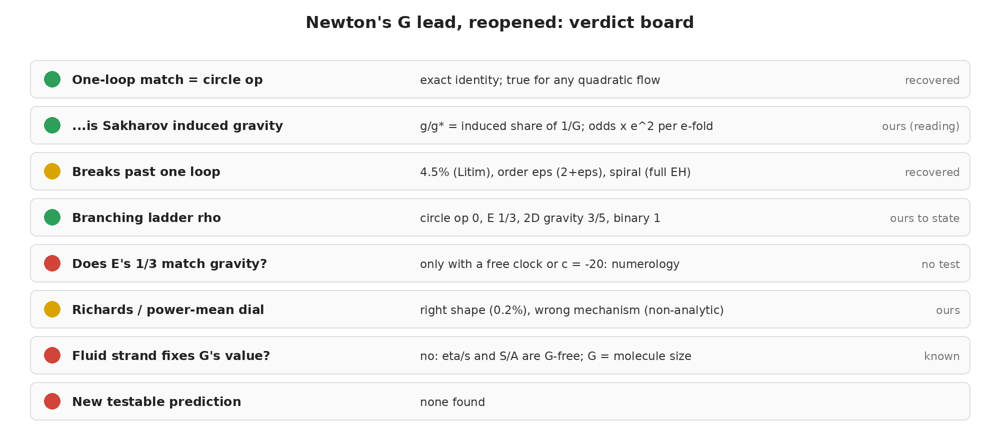
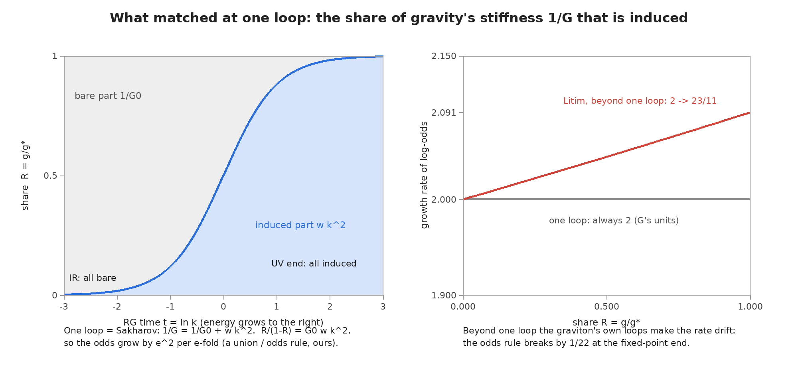
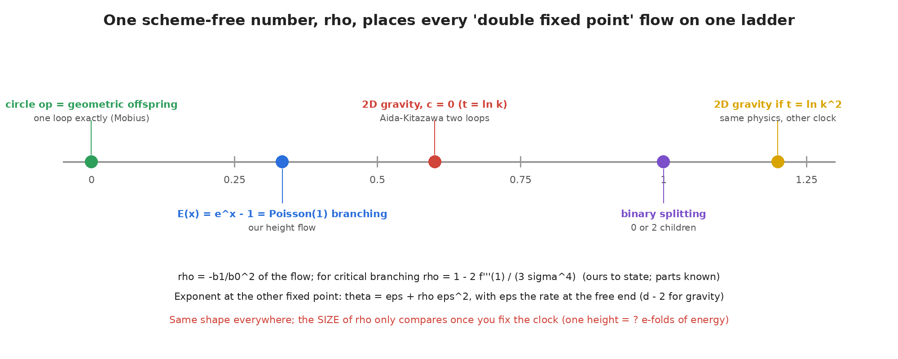
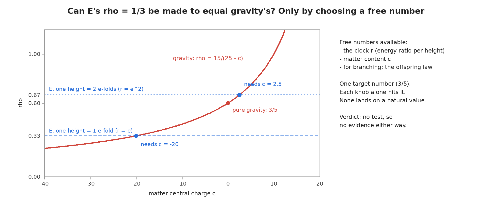
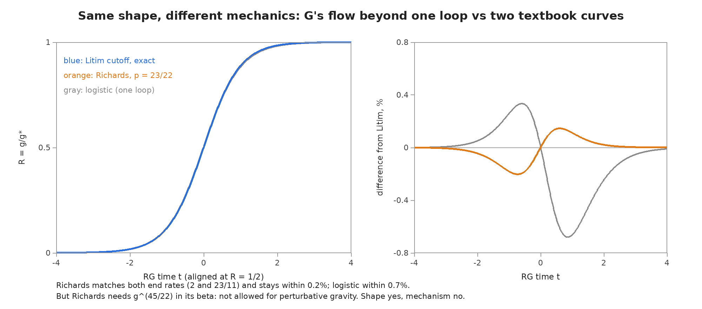
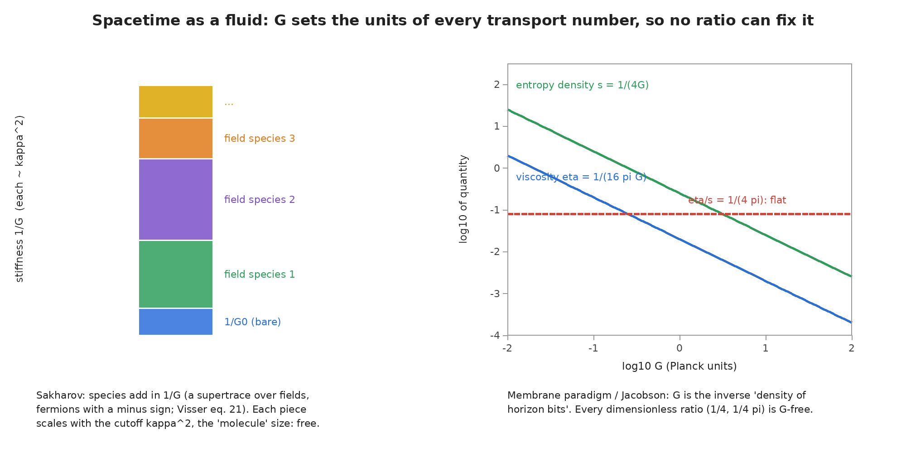
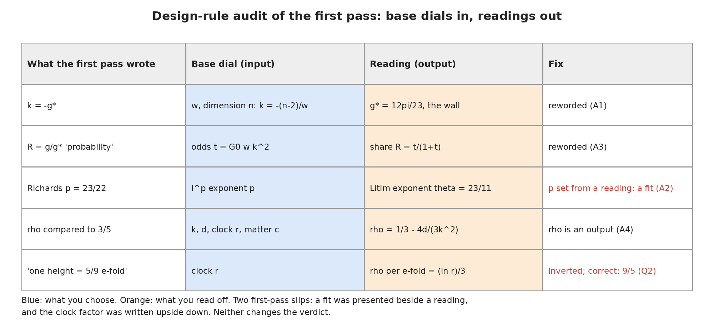
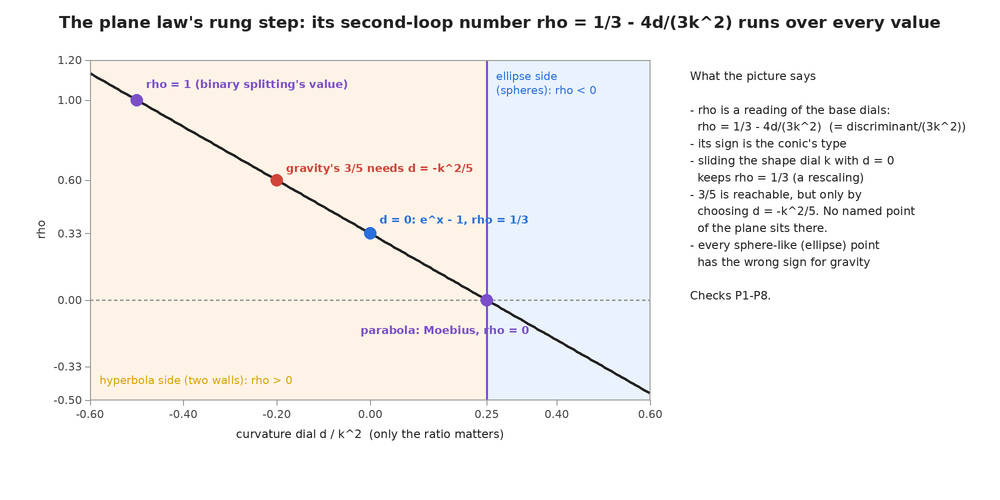
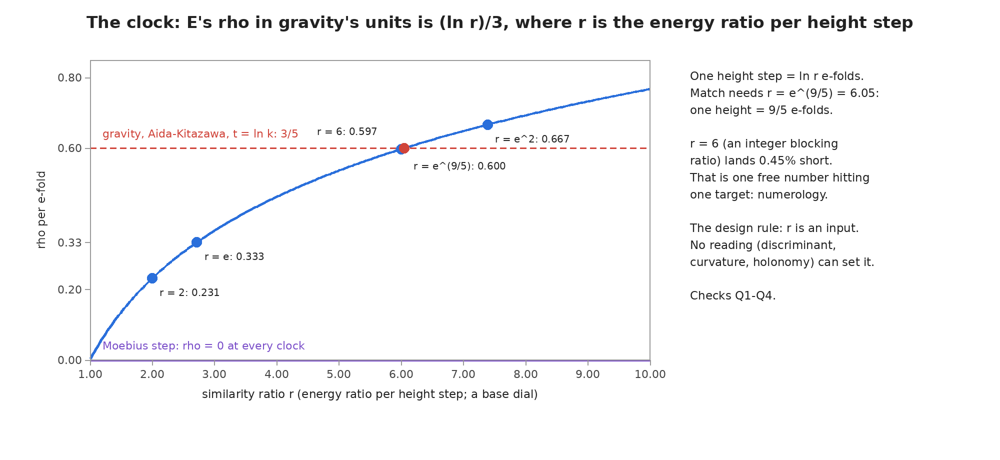
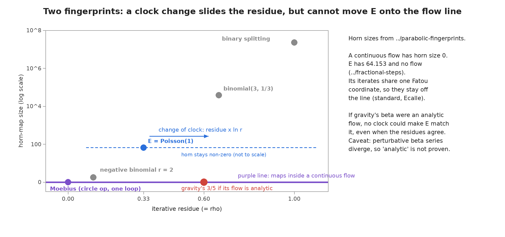

# DRAFT · Newton's G lead, reopened

*Nov 25, 2026. Brennan reopened the G lead ("I'd like to start following them, including the G lead"), added that he is looking for "a math that has the same shape, not necessarily a direct underlying identical mechanic", and asked for a strand treating spacetime as a fluid with G as one of its coefficients. Checks: `checks.py`, **23/23 pass** (`checks_output.txt`, numpy only). Pictures: `figures.py` → `figures/n1`–`n6`. **Second look, Nov 26** (Brennan: "let's take a look and use the new tools that we have added since this work was done"): section 7, `checks2.py` **21/21 pass**, `figures2.py` → `figures/n7`–`n10`. Shared code: `gshapes.py`. Earlier work this builds on: [asymptotic-safety](../why-i/e-i-pi/asymptotic-safety/README.md), [beyond-one-loop](../why-i/e-i-pi/asymptotic-safety/beyond-one-loop/README.md), [height-dial](../why-i/e-i-pi/asymptotic-safety/beyond-one-loop/height-dial/README.md), [height-running-coupling](../height-running-coupling/HANDOFF.md), [g-dials](../why-i/e-i-pi/g-dials/README.md).*

## Verdict in one paragraph

The one-loop match is real, it is exact, and it turns out to be **Sakharov's induced gravity**: the share of gravity's stiffness 1/G that comes from quantum fluctuations grows like a probability whose odds multiply by e² for every e-fold of energy. It has no fitted numbers, but it holds for *every* flow of that simple shape, so it tests nothing about gravity by itself. Past one loop the same shape continues (a "double fixed point" flow, the same shape as our height flow E(x) = eˣ − 1, which is a critical branching process), but the one number that measures the second loop, ρ, comes out 1/3 for E and 3/5 for two-dimensional gravity. The two can only be made equal by choosing a free number (the clock, or the matter content), so **there is no test and no evidence either way**. The fluid strand is real physics (Sakharov 1967; Jacobson 1995; the horizon's viscosity 1/(16πG)), but in it **G sets the units of every transport number**, so every pure ratio is G-free and nothing there can fix G's value. **No new testable prediction.** What is worth keeping: the induced-share reading, the branching ladder, and a clear statement of why the dials keep failing past one loop.

**Second look (Nov 26): the lead stays closed, for sharper reasons.** The newer tools show that the curvature dial d can put the second-loop number anywhere (ρ = 1/3 − 4d/(3k²)), so reaching gravity's 3/5 is a choice (d = −k²/5), not a geometric fact; the shape slide leaves ρ at 1/3; and the clock that would decide the comparison is a base dial (the similarity ratio r), which the design rule says no reading can fix. The audit also caught two slips in the first pass: a fitted exponent shown as if it were derived, and the clock factor written upside down (one height must be 9/5 e-folds, not 5/9). Neither changes the verdict. See section 7.

---

## 1. What matched before, and what it assumed (recovered)

- **The match (ours, earlier today).** Take the one-loop flow of the dimensionless Newton coupling g = Gk²: dg/dt = (d − 2)g − wg², with t = ln k. In u = 1/g each RG step is exactly u ∘ₖ s = u + s + kus with **k = −(d − 2)/w**, set by the inputs w and the dimension d; the UV fixed point g\* = (d − 2)/w is then *read out* as the wall −1/k, so k = −g\* (check A1; design-rule wording, section 7.1).
- **Assumptions.** The one-loop shape (Weinberg 1979; Reuter 1998), and that the UV fixed point exists (strong evidence in truncations, not proven).
- **Free parameters: none fitted.** k comes from the flow's own inputs. But the identity holds for **every** quadratic flow a·g − b·g² (a quadratic flow is a Möbius flow), so the match by itself cannot tell gravity from anything else of that shape (A3).
- **New today: it is induced gravity.** Bonanno–Reuter's closed form, 1/G(k) = 1/G0 + wk², is exactly Sakharov's induced-gravity running: each field species adds a piece proportional to the cutoff² to 1/G (Visser's review, eq. 21, a supertrace over species with fermions entering with a minus sign). Check A2 confirms that this formula solves β = 2g(1 − wg). So the circle op in 1/g *is* "species add in 1/G".
- **The union / odds reading (ours).** The base dial is the odds t = G0wk² (one per scale); R = g/g\* = t/(1 + t) is its reading, the **induced share** of the stiffness: (induced part wk²)/(total 1/G). Its odds, R/(1 − R) = G0wk², multiply by e^(d−2) per e-fold of energy, like independent pieces of evidence with a fixed likelihood ratio (B1). The UV fixed point is the regime where gravity is 100% induced. That large-N fixed points are matter-induced is known in substance (large-N asymptotic safety); the share-and-odds phrasing is ours.
- **Where it breaks (recovered).** Beyond one loop the graviton's own loops feed back into 1/G. In the Litim cutoff with λ = 0, the exact solution is R^(1/2)(1 − R)^(−11/23) = e^t (B3 confirms it by direct integration), so the odds grow at rate 2 at the IR end and 23/11 at the UV end, drifting by 1/22 (B2, right panel). In 2 + ε the break is at order ε; in the full Einstein–Hilbert flow the fixed point spirals and no circle-op form exists.

## 2. Same shape: G's flow, our height flow and critical branching (ours to state; pieces known)

- **The common shape.** At d = 2 the flow of G has a *double* fixed point at g = 0 (dg/dt = −b₀g² − b₁g³ + …). Our height flow of E(x) = eˣ − 1 has the same kind of fixed point (Julia's iterative logarithm, β = x²/2 − x³/12 + …). Turning on a small rate ε at the free end (d − 2 for gravity) splits it into two fixed points, and the exponent at the second one is **θ = ε + ρε² + …** with **ρ = −b₁/b₀²**, a number no change of coordinates can alter (checks C1–C7).
- **E is a critical branching process (known).** E(x) = f(1 + x) − 1 for f(s) = e^(s−1), the generating function of Poisson(1) offspring. Iterating E is following generations: E^n(−1) is minus the chance a family line survives n generations, which falls like 2/n (Kolmogorov; C5 checks n·P/2 → 0.998 at n = 2000).
- **The ladder (ours to state).** For any critical branching law, ρ = 1 − 2f‴(1)/(3σ⁴) (σ² the offspring variance). Checked against the near-critical families:
  - **ρ = 0: geometric offspring.** Its generating function is a Möbius map, so the flow is *exactly* our circle op, with θ = ε at every ε (C6). **One loop = the geometric member of the ladder.**
  - **ρ = 1/3: Poisson(1), our E.** This is the same 1/3 the height-running-coupling handoff found (C4).
  - **ρ = 3/5: two-dimensional gravity with no matter**, from Aida–Kitazawa's two-loop β (ρ = 15/(25 − c) for matter central charge c), with t = ln k (C7). They caution that the physical ε² exponent may need more operators, so treat 3/5 as the value of their β.
  - **ρ = 1: binary splitting** (0 or 2 children).
- **What this says, on its own merits.** Gravity in two dimensions behaves like a near-critical branching process: d − 2 is how supercritical it is, and graviton loops are what move it off the geometric (one-loop, circle-op) rung. That is a correct and fairly clean dictionary. It is a shape match, as Brennan asked for, not a shared mechanism.

## 3. The numerology test

- **The catch.** ρ changes when the clock changes: if one step of E spans an energy ratio r (ln r e-folds), ρ per e-fold is (ln r)/3 (section 7.3, Q1). Nothing fixes r. *[Corrected Nov 26: the first version said ρ is divided by the number of e-folds; it is multiplied.]*
- **What it would take to match.** Gravity's 3/5 equals E's only if one height = 9/5 e-folds (r = e^(9/5) ≈ 6.05; corrected from "5/9"), or (keeping one height = 1 e-fold) if the matter central charge is c = −20, or (one height = 2 e-folds, r = e², ρ_E = 2/3) if c = 2.5. None of these is a natural value (D1). A branching law with f‴(1)/σ⁴ = 3/5 hits gravity's number exactly, but the ladder can hit any ρ ≤ 1 (D2).
- **Verdict.** One target number, several knobs, each able to hit it alone. **No test, so no evidence either way.** This is the same lesson as the height-dial page (one height per number) and the running-coupling handoff (only the sign of ρ is meaningful). The sign agrees: ρ > 0 for both E and gravity, the φ⁴-like pattern.

## 4. The semiring dial: right shape, wrong mechanism (ours)

- **The power-mean dial.** Replace Sakharov's plain sum 1/G = 1/G0 + wk² by a power mean, 1/G^p = 1/G0^p + (wk²)^p. That is the semiring dial (soft-max with temperature 1/p; p = 1 is the plain sum). Then R^p follows a logistic curve, i.e. R follows the **Richards curve** dR/dt = 2R(1 − R^p) (Richards 1959, known) (E4).
- **It gets both ends right, by construction.** p is a base dial; setting p = θ/2 = 23/22 uses Litim's exponent θ (a reading) as an input, so the two end rates (2 and 23/11) match because we chose them to (E1; audit A2). Only the in-between closeness is a result. Across the whole crossover it stays within **0.2%** of the exact Litim curve (largest gap 0.00203); plain one-loop logistic stays within 0.7% (0.00680) (E2; polished in N1).
- **But the mechanism is wrong.** Its β contains g^(45/22), which is not a power series in g; perturbative gravity's β is. It is the same corner failure the beyond-one-loop page found for the flat coordinate (E3).
- **Why every dial fails here (ours, a unifying line).** Past one loop the flow has *two different rates at its two ends* (2 and 23/11). The curvature dial (the plane dial) d keeps the two rates equal and opposite; the height dial s shifts both together or breaks low-energy constancy; the semiring dial p matches both but costs smoothness at the free end. One loop is exactly the case where the two rates agree.

## 5. The fluid strand: G as a coefficient of spacetime "fluid" (claims checked)

**Verified claims (known):**
- **Sakharov 1967, induced gravity.** The Einstein–Hilbert action appears in the one-loop effective action of any quantum field theory on a curved background, and 1/G picks up a piece proportional to cutoff² from each species (Visser 2002, eq. 21). Visser's framing: gravity emerges from quantum fields roughly the way hydrodynamics emerges from molecules.
- **Jacobson 1995, Einstein's equation as an equation of state.** From δQ = T dS on every local Rindler horizon, with dS = η δA, the Einstein equation follows, and **G = 1/(4ħη)**. The constant η is not computed; Jacobson says a microscopic theory may someday compute it. His analogy is sound in air, not viscosity (F2).
- **"G is like a viscosity": partly right.** In the membrane paradigm the horizon has shear viscosity **η_shear = 1/(16πG)** and entropy density **s = 1/(4G)**, so η/s = 1/(4π), the Kovtun–Son–Starinets value. Eling–Guedens–Jacobson (2006) add shear-viscous entropy production to Jacobson's argument; Chirco–Eling–Liberati (2010) get η/s = 1/(4π) from entanglement of a free scalar. Bredberg–Keeler–Lysov–Strominger (2011) show the Einstein equation near a horizon reduces to the incompressible Navier–Stokes equation.

**What our pieces give (ours):**
- **The one-loop match is the induced-gravity mechanism** (section 1). In fluid words: species add in 1/G the way parallel channels add in conductance, so G combines as a parallel sum. That is + seen through x ↦ 1/x, the same move that makes the flow ∘ₖ in u = 1/g (F3).
- **No pure number fixes G.** η_shear and s both scale as 1/G, so η/s is the same for every G (F1). The area law's 1/4 and the viscosity's 1/(4π) are G-free pure numbers. G itself is the inverse density of horizon "bits", which is a length², the size of spacetime's "molecules". For a fixed G the cutoff has to fall like 1/√N with the number of species (Dvali's species scale, known; F4). Our algebra has no built-in length, so neither the cube corners nor the union rule can supply G's value. That is the same verdict as g-dials: G alone has units, never a dial.
- **Where our Navier–Stokes notes fit.** Through Bredberg–Keeler–Lysov–Strominger, our NS results about the nonlinear term carry over to a horizon fluid unchanged: the circle-operation cube of eigen-rates det(I + h∇u), Betchov's ⟨ω·Sω⟩ = −4⟨det S⟩, and restricted Euler (`jet-fields/`, `ns-rungs/`). They are about the advection term, not the viscosity, so they do not touch G. Transport of known results, not new physics.
- **Pure numbers the fluid picture does offer for a shape test:** 1/4 (S = A/4G) and 1/(4π) (η/s). Whether the cube can produce 1/4 is the question the holographic-entropy-cone exploration is already chasing; not duplicated here.

## 6. Is the G lead worth following further?

- **As a road to G's value: no.** Every route (asymptotic safety, induced gravity, Jacobson, horizon viscosity) ends in the same place: G sets a unit, the size of spacetime's "molecules", and nothing dimensionless fixes it. Our algebra is dimensionless.
- **As a lens: yes, modestly.** Three things are worth keeping:
  1. **One loop = induced gravity = the circle op = the geometric rung of the branching ladder.** One picture, four names.
  2. **ρ as the second-loop measure**, with gravity, E and branching on one line, and the honest warning that its size needs a clock.
  3. **The two-rates diagnosis** of why the plane, height and semiring dials all fail past one loop.
- **The one door left open.** If something physical fixed how many e-folds of energy one height step is (a discrete RG step, as in hierarchical models), ρ would become a real test: E predicts 1/3 against gravity's 3/5. Nothing we have fixes that clock today. *(Nov 26: the clock is the base dial r; section 7.3 shows the match needs r = e^(9/5), and an integer r = 6 misses by 0.45%, which is numerology.)*

## 7. Second look with the newer tools (Nov 26)

**Result in one sentence:** the newer tools do not reopen the G lead; they show exactly why it stays closed, because the one number that measures the second loop, ρ, can be put anywhere by a dial we choose, and the clock that would make the comparison fair is itself a dial we choose.

Brennan asked to look again "and use the new tools that we have added since this work was done". The tools used: the design rule (base dials in, readings out, from [affine-names](../affine-names/README.md)), the shape and curvature dials of the plane law ([conics](../conics/README.md), [shape-dial-survey](../shape-dial-survey/README.md), [height-flow](../height-flow/README.md)), the polishing step ([polish-audit](../polish-audit/README.md)), the rung ruler (hypernatural logarithm and Abel function), the two fingerprints ([parabolic-fingerprints](../parabolic-fingerprints/README.md), [fractional-steps](../fractional-steps/README.md)), the [Mathlib map](../mathlib-map/README.md), and [hyperspheres and polar coordinates](../hypersphere/README.md). Checks: `checks2.py`, **21/21 pass** (`checks2_output.txt`, `results2.json`).

### 7.1 Design-rule audit of the first pass

*Figure n9. Each thing the first pass wrote, split into what you choose (blue) and what you read off (orange). Red marks the two slips.*

- **Three wordings were in the wrong direction and are now fixed** (A1, A3, A4): k comes from the inputs w and the dimension, and g\* is read out as the wall; the odds G0wk² is the base dial and the share R is its reading; ρ is an output.
- **Slip 1, a fit shown beside a derivation** (A2). The ℓp exponent p is a base dial, but the first pass set it from Litim's exponent θ = 23/11, which is a reading. So the Richards curve's matching end rates are built in. Section 4 now says so.
- **Slip 2, the clock factor upside down** (Q2). The first pass wrote "one height = 5/9 of an e-fold". Measured directly, E matches 3/5 only when one height spans **9/5 e-folds**. The checks of the first pass used the right factor (1.8); only the sentence was inverted. Section 3 is corrected.
- **Neither slip changes the verdict.**

### 7.2 Does the shape or curvature dial move ρ from 1/3 toward 3/5 for a geometric reason?

*Figure n7. The rung step of the plane law (a + b + kab)/(1 − dab) is its exponential map, E = L⁻¹ with L(x) = ∫₀ˣ dy/(1 + ky + dy²). Its second-loop number, measured from the flow itself at eight points, is ρ = 1/3 − 4d/(3k²). Shaded: hyperbola side (left) and ellipse side (right) of the parabola d = k²/4.*

- **The formula is not new to the repo.** height-flow already lists 1/3 − 4d/(3k²) for the curvature dial. What is new here is measuring it from the flow (θ = ε + ρε²) and laying gravity onto it (P1, P2).
- **Sliding shape with d = 0 does nothing.** k from 1 down to 0.02 keeps ρ = 1/3 (P4), because ρ depends on k and d only through d/k² (P5). A shape slide is a rescaling.
- **Sliding d moves ρ over every value**, and its sign is the conic's type (P7): ellipse side ρ < 0, parabola ρ = 0 (there the step is exactly the Möbius map x/(1 − kx/2), the circle-op class, P3), hyperbola side ρ > 0.
- **Gravity's 3/5 sits at d = −k²/5** (P6). In sphere terms (hypersphere page: d = 1/radius²) that is a pseudo-sphere of radius √5/|k|. Every round sphere has the wrong sign. The named points of the plane give ρ = 0, 1/3, 2/3, 1 and −1/3; none gives 3/5. So reaching 3/5 means **choosing** d, which is fitting one number with one dial. **No geometric reason, so no test.**
- **The curvature slide and the clock slide are the same move for ρ** (P8). A step with (k² − 4d)/k² = c has ρ = c/3, which is exactly E's ρ when one height spans c e-folds. They differ only in finer data (7.5).
- **A refinement of section 4's two-rates line.** As a *flow generator*, the quadratic 1 + ky + dy² has equal and opposite rates at its two zeros, so d cannot help. Used as a *step* (its exponential applied as a map), d does set ρ freely, but then the step is not known to sit in a continuous flow except on the parabola (and for d = 0 it does not, fractional-steps). The same trade as before: matching a number costs the flow.

### 7.3 The clock is a base dial: the similarity ratio r

*Figure n8. If one height step multiplies the energy scale by r, E's second-loop number per e-fold is (ln r)/3, measured here by running E as an RG step with that clock.*

- **Measured values** (Q1): r = 2 gives 0.231, r = e gives 0.333, r = 6 gives 0.597, r = e² gives 0.667, and r = e^(9/5) ≈ 6.05 gives 0.600.
- **Only r = e^(9/5) matches gravity** (Q2). The design rule puts r among the base dials (one per piece), so it is an input. No reading (discriminant, curvature −Δ/4, holonomy) can set it.
- **Near miss, flagged** (Q3). An integer blocking ratio r = 6, as in real-space RG, lands 0.45% short of 3/5. That is one free number chosen to hit one target, and 3/5 is itself one scheme's two-loop value with a stated caveat. Numerology, not evidence.
- **Only ρ = 0 is clock-free** (Q4): the Möbius step has ρ = 0 for every r. So of ρ, only its sign survives a change of clock, which is what the running-coupling handoff found.

### 7.4 The hypernatural ruler measures the same thing

- The rung ruler (the Abel function α, with α(E(x)) = α(x) + 1, the inverse of the hypernatural logarithm's height count) behaves near 0 as **α(x) = −2/x + ρ ln|x| + const**. With ρ = 1/3 it settles to a limit (last step 5 × 10⁻⁷ after a million rungs); with ρ = 0 it drifts by (1/3) ln 10 = 0.7675 per decade of rungs, exactly as the formula says (H1).
- Gravity's RG time near a double fixed point, t(g) = ∫dg/β, has the same pole-plus-log form, with ρ as its log coefficient (H2). So the ruler gives no new number: comparing rulers is comparing ρ, and the ruler's unit is again the clock r. That a parabolic map's Fatou coordinate carries the residue as its log term is standard (Écalle).

### 7.5 Two fingerprints: the residue moves with the clock, the horn does not

*Figure n10. Residue (= ρ) across, horn-map size up (log scale), values from parabolic-fingerprints. The purple line is every map that sits in a continuous flow.*

- **E has horn size 64.153 and no continuous flow** (fractional-steps). Its iterates share one Fatou coordinate, so a whole-number change of clock keeps the horn non-zero (standard reasoning, not recomputed here; sympy is not installed in this session).
- **If gravity's β were an analytic flow**, its time-r map would sit on the purple line for every r, so **no clock could make E match it, even if the residues agreed**. This is a second, independent reason the comparison is not a test. Caveat: perturbative β series diverge, so "analytic" is an assumption, not a fact.

### 7.6 The Mathlib map, polar coordinates and hyperspheres

- **Mathlib:** our law at k = 1 is Mathlib's circle operation, and walls are the quasispectrum flipped. For a plain number the quasispectrum is just the number itself, so this adds nothing to G. A name clash to avoid: the *Jacobson radical* in the Mathlib map is Nathan Jacobson's, not Ted Jacobson of section 5.
- **Polar coordinates:** the polar recast already listed this lead as unchanged, and nothing here changes that.
- **Hyperspheres:** that page lists Newton's G among what does not come out of the sphere. Section 7.2 adds the reason in ρ terms: round spheres sit on the ellipse side, where ρ < 0, the wrong sign for gravity.

### 7.7 Polished numbers

g\* = 12π/23 = 1.639092; θ = 23/11 = 2.090909; B1 = −11/(3π); B2 = 1/(12π); ρ values are exact fractions (0, 1/3, 3/5, 2/3, 1); gravity's ρ from Aida–Kitazawa's β refits to 0.60000 (N3); the Richards and logistic largest gaps refine to 0.00203 at t = −0.725 and 0.00680 at t = +0.861 (N1). The first pass's rounded values stand.

### 7.8 Does this open a lead worth following?

**No, it stays closed.** Every newer tool lands in the same place: the shape slide leaves ρ alone, the curvature dial can reach 3/5 only by choosing d, the clock that would make E and gravity comparable is a base dial that no reading can fix, and the horn fingerprint says that even a matched ρ would not make the two the same kind of map if gravity's flow is analytic. What the second look adds is clarity, not a test: ρ's sign is the conic's type, curvature and clock are the same knob for ρ, and the Möbius point ρ = 0 (one loop, the circle op, Sakharov's induced running) is the only part of the story that does not depend on a choice.

## Assumptions

- The UV fixed point of asymptotic safety exists; all fixed-point numbers depend on the truncation and scheme.
- Litim cutoff with λ = 0 for the beyond-one-loop curve (the parent page's equations).
- Aida–Kitazawa eq. 4.18 for the 2 + ε flow; the ε² exponent may change once more operators are renormalized (their caveat).
- RG time t = ln k unless stated. The comparison with E uses one height = one e-fold (r = e; and two e-folds, r = e², as an alternative) only to show what a match would need.
- Membrane-paradigm numbers in units ħ = c = k_B = 1, Einstein gravity.

## Known vs ours

| Item | Status |
|---|---|
| One-loop flow in 1/g is exactly ∘ₖ, k = −g\* | Ours (earlier today, recovered) |
| Bonanno–Reuter G(k) = G0/(1 + wG0k²) | Known |
| ...is Sakharov's additive induced running of 1/G | Known in substance; link to ∘ₖ **ours** |
| g/g\* = induced share; odds × e^(d−2) per e-fold | **Ours** (reading) |
| Break past one loop: 23/11, order ε, spiral | Ours (earlier today, recovered) |
| E(x) = eˣ − 1 as Poisson(1) branching; survival ~ 2/n | Known (Kolmogorov) |
| b₀ and ρ = −b₁/b₀² scheme-free | Known |
| θ = ε + ρε² near a split double fixed point | Known math; stated here for the comparison |
| Branching ladder ρ = 1 − 2f‴(1)/(3σ⁴); geometric = circle op = ρ 0 | **Ours to state** (each piece standard) |
| 2D gravity ρ = 15/(25 − c) from Aida–Kitazawa's β | **Ours** (computed from their β) |
| Matching E to gravity needs a free clock or c = −20 | **Ours** (negative result) |
| Richards curve (Richards 1959) | Known |
| Power-mean (semiring dial) form of G(k) = Richards; right ends, non-analytic | **Ours** |
| Two-rates diagnosis of why the dials fail | **Ours** |
| Sakharov 1967; Jacobson 1995; membrane η = 1/(16πG); KSS 1/(4π); BKLS NS ↔ Einstein | Known |
| Species add in 1/G ⇒ G as a parallel sum, the same move as ∘ₖ in 1/g | **Ours** (reading) |
| Fluid ratios are G-free, so they cannot fix G | Known in substance; stated plainly here |
| Plane law's rung-step ρ = 1/3 − 4d/(3k²) | Ours, already on height-flow; measured from the flow here |
| Sign of ρ = conic type; gravity's 3/5 at d = −k²/5; round spheres have the wrong sign | **Ours** (Nov 26) |
| Curvature slide and clock slide move the same ρ | **Ours** (Nov 26) |
| E's ρ per e-fold = (ln r)/3; match needs r = e^(9/5); r = 6 near miss is numerology | **Ours** (Nov 26; corrects the first pass's "5/9") |
| Fatou coordinate carries the residue as its log term | Known (Écalle) |
| Horn size zero exactly for maps in a continuous flow | Known (Écalle, Voronin) |

## Checks

`python3 checks.py` prints 23 checks and writes `checks_output.txt` and `results.json`. Groups: A (what matched), B (induced share and odds), C (branching ladder and 2 + ε gravity), D (numerology), E (shape and the semiring dial), F (fluid strand). Result: **23/23 pass.**

`python3 checks2.py` (second look) prints 21 checks and writes `checks2_output.txt` and `results2.json`. Groups: P (plane law's rung step and ρ), Q (the clock r), H (the Abel ruler), A (design-rule audit), N (polished numbers). Result: **21/21 pass.**

## Files

- `README.md` (this page), `gshapes.py`, `checks.py`, `checks_output.txt`, `results.json`
- `figures.py`, `svgkit.py` (copied from `why-i/e-i-pi/`), `figures/n1`–`n6` (SVG and PNG)
- Second look: `checks2.py`, `checks2_output.txt`, `results2.json`, `figures2.py`, `figures/n7`–`n10` (SVG and PNG)

## Sources

Checked by fetch or search this session:
- T. Jacobson, *Thermodynamics of spacetime: the Einstein equation of state*, PRL 75, 1260 (1995), gr-qc/9504004 (G = 1/(4ħη); η not computed).
- M. Visser, *Sakharov's induced gravity: a modern perspective*, Mod. Phys. Lett. A 17, 977 (2002), gr-qc/0204062 (eq. 21).
- G. Chirco, C. Eling, S. Liberati, *The universal viscosity to entropy density ratio from entanglement*, arXiv 1005.0475 (2010).
- C. Eling, R. Guedens, T. Jacobson, *Non-equilibrium thermodynamics of spacetime*, PRL (2006), gr-qc/0602001.
- I. Bredberg, C. Keeler, V. Lysov, A. Strominger, *From Navier–Stokes to Einstein*, JHEP 07 (2012) 146, arXiv 1101.2451.
- Membrane-paradigm η = 1/(16πG) and η/s = 1/(4π): as quoted in arXiv 0809.3808 and 1005.0475 (KSS original not fetched).

From the parent pages: Bonanno–Reuter, hep-th/0002196; Aida–Kitazawa, hep-th/9609077 (eq. 4.18); Litim, hep-th/0312114; Curtright–Zachos, arXiv 1010.5174. Standard, not fetched this session: Dvali (species scale, 2007), Kolmogorov (critical survival), Richards (1959), Écalle and Voronin (parabolic germs: iterative residue, Fatou coordinates, horn maps). Section 7 also draws on the repo pages it links.
