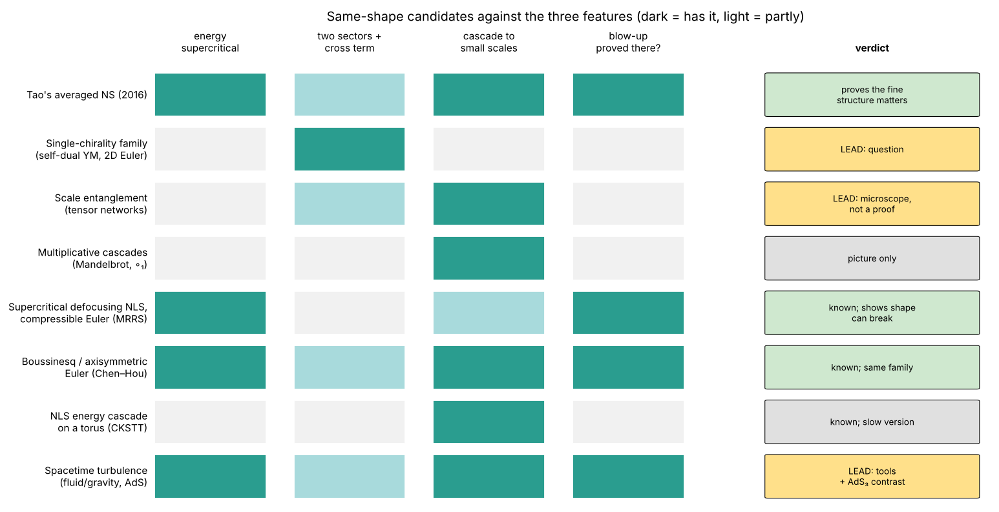
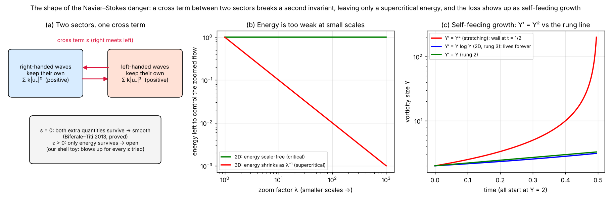
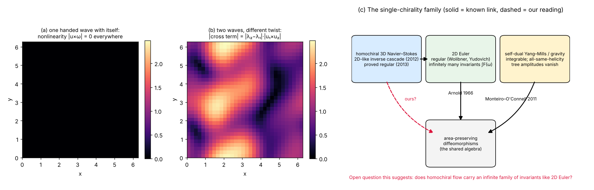
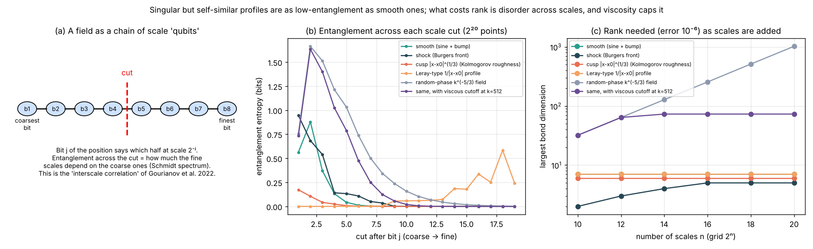
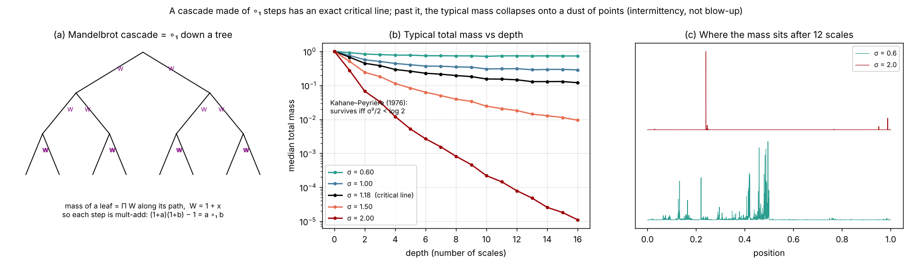
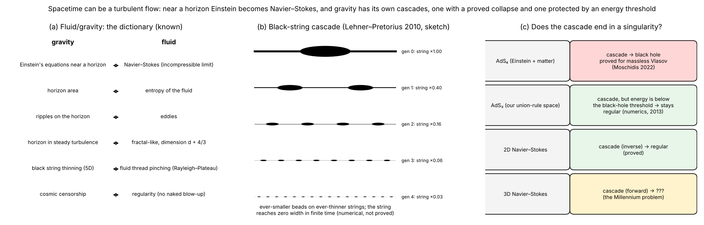

# DRAFT · Maths with the same shape as Navier–Stokes (with spacetime as a turbulent flow)

Nov 25, 2026. Asked for by Brennan: "and then navier stokes how close are we on that", then "I'm wanting to look for a
math that has the same shape not necessarily a direct uh, underlying identical mechanic, but just the same shape", and
then "I want to go ahead and add space time as a turbulent flow to the uh, to that same effort." Background from his
voice call: "i'm wondering if entanglement might be the key to unlocking navier stokes", and "maybe space time is a
turbulent flow."

Checks: `checks.py` → `checks_output.txt` (**17 of 17 pass**, numpy only) → `results.json`. Pictures: `figures.py` →
`figures/`. DRAFT: everything below is known work unless marked **ours**, and the "ours" items are readings, checks and
open questions, not theorems. Nothing here gets closer to solving the Millennium problem; it maps where else the same
shape lives and which of those places has a tool worth borrowing.

## The result in plain words

The Navier–Stokes danger has a definite shape (a cross term between right- and left-handed motion that strips away a
second protective quantity and leaves only an energy too weak at small scales), and that shape shows up in gauge
theory, in tensor networks and in gravity itself; three of those are leads worth following, but entanglement on its own
cannot be the key, because the most feared kind of singularity is itself low in entanglement.

## Verdicts, lead by lead (fundamental first)

| Candidate | Verdict | Why, in one line |
|---|---|---|
| The shape, named (section 1) | **Settled enough to search with** | Three features, each already in the literature; the cross-chirality gate is the one most fields lack. |
| Tao's averaged Navier–Stokes (section 2) | **Known; proves the cross term belongs in the shape** | Same energy law, averaged nonlinearity, and it blows up. Any proof must use the exact right-meets-left structure. |
| Single-chirality family: homochiral flow, 2D Euler, self-dual Yang–Mills and gravity (section 3) | **Lead worth following (a question)** | In every member the one-handed sector is tame. It suggests a precise question: does one-handed 3D flow carry infinitely many conserved quantities, as 2D Euler does? |
| Entanglement and tensor networks across scales (section 4) | **Lead worth following as a microscope, not as a proof route** | The 2022 claim checks out, but our test shows a self-similar singular profile needs only 6 to 7 units of rank at any depth. Low entanglement does not mean smooth. It does mean tensor trains could resolve a candidate blow-up cheaply. |
| Multiplicative cascades, our ∘₁ down a tree (section 5) | **Picture only** | An exact critical line for a ∘₁ chain across scales. It describes how dissipation clumps (intermittency), not whether the flow breaks. |
| Places where the shape was proved to break (section 6) | **Known; they show the shape can break and how proofs of breaking are built** | Supercritical NLS and compressible Euler, 2D Boussinesq and axisymmetric Euler, and the slow cascade on a torus. |
| Spacetime as a turbulent flow (section 7) | **Lead worth following (tools, and an AdS₃ contrast)** | True in a precise sense near horizons and in AdS. Gravity has a cascade with a proved collapse (AdS₄, Moschidis) and one held off by an energy threshold (AdS₃, the space our union rule lives in). |

## 1. The shape, named

Three features, all known, which together are the shape we are matching. None of the names below is new.

1. **Supercritical energy (panel b).** Zooming a solution by λ leaves the equations unchanged but shrinks its energy
   by λ⁻¹ in 3D (check S1); in 2D the energy is unchanged (S2). So at small scales the one quantity we control is too
   weak to rule out trouble. This is the standard term (Tao's "supercriticality barrier").
2. **Two sectors and a cross term (panel a).** Split the flow into right- and left-handed helical waves (Waleffe 1992).
   With only one hand present, each hand keeps its own positive quantity Σ k|u|², and the flow is proved smooth
   (Biferale–Titi 2013). Turn on the right-meets-left terms and that extra quantity is gone. In our earlier shell-model
   toy (`../ns-rungs/`), every amount of cross term tried led to blow-up, later as the dial went down. The "far corner of
   the stretch cube" is the same thing seen through the strain: enstrophy production is the product of the three
   stretch rates, the corner term (Betchov 1956).
3. **Self-feeding growth toward small scales (panel c).** The stretching term makes vorticity feed on itself like
   Y′ = Y², which hits a wall in finite time, while every rung of our ladder (Y′ = Y, Y log Y, …) lives forever. This is
   the gap measured on our earlier page: one full rung wide.

So the shape, in one line: **a supercritical cascade toward small scales, gated by a cross term between two sectors that
each carry their own protective quantity.** A field "has the same shape" if it has a coercive but supercritical
quantity, a split into two sectors where one sector alone is tame, and a cascade the cross term switches on.

**Existing work on our exact dial.** Alexakis and Biferale ("λ-Navier–Stokes turbulence", 2021–22) weighted the
right-meets-left terms by λ in the real equations, not a shell model, and found the cascade flips direction at
λc ≈ 0.3: above it energy goes to small scales, below it to large scales, as in 2D. That is a threshold our shell toy did
not show. It concerns which way energy flows on average, not whether a singularity forms, and smoothness is proved only
at λ = 0.

## 2. Tao's averaged Navier–Stokes: why the cross term belongs in the shape (known)

Tao (J. Amer. Math. Soc. 2016) built an "averaged" Navier–Stokes with the same energy identity and the same harmonic
analysis estimates, and proved it blows up in finite time. The averaging keeps the energy law but scrambles the fine
structure of which waves talk to which. His construction pushes energy down a chain of scales like a relay of logic
gates. Consequence: any proof of smoothness must use the exact form of the nonlinearity, which is precisely the
right-meets-left structure of section 1. That is why the cross term, not supercriticality alone, is the heart of the
shape.

## 3. The single-chirality family (pieces known; the link is ours)

- **One hand cannot talk to itself (panels a, b; checks H1–H4).** For curl eigenfields (Beltrami flows, curl u = λu) the
  Navier–Stokes nonlinearity of one mode with itself is zero, and between two modes it is (λ₂ − λ₁)·u₁×u₂. Two
  different modes with the same λ also cancel. So the nonlinearity needs a difference of twist; same-handed, same-size
  waves are inert. This is elementary and known.
- **Homochiral flow behaves like 2D.** Keeping only one hand gives a 2D-like inverse cascade (Biferale, Musacchio and
  Toschi, PRL 2012), and it is proved smooth (Biferale–Titi 2013).
- **2D Euler** is smooth (Wolibner 1933, Yudovich 1963), has infinitely many conserved quantities ∫F(ω), and is geodesic
  motion on the group of area-preserving maps (Arnold 1966).
- **Self-dual Yang–Mills and self-dual gravity** are the one-helicity sectors of gauge theory and gravity. They are
  integrable (Ward 1977, Penrose's nonlinear graviton), tree amplitudes with all helicities equal vanish, and their
  hidden algebra is again area-preserving maps (Monteiro and O'Connell 2011). Navier–Stokes itself has been put into
  this amplitude language: its kinematic algebra is spatial diffeomorphisms (Cheung and Mangan 2020).

**Ours (a reading, not checked in the literature beyond one search):** homochiral 3D Navier–Stokes belongs in the same
family as the self-dual sector, with "right meets left" playing the role of mixing self-dual and anti-self-dual parts.
In every member, the one-handed sector is the tame one. **The question this gives, worth following:** does homochiral
3D Euler carry an infinite family of conserved quantities, like 2D Euler's ∫F(ω) and the self-dual sector's hidden
symmetry? Biferale–Titi used one such quantity; if there are infinitely many, Alexakis–Biferale's threshold λc might be
read as where they stop protecting the flow. I did not find this question posed.

## 4. Entanglement and tensor networks across scales

**The claim, checked.** Gourianov, Lubasch, Dolgov, van den Berg, Babaee, Givi, Kiffner and Jaksch, "A quantum-inspired
approach to exploit turbulence structures", Nature Computational Science 2 (2022). They measured correlations between
length scales with tools from quantum many-body physics, found them limited, and used matrix product states to solve
Navier–Stokes with more than ten times fewer parameters than direct simulation. The voice assistant's summary ("scale-to-
scale entanglement is low") is a fair paraphrase of the abstract; I could not read the full text for their numbers.

**Our test (checks E1–E7; the computation is ours, the method is standard).** Write a function on 2²⁰ points as a chain of
20 "scale bits" (panel a) and measure the entanglement across each cut, plus the rank needed for 10⁻⁶ accuracy as scales
are added (panels b, c):

- A smooth field, a thin shock, a **Kolmogorov-rough cusp |x−x₀|^(1/3)** and a **Leray-type 1/|x−x₀| profile** all stay
  at rank 5 to 7, the same at 2¹⁰ points as at 2²⁰. The two singular, self-similar profiles are as cheap as the smooth one.
- A random-phase Kolmogorov field doubles its rank with every added scale (32 → 1022): the cost is disorder across
  scales. Its entanglement entropy stays under 2 bits because most energy sits at large scales; the rank is the honest
  measure here.
- The same field with a viscous cutoff stops growing at rank 73 once the scales pass the cutoff. Viscosity caps the
  entanglement.

**Verdict.** Entanglement across scales measures how disordered the scales are, not how dangerous. A self-similar
blow-up is perfectly ordered across scales (the same shape repeated smaller), so it is low-entanglement. This matches a
known theorem: tensor-network approximation classes contain Besov smoothness classes but are not contained in any of
them (Ali and Nouy, Constructive Approximation 2023), so low rank and smoothness are different things. So entanglement
cannot by itself unlock Navier–Stokes: bounding it would not rule out the classic self-similar singularity (which was
ruled out by other means: Nečas–Růžička–Šverák 1996, Tsai 1998).

**What it does offer (a lead worth following):** because a self-similar singularity costs fixed rank however many scales
you add, tensor trains are a natural microscope for the numerical hunts for blow-up (Hou's group; the 2025 neural-network
searches for unstable self-similar solutions). Adding a scale costs a constant, not a doubling. Quantized tensor trains
are already known to resolve corner singularities efficiently in elliptic problems (Kazeev and Schwab 2018). I did not
find them used in the Euler or Navier–Stokes blow-up searches; that literature check comes first.

**Tie to our union rule (ours, a proposed test, not run).** Our probability-entanglement page showed P(A or B) = p ∘₋₁ q
exactly when two parts share no information, with the miss capped by √(2I). With the cross term off, the right- and
left-handed sectors evolve separately, so from independent starts the union rule holds between them forever; the cross
term is what makes it fail. Measuring the miss (or the mutual information between the two hands) against the dial, in the
shell toy and against Alexakis–Biferale's λc, would say whether the hands become correlated before the cascade turns.

## 5. Multiplicative cascades: our ∘₁ down a tree (known; picture only)

Mandelbrot's cascade (1974) splits mass in two at every scale and multiplies each half by a random weight W = 1 + x with
mean 1. Two steps compose as (1+a)(1+b) − 1 = a ∘₁ b (check C4), so a path down the tree is a ∘₁ chain across scales.
Kahane and Peyrière (1976) proved the exact line: for log-normal weights the total mass survives iff σ²/2 < log 2, i.e.
σ < 1.18. Below it the typical mass stays near 1 (C1: 0.73 after 16 scales at σ = 0.6); above it the typical mass
collapses (C2: 10⁻⁵ at σ = 2) while the average stays 1 (C3), because the mass piles onto a dust of points (panel c).

Same shape in one respect: a cascade across scales with a sharp critical line. Different in the respect that matters:
it models how turbulent dissipation clumps (Kolmogorov 1962, She–Leveque 1994), not whether a solution breaks. Worth a
line in our README under "where it unifies" only if we want it; no research lead.

## 6. Where the shape was proved to break (known)

- **Supercritical defocusing equations.** Merle, Raphaël, Rodnianski and Szeftel (2019–22) proved finite-time implosion
  for the energy-supercritical defocusing NLS and for compressible Euler and Navier–Stokes: a conserved, positive energy
  that is supercritical is not enough for smoothness. Their method: build a self-similar imploding profile and prove it is
  stable.
- **2D Boussinesq and 3D axisymmetric Euler.** These two are an exact same-shape pair (temperature gradient plays
  stretching). Chen and Hou (2022–23) give a computer-assisted proof of blow-up with a boundary, by proving stability of an
  approximate self-similar profile (with Elgindi's 2021 C^(1,α) blow-up for Euler before it). Hou's 2026 talks describe
  numerical evidence of potential singular behaviour in 3D Navier–Stokes (vorticity up by about 10⁷); that is evidence
  in talk announcements, not a theorem.
- **Model equations built for the shape.** The Constantin–Lax–Majda 1D model (1985) and surface quasi-geostrophic flow
  (Constantin–Majda–Tabak 1994). For SQG the critical dissipative case was solved by De Giorgi-type methods (Kiselev–
  Nazarov–Volberg 2007, Caffarelli–Vasseur 2010); the supercritical case is open, the same wall as 3D.
- **The slow version.** On a torus, cubic NLS is smooth forever, yet energy can still be pushed to ever-smaller scales
  (Colliander–Keel–Staffilani–Takaoka–Tao 2010). Their resonant relay is the ancestor of Tao's averaged blow-up.

## 7. Spacetime as a turbulent flow

**The claims, checked.**

- **Fluid/gravity duality is real.** Bhattacharyya, Hubeny, Minwalla and Rangamani (2008) showed long-wavelength black-brane
  geometries are governed by relativistic fluid equations. Bredberg, Keeler, Lysov and Strominger ("From Navier–Stokes to
  Einstein", 2011) showed every solution of incompressible Navier–Stokes gives a solution of the vacuum Einstein equations,
  in a near-horizon limit. So "Navier–Stokes regularity" is literally a statement about a class of spacetimes near a
  horizon, in that limit.
- **"2014 work on fractal horizons" is right.** Adams, Chesler and Liu, "Holographic turbulence", PRL 112, 151602 (2014;
  preprint 2013): turbulent black holes in AdS₄ show an inverse cascade in both fluid and geometry, and for steady
  turbulence they argue the horizon is approximately fractal with dimension d + 4/3. Yang, Zimmerman and Lehner (PRL 2015)
  found an inverse-cascade-like instability of rapidly spinning black holes in ordinary (asymptotically flat) space.
- **Gravity has its own blow-up cascades.** Lehner and Pretorius (PRL 2010) simulated 5D black strings: ever-smaller beads
  on ever-thinner strings, reaching zero width in finite time, a naked singularity, which they compare to a low-viscosity
  fluid thread pinching (numerical, not proved). In AdS₄, Bizoń and Rostworowski (2011) found that arbitrarily small
  perturbations cascade to small scales and form a black hole; Moschidis proved this instability for the Einstein–massless
  Vlasov system (Inventiones 2022) with an engineered hierarchy of beam interactions across scales.
- **AdS₃ is the protected case.** Bizoń and Jałmużna (PRL 2013): in AdS₃ small perturbations still cascade, but their
  energy is below the black-hole threshold, so no collapse; the solutions appear to stay smooth (numerics).

**Verdict: lead worth following.** "Spacetime is a turbulent flow" holds in a precise sense near horizons and in AdS:
there, the geometry itself carries eddies, cascades and, in gravity's version, proved collapse. Two things are worth
borrowing. First, Moschidis' proof is a rigorous template for driving a cascade to collapse in a conservative system, close
in spirit to Tao's relay; it belongs on the reading list for the blow-up side of Navier–Stokes. Second, gravity sorts its
cascades just as Navier–Stokes does: AdS₄ collapses, AdS₃ cascades but is protected by an energy threshold, as 2D flow is
protected by its extra quantity. The broader idea that spacetime everywhere is amorphous or turbulent has no support I
found; the fluid/gravity map is a limit near horizons, not a statement about empty space.

**Ties to our own work.** Gravity's waves come in two helicities, and self-dual gravity is the one-handed sector, so
spacetime also carries the two-sector shape of section 3 (known pieces). AdS₃ is where our union rule lives: there the
cross-ratio is the "at least one tick" probability of a Poisson clock on a region's modular time. **Ours, speculation:**
the AdS₃ cascade gives a dynamical test of that reading, by tracking the boundary conditional mutual information I(A:C|B)
while the cascade runs and asking whether the union rule's miss grows as energy moves to small scales. The fractal-horizon
dimension d + 4/3 is a candidate for our dimension dial (our "NS across dimensions" page found dimension and dissipation
are one dial); I have not checked whether that reading adds anything.

## Known vs ours

| Piece | Status |
|---|---|
| Supercriticality, helical decomposition, Betchov corner, Biferale–Titi, Tao's averaged blow-up | known |
| Alexakis–Biferale threshold λc ≈ 0.3 on the cross-chirality dial | known (2021–22) |
| Beltrami cross term (λ₂ − λ₁)·u₁×u₂ (H1–H4) | known, elementary; checked here |
| Homochiral Navier–Stokes as a member of the self-dual family, and the infinite-invariants question | **ours** (one search found no prior statement) |
| Tensor-network turbulence compression | known (Gourianov et al. 2022) |
| Scale-rank test: self-similar singular profiles have fixed rank; disorder costs rank; viscosity caps it (E1–E7) | **ours** as a computation; consistent with Ali–Nouy 2023 |
| Tensor trains as a microscope for blow-up searches | **ours** as a suggestion; not checked against the full literature |
| Union-rule miss between the two hands as a diagnostic | **ours**, proposed, not run |
| Mandelbrot cascade as a ∘₁ chain; Kahane–Peyrière line (C1–C4) | known; the ∘₁ wording is ours |
| Fluid/gravity, holographic turbulence, black-string cascade, AdS instability and its AdS₃ exception | known |
| AdS₃ cascade as a test of our union-rule reading; d + 4/3 on the dimension dial | **ours**, speculation |

## Sources

Gourianov et al., Nat. Comput. Sci. 2 (2022), arXiv:2106.05782 · Alexakis and Biferale, arXiv:2109.01073 · Biferale and
Titi, arXiv:1303.1215 · Ali and Nouy, arXiv:2007.00128 · Cheung and Mangan, arXiv:2010.15970 · Monteiro and O'Connell,
arXiv:1105.2565 · Adams, Chesler and Liu, arXiv:1307.7267 · Yang, Zimmerman and Lehner, arXiv:1402.4859 · Bredberg, Keeler,
Lysov and Strominger, arXiv:1101.2451 · Lehner and Pretorius, arXiv:1006.5960 · Moschidis, arXiv:1812.04268 · Bizoń and
Jałmużna, arXiv:1306.0317. Others are cited by author and year from standard references.

## Files

- `checks.py`, `checks_output.txt`, `results.json`: 17 checks (scale entanglement E1–E7, cascade C1–C4, chirality H1–H4,
  scaling S1–S2).
- `figures.py`, `figures/fig1`–`fig6`.
