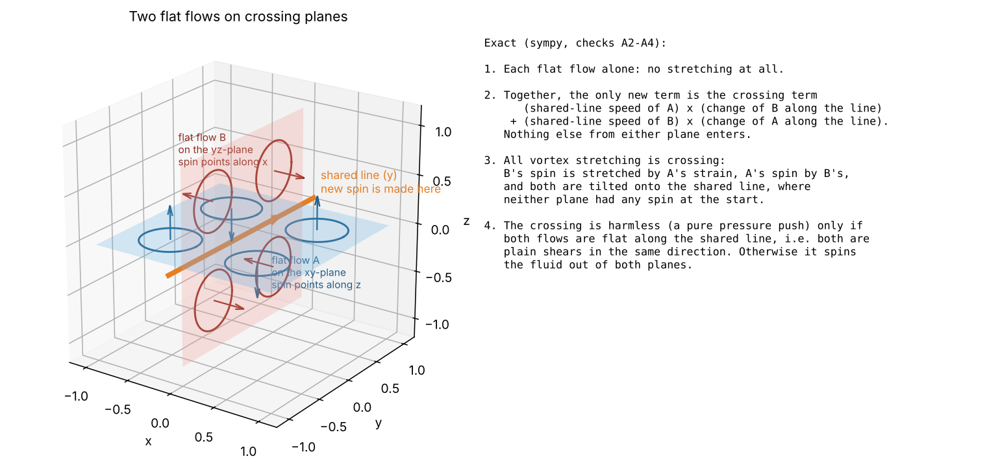
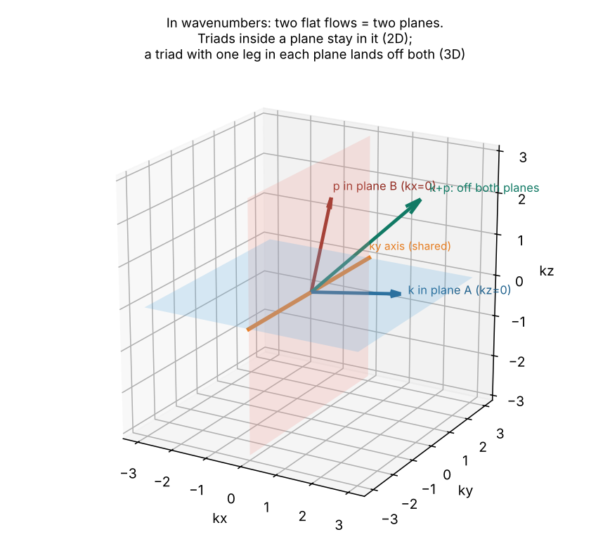
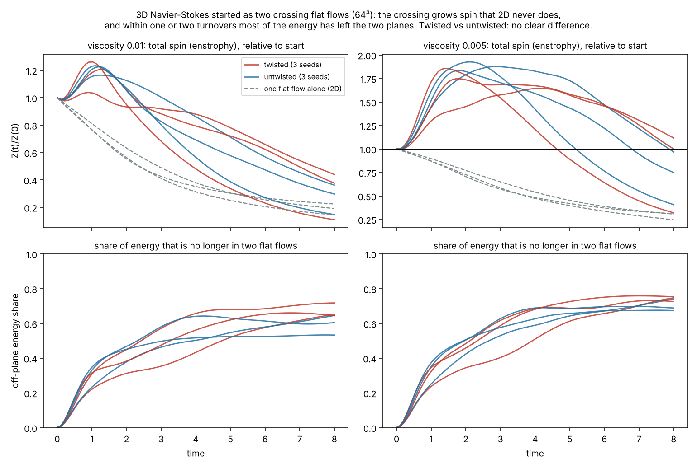
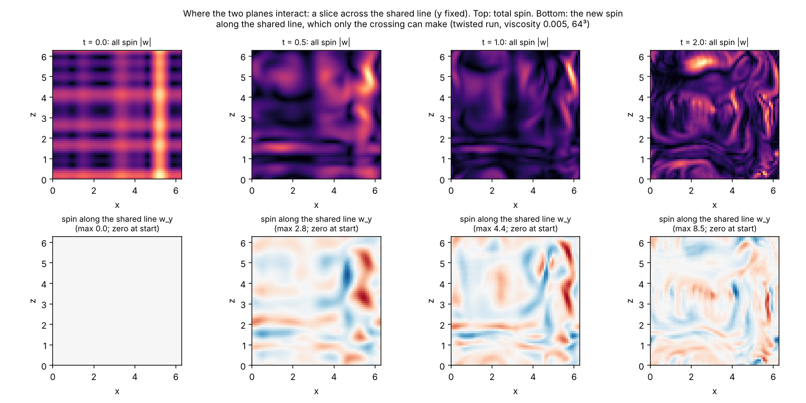
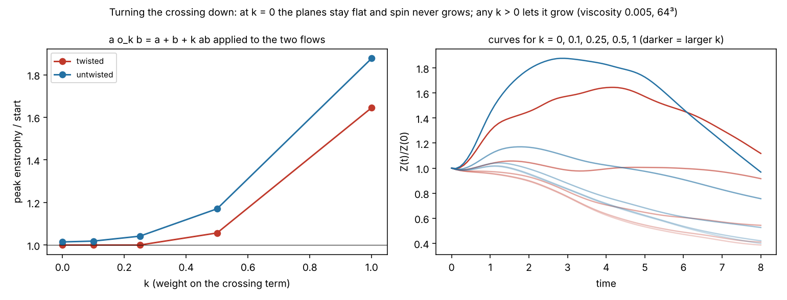
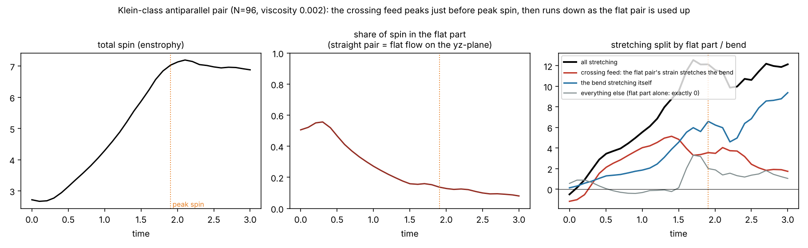

# DRAFT · Navier–Stokes as two crossing flat flows

**DRAFT, Nov 27 2026.** Part of Fused Hyperoperation Algebra. Asked for by Brennan: "We might show that navier stokes
really is 2D, but that the flows are two intersecting planes", then "remember we found some stable vortex stretching
in the Klein bottle work" and "The idea that reality itself is twisted might be a good tack".

Checks: [`checks.py`](checks.py) → [`checks_output.txt`](checks_output.txt), **10 of 10 pass** (seconds; reads the run files). Exact algebra:
[`algebra.py`](algebra.py) (sympy). Runs: [`twoplanes.py`](twoplanes.py) (solver, with the k setting on the crossing),
[`batch1.sh`](batch1.sh), [`batch2.sh`](batch2.sh), [`batch3.sh`](batch3.sh), [`klein_planes.py`](klein_planes.py) (Klein pair),
[`twist_sectors.py`](twist_sectors.py). Pictures: [`figures.py`](figures.py) → [`figures/`](figures/).
Everything is known mathematics unless marked **ours**; the "ours" items are readings, exact identities and runs, not
theorems about blow-up.

## The result in plain words

**Half of the idea is exactly true, and the other half is where all of 3D's difficulty lives.**

- **True, exactly:** every 3D flow in the periodic box is two flat flows on crossing planes, plus one plain 2D flow on
  the third plane. Here "flat flow" means the fluid moves only within the plane's direction, layer by layer
  (section 1). So 3D velocity really is two planes' worth of 2D motion.
- **The catch:** a flat flow that is the *same* on every layer is true 2D and stays smooth (proved). Two of those on
  crossing planes do not stay that way. The only thing they add to each other is one **crossing term**, and it lives
  entirely on the line where the planes meet (figure 1). All vortex stretching, the thing that could make 3D blow up,
  is that crossing term. It also makes brand-new spin along the shared line, which neither plane had.
- **Dial (ours):** putting k on the crossing (a ∘ₖ b = a + b + k·ab applied to the two flows) gives a family that
  keeps energy exact. At k = 0 the planes stay flat and spin never grows; growth rises smoothly with k (figure 4).
- **Runs (ours):** started as two crossing 2D flows, the 3D flow grows its total spin by 1.2–1.9× where each 2D flow
  alone only decays, and within one or two turnovers 53–75% of the energy has left the two planes (figure 3).
- **The twist (ours):** a quarter turn about the shared line, with a quarter shift along it, carries any flat flow on
  one plane onto a flat flow on the crossing plane. It is the only turning twist that makes exactly two planes, and
  they come out perpendicular. So "reality is twisted" and "two crossing planes" are the same picture: Brennan's
  flows are exactly the flows that live on the quarter-turn space (Conway–Rossetti's *tetracosm*, one of the ten
  flat 3D spaces). Over 9 seeds the twist trims the growth by only 3% on average (lower in 6 of 9, higher in 3), so
  it does **not** tame the crossing.
- **Klein link:** the Klein antiparallel pair is one flat flow (the straight pair) plus a bend, and all its stretching
  comes from the bend crossing the flat part (figure 6). What settled there was the **total** spin across grids, never
  the peak.

## What this contributes, graded two ways

| | Verdict | Why |
|---|---|---|
| Worth following? | **Yes, as a lens.** It puts the whole 3D difficulty in one exact place: the crossing term on the shared line. | The split is exact, the crossing term is short and exact, and the twist gives the two-plane flows a home of their own. |
| Could it reach a proof? | **Not as it stands.** The crossing does not stay small in any run, and no setting short of switching it off keeps it bounded. | A proof would need a bound on the crossing that the runs do not show. Section 6 says what would make it a lead. |

## 1. The split is exact (fundamental, checked)

*Figure 1. Flat flow A on the xy-plane (spin points along z), flat flow B on the yz-plane (spin along x). They meet on
the y line. The box on the right lists what the algebra proves.*

Check A6 (numeric, exact to rounding): any incompressible velocity field in the periodic box splits as

  u = (layered flow in the xy-plane) + (layered flow in the yz-plane) + (plain 2D flow in the xz-plane).

The third piece is the y-average's motion in the xz-plane (9% of the energy for a random field). "Layered" means the
velocity lies in the plane but may change from layer to layer. This is the axial gauge of the vector potential (one of
its three components set to zero), known in substance; the two-planes reading is Brennan's.

A *strict* flat flow is the same on every layer: true 2D. Two strict flat flows are functions of two variables each,
so they cover only a thin slice of all 3D flows. The interesting question is what happens when you start from two
strict ones.

## 2. The crossing term (exact, ours as a statement)

With A on the xy-plane and B on the yz-plane (sympy, checks A2–A4):

- A alone and B alone have **no** stretching (true 2D).
- Together, the only new piece of the motion is

  **crossing = (A's speed along the shared line) × (how B changes along the line) + (B's speed along the line) × (how A changes along the line).**

  Nothing else from either plane enters.
- All stretching is crossing: B's spin is stretched by A's strain, A's spin by B's, and both are tilted onto the
  shared line, where there was no spin at the start.
- The crossing is a harmless pressure push only when **both** flows are flat along the shared line, which makes them
  parallel shears and the whole flow one-directional. Otherwise it spins the fluid out of both planes.
- Layered flows can cross exactly: two waves of the ABC flow, one on each plane, are an exact solution (A5; Beltrami,
  known).

*Figure 2. In wavenumbers the two flat flows are two planes that share the ky axis. Three waves that interact all inside
one plane stay there (that is why 2D closes). A wave from each plane makes a third wave off both planes: that is the
crossing, seen as a triad.*

## 3. Does the crossing stay tame? (runs, ours)

*Figure 3. Two random 2D flows on crossing planes, run as full 3D Navier–Stokes on 64³. Top: total spin relative to the
start. Dashed grey: a flat flow alone, which only decays. Bottom: share of energy no longer in the two planes.*

| viscosity | peak total spin / start (3 seeds) | peak spin from ~6.7 | energy off the planes at t = 8 |
|---|---|---|---|
| 0.01, twisted | 1.04, 1.21, 1.26 | 11.1, 10.0, 15.4 | 64–72% |
| 0.01, untwisted | 1.16, 1.23, 1.23 | 14.5, 14.0, 13.9 | 53–65% |
| 0.005, twisted | 1.65, 1.75, 1.86 | 17.9, 16.9, 21.3 | 73–75% |
| 0.005, untwisted | 1.88, 1.84, 1.93 | 21.4, 19.2, 21.7 | 67–74% |

Six more seeds at viscosity 0.005 (`batch3.sh`, to t = 4): twisted 1.90× on average, untwisted 1.96×; the twisted run is lower
in 6 of 9 pairs (check C5).

At the peak, spin along the shared line holds 24–35% of the total, close to the third it would have if the flow had
forgotten its planes entirely. The 64³ and 96³ grids agree on the peak total spin to 0.1% (figure 7), so these runs are
resolved; with ordinary viscosity nothing here comes near blow-up.

*Figure 5. A slice across the shared line. At the start the spin is a plaid: stripes from plane A one way, stripes from
plane B the other. The new spin along the shared line (bottom) is born where the stripes cross and is pulled into thin
sheets.*

## 4. The k setting on the crossing (ours)

The Navier–Stokes nonlinear term splits exactly like a ∘ₖ b = a + b + k·ab: N(A+B) = N(A) + N(B) + crossing. Putting
the dial k on the crossing gives a family that keeps energy exact for every k (each piece conserves it); k = 1 is true
Navier–Stokes and k = 0 lets each plane talk only to itself (and through the modes of the shared line).

*Figure 4. Peak total spin against k (viscosity 0.005, seed 0). k = 0: the planes stay flat to within 4–11% and spin never
grows. Growth then rises smoothly: twisted 1.00, 1.00, 1.00, 1.06, 1.65 at k = 0, 0.1, 0.25, 0.5, 1; untwisted 1.01,
1.02, 1.04, 1.17, 1.88.*

There is no sharp threshold in these runs: where growth starts depends on the viscosity, so it is not a constant of
the equation. The same kind of dial on the handedness of the waves (Alexakis–Biferale, Sahoo–Alexakis–Biferale 2017)
is already in [`../ns-same-shape/`](../ns-same-shape/); this one is new to us as a dial on plane crossing.

## 5. The twist (exact, ours as a reading)

Check A7: the twist g = (quarter turn about the shared line) + (quarter shift along it) carries a flat flow on the
xy-plane onto a flat flow on the yz-plane; twice the twist brings it back. Four twists are a full shift, so the box
divided by g is a flat space with no fixed points, the quarter-turn space. Among the turning twists, a half turn keeps
one plane, a third or sixth turn makes three planes at 60°, and **only the quarter turn makes exactly two, at right
angles.** So the two-crossing-planes flows are exactly the flows on the quarter-turn space built from one flat flow,
and the run keeps that symmetry for all time (checked to 10⁻¹⁵).

How much of a general flow is twisted (`twist_sectors.py`): split any flow into four parts by how the twist acts (×1,
×i, ×−1, ×−i). A random flow has 27% of its energy in the fully twisted part. That part is closed under Navier–Stokes,
and the others feed it: the ×−1 part's self-interaction lands in the twisted part, and the ×i parts land in ×−1. So
the twisted part is where the rest of the flow pours its self-interaction.

As with the Klein bottle: a blow-up found on the quarter-turn space would be a blow-up in Clay's periodic box
(option D), but smoothness there would cover only twisted flows.

## 6. The Klein pair through the two-plane lens

*Figure 6. The Klein-class antiparallel pair (same data as `../klein-flow/periodic-box/blowup/`, 96³, viscosity 0.002).
Left: total spin. Middle: share of spin in the flat part (the straight pair, a flat flow on the yz-plane). Right:
stretching split by which part supplies the spin and which the stretching.*

- The straight pair is one flat flow: 51% of the spin at the start sits in it, and it does no stretching at all
  (check C10, exact to 10⁻²⁹). Every bit of stretching involves the bend.
- **ours:** the stretching comes in two phases. First the **crossing feed**: the straight pair's strain stretches the
  bend (73% of all stretching at t = 1). It peaks at t ≈ 1.4, just before the peak spin (t ≈ 1.9) and the peak total
  spin (t ≈ 2.1). After that the flat pair is mostly used up (its share falls to 13%, then 8%), the crossing feed runs
  down, and the bend stretching itself takes over while viscosity holds the total spin level.
- So in this run the pinch turns over after the crossing feed peaks. That is one run on one grid (96³, where the peak
  spin is a lower bound), a timing match and not a cause proved.

What "stable" meant there: the **total** spin agreed across the 128³, 192³ and 256³ grids to within 0.6–2.2%; the peak
spin did not settle (151, 233, 314) and is a lower bound. The two-plane lens explains where the stretching comes from,
not why it stays finite.

## 7. What would make this a lead to a proof

Known (verify before relying on it): Chae and Choe (1999, Electron. J. Differential Equations) proved smoothness from
conditions on **two** components of the spin, the ones across a fixed direction (scale-critical conditions; see
E. Miller's survey, arXiv:2111.00040). Take that direction to be the shared line: those two components are exactly the
two planes' own spins. So, in Brennan's picture, **the shared-line spin cannot cause blow-up by itself while the planes'
own spins stay controlled.** Any blow-up has to show up in the planes' own spins.

That turns the idea into a concrete target: show that the crossing can never feed the planes' own spins faster than
viscosity removes them. The runs say it does feed them (total spin grows 1.2–1.9×), so a proof would need a structural
reason the feeding stays bounded at every scale, which nothing here supplies yet. Two cheaper next steps:

1. **The twisted part as a sink.** Measure how much of the stretching in a general turbulent run lands in the
   quarter-turn-twisted part, and whether that part's spin stays bounded when the rest does.
2. **A crossing-only bound.** Since the crossing involves only shared-line speeds and shared-line changes, test whether
   a bound on the shared-line speed alone (a one-velocity-component condition, a known family of criteria) is
   reachable for two-plane data.

## Checks

| check | result | numbers |
|---|---|---|
| C1 exact algebra (algebra.py) | pass | 13 of 13 pass |
| C2 a flat flow alone never grows its total spin | pass | largest peak/start over 12 flat runs = 1.000000; stays exactly flat |
| C3 two crossing flat flows grow total spin in all 12 runs | pass | 0.01 twisted: 1.04, 1.21, 1.26; 0.01 untwisted: 1.16, 1.23, 1.23; 0.005 twisted: 1.65, 1.75, 1.86; 0.005 untwisted: 1.88, 1.84, 1.93 |
| C4 most energy leaves the two planes by t = 8 | pass | off-plane share at t=8: 0.53 to 0.75 |
| C5 the twist does not tame the crossing (9 seeds, viscosity 0.005, peak by t = 4) | pass | twisted lower in 6 of 9; differences -0.24, -0.09, -0.07, +0.15, +0.10, -0.16, +0.00, -0.09, -0.16; means 1.90 vs 1.96 |
| C6 k setting on the crossing: peak spin rises with k (k = 0, 0.1, 0.25, 0.5, 1) | pass | twisted: 1.00, 1.00, 1.00, 1.06, 1.65; untwisted: 1.01, 1.02, 1.04, 1.17, 1.88 |
| C7 k = 0: planes stay nearly flat and spin does not grow | pass | peak/start 1.000, 1.015; off-plane share 0.035, 0.112 (the leak is the out-of-plane part fed through the shared line) |
| C8 grid check: 64³ and 96³ agree on total spin within 3% at every time | pass | peak 4.699 vs 4.697; largest gap 0.6%; peak spin 17.9 vs 18.0 |
| C9 twisted part: about a quarter of a random flow, closed under the nonlinear term | pass | share 0.275; sector -1 self-interaction lands in twisted part: 1.000 |
| C10 Klein pair: the flat part alone does no stretching; all of it involves the bend | pass | max /P(flat,flat,flat)/ = 1.1e-29 vs max total 12.55; flat share of spin 0.51 -> 0.08 |
