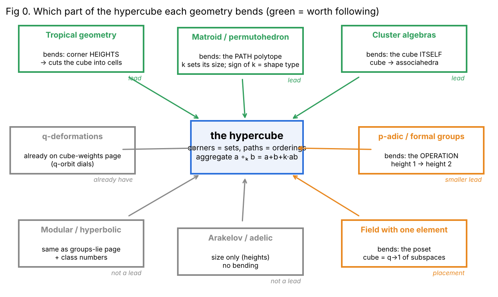
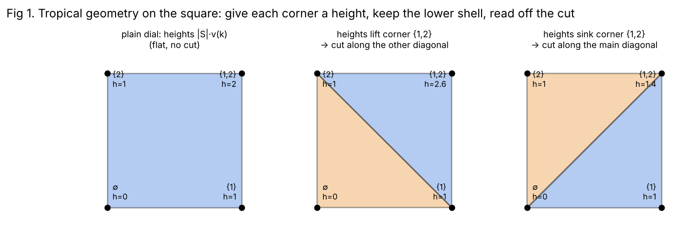
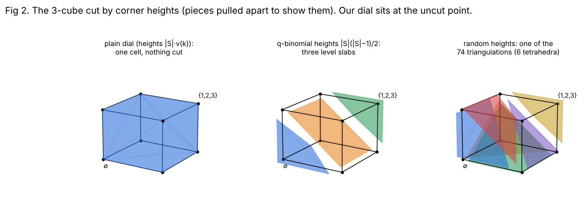
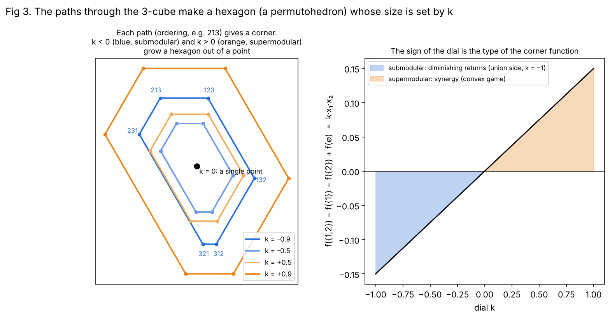
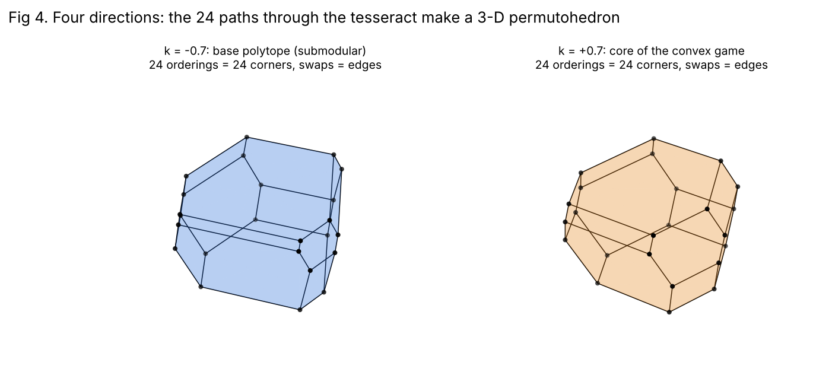
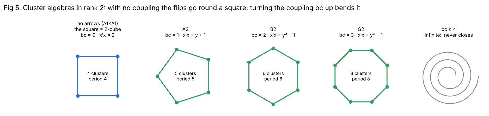
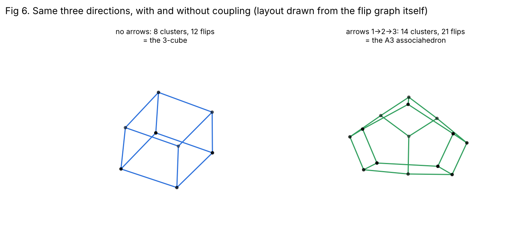
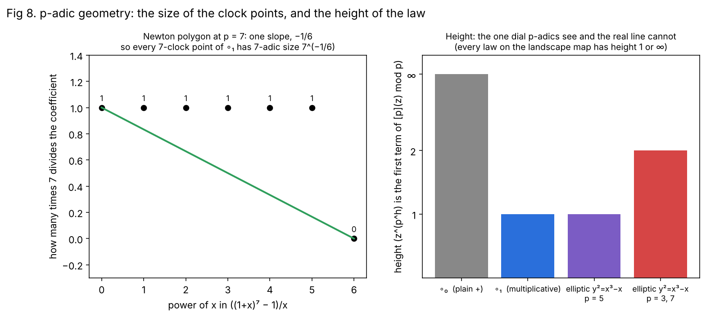
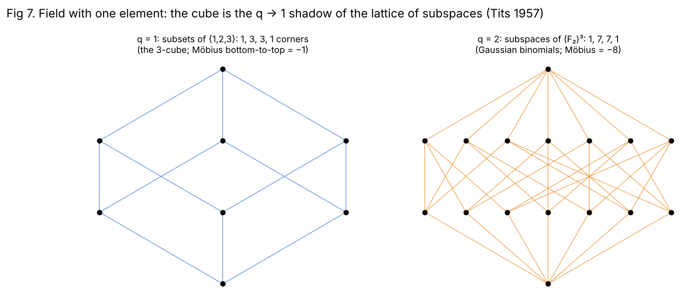
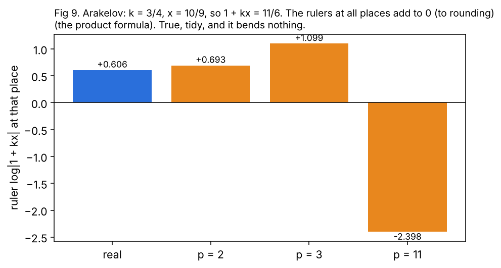

# DRAFT · Geometries from number theory, beyond toric, as ways to bend the hypercube

Nov 25, 2026. Asked for by Brennan on a voice call: look at the geometries used in number theory, like toric geometry
"but different than that", "to maybe get an idea of other ways to deform our hypercube."
Checks: `checks.py` → `checks_output.txt`, **41 of 41 pass** (numpy, scipy, sympy, mpmath).
Pictures: `figures.py` → `figures/`. Pushed to the repo Nov 25 as a DRAFT; CI runs `checks.py`.

Builds on, and does not repeat: `toric/` (the field with one element, Tits, Borger, Frobenius windings),
`cube-weights/` (direction dials 1, q, q², … give the Gaussian binomials), `boolean-lattice/` (paths are orderings,
orderings are the permutohedron), `game-theory/` (Shapley on the dial game), `groups-lie/` (the landscape is
one-parameter Möbius groups), `quantum-to-classical/` (Maslov's tropical limit). The semiring audit is a separate thread.

## The answer in plain words

Three of these geometries give real, picture-able ways to bend the hypercube, each bending a different part of it.
**Tropical geometry** bends the corners (give each corner a height and the cube cuts into cells; our dial sits exactly
at the uncut point). **The permutohedron** bends the paths (the orderings make a polytope that grows out of a single
point as you turn k, and the sign of k decides which kind). **Cluster algebras** bend the cube itself (with no coupling
between directions the cube *is* a cluster shape; turn couplings on and it bends into pentagons, hexagons and
associahedra). These three are worth following.

Two more are real but smaller: **p-adic geometry** finds one new dial on the *operation*, the "height" of a formal
group, that the real line cannot see; and the **field with one element** places the cube as the q → 1 shadow of the
lattice of subspaces, which our dial does not reach. **Arakelov/adelic** and **modular/hyperbolic** geometry are true
but bend nothing. **q-deformations** we already have on the cube-weights page.

| Geometry | What it bends | Real deformation? (check) | Standard name and source | Known or ours | Verdict |
|---|---|---|---|---|---|
| Tropical | corner heights | yes: 74 cuts of the 3-cube; ∘ₖ is the uncut point (A2, A4) | regular subdivisions, secondary polytope (Gelfand–Kapranov–Zelevinsky 1994; De Loera–Rambau–Santos 2010) | known; placing ∘ₖ at the origin is ours | **follow** |
| Permutohedron (matroid side) | the paths | yes: hexagon grows from a point as \|k\| grows (B2) | generalized permutohedra (Postnikov 2009), base polytope (Edmonds 1970), core of a convex game (Shapley 1971) | known pieces; the k-family picture is ours, probably folklore | **follow** |
| Cluster algebras | the cube's shape | yes: cube → associahedron (C2) | Fomin–Zelevinsky 2002–2003; Chapoton–Fomin–Zelevinsky 2002 | known | **follow** |
| p-adic / formal groups | the operation | yes, but of ∘ₖ, not the cube: height 1 → 2 (E3) | Lubin–Tate 1965; Honda 1970; Silverman ch. IV | known; "landscape = heights 1 and ∞" is ours as a placement | smaller lead |
| Field with one element | the poset | the cube is a limit, not a dial position (D3, D4) | Tits 1957; Borger 2009; Connes–Consani | known (toric page) | placement only |
| Berkovich / Newton polygons | sizes of clock points | no new bending beyond tropical (E1) | Berkovich 1990; Newton polygons | known | folded into tropical |
| Arakelov / adelic | sizes (heights) | no (F1, F2) | product formula, Weil height | known | not a lead |
| Modular / hyperbolic | the landscape map | no; adds class numbers only off the landscape plane (G1, G2) | Gauss; groups-lie page | known | not a lead |
| q-deformations | layer weights | yes, already found (A3b) | Cauchy q-binomial theorem | known; on cube-weights page | already have |

---

## 1. Tropical geometry: give the corners heights and the cube cuts itself

**What it bends.** The corner weights. Our aggregate over all directions is the polynomial ∏(1 + k·xᵢ), and its
corners *are* the cube: the exponent of each term is a corner S and its coefficient is k^|S| (A1, A1b). Tropical
geometry takes the size of each corner weight as a **height**, lifts each corner of the cube to that height, and keeps
the lower shell. The creases in that shell cut the cube into cells.

- **Our dial sits at the uncut point.** The heights from k^|S| are |S| times the size of k, which is flat, so the whole
  cube stays one cell (A2). That is the tropical way of saying ∘ₖ is "the same" at every corner. Any departure from
  flat heights is a genuine bending.
- **The space of all bendings is a known object.** For the 3-cube, random corner heights reach exactly **74
  triangulations**, 72 made of 6 tetrahedra and 2 made of 5 (A4, A4b), matching the known count, and every one comes from
  heights (all regular). The space of heights, sorted by which cut they make, is the *secondary fan*; its polytope is the
  secondary polytope (Gelfand, Kapranov and Zelevinsky 1994).
- **The cube-weights page's q weights land on a clean cell.** Direction dials 1, q, q², … give each layer the weight
  q^C(m,2) (cube-weights I1; Cauchy's q-binomial theorem, A3b). As heights, |S|(|S|−1)/2 curves up, so the cube
  slices into **three level slabs**: a tetrahedron, an octahedron, a tetrahedron (A3). So q-dials are exactly the
  "cut by levels" bending.

- *Known:* regular subdivisions, secondary polytopes, tropical hypersurfaces dual to subdivisions (Maclagan and Sturmfels,
  *Introduction to Tropical Geometry*, 2015). *Ours:* that ∘ₖ is the origin of the cube's secondary fan, and that the
  q-dials are the level-slab cell.
- **Why it's worth following.** Our corner-weight work (Lucas weights, soliton pair weights, the q-orbit) has been asking
  which weights genuinely change the cube. The secondary fan answers that question for all of them at once, with a
  picture: weights in the same cell are the same shape. Concrete next step: put each existing corner-weight family into
  the 3-cube's secondary fan and see which of the 74 cells (or coarser cuts) it lands in.
- **p-adic and Berkovich geometry fold in here.** A p-adic size is a height, and the Newton polygon is this same lower
  shell in one variable (section 4). Berkovich spaces retract onto tropical pictures, so they add no separate bending.

## 2. The permutohedron: the paths make a polytope, and k sets its size

**What it bends.** The paths. Each path through the cube is an ordering of the directions; walking it, write down how
much each direction added when it joined. That vector is one corner of a polytope.

- **The sign of the dial is the type of the corner function.** The second difference of the aggregate is exactly
  k·xᵢ·xⱼ·∏_S(1 + k·x) (B1d). So k < 0 makes it **submodular** (diminishing returns, the union side; k = −1 is
  "at least one happens"), k = 0 **modular** (plain sum) and k > 0 **supermodular** (synergy, a convex game) (B1, B1b,
  B1c). This sign rule is known for Sugeno's λ-measures (fuzzy-measure theory).
- **The paths are the corners of a polytope.** For three directions the 6 orderings give the 6 corners of a hexagon
  (B2); for four, the 24 orderings give the 24 corners of a 3-D permutohedron (B2c). For k < 0 it is the *base
  polytope* of the submodular function, every corner obeying y(S) ≤ f(S) (Edmonds 1970, B3); for k > 0 it is the
  *core* of the convex game, y(S) ≥ f(S) (Shapley 1971, B3b). Every corner S of the cube is a face that some path
  touches.
- **At k = 0 the polytope shrinks to a single point** (B2b): with plain addition every ordering credits each
  direction the same. Turning k inflates it. With equal entries the corners are the reorderings of
  x·(1, r, r²), r = 1 + kx (B4): a geometric progression, so k is the ratio.
- **The middle of the polytope is the Shapley value** already on the game-theory page (B5).

- *Known:* generalized permutohedra are exactly the polytopes of submodular functions (Postnikov 2009; Aguiar and Ardila
  2017); base polytopes (Edmonds 1970); cores of convex games (Shapley 1971). *Ours:* the one-dial family, the polytope
  growing out of a point at k = 0, and the k-as-ratio reading. Probably folklore; not found stated in this form today.
- **Why it's worth following.** It is the first time the dial has a geometric underpinning we're sure of, as a polytope
  with a whole theory behind it, and it lives on the paths, which is where order and non-commuting directions live. The
  boolean-lattice page asked for exactly this: "a polytope on which to draw how totals change between orderings."
  Concrete next steps: the volume of the polytope as a function of k (Postnikov has a formula for these volumes), and
  what happens on the circle side (imaginary k), where the corners become complex.

## 3. Cluster algebras: the cube is the "no coupling" case, and couplings bend it

**What it bends.** The cube's own shape. A cluster algebra is a set of variables you can swap one at a time by a rule
x′·x = (product) + (product). The swaps form a graph.

- **With no coupling between directions, the swap graph is the cube.** Three uncoupled directions give 8 clusters and
  12 swaps, the 3-cube; four give 16 and 32, the tesseract (C2, C2b). Each direction just flips back and forth.
- **Turning on coupling bends it.** In two directions, coupling bc = 0, 1, 2, 3 makes the swap cycle close after 4, 5,
  6, 8 steps: square, pentagon, hexagon, octagon (C1, C2d); bc ≥ 4 never closes (C1b). In three directions, coupling
  1 → 2 → 3 bends the cube into the **A3 associahedron**: 14 clusters, 21 swaps (C2c).
- Every variable stays a Laurent polynomial in the starting ones (C3), the Laurent phenomenon.
- **A tie to our lift.** The companion "Y-system" is built from factors 1 + y, which is the lift of ∘₁. Around the
  pentagon, the Rogers dilogarithm of y/(1+y) sums to exactly **π²/2** (C4, Abel's five-term identity). Dilogarithm
  sums like this are a doorway into number theory (the Bloch group), so this is a place where ∘₁ meets real arithmetic.

- *Known:* all of it (Fomin and Zelevinsky 2002 and 2003; polytopes by Chapoton, Fomin and Zelevinsky 2002; Zamolodchikov
  periodicity). Note the boolean-lattice page set associahedra aside because ∘ₖ is associative, so bracketings agree.
  That is still right: here the associahedron comes from coupling directions, not from bracketing.
- **Why it's worth following.** It gives a ready-made, fully classified way for directions to *interact*, which our
  cube lacks: the twisted-boosts work (non-commuting directions) is looking for exactly this kind of structure. The
  coupling is a whole-number dial (0, 1, 2, 3, then infinite), not our continuous k, so the open question is whether a
  quantum cluster parameter plays the role of k. That's unchecked.

## 4. p-adic geometry: one new dial on the operation, the "height"

**What it bends.** The operation, not the cube. Over the p-adic numbers (sizes measured by how often a prime p divides),
two things show up.

- **The clock points have one fixed size.** The p-step clock points of ∘₁ (x ∘₁ … ∘₁ x = 0, p times) all have p-adic
  size p^(−1/(p−1)): the Newton polygon is one straight segment (E1). Known; it is the tropical picture of section 1 in
  one variable.
- **The height: what the real line can't see.** Fuse z with itself p times and reduce mod p. For ∘₁ the first surviving
  term is z^p: **height 1**. For plain + (k = 0) nothing survives: **height ∞** (E2, E2b). Every law on the landscape map
  is one of these two (the circle law is a twist of ∘₁, so also height 1). The formal group of the elliptic curve
  y² = x³ − x starts at z^9 for p = 3 and z^49 for p = 7: **height 2**, a genuinely different law that no chart change
  turns into ∘ₖ; at p = 5 it is height 1 (E3). The toric page's own point counts already show this: the curve is
  height 2 exactly at the primes p ≡ 3 mod 4 (E3b).
- *Known:* Lubin–Tate 1965 (formal groups over the p-adics are sorted by height); Honda 1970; the
  Coleman–McGuinness classification already cited for our (k, q) map. *Ours, as a placement:* "the whole landscape is
  heights 1 and ∞; height 2 is the first law beyond it."
- **Worth following, modestly.** It is a real dial, but on the operation rather than on the cube, and it needs elliptic
  curves, which takes us away from the hypercube. It fits the elliptic page if we go back there.

## 5. The field with one element: the cube is a shadow of the subspace lattice

- The toric page already covers the main points (Tits, Borger's Frobenius windings, ((1+kx)^p − 1)/k ≡ k^(p−1)x^p mod p,
  rechecked here as D5). Two additions:
- **Our dial is the λ-ring's t.** For two "line" elements, λ_t(x + y) = 1 + t·(x ∘_t y) exactly (D1), and the rank-j layer
  of the cube is λ^j (D2). Borger's version of the field with one element *is* λ-rings, so ∘ₖ sits at its foundation.
  Known structure; ours as a placement.
- **The cube is a limit, not a dial setting.** Replace "subsets" by "subspaces over a finite field of size q": the 3-cube's
  1, 3, 3, 1 becomes 1, 7, 7, 1 at q = 2 (D3), and the cube comes back at q = 1 (D3b). The bottom-to-top Möbius number
  goes from −1 to −8 (D4). This is a genuine deformation of the cube as an ordered set, but our dial k does not produce
  it (the boolean-lattice page found the same). Placement only.

## 6. Arakelov and adelic geometry: true, but it bends nothing

- For rational k and x, the ruler log|1 + kx| summed over the real place and every prime is exactly 0 (F1, the product
  formula), and the Weil height of the lift is subadditive under ∘ₖ (F2). Both follow at once from ∘ₖ being
  multiplication in disguise. They measure sizes; they don't bend the cube. Not a lead.

## 7. Modular and hyperbolic geometry: already on the groups-lie page

- The landscape laws are one-parameter Möbius groups, sorted by p² − 4q into line, border and circle classes (groups-lie,
  rechecked as G2). That is the hyperbolic, parabolic and elliptic sorting of the modular group. Integer arithmetic only
  adds something new off the landscape plane (forms α + βx + γx² with α ≠ 1), where class numbers appear: 1, 1, 2, 3, 5, 7
  for discriminants −3, −4, −20, −23, −47, −71 (G1). That's Gauss, and it doesn't touch the cube. Not a lead.

## Leads, judged on their own merits

1. **Tropical: corner heights.** Worth following. It answers, for every corner-weight family at once, whether the weights
   really change the cube's shape, and our dial is its origin. Next: place Lucas, soliton-pair and q-orbit weights in the
   3-cube's secondary fan.
2. **Permutohedron: the paths.** Worth following. A polytope with a full theory whose size is set by k and whose type is
   set by the sign of k, living exactly where order matters. Next: its volume as a function of k, and the circle side.
3. **Cluster algebras: coupled directions.** Worth following. A classified way for directions to interact, bending the
   cube into associahedra; ∘₁'s lift shows up in its Y-system and dilogarithm sums. Next: whether a quantum cluster
   parameter can play the part of k.
4. **Formal-group height.** Smaller. Real, but it bends the operation and pulls toward elliptic curves.
5. **Field with one element.** Placement only; the toric page has it.
6. **Arakelov, modular, Berkovich.** Not leads for bending the cube.

## Sources

- Gelfand, Kapranov, Zelevinsky, *Discriminants, Resultants and Multidimensional Determinants* (1994).
- De Loera, Rambau, Santos, *Triangulations* (2010).
- Maclagan, Sturmfels, *Introduction to Tropical Geometry* (2015).
- Postnikov, "Permutohedra, associahedra, and beyond", IMRN (2009). Aguiar, Ardila, "Hopf monoids and generalized permutahedra" (2017).
- Edmonds, "Submodular functions, matroids, and certain polyhedra" (1970). Shapley, "Cores of convex games" (1971).
- Sugeno, PhD thesis (1974), λ-fuzzy measures; Grabisch, *Set Functions, Games and Capacities in Decision Making* (2016).
- Fomin, Zelevinsky, "Cluster algebras I, II" (2002, 2003); Chapoton, Fomin, Zelevinsky, "Polytopal realizations of generalized associahedra" (2002).
- Lubin, Tate, "Formal complex multiplication in local fields" (1965); Silverman, *The Arithmetic of Elliptic Curves*, ch. IV.
- Tits (1957); Borger, "Λ-rings and the field with one element" (2009).
- Coleman, McGuinness, "Rational formal group laws", Pacific J. Math. 147 (1991).
