# Odds-dial survey: which proved laws slide into one another (DRAFT)

**DRAFT, Nov 26 2026.** Part of Affine Composition Theory (repo: fused-hyperoperation-algebra). Asked for by Brennan:
"I'd like similar surveys for the other dials as well", after the shape-dial survey ("a survey of all of our laws that
we've proven to see if the shape dial is able to move from one to another", then "check all laws using the shape dial to
see if a new law emerges and what it might be for", with "a polishing step ... as long as it doesn't take too much effort
from the computer"). This page does it for **t, the odds**: one number per element, saying how strongly that element
takes part. All t = 1 is the plain power set; t → 0 drops the element; t → ∞ forces it. Two independent elements join by
t ∘₁ s, the complement is 1/t, and the chance t/(1 + t) is a reading (`affine-names/` §6).

Checks: `checks.py` → `checks_output.txt`, **57 of 57 pass** (numpy, scipy, sympy, mpmath), including 4 polish checks at
30 digits that cost **0.08 seconds in all**. Law list: `laws.py` → `laws.json` (the 65 groups of `dial-catalog/`).
Pictures: `figures.py` → `figures/`. No Lean in this pass. Colour key: **blue = our reading, orange = already known,
grey = endpoints and background.**

## The result

With every other dial held still and only the odds turned, the 65 law groups sort like this:

- **18 groups slide into another proved law.** In every one the carrying formula is exact and checked along the whole
  dial. All 18 run through mathematics that is already in print.
- **3 groups are the odds dial itself**: the dialled power set, the corner expansion, and the union rule on odds.
- **44 groups don't slide.** In most, t is only the argument the law composes, so the law holds at every t and nothing
  moves (the core law, Bliss, barrier odds, Hamacher). The rest live on other dials.
- **No group is "plausible", "partly" or a disguise.** The odds dial is simple: every law it touches is either exact
  at every t or a straight line in it.

The leads, in order:

1. **t = 1 is one stop where five proved laws meet, for one reason (N1).** The complement t ↔ 1/t has exactly one
   positive fixed point, t = 1. Every law that respects the complement has its special point there: chance ½ and the
   entropy peak, Bayes' neutral evidence, the fermion level half full, the Ryu–Takayanagi mutual information switching
   on, and the Lee–Yang zeros pinching the real axis. (The boson wall also sits at t = 1, for a different reason: its
   series 1 + t + t² + … stops converging.) Each law is known; seeing them as one fixed point is our reading. Worth one
   picture in the dial map, not a paper.
2. **Holographic gluing (C7) and a small new law (N2).** The odds X of the two RT phases glue by X₁ ∘₁ X₂. For a region
   A next to two touching intervals B₁, B₂ that each share nothing with A, three-party sharing (I₃ < 0) starts exactly on
   the curve X₂ = (1 − X₁)/(1 + X₁), the power-set "partner" curve, whose symmetric point is the **union half √2 − 1**.
   Proved here in two lines; checked on real intervals. Not found in my search. It is a corollary of Headrick's 2010
   transition, so it is a neat fact for the holographic note, not a lead of its own.
3. **Small odds are the classical limit (C4).** At small t, Fermi, Boltzmann and Bose occupations agree (n = t/(1 + kt)),
   N elements at odds λ/N give Poisson, and (1 + 1/n)ⁿ climbs to e. So t is the dial that makes k stop mattering. Known.
4. **Lee–Yang (C5).** Uniform odds is the fugacity. The zeros sit on the circle |t·k^(deg/2)| = 1, and turning one
   element alone is the original Lee–Yang statement (no zero while every normalised odds is inside the unit disk). Known
   (Lee and Yang 1952; Asano 1970).
5. **Bayes, boosts and selection are one move (C2).** Multiplying one element's odds is a Bayes update, a relativistic
   boost (log odds = rapidity), one generation of selection and an Elo step. Known.
6. The rest are tidy and known: the fractional exponent t = 2^a − 1 (C1), the logistic reading and cube vs simplex (C3),
   primes at t_p = p^−s (C6), tilting point processes (C8), geometric odds and the q-binomial theorem (C9), and one bond
   alone sliding deletion into contraction (C10).

**New laws at in-between settings (section N).** Only one setting strictly between the proved stops carries a law of its
own that I could not find stated: the union half √2 − 1 as the onset of holographic three-party sharing (N2, proved,
small). t = 1 gathers five known laws (N1). The golden ratio is **not** a stop: t = 1/φ is just the point where
"both copies miss" equals "one copy hits", a known puzzle with no law behind it (N3). The 22.5° of the union half
(√2 − 1 = tan π/8) is not the 22.5° of Bell's optimal angle in any shared law (N2, check N2e).

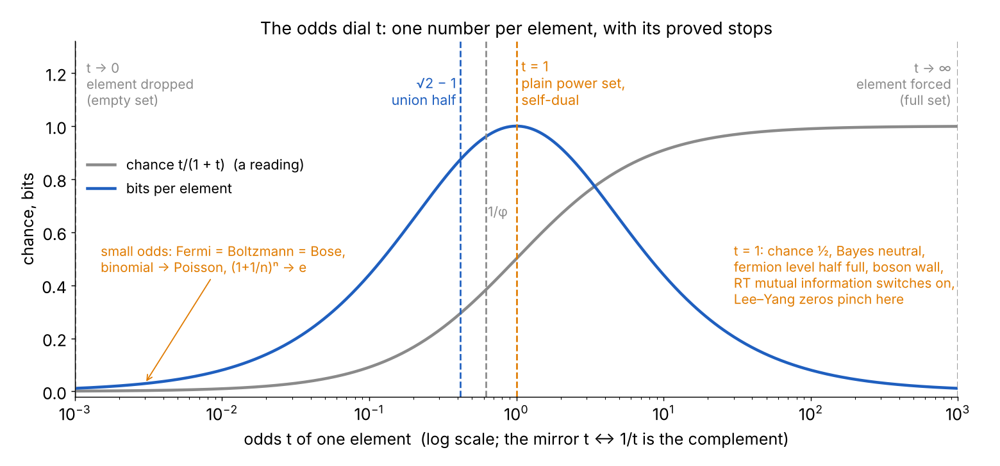

*Figure 0. The odds of one element on a log scale. Grey: the chance t/(1 + t), a reading. Blue: the bits the element
carries, which peak at t = 1. The proved stops: t → 0 (dropped), √2 − 1 (union half), t = 1 (plain power set, the
complement's mirror point), t → ∞ (forced). 1/φ is marked only to show it is not a stop.*

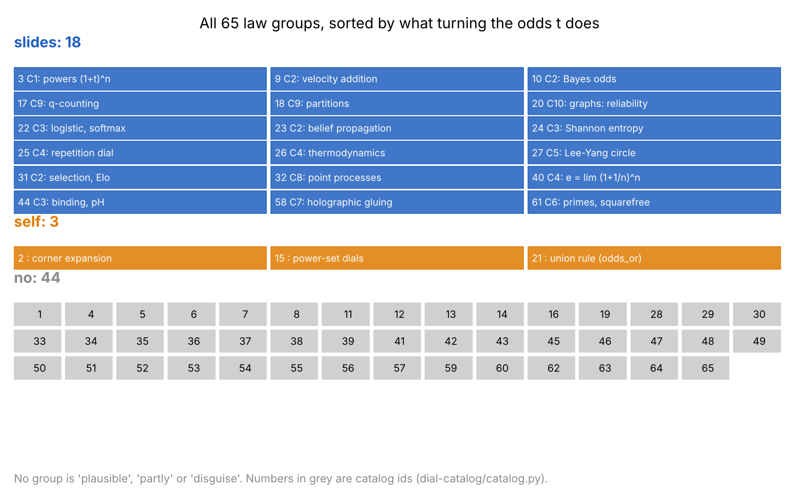

*Figure 1. All 65 groups, sorted. Blue tiles slide (with their candidate), orange tiles are the dial itself, grey tiles
(catalog ids) don't slide.*

---

## How I tested a slide

For each group I read its Lean module and page, asked whether a per-element weight appears in its statements, and if so
turned it in two ways: **(a) uniformly**, every element at the same t, and **(b) one element alone**, the others held
fixed. A group **slides** when both ends are proved laws (a Lean theorem or a checked page) and the quantity that carries
one to the other is exact along the whole dial and checked. When t is only the input the law composes (the law holds the
same at every t), the verdict is **no**: nothing is carried anywhere.

| Candidate | Uniform turn | One element alone |
|---|---|---|
| C1 power set | empty ↔ plain ↔ full; t = 2^a − 1 is the exponent a | total is a straight line in that element's (1 + t) |
| C2 Bayes | — | multiply its odds by the likelihood ratio |
| C3 logistic | chance curve, entropy | cube: others unchanged; simplex: others drop |
| C4 classical | small t: all statistics agree | one level's occupation |
| C5 Lee–Yang | zeros on a circle in t | no zero inside the polydisk |
| C6 primes | s moves every t_p = p^−s | one Euler factor on or off |
| C7 holography | equal neighbours | move one interval |
| C8 k copies | tilt the whole process | tilt one mode |
| C9 geometric odds | t_i = q^i t (a profile, the third way) | — |
| C10 graphs | — | one bond: deletion ↔ contraction |

---

## C1. The power set: empty, plain, full, and the fractional exponent — slides

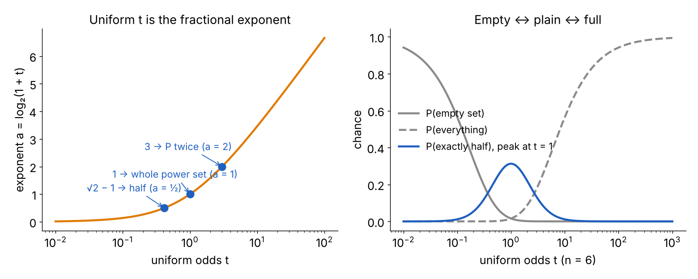

*Figure 2. Left: uniform odds t read as an exponent a = log₂(1 + t). Right: for 6 elements, the chance of the empty set,
of everything, and of exactly half, as the uniform odds turn.*

- **Ends.** All t = 0 counts 1 (`PowersetDials.total_empty`); all t = 1 counts 2ⁿ (`total_full`); t → ∞ forces every
  element (check C1d). The complement maps t to 1/t (`cell_compl`, `W_compl`; check C1e).
- **Along the dial.** Uniform t counts (1 + t)ⁿ (`total_uniform`), and t = 2^a − 1 makes that 2^(an): the dial is the
  fractional exponent, and exponents add exactly when dials join by ∘₁ (`DialSurvey.exponent_ruler`; checks C1b, C1c).
  So the Powers law 1 + t^(n) = (1 + t)ⁿ slides onto the exponent ruler. One element alone: the total is
  (1 + t₁) × (the rest), a straight line (C1f).
- **Known:** p-biased product measures, the dyadic exponent (dial-survey finding 3; `fractional-powerset-dials/`).
  **Ours:** none beyond the earlier pages.
- **Verdict: slides, known.** It is the frame every other candidate uses.

## C2. Bayes, boosts, selection: multiplying one element's odds — slides

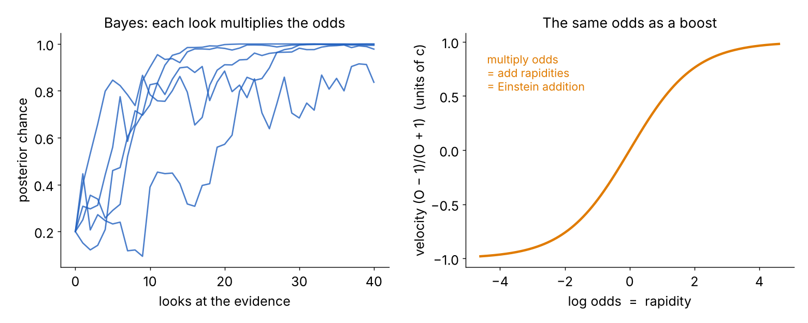

*Figure 3. Left: five runs of 40 looks at evidence; each look multiplies the odds. Right: the same odds as a velocity,
(O − 1)/(O + 1); multiplying odds adds rapidities.*

- **Ends and carrier.** Posterior odds = prior odds × likelihood ratio (`Statistics.bayes_odds`, `evidence_circ`,
  `repeated_evidence`; check C2a). Log odds add over looks (C2b). Multiplying odds is Einstein's velocity addition for
  v = (O − 1)/(O + 1) (`GameTheory.odds_is_lift`, `InformationTheory.odds_to_velocity`; C2c). One generation of haploid
  selection multiplies an allele's odds by 1 + s (`Biology.Evolution.generations_add`; C2d), and belief propagation's
  variable node multiplies odds (`InformationTheory.variable_node`).
- **Known (orange):** Bayes in odds form (Turing's weight of evidence, written up by Good 1950); the logit (Berkson
  1944); rapidity and the Doppler factor; selection as Bayesian updating (Harper 2009, arXiv:0911.1763).
- **Ours (blue):** only the placement: all four are "turn one element's odds", groups 9, 10, 23, 31.
- **Verdict: slides, known.** No new lead.

## C3. The logistic reading; cube against simplex — slides

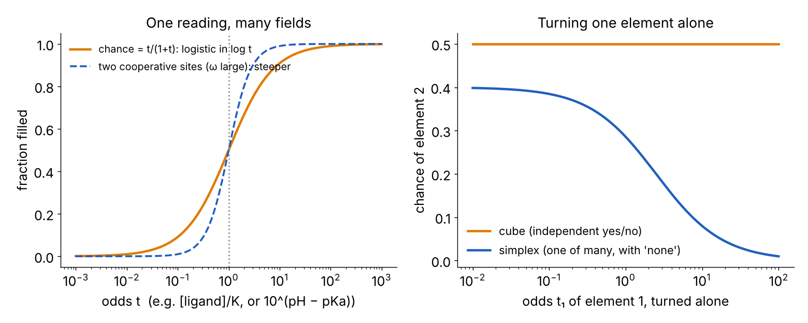

*Figure 4. Left: the fraction filled, t/(1 + t), with t as ligand over K or 10^(pH − pKa); two cooperative sites are
steeper. Right: turning element 1's odds alone. Read as independent yes/no (cube), element 2 does not notice; read as
one of many (simplex), it drops.*

- **Uniform turn.** The chance runs 0 → ½ → 1 and is the logistic function of log t (C3a). The bits carried, n·h(t/(1 + t)),
  run 0 → n → 0 with the peak at t = 1 (C3e; at t = 1 the 2ⁿ states of `Thermodynamics.landauer_states`). For binding,
  per-site odds [L]/K give Langmuir's saturation, and two sites with cooperativity ω > 1 have no real zero
  (`Chemistry.ChemEquilibrium.binding_dial`, `cooperative_no_real_zero`; C3d), a two-site Lee–Yang.
- **One element alone.** The same odds can be read on the cube (t_i/(1 + t_i), independent) or on the simplex
  (t_i/(1 + Σt), one of many). Turning t₁ leaves the other cube chances fixed; on the simplex the others fall but keep
  their ratios (C3b). At small odds the two readings agree (C3c), which is why the shape-dial survey saw "logistic vs
  softmax" as a k move.
- **Known:** Verhulst's logistic; Berkson 1944; Langmuir 1918; Henderson 1908 and Hasselbalch 1917; Luce's choice axiom
  (1959). **Ours:** placement only.
- **Verdict: slides, known.**

## C4. Small odds: the classical limit — slides

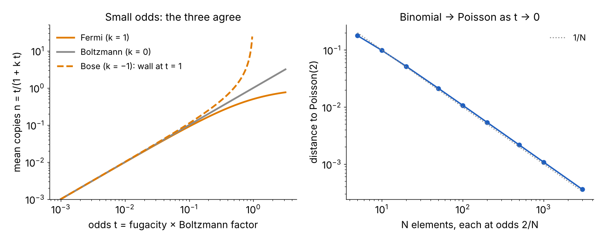

*Figure 5. Left: mean copies n = t/(1 + kt) for Fermi, Boltzmann and Bose; they merge at small odds, and Bose hits a
wall at t = 1. Right: N elements at odds 2/N; the count's distance to Poisson(2) falls like 1/N.*

- **Carrier.** With t = fugacity × Boltzmann factor, one level's mean copies is n = t/(1 + kt) in the repetition-dial
  page's sign (k = 1 Fermi, 0 Boltzmann, −1 Bose; `RepetitionDial.inverse_gap`, `fluctuation`;
  `Thermodynamics.fermi_velocity_num`, `boson_mode`; check C4a). The gap from Boltzmann is k t²/(1 + kt), relative size t
  (C4b). So as t → 0 all statistics give the same law.
- **Same limit, two more laws.** N elements at odds λ/N give Poisson(λ), distance falling like 1/N (C4c; the statistics
  page's binomial-to-Poisson checks). The count (1 + 1/n)ⁿ climbs to e (`E.stair`, `stair_le_s`; C4d).
- **Overlap with k.** Moving between Fermi, Boltzmann and Bose is the homothety k, not t. What belongs to t is only this:
  small odds make k stop mattering, and t = 1 is where the fermion is half full and the boson meets its wall (C8, N1).
- **Known:** Fermi 1926, Dirac 1926, Bose 1924, Einstein 1924–25; Poisson's limit (1837). **Ours:** placement.
- **Verdict: slides, known.** Useful as a sentence in the dial map: t is the classical-limit dial.

## C5. Lee–Yang: the uniform odds is the fugacity — slides

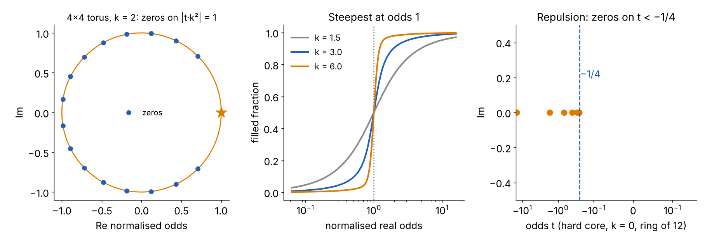

*Figure 6. Left: the zeros of the dial gas Σ t^|S| k^e(S) on a 4 × 4 torus at k = 2, in normalised odds t·k²: all on the
unit circle; the star is t = 1. Middle: the filled fraction along real odds steepens at normalised odds 1 as k grows.
Right: with repulsion (hard core, k = 0) the zeros move to the negative axis, beyond −1/4.*

- **Uniform turn.** The dial gas of `lee-yang/` is the power set with uniform odds t and pair weight k. For k ≥ 1 every
  zero lies on |t·k^(deg/2)| = 1: on a 12-ring, |kt| = 1 (C5a); on the 4 × 4 torus, |t k²| = 1 (C5b). In normalised odds
  the complement t → 1/t maps the polynomial to itself (palindromic, C5c), which is why the circle is where it is.
  Along real odds the density is exactly ½ at normalised odds 1 (C5e), and as k grows the zero nearest the real axis
  closes in on that point (C5g: angle 1.24, 0.56, 0.30 rad at k = 1.5, 2.5, 4). A real slide from the empty phase to the
  full phase can only jump there.
- **One element alone.** Z ≠ 0 whenever every normalised per-site odds is inside the unit disk (1,500 random samples,
  smallest |Z| = 0.21; C5d). This is the original multi-variable Lee–Yang theorem.
- **Repulsion.** At k = 0 the zeros sit on the negative odds axis, none in (−1/4, 0) on the ring (C5f), the Shearer point
  for degree 2.
- **Known:** Yang and Lee, Phys. Rev. 87, 404 and Lee and Yang, Phys. Rev. 87, 410 (1952), stated with one fugacity per
  site; Asano (1970) and Ruelle (1971) for the contraction proof; Shearer (1985) and Scott and Sokal (2005) for the
  hard-core radius. **Ours:** the placement (Lee–Yang as the complement's mirror circle on the odds dial).
- **Verdict: slides, known.** It explains why the Lee–Yang page's walls sit where they do, nothing more.

## C6. Primes at odds t_p = p^−s — slides

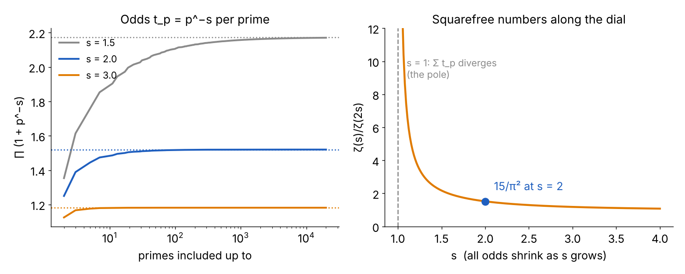

*Figure 7. Left: partial products ∏(1 + p^−s) settle on ζ(s)/ζ(2s) (dotted). Right: ζ(s)/ζ(2s) along s; the pole at
s = 1 is where the total odds Σ p^−s diverge.*

- **Carrier.** Giving each prime the odds p^−s turns the power set of primes into the squarefree numbers:
  ∏(1 + p^−s) = ζ(s)/ζ(2s) (`PowersetDials.euler_squarefree`, `squarefree_from_subsets`; checks C6a at s = 2, 3). The
  density is 6/π² (C6b: 0.607926 up to 10⁶). A boson is a tower of fermions at odds x, x², x⁴, …
  (`PowersetDials.fermi_dirac`; C6c). One prime alone: turning t₂ to 0 leaves the odd squarefree numbers (C6d).
- **Along s.** s → ∞ sends every odds to 0 (only n = 1); s = 2 gives 15/π²; s = 1 is the pole. dial-survey finding 5 and
  `dial-survey/wall/` already cover the k side (and found it is Dahlquist 1952).
- **Known:** Euler; Gegenbauer (1885) for the density; the fermionic primon gas (Spector 1990; Julia 1990).
  **Ours:** none new.
- **Verdict: slides, known.** A test bed, as dial-survey said.

## C7. Holographic gluing: the odds of the two RT phases — slides

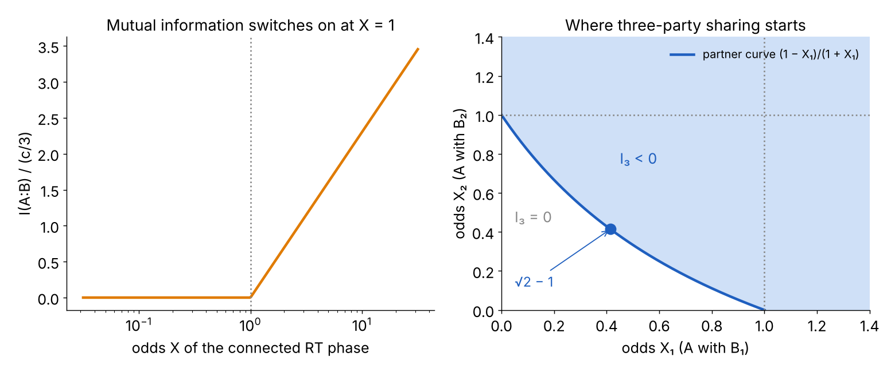

*Figure 8. Left: Ryu–Takayanagi mutual information as a function of the odds X: zero up to X = 1, then log X. Right: for
A next to touching B₁, B₂, the region where I₃ < 0 (blue). Its edge inside the box X₁, X₂ < 1 is the partner curve, with
√2 − 1 on the diagonal.*

- **Ends and carrier.** The odds X = x/(1 − x) of the cross-ratio picks the phase: disconnected (I = 0) for X ≤ 1,
  connected (I = (c/3) log X) above. Gluing touching intervals is X₁₂ = X₁ ∘₁ X₂ (`HoloGluing.odds_glue`; checked on
  500 interval triples, C7a), and monogamy follows (`HoloGluing.monogamy_glued`; C7b). The switch is at X = 1 exactly
  (C7c): the t = 1 stop.
- **One element alone.** Moving one interval turns its odds; I₃ stays ≤ 0 all the way, and it first goes negative on
  the partner curve (N2).
- **Known:** the x = ½ transition and I = (c/3) max(0, log X) (Headrick 2010, arXiv:1006.0047); monogamy of holographic
  mutual information (Hayden, Headrick and Maloney 2013, arXiv:1107.2940). **Ours:** the gluing in odds and its Lean
  proof (`holographic-entropy-cube/`), and the onset curve (N2).
- **Verdict: slides.** Worth keeping in the holographic note for N2.

## C8. k copies: tilting multiplies the odds — slides

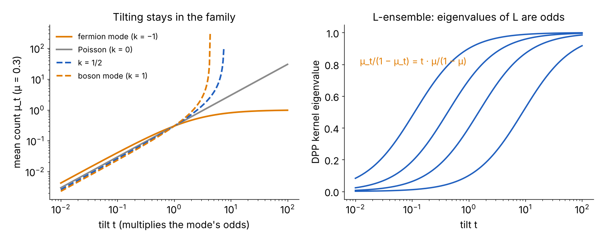

*Figure 9. Left: tilting one mode by t^N keeps it in its family (fermion, Poisson, k = ½, boson); the mean moves.
Right: for a determinantal process, the kernel's eigenvalues μ move so that μ/(1 − μ) is multiplied by t.*

- **Carrier.** One mode of the dial point processes (`dial-point-processes/`, generating function
  (1 + kμ(1 − z))^(−1/k)) tilted by t^N stays in its family, and its odds μ/(1 + kμ) is multiplied by t
  (k = −1, 0, ½, 1; check C8a). For a whole determinantal process this is the L-ensemble rule: tilting by t^|S| scales L
  by t, giving kernel tK(I − K + tK)^−1 (C8b, against brute force). The eigenvalues of L are the modes' odds.
- **What is about t, not k.** At t = 1 a fermion level is half full and a boson level's mean diverges as t → 1 (C8c).
  Which statistics a mode has is the homothety k, left to the homothety survey.
- **Known:** L-ensembles (Macchi 1975; Borodin and Rains 2005); Shirai and Takahashi (2003). **Ours:** the one-line form
  "tilting multiplies μ/(1 + kμ) for every k", not found stated, but each case is a textbook exponential tilt.
- **Verdict: slides, known.**

## C9. Geometric odds: the q-binomial theorem — slides

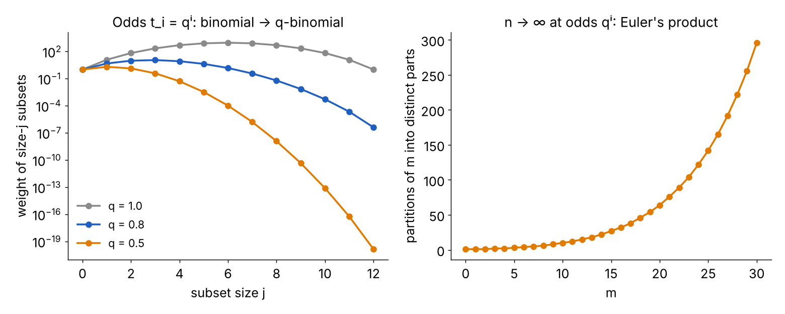

*Figure 10. Left: weights of the size-j subsets when element i has odds qⁱ; q = 1 is the binomial row. Right: with all
elements (n → ∞) at odds qⁱ, the count is partitions into distinct parts.*

- **Carrier.** This is a third way to turn t: a profile, t_i = qⁱ t. The count becomes Gauss's q-binomial sum
  Σ q^(k(k−1)/2)[n, k]_q t^k (`QAcross.QCounting.q_binomial_theorem`; check C9a), and q = 1 returns (1 + t)ⁿ (C9b).
  With n → ∞, odds qⁱ count distinct-part partitions and odds −qⁱ give Euler's pentagonal numbers
  (`QAcross.Partitions.pentagonal_30`, `euler_is_circ_30`; C9c).
- **Known:** Cauchy's binomial theorem, Gauss; Euler (1748). **Ours:** placement.
- **Verdict: slides, known.**

## C10. One bond alone: deletion slides into contraction — slides

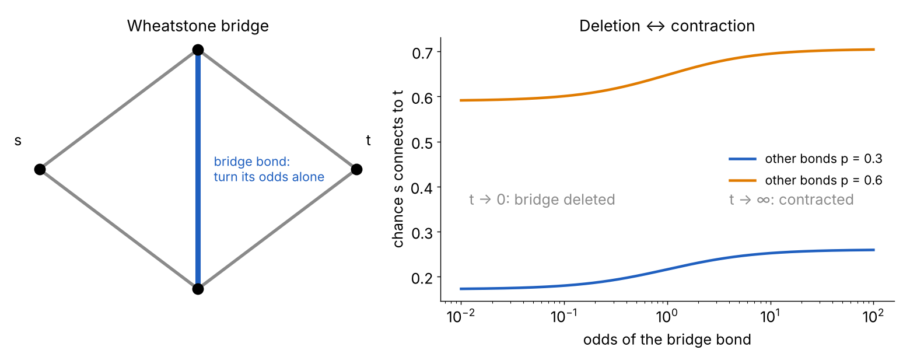

*Figure 11. The Wheatstone bridge. Turning only the bridge bond's odds moves the s–t connection chance from "bridge
deleted" (two series pairs in parallel) to "bridge contracted" (two parallel pairs in series), along a straight line in
its chance t/(1 + t).*

- **Carrier.** Reliability is multi-affine in the bond chances, so one bond alone is a straight line between deletion
  (t = 0) and contraction (t → ∞) (checks C10a, C10b), and the whole curve is 2p² + 2p³ − 5p⁴ + 2p⁵
  (`GraphTheory.wheatstone`; C10c).
- **Known:** Moore and Shannon (1956); deletion–contraction (Tutte). **Ours:** placement.
- **Verdict: slides, known.**

---

## N. New laws at in-between settings

I swept every group that depends on t over the in-between settings, uniform and one element at a time, looking for laws
that hold only strictly between the proved stops 0, 1 and ∞. Three settings came up.

| Setting | What appears there | Status |
|---|---|---|
| t = 1 | five known laws share one stop: the complement's mirror point | each law known; the shared reason is our reading (N1) |
| t = √2 − 1 | onset of holographic three-party sharing for equal neighbours; edge of the region is the partner curve | **proved here**, not found in my search (N2) |
| t = 1/φ | "both copies miss" = "one copy hits" | known puzzle; no law behind it (N3) |
| t = 2^a − 1, 0 < a < 1 | fractional exponents of the power set | known (C1; dial-survey finding 3) |
| t < 0 | hard-core zeros start at −1/4 | known (Shearer 1985; C5) |

### N1. t = 1, the self-dual stop

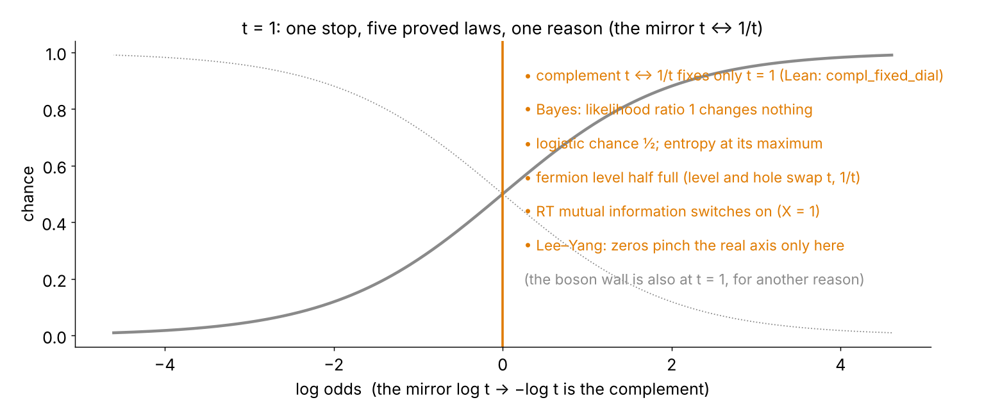

*Figure 12. Log odds against chance. The complement is the mirror log t → −log t (dotted). Five proved laws have their
special point on the mirror line; the boson wall sits there for another reason.*

- **The law.** The complement t ↔ 1/t has exactly one positive fixed point (`PowersetDials.compl_fixed_dial`; check N1a).
  Every law on the odds dial that respects the complement must have its symmetric point at t = 1: chance ½; a likelihood
  ratio of 1 changes nothing; maximum entropy; a fermion level half full (a level and its hole swap t and 1/t); the RT
  switch X = 1 (the swap x ↔ 1 − x exchanges the two RT surfaces); the real point of the Lee–Yang circle (spin flip;
  N1b, C5c, C5e). The boson wall at t = 1 is not one of these: it is where 1 + t + t² + … stops converging.
- **Status: proved** (each piece is a one-line identity already in Lean or checked here). **Known vs ours:** every piece
  is known; the observation that they are one fixed point is ours.
- **What it might be for.** A rule of thumb for the whole theory: when a law turns on, switches phase or peaks as an
  odds varies, look at t = 1 in the right normalisation first.
- **Verdict: worth a picture in the dial map**, not more.

### N2. t = √2 − 1, the union half, as the onset of three-party sharing

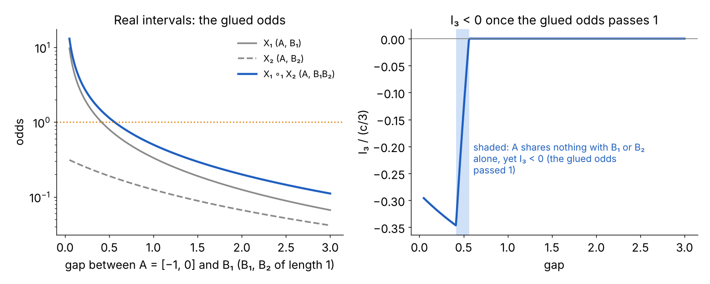

*Figure 13. Real intervals on a line: A = [−1, 0], then B₁ and B₂ of length 1, touching, at a growing gap. Left: the odds
of A with B₁, with B₂, and with the glued B₁B₂. Right: I₃. In the shaded band A shares nothing with B₁ or B₂ alone, yet
I₃ < 0, because the glued odds X₁ ∘₁ X₂ has passed 1.*

- **The law.** Take X₁, X₂ ≤ 1, so A shares no mutual information with B₁ or with B₂. Then I₃ = −(c/3) log⁺(X₁ ∘₁ X₂),
  which is negative exactly when (1 + X₁)(1 + X₂) > 2, that is when X₂ > (1 − X₁)/(1 + X₁). That curve is the partner
  curve of `fractional-powerset-dials/` (two dials that join to the full power set). For equal neighbours it gives
  X > √2 − 1, the union half (`PowersetDials.half_dial`, `partner_fixed_iff`), the same number as the lens fixed point
  in `Thermodynamics.lens_fixed_point`.
- **Proof.** Two lines from the RT formula I = (c/3) log⁺X and the gluing law X₁₂ = X₁ ∘₁ X₂ (Lean: `odds_glue`).
- **Checks.** N2b (threshold at √2 − 1 to 4 digits), N2c (400 random pairs, edge = partner curve), N2d (real intervals:
  RT lengths reproduce the odds formula, and I₃ < 0 starts where the glued odds passes 1), P1 (polish: the root is
  √2 − 1 to 30 digits).
- **In print.** Headrick (2010) has the x = ½ switch; Hayden, Headrick and Maloney (2013) prove I₃ ≤ 0 but give no
  threshold. My searches (listed under Known vs new) did not find the partner-curve edge or the √2 − 1 onset stated.
  It is a two-line corollary, so it may be folklore.
- **What it might be for.** A clean example of entanglement that exists only among three parties: A is uncorrelated
  with each half of B but correlated with the whole, and the odds dial says exactly where that starts.
- **A negative check.** √2 − 1 = tan(π/8), and π/8 is also Bell's optimal angle. But in the Born rule the odds is
  tan² of the angle, (√2 − 1)² = 3 − 2√2, so no law joins the two (N2e). It is two ways of halving 45°.
- **Verdict: a neat fact for the holographic note.** Not a lead on its own.

### N3. The golden ratio is not a stop

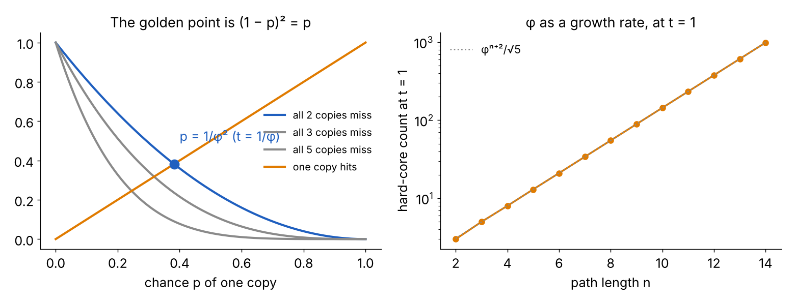

*Figure 14. Left: the chance that all copies miss against the chance that one hits; with two copies they cross at
p = 1/φ², odds 1/φ. Right: φ does appear on this dial, but as a growth rate at t = 1 (the hard-core path counts
Fibonacci numbers), not as a setting of t.*

- **What happens at t = 1/φ.** t ∘₁ t = 1/t: two independent copies together have the odds of the complement of one,
  i.e. (1 − p)² = p with p = 1/φ² (N3a, P4). It is the root of a quadratic; nothing else on the dial meets it.
- **Where φ really shows.** At t = 1 the hard-core gas on a path counts Fibonacci numbers, growing by φ per site (N3b).
- **Verdict: no law. Not worth following.**

---

## Assumptions

- The sort uses the 65 groups of `dial-catalog/catalog.py` and reads each group through its Lean modules and pages as
  of Nov 26. A group gets "slides" when at least one of its laws slides; the group's other laws may not move (group 23:
  belief propagation moves, Rényi does not).
- "Uniform" means every element at the same t; C9 uses a geometric profile, a third way, and says so.
- C5 uses the dial gas with pair weight k ≥ 1 and normalised odds t·k^(deg/2) on regular graphs; the circle statements
  are checked on a 12-ring and a 4 × 4 torus, not proved here (they are Lee and Yang's theorem).
- C7 and N2 assume the Ryu–Takayanagi formula for intervals in the vacuum of a holographic CFT₂, as the holographic page
  does. N2 is proved under that assumption; on real intervals it is checked numerically (N2d).
- C4 uses the repetition-dial page's sign for k (k = 1 Fermi). The dial-survey Lean file uses the opposite sign; the two
  agree once read as weight against probability (`names-review/`).
- Numeric only: C4c (Poisson distance), C5a–g (zeros), C6a–b (prime products, density), C8b (one random kernel),
  C10a (sampled points on an exact line), N2c–d. Everything else is exact (sympy) or a closed form.

## Known vs new

| Item | Status | Source |
|---|---|---|
| Uniform odds as fractional exponent, complement 1/t | Known | p-biased measures; dial-survey finding 3 |
| Bayes in odds form; logit | Known | Good 1950; Berkson 1944 |
| Odds multiply = velocities add | Known | Doppler factor; shape-dial survey C1 |
| Selection as Bayesian update | Known | Harper 2009, arXiv:0911.1763 |
| Cube vs simplex reading, ratios kept | Known | Luce 1959 |
| Occupation t/(1 + kt), classical limit | Known | Fermi 1926; Dirac 1926; Bose 1924; Einstein 1924–25 |
| Binomial → Poisson | Known | Poisson 1837 |
| Lee–Yang circle, per-site fugacities | Known | Yang and Lee 1952; Lee and Yang 1952; Asano 1970; Ruelle 1971 |
| Hard-core zeros beyond −1/4 | Known | Shearer 1985; Scott and Sokal 2005 |
| ∏(1 + p^−s) = ζ(s)/ζ(2s), density 6/π² | Known | Euler; Gegenbauer 1885 |
| RT switch at x = ½, I = (c/3) log⁺X | Known | Headrick 2010 |
| I₃ ≤ 0 holographically | Known | Hayden, Headrick and Maloney 2013 |
| Tilting a DPP scales L | Known | Macchi 1975; Borodin and Rains 2005 |
| q-binomial theorem, Euler's pentagonal product | Known | Cauchy; Gauss; Euler 1748 |
| Reliability and deletion–contraction | Known | Moore and Shannon 1956; Tutte |
| t = 1 as the shared fixed point of five laws | Ours (a reading) | this page, N1 |
| Onset of I₃ < 0 on the partner curve, √2 − 1 for equal neighbours | **Ours, proved (two lines); not found in my search** | this page, N2 |
| Tilting multiplies μ/(1 + kμ) for every k | Ours as one line; each case textbook | this page, C8 |
| Golden point (1 − p)² = p | Known puzzle | — |

**Searches run (Nov 26, WebSearch and WebFetch):** "holographic tripartite information three adjacent intervals I3
negative threshold cross ratio phase transition"; "tripartite information adjacent intervals holographic sqrt(2)-1 OR
3-2√2 cross ratio mutual information transition 1/2 Headrick"; a read of Hayden–Headrick–Maloney (arXiv:1107.2940) for
an I₃ threshold (none given); "Lee-Yang theorem multi-affine polynomial individual fugacities polydisk Asano contraction
1970"; "golden ratio probability (1-p)^2 = p both fail equals one succeeds"; "exponential tilting determinantal point
process kernel K t(I-K+tK)^{-1} stays determinantal". None found the N2 edge. Older sources in the table are cited from
standard references and the repo's own pages, not re-fetched in this pass.

## Sources

- C. N. Yang and T. D. Lee, Phys. Rev. 87, 404 (1952); T. D. Lee and C. N. Yang, Phys. Rev. 87, 410 (1952).
- T. Asano, Phys. Rev. Lett. 24, 1409 (1970); D. Ruelle, Phys. Rev. Lett. 26, 303 (1971); J. Borcea and P. Brändén,
  "The Lee–Yang and Pólya–Schur programs II", arXiv:0809.3087.
- J. B. Shearer, Combinatorica 5 (1985); A. D. Scott and A. D. Sokal, J. Stat. Phys. 118 (2005).
- M. Headrick, "Entanglement Rényi entropies in holographic theories", Phys. Rev. D 82, 126010 (2010), arXiv:1006.0047.
- P. Hayden, M. Headrick and A. Maloney, "Holographic mutual information is monogamous", Phys. Rev. D 87, 046003 (2013),
  arXiv:1107.2940.
- I. J. Good, *Probability and the Weighing of Evidence* (1950); J. Berkson, J. Amer. Statist. Assoc. 39 (1944);
  R. D. Luce, *Individual Choice Behavior* (1959); M. Harper, "The replicator equation as an inference dynamic",
  arXiv:0911.1763 (2009).
- E. Fermi, Z. Phys. 36 (1926); P. A. M. Dirac, Proc. R. Soc. A 112 (1926); S. N. Bose, Z. Phys. 26 (1924); A. Einstein,
  Sitzungsber. Preuss. Akad. Wiss. (1924, 1925).
- O. Macchi, Adv. Appl. Probab. 7 (1975); A. Borodin and E. M. Rains, J. Stat. Phys. 121 (2005); T. Shirai and
  Y. Takahashi, J. Funct. Anal. 205 (2003).
- L. Gegenbauer (1885) on squarefree density; B. Julia (1990) and D. Spector (1990) on the primon gas.
- E. F. Moore and C. E. Shannon, J. Franklin Inst. 262 (1956).
- Repo pages: `dial-survey/`, `fractional-powerset-dials/`, `fractional-powerset/`, `dial-point-processes/`,
  `holographic-entropy-cube/`, `repetition-dial/`, `lee-yang/`, `statistics/`, `thermodynamics/`, `affine-names/` §6,
  `corner-weights/`, `decrement-paths/`, `fractal-dials/`, `actuarial/`, `riemann/`.
