# Operations catalog: the moves we keep using, and what to call them

*Nov 25, 2026. Brennan asked (timeline, voice): "If there's any other basic operations like this one that we're using that don't have coined names of their own, I'd like to know. They're basically combinations of functions. I would like to be able to start using the shorthand version of them." And: "the shifting and bending and the different dialing, using of the dials. What could be operations?"*

Checks: `checks.py` → `checks_output.txt`, **33 of 33 pass** (mpmath). Usage counts: `count_uses.py` → `count_uses_output.txt`, `counts.json`. Pictures: `figures.py` → `figures/`, one per operation. No Lean file is added here; every identity checked below is either already in the library (cited by theorem name) or one line of algebra.

## Decision, Nov 25

Brennan said yes (voice) to all five proposed shorthands, all marked ours, for the 1.0 rename pass: **ℓₖ** (lift), **φₖ** (flip), **a +⁽ˢ⁾ b** (replaces B_s), **fuse**, and **σ_c** (slide). Recorded in `roadmap/ROADMAP-1.0.md`, item 4. Nothing is renamed yet. The standard-name switches (f₊ for transport, Lₖ for bend/ruler/flat coordinate, a′ for way back, "class" for country) were not part of that question and are still open. Citation to add: Bennett 1915 on the fractional-rungs pages.

## Result in plain words

1. **Most of our moves are one known operation done with different maps.** Shifting, bending, flipping, mirroring, sliding, rescaling, climbing a rung and fusing all have the same shape: take an operation ∗ and a map f, and form f₊(∗)(a, b) = f(f⁻¹(a) ∗ f⁻¹(b)). This has standard names: *transport of structure* (Bourbaki), *conjugation*, and for f⁻¹(f(a) + f(b)) a *quasi-sum* with *generator* f (Aczél 1948). So we don't need a new word. We need the notation **f₊**, and then each move is just "which f". (Figure 1.)
2. **Every dial move on the (k, d) plane comes from two maps: slide x ↦ x/(1 + cx) and rescale x ↦ λx.** Mirror is rescale with λ = −1, and the weight/probability flip is a slide with c = k. Slides keep the discriminant k² − 4d; rescaling keeps its sign. So every two-dial law is exactly one of three: plain +, velocity addition (a + b)/(1 + ab) (the class of ∘ₖ), or tangent addition (a + b)/(1 − ab). This is known (Coleman–McGuinness 1991), and our "countries" are exactly these classes. (Figure 11.)
3. **A few of our own words already have standard names we should switch to:** "bend", "ruler" and "flat coordinate" are all *the logarithm of the formal group law* (write Lₖ); "way back" is the *quasi-inverse*; the "wall" −1/k is the *absorbing element* of ∘ₖ (it absorbs everything: wall ∘ₖ b = wall, and it lifts to 0). The wall is the project's single most used word (about 2,260 matches).
4. **Only four things earn a new shorthand, and each is marked ours:** ℓₖ for the lift 1 + kx, φₖ for the flip, **a +⁽ˢ⁾ b** for the height-s operation (today's B_s clashes with Bernoulli numbers, B₂ = 1/6), and "fuse" for transport by x ↦ x − 1 (the repo's own namesake). An optional fifth is "slide" σ_c.
5. **One citation is missing.** Our climb (transport by eˣ − 1) is a close cousin of Bennett's commutative hyperoperations (Annals of Math. 17, 1915), which climb by transport with exp. Since eˣ − 1 = (x ↦ x − 1) ∘ exp, our climb is Bennett's climb followed by a fuse. The fractional-rungs pages should cite Bennett.

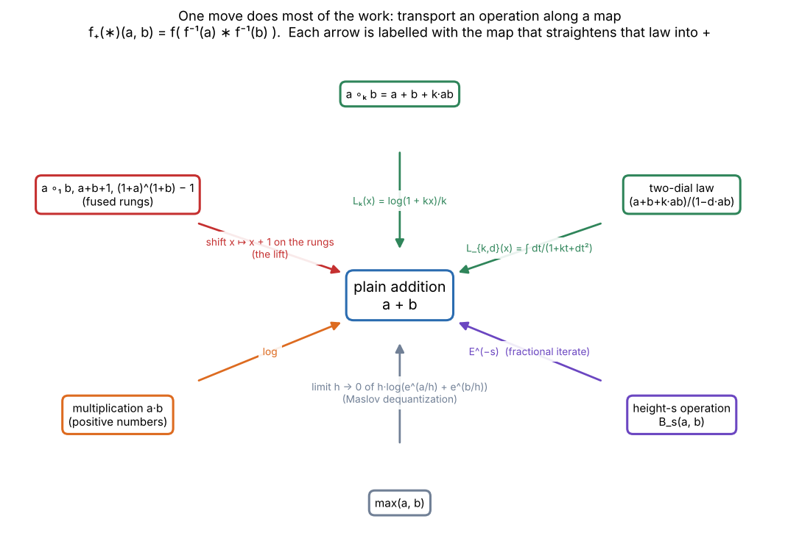

## Summary table

"Uses" counts regex matches of the move's words and formulas across 946 files in math-theory (pages, checks, Lean). It is rough: "wall" and "lift" pick up some other senses, and Lean files are mirrored in two folders, so treat the numbers as an order of magnitude.

| # | Operation | Formula | Existing name | Proposed shorthand | Known / ours | Uses (files) |
|---|---|---|---|---|---|---|
| 1 | Transport | f₊(∗)(a,b) = f(f⁻¹a ∗ f⁻¹b) | transport of structure; conjugation; quasi-sum (Aczél) | **f₊** (standard pushforward notation) | known | 305 (126) as "climb/conjugat/transport"; every row below is one |
| 2 | Lift | ℓₖ(x) = 1 + kx | adjoint-group map a ↦ 1 + a (Jacobson); growth factor 1 + i | **ℓₖ** | map known; symbol ours | 1,515 (340) |
| 3 | Quasi-inverse ("way back") | a′ = −a/(1 + ka) | quasi-inverse (Perlis 1942, Jacobson 1945) | **a′** (Jacobson's) | known | 127 (48) |
| 4 | Wall | −1/k, with −1/k ∘ₖ b = −1/k | absorbing (zero) element of the monoid | keep "wall", note the standard name | known | 2,258 (367) |
| 5 | Circle power | a^(∘ₖ n) = ((1+ka)ⁿ − 1)/k, any real n | circle power; compound growth | **a^(∘ₖ n)** | known | 936 (154) |
| 6 | n-fold combine | ∘ₖ(a₁..aₙ) = (Π(1+kaᵢ) − 1)/k = Σ k^(m−1)e_m; det(I+kA) = 1 + k·D_k(A) | weighted elementary symmetric sum; Fredholm/characteristic coefficients | write ∘ₖ(a₁, …, aₙ) | known | 222 (76) |
| 7 | Möbius inversion | alternating sum over the cube | Möbius inversion (Rota 1964) | none needed | known | 16 (11) |
| 8 | Flip | φₖ(x) = x/(1 + kx), carries ∘ₖ → ∘₋ₖ; φₖ = −(quasi-inverse) | odds↔probability (k = ±1); Tsallis additive duality | **φₖ** | map known; symbol ours | 487 (89) |
| 9 | Mirror | x ↦ −x: a ∘₋ₖ b = −((−a) ∘ₖ (−b)) | sign-convention switch (Divinsky vs Coleman–Easdown) | none (it is −x) | known | 222 (83) |
| 10 | Logarithm ("bend", "ruler", "flat coordinate") | Lₖ(x) = log(1+kx)/k; L_{k,d}(x) = ∫₀ˣ dt/(1+kt+dt²) | logarithm of the formal group law (log_F); Aczél generator | **Lₖ**, L_{k,d}; retire "bend/ruler" | known | 572 (158) |
| 11 | k-log / k-exp | (xᵏ−1)/k; (1+kx)^(1/k) | Box–Cox (1964); Tsallis q-log/q-exp with q_T = 1 − k | keep "k-log", "k-exp" | known | 77 (31) |
| 12 | Slide (chart change) | x ↦ x/(1+cx): (k,d) → (k+2c, d+kc+c²) | strict isomorphism of formal group laws; Möbius map fixing 0 | "slide" **σ_c** (optional) | map known; word ours | 43 (13), but it underlies every class result |
| 13 | Rescale | x ↦ λx: (k,d) → (λk, λ²d); h→0 limit gives max | change of units; Maslov dequantization (tropical limit) | none | known | 156 (85) |
| 14 | Classes ("countries") | sign of k² − 4d | isomorphism classes (Coleman–McGuinness); discriminant of a quadratic form | say "class" | known | 416 (125) |
| 15 | Turning a dial to its end | k → 0 | deformation; Inönü–Wigner contraction | none | known | 111 (40) |
| 16 | Height flow | E^t, E(x) = eˣ − 1 | regular (fractional) iteration (Szekeres 1958, Écalle); Abel function = Fatou coordinate | E^(∘t) or E^t | known | 296 (73) |
| 17 | Height-s operation | B_s(a,b) = E^s(E^(−s)a + E^(−s)b) = (E^s)₊(+) | none for this family; nearest is Bennett 1915 | **a +⁽ˢ⁾ b** | ours | 153 (28) |
| 18 | Climb a rung | ∗ ↦ E₊(∗); B_(s+1) = E₊(B_s) | conjugation by E; Bennett climbs with exp | **E₊** | known move | in row 1 |
| 19 | Fuse | ∗ ↦ (x ↦ x − 1)₊(∗): +→a+b+1, ×→∘₁, aᵇ→(1+a)^(1+b)−1 | conjugation by a translation | **fuse** | word ours | 449 (45) |
| 20 | Translation | T_a(x) = a ∘ₖ x = (1+ka)x + a, T_a∘T_b = T_(a∘ₖb) | left translation; regular representation | T_a | known | 84 (38) |
| 21 | Exponential tilt | reweight outcome N by t^N | exponential tilting (Esscher 1932) | none | known | 50 (15) |
| 22 | Zoom | x(s) = Σ rᵢˢ, dimension at x(D) = 1 | Moran's equation (1946) | s, D (as in the rename plan) | known | 261 (53) |
| 23 | Order gap | (1+s)x+c in two orders differ by s₁c₂ − s₂c₁ | commutator in the affine group | none | known | 197 (58) |

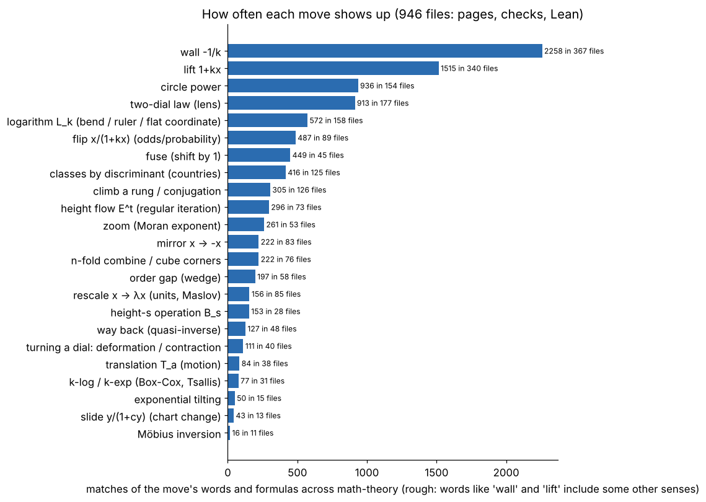

---

## 1. Transport: the one move behind most of the others

**Formula.** f₊(∗)(a, b) = f(f⁻¹(a) ∗ f⁻¹(b)): carry a, b back along f, combine there, carry the answer forward.

**Existing names.** Transport of structure (Bourbaki). Conjugation. When ∗ is +, Aczél (1948) proved every continuous, cancellative, associative operation on an interval is f⁻¹(f(a) + f(b)) for some monotone f, its *generator*; the operation is called a *quasi-sum* (Marley and Ng). In formal group law language, F(a, b) = exp_F(log_F a + log_F b). mathlib does this under "transfer" (`Equiv.mul`, `Equiv.add` in `Mathlib.Algebra.Group.TransferInstance`).

**What it buys us.** Every row of the table from 2 to 19 is f₊ with a named f, except the circle power, the combine and Möbius inversion, which are built from ∘ₖ itself. "Shifting" is f(x) = x + c, "bending" is f = Lₖ, "climbing" is f = E, "fusing" is f(x) = x − 1. Brennan's guess that these are "basically combinations of functions" is exactly right, and the literature already has the name.

**Shorthand.** f₊ (standard). Checks 9, 13, 15, 17, 19 and 24 to 30 in `checks.py`.

## 2. Lift ℓₖ(x) = 1 + kx

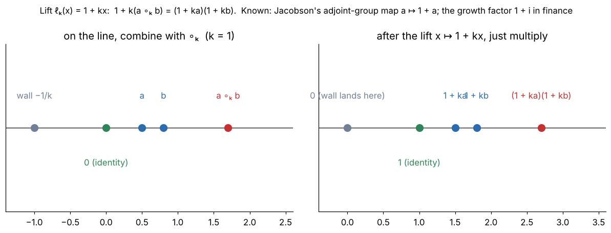

1 + k(a ∘ₖ b) = (1 + ka)(1 + kb). The lift turns ∘ₖ into multiplication and sends the wall to 0 and the identity 0 to 1. Known: for k = 1 it is the isomorphism of the circle (adjoint) group with a multiplicative group (Jacobson); in finance it is the growth factor 1 + i. Lean: `Rungs.sadd_lift` and the rest of "Lifting: every rung is the plain operation seen through x ↦ 1 + x" in `lean-library/FusedAlgebra/Rungs.lean`; `EIPi.madd` ("the lift 1 + k·x turns the dial into ordinary multiplication"). Most used in `proof-engine/lean/FusedPictures.lean`, `clifford/checks.py`, `diamond-lattice/`.

**Naming note.** "Lift" collides with the standard topology/category word (lifting a map through a cover or a functor). It is used about 1,500 times here, so renaming costs a lot. Recommend: keep the word, add a row to `names-review/NAMING-COLLISIONS.md`, and use the symbol **ℓₖ** (ours) in formulas.

## 3. Quasi-inverse ("way back") and 4. the wall

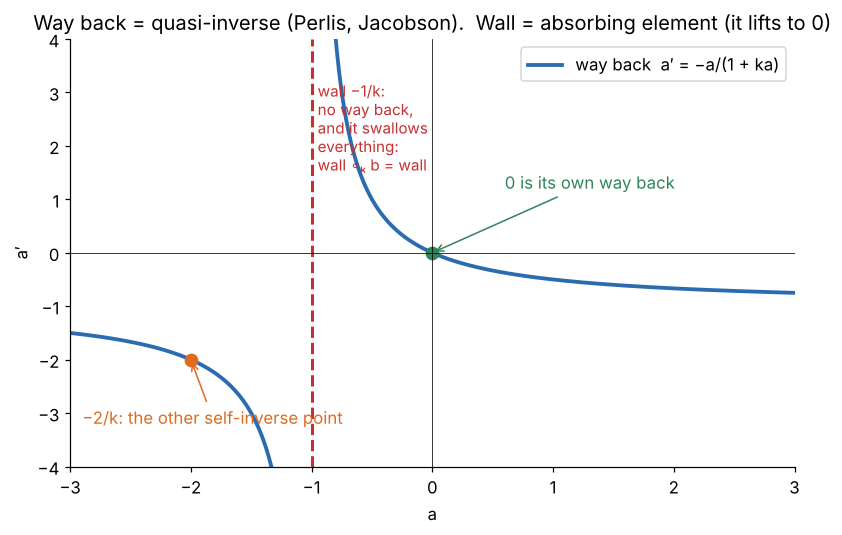

a′ = −a/(1 + ka) solves a ∘ₖ a′ = 0. Known: quasi-inverse (Perlis 1942; Jacobson 1945; mathlib `IsQuasiregular`). The names review already maps "way back" to it; recommend writing **a′** in formulas.

The wall −1/k is the one point with no quasi-inverse, and it is the **absorbing element**: −1/k ∘ₖ b = −1/k for every b (check 2). Under the lift it becomes 0, which absorbs under multiplication. That standard name explains every "wall" result at once: anything combined with the wall is the wall. Recommend keeping "wall" (already listed in the collisions page) and adding "absorbing element" to the glossary. Most used in `lee-yang/`, `axioms/lean/Axioms/MultAddRing.lean`, `complex-analysis/`.

## 5. Circle power and 6. the n-fold combine

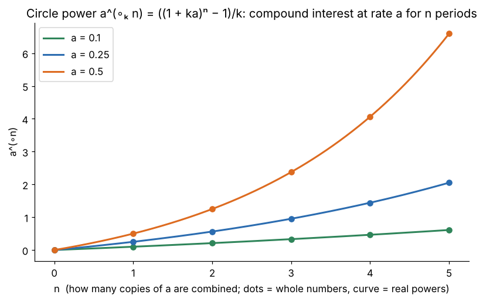

a^(∘ₖ n) = ((1 + ka)ⁿ − 1)/k is n copies of a combined; the formula works for real n (check 5: a half power combined with itself gives a). Known: circle power; compound interest. Lean: `Base.mpow`, used most in `numerical-analysis/` (`Numerical.bernoulli`), `topology/lean/HopfInvariantOne.lean`, `biology/05-development/`.

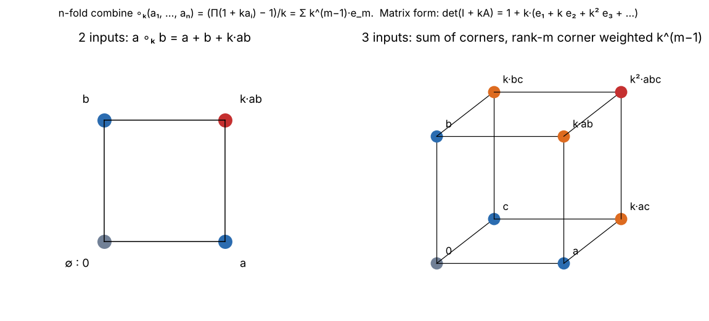

Combining n numbers is a sum over the corners of the n-cube, a rank-m corner weighted k^(m−1): Σ k^(m−1)e_m (check 6). For matrices it is det(I + kA) = 1 + k·D_k(A), D_k = e₁ + k e₂ + k² e₃ (check 7; Lean `LinearAlgebra.Dk`). Known: weighted elementary symmetric sums; the coefficients of det(I + kA) (Fredholm). Lean: `foldW` in `FunctionalAnalysis`, `Statistics`, `PvsNP`. Shorthand: just write ∘ₖ(a₁, …, aₙ), the way Σ is written for +.

## 7. Möbius inversion

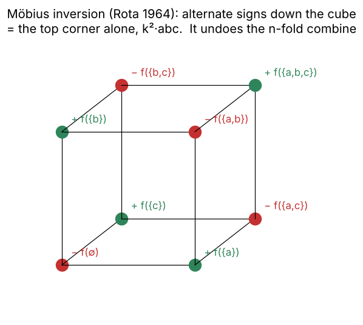

Alternating signs down the cube isolate the top corner k^(n−1)·Π aᵢ (check 8). Known: Rota 1964. Used in `boolean-lattice/`. No shorthand needed.

## 8. Flip φₖ(x) = x/(1 + kx) and 9. Mirror

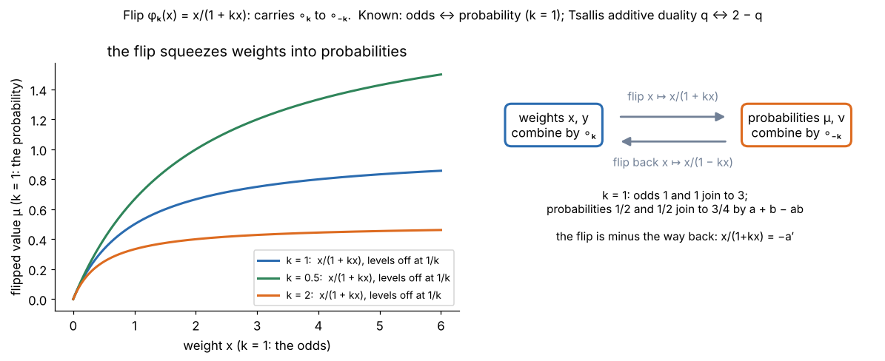

The flip carries ∘ₖ to ∘₋ₖ (check 9; Lean `Conventions.weight_prob_flip`). At k = 1 it is odds → probability, and at k = −1 probability → odds; this is the project's `odds` and `prob` (about 490 matches, most in `statistics/`, `logic-sets/`, `measure-probability/`). Known: Tsallis additive duality q ↔ 2 − q. **New small observation (ours, one line of algebra):** the flip is minus the quasi-inverse, φₖ(a) = −a′ (check 10), so "flip" and "way back" are one move. Shorthand **φₖ** (ours; the word "flip" mildly collides with flips in algebraic geometry).

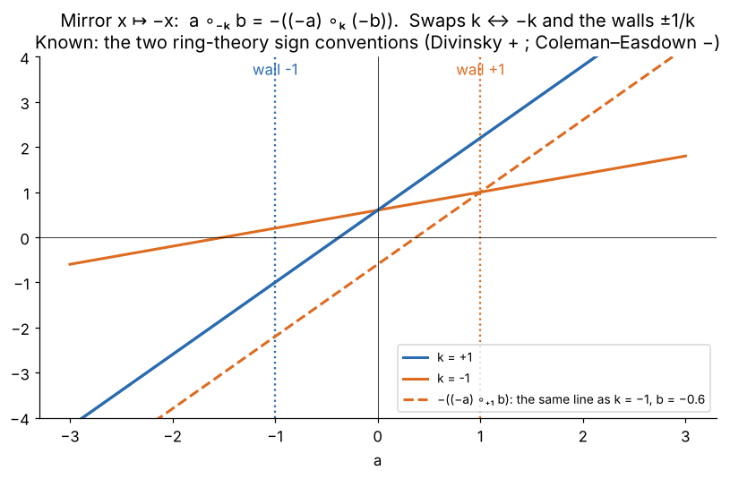

Mirror x ↦ −x: a ∘₋ₖ b = −((−a) ∘ₖ (−b)) (check 12; Lean `circle_mirror`). Known: the two sign conventions of ring theory. It is rescale with λ = −1, so it needs no symbol.

## 10. Logarithm Lₖ (our "bend", "ruler", "flat coordinate") and 11. k-log / k-exp

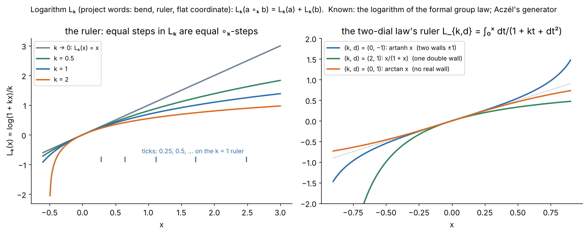

Lₖ(x) = log(1 + kx)/k turns ∘ₖ into + (check 13). For the two-dial law the same job is done by L_{k,d}(x) = ∫₀ˣ dt/(1 + kt + dt²): artanh-like with two walls, x/(1 + x)-like with one double wall, arctan-like with none (check 14, all three classes). Known: the logarithm of the formal group law (log_F), equivalently Aczél's generator. Used most in `numerical-analysis/`, `shape-directions/`, `dial-point-processes/` (`ruler`).

**Recommend** retiring "bend", "ruler" and "flat coordinate" for "the logarithm of ∘ₖ", written **Lₖ**. "Bend" also means light bending on the general-relativity pages (`GeneralRelativity.bendFrac`), so it already means two things here.

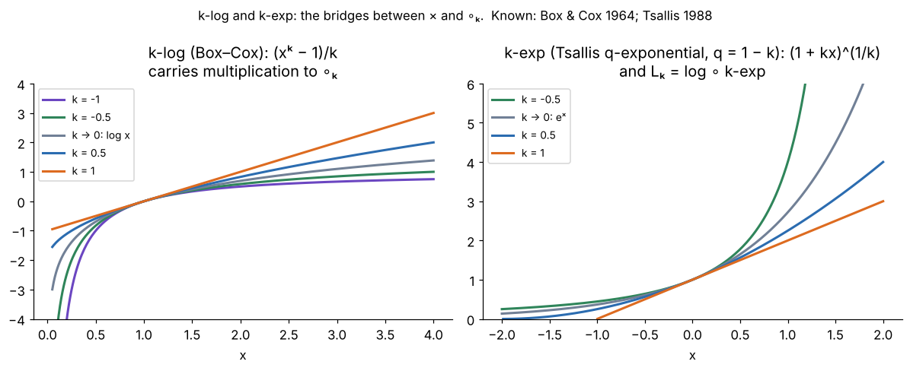

k-log (xᵏ − 1)/k carries multiplication to ∘ₖ (check 15), and Lₖ = log of the k-exp (1 + kx)^(1/k) (check 16). Known: Box–Cox 1964; Tsallis q-logarithm and q-exponential with q_T = 1 − k. Keep the words "k-log" and "k-exp". Don't write logₖ, which reads as a base-k logarithm.

## 12–15. Dial moves on the (k, d) plane

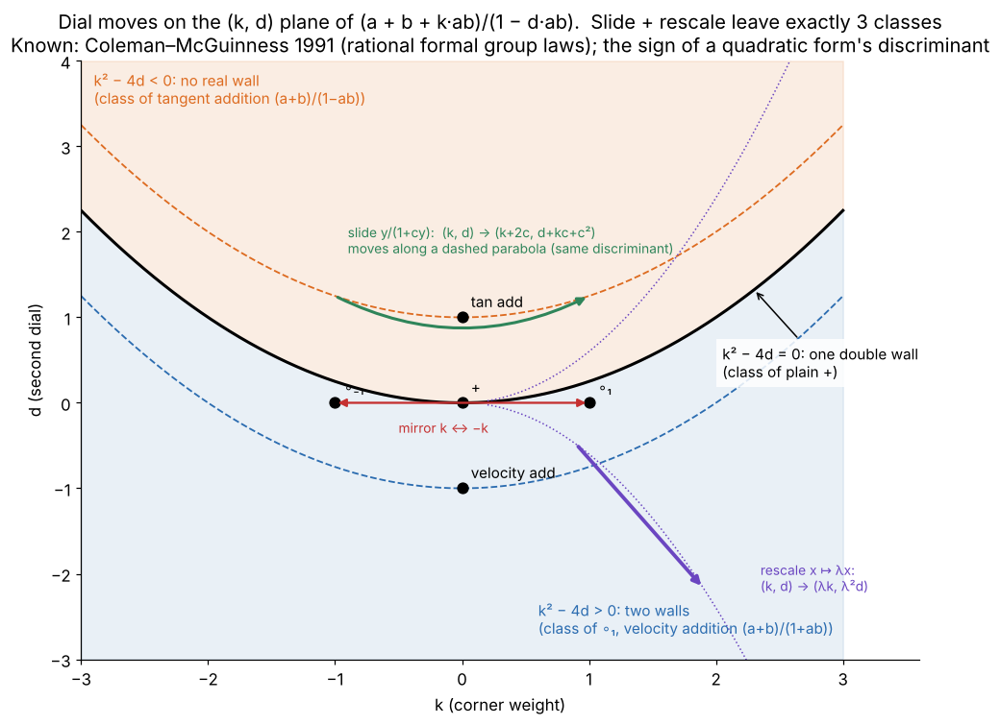

- **Slide** x ↦ x/(1 + cx) moves (k, d) to (k + 2c, d + kc + c²) and keeps k² − 4d (checks 17, 18; Lean `GroupsLie.shift_conj_num`). The flip is the slide with c = k.
- **Rescale** x ↦ λx moves (k, d) to (λk, λ²d) (check 19; Lean `circK_scale`, `units_change_weight`, `LandscapeMap.units_num`). In particular ∘ₖ is ∘₁ rescaled, which is why only the sign of k matters.
- **Three classes.** Slide to remove k, then rescale: every law lands on exactly one of +, (a + b)/(1 + ab) or (a + b)/(1 − ab) (check 21, six sample points). Velocity addition is ∘₂ seen through a slide (check 22). Known: Coleman–McGuinness 1991 classify rational formal group laws this way; over the reals the sign of the discriminant decides, as for a quadratic form. Recommend calling the "countries" *classes* in 1.0 text.
- Together, slide and rescale make the maps x ↦ λx/(1 + cx): the Möbius maps that fix 0. That is the whole set of dial moves that keep a law in the two-dial family.

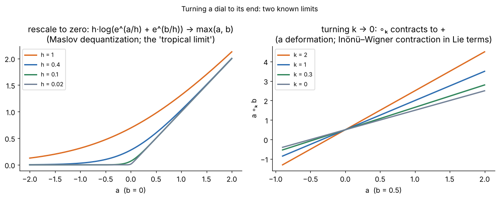

**Turning a dial to its end.** Rescaling toward zero turns log(eᵃ + eᵇ) into max (check 23; already seen in `fractional-rungs/regular_iteration_output.txt` as "zoom out B_−1"). Known: Maslov dequantization, the tropical limit (Litvinov and Maslov). Turning k → 0 contracts ∘ₖ to +. Known: a deformation; in Lie terms an Inönü–Wigner contraction. No new names.

## 16–19. Height: flow, the height-s operation, climbing and fusing

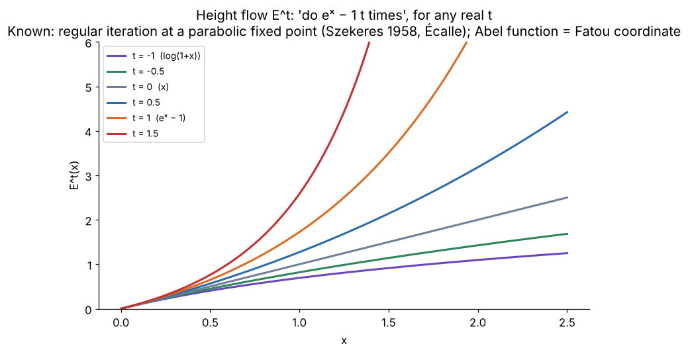

E^t is "do eˣ − 1 t times" for real t. Known: regular iteration at a parabolic fixed point (Szekeres 1958; Écalle; Lévy's algorithm). The Abel function is the Fatou coordinate. This is the other thread's ground (`fractional-rungs/`, `fractional-rungs/e-every-height/`); nothing is redone here, and the picture uses their Lévy-type limit. Standard notation is E^(∘t), and E^t is fine where nothing else is meant.

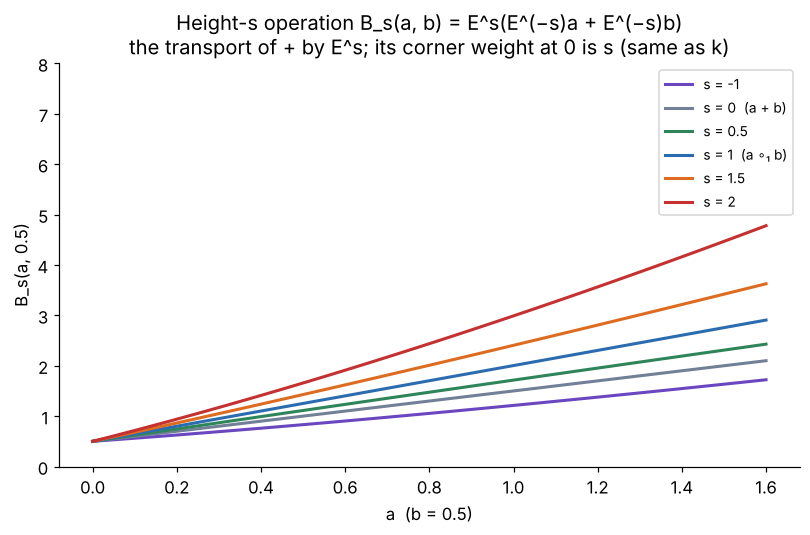

B_s(a, b) = E^s(E^(−s)a + E^(−s)b) is (E^s)₊(+): addition transported by the height flow. Its corner weight at 0 is s (`regular_iteration_output.txt`). **No standard name was found for this family.** **Proposed shorthand (ours): a +⁽ˢ⁾ b**, "addition at height s", with +⁽⁰⁾ = + and +⁽¹⁾ = ∘₁. The superscript matches E^s and keeps it apart from the dial subscript in ∘ₖ (a +⁽²⁾ b is not a ∘₂ b). The reason to change: B₂ in a mathematician's eye is the Bernoulli number 1/6, and the library already has `Bernoulli` theorems. The supernatural logarithm lnₛ(x) = E^(−s)(x − 1) from the other thread is then simply the logarithm of +⁽ˢ⁾ composed with the inverse lift.

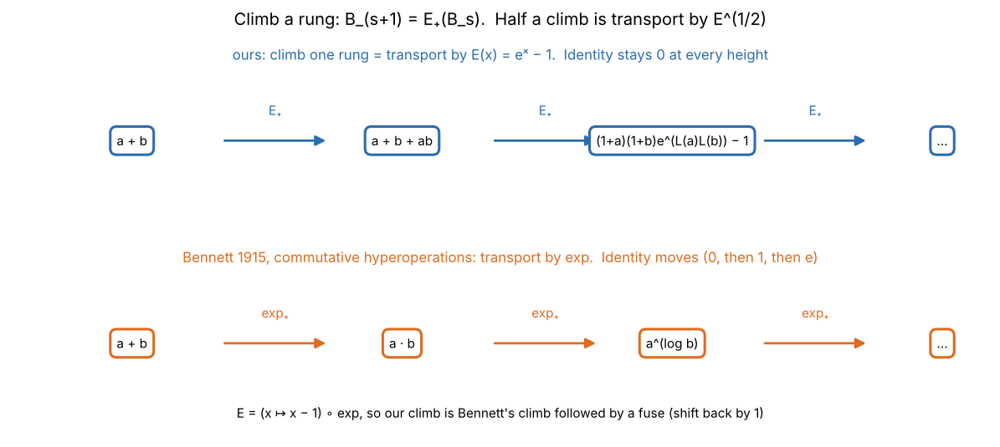

**Climb a rung**: B_(s+1) = E₊(B_s) (checks 24–26: E₊(+) = ∘₁, twice gives (1 + a)(1 + b)e^(L(a)L(b)) − 1, and down gives log(eᵃ + eᵇ − 1)). Known as conjugation. **Nearest prior work:** Bennett's commutative hyperoperations (A. A. Bennett, "Note on an operation of the third grade", Annals of Math. 17(2), 1915, 74–75) climb by transport with exp: +, ×, a^(log b), … Ours climbs with E = (x ↦ x − 1) ∘ exp (check 30), so the identity stays 0 at every height, where Bennett's moves from 0 to 1 to e. Shorthand **E₊**, no new word needed.

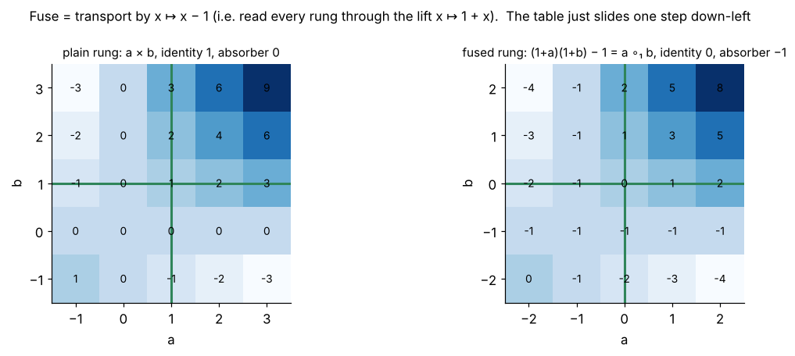

**Fuse** is transport by x ↦ x − 1, the same as reading a rung through the lift x ↦ 1 + x: + becomes a + b + 1, × becomes ∘₁, aᵇ becomes (1 + a)^(1 + b) − 1 (checks 27–29; Lean `Rungs.sadd`, `fexp`, `ftet`, `FusedPeano`). As a move it is plain conjugation by a translation (known). The word "fuse" for this one shift is ours and is where the repo gets its name; the names review already notes the mild clash with fused multiply-add.

## 20–23. Other recurring moves, all already named

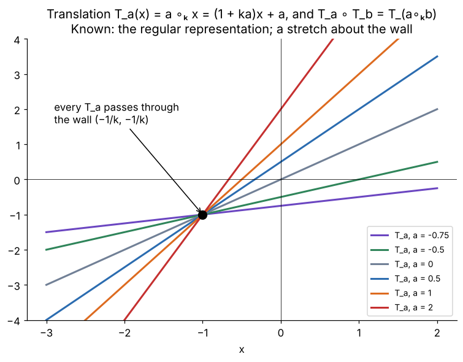

**Translation** T_a(x) = a ∘ₖ x = (1 + ka)x + a; T_a ∘ T_b = T_(a∘ₖb), and every T_a fixes the wall (checks 31, 32; Lean `T_comp`, `OrderDial.app_comp`). Known: left translation / regular representation. The order-dial page already reads ∘ₖ as "stretches about the wall".

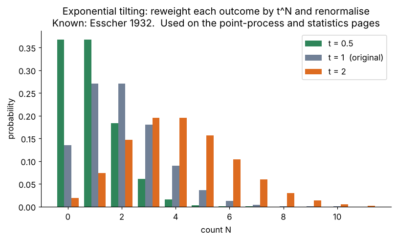

**Exponential tilt**: reweight outcome N by t^N. Known: Esscher 1932. Used in `dial-point-processes/` (`tilt_in_ruler`) and `simple-laws/`.

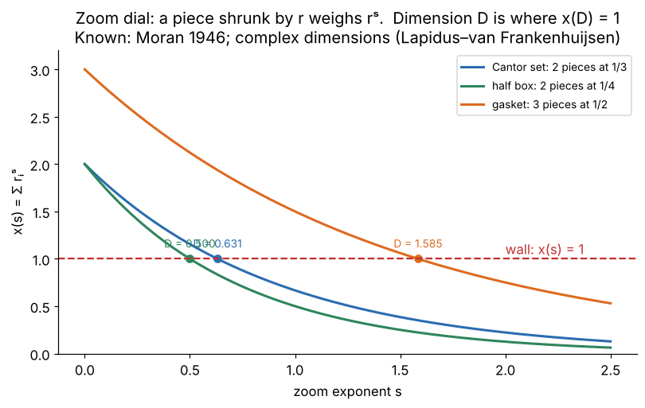

**Zoom**: Moran's equation Σ rᵢˢ = 1 (Moran 1946). Use s and D as the rename plan already says (`zoom-dial/`).

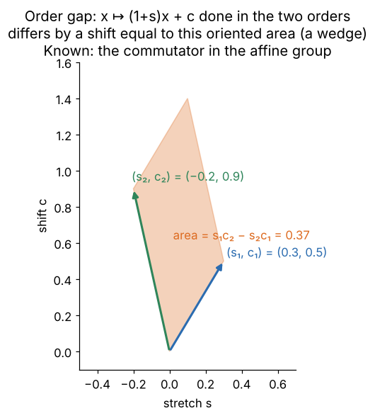

**Order gap**: two stretch-and-shifts in the two orders differ by s₁c₂ − s₂c₁ (check 33; Lean `OrderDial.order_gap`). Known: the commutator in the affine group, the same wedge as the Clifford work.

---

## What I'd adopt, in one list

- Use **f₊** for transport and say which f. Retire nothing else for this.
- Standard names to switch to: **Lₖ** "logarithm" for bend/ruler/flat coordinate; **a′** "quasi-inverse" for way back; "class" for country; "absorbing element" in the glossary beside wall.
- New shorthand, marked ours, **picked Nov 25**: **ℓₖ** (lift), **φₖ** (flip), **a +⁽ˢ⁾ b** (height-s operation, replacing B_s), **fuse**, **σ_c** (slide).
- Add rows to `names-review/NAMING-COLLISIONS.md` for lift (topology), flip (algebraic geometry), bend (internal: GR light bending), B_s (Bernoulli).
- Cite Bennett 1915 on the fractional-rungs pages.

These are recommendations. Nothing in the library, the pages or VERSION is renamed here; if Brennan picks some, the repo thread folds them into the 1.0 rename pass (`names-review/RENAME-PLAN.md`).

## Known vs ours (honest)

Every operation and dial move here is known. Ours: the observation that the flip is minus the quasi-inverse (one line), the reading of the dial moves as the Möbius maps fixing 0 acting on the landscape (standard group action, our packaging), and the proposed symbols ℓₖ, φₖ, +⁽ˢ⁾, σ_c and the word "fuse". None of this is a discovery; it is a naming and bookkeeping pass.

## Files

- `README.md` (this page), `figures/fig01`–`fig21` PNGs, `figures.py`.
- `checks.py`, `checks_output.txt` (33 of 33 pass; mpmath).
- `count_uses.py`, `count_uses_output.txt`, `counts.json` (run as `python3 -I count_uses.py <math-theory folder>`).

## Sources

- J. Aczél, "Sur les opérations définies pour nombres réels", Bull. Soc. Math. France 76 (1948); Lectures on Functional Equations (1966), §6.2. Quasi-sum name: A. A. J. Marley and C. T. Ng.
- A. A. Bennett, "Note on an operation of the third grade", Annals of Mathematics 17(2) (1915) 74–75.
- S. D. Coleman and B. McGuinness, Pacific J. Math. 147 (1991) (rational formal group laws).
- S. Perlis (1942) and N. Jacobson (1945), quasi-regularity; mathlib `PreQuasiregular`, `IsQuasiregular`.
- G.-C. Rota, "On the foundations of combinatorial theory I", 1964 (Möbius inversion).
- G. Box and D. Cox, 1964; C. Tsallis, 1988.
- G. Szekeres, Acta Math. 100 (1958); J. Écalle (regular iteration).
- G. L. Litvinov and V. P. Maslov (dequantization, idempotent mathematics).
- F. Esscher, 1932 (exponential tilting); P. A. P. Moran, 1946.
- E. Inönü and E. P. Wigner, 1953 (contractions).
