# Order-dial survey: which proved laws slide into one another (DRAFT)

> **Names:** some words or symbols on this page (fused, twist, Tsallis q) also mean something else in standard math, physics or computing, or inside this project. [NAMING-COLLISIONS.md](../../NAMING-COLLISIONS.md) says which meaning is in play.

Page: https://claude.ai/artifact/248QgzrTTc2ZUfr2qZWoxy

**DRAFT, Nov 26 2026.** Part of Affine Composition Theory (repo: fused-hyperoperation-algebra). Asked for by Brennan:
"I'd like similar surveys for the other dials as well", after the shape-dial survey ("a survey of all of our laws that
we've proven to see if the shape dial is able to move from one to another ... really all of them", then "check all laws
using the shape dial to see if a new law emerges and what it might be for", and "add a polishing step to all of our
methods, as long as it doesn't take too much effort from the computer"). This page does the same for **q, the order
dial** (or ħ, with q = e^{iħ}): two moves obey yx = q·xy, the swap gap is an oriented area (the holonomy ω, a reading),
and q = 1 is commutative.

Checks: `checks.py` → `checks_output.txt`, **54 of 54 pass** (sympy, numpy, scipy, mpmath), including 3 polish checks
at 30 digits that cost **0.25 seconds in all**. Law list: `laws.py` → `laws.json` (the 65 groups of
`../dial-catalog/catalog.py`). Pictures: `figures.py` → `figures/`. Exact helpers: `qlib.py`. No Lean in this pass.
Builds on `order-dial/` (the dial's own write-up), `q-across/`, `quantum-action/` and its `cut-independence/`,
`cube-weights/`, `rulecraft-history/`, and does not repeat them.
Colour key: **blue = our reading, orange = already known, grey = endpoints and background.**

*One line on names:* the letter q has three other meanings in this repo: q = k + 1 (Tsallis in `dial-survey/`, and the
q of `QAcross.QDial` and the toric count `fan_count`), the landscape q = d at k = 0 in `twisted-boosts/`, and the
number planes' u² = ku − q in `NumberPlane`, where q is the curvature dial d. This page surveys only the order dial.

## The result

With every other dial held still and only q turned, the 65 law groups sort like this:

- **6 groups slide** into another proved law, with the link checked exactly along the whole dial.
- **3 are plausible:** the numbers slide, but the law in between is not proved in this repo.
- **2 survive only on part of the dial** (Clifford signatures, repetition): they live at q = ±1 and nowhere between.
- **5 are another dial in disguise.** Three times the q is the homothety dial (k = q − 1); twice it is the face weight
  q = β/α, which is a reading of the curvature dial.
- **1 group is the order dial itself.**
- **48 don't slide:** they have no product of two moves whose order could cost anything.

The leads, in order. All of the mathematics is in print; what is ours is where each law sits on the dial.

1. **Binomial → q-binomial (C3).** (x + y)ⁿ with yx = q·xy has the Gaussian binomials as coefficients (Potter 1950,
   Schützenberger 1953). The dial has three proved stops: q = 1 is Pascal (Lean `gauss_at_one`, every n), q = 0 keeps
   each sorted word once, and q → ∞ keeps only the reversed word. At a root of unity the q-Lucas theorem holds
   (Olive 1965, Désarménien 1982). Its q = −1 case is already a Lean theorem here (`gauss_at_neg_one`). This is the
   cleanest slide on the dial.
2. **Face weights q^area, partitions and solitons (C5, with C2, C4 and C6).** A word's out-of-order count is the area
   under its lattice path. So one weight, q^(inversions), gives q-counting, partitions in a box, routes on the
   permutohedron and the soliton corner weights. q = 1 counts, q → 0 keeps the minimum and q → ∞ the maximum.
3. **The circle operation over q-commuting inputs (C1).** ∘ₖ stays associative for every q. Its order gap is exactly
   k(1 − q)·ab: zero at q = 1 and largest at q = −1, where repeats are forbidden (Lean `anticommute_self_zero`).
4. **Rulecraft's order of reforms under q (C7, plausible).** Weigh each order of a reform package by q to the number of
   out-of-order pairs (the Mallows model, 1957). Then q = 0 gives the best order ("sort by target", rulecraft-history
   H5a), q = 1 the plain average over all orders, and q → ∞ the worst order. The expected outcome falls monotonically
   in between in every case I checked. That follows from a coupling statement that one version of a 2017 preprint
   proves; I could not confirm it in the current version. This is a useful one-knob reading for the book, not new
   mathematics.
5. **Weyl, Heisenberg, Moyal (C8, the dial itself).** q = e^{iħ}: the swap costs the phase e^{iħω}, with ω the area
   (Lean `swap_costs_area`, `weyl`, `order_gap`). All known (Weyl 1927, Moyal 1949).

**New laws at in-between settings (section N): none that is new.** Every special in-between setting is a root of unity
(or a whole-number q, a prime power) and every law there is in print. At a primitive m-th root: the binomial collapses
to (x + y)^m = x^m + y^m; the Gaussian binomials obey q-Lucas; finite matrices with VU = q·UV exist; and
the Turaev–Viro sums truncate. At whole-number q the Gaussian binomials count subspaces over a field with q elements.
I proved the short ones and checked the rest. The plain negative result is worth having: the order dial has no
hidden stop beyond the roots of unity.

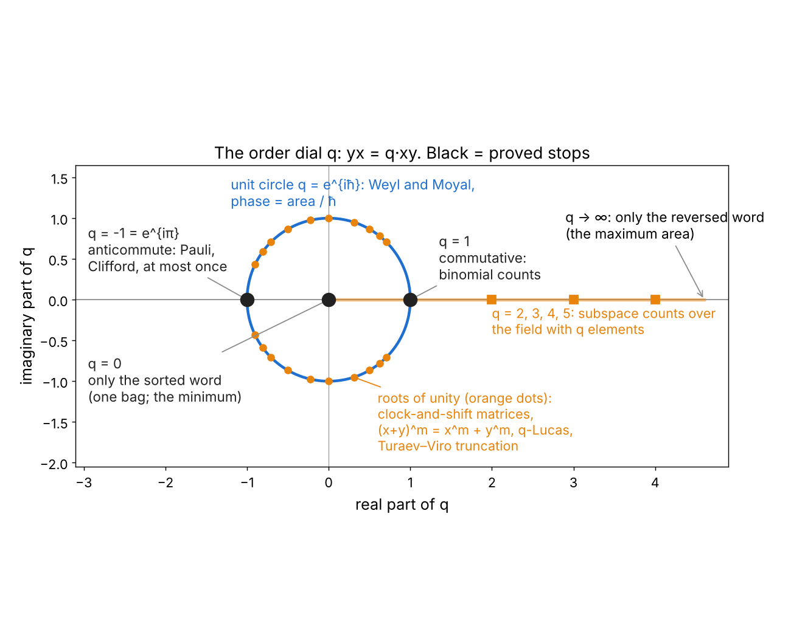

*Figure 0. The order dial lives in the complex q plane. Black: the proved stops q = 0, 1, −1. Blue: the unit circle
q = e^{iħ}, where Weyl's and Moyal's laws live. Orange: roots of unity (finite clock-and-shift matrices, the Frobenius
collapse, q-Lucas, Turaev–Viro) and the whole numbers 2, 3, 4, 5 (subspace counts). The ray toward infinity keeps only
the reversed word.*

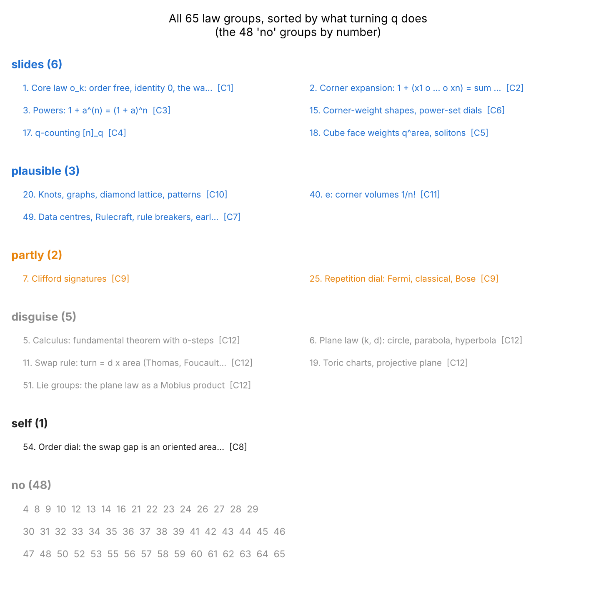

*Figure 13. All 65 groups by verdict. The 48 "no" groups are listed by number; `laws.json` has each one's reason.*

---

## How I tested a slide

For each law group I asked one question: does it hold a product of two things whose order could cost something? If yes,
I replaced the swap rule yx = xy by yx = q·xy, with every other dial fixed, and followed the law as q moves. I used the
quantum plane for two moves, the multiparameter version x_j x_i = q·x_i x_j for many, and q = e^{iħ} for phase space.
A link counts as **slides** when both ends are proved (in Lean or on a checked page) and the quantity that carries one
into the other is checked exactly along the dial (symbolic in q). **Plausible** means the numbers slide but the law in
between is not proved here. **Disguise** means the q in that law is fixed by another dial (k = q − 1, or q = β/α from
(k, d)), so turning it with that dial held still is impossible.

One fact runs through every candidate: **out-of-order pairs = area.** Each swap of a y past an x adds one box under
the word's lattice path (check E2). So q^(inversions) is q^area, and q = 0, 1, ∞ mean minimum, count and maximum.

---

## C1. The circle operation over q-commuting inputs — slides

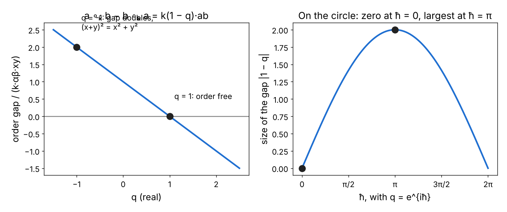

*Figure 1. Left: the order gap of ∘ₖ on (αx, βy) is k(1 − q)·αβ·xy, a straight line in q that is zero only at q = 1.
Right: on the unit circle q = e^{iħ} its size is 2|sin(ħ/2)|, largest at ħ = π (q = −1).*

- **Both ends.** At q = 1 the core law is order-free (Lean `circK_comm`). At q = −1 two copies of one thing cannot
  coexist (Lean `anticommute_self_zero`), and Pauli's X and Z anticommute (Lean `pauli`).
- **Along the dial.** ∘ₖ over the quantum plane is associative for every q and k (A1, symbolic). Its order gap is
  exactly k(1 − q)·ab (A2). At q = −1 the cross terms cancel: (x + y)² = x² + y² (A3, A4).
- **Known:** the circle operation of any ring is associative (Jacobson's quasi-regular product); the quantum plane is
  Manin's (1988). **Ours:** the reading that the order dial runs the core law from "order free" to "at most once".
- **Verdict: solid, mostly a reading.** It is the base that every other candidate stands on.

## C2. Corner expansion → soliton corners — slides

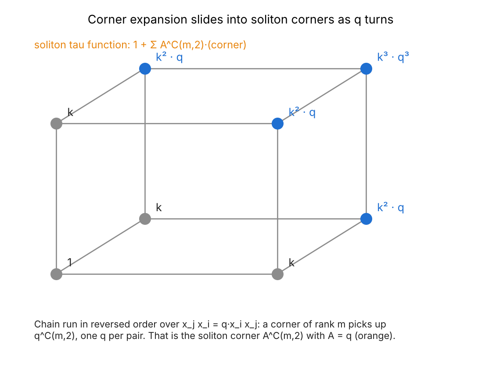

*Figure 2. Run the chain in reversed order over x_j x_i = q·x_i x_j and write the answer in sorted order. A corner of
rank m picks up q^C(m,2), one q for each pair it reversed.*

- **Both ends.** q = 1: the corner expansion 1 + (x₁ ∘ … ∘ xₙ) = Σ over corners (Lean `Base`, `Cube`). Reversed order
  at general q: the soliton tau function with equal pair weights A = q (Lean `tau3_equal_corner`).
- **Along the dial.** Every corner weight k^m·q^C(m,2), n = 3, 4 (B1, exact); in sorted order no corner picks up q (B2).
- **Known:** the vertex-operator picture of solitons (Hirota's pair weights). **Ours:** already in `cube-weights/`
  §3(b); this survey confirms it as a slide with both ends in Lean.
- **Verdict: worth keeping as the bridge between the corner stream and the soliton stream.** Nothing new beyond
  `cube-weights/`.

## C3. Binomial → q-binomial → its limits and roots of unity — slides

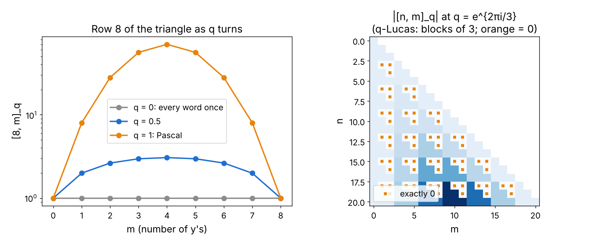

*Figure 3. Left: row 8 of the triangle at q = 0 (every coefficient 1), 0.5 and 1 (Pascal). Right: |[n, m]_q| at
q = e^{2πi/3}. The orange squares are exact zeros, in blocks of 3: the q-Lucas theorem.*

- **The law along the dial.** (x + y)ⁿ = Σ [n, m]_q x^m y^(n−m) when yx = q·xy (C1: exact for n ≤ 10). The commutative
  Cauchy form ∏(1 + q^i t) = Σ q^C(m,2) [n, m]_q t^m holds too (C5; Lean `q_binomial_theorem` for n ≤ 6).
- **Stops.**
  - q = 1: Pascal, for every n (Lean `gauss_at_one`).
  - q = 0: every coefficient is 1, so only the n + 1 sorted words survive (C3).
  - q → ∞: the top power is q^(m(n−m)), with coefficient 1: only the fully reversed word survives (C4).
  - q a primitive d-th root of unity: [n, m] = C(⌊n/d⌋, ⌊m/d⌋)·[n mod d, m mod d] (C6: exact modulo the cyclotomic
    polynomial, d = 2 to 7, n ≤ 21). The d = 2 case is the repo's Lean `gauss_at_neg_one` (C7).
- **Known:** Gauss (1808) for the polynomials; Rothe (1811) and Cauchy (1843) for the commutative q-binomial theorem.
  The q-commuting form is usually credited to Schützenberger (C. R. Acad. Sci. Paris, 1953). Potter (1950) proved it
  earlier for matrices at a root of unity, and his proof works in general. q-Lucas is Olive (1965) and Désarménien
  (1982); Sagan (1992) gave a group-action proof. **Ours:** only the placement, with all four stops proved or checked here.
- **Verdict: the cleanest slide on this dial, and fully known.** It is the backbone: C4, C5 and C6 are its special cases.

## C4. q-counting [n]_q — slides (and is also the k dial)

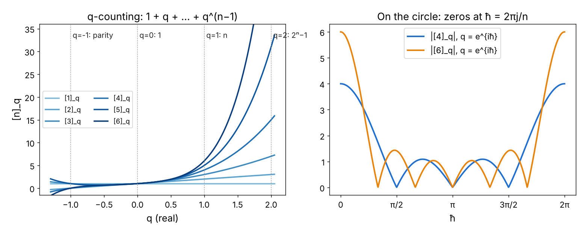

*Figure 4. Left: [n]_q = 1 + q + … + q^(n−1) on the real line, with the four Lean stops. Right: on the unit circle
|[n]_q| vanishes at ħ = 2πj/n.*

- [n]_q counts the words with one y by their out-of-order pairs (D1). Stops: n at q = 1, 1 at q = 0, parity at
  q = −1, 2ⁿ − 1 at q = 2 (D3; all Lean in `QAcross.QDial`), and 0 at a primitive n-th root (D4).
- **The same numbers are the k dial.** 1 + (q − 1)[n]_q = qⁿ (Lean `qnum_lift`, D2): [n]_q is the circle power of 1
  at k = q − 1. So on this one law the order dial and the homothety dial give the same numbers. The q = 0 stop is the
  union rule (k = −1) and q = −1 is "exclusive or" (k = −2).
- **Known:** all of it (q-integers; Gauss). **Ours:** that this is where the two dials coincide.
- **Verdict: tidy, known.** It is the honest reason the q dial and the k dial are easy to confuse.

## C5. Face weights q^area, partitions and solitons — slides

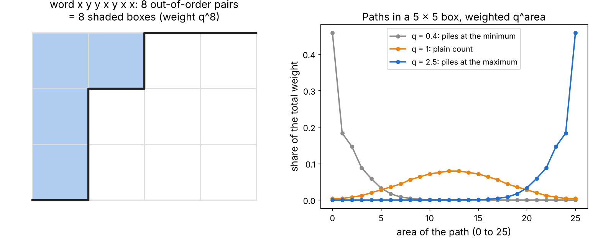

*Figure 5. Left: the word x y y x y x x has 5 out-of-order pairs, and its path has 5 boxes above it. Right: paths in a
5 × 5 box weighted q^area. As q grows the weight piles up at the maximum area; as q shrinks, at the minimum.*

- **The law.** Σ over partitions in an m × (n − m) box of q^|λ| = [n, m]_q (E1, n ≤ 10), because inversions = area (E2).
- **Stops.** q = 1 counts the C(n, m) paths (Lean `gauss_at_one`). q → 0 keeps the one path of area 0 and q → ∞ the one
  of area m(n − m) (E3). On the soliton side the theta weight q^C(m,2)·[n, m]_q is the t^m layer of the q-orbit product
  (E4; cube-weights I1), and q = 0 leaves only the cube (Lean `theta2_face`, `orbit_product_q0`).
- **Known:** partitions in a box and Gaussian binomials (Sylvester, MacMahon); the theta and partition identities in
  `QAcross.Partitions` (Euler, Jacobi). q → 0 picking the minimum is the idea behind Kashiwara's crystal bases (1990).
  **Ours:** stating the shape-dial survey's "plausible" link as a proved slide on the order dial. Its weak point was the
  middle law, and that law is C3.
- **Verdict: worth keeping.** It upgrades the shape-dial survey's C5 entry for this group from plausible to slides,
  because the right dial is q, not the shape.

## C6. Routes on the permutohedron — slides

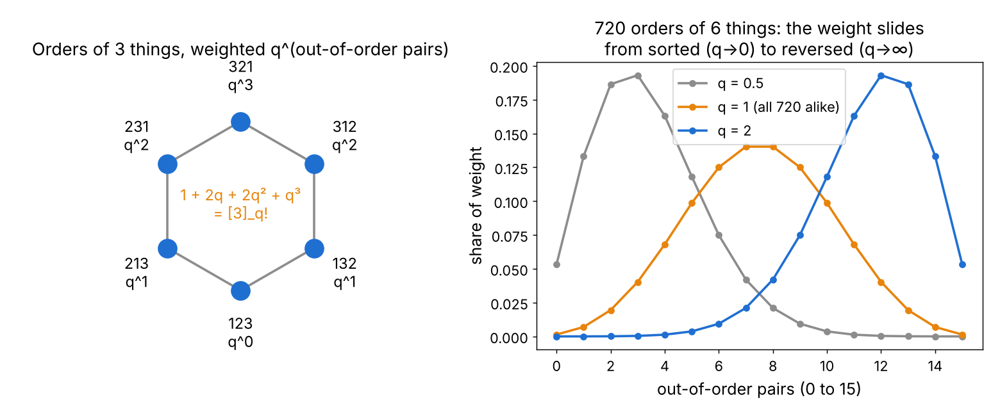

*Figure 6. Left: the six orders of three things, each weighted q to its out-of-order pairs; the sum is [3]_q!.
Right: for six things, the weight slides from sorted (small q) to reversed (large q).*

- Σ over permutations of q^inv = [n]_q! (F1, n ≤ 7). q = 1 counts n!, q = 0 keeps one route, and at a cube root of 1
  all routes cancel from n = 3 on (F2; cube-weights E2). At q = −1 the signs cancel from n = 2 (F3).
- **Known:** Rodrigues (1839), MacMahon (1916). **Ours:** nothing beyond `cube-weights/` §5. **Verdict: known; kept
  because C7 uses it.**

## C7. Rulecraft: the order of reforms under q — plausible

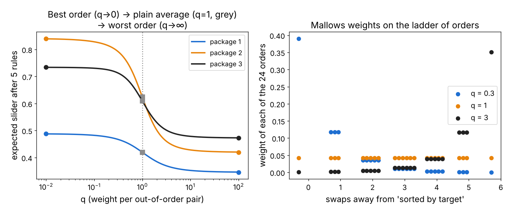

*Figure 7. Left: three packages of 5 rules. The expected slider after all 5 rules, with each order weighted q to its
out-of-order pairs. q → 0 gives the best order, q = 1 (grey squares) the plain average of all 120 orders, q → ∞ the
worst. Right: the weights of the 24 orders of 4 rules, by how many swaps they are from "sorted by target".*

- **Both ends.** At q = 0 only the order "sorted by target" counts, and rulecraft-history H5a proved it gives the
  highest outcome. The proof is the exchange step H3: each neighbour swap moves the outcome by λ₁λ₂(t₂ − t₁) times
  later shrinks. q = 1 is the plain average over all n! orders, and q → ∞ the reversed order, the lowest (G1).
- **In between.** The expected outcome falls monotonically as q grows: 300 random packages, 62 settings from 0 to 1000
  (G2), polished at 30 digits (P2). Underneath sits a stronger statement. The weights at q are dominated by those at
  q′ > q in the weak order of permutations, the order that rulecraft-history's Fig 3 draws as a ladder. I checked that
  exactly by linear programming for 3, 4 and 5 rules (G3). Since the outcome falls along every step up that ladder
  (H5b), domination gives the monotone curve.
- **Is the domination in print?** It is the Mallows model (Mallows, Biometrika 1957), and the domination appears as
  Lemma 3.3 in version 2 (Jan 2017) of Ke Jin's arXiv:1611.03840, proved by a coupling of two Markov chains. I could not
  find the statement in the current version 3 (May 2019), and one search summary called it a conjecture. So I treat it
  as not settled: checked here for n ≤ 5.
- **Known:** the Mallows model; the q-factorial normaliser; agenda power in political science (Romer and Rosenthal 1978).
  **Ours:** reading the order dial as a noisy agenda setter on Rulecraft's reform packages. q says how hard the order
  leans toward one side's favourite order. I did not find Mallows weights applied to the order of reforms or agendas
  (queries listed in Known vs new).
- **Verdict: worth using in the book, not new mathematics.** It turns "who controls the agenda" into one number that
  runs from full control (q = 0) through a random order (q = 1) to full control by the other side (q → ∞).

## C8. Weyl, Heisenberg and Moyal: the dial itself — self

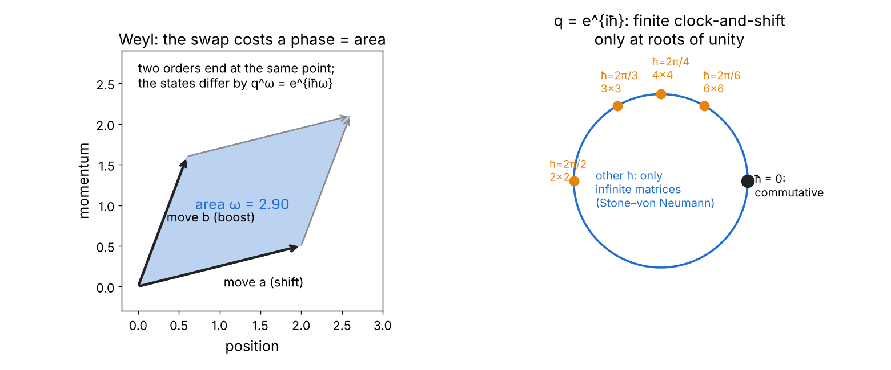

*Figure 8. Left: two moves in phase space, done in both orders, end at the same point. The states differ by
q^ω = e^{iħω}, with ω the parallelogram's area. Right: on the circle q = e^{iħ}, finite matrices exist only at roots of
unity (ħ = 2π/m, size m). Everywhere else the relation needs infinite matrices.*

- **Proved stops.** The affine order gap is a wedge (Lean `order_gap`, `commute_iff`). The Heisenberg swap costs the
  area exactly (Lean `swap_costs_area`, `triangle_loop`, `quad_loop`). The discrete Weyl relation is the swap rule with
  q = λ^a (Lean `weyl`).
- **Along the dial.** The Weyl phase is the area (H1). Moyal's product gives x⋆p − p⋆x = iħ (H2), is associative for
  every ħ (H3) and is the commutative circle operation at ħ = 0 (H4). Clock and shift give C·S = ω·S·C at ħ = 2π/m (H5).
- **Known:** Weyl (1927), Groenewold (1946), Moyal (1949), Stone–von Neumann, Sylvester's clock and shift (1882).
  **Ours:** the reading, already made in `order-dial/` §5 and `quantum-action/` §1.
- **Verdict: the dial's own home; no slide to report.** Its value is as the hub that C1–C7 hang on.

## C9. Clifford signatures and repetition: only at q = ±1 — partly

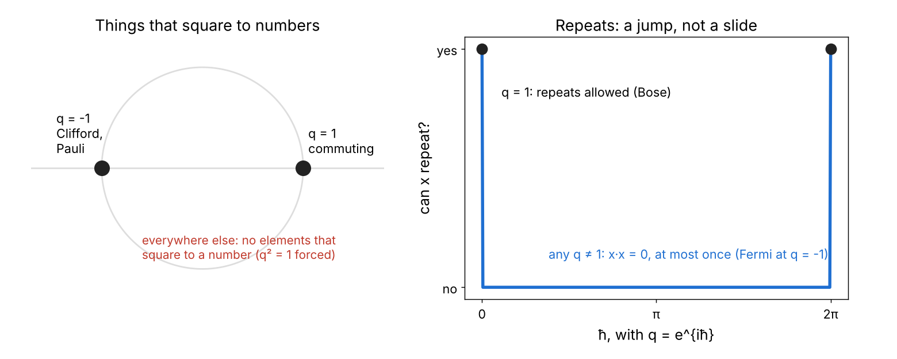

*Figure 9. Left: elements that square to a number allow only q = 1 or q = −1. Right: whether a thing can repeat jumps
from yes (q = 1) to no (any q ≠ 1).*

- **Clifford (group 7).** If e₁² = c ≠ 0 and e₂e₁ = q·e₁e₂, then moving e₁ twice gives q² = 1 (I1; order-dial G1). So
  Clifford's laws live at q = −1 (and q = 1) and break everywhere between. In-between q needs things whose m-th power,
  not square, is a number: clock and shift (C8).
- **Repetition (group 25).** x·x = q·x·x with q ≠ 1 forces x² = 0 (I2; Lean `anticommute_self_zero` at q = −1). So
  Bose counting survives only at q = 1, and every other q snaps to "at most once". It is a jump, not a slide.
  Smooth in-between counting needs a different relation, the q-oscillator aa† − q·a†a = 1 (Arik and Coon 1976;
  Biedenharn 1989; Macfarlane 1989), which is not built here. Anyons sit there too (`order-dial/` §4), unproved.
- **Verdict: an honest break.** It says plainly which laws the order dial cannot carry.

## C10. Knots: the Jones polynomial around the circle — plausible

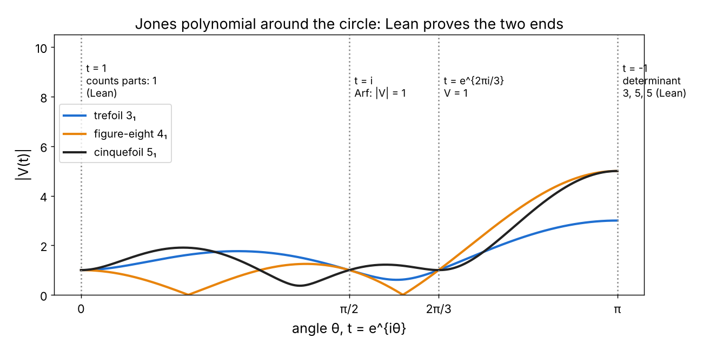

*Figure 10. |V(t)| for the trefoil, figure-eight and cinquefoil as t goes round half the circle. Lean proves the two
ends (t = 1 counts parts, t = −1 is the determinant). The two marked stops between them are known values.*

- **Both ends in Lean** (`QAcross.Knots`): V(1) = 1 for each knot, V(−1) = ±3, 5, 5 (J1). Between them:
  V(e^{2πi/3}) = 1 (J2) and V(i) = (−1)^Arf (J3), checked for the three knots.
- **Why only plausible.** The knots' t is the order dial only through the quantum group U_q(sl₂). The repo checked
  that group as the symmetry of the quantum plane (cut-independence Q2–Q3), and Lean proves the loop value is −[2]
  (`loop_value_q`). But the step from the plane's R-matrix to the Jones polynomial is not proved here.
- **Known:** Jones (1985); Lickorish and Millett (1986) for the special values; Murakami (1986) for the Arf value;
  Reshetikhin and Turaev (1990) for the quantum-group construction. **Ours:** nothing new.
- **Verdict: known, low priority.** It would only become a real slide if the R-matrix step were built from our swap
  rule. That is doable but would re-derive known mathematics.

## C11. e and the q-exponential — plausible

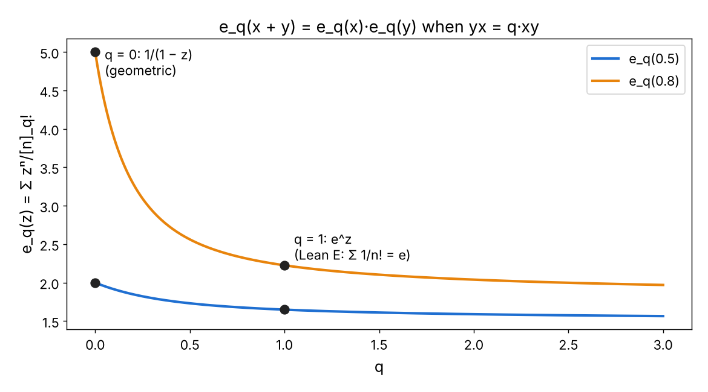

*Figure 11. e_q(z) = Σ zⁿ/[n]_q! at z = 0.5 and 0.8. q = 0 gives the geometric series 1/(1 − z), q = 1 gives e^z.*

- e_q(x + y) = e_q(x)·e_q(y) when yx = q·xy (K1: exact through degree 7 for q = 1/3, 2 and symbolic q). At q = 1 it is
  e's own law (Lean `E`: Σ 1/n! = e); at q = 0 the factorials all become 1 (K2).
- **Known:** this is the identity behind Schützenberger's 1953 note (its title is about solutions of
  F(x + y) = F(x)F(y)). **Ours:** placing e's module at the q = 1 stop.
- **Verdict: plausible here, known in print.** It is cheap to prove in Lean if wanted, but it would re-derive a known
  identity.

## C12. Five disguises

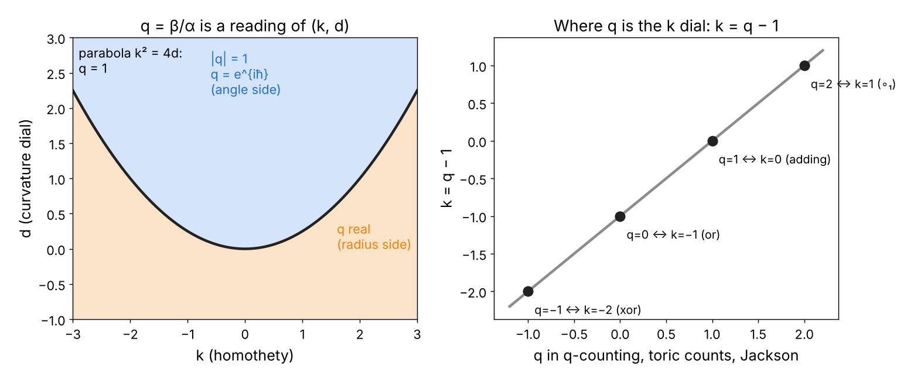

*Figure 12. Left: the face weight q = β/α is fixed by (k, d). It lies on the unit circle above the parabola (angle side),
equals 1 on it, and is real below it. Right: in q-counting, toric counts and Jackson's derivative, q is the homothety
dial, k = q − 1.*

- **Plane law and Lie groups (groups 6, 51): the curvature dial.** With 1 + kx + dx² = (1 + αx)(1 + βx),
  (1 + q)²/q = k²/d and (1 − q)²/q = Δ/d (L1). So |q| = 1 exactly when Δ ≤ 0 (L2), and the dial's Lucas sequence is
  α^(n−1)[n]_{β/α} (L3; cut-independence Q10). With k held fixed, moving q means moving d.
- **Swap rule (group 11): the curvature dial and the spin.** turn = d × area becomes phase = area/ħ only through
  ħ = 1/(j·d) (quantum-action §2, A3), which moves d.
- **Calculus and toric charts (groups 5, 19): the homothety dial.** Jackson's derivative gives [n]_q x^(n−1) (L4) with
  q = 1 + h, a step size. The toric count runs through a = q − 1 points on the circle (Lean `fan_count`).
- **Verdict: useful for bookkeeping.** These are the places where a "q" in the repo is not the order dial.

---

## N. New laws at in-between settings

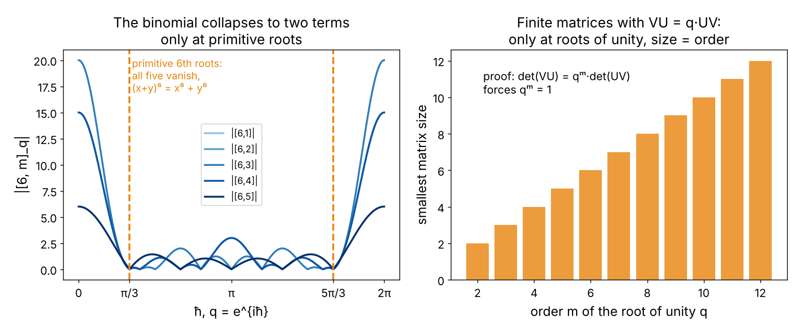

*Figure N. Left: |[6, m]_q| on the unit circle. All five vanish together only at the primitive 6th roots, where
(x + y)⁶ = x⁶ + y⁶. Right: invertible matrices with VU = q·UV exist only at roots of unity, and the smallest have size
equal to the order of q.*

I looked for settings strictly between the proved stops (0, 1, −1, ∞) where something special happens. On the real
line between 0 and 1, and between 1 and ∞, every law above changes smoothly and nothing new appears. All the special
points are on the unit circle at roots of unity, plus the whole numbers. Each law found there is in print.

| | Law | Status here | In print |
|---|---|---|---|
| N1 | **Frobenius collapse.** At a primitive m-th root, [m, j]_q = 0 for 0 < j < m, so (x + y)^m = x^m + y^m. A non-primitive root is not enough: at q = −1, (x + y)⁴ = x⁴ + 2x²y² + y⁴ | **proved** (two lines: [m]_q = 0 while [j]_q ≠ 0 for 0 < j < m); checked m ≤ 8 exactly (N1, N1b) and on clock-and-shift matrices (N1c, P3) | classical; e.g. Kassel, *Quantum Groups* (1995); used by Bonahon, arXiv:1708.07617 |
| N2 | **Finite matrices need a root of unity.** Invertible m × m matrices with VU = q·UV exist only if q^m = 1, and the smallest have size equal to the order of q (clock and shift) | **proved**: det(VU) = q^m·det(UV); clock and shift give the size. Checked m ≤ 6 (N2) | Sylvester (1882); Weyl (1927) |
| N3 | **q-Lucas** at a primitive d-th root | **checked** d ≤ 7, n ≤ 21, exact (C6), polished at 30 digits (P1); d = 2 is Lean `gauss_at_neg_one` (n ≤ 8) | Olive (1965), Désarménien (1982) |
| N4 | **Big centre.** At a root of unity U^m and V^m commute with everything | **proved** (q^m = 1); checked (N3) | rational rotation algebras (Rieffel 1981 and after) |
| N5 | **Truncation.** At q = e^{iπ/r} the quantum dimensions vanish at 2j + 1 = r, which makes the Turaev–Viro sum finite | already proved and checked in `quantum-action/cut-independence/` | Turaev and Viro (1992) |
| N6 | **Whole-number q.** At a prime power q, [n, m]_q counts m-dimensional subspaces of an n-dimensional space over the field with q elements | **checked** ([4, 2]₂ = 35 is Lean `gauss_4_2`; N4) | Gauss; Goldman and Rota (1970); q → 1 is Tits's "field with one element" (1957) |
| N7 | **Mallows monotone in the weak order** (C7) | **checked** n ≤ 5 exactly (G3) | stated as Lemma 3.3 in v2 of Jin, arXiv:1611.03840; status in the current version unclear |

**What they might be for.** N1 and N2 say that a finite, exactly computable model of the order dial exists only at
roots of unity. That is why the 3D quantum gravity of `cut-independence/` had to sit there. N6 is why q-counting
doubles as counting over finite fields. N7 gives the Rulecraft curve of C7 its shape.

**Verdict on section N: a clean negative result.** No in-between law here is new. The dial's special points are
exactly the roots of unity, and the known theory there is complete enough that I found nothing to add.

---

## Assumptions

- The quantum plane is taken over a commutative coefficient ring with q a unit. "Slides" for C1–C6 means exact
  symbolic identities in q, checked for the sizes stated (n ≤ 10 for the q-binomial, n ≤ 7 for permutations); the
  general statements are the cited theorems, not proofs written here.
- N2 is about **invertible** matrices. With nilpotent matrices the quantum plane has finite representations at every q.
- C7 models a reform as x ↦ (1 − λ)x + λt with 0 < λ < 1, distinct targets, start value 0.5, and Mallows weights
  measured from the target-sorted order. The monotone curve is numeric (300 random packages, 62 values of q). The
  domination is exact only for n = 3, 4, 5 and six pairs of q.
- C10 checks three knots only. The values at t = i and t = e^{2πi/3} come from the Jones polynomials that Lean
  computes, evaluated in sympy.
- C11 is a truncated-series check (degree ≤ 7), not a proof.
- Verdicts are judgements made from the repo's own modules and pages on Nov 26, 2026. A group marked "no" may still
  hide an order effect that the repo has not built (for example q-Catalan numbers in group 16, or magnetic translations
  in group 12).

## Known vs new

- **Known (orange):** every theorem on this page. The Gaussian binomials and the q-binomial theorem (Gauss, Rothe,
  Cauchy); the q-commuting form (Potter 1950, Schützenberger 1953); q-Lucas (Olive 1965, Désarménien 1982); inversions
  and the q-factorial (Rodrigues 1839, MacMahon 1916); the Mallows model (1957); Weyl, Moyal and Stone–von Neumann;
  clock and shift (Sylvester 1882); the Frobenius collapse at roots of unity; the special values of the Jones
  polynomial; the q-exponential law; the quantum plane (Manin 1988).
- **Ours (blue):** the sorting of the repo's 65 law groups by what q does, and these readings:
  - out-of-order pairs = area ties C2–C6 into one slide;
  - the order gap of ∘ₖ is k(1 − q)·ab;
  - the five disguises (q = k + 1 and q = β/α);
  - the Mallows reading of Rulecraft's order of reforms.
- **Searches run (Nov 26):**
  - "q-binomial theorem noncommuting yx = qxy Schützenberger 1953 Potter 1950"
  - "q-Lucas theorem Gaussian binomial root of unity Désarménien Olive"
  - "Mallows model order of policies agenda sequencing permutations inversions q^inv": found the Mallows literature,
    nothing on agendas or the order of reforms
  - "(x+y)^n = x^n + y^n when yx = q xy q primitive n-th root of unity quantum plane Frobenius"
  - "Mallows measure stochastically monotone in q weak Bruhat order coupling increasing function", and a second,
    extended search on the same: found Jin's preprint; Johnson, Leader and Long show the uniform measure is **not**
    positively associated in the weak order, so the domination is not a free consequence of a correlation inequality
  - "Sylvester 1882 nonions clock and shift matrices finite-dimensional representation Weyl relation only roots of unity"

  The Mallows reading of reform order was **not found in my search**; that is not a claim that it is not in print.

## Sources

- H. S. A. Potter, "On the latent roots of quasi-commutative matrices", Amer. Math. Monthly 57 (1950). M.-P.
  Schützenberger, C. R. Acad. Sci. Paris 236 (1953), on solutions of F(x + y) = F(x)F(y). Attribution as in
  [Stoyanovsky, arXiv:0812.4916](https://arxiv.org/pdf/0812.4916) and
  [Schlosser, arXiv:1106.2112](https://arxiv.org/pdf/1106.2112).
- q-Lucas: G. Olive, "Generalized powers", Amer. Math. Monthly 72 (1965); J. Désarménien, Europ. J. Combin. 3 (1982),
  Prop. 2.2; B. Sagan (1992). Statement as in [arXiv:2310.15207](https://arxiv.org/pdf/2310.15207) and
  [arXiv:math/0504569](https://arxiv.org/pdf/math/0504569).
- Frobenius at roots of unity: F. Bonahon, [Miraculous cancellations for quantum SL₂, arXiv:1708.07617](https://arxiv.org/pdf/1708.07617);
  C. Kassel, *Quantum Groups*, GTM 155 (1995).
- C. L. Mallows, "Non-null ranking models", Biometrika 44 (1957). K. Jin,
  [arXiv:1611.03840](https://arxiv.org/pdf/1611.03840) (v2, Jan 2017, Lemma 3.3). J. R. Johnson, I. Leader and E. Long,
  [Correlation for permutations](https://web.mat.bham.ac.uk/E.Long/Papers/Correlation%20for%20permutations.pdf) (2019).
- Clock and shift: [Generalizations of Pauli matrices](https://en.wikipedia.org/wiki/Generalizations_of_Pauli_matrices)
  (Sylvester 1882; Weyl).
- From memory, not re-fetched: Gauss (1808); Rothe (1811); Cauchy (1843); Rodrigues (1839); MacMahon (1916); Weyl
  (1927); Groenewold (1946); Moyal (1949); Tits (1957); Goldman and Rota (1970); Arik and Coon (1976); Romer and
  Rosenthal (1978); Rieffel (1981); Jones (1985); Lickorish and Millett (1986); Murakami (1986); Manin (1988);
  Biedenharn (1989); Macfarlane (1989); Kashiwara (1990); Reshetikhin and Turaev (1990); Turaev and Viro (1992).
  Check these before any paper.
