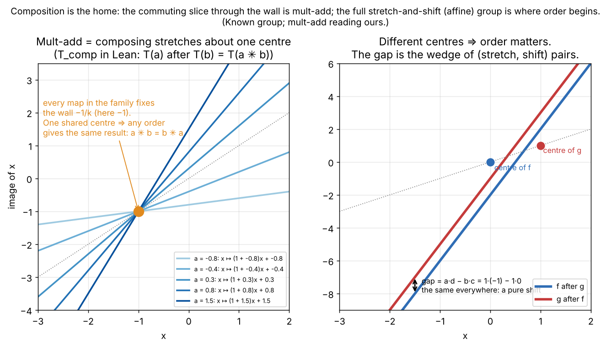
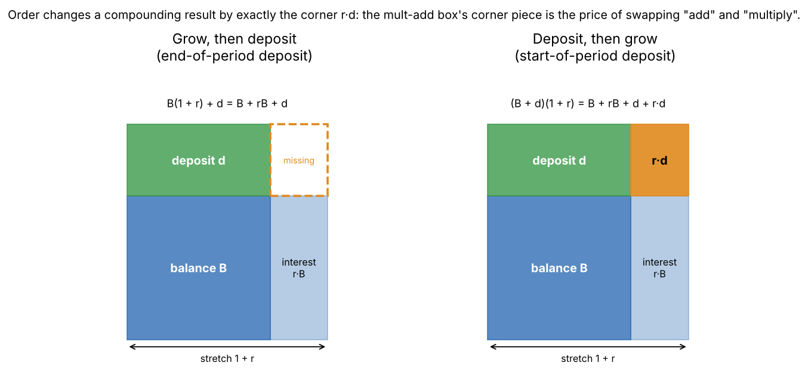
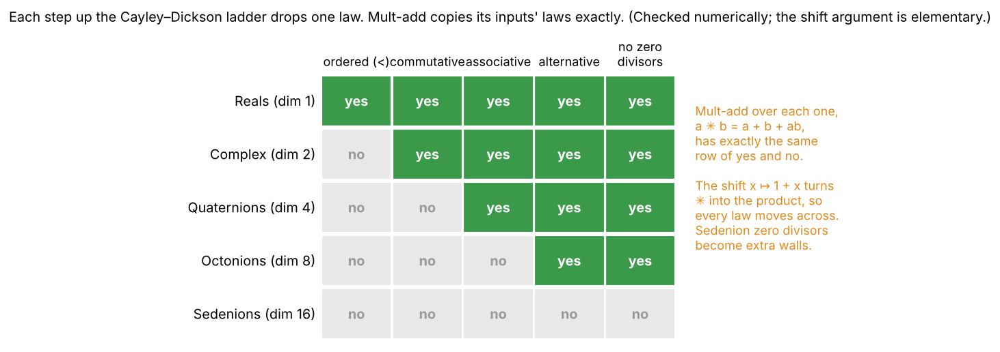
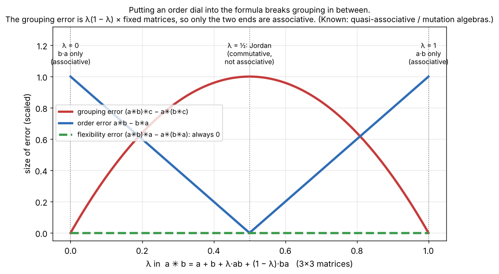
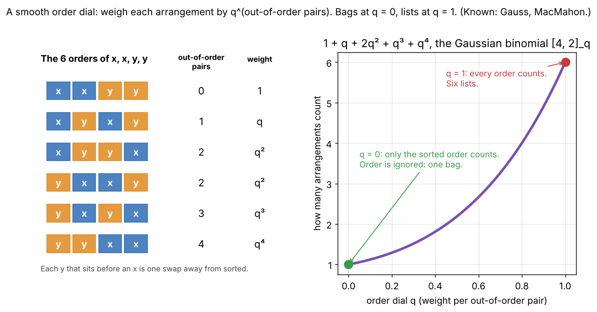
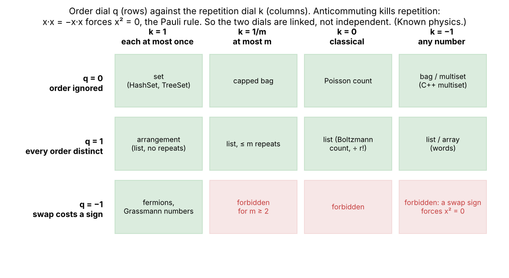
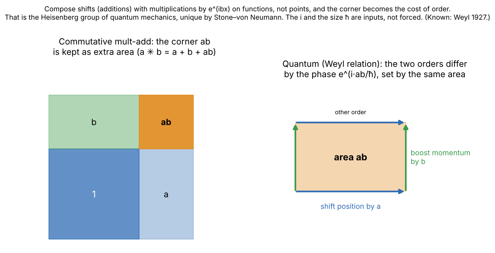
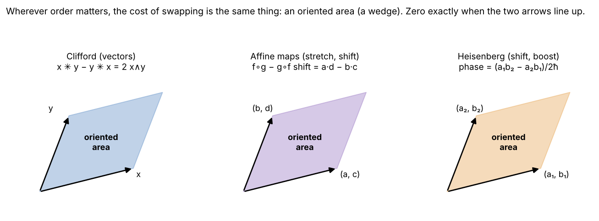
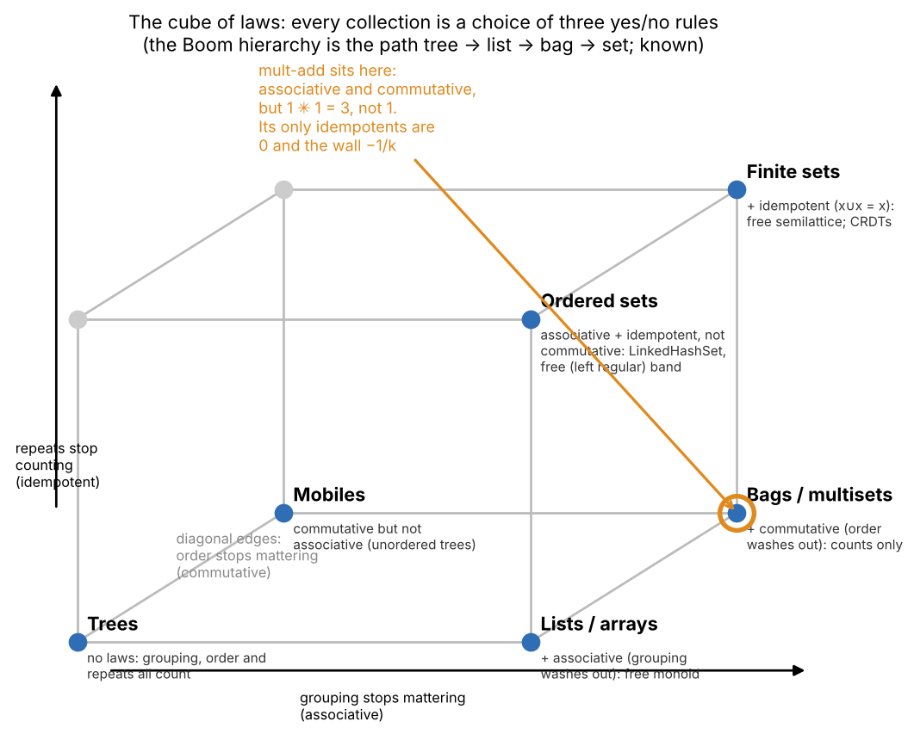
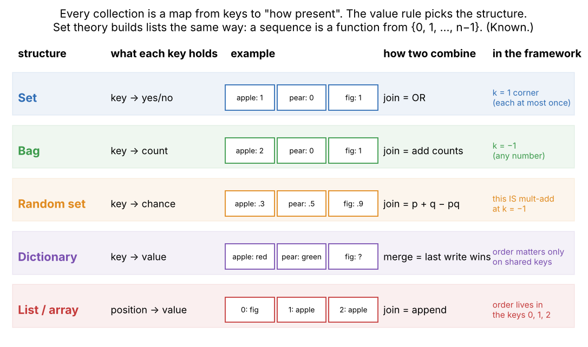

# Composition, order and the collection laws (Nov 25, 2026)

**Result.** Composition is a sound frame for the whole framework: the circle operation ∘₁ (called mult-add before 1.0) is exactly composition of stretches that share one centre (the wall −1/k), and order starts to matter the moment two maps have different centres, by an amount that is always an oriented area (a wedge). The route to quantum mechanics is real but not forced: compose shifts with multiplications on *functions* and you get the Heisenberg group, whose phase is the same corner area ab; the i and the size ħ have to be put in by hand.

Brennan's questions this answers (Nov 25, voice): map computer science data structures onto set theory and the framework; look at algebras that drop commutativity or associativity; "is composition itself a fundamental quality of this theory?"; use category theory as the frame; and "composition of set operations ... might yield some really interesting results in our infinities question".

Everything below is checked: `checks.py` (71/71 pass) and `lean/OrderDial.lean` (33 theorems, core Lean 4.37, no `sorry`, standard axioms only). Each section says what is known and what might be ours.

---

## 1. The frame: things plus arrows that compose

A category is just objects plus arrows that compose, with composition always associative. A monoid is a category with one object, so the number line under ∘₁ *is* a one-object category: its arrows are numbers, composing them is the circle operation, and 0 is the identity arrow.

- **The circle operation is composition.** Read a as the map x ↦ (1 + ka)x + a. Doing b then a gives the map for a ∘ₖ b (the existing `T_comp` in [groups-lie](../groups-lie/), and here `app_comp`, `k_slice`). Every one of those maps fixes the same point, the wall −1/k (left picture). Maps that share a centre commute, which is why the circle operation doesn't care about order.
- **The full home is the stretch-and-shift (affine) group.** Let the stretch a and the shift c vary separately: (a, c) is x ↦ (1 + a)x + c. Composing gives (a ∘₁ b, c + (1 + a)d): **the stretches still combine by the circle operation, and only the shifts pick up order** (`comp`, `stretch_order_free`).
- **The cost of order is a wedge.** The two orders differ by a pure shift equal to a·d − b·c, the oriented area spanned by (a, c) and (b, d) (`order_gap`). Two maps commute exactly when that area is zero, which is exactly when they share a centre (`commute_iff`). The circle operation's family is one such commuting slice.
- **The whole landscape is composition too.** Every law (a + b + p·ab)/(1 − d·ab) is a one-parameter family of Möbius maps x ↦ (αx + β)/(γx + δ) composing (check I7; proved as `mob` products in groups-lie). The circle operation is the slice that fixes infinity (the affine maps). Lie's vector fields α + βx + γx² are the arrows' directions; translation and stretch don't commute ([1, x] = 1, check I9).

*Known:* all of it. The affine group, Möbius one-parameter groups (Lie, Klein) and "formal group laws are one-parameter groups" are textbook. *Ours:* reading the circle operation as the commuting slice through the wall, and the order gap as the same wedge seen in Clifford's work (section 5).

### Existing results, reread as composition

| Earlier result | As composition |
|---|---|
| Fused rungs: conjugate a rung by x ↦ 1 + x | composing with the shift S on both sides, S⁻¹ ∘ f ∘ S; the shift is an isomorphism of one-object categories, (ℝ, ∘₁) ≅ (ℝ, ×) |
| Circle powers a^(∘₁n) = (1 + a)ⁿ − 1 | n-fold composition of one stretch |
| Rung flow and the Abel function | fractional composition powers: "do this map half a time" |
| The landscape plane (k, d) | one-parameter families of Möbius maps |
| Category theory pass: A ∘₁ B is the product in sets-and-partial-functions | the arrows there compose as partial functions; the lift is a functor |
| `no_iterate_half` (no f with f(f(n)) = 2ⁿ when f(0) = 1) | the cardinal shadow of "no functor square root of the power set", section 6 |

## 2. Where order changes the answer: compounding

One compounding period is a stretch-and-shift: grow by r, deposit d. Do it in the other order and the results differ by **r·d, the interest on the deposit**, which is exactly the corner piece of the circle-operation box (`compounding_corner`). Two periods with rates and deposits (r₁, d₁), (r₂, d₂) differ by r₁d₂ − r₂d₁ (check I2). Over many periods, depositing at the start instead of the end multiplies the final balance by 1 + r (the annuity-due rule, check I3).

**What k becomes.** Each period has its own centre −d/r: the balance at which interest exactly cancels the payment (on a loan, the balance that never shrinks). For the circle operation's family, rate = k × deposit, so every period has the same centre, the wall −1/k (`centre_fixed`, check I4). That gives the wall a plain-money meaning: it is the interest-only balance. When periods have different centres, the composite has a new centre of its own, −(d₁ + (1 + r₁)d₂)/(r₁ ∘₁ r₂) (check I6), and k is no longer one number: it becomes a property of each map.

*Known:* annuity arithmetic. *Ours:* the reading of k as rate per unit deposit and of the wall as the shared fixed point.

## 3. Algebras that drop a law: where order can live

Brennan asked to use known algebras that give up commutativity or associativity. Two findings.

**The circle operation copies its inputs' laws exactly.** The shift x ↦ 1 + x turns a + b + ab into the product (1 + a)(1 + b), so whatever the product obeys, ∘₁ obeys, and whatever it breaks, ∘₁ breaks, by the same amount: the commutator of ∘₁ is the commutator of the product, and so is the associator (checks E, on quaternions, octonions and sedenions).

So the quaternion circle operation is associative but order-sensitive; the octonion circle operation loses associativity but keeps the weaker "alternative" law (a ∘₁ a) ∘₁ b = a ∘₁ (a ∘₁ b); the sedenion circle operation loses even that, and its zero divisors become extra walls (a pair a, b, neither −1, with a ∘₁ b = −1, check E).

**Putting order into the formula itself costs grouping.** Try a ∘₁ b = a + b + λ·ab + (1 − λ)·ba, sliding from one order (λ = 1) to the other (λ = 0).

- Its order error is (2λ − 1)·[a, b], a Lie bracket (`mutAdd_comm`, check D6).
- Its grouping error is λ(1 − λ) times a fixed amount, so it is associative only at the two ends (symbolic check D1; on 2×2 matrices `mutAdd_assoc_only_at_ends`).
- In the middle, λ = ½, you land on the **Jordan product** (ab + ba)/2, shifted: a + b + (ab + ba)/2 = (1 + a)∘(1 + b) − 1 (checks D4, D5). Every λ stays "flexible", (a ∘₁ b) ∘₁ a = a ∘₁ (b ∘₁ a) (`mutAdd_flexible`).

*Known:* these are the quasi-associative (mutation) algebras; λ = ½ is the special Jordan algebra, which Jordan, von Neumann and Wigner (1934) proposed for quantum observables. *Ours:* only the circle-operation reading. *Verdict:* a smooth order dial inside the formula exists, but it trades away associativity, so it is not the natural road. The natural road is to keep the formula and change what goes in (sections 4 and 5).

## 4. A smooth order dial that keeps grouping: q

Weigh each arrangement by q to the number of out-of-order pairs. At q = 0 only the sorted order counts (order ignored: one bag); at q = 1 every order counts (six lists); in between the count is the Gaussian binomial (`xxyy_inversions`, checks C1–C4). Algebraically this is the rule yx = q·xy (the quantum plane), and it stays associative for every q (check C5).

**When this dial is honest, and how it ties to repetition.**

- If things square to a plain number (as Clifford's vectors and Pauli's matrices do), q can only be +1 or −1 (check G1; Pauli X and Z, `pauli`). Values in between need things whose higher powers, not squares, come back to 1 (clock and shift matrices, check G4).
- If swapping two copies of the *same* thing costs anything (q ≠ 1), then x·x = 0: no repeats (`anticommute_self_zero`, check G5). For q = −1 this is the Pauli exclusion rule. So the order dial and the 1.0 checklist's repetition dial k are linked: a sign on swaps forces k = 1.

*Known:* Gauss and MacMahon (inversions), the quantum plane (1980s quantum groups), Pauli exclusion from anticommutation. *Ours:* the grid that sets q against the repetition dial k. In two dimensions the in-between values are anyons, and physicists relate their exchange phase to Haldane's exclusion statistics in a strong magnetic field (Dasnières de Veigy and Ouvry 1994; the general relation is still debated), which is the item already on the after-1.0 list.

## 5. The route to quantum mechanics

The voice call left a hypothesis: the affine group "connects straight to" quantum mechanics. **That part is off, as the coordinator suspected.** The affine group's directions obey [X, Y] = Y, and repeating the bracket never dies out ([X, [X, Y]] = Y). Quantum mechanics needs the Heisenberg group, whose bracket [X, Y] = Z commutes with everything (checks J5, J6). They are different groups.

But a closely related route does work:

- Act on *functions* instead of points. Let a shift (an addition) be f(x) ↦ f(x + a) and a multiplication be f(x) ↦ e^(ibx)·f(x). Then shift-after-multiply = e^(iab) × multiply-after-shift (check J2). **The cost of order is a phase set by the area ab: the same corner that the commutative circle operation keeps as extra area.** That is the Weyl relation, the Heisenberg group of quantum mechanics.
- With real growth e^(bx) instead of e^(ibx), the cost is the factor e^(ab) (check J3); on sequences it is the q-commutation of section 4 with q = λ^a (`weyl`, check J1). So the order dial q *is* "swap an addition with a multiplication".
- In symmetric (Weyl) order the phase is half the wedge, (a₁b₂ − a₂b₁)/2ħ: an oriented area again (check J4).

**ħ as the order dial, with grouping kept.** The circle operation over the Moyal star product (the product of quantum phase space) is associative for every ħ, its order error is iħ times the Poisson bracket to leading order, and at ħ = 0 it is the ordinary circle operation (checks H1–H5). So the framework's quantum version needs no new formula: run the same a + b + ab on quantum inputs, and ħ sets how much order matters.

**Forced or bolted on?** Partly forced. Once you accept that swapping a shift and a multiplication costs a phase, the Stone–von Neumann theorem says there is essentially only one way to represent it: ordinary quantum mechanics. What is *not* forced: the i (why a phase rather than real growth) and the size of ħ. And nothing here yet gives the dynamics (the Schrödinger equation) or any new prediction.

*Known:* Weyl 1927, Groenewold 1946, Moyal 1949, Stone–von Neumann, deformation quantization (Bayen et al. 1978, Kontsevich 1997). *Ours:* that the Weyl phase is the circle-operation corner, and that one wedge prices order in Clifford's work, affine composition and quantum phase space.

## 6. Infinities: composing the power set

Iterating the power set climbs the infinities: P, P∘P, P∘P∘P, … In category theory P is a functor (a map of whole categories), so a "half power set" would be a functor H with H∘H ≅ P.

**There is no such functor on all sets** (`no_functor_half`, plus a two-line argument). A functor keeps injections that have a way back, and every injection out of a nonempty set has one, with no choice needed. So H can't shrink sizes from 1 up. Then the sizes clash already at sets of 0, 1 and 2 elements: if H(one point) has 0, 1 or 2 elements, P of a 1- or 2-element set comes out with the wrong size, and it can't have 3 or more because it fits inside H(H(one point)), which must have exactly 2.

*What it means for catalog item 1 (the choice-free half power set):* that open question survives only if the half step is allowed to ignore finite sets or to stop being a functor. The obstruction lives at the same spot as `no_iterate_half` (the empty set and a single point). *Known vs new:* the argument is short and elementary; we did not find it stated, but it may well be folklore. Cantor's theorem itself is a composition fact too (Lawvere's fixed-point theorem, 1969), which is the known frame for this.

## 7. Supporting map: data structures and the laws behind them

- **Three yes/no rules sort the collections.** Does grouping matter (associativity)? Does order (commutativity)? Do repeats count (idempotence)? Trees → lists → bags → sets add one law at a time; that path is the Boom hierarchy (named for Hendrik Boom, first in print in Meertens's 1986 *Algorithmics*). As free objects: lists are the free monoid, bags the free commutative monoid, finite sets the free semilattice (checks B1–B4, B8). Ordered sets without repeats (a LinkedHashSet) are the free left regular band (checks B5–B7).
- **The circle operation sits at the bag corner.** It is associative and commutative, but 1 ∘₁ 1 = 3, and its only idempotents are 0 and the wall −1/k (`circK_idem_iff`). Category theory lives on the associative face of the cube: composition always ignores grouping, never necessarily order.

- **Every collection is a map from keys to "how present".** A set holds yes/no, a bag a count, a random set a chance (and joining random sets is p + q − pq, which is the circle operation at k = −1), a list holds values at positions 0, 1, 2. Set theory builds sequences the same way, as functions out of {0, …, n − 1}.
- **On dictionaries.** A dictionary as a static object needs unique keys, not order (it is a function from keys to values), and in computer science some dictionaries keep order and some don't (Python's has kept insertion order since 3.7; Java's HashMap doesn't). But Brennan's instinct has a real basis: **merging** dictionaries is order-sensitive. "Last write wins" is associative and idempotent but not commutative; it is a right regular band, and order matters only on shared keys (`over_assoc`, `over_idem`, `over_right_regular`, `over_not_comm`, checks B9–B12).
- **Composing many-valued arrows.** Arrows that return a bag or a set compose by matrix products: with a count sum for bags (k = 0) and with OR for sets, and OR on 0/1 is exactly a + b − ab, the circle operation at k = −1 (`ksum_zero`, `ksum_or`). Anywhere else the k-sum fails to distribute, by k·a·b·c·(c − 1) (`ksum_distrib_gap`), so this composition is honest only at those corners. That is the same pattern the repetition dial found (honest counts only at k = 1/m).

*Known:* all of section 7 (Boom hierarchy, free objects, bands, Kleisli categories of the list, bag and powerset monads, CRDT merge as a semilattice).

---

## Verdict, lead by lead

- **Worth following: the framework's quantum version is the circle operation over non-commuting inputs, with ħ as the order dial.** It keeps the formula, keeps associativity, and turns the corner ab into the quantum phase. Known mathematics (deformation quantization), so the value is the connection, not a discovery. Next concrete step: redo the existing boost and Doppler results on phase space with the star product and see what the corner does there. No new prediction yet.
- **Worth keeping, small: no functor half power set.** Elementary, possibly folklore, and it sharpens catalog item 1: a choice-free half power set must give up functoriality or finite sets.
- **The composition frame covers more of math in one lens:** Möbius and affine maps, rungs and fractional iteration, collections and their merge rules, quantum phase space. Every piece is known; what is ours is that one picture (shared centre = no order; order cost = oriented area) holds them all.
- **Closed:** the order dial inside the formula (gives Jordan algebras, loses associativity); the affine group as quantum mechanics (wrong group).

## Files

- `checks.py` → `checks_output.txt`: 71/71 pass (needs sympy, numpy).
- `figures.py` → `figures/fig1` … `fig10` (PNG, labeled).
- `lean/OrderDial.lean`: 33 theorems, core Lean 4.37.0-rc1, no `sorry`, only the standard axioms (checked with `#print axioms`). Imports only `FusedAlgebra.Base`, namespace `OrderDial`. To add it to the library: copy it to `lean-library/FusedAlgebra/Topics/OrderDial.lean`, add `FusedAlgebra.Topics.OrderDial` to `build.sh` after `FusedAlgebra.Topics.DialPotential`, and add an import line in `FusedAlgebra.lean`.

## Sources

- Boom hierarchy: [Disco docs](https://disco-lang.readthedocs.io/en/latest/reference/boom.html), [The Morning Paper](https://blog.acolyer.org/2014/11/06/the-boom-hierarchy/), Zwart and Marsden, [No-go theorems for distributive laws](https://arxiv.org/pdf/2003.12531) (all eight combinations of the three laws, as monads).
- Mutation (quasi-associative) algebras, λ = ½ special Jordan: [Encyclopedia of Mathematics, Lie-admissible algebra](https://encyclopediaofmath.org/wiki/Lie-admissible_algebra), [Lie-admissible mutation algebras](https://koreascience.kr/article/JAKO198121167806379.pdf). The associator λ(1 − λ)(…) was derived here (check D1).
- Anyons and exclusion statistics: Dasnières de Veigy and Ouvry, [cond-mat/9405017](https://pdf.arxiv.org/pdf/cond-mat/9405017); Ouvry, [Anyons and lowest Landau level anyons](https://ar5iv.arxiv.org/html/0712.2174).
- Textbook, not re-fetched: Weyl (1927), Jordan–von Neumann–Wigner (1934), Moyal (1949), Stone–von Neumann, Lawvere (1969), Gaussian binomials (Gauss; MacMahon 1916), Python 3.7 dict ordering.
