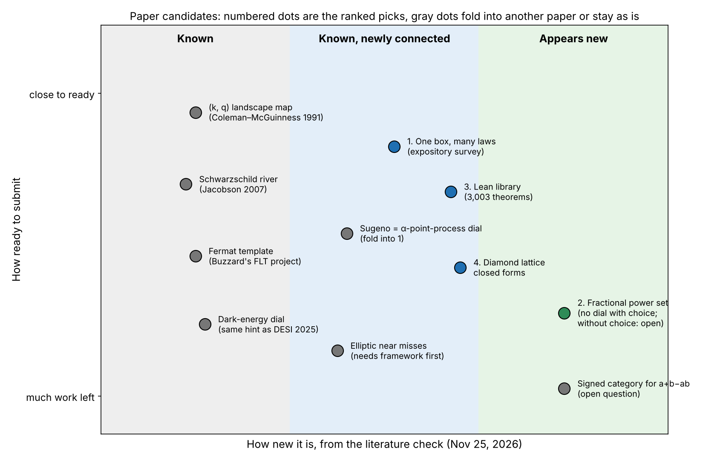
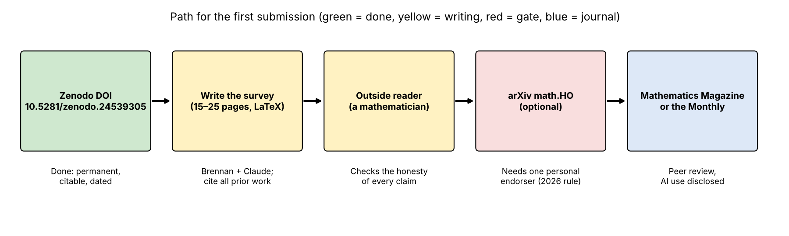

# Fused Hyperoperation Algebra: what could become a paper

Review of Nov 25, 2026. Every result in the repo README's catalog and the page index was checked against the literature. Verdicts: **known**, **known but newly connected**, or **appears new** (meaning our search found nothing; not a guarantee).

## Short answer

Submit first an **expository paper**, "One box, many laws", to *Mathematics Magazine* (or the *American Mathematical Monthly*). It tells the story you already believe in: one shape, a + b + k·ab, seen across counting, probability, relativity, topology and physics. Expository journals publish known mathematics when the presentation is new and clear, so the honesty rule costs nothing: every row says where it was known.

The one result that **appears new** is the fractional power set. With choice it is a short, elementary argument; without choice it is open. That is the best lead for a research paper, but it needs a set theorist's eye first.

Nothing is at risk of being lost: the Zenodo DOI (10.5281/zenodo.24539305) already makes the whole repo permanent, dated and citable.

## Picture 1: the candidates

## Ranked table

| Rank | Candidate | Verdict | Closest prior work | Format and venue |
|---|---|---|---|---|
| 1 | One box, many laws: the a + b + k·ab family across fields | Known, newly connected | Coleman & McGuinness 1991 (all rational formal group laws); Aczél 1966 (associative laws); Perlis/Jacobson circle composition; Sugeno 1974; Shirai & Takahashi 2003; Tsallis 1988; Hirzebruch genera; Jacobson 2007 (g_tt·g_rr = −1) | Expository article, *Mathematics Magazine* or *Monthly*; optional arXiv math.HO preprint |
| 2 | Fractional power set: no dial with choice; open without | Appears new (elementary part may be folklore) | Merimovich 2007; Karagila 2014; Halbeisen & Shelah; Kneser 1950 (half-exponential) | First a public question to set theorists (MathOverflow); then a short note, arXiv math.LO, *Mathematical Logic Quarterly*; a real paper if the choice-free construction works |
| 3 | The Lean library (3,003 theorems, no sorry) | New as formalization; statements known | mathlib; Buzzard's FLT project | Contribute the best pieces to mathlib after the port; maybe a short paper at ITP 2027 (call not out yet; CPP 2027's deadline passed in Sept.) |
| 4 | Diamond hierarchical lattice closed forms (slope (2y/(y+1))², exact ν) | Known in parts, formula not found | Chang, Roeder & Shrock 2020; textbook percolation (golden ratio at Q = 1) | Short note, arXiv cond-mat.stat-mech; or a section of paper 1 |
| — | Sugeno λ-measure = α-point-process dial = Tsallis q-sum | Known pieces, link not found stated | Sugeno 1974; Shirai & Takahashi 2003; Tsallis 1988 | A section of paper 1 |
| — | (k, d) landscape map and shape number | Known | Coleman & McGuinness 1991 classify exactly this plane by c² − 4d | A section of paper 1 |
| — | Schwarzschild river, (−g_tt − 1) ∘₁ (g_rr − 1) = 0 | Known | Jacobson 2007; Hamilton & Lisle 2008 | A section of paper 1 |
| — | Fermat counterexample map | Known method | Buzzard's FLT blueprint (top-down, 1980s inputs assumed) | None |
| — | Signed category with a + b − ab as product | Open question | Schanuel 1991 ("negative sets"); Propp; Baez | A MathOverflow question |
| — | Elliptic near misses | Depends on our own "rung" definition | — | None until the framework is published |
| — | Dial as dark energy | Known hint | DESI 2025; exponential quintessence | None |
| — | Electromagnetism, Clifford, GR bridges, size dial | Known | Maxwell, Hestenes, Jacobson 1995, Fermi–Dirac | Material for paper 1, or none |

## Each candidate in a sentence or two

1. **One box, many laws.** The strongest fit for your goal, a shared lens over known math. Caution found today: the (k, d) map is *exactly* the Coleman–McGuinness classification of rational formal group laws, so the paper must cite it up front and present the map as a picture of that theorem, not a new one. A tight story of 6 to 8 rows reads better than all 12.
2. **Fractional power set.** With choice, a monotone half power set must land strictly between κ and 2^κ, and no full dial exists because the halvings would shrink forever. Short and elementary, so a set theorist may call it folklore; that is why asking publicly first makes sense. The choice-free question is genuinely open as far as we could find.
3. **Lean library.** Formal checks are new; the statements are mostly known. Formalization venues want a technique or a hard theorem, so mathlib contributions (for example Sugeno measures) are the likelier route than a standalone paper.
4. **Diamond lattice.** The closed slope formula wasn't found written, but it is elementary and the special cases are known. Too slight alone; good as a section.

## Picture 2: the path for the first submission

## What the first submission still needs

- **The manuscript**, in LaTeX on the *Mathematics Magazine* template: lively, picture-led, active voice, author name left out of the file for review.
- **Citations for every row**, especially Coleman & McGuinness 1991, and a plain statement that no new theorem is claimed.
- **An outside reader**, ideally a mathematician, to check the claims before submission.
- **AI disclosure.** Taylor & Francis (publisher of the MAA journals) bars AI as an author and asks for a statement of the tool, version, use and reason in the acknowledgments. You are the sole author and answer for every line.
- **arXiv is optional.** Since Jan 21, 2026 every first-time arXiv submitter needs a personal endorsement from an established author in the category. arXiv also bans authors for a year for unchecked AI content (fake references, leftover chatbot text), so every reference must be checked by hand. The MAA pages don't say whether an arXiv preprint counts as prior publication; check before posting.
- **Your accounts and submissions** (Editorial Manager, arXiv) are yours to make; nothing was created or sent.

## Sources checked

- Coleman & McGuinness, "Rational formal group laws", Pacific J. Math. 147 (1991): https://msp.org/pjm/1991/147-1/p02.xhtml
- Jacobson, "When is g_tt g_rr = −1?", Class. Quantum Grav. 24 (2007): https://arxiv.org/abs/0707.3222v2
- Chang, Roeder & Shrock, Potts zeros on diamond hierarchical graphs: https://arxiv.org/pdf/1911.04012
- α-determinantal processes, existence: https://arxiv.org/pdf/1510.03975
- Circle composition and quasi-regular rings: https://encyclopediaofmath.org/wiki/Quasi-regular_ring
- Gitik, "The power set function": https://arxiv.org/pdf/math/0212405
- Fernengel & Koepke, Easton-like theorem without choice: https://arxiv.org/pdf/1607.00205
- Buzzard's FLT blueprint: https://imperialcollegelondon.github.io/FLT/blueprint
- arXiv math endorsement: https://info.arxiv.org/help/endorsement-math.html and https://blog.arxiv.org/arxiv/2025/12/10/updated-endorsement-policy-for-arxiv-mathematics
- arXiv one-strike AI rule (news): https://cerncourier.com/a/arxivs-one-strike-rule-on-ai/
- Taylor & Francis AI policy: https://taylorandfrancis.com/our-policies/ai-policy/
- MAA submissions: https://maa.org/press/periodicals/submissions-to-maa-periodicals
- CPP 2027: https://popl27.sigplan.org/home/CPP-2027

Searches for a prior "half power set" or "functional square root of 2^κ" result, and for a stated Sugeno ↔ α-point-process link, found nothing. MathOverflow could not be searched from here, so the fractional power set verdict rests on arXiv and general web search only.
