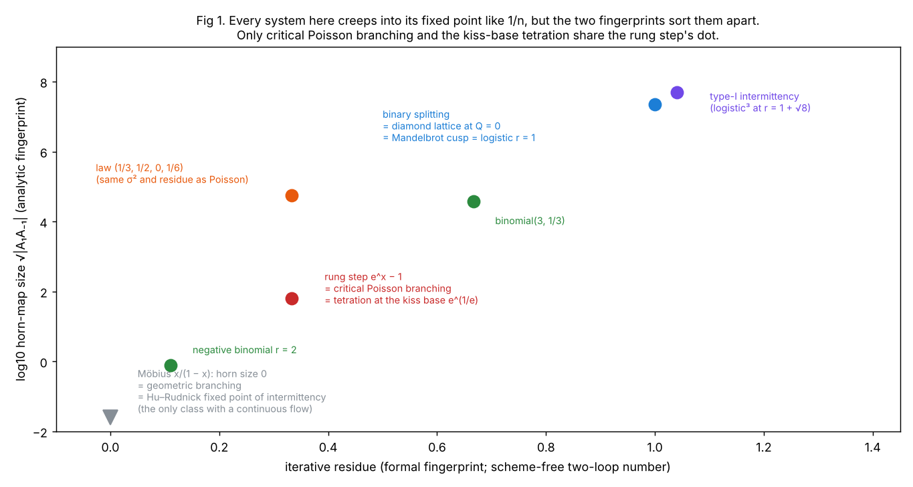
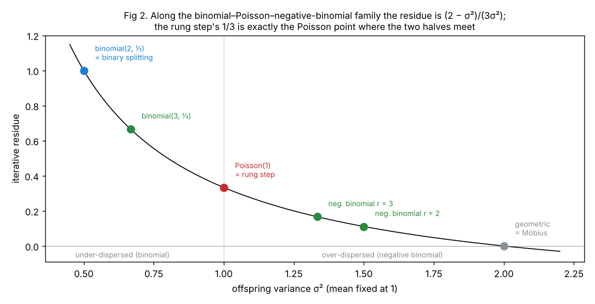
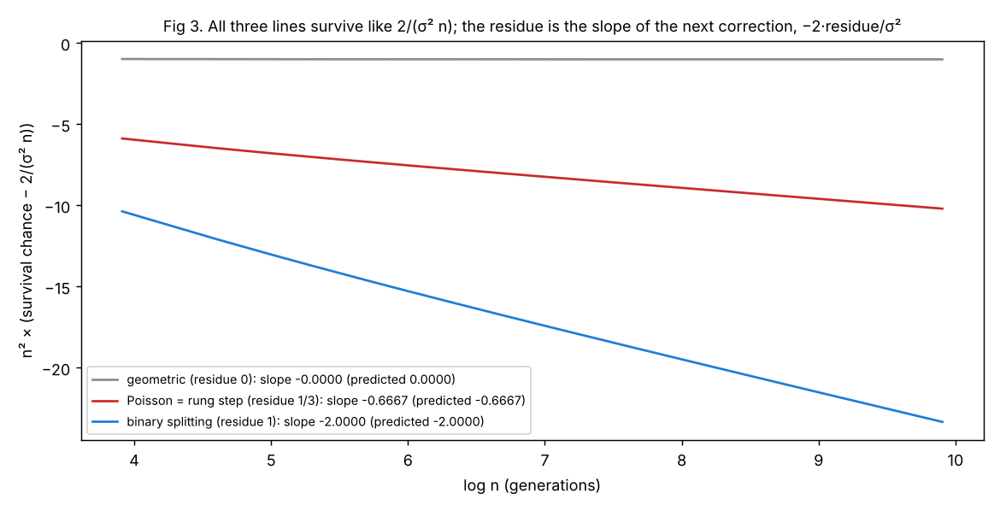
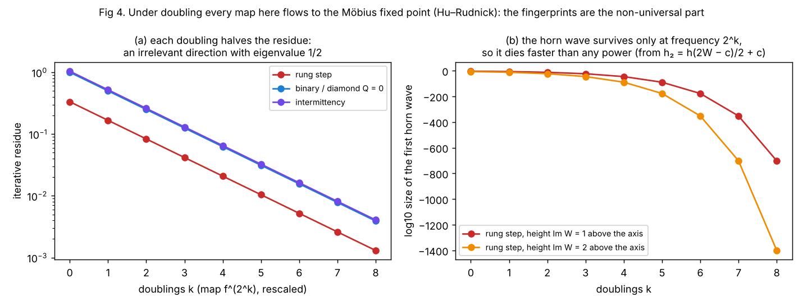

# Parabolic fixed points elsewhere: does the rung step's fingerprint show up? (DRAFT)

**Result in one sentence:** many known systems creep into a fixed point the same way the rung step does, but
only critical Poisson branching and tetration at the kiss base e^(1/e) carry its exact fingerprint, and the
diamond lattice and intermittency do not.

Status: DRAFT, not reviewed, not published. Follows lead R2 in `../closed-leads-revisit/README.md`. The
fingerprint code is copied unchanged from `../height-flow/horn_invariants.py` (`hornlib.py`).

## The question in plain words

The rung step E(x) = e^x − 1 touches the line y = x at 0, so repeated steps creep in like −2/n instead of
shrinking geometrically. That is the shape called a *parabolic fixed point*. Every parabolic map creeps like
1/n, so the shape alone means little. Two numbers tell such maps apart (Écalle, Voronin):

- the **iterative residue** (the formal fingerprint; for flows it is the scheme-free two-loop number b₁/b₀²,
  as `../height-running-coupling/` showed). For E it is **1/3**.
- the **horn-map size** √|A₁A₋₁| (the analytic fingerprint; zero only when the map sits in a continuous
  flow). For E it is **64.153**.

Two maps that can be turned into each other by a change of variable have the same two numbers. The old
closures ("the diamond lattice predicts nothing", "Feigenbaum has no connection") were made before we had
these numbers. So the test: compute them for the other creeping systems.

## Fig 1. The fingerprint map

| System | Residue | Horn size | Same class as the rung step? |
|---|---|---|---|
| Rung step e^x − 1 | 1/3 | 64.153 | itself |
| Critical Poisson(1) branching | 1/3 | 64.153 | **yes, it is the same map** (x = s − 1) |
| Tetration η^X at the kiss point X = e, η = e^(1/e) | 1/3 | 64.153 | **yes, the same map** (X = e(1 + x)) |
| Law (1/3, 1/2, 0, 1/6): same variance and residue as Poisson | 1/3 | 57 010 | no: only the horn size tells it apart |
| Critical binary splitting = diamond lattice Potts step at Q = 0 = Mandelbrot cusp z² + ¼ = logistic map at r = 1 | 1 | 2.235 × 10⁷ | no |
| Type-I intermittency: logistic map cubed at the period-3 tangency, r = 1 + √8 | **51/49** (to 20 digits) | 5.001 × 10⁷ | no |
| Binomial(3, ⅓) | 2/3 | 37 646 | no |
| Negative binomial r = 2 | 1/9 | 0.768 | no |
| Möbius x/(1 − x) = critical geometric branching = Hu–Rudnick fixed point | 0 | 0 | no; this is the only class with a continuous flow |

- **The diamond lattice at Q = 0 is critical binary branching.** In y = 1/t its step is exactly
  y → (y² + 1)/2, which is the generating function of "0 or 2 children, half each". A further y = 2z turns it
  into z → z² + ¼, the cusp of the Mandelbrot set, which is also the logistic map at r = 1. So the diamond
  lattice *is* a branching process, but a binary one, not a Poisson one, and its fingerprint (1, 2.2 × 10⁷)
  is far from ours.
- **Intermittency is a near neighbour of the binary class, not of ours.** Its residue 51/49 sits just above
  1, and its horn size is the same order as the binary class.
- **Feigenbaum's period doubling** is not parabolic at all (its fixed point is hyperbolic), so it has no
  fingerprint to compare. That old closure stands for the old reason.

## Fig 2. Among branching laws, the rung step's 1/3 is exactly the Poisson point

For any critical branching law the residue is **1 − (2/3)κ**, with κ = E[Z(Z−1)(Z−2)]/σ⁴. Along the family
binomial → Poisson → negative binomial (mean 1) it becomes **(2 − σ²)/(3σ²)**. Under-dispersed laws
(binomial) sit above 1/3, over-dispersed laws (negative binomial) sit below, and Poisson, with σ² = 1, is
the point where the two halves meet. The geometric law (σ² = 2) lands on 0, the Möbius class.

## Fig 3. Where the residue can be measured: how long a family line survives

Kolmogorov's law says a critical family line survives n generations with chance about 2/(σ² n). The
residue is the next correction: survival ≈ 2/(σ² n) − (2·residue/σ²)·(log n)/n² + …. Run to n = 20 000, the
measured slopes are −0.000000 (geometric, predicted 0), **−0.666670 (Poisson, predicted −2/3)** and −2.000017
(binary, predicted −2). So the rung step's 1/3 is something you could, in principle, read off extinction
data from a near-critical population.

## Fig 4. Why the fingerprint never shows up in universal laws

The renormalization of intermittency (Hirsch, Nauenberg and Scalapino; Hu and Rudnick, 1982) doubles a map
and rescales it. Its fixed point is exactly the Möbius map x/(1 − ux). Each doubling halves the residue
(iterates divide the residue), and the horn wave survives only at frequency 2^k, so both fingerprints die
out. In renormalization language the residue is an *irrelevant direction with eigenvalue 1/2*. Every map
on Fig 1 flows to the same Möbius point; what makes the rung step itself lives only in correction terms,
like the (log n)/n² term in Fig 3.

## Verdict on the lead

**Mostly stays closed, with a clearer reason than before.** The shape (parabolic creep) is everywhere, but
the rung step's exact fingerprint is shared only by systems that are literally the same map: critical
Poisson branching and tetration at the kiss base. The diamond lattice and intermittency are different
classes, so the old closures stand. What the lead did give:

- a firm, picture-level identification of where the rung step sits among creeping maps (Fig 1);
- the Poisson point as the meeting place of under- and over-dispersed branching (Fig 2);
- one checkable prediction, the −(2/3)(log n)/n² correction to Poisson survival (Fig 3);
- the explanation of why no universal law can single the rung step out (Fig 4).

If anything is worth one more look, it is the tetration tie: the rung step and tetration at e^(1/e) are the
same map, which links the height flow directly to the hyperoperation side of the theory.

## What is known and what is ours

**Known.**
- Iterative residue, horn maps and the classification of parabolic maps (Écalle 1981; Voronin 1981);
  iterates divide the residue.
- Kolmogorov's 2/(σ² n) survival law; second-order terms of critical survival have a literature
  (Chistyakov 1957 for continuous time), which we did not reopen.
- The diamond-lattice Potts step (Berker and Ostlund 1979); the logistic map at r = 1 is conjugate to z² + ¼.
- Tetration at base e^(1/e) has a parabolic fixed point at e; η^X near e is e^x − 1 after X = e(1 + x).
- The Hu–Rudnick fixed point of the intermittency renormalization, x[1 − (z−1)u x^(z−1)]^(−1/(z−1)), which is
  Möbius for z = 2 (as quoted by Robledo and co-authors; we did not open the original paper).
- The rung step's own fingerprint (1/3, 64.153) is from `../height-flow/`.

**Ours (as far as we found).**
- The diamond lattice at Q = 0 written as critical binary branching y → (y² + 1)/2 (elementary; it may be
  stated in the hierarchical-lattice literature).
- Residue = 1 − (2/3)κ for critical branching, and (2 − σ²)/(3σ²) along the binomial–Poisson–negative-binomial
  family (simple algebra).
- The survival correction slope −2·residue/σ², checked numerically for three laws.
- The fingerprint of type-I intermittency at the period-3 window: residue 51/49 and horn size 5.001 × 10⁷.
- Horn sizes for the binomial and negative binomial laws.
- Reading the residue as the eigenvalue-1/2 irrelevant direction of the Hu–Rudnick fixed point (follows
  directly from the known facts above).

## Checks

- `identities.py`: 16/16 exact identities pass (diamond = binary branching = cusp = logistic r = 1;
  Poisson = rung step = kiss-base tetration; geometric = Möbius; the residue formula on eight laws).
- Change-of-variable invariance: the diamond step computed in its own variable t gives the same horn numbers
  as binary splitting to every printed digit (A₁ = −0.0589504305644 + 0.0100098659i in both).
- Intermittency: two different orbit points of the period-3 tangency (0.1599 and 0.9563) give the same
  residue and the same horn size, 50 011 960.2295. The third orbit point (0.5144, right next to the
  logistic peak) did not converge in the strips used, so it is left out.
- Horn constants obey A₀⁻ = 2πi·residue in every run (for example 6.5396 = 2π·51/49 for intermittency).
- Law (1/3, 1/2, 0, 1/6) is exactly e^x − 1 cut at x³, and reproduces the height-flow page's number 57 009.96.
- Survival slopes match −2·residue/σ² to 5 digits once the next (log n)^j/n terms are fitted.

## Files

- `identities.py` → `identities.json`: exact identities and branching residues.
- `hornlib.py`: horn-map code copied from `../height-flow/horn_invariants.py`.
- `horns.py NAME` → `horns_NAME.json`: residue and horn size for diamond_Q0, binary, negbin2, binom3,
  poissonlike, logistic3_0/1/2 (`log3_*.txt` hold the intermittency runs).
- `figures.py` → `figures/`, `survival_fits.json`.

## Sources

- Robledo and co-authors, criticality in one-dimensional maps, quoting the Hu–Rudnick fixed point:
  https://arxiv.org/pdf/cond-mat/0202095
- Hu, B. and Rudnick, J. (1982), Phys. Rev. Lett. 48, 1645 (cited, not opened).
- Kudratova and Khusanbaev (2021), continuation probability of a critical Galton–Watson process, with the
  history from Kolmogorov and Chistyakov: https://mathnet.ru/eng/vtgu870
- Écalle; Voronin; Berker and Ostlund (1979): named from memory, as on the height-flow and diamond-lattice pages.
