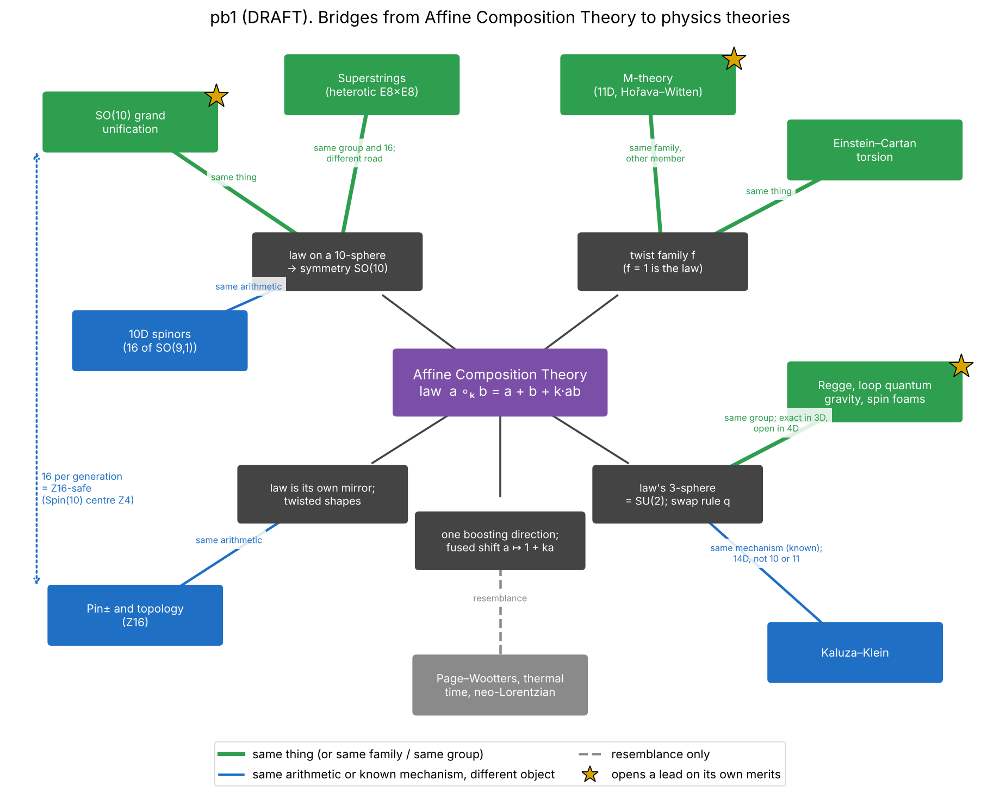
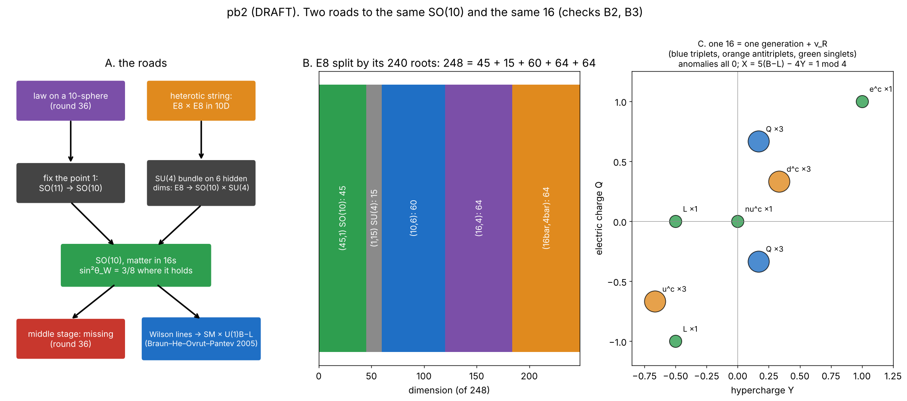
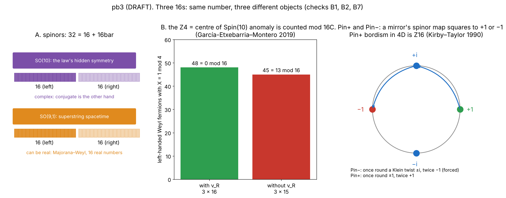
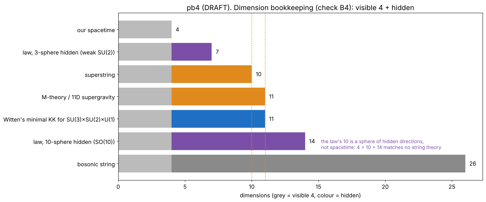
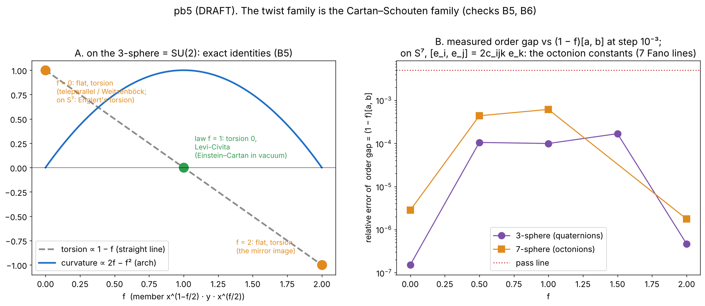
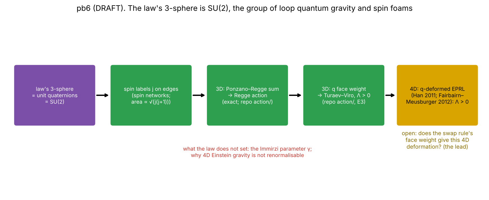
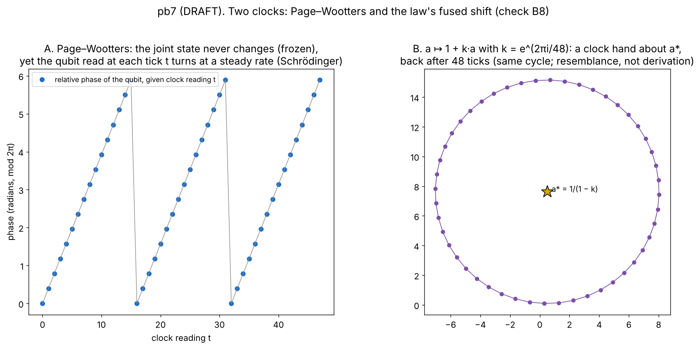
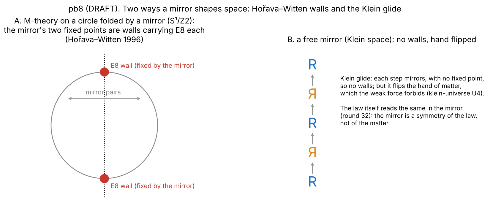

# DRAFT · Bridges between Affine Composition Theory and the major physics theories

**DRAFT, Nov 28 2026. Not versioned, not proved in Lean.** Asked for by Brennan on a voice call, after asking whether superstring
theory and M-theory are built on the round 36 result: "Okay, so these um, overlaps, I'd like to show the bridges between the
different theories."

Checks: [`checks.py`](checks.py) → [`checks_output.txt`](checks_output.txt), **9 of 9 pass** (about 100 s; numpy, scipy, sympy),
numbers in [`results.json`](results.json). Pictures: [`figures.py`](figures.py) → [`figures/`](figures/) pb1 to pb8.
Colour key on every picture: **green = the same thing (or the same family or group), blue = the same arithmetic or a known
mechanism on a different object, grey = a resemblance only, red = doesn't carry over, gold star = opens a lead on its own merits.**

Builds on, and doesn't redo: [`bridge-survey/`](../bridge-survey/README.md) (739 bridges, 20 fields),
[`string-theory/`](../string-theory/README.md), [`gr-bridges/`](../gr-bridges/README.md), rounds 21 and 31 to 36 of
`forces-as-curvature`, [`torsion-dial/`](../torsion-dial/README.md), [`klein-universe/`](../klein-universe/README.md),
[`spin-i-tie/`](../spin-i-tie/README.md), [`probability-entanglement/`](../probability-entanglement/README.md),
[`action/`](../quantum-action/README.md) and the [`prior-art-audit/`](../forces-as-curvature/prior-art-audit/README.md).

## The result first

**The theory meets every one of these theories through the same few pieces of the law, and in four places the meeting is the same
mathematics, not a look-alike.** None of the big theories is *built on* the law. But the law's symmetry on a 10-sphere is the
SO(10) of grand unification and of heterotic string models, its twist family is the Cartan–Schouten family behind torsion and
Englert's 11-dimensional supergravity solution, and its 3-sphere is the SU(2) of loop quantum gravity and spin foams.

*pb1. The bridge map. The law sits in the middle. The dark boxes are the five pieces of it that do the bridging. Each outer box is a
major theory, coloured by how close the bridge is. Gold stars are the bridges that open a lead on their own merits. The dotted line
on the left is the one bridge between two outer theories that this round found: SO(10)'s 16 states per generation are exactly what
the Pin+ "mod 16" count needs.*

### The bridges at a glance

| Theory | What in the law lands there | Kind | Who proved the physics side | Lead? |
|---|---|---|---|---|
| **SO(10) grand unification** | the law on a 10-sphere has symmetry SO(10); one spinor hand is one generation with the measured charges (round 36, B2) | **same thing** | Georgi 1975; Fritzsch–Minkowski 1975 | **Yes, within the build** |
| **Superstrings (heterotic)** | the same SO(10) and the same 16, reached by fixing a point instead of by a bundle inside E8 (B3) | **same group, different road** | Gross–Harvey–Martinec–Rohm 1985; Candelas–Horowitz–Strominger–Witten 1985; Braun–He–Ovrut–Pantev 2005 | No new lead (B9 closes the copy) |
| 10D spinors (superstring spacetime) | 16 = one hand of the 32-component spinor in both SO(10) and SO(9,1) (B1) | same arithmetic | textbook | No |
| **M-theory** | the twist family on the 7-sphere: its flat member's torsion is the octonion constants, the form of Englert's torsion (B6); a mirror fold gives Hořava–Witten's walls (pb8) | **same family, other member**; walls a resemblance | Cartan–Schouten 1926; Englert 1982; Hořava–Witten 1996 | **Yes, small** |
| **Einstein–Cartan torsion** | the twist family on the 3-sphere is the Cartan–Schouten family; the law f = 1 is the torsion-free member (B5) | **same thing** | Cartan–Schouten 1926; Kibble 1961, Sciama 1962 | No |
| **Regge, loop quantum gravity, spin foams** | the law's 3-sphere is SU(2); its swap rule's q gives Turaev–Viro with Λ > 0 in 3D (action/) | **same group; exact in 3D, open in 4D** | Ponzano–Regge 1968; Turaev–Viro 1992; Han 2011; Fairbairn–Meusburger 2012 | **Yes, the best one** |
| Kaluza–Klein | a closed direction gives a force; the Hopf circles are a unit monopole (force-reach, round 31); the 10-sphere as a hidden space gives 14D (B4) | known mechanism, different numbers | Kaluza 1921; Klein 1926; Witten 1981 | No |
| Page–Wootters, thermal time, neo-Lorentzian | the fused shift a ↦ 1 + ka turns like a clock; one boosting direction gives time (round 21, B8) | resemblance | Page–Wootters 1983; Connes–Rovelli 1994 | No (the AdS₃ clock lead from probability-entanglement stays open) |
| Pin± and topology | Klein twists give Pin± spinors (±1 or ±i); SO(10)'s centre Z4 makes 16 per generation the mod-16-safe count (B2, B7) | same arithmetic, with a known reason | Kirby–Taylor 1990; García-Etxebarria–Montero 2019 | No |

---

## 1. SO(10) and the heterotic string: two roads to the same place

*pb2. A: two roads to SO(10). The law gets it by fixing its point 1 on a 10-sphere. The heterotic string gets it by breaking E8
with an SU(4) bundle on the six hidden directions. They meet at SO(10) with matter in 16s. B: computed from E8's 240 roots, E8's
248 splits as 45 + 15 + 60 + 64 + 64 under SO(10) × SU(4) (check B3). The 64 = 16 × 4 is where heterotic generations come from.
C: one 16, plotted by hypercharge and charge. It is one generation plus a right-handed neutrino, with every anomaly cancelled (B2).*

- **SO(10) grand unification: the same thing (B2, round 36).** The law's symmetry on a 10-sphere *is* SO(10), and one hand of its
  spinor is exactly Q, u^c, d^c, L, e^c and ν^c with the measured hypercharges. sin²θ_W = 3/8 where SO(10) holds. This is
  textbook SO(10) (Georgi 1975; Fritzsch and Minkowski 1975). What is ours is that it is the law's own symmetry. The size of the
  sphere is still chosen, not derived.
- **Heterotic string: the same group and the same 16, by another road (B3).** The heterotic string has E8 × E8 in ten spacetime
  dimensions. Curling up six of them with an SU(4) bundle leaves SO(10), and matter comes in 16s tagged by SU(4)'s 4 (Braun, He,
  Ovrut and Pantev, *A Heterotic Standard Model*, 2005). So string models and the law land on *the same* SO(10) and *the same* 16.
  Neither is built on the other, and their reasons differ: a point on a sphere, against a bundle inside E8.
- **Ten dimensions is only shared arithmetic (B1).** The superstring's 10 are spacetime directions with one minus sign, SO(9,1).
  The law's 10 are hidden directions on a round sphere, SO(10). Both spinors split as 32 = 16 + 16, because the two groups have the
  same complex form. But in SO(9,1) a 16 can be real (Majorana–Weyl), and in SO(10) it can't: its conjugate is the other hand.
  Same count, different objects.
- **Can the law copy the heterotic way to the middle stage? No (B9, ours).** Round 36 found the couplings miss unless something sits
  between SO(10) and the Standard Model. Braun–He–Ovrut–Pantev get there with Wilson lines, which need loops in the hidden space.
  The 10-sphere has no loops. The only group that can act freely on an even sphere is Z2, the antipodal map (Lefschetz), which gives
  a space with only Pin− spinors and moves the law's point 1 to −1, so it isn't a symmetry of the law as set up.
- **Lead (within the build, already on the forces card):** what picks the 10-sphere, and where the middle stage comes from. This
  round removes one candidate answer (Wilson lines on the law's own sphere).

## 2. The three 16s

*pb3. A: the 16 as one hand of a spinor, in SO(10) (complex) and SO(9,1) (real). B: the Z4 anomaly is counted mod 16. Three
generations of 16 give 48 = 0 mod 16, safe; without right-handed neutrinos, 45 = 13 mod 16, anomalous. C: Pin+ and Pin−. A mirror
acts on spinors by a matrix that squares to +1 or −1, so once round a Klein twist gives ±1 or ±i.*

- **SO(10)'s centre is the X symmetry's Z4 (B2, our check of a known fact).** Every state of the 16 carries X = 5(B − L) − 4Y = 1 mod
  4, and the centre element of Spin(10) acts on all 16 as i and on the 10 as −1. So they are the same Z4.
- **That Z4's anomaly is counted mod 16** (García-Etxebarria and Montero, *Dai–Freed anomalies in particle physics*, JHEP 2019). The
  same mod 16 is the Pin+ bordism group in four dimensions (Kirby and Taylor 1990), which is why they tie 16 states per generation
  to topological superconductors. With right-handed neutrinos the count is safe; without, it isn't.
- **What this means for the theory.** The law's SO(10) brings the right-handed neutrino automatically, so the build is mod-16 safe
  with nothing added. That's a real bridge between the round 36 result and the klein-universe's Pin± spinors, but all of its
  physics is known. Not a new lead.

## 3. Dimensions

*pb4. Visible 4 plus hidden directions in each theory (check B4, arithmetic only).*

- **Witten's coincidence (1981).** The smallest hidden space whose symmetries hold SU(3) × SU(2) × U(1) is CP² × S² × S¹, seven
  dimensions, so 4 + 7 = 11, which is exactly the largest dimension supergravity allows (Nahm 1978). That is one reason 11D drew
  attention before M-theory had its name.
- **The law's 10-sphere as a Kaluza–Klein hidden space gives 4 + 10 = 14**, which is none of 10, 11 or 26. Its full rotations would be
  SO(11), with the law's choice of 1 breaking it to SO(10). So the law's SO(10) and string theory's ten dimensions are not the same
  ten.
- **Kaluza–Klein itself is already a known bridge** ([`force-reach/`](../force-reach/README.md), round 31): a closed direction gives a
  massless force plus a tower, and the law's 3-sphere read along its circles is the Hopf fibration, a unit magnetic monopole. Witten's
  1981 no-go still holds: geometry alone gives no net handedness (round 31).

## 4. Torsion, Einstein–Cartan, and the 7-sphere of 11D supergravity

*pb5. A: on the 3-sphere, the twist family x^(1−f/2) · y · x^(f/2) is the Cartan–Schouten family of connections. Torsion runs
along a straight line in f, curvature along an arch. The law, f = 1, is the torsion-free member. f = 0 and f = 2 are flat with
torsion. B: measured on quaternions and on octonions, the order gap is (1 − f)[a, b], so the f = 0 member's torsion on the 7-sphere
is the octonion structure constants.*

- **Einstein–Cartan: the same thing (B5).** On the 3-sphere, which is the group SU(2), the twist family is exactly Cartan and
  Schouten's 1926 family: torsion (1 − f)[X, Y], curvature −(2f − f²)/4 [[X, Y], Z]. The law sits at the torsion-free member, which
  is ordinary general relativity's connection. In Einstein–Cartan theory torsion is sourced by spin and vanishes in empty space
  (Kibble 1961, Sciama 1962), so the law adds no torsion there, as [`torsion-dial/`](../torsion-dial/README.md) found. The flat
  members f = 0 and 2 are the "teleparallel" connections. No new lead: the physics is known and its effects only appear at
  densities near 10⁵⁸ kg/m³.
- **M-theory's 7-sphere: same family, other member (B6).** On the octonions' 7-sphere the same family has order gap (1 − f)[a, b],
  and [e_i, e_j] = 2c_ijk e_k, with c the octonion constants (the 7 lines of the Fano plane). So the flat member's torsion is
  exactly that tensor. That is the form of the torsion in Englert's 1982 solution of 11-dimensional supergravity on the 7-sphere,
  which later papers write with the same octonion constants: an octonionic form of the Cartan–Schouten parallelism in *Phys. Lett. B* 127 (1983) 191, Dereli, Panahimoghaddam, Sudbery and Tucker (*Phys. Lett. B* 126, 1983), and Loginov (arXiv 1307.0097). The law's f = 1
  member has none.
- **Lead (small, worth a look):** Loginov describes a one-parameter family of Englert-type geometries on the 7-sphere with a
  parameter α. At α = 0 it is the flat Cartan–Schouten member, and its equation has a factor 1/(1 − 2α) that blows up at α = ½. That
  behaves as if α = f/2, with the law's torsion-free member at the singular point. **I haven't checked this past the paper's
  summary.** If it holds, the law is the one member of that family where the Englert flux switches off, which would be a precise
  statement of where the law sits inside an 11D supergravity solution space.

## 5. Loop quantum gravity, Regge calculus and spin foams

*pb6. From the law's 3-sphere to quantum gravity. The first four steps are exact and known. The last is the open lead.*

- **The same group.** The law's 3-sphere is the unit quaternions, the group SU(2). That is the group whose spin labels j sit on the
  edges of loop quantum gravity's spin networks, with areas proportional to √(j(j + 1)).
- **In 3D the bridge is exact and known** ([`action/`](../quantum-action/README.md)). Ponzano and Regge's 1968 sum over spins gives back the
  Regge action. Turning on the swap rule's q curves every building block and adds a positive cosmological constant: Turaev–Viro
  (1992), with our face weights reproducing its cut-independence ([`action/cut-independence/`](../quantum-action/cut-independence/README.md)).
- **In 4D the same deformation exists.** Han (2011) and Fairbairn and Meusburger (2012) built q-deformed versions of the 4D EPRL spin
  foam from two copies of the quantum group at a root of unity. Their models converge, and there is evidence they describe gravity
  with a positive cosmological constant.
- **Lead (the best one here, and the closest to the north star):** test whether the swap rule's face weight gives Han's 4D deformation
  the way it gives Turaev–Viro in 3D. Why it is worth it: it is the only bridge where the law's own dial lands inside a working
  quantum gravity, and 4D is where the open question lives. What the law doesn't set: the Immirzi parameter, and why 4D Einstein
  gravity isn't renormalisable.

## 6. Time: Page–Wootters, thermal time, and "one true time"

*pb7. A: Page–Wootters. The joint state of a clock and a qubit never changes, yet the qubit read at each clock tick turns at a
steady rate (check B8). B: the law's fused shift a ↦ 1 + k·a with k on the unit circle is a clock hand turning about 1/(1 − k), back
after N ticks when kᴺ = 1.*

- **Page–Wootters (1983): a resemblance.** A frozen universe can still contain time, read as correlations with a clock. The fused
  shift with |k| = 1 turns like that clock's tick and shares its cycle, but nothing in the law produces the conditional-state
  structure. The thermal-time and AdS₃ clock material is in [`probability-entanglement/`](../probability-entanglement/README.md),
  where the AdS₃ clock probability is the live lead.
- **Neo-Lorentzian "one true time": a resemblance, not the same claim.** Round 21 found the law gives time a meaning (the one direction
  along which it boosts), and closed de Sitter slices pick a cosmic time. Every expanding universe has that cosmic frame, and it
  breaks no local law. Theories that make a preferred time fundamental, Einstein-aether and Hořava gravity, are now pinned by the
  neutron-star merger GW170817: gravity's speed matches light's to about 1 part in 10¹⁵ (Oost, Mukohyama and Wang 2018; Gümrükçüoğlu,
  Saravani and Sotiriou 2018). Nothing in the law needs such a frame.
- The clock thread is still running separately and will report on the wrapped-clock idea; this round doesn't pre-empt it.

## 7. Mirrors: Pin±, Hořava–Witten walls and the Klein glide

*pb8. A: M-theory on a circle folded by a mirror. The mirror's two fixed points become walls, each carrying one E8. B: a mirror
with no fixed point (the Klein glide) makes no walls, but flips the hand of matter.*

- **Hořava–Witten (1996): a resemblance.** M-theory on a circle folded by a mirror is the strongly coupled E8 × E8 heterotic string,
  with one E8 on each wall. The law is its own mirror image (round 32), so a mirror fold is a symmetry of the law. That is as far as
  the bridge goes: the walls and their E8s come from cancelling M-theory's anomalies, which the law doesn't see.
- **Pin±: known and already in the repo** ([`klein-universe/`](../klein-universe/README.md)). Once round a Klein twist multiplies a
  Pin+ spinor by ±1 and a Pin− spinor by ±i (B7). The Klein shape itself is ruled out by the weak force.

---

## What is ours and what is known

| Claim | Status |
|---|---|
| SO(10) unification, its 16, sin²θ_W = 3/8 | Known (Georgi; Fritzsch–Minkowski) |
| The law's symmetry on a 10-sphere is that SO(10) | Ours (round 36), a placement of textbook sphere geometry |
| E8 → SO(10) × SU(4) and heterotic SO(10) models | Known (Slansky 1981; Braun–He–Ovrut–Pantev 2005) |
| The law and the heterotic string reach the same SO(10) and 16 by different roads | Ours, a comparison |
| Wilson-line breaking has no copy on the law's 10-sphere (B9) | Ours, from Lefschetz and Stiefel–Whitney arithmetic |
| 16 vs 16: SO(10) complex, SO(9,1) real | Known |
| X symmetry's Z4 = Spin(10)'s centre; mod-16 anomaly needs ν_R | Known (García-Etxebarria–Montero 2019); the centre check is ours |
| Twist family = Cartan–Schouten family; law = torsion-free member | Known family (1926); the identification is ours (torsion-dial and B5) |
| The flat member's torsion on S⁷ = octonion constants = Englert's torsion form | Known (Cartan–Schouten; Englert 1982; Phys. Lett. B 127 (1983) 191); the f-reading is ours |
| Loginov's α behaves like f/2 | Ours, a guess, unchecked |
| Law's 3-sphere = SU(2); Ponzano–Regge, Turaev–Viro, q ↔ Λ | Known; the face-weight link in 3D is ours (action/) |
| q-deformed 4D spin foams with Λ > 0 | Known (Han 2011; Fairbairn–Meusburger 2012) |
| Fused shift with \|k\| = 1 as a clock hand | Ours, a resemblance |

## Assumptions

- "Same thing" means the same group, connection or representation, with a published source for the physics side. "Same arithmetic"
  means the same number with a different object behind it. "Resemblance" means a shared picture with nothing forced.
- The dials keep their meanings: q in section 5 is the order dial (the swap rule's face weight); the sphere sizes in rounds 12 to 36
  come from the law's curvature setting, not from q. The twist family's f and torsion are derived, not dials.
- Hypercharge is normalised as Q = T3 + Y, so X = 5(B − L) − 4Y; other papers write the same symmetry with Y rescaled.
- B1 uses explicit 32 × 32 gamma matrices and finds the charge-conjugation matrix numerically; B3 builds E8's roots in the usual
  D8 + half-integer form; B5 is exact in sympy; B6 uses Cayley–Dickson octonions and a step of 10⁻³.
- Literature checked this session: García-Etxebarria–Montero's abstract, Braun–He–Ovrut–Pantev's abstract and follow-ups, Loginov's
  Englert-type paper, Fairbairn–Meusburger's abstract, the GW170817 bounds on Einstein-aether and Hořava gravity, and summaries of
  Witten 1981. Other citations are textbook and weren't re-fetched.

## Files

- `checks.py` → `checks_output.txt`, `results.json`: 9 / 9 pass.
- `figures.py` → `figures/pb1` to `pb8`.

## Sources

Checked this session:
- I. García-Etxebarria and M. Montero, "Dai–Freed anomalies in particle physics", JHEP (2019): [arXiv:1808.00009](https://arxiv.org/abs/1808.00009v1)
- V. Braun, Y.-H. He, B. Ovrut and T. Pantev, "A Heterotic Standard Model" (2005): [arXiv:hep-th/0501070](https://ar5iv.arxiv.org/html/hep-th/0501070)
- E. K. Loginov, "Englert-type solutions of d = 11 supergravity": [arXiv:1307.0097](https://arxiv.org/pdf/1307.0097)
- Octonion product deformations from the parallelizable torsion of S⁷: [arXiv:2111.10209](https://arxiv.org/pdf/2111.10209)
- W. Fairbairn and C. Meusburger, "Quantum deformation of two four-dimensional spin foam models": [arXiv:1012.4784](https://arxiv.org/abs/1012.4784)
- J. Oost, S. Mukohyama and A. Wang, "Constraints on Einstein-aether theory after GW170817": [arXiv:1802.04303](https://arxiv.org/pdf/1802.04303)
- A. E. Gümrükçüoğlu, M. Saravani and T. P. Sotiriou, "Hořava gravity after GW170817": [arXiv:1711.08845](https://arxiv.org/pdf/1711.08845)

Textbook and classic, not re-fetched: Kaluza (1921); Klein (1926); Cartan and Schouten (1926); Kibble (1961); Sciama (1962);
Ponzano and Regge (1968); Georgi (1975); Fritzsch and Minkowski (1975); Nahm (1978); Witten, "Search for a realistic Kaluza–Klein
theory", Nucl. Phys. B 186 (1981) 412; Slansky, Phys. Rep. 79 (1981); Englert (1982); Dereli, Panahimoghaddam, Sudbery and Tucker (1983); "Octonionic torsion on S7 and Englert's compactification of d = 11 supergravity", Phys. Lett. B 127 (1983) 191 (authors not re-checked); Page
and Wootters (1983); Gross, Harvey, Martinec and Rohm (1985); Candelas, Horowitz, Strominger and Witten (1985); Kirby and Taylor
(1990); Turaev and Viro (1992); Connes and Rovelli (1994); Hořava and Witten (1996); Han (2011); Polchinski, *String Theory* (1998).
