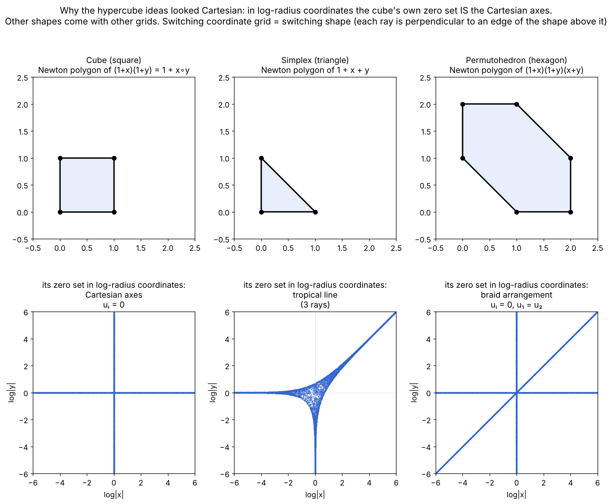
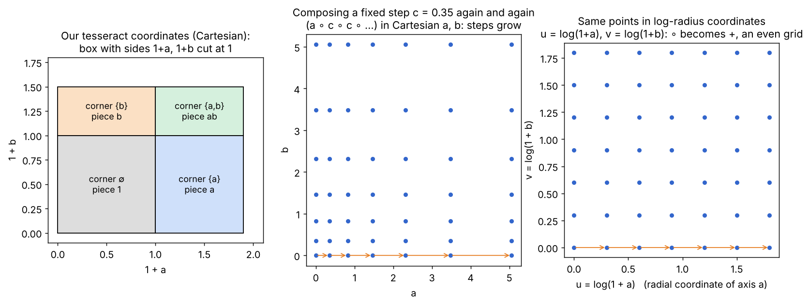
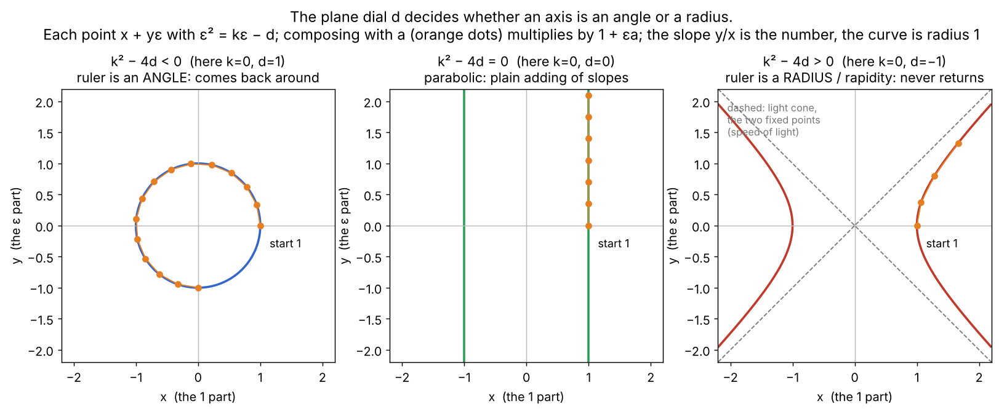
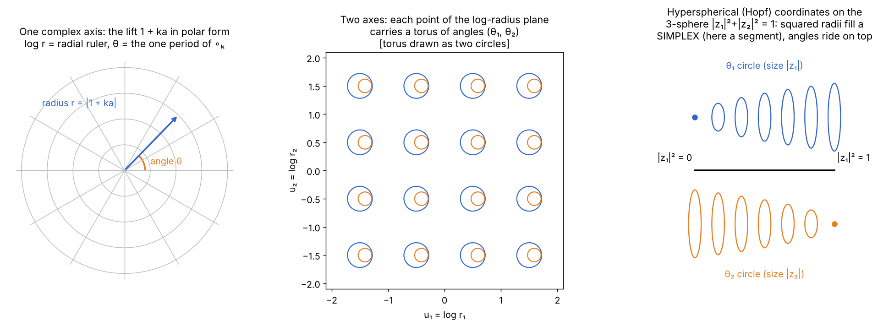
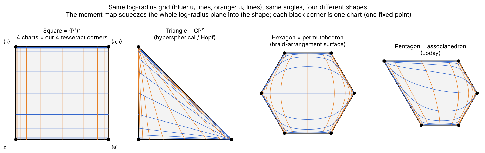
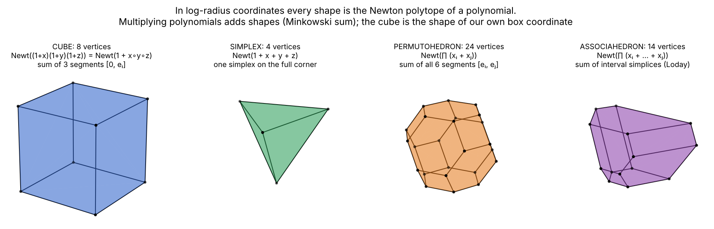
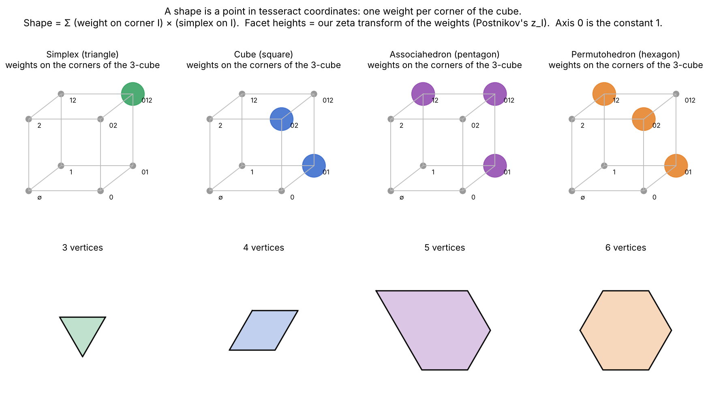
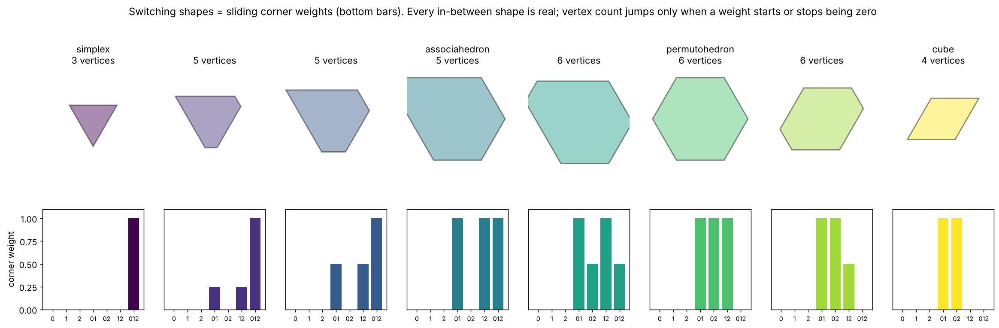
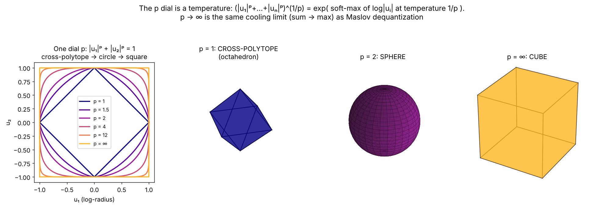
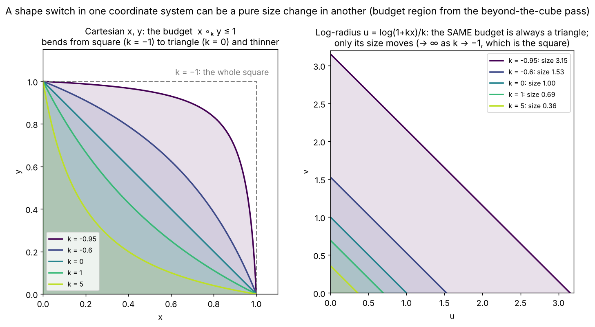

# Polar coordinates for many dimensions: switching shapes (DRAFT)

**DRAFT, Nov 26 2026.** Part of Hypercube Composition Theory (repo: fused-hyperoperation-algebra).
Question (Brennan, Nov 25): most hypercube ideas so far map onto Cartesian coordinates. Would a more polar
coordinate system, with many dimensions, let shapes be switched between more easily?

**Short answer.** Yes, but with a known structure, not a new one. Take the logarithm of each box side as a
*radius* coordinate, and keep a separate *angle* for each axis. In those coordinates every shape we care
about (cube, simplex, permutohedron, associahedron, cross-polytope, sphere) is the same kind of object, and
switching shapes means sliding a few numbers. The shape's numbers turn out to be one weight per corner of the
cube, so a shape is itself a point in our tesseract coordinates, and our zeta transform gives its facets.
Nearly all of this is known mathematics (toric geometry, tropical geometry, Postnikov's generalized
permutohedra). What is ours is the bridge to our operation and to our tesseract coordinates. It does make
switching easier, and the reason is concrete: what was a curved change in Cartesian coordinates becomes a
straight change, often only a change of size.

Checks: `checks.py` → `checks_output.txt`, **28/28 pass**. Pictures: `figures.py` → `figures/`.
No Lean in this pass (no Lean on this machine); the statements are small and listed under "Next" for the
Mac Studio.

---

## 0. Why everything looked Cartesian

*Figure 9. Top: three shapes as the Newton polygon of a polynomial (the corners of the polygon are the
exponents of its terms). Bottom: where the polynomial is zero, drawn in log-radius coordinates
(log|x|, log|y|). The box polynomial (1+x)(1+y) = 1 + x∘y vanishes exactly on the coordinate axes.*

The cube is the shape of our own box coordinate: 1 + (a ∘ b ∘ c) = (1+a)(1+b)(1+c) has one term per corner.
In log-radius coordinates its zero set is the set of coordinate hyperplanes uᵢ = 0, which *is* a Cartesian
grid. So the Cartesian look was not an accident of drawing; it is the cube's own shadow. The triangle brings a
three-ray grid (the tropical line), the hexagon brings the braid arrangement (uᵢ = 0 and u₁ = u₂). Each ray
is perpendicular to an edge of the shape above it.

**Known:** amoebas (Gelfand–Kapranov–Zelevinsky 1994), tropical hypersurfaces, normal fans (each shape's
grid is its normal fan). **Ours:** reading Brennan's observation through this, and the cube as the Newton
polytope of the box coordinate.

---

## 1. One axis: the lift's logarithm is a radius

*Figure 1. Left: our tesseract coordinates for two axes, the box with sides 1+a, 1+b cut at 1 into four
corner pieces. Middle: composing a fixed step c again and again spreads out in Cartesian a, b. Right: the same
points in u = log(1+a), v = log(1+b) sit on an even grid.*

The ruler log(1 + kx)/k turns a ∘ₖ b into u + v (check A1, all k). Per axis that is a radial coordinate:
the box side 1 + ka is a length, and its logarithm is "log-radius". The composition of all axes,
log(1 + a₁∘a₂∘…∘aₙ) = u₁ + … + uₙ (check A3), is the sum of the radii: that sum is the direction that will
turn out to be the simplex.

**Known:** the logarithm of the multiplicative formal group law. **Ours:** nothing new here; this is the
foundation the rest stands on.

---

## 2. The plane dial d decides whether an axis is an angle or a radius

*Figure 2. Each panel is the plane of numbers x + yε with ε² = kε − d. The coloured curve is "radius 1"
(x² + kxy + dy² = 1). Orange dots: start at 1 and compose with the same step again and again. Left, the dots
go round a circle and come back; right, they slide along a hyperbola toward the light cone and never return.*

The plane law (a + b + k·ab)/(1 − d·ab) is ordinary multiplication of the two-part numbers 1 + εa and
1 + εb, read off as a slope y/x (check B1). The quantity x² + kxy + dy² multiplies (check B2), so it is the
radius. Then the sign of k² − 4d decides everything (check B3: composing with a is a turn whose
trace² − 4·det is exactly a²(k² − 4d)):

- **k² − 4d < 0:** the ruler is an **angle**. It wraps around. k = 0, d = 1 is arctan a + arctan b (check B4).
- **k² − 4d = 0:** parabolic, plain adding of slopes.
- **k² − 4d > 0:** the ruler is a **radius** (rapidity). k = 0, d = −1 is artanh, Einstein's velocity
  addition (check B5); the two fixed points are the speed of light.
- **d = 0** gives back ∘ₖ, and its radius is exactly the lift 1 + ka (check B6). So ∘ₖ by itself is the
  radius type. Over the complex numbers its one period (found on the shape-directions page) is the angle.

So in a many-dimensional polar system each axis carries its own (k, d), and that choice says whether the axis
is a radial direction or an angular one.

**Known:** the three kinds of plane numbers and their polar forms (Yaglom, *Complex Numbers in Geometry*,
1968); the (k, d) family is exactly Coleman–McGuinness 1991. **Ours:** the reading "d picks angle or radius
per axis" inside our framework.

---

## 3. Polar coordinates in many dimensions

*Figure 3. Left: one complex axis in polar form. Middle: with two axes, each point of the log-radius plane
carries a torus of angles (drawn as two circles). Right: ordinary hyperspherical coordinates on the 3-sphere,
written Hopf's way: the squared radii |z₁|², |z₂|² run along a segment, and the angle circles shrink to points
at the ends.*

There are two standard ways to do "polar with many dimensions", and they differ only in the shape the radii
fill:

- **One radius and one angle per axis** (log r₁, …, log rₙ; θ₁, …, θₙ). The radii fill all of space, or a
  cube once squeezed (section 4). This is the natural system for our operation, because ∘ₖ acts axis by axis.
- **Hyperspherical / Hopf coordinates** on the sphere |z₁|² + … + |zₙ|² = 1. The squared radii fill a
  **simplex** (check I1), and the angles ride on top.

In both, the angles are a torus and they never change what shape you are in. Only the radial part does.

**Known:** action-angle coordinates; the logarithm map of a torus; Hopf coordinates.

---

## 4. Same grid, same angles, four shapes

*Figure 4. The same log-radius grid (blue lines: u₁ fixed; orange lines: u₂ fixed), pushed into four
shapes by the moment map. The whole infinite plane lands inside each shape. Black dots are corners; each
corner is one chart. On the square, the four charts are the four tesseract corners of our ToricCharts.lean.*

The moment map is the gradient of a smoothed maximum, u ↦ ∇ ½ log Σ exp(2⟨m, u⟩), summed over the corners m of
the shape. It sends the log-radius plane onto the inside of the shape, and turning the angles does not move it
(checks C1, C2). For the square it is just the logistic curve on each axis separately (check C3): the cube is a
product of segments. Change the list of corners and the same grid, with the same angles, fills a triangle, a
hexagon or a pentagon instead.

This is where "switching shapes" lives: the radial part is a choice of shape, the angles are untouched.
For a smooth shape like these, corners ↔ charts ↔ fixed points, which is why our P¹×P¹ gluing had exactly
four charts.

**Known:** moment maps and Delzant's theorem (Atiyah; Guillemin–Sternberg 1982; Delzant 1988).
**Ours:** the match with our tesseract corners and ToricCharts.lean.

---

## 5. Every shape is a polynomial, and multiplying adds shapes

*Figure 5. Four shapes in three dimensions with the polynomial whose terms are their corners: cube
(8 corners), simplex (4), permutohedron (24), associahedron (14). Vertex counts checked (D1).*

| Shape | Polynomial (its corners are the exponents) | Built as |
|---|---|---|
| Cube | (1+x)(1+y)(1+z) = 1 + x∘y∘z | sum of segments [0, eᵢ] |
| Simplex | 1 + x + y + z | one simplex |
| Permutohedron | ∏ over pairs (xᵢ + xⱼ) | sum of all segments [eᵢ, eⱼ] |
| Associahedron (Loday) | ∏ over intervals (xᵢ + … + xⱼ) | sum of interval simplices |

Multiplying polynomials adds their shapes (Minkowski sum: corner by corner, every sum of one corner from each).
The cube's polynomial is our box coordinate, so composing with ∘ is the same act as stacking segments into
a cube (check D2).

**Known:** Newton polytopes and Ostrowski's theorem; Loday's associahedron (2004); Postnikov,
*Permutohedra, associahedra, and beyond* (2009). **Ours:** the cube as Newt(1 + a∘b∘c).

---

## 6. A shape is a point in tesseract coordinates

*Figure 6. Top: a weight on each corner of the 3-cube (corners named by their switches 0, 1, 2; axis 0 is the
constant 1). Bottom: the shape those weights build. Simplex = weight on corner 012. Cube = weights on 01 and 02.
Associahedron = 01, 12, 012. Permutohedron = 01, 02, 12.*

This is the core result. Postnikov's family is: pick a weight yᵢ ≥ 0 for every subset I of the axes, and add
up y_I copies of the simplex on I. A subset of the axes is a corner of the cube, so **the weights are a point
in our tesseract coordinates**, one number per corner. And Postnikov's facet heights z_I = Σ over J inside I of
y_J are exactly our tesseract `zeta` (corner coordinates → box coordinates). The shape is then

  the points t with Σ_{i∈I} tᵢ ≥ z_I for every corner I, and Σ tᵢ = z_all,

and every one of those inequalities is tight (check E1, run with our own tesseract.py `zeta`). Its support
function, the "how far does the shape reach in direction u" function, is a weighted sum of maxima:
h(u) = Σ_I y_I · max_{i∈I} uᵢ (check F1). In log-radius coordinates every shape in the family is that one
formula with different weights.

*Figure 7. Switching shapes is sliding the corner weights (bars). Every in-between shape is a real shape. The
vertex count jumps only when a weight starts or stops being zero: simplex (3) → 5 → associahedron (5) → 6 →
permutohedron (6) → cube (4).*

**Known:** generalized permutohedra, their y and z coordinates and the Möbius inversion between them
(Postnikov 2009, sections 6 and 9); they are the same as polymatroids and as cores of convex cooperative games.
**Ours:** identifying y with our tesseract corner coordinates and z with our box coordinates, so one piece of
our code (`zeta` / `mobius`) runs both the point side and the shape side.

---

## 7. The p dial: cross-polytope → sphere → cube

*Figure 8. Left: |u₁|ᵖ + |u₂|ᵖ = 1 for p = 1, 1.5, 2, 4, 12, ∞. Right: p = 1 (octahedron, the
cross-polytope), p = 2 (sphere), p = ∞ (cube).*

Polytopes can't reach the sphere; a norm dial can. The p-norm ball turns the cross-polytope (p = 1) into the
sphere (p = 2) into the cube (p = ∞). The dial has a reading in our project's terms: the p-norm is
exp of a soft maximum of log|uᵢ| at temperature 1/p (check H1), and p → ∞ is the cooling limit where a sum
becomes a max (check H2). That is the same limit as the Maslov dequantization page (∘ₖ with ⊕ₖ is a semiring at
every k).

**Known:** p-norm balls (Lamé curves / superellipses); log-sum-exp → max. **Ours:** linking the p dial to our
Maslov result.

**Where the cross-polytope sits.** It is not in the family of section 6: its edges point along eᵢ + eⱼ, which is
not a type-A direction (check G2). It does sit in the *signed* version of the family, where both the cube's
edges (eᵢ) and the cross-polytope's (eᵢ ± eⱼ) are allowed (check G1). In our language, signs are the flip
φ (u ↦ −u). **Known:** Ardila–Castillo–Eur–Postnikov, *Coxeter submodular functions and deformations of
Coxeter permutahedra* (Adv. Math. 2020): for type B the cube and the cross-polytope are both weight polytopes,
so both live in the type-B family.

---

## 8. A switch in one system can be just a size change in another

*Figure 10. Left: the budget region x ∘ₖ y ≤ 1 in Cartesian x, y bends from the square (k = −1) through the
triangle (k = 0) to thin curved shapes. Right: in log-radius coordinates the same region is always a
triangle. Only its size changes, log(1+k)/k, which grows without bound as k → −1.*

The beyond-the-cube pass found that the budget region is the cube at k = −1 and the simplex at k = 0 (its
check F2). In log-radius coordinates it is one simplex for every k, of size log(1+k)/k (check J1). So the
k-dial's cube-to-simplex switch is not a change of shape at all once you use the right coordinates. The cube
is the simplex pushed off to infinity.

**Ours** (the budget region is from the beyond-the-cube folder; the log-radius reading is new here).

---

## Does it make switching easier, or only rename things?

It makes switching easier, for four concrete reasons:

1. **One object instead of many.** In log-radius coordinates, cube, simplex, permutohedron and associahedron
   are all "a weighted sum of maxima" (section 6). Switching is sliding numbers.
2. **Our operation does a real job there.** Composing box coordinates multiplies polynomials, which adds
   shapes. The cube is literally the shape of a ∘ b ∘ c.
3. **Some switches vanish.** The k-dial's cube ↔ simplex switch becomes a size change (section 8).
4. **The dials separate cleanly.** d picks angle versus radius on each axis (section 2), the corner weights
   pick the polytope (section 6), and p picks how round it is (section 7).

The renaming part, stated plainly: most of this is known mathematics, and a mathematician would read it as
toric and tropical geometry plus Postnikov's family. No new theorem is claimed. The new things are bridges:
cube = Newt(1 + a∘b∘c); shape weights = tesseract corner coordinates with our zeta as Postnikov's z; the d-dial
as angle-or-radius; the p-dial as a Maslov temperature; and the budget region as one simplex.

## One lead worth a closer look

Our corner `compose` (switches combine by OR) takes two shapes' weight vectors to a third. The weights stay
≥ 0, so the result is again a shape in the family, and its facet heights multiply: z(y ∘ y′) = z(y)·z(y′)
(check K1; cube ∘ cube has 16 corners). Each half is known in another field: in evidence theory this OR
combination of weights is Smets' disjunctive rule, under which belief functions multiply, and generalized
permutohedra are the cores of such functions. I did not find the two put together as an operation on shapes.
It is worth following because it would give the shape side its own version of our operation, alongside the
Minkowski sum, and it is cheap to test: does it respect the associahedron, and does it match a known
polytope construction. Marked ours until a search says otherwise.

## Next (offered, not started)

- Lean (Mac Studio): plane law = product in the ε-numbers and multiplicativity of x² + kxy + dy² (B1, B2);
  Postnikov z = our zeta (E1); z(y∘y′) = z(y)z(y′) (K1). All are short ring identities.
- Follow the lead above.
- Put the angle part to work: with d set to angle type on some axes, the moment polytope picks up circle
  factors. Check whether the relativity and electromagnetism pages' choices of d sit naturally here.

## Files

- `README.md`: this write-up
- `checks.py` → `checks_output.txt` (28/28). Imports `../tesseract/tesseract.py` for `zeta`, `compose`.
- `figures.py` → `figures/fig1` … `fig10`
- Needs numpy, scipy, matplotlib.

## References

- I. M. Gelfand, M. Kapranov, A. Zelevinsky, *Discriminants, Resultants and Multidimensional Determinants*, 1994 (amoebas).
- I. M. Yaglom, *Complex Numbers in Geometry*, 1968 (elliptic, parabolic, hyperbolic numbers).
- R. Coleman, R. McGuinness, "Rational formal group laws", Pacific J. Math. 147 (1991).
- M. Atiyah, "Convexity and commuting Hamiltonians", 1982; V. Guillemin, S. Sternberg, 1982; T. Delzant, 1988.
- J.-L. Loday, "Realization of the Stasheff polytope", Arch. Math. 83 (2004).
- A. Postnikov, "Permutohedra, associahedra, and beyond", IMRN 2009 (arXiv math/0507163).
- F. Ardila, F. Castillo, C. Eur, A. Postnikov, "Coxeter submodular functions and deformations of Coxeter permutahedra", Adv. Math. 365 (2020), arXiv 1904.11029.
- G. Litvinov, V. Maslov, idempotent mathematics and dequantization (1996 onward).
- P. Smets, "Belief functions: the disjunctive rule of combination and the generalized Bayesian theorem", Int. J. Approx. Reasoning 9 (1993).
