# DRAFT · Everything we have proved, read in the polar coordinates

> **Names:** some words or symbols on this page (⊛, mult-add, fused, rung, wall, Tsallis q) also mean something else in standard math, physics or computing, or inside this project. [NAMING-COLLISIONS.md](../../NAMING-COLLISIONS.md) says which meaning is in play.

**DRAFT, Nov 26 2026.** Part of Affine Composition Theory (repo: fused-hyperoperation-algebra).
Asked for by Brennan: "Please look at every thing we have proved in the lens of the polar hyper coordinate
system", and then: "And please use the right shape for the job."

Builds on `polar-coordinates/` (the many-dimensional polar system) and does not repeat it. Checks: `checks.py` →
`checks_output.txt`, **24 of 24 pass** (numpy, scipy, sympy). Family counts: `inventory.py` → `inventory.md`.
Pictures: `figures.py` → `figures/`. Colour key in the pictures: **orange = known, blue = ours** (a bridge or a
reading, not a new theorem). No Lean was compiled in this pass (no Lean on this machine).

## The short answer

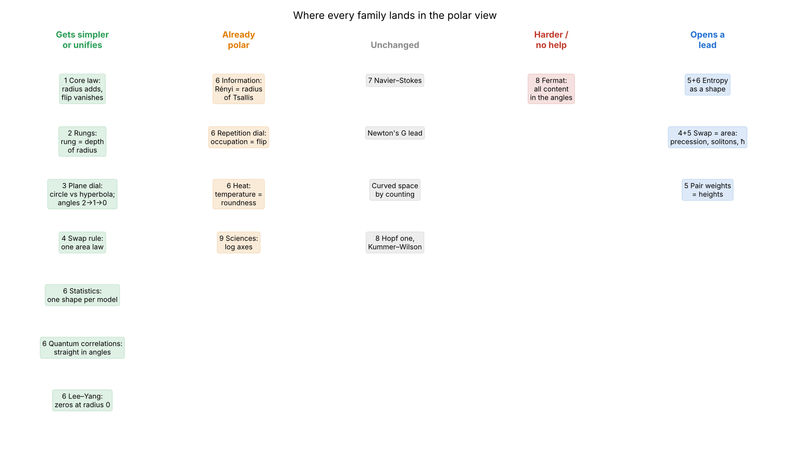

*Figure 11. Where each family lands.*

The polar view genuinely changes five families and leaves the rest as they were.

- **Gets simpler or unifies:** the core law (composing is adding radii, and the flip disappears), the rungs (each
  rung is one more radius taken), the curvature dial (it is the choice between an angle and a radius, and the
  composition-shape line counts angles 2 → 1 → 0), the swap rule (precession, the cube's face weights and Planck's
  constant become one area law), statistics (each model has its own shape), quantum correlations (round in the usual
  coordinates, straight in angle coordinates) and Lee–Yang (every zero sits at radius 0).
- **Already polar:** information theory, the repetition dial, heat and the applied sciences were already written in
  radius coordinates (Rényi as the radius of Tsallis, occupation as the flip, log K, pH).
- **Unchanged:** Navier–Stokes, the Newton's G lead, curved space by counting, Hopf invariant one, Kummer–Wilson.
- **Harder, or no help:** Fermat. In radius coordinates every Fermat curve looks like the same line shrunk by n,
  so everything that makes Fermat hard sits in the angles.
- **Opens a lead:** after the literature pass (section 10), the strongest is that **our curvature dial (the plane dial) is Hirzebruch's
  two-parameter genus**, which joins the dial and the swap rule through one number q and hands both a large known
  theory. Entropy as a shape (section 6b) turned out to be already known in its sign form (Hernández-Cuenca, Hubeny
  and Jia), so it is now a picture, not a lead.

## The right shape for each family

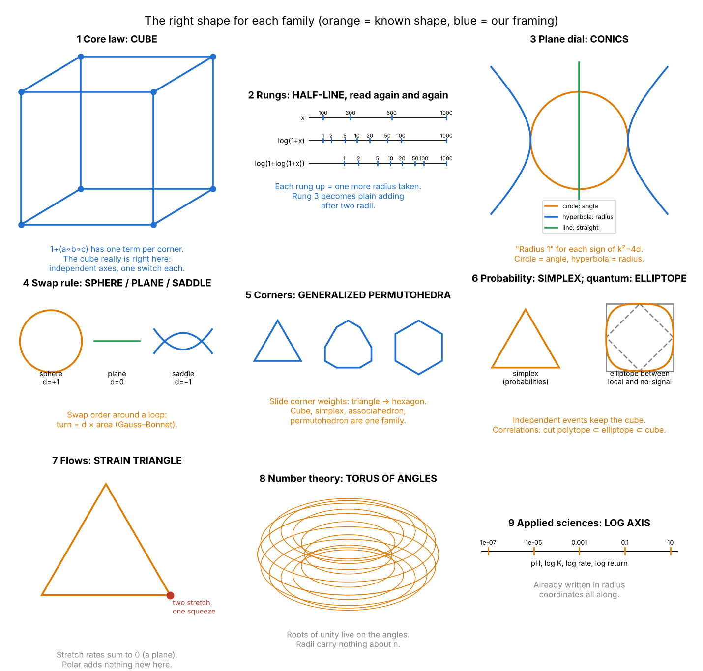

*Figure 1. The shape that fits each family best. The cube is the right one only where the axes really are
independent switches: the core law and independent events.*

| Family (Lean theorems) | Right shape | Why that shape |
|---|---|---|
| 1 Core law and its algebra (374) | **Cube** | 1 + (a∘b∘c) has one term per corner; independent axes, one switch each |
| 2 Rungs, height, calculus (352) | **Half-line, read again and again** | each rung is one more logarithm of the same axis |
| 3 Curvature dial, composition shapes (576) | **Conics: circle, parabola, hyperbola** | "radius 1" is a circle when the axis is an angle, a hyperbola when it is a radius |
| 4 Swap rule: precession, curvature (153) | **Sphere, plane, saddle** | the turn around a loop is curvature × area |
| 5 Corners, shapes, counting (468) | **Generalized permutohedra** | one weight per corner slides between simplex, cube, associahedron, permutohedron |
| 6 Probability, information, heat (508) | **Simplex** (one outcome of many); **cube** (independent events); **elliptope** (quantum correlations) | probabilities sum to 1; independence multiplies; quantum correlations sit between the local polytope and the cube |
| 7 Fields and flows (41) | **Strain triangle** | stretch rates sum to zero, so they live on a plane |
| 8 Number theory, complexity (286) | **Torus of angles** | roots of unity live on circles |
| 9 Applied sciences (344) | **Log axis** | pH, log K, log rates, log returns |

The Lean counts come from the compiled snapshot (3,125 theorems, `lean-library/theorems.tsv`). Lean files written
after that snapshot (precession, corner weights, the holographic gluing files, shape dependencies) are read here
from their write-ups.

---

## 1. Core law: composing is adding radii (gets simpler)

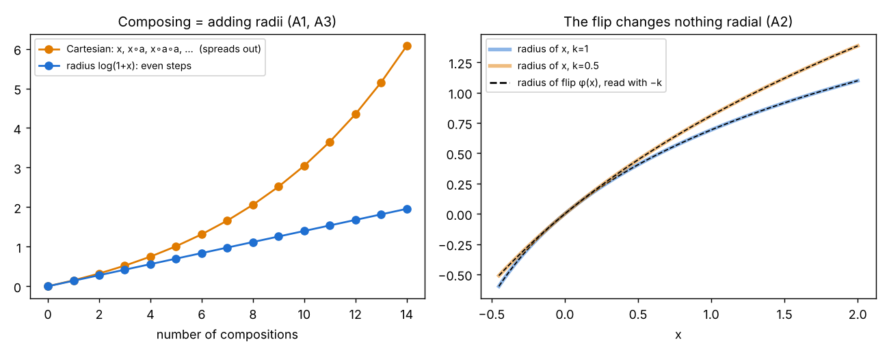

*Figure 2. Left: composing the same step again and again spreads out in Cartesian x, but makes even steps in
the radius log(1+x). Right: the flip changes nothing radial.*

**Shape: the cube.** Here the cube is genuinely right: the corner expansion (`one_add_foldMA_eq_corners`) says
1 + (x₁∘…∘xₙ) has exactly one term per corner (check A6).

Read in the radius Lₖ(x) = log(1 + kx)/k:

- associativity, commutativity and identity 0 become those of addition (A1);
- the n-th power is n times the radius (A3), so `mpow_eq` and `wpow_lift` say "n equal steps";
- the inverse is the negative radius; the wall −1/k sits at radius minus infinity and, at k = −1, certainty sits at
  radius plus infinity (A4, A5);
- **the flip disappears**: the radius of φₖ(x) = x/(1 + kx), read with −k, is the radius of x (A2). So the flip is
  not a new move in polar terms, only the same radius seen from the other end of the dial.

**Known:** the logarithm of the multiplicative formal group law. **Ours:** that the flip is invisible to the radius
is a one-line consequence, now checked; it explains why `wAdd_flip` and `wAdd_neg_one_mirror` look like symmetries.
**Verdict: simpler, no new lead.**

## 2. Rungs: each rung is one more radius (gets simpler)

**Shape: the half-line, read again and again** (Figure 1, panel 2).

The height flow E(x) = eˣ − 1 undoes the radius exactly (B1), so the ruler is "one rung down". Rung 3, the fused
exponent 1 + (a ⊛ b) = (1 + a)^(1+b), becomes plain addition once you take the radius twice:
log log(1 + a⊛b) = log log(1 + a) + log(1 + b) (B2). So the rung number counts how many times you take the radius
before the law turns into addition.

The polar view also names the obstacle the height-flow page met: the radius map log(1 + x) has a fixed point at 0
with slope exactly 1 (B3), a parabolic fixed point, so fractional rungs are not unique and the two half-rungs differ
by the Écalle–Voronin horn coefficient, as that page found.

**Known:** iterated logarithms, Abel and Fatou coordinates. **Verdict: simpler; it reorganizes the height-flow
results but adds nothing to them.**

## 3. Curvature dial: an angle or a radius (gets simpler, unifies)

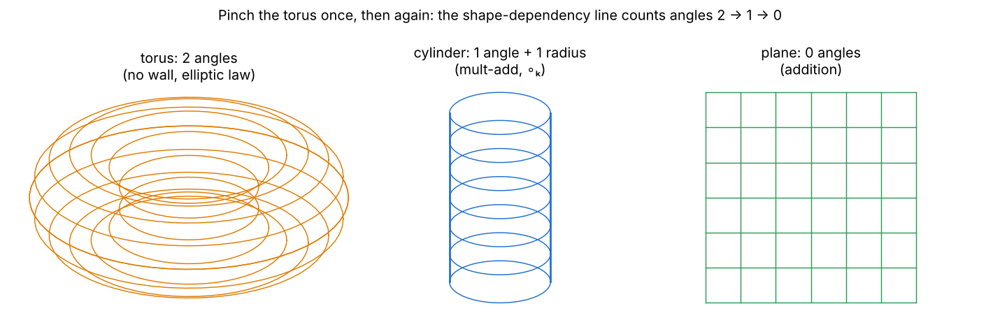

*Figure 3. The composition-shape line from the shape-dependencies pass (addition → the circle operation, called mult-add before 1.0 → no-wall law) is a
count of angles: plane (0), cylinder (1 angle, 1 radius), torus (2 angles).*

**Shape: the conics** (Figure 1, panel 3). "Radius 1" for the plane law is x² + kxy + dy² = 1: a circle when
k² − 4d < 0, a hyperbola when k² − 4d > 0.

- Check C1 runs the plane law with random (k, d): in all 399 cases the sign of k² − 4d decides whether repeated
  composition wraps around and comes back (angle) or runs into a wall (radius).
- The landscape's discriminant classes are exactly these: no wall = angle, two walls = radius, one double wall =
  straight.
- **Clifford** (53 theorems): a generator squaring to −1 is an angle (cos, sin), to +1 a radius (cosh, sinh), to 0
  straight (C2). So a Clifford signature (p, q, r) is literally "how many radial, angular and straight axes".
- **Relativity:** velocity addition is a radial axis (rapidity is the radius); rotations are angular axes.
- **Elliptic:** the torus is two angles. Pinching it once leaves one angle and one radius (the multiplicative group,
  our ∘ₖ), pinching twice leaves none (addition). That is the exact line the shape-dependencies Lean file proved.

**Known:** Yaglom's three kinds of plane numbers; Clifford signatures; degenerations of cubic curves.
**Ours:** the sentence "the composition-shape order counts angles". **Verdict: unifies the landscape, Clifford,
relativity and elliptic families under one dial; no new theorem.**

## 4. Swap rule: one area law for precession, face weights and Planck's constant (unifies; small lead)

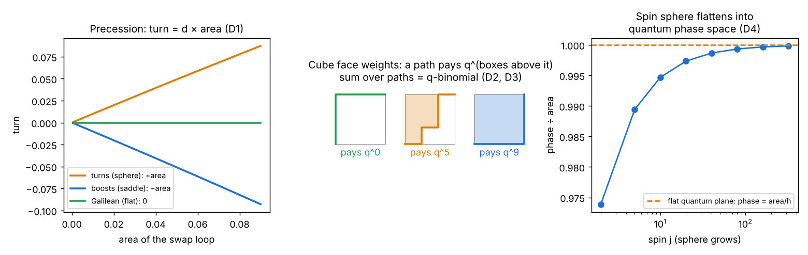

*Figure 4. Left: swap the order of two small moves and go round the loop; the leftover turn is +area on the sphere,
−area on the saddle, 0 when flat. Middle: in the cube's face weights each lattice path pays q to the number of boxes
above it. Right: the spin sphere flattens into quantum phase space as the spin grows; phase per area tends to 1.*

**Shape: sphere, plane, saddle.** The precession page found turn = d × enclosed area. Check D1 recomputes it:
rotations give +1, boosts −1, Galilean moves 0, to four digits.

The polar view puts three things in one slot, the angle part:

1. **Precession** (Thomas, Foucault, Berry, Gravity Probe B, the double pulsar): turn = d × area.
2. **Cube face weights** (cube-weights pass): inputs that commute up to q make each path pay q^(area) (D2), and a
   quantum clock-and-shift pair with VU = qUV expands with the same q-binomials (D3).
3. **Planck's constant:** take a spin j (a sphere, d = +1) and let it grow; near the pole the two small turns become
   position and momentum, and the swap phase per unit area tends to 1, that is 1/ħ in these units (D4: 0.9894 at
   j = 5, 0.9998 at j = 320).

So "swapping costs a turn proportional to area" covers the curvature dial d (curved space), the face weight q (solitons)
and ħ (quantum phase space). The sphere-to-plane step is the Inönü–Wigner contraction of rotations to the Heisenberg
group (Holstein–Primakoff), which is known.

**Known:** Gauss–Bonnet; the noncommutative torus; Inönü–Wigner contraction. **Ours:** that our d and our q are the
same slot, and that ħ sits on the same line. **Verdict: unifies two of our streams. A lead worth following**,
because it gives the precession stream and the corner-weights stream one shared dial, and the frame-dragging lead
on the precession page would be a test: frame dragging should appear as a swap phase with its own area law.

## 5. Corners and shapes (unchanged in content; one bridge)

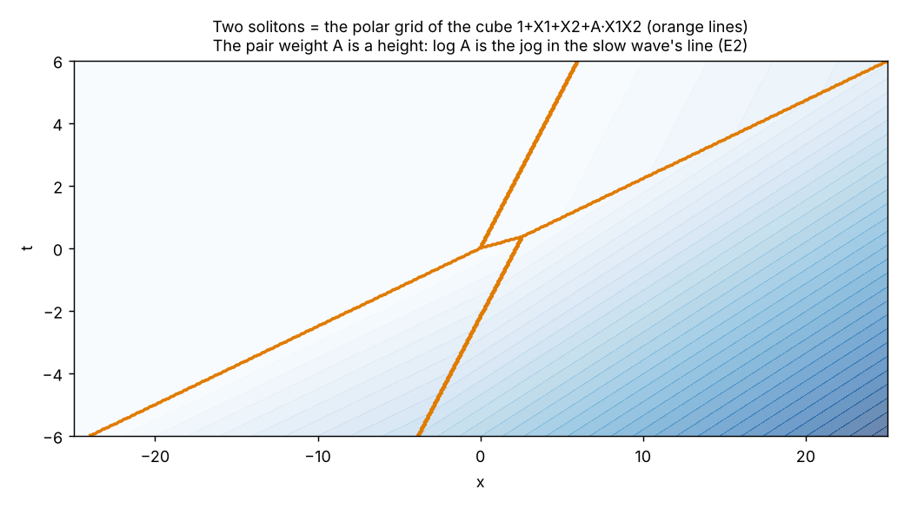

*Figure 9. A two-soliton wave in (x, t). The orange lines are the polar grid of the cube polynomial
1 + X₁ + X₂ + A·X₁X₂. The pair weight A is a height: log A is the jog in the slow wave's line.*

**Shape: generalized permutohedra** (the polar pass showed cube, simplex, associahedron and permutohedron are one
family, one weight per corner).

- Power-set dials, fractional power sets, combinatorics, the diamond lattice, toric charts and the cube proofs were
  already corner statements; they read the same, now as weights on the family's corners.
- **Bridge (ours, on known math):** corner weights play two different roles. In the shape family they are the sizes
  of simplices added together. In the soliton τ-function they are heights over the cube's corners. Check E2 measures
  the jog of the slow soliton in a KdV two-soliton: −2.1970 against log A / k₂ = −2.1972. The soliton contour plot is
  the tropical (polar) grid of the cube, lifted by the pair weights. **Known:** Kodama and Williams on KP solitons
  and tropical curves. **Verdict: a small lead**: it puts the corner-weights stream on a geometric footing we are
  sure of, and Kodama's resonant solitons (the next layer named on the corner-weights page) may be where the heights
  stop being generic. Not checked.

## 6. Probability, information, statistics, heat

### 6a. Statistics: each model has its own shape (unifies)

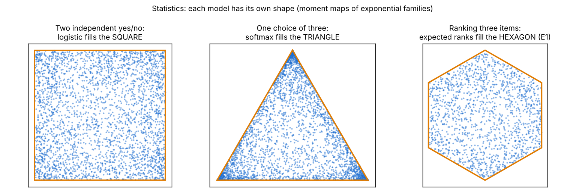

*Figure 5. Two independent yes/no answers fill the square; one choice of three fills the triangle; expected ranks
of three items fill the hexagon (check E1).*

The moment map of the polar pass is the mean of an exponential family. Independent yes/no answers: the cube
(logistic on each axis). One choice among many: the **simplex** (softmax). Rankings: the **permutohedron** (expected
ranks of a Plackett–Luce model, E1). So the statistics family uses the simplex, not the cube, for categorical results,
and the cube only for independent events. **Known:** marginal polytopes (Wainwright and Jordan). **Verdict: unifies
statistics with the shape family.**

### 6b. Entropy as a shape (the strongest lead)

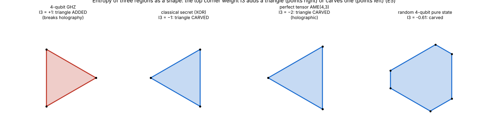

*Figure 7. The entropy of three regions drawn as a shape. Copying information (GHZ) adds a triangle; a shared
secret (XOR) and the perfect tensor carve one out. A random 4-qubit state carves a little.*

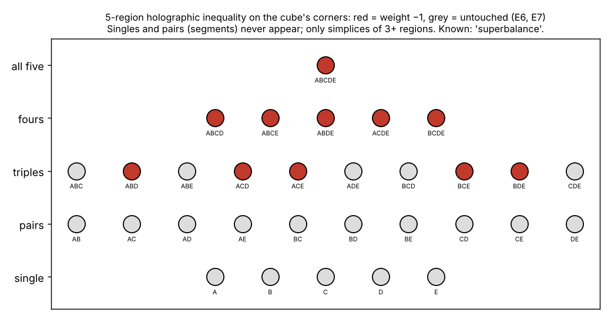

*Figure 8. The 5-region holographic cyclic inequality written as weights on the cube's corners. Singles and pairs
never appear.*

Entropy of subsets is submodular, so it defines a shape in the polar family (a polymatroid base polytope). Its
corner weights are the Möbius inverse of the entropies, the same `zeta` / `mobius` pair our tesseract code uses.

- The top corner weight for three regions is the tripartite information I3, and the hexagon's alternate sides
  differ by exactly I3 (E5): GHZ +1, copies +1, XOR −1, perfect tensor AME(4,3) −2 trits.
- The holographic rule MMI is I3 ≤ 0: **holographic shapes have their top triangle carved out, never added.**
- The 5-region cyclic holographic inequality, written in the same corner weights, has 11 nonzero corners, every one
  with weight −1, and none of them a single region or a pair (E6, E7). So holography constrains only the simplices of
  three or more regions; the pair segments are free.

**Known:** entropy is a polymatroid (Fujishige 1978); I3 as the co-information atom (Yeung); "superbalance" of
holographic inequalities, that they lose all one- and two-party terms (He, Hubeny, Rangamani 2020; set up in He,
Headrick, Hubeny 2019). **Ours:** the shape
reading, carved versus added, and its link to the exploration page's cube corner sum at k = −1.

**Why it looked worth following (before the literature pass, see 6b follow-up):** it turns the holographic entropy cone, which the exploration page
reached by corner sums, into a statement about shapes that our code already handles, and it is cheap to test.
The next test is whether every known 5-region holographic inequality has all its corner weights of one sign; if
they do, "holographic = higher simplices carved out" would be a clean geometric description of the cone.

### 6b, follow-up. Every five-region holographic rule, checked (Brennan's yes, Nov 26)

**Spoken result.** Yes, it holds for every one of them. Apart from plain subadditivity, all 357 five-region
holographic rules say the same kind of thing: pick a group of corners with three or more regions, and their weights
must add to zero or less. No rule ever touches a single region or a pair, and no rule ever has a plus sign.

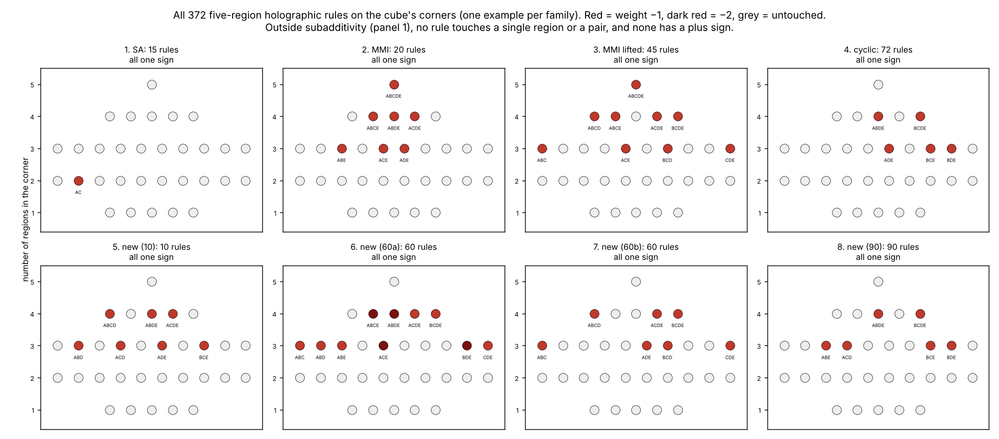

*Figure 12. One example from each of the eight families of five-region holographic rules, drawn on the cube's 31
corners. Red = weight −1, dark red = −2. Panel 1 is subadditivity, the only family that touches a pair.*

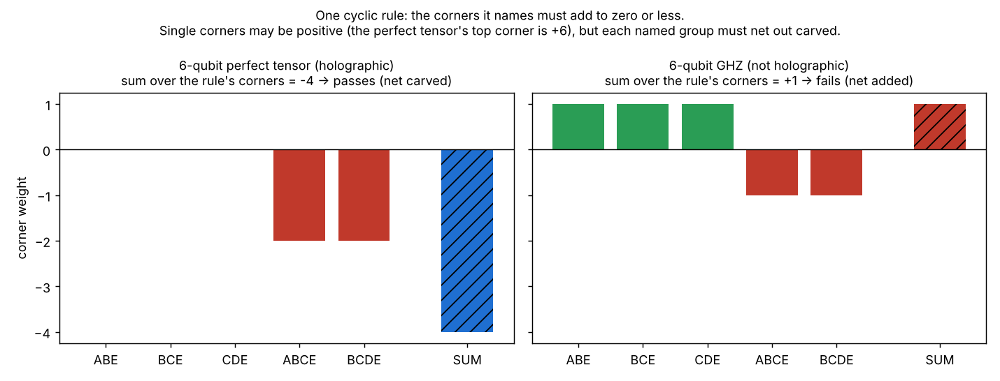

*Figure 13. One cyclic rule on two states. The perfect tensor's corners in that group add to −4, so it passes; GHZ's
add to +1, so it fails.*

What was checked (`hec5/hec5_signs.py` → `hec5/hec5_signs_output.txt`):

- The eight family representatives were copied from Table 1 of Hernández-Cuenca 2019 (arXiv:1903.09148), which
  proved this list is the complete five-region cone. Applying all 720 relabelings of the five regions and the
  purifier reproduced the paper's family sizes exactly, 15, 20, 45, 72, 10, 60, 60 and 90, for **372 rules in
  total**. That is a check that the copying was right.
- Each rule was rewritten in the corner weights (the Möbius inverse of the entropies, the same `mobius` our tesseract
  code uses). **All 357 rules outside subadditivity have every nonzero coefficient negative (−1 or −2) and only on
  corners of three or more regions.** The 15 subadditivity rules are each of one sign too, but they touch pairs, and
  the five that involve the purifier touch singles.
- Sanity checks (`hec5/hec5_checks.py`): a 6-qubit perfect tensor passes all 372 rules; a 6-qubit GHZ state fails
  every rule in the seven families beyond subadditivity.

**A refinement, stated plainly.** "Holographic means carved out" is true for each rule's *group* of corners, not for
each corner by itself. The perfect tensor has a top-corner weight of +6 and still passes, because each group the
rules name nets out to zero or less (Figure 13). So the accurate wording is: **every holographic rule is a
"net carved" condition on a group of higher corners.**

**Known versus ours (corrected Nov 26 after the literature pass).** All of it is known. The complete five-region
list is Hernández-Cuenca 2019. "Superbalance", meaning no one- or two-region terms, was proved by He, Hubeny and
Rangamani (JHEP 2020). And the one-sign pattern itself is **Proposition 3 of Hernández-Cuenca, Hubeny and Jia
(arXiv:2309.06296)**: in the I-basis every valid rule has coefficients whose sign is fixed by the number of regions,
(−1)^|K| q_K ≥ 0. Since the I-basis is our corner weights with alternating signs, that is exactly "one sign in the
corner weights". An earlier version of this page marked it "ours, unconfirmed" and said the I-basis showed mixed
signs; both were wrong. What remains ours is only the picture: drawing each rule as a carved group of cube corners,
and the 372-rule reproduction.

**Is it worth following?** Not as a new result. The live question next to it is the *tripartite form* conjecture
of Hubeny and Liu (arXiv:2609.22504, 2026): every holographic rule is a sum of negative conditional tripartite
informations. In our pictures that reads: every rule's corner group splits into upward intervals, each starting at
a 3-region corner. All 357 five-region rules split that way (section 10, Figure 15), but that much was already
known up to six regions. It is a clean way to draw an open conjecture, not a new route to proving it.

### 6c. Quantum correlations: straight in angle coordinates (gets simpler)

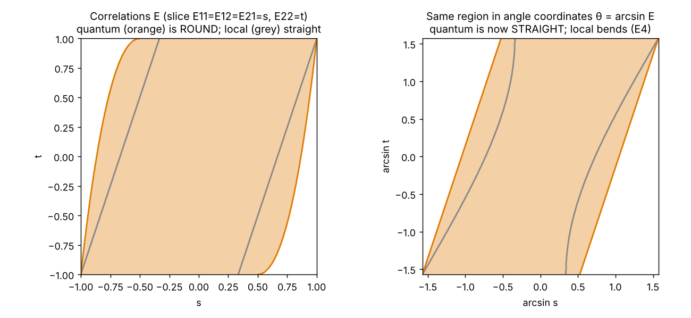

*Figure 6. Left: a slice of the correlations E. The quantum region (orange) is round; the local region (grey) is
straight. Right: the same slice in angle coordinates θ = arcsin E. Now the quantum region is straight and the local
one bends.*

**Shape: the elliptope** (from the beyond-the-cube pass), between the local polytope (CHSH ≤ 2) and the no-signalling
cube (CHSH 4). Taking angles makes the quantum boundary flat: |Σ ± arcsin Eᵢⱼ| ≤ π. Check E4 tested 3,000 random
two-qubit states and measurements: no excess (largest CHSH seen 2.496). **Known:** Landau 1988, Masanes 2003.
**Verdict: simpler; this is the polar move doing exactly what it should.**

### 6d. Lee–Yang: zeros at radius 0 (gets simpler)

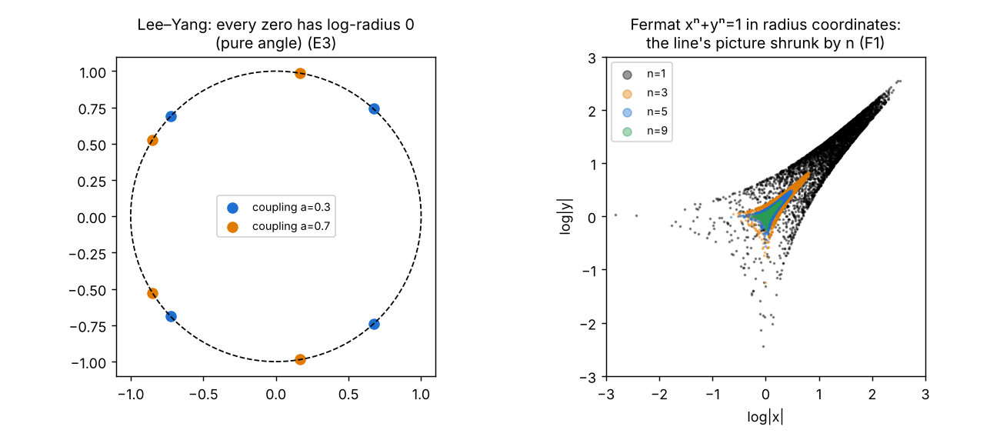

*Figure 10. Left: Lee–Yang zeros on the unit circle. Right: Fermat curves in radius coordinates, the same picture
shrunk by n.*

**Shape: the circle.** Every zero of a ferromagnet's partition function has log-radius 0 (E3): in polar terms the
Lee–Yang theorem says the zeros are pure angle. **Known.** **Verdict: simpler.**

### 6e. Already polar

Information theory already uses Rényi = Lₖ(Tsallis) (`InfoFused.lean`). The repetition dial already has occupation
= φₖ(Boltzmann factor), the flip. Heat already has temperature as the Maslov roundness dial (G1). These read the same.

## 7. Fields and flows (unchanged)

**Shape: the strain triangle.** Stretch rates sum to zero, so they live on a plane, and the dangerous corner (two
stretch, one squeeze, Betchov 1956) is a corner of that triangle. The polar view adds nothing: the hard part is the
helix cross term, which no coordinate change removes. The Newton's G lead and curved space by counting are also
unchanged.

## 8. Number theory (Fermat: harder, or no help)

**Shape: the torus of angles.** Every Fermat curve xⁿ + yⁿ = 1 has the line's radius picture shrunk by n (F1,
Figure 10). So in polar coordinates all of n lives in the angles, the roots of unity, and the radius part carries
nothing. Saying so plainly: the polar view does not help with Fermat. Hopf invariant one and Kummer–Wilson are
unchanged.

## 9. Applied sciences (already polar)

**Shape: the log axis.** Chemistry (log K, pH, Nernst, Arrhenius), biology and finance (log returns, Fisher's rule)
were written in radius coordinates all along. Unchanged.

## 10. What the literature already has, and the super logarithm (Nov 26)

*Asked by Brennan on a call: whether any of the polar simplifications yield a lead, and whether there is literature
built on what we found; then whether the super logarithm falls out of a different shape, or out of changing from
one shape to another. Checks in `literature/`: `genus_check.py` (all 20 genus values match), `tf_check.py` (357 of
357), `superlog_shapes.py` (flow identities exact in sympy), `rigidity_check.py`.*

**Spoken result.** The strongest lead is that our curvature dial is a well-known object in topology, Hirzebruch's
two-parameter genus, and through it the curvature dial and the swap rule turn out to be one number. The super logarithm
does not fall out of any single shape: every shape in the polar system has a simple ruler, and the rungs between
whole heights match no shape past the third term. It falls out of the change from one shape to the next, done a
fractional number of times, and what makes that unique is the pinch point at zero, which is known math.

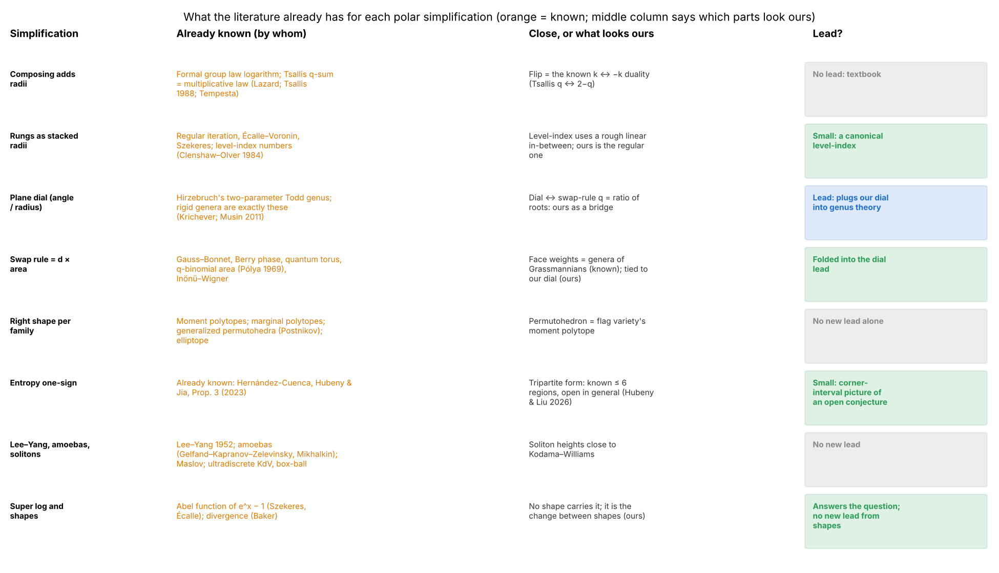

*Figure 17. Each simplification, what is already known and by whom, what is close or ours, and whether it opens a
lead.*

### 10a. The curvature dial is Hirzebruch's two-parameter genus (lead)

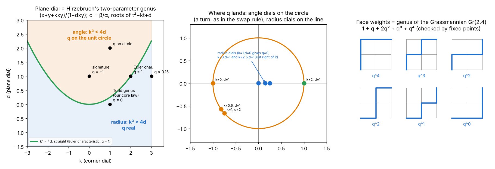

*Figure 14. Left: the plane-dial map, with the named genera at their points. Middle: where q = β/α lands for each
dial; angle dials put it on the unit circle. Right: the six staircase paths of Gr(2,4), weighted q^area; their sum is
the genus of that Grassmannian.*

- **Known.** The law (x + y + kxy)/(1 − dxy) is the formal group law of Hirzebruch's two-parameter Todd genus
  (topologists write it (x + y + μ₁xy)/(1 + μ₂xy), so k = μ₁, d = −μ₂). Its special points are named: d = 0 is the
  Todd genus (our core law), k = 0 is the signature, and k² = 4d is the Euler characteristic. The χ_y-genus of a
  Grassmannian is a Gaussian binomial, and Gaussian binomials count staircase paths by area (Pólya 1969). Musin
  (2011, building on Krichever) proved that the genera rigid under circle actions are exactly these two-parameter
  ones.
- **Checked here.** Write 1 + kx + dx² = (1 + αx)(1 + βx). The genus then gives CP^n the q-number with q = β/α, and
  fixed-point sums on CP², CP³, Gr(2,4) and the flag variety Fl(3) give exactly the q-numbers, q-binomials and
  q-factorials for five dial settings (20 of 20 values).
- **Ours (a bridge, not a new theorem).** In the angle case (k² < 4d) α and β are complex conjugates, so q sits
  on the unit circle and is a turn. In the radius case q is real, and on the straight line q = 1. That is the swap
  rule's three cases (rotation, boost, Galilean), so **the dial and the swap rule are one number, q = β/α**, and our
  cube face weights at any dial are genera of Grassmannians.
- **Is it worth following?** Yes, on its own merits. It gives two of our families a single, large, known home, with
  tools we can use directly: fixed-point formulas, rigidity, and the elliptic genera (Krichever; Buchstaber–Bunkova)
  that should sit at the elliptic end of our dial, though I have not checked that. It also makes testable
  predictions. For example, the permutohedron's corners are the fixed points of the flag variety, so face weights on
  the permutohedron should be that genus. Next: put the CP^n identity in Lean, and check partial flag varieties
  against our q-multinomials.

### 10b. Entropy as a shape: already known (correction)

The one-sign pattern of section 6b is Proposition 3 of Hernández-Cuenca, Hubeny and Jia (arXiv:2309.06296). Section
6b has been corrected. The neighbouring open question is Hubeny and Liu's tripartite-form conjecture (2026). In our
pictures it says every rule is a stack of upward corner intervals, each starting at a 3-region corner. All 357
five-region rules split that way. That much was already known up to six regions, so this is a clean drawing of an
open conjecture, not new evidence.

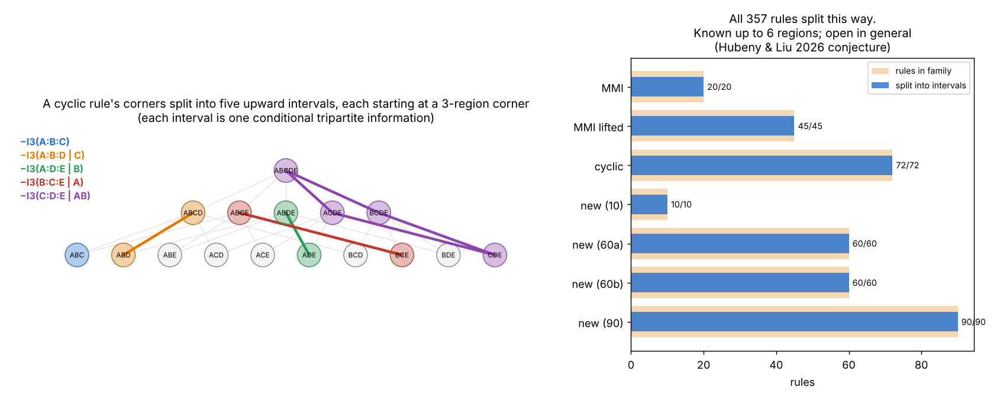

*Figure 15. Left: one cyclic rule's corners, split into five intervals; each colour is one negative conditional
tripartite information. Right: every rule in every family splits this way.*

### 10c. The other simplifications

- **Composing adds radii.** Textbook: the logarithm of the multiplicative formal group law. Tsallis' q-sum is the
  same law (Tsallis 1988; Tempesta's group entropies), and the flip is the known k ↔ −k duality (Tsallis q ↔ 2 − q).
  No lead.
- **Rungs as stacked radii.** Known: regular iteration (Szekeres, Écalle). The resemblance to level-index numbers
  (Clenshaw–Olver 1984) is real. There the level is the number of logs taken (our rung count) and the index is the
  fractional part. Their in-between values are a linear patch; Clenshaw, Lozier, Olver and Turner (1986) note there
  is no definitive choice, and Walker (1991) built smooth versions. Our rung ruler is the regular, analytic choice for
  e^x − 1. That is a small, practical lead (a canonical smooth level-index system), worth it only if someone needs
  one.
- **Angle versus radius.** "Wick rotation" is exact only at k = 0: putting x → ix turns tan's law into tanh's by
  flipping d. For general k the switch is between the two real forms of the same complex group, set by the sign of
  k² − 4d. Known.
- **Right shape per family.** Known: moment polytopes (Atiyah, Guillemin–Sternberg), marginal polytopes of
  exponential families (Wainwright–Jordan), generalized permutohedra (Postnikov), the elliptope (Laurent–Poljak) and
  the Landau/Masanes boundary. No new lead on its own; the permutohedron as the flag variety's shape feeds 10a.
- **Lee–Yang, amoebas, solitons.** Known: Lee–Yang 1952; amoebas (Gelfand–Kapranov–Zelevinsky, Mikhalkin);
  Maslov dequantization; ultradiscrete KdV and the box-ball system. Soliton heights sit close to Kodama–Williams.
  No new lead.

### 10d. The super logarithm and the shapes

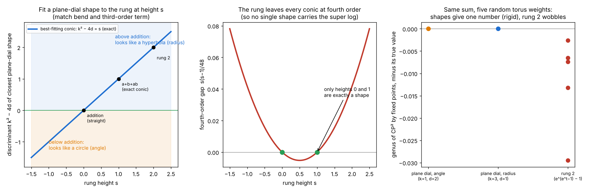

*Figure 16. Left: the plane-dial shape that best matches the rung at height s has discriminant exactly s, so it is
a circle below addition and a hyperbola above it. Middle: the rung leaves that shape at the fourth term by s(s−1)/48,
which is zero only at heights 0 and 1. Right: the same fixed-point sum for CP² with five random torus weights; the
two shapes give one number every time, and rung 2 wobbles.*

Builds on `../fractional-rungs/e-every-height/` (the hypernatural log ln_s(X) = E^−s(X − 1), E = e^x − 1).

- **The hypernatural log is a radius, in exactly our sense.** Each rung operation B_s(x, y) = E^s(E^−s x + E^−s y)
  is a one-dimensional formal group law, and its logarithm is E^−s. So ln_s is the radius of the height-s operation,
  just as log(1 + kx)/k is the radius of the dial-k operation. The framework is known (Lazard); applying it to
  B_s is ours.
- **No shape carries it.** Every plane-dial shape has an elementary ruler, the log of a fraction of linear terms.
  The best-matching shape at height s has k = s and d = s(s − 1)/4, so k² − 4d = s exactly (ours, exact in sympy).
  It then misses at the fourth term by s(s − 1)/48. Only addition (s = 0) and our operation (s = 1) are shapes; rung 2
  already is not.
- **Shapes are rigid; rungs are not.** Any ruler defines a genus. Musin's theorem says the rigid ones are exactly the
  plane-dial shapes, and the right panel shows rung 2 failing it numerically.
- **Where the super log comes from: changing shape.** Climbing one rung is conjugating by e^x − 1, which carries the
  height-s operation to height s + 1. That is the change from one shape to the next. The hypernatural log is that
  change done s times. What makes "s times" unique for fractional s is the pinch point at zero, the parabolic fixed
  point behind our horn fingerprints (Szekeres, Écalle). That part is known.
- **A consequence (ours, short argument).** For fractional s the operation B_s has no convergent power series at 0.
  If it had one, its logarithm would converge too, and Baker proved the fractional iterates of e^x − 1 do not. So
  fractional rungs live on the half-line away from 0, never as a shape around 0.
- **Not examined.** The roundness dial (Maslov's temperature) moves + toward max, which is a different direction
  from height. The cube, simplex, sphere and cross-polytope are shapes of where corners sit, and they don't change
  the operation, so they cannot produce the super log.

**Is it worth following?** It answers the question, but it opens no strong lead. The shapes cannot give a new route
to the super log, because none of them reaches it. The useful outcome is the clean statement that the super log
lives in the change between shapes, pinned down by the parabolic point. The one small applied lead is the smooth
level-index system in 10c.

**Known versus ours, in this section.** Known: Hirzebruch's two-parameter genus and its law; χ_y of Grassmannians
as Gaussian binomials; Musin/Krichever rigidity; Hernández-Cuenca–Hubeny–Jia Proposition 3; the tripartite-form
conjecture; formal group laws (Lazard); regular iteration and Baker's divergence; level-index arithmetic. Ours: the
dial-to-q bridge with the swap rule; the corner-interval drawing; the best-fitting shape at height s (k² − 4d = s)
and its fourth-order gap; the no-convergent-series consequence for B_s; and the reading of the super log as the
change between shapes.

**References for this section:** F. Hirzebruch, *Topological Methods in Algebraic Geometry*; O. Musin, "On rigid
Hirzebruch genera", Moscow Math. J. 2011, arXiv:0809.3063; V. Buchstaber, E. Bunkova, arXiv:1010.0944;
S. Hernández-Cuenca, V. Hubeny, F. Jia, arXiv:2309.06296; V. Hubeny, Y. Liu, arXiv:2609.22504; T. He, V. Hubeny,
M. Rangamani, JHEP 07 (2020) 245; C. W. Clenshaw, F. W. J. Olver, "Beyond floating point", J. ACM 1984;
P. Walker, Math. Comp. 1991; G. Pólya, 1969; P. Tempesta (group entropies).

---

## Leads, ranked on their own merits (updated after the literature pass)

1. **The curvature dial is a genus** (section 10). Worth following: it gives our dial and our swap rule one known home,
   with rigidity and fixed-point formulas we can use, and makes testable predictions about face weights.
2. **Swap equals area** (4). Now folded into lead 1: the swap rule's q is the dial's ratio of roots.
3. **Pair weights as heights** (5). Smaller, and close to Kodama–Williams; the open question is resonant solitons.
4. **Entropy as a shape** (6b). No longer a lead: the sign pattern is known (Hernández-Cuenca, Hubeny, Jia, Prop. 3).
   What is left is a picture of the open tripartite-form conjecture (Hubeny & Liu 2026).

## Next (offered, not started)

- Lean: the curvature dial's logarithm gives CP^n the value q-number (one series identity).
- Check the plane-dial genus on partial flag varieties against our face weights (q-multinomials).
- Lean (Mac Studio): A2 (flip leaves the radius alone), B2 (rung 3 after two radii), E5 (top corner = I3), E6 (the
  cyclic inequality's corner coefficients). All are short identities.

## Files

- `README.md`: this write-up
- `checks.py` → `checks_output.txt` (24/24)
- `inventory.py` → `inventory.md` (Lean theorems grouped into the nine families)
- `figures.py` → `figures/fig1` … `fig11`
- `hec5/`: the five-region sign check (`hec5_signs.py`, `hec5_checks.py`, outputs, `hec5_figures.py` → fig12, fig13)
- `literature/`: the literature pass and super-log question (`genus_check.py`, `tf_check.py`, `superlog_shapes.py`,
  `rigidity_check.py`, their outputs, `lit_figures.py` → fig14 … fig17)

## References

- I. M. Yaglom, *Complex Numbers in Geometry*, 1968.
- A. Postnikov, "Permutohedra, associahedra, and beyond", IMRN 2009.
- E. Inönü, E. P. Wigner, "On the contraction of groups and their representations", 1953.
- T. Holstein, H. Primakoff, 1940.
- Y. Kodama, L. Williams, "KP solitons and total positivity for the Grassmannian", Invent. Math. 2014.
- M. J. Wainwright, M. I. Jordan, *Graphical Models, Exponential Families, and Variational Inference*, 2008.
- S. Fujishige, "Polymatroidal dependence structure of a set of random variables", 1978.
- R. W. Yeung, "A new outlook on Shannon's information measures", IEEE Trans. IT 1991.
- T. He, M. Headrick, V. Hubeny, "Holographic entropy relations repackaged", JHEP 2019, arXiv:1905.06985.
- S. Hernández-Cuenca, "The holographic entropy cone for five regions", Phys. Rev. D 100, 026004 (2019), arXiv:1903.09148.
- L. J. Landau, "Empirical two-point correlation functions", Found. Phys. 1988; Ll. Masanes, "Necessary and sufficient
  condition for quantum-generated correlations", 2003.
- T. D. Lee, C. N. Yang, 1952.
- P. Betchov, 1956.
