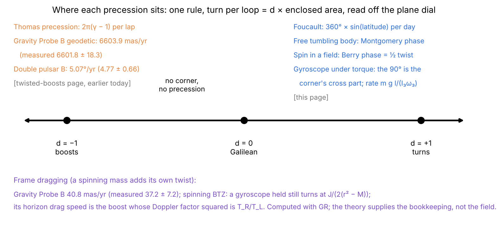
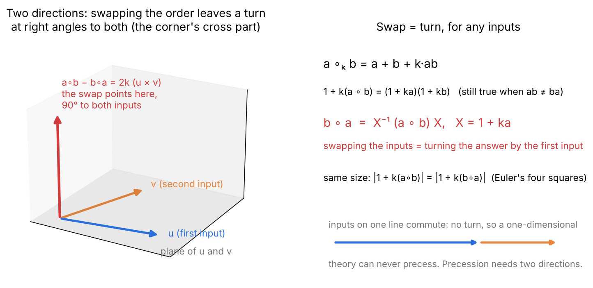
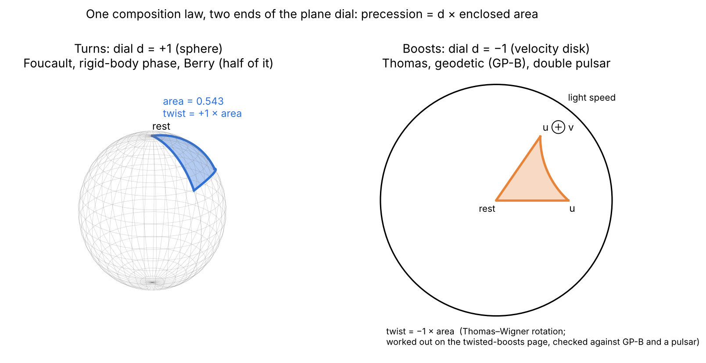
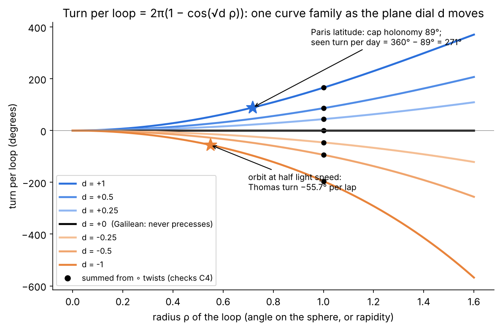
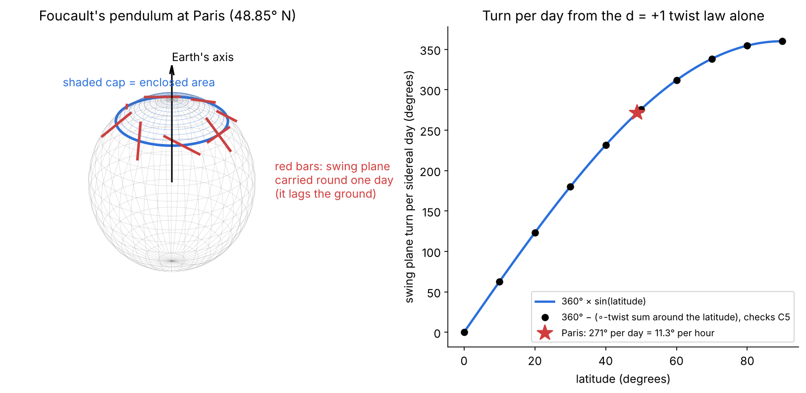
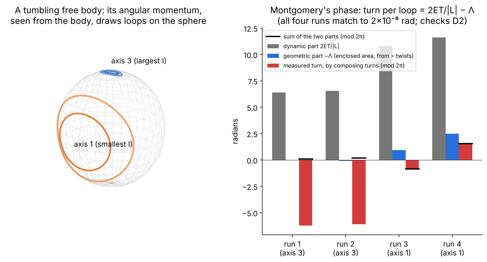
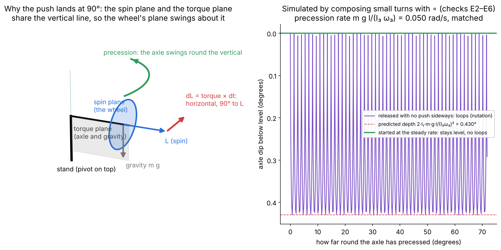
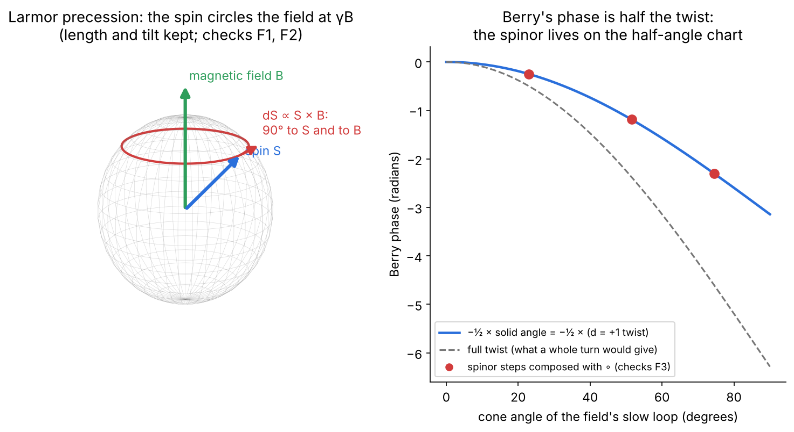
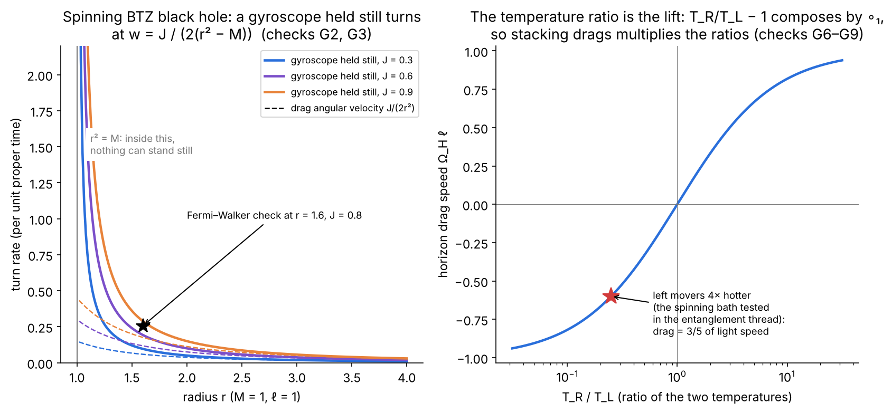

# DRAFT: Precession through the circle operation (Nov 25, 2026)

Asked by Brennan (voice call): "I want to be able to describe precession from this theory ... It's just something
that seems like should be able to be described with this theory."

## The result in two sentences

Yes. Every kind of precession we tested comes from one rule of the circle operation: when the two inputs point in
different directions, swapping their order turns the answer, and over a closed loop that turn equals the curvature dial (the plane dial)
d times the area enclosed. With d = −1 (boosts) this is Thomas precession, already matched to Gravity Probe B and the
double pulsar; with d = +1 (turns) it gives Foucault's pendulum, the tumbling-body phase and Berry's spin phase, and
the gyroscope's famous 90° is the cross part of the operation's corner. The one thing the theory does not supply is
the push itself: a torqued gyroscope's rate, m·g·l/(I₃ω₃), still needs Newton's torque law. The theory says how the
turns combine, not where the force comes from.

*Fig 9. Where each precession sits on the curvature dial. Left (d = −1, boosts): Thomas, geodetic, double pulsar, all
from the twisted-boosts page earlier today. Right (d = +1, turns): this page. Middle (d = 0, Galilean): no corner, so
no precession. Bottom: frame dragging, which needs gravity's own input.*

## 1. Why the push lands at 90° (fundamental)

*Fig 1. Left: two directions u and v. Swapping their order inside the operation leaves a difference
2k(u × v) that points at right angles to both. Right: the general rule.*

The circle operation a ∘ₖ b = a + b + k·ab works in any algebra where you can multiply, including ones where
ab ≠ ba (quaternions for turns, 2×2 Pauli matrices for boosts). Its lift survives: 1 + k(a ∘ b) = (1 + ka)(1 + kb).
From that, three facts follow (checks A1 to A7, Lean section 1 to 4):

- **Swap = turn.** b ∘ a = X⁻¹ (a ∘ b) X with X = 1 + ka. Swapping the inputs gives the same answer turned by the
  first input. Its size never changes.
- **The swap's size is k × (ab − ba).** For two directions that is 2k·(u × v): a direction at right angles to both
  inputs. This is the 90°.
- **One line, no turn.** Inputs along one line commute. So every one-dimensional page of the theory has no
  precession at all, and it can't: precession needs two directions.

The corner ab of two directions splits into a dot part (along) and a cross part (across). The dot part is the plane
dial: it lands in the denominator 1 − d·(u·v). The cross part is the tilt, and precession is the tilt.

**Status.** The algebra is elementary; the commutator fact was already on the groups-lie page (matrix ∘, Magnus
1937) and the corner split on the twisted-boosts and Clifford pages. "Swap = turn" stated for the circle operation
on any algebra is ours as a framing; it predicts nothing by itself.

## 2. One law, two ends (fundamental)

*Fig 2. The same composition law at the two ends of the curvature dial. Left: turns (d = +1) on the sphere; the
twist of a triangle is + its area. Right: boosts (d = −1) in the velocity disk; the twist is − its area.*

- **Turns (d = +1).** Two turns with half-angle vectors g and h compose as (1 + g)(1 + h) = 1 + g ∘₁ h, which is
  Rodrigues' formula g′ = (g + h + g × h)/(1 − g·h) (Rodrigues 1840). Matched against 3D rotation matrices for 2,000
  random pairs (B1).
- **Boosts (d = −1).** Two boosts with half-velocity vectors u and v compose in the Pauli algebra as
  (1 + u)(1 + v) = (1 + u·v) + (u + v) + i(u × v). The dial flips the sign in front of u·v. Here the cross part can't
  stay a boost: it is a turn. That turn is the Thomas–Wigner rotation, with tan(θ/2) = |u × v|/(1 + u·v), matched
  against 4×4 Lorentz matrices for 500 random pairs (B2, B3), and the textbook perpendicular-boost formula (B4).

So turns combined give a tilted turn, and boosts combined give a boost plus a turn. Both come from the same cross
part of the corner.

## 3. Turn per loop = d × area: one curve family

*Fig 3. Carry a direction round a circle of radius ρ, composing step by step with the plane law. The total turn is
2π(1 − cos(√d ρ)) (cosh when d is negative). Blue: the turn side. Orange: the boost side. Black: d = 0, flat,
never precesses. Dots: summed directly from the operation's twists (C4).*

The twisted-boosts page showed one triangle's twist is d × its area (Gauss–Bonnet with curvature d). Here it is
checked at both ends (C2, C3) and summed round whole loops for seven dial settings from +1 to −1 (C4). The same
function, a few lines of code, gives Foucault at d = +1 and Thomas at d = −1 (C5, C8).

**Status.** Holonomy = curvature × area is standard geometry. That a single dial moves it continuously from
Foucault to Thomas through "no precession" at d = 0 is our reading of the curvature dial. It is a clean picture, not a
new prediction.

## 4. Foucault's pendulum

*Fig 4. Left: the swing plane carried round the latitude of Paris for a day; the shaded cap is the enclosed area.
Right: turn per day against latitude; dots computed only from the d = +1 twists.*

Summing the d = +1 twists round the latitude circle gives the cap's area; the ground frame turns once a day, so the
swing plane is seen to turn 360° × sin(latitude) per sidereal day (C5). At Paris (48.85° N) that is 11.3° per hour,
the rate of Foucault's 1851 demonstration (C6). A pendulum integrated directly on the rotating Earth with the
Coriolis force turns at the same rate (C7), so this is the physics, not a tautology.

**Status.** Known physics (Foucault 1851). Ours: getting it from the operation's twists alone.

## 5. The free tumbling body

*Fig 6. Left: a tumbling body's angular momentum, seen from the body, draws loops on the sphere. Right: the turn the
body makes per loop splits into a dynamic part 2ET/|L| and a geometric part −Λ, the enclosed area.*

A body with three different moments of inertia (1, 2, 3) was tumbled, with its orientation built only by composing
small turns with ∘₁ (4th-order steps). After each loop it has turned about its fixed angular momentum by
2ET/|L| − Λ, where Λ is the enclosed area computed with the d = +1 twists (D1, D2; four runs about both stable axes,
match to 2×10⁻⁸ rad). With the area's sign flipped the formula fails (D3), so the twist term is really there.

**Status.** Known: Montgomery, "How much does the rigid body rotate?", Am. J. Phys. 59, 394 (1991). Ours: the area
term is the d = +1 twist law.

## 6. The torqued gyroscope (Brennan's 90° question)

*Fig 5. Left: gravity pulls down on the end of the axle; the torque is horizontal and at 90° to the spin. The spin
plane and the torque plane share the vertical line, so the wheel's plane swings round it. Right: simulation by
composing small turns. Started at the right sideways speed it stays level (green). Released with no sideways push it
dips and loops (purple), to the predicted depth.*

- The torque of gravity is horizontal and perpendicular to the axle at every step (E1). In plane language: the
  spin lives in the wheel's plane; the torque lives in the plane of the axle and gravity; those two planes share
  only the vertical line, so adding a little torque swings the spin plane about the vertical. That is precession.
- Steady precession with a level axle: the precession turn's cross product with the spin equals the torque exactly
  when Ωₚ · I₃ω₃ = m·g·l (Lean gyroscope_steady). The simulation, built from ∘ compositions, gives Ωₚ = 0.050000
  against 0.050000 predicted, axle level to 5×10⁻⁷ (E2, E3), energy kept (E4).
- Released with no precession it nutates: depth 2·I₁·m·g·l/(I₃ω₃)² matched within 3%, average rate still
  m·g·l/(I₃ω₃) (E5, E6).

**Status.** Known (Euler, Lagrange top). What the theory adds is the 90° itself: it is the cross part of the corner.
What it does not add is the torque: the rate needs Newton's law dL/dt = τ as an input.

## 7. Spin in a magnetic field: Larmor and Berry

*Fig 7. Left: a spin circles the field (Larmor); each push is at 90° to both the spin and the field. Right: a spin
following a slowly circling field picks up Berry's phase, half the d = +1 twist of the field's loop.*

Spin steps composed with ∘₁ reproduce Larmor precession at γB exactly (F1, F2). A spin-½ following a field round a
cone picks up −½ × solid angle (F3, three cone angles, within the slow-loop error). That is exactly half the d = +1
twist (F4), because the spinor lives on the half-angle chart, the same "half a kick" the twisted-boosts page uses
for velocities.

**Status.** Known: Larmor, Berry (Proc. R. Soc. A 392, 45, 1984). The half-angle reading matches the Clifford
page's Hopf link (piece 11); here it gets a spin check.

## 8. Frame dragging in the spinning BTZ black hole

*Fig 8. Left: a gyroscope held still near a spinning BTZ black hole turns at w = J/(2(r² − M)) relative to the
static frame (the star: an independent Fermi–Walker integration). Dashed: the drag angular velocity J/(2r²).
Right: the horizon's drag speed against the ratio of the two temperatures; the star is the spinning bath tested in
the entanglement thread.*

- Rotating BTZ (ℓ = 1, 8G = 1): g_tt = −(r² − M), g_tφ = −J/2 exactly (G1).
- A gyroscope held still turns at **w = J / (2(r² − M))** per unit proper time; one carried by a
  zero-angular-momentum observer does not turn (G2). An independent numerical Fermi–Walker transport agrees to better than 10⁻⁷
  (G3). No spin, no turn (G4); far out it matches the drag rate J/(2r²) (G5). It blows up at r² = M, where nothing
  can stand still.
- Horizon drag speed Ω_H ℓ = r₋/r₊ = (T_R − T_L)/(T_R + T_L), and the Hawking temperature is the harmonic mean of
  T_L and T_R (G6). Its relativity-page coordinate 2u/(1 − u) is T_R/T_L − 1 (G7): the temperature ratio is the
  lift, so stacking two drags multiplies the ratios, which is ∘₁ (G8, Lean drag_stack).
- The entanglement thread's spinning bath (left movers 4× hotter than right movers) has a horizon dragging at 3/5
  of light speed (G9). That thread also found the gluing dial k doesn't move in a spinning bath; consistent with
  this: spin changes the rate, not the rule.

**Status.** All of this is general relativity applied (BTZ: Bañados, Teitelboim, Zanelli 1992; gyroscope rate =
vorticity of the observer, standard). We did not find w = J/(2(r² − M)) quoted, but it is a routine computation, so
treat it as known in principle. Ours: the temperature-ratio-as-lift reading. In 3+1 dimensions the frame-dragging
number was already done on the twisted-boosts page: Gravity Probe B 40.8 mas/yr against 37.2 ± 7.2 measured.

## Lead 1 (Thomas–Wigner): already done, rerun

The brief's first lead was worked out earlier today on the twisted-boosts page: the twist e^{iω} = (X + iY)/(X − iY)
with X = 1 − d(u·v), Y = d(u × v); ω = d × area; Thomas precession 2π(γ − 1) per lap; Gravity Probe B geodetic
6603.9 mas/yr against 6601.8 ± 18.3 measured; double pulsar B 5.07°/yr against 4.77 ± 0.66. Its three check files
were rerun here: 36/36, 21/21, 13/13 pass. Standard names: Thomas precession (Thomas 1926), Wigner rotation (Wigner
1939), Ungar's gyrogroups (the twist is Ungar's gyration), Borel 1913.

## Verdict on each lead, on its own merits

1. **Thomas–Wigner (boosts, d = −1).** The strongest of the three: exact, and matched to two independent measured
   precessions. It doesn't open a new path beyond what that page already found.
2. **Gyroscope and the turn side (d = +1).** The theory now describes every geometric precession we tried (Foucault,
   tumbling body, Berry, the gyroscope's 90°) with one rule, and the numbers are right. It is a real unification of
   known physics, worth keeping as a write-up. It is not a new prediction, and the torque-driven rate still needs
   Newton's law as input.
3. **Frame dragging (BTZ).** Computed correctly, but the physics comes from general relativity, not from the
   operation. The temperature-ratio-as-lift link to the spinning-bath thread is small but genuine. Not a path by
   itself.

**One lead that would be new:** frame dragging is the only precession here that the theory can't produce on its
own; it borrows gravity's field. On the pulsar page the companion's drag enters with weight 2·m₁/M. If that weight
could be derived from swap = turn applied to the spinning source itself (the source's own turn composed with the
orbit), frame dragging would come out of the operation instead of being put in. We have not tried this; it is the
open edge of this page.

## Files

- `checks.py` → `checks_output.txt`, `results.json`: **41/41 pass** (sympy, numpy, scipy). About 30 seconds.
- `figures.py` → `figures/fig1` to `fig9` (labeled PNGs, read results.json).
- `lean/Precession.lean`: **23 theorems** (including one ext lemma), core Lean 4.37.0-rc1, imports Base only, no
  sorry, standard axioms only. Compiled here against a copy of the shared library (library unchanged; full build of
  the copy: 3,125 theorems clean, then this module on top). To merge: copy to
  `FusedAlgebra/Topics/Precession.lean`, add to build.sh after BinaryPulsar and to FusedAlgebra.lean.
  Contents: quaternion ∘ₖ with lift and associativity; swap_is_turn; swap_diff; pure_commutator (the 90°);
  cross_perp_left/right; nsq_mul (Euler's four squares); swap_keeps_size; collinear_commute; rodrigues and
  rodrigues_same_axis (tan law); torque_perp_axle, torque_horizontal, gyroscope_steady; larmor_keeps_length,
  larmor_keeps_tilt; drag_coordinate, drag_stack, spinning_bath_drag.
- Pushed to the repo Nov 25 as a DRAFT. CI runs `checks.py`, and `lean/Precession.lean` is compiled into the library as `FusedAlgebra.Topics.Precession`.

## Known vs ours (summary)

| Piece | Status | Source |
|---|---|---|
| Swap = turn for ∘ₖ on any algebra | ours (framing; elementary) | checks A, Lean 1–4 |
| Rodrigues composition = ∘₁ on quaternions | known | Rodrigues 1840 |
| Thomas–Wigner angle from the Pauli corner | known | Thomas 1926, Wigner 1939; Baylis's algebra of physical space |
| Turn per loop 2π(1 − cos √d ρ) as one dial family | known geometry, our dial reading | checks C4 |
| Foucault from ∘ twists | known physics, our route | Foucault 1851 |
| Rigid-body phase, area from ∘ twists | known physics, our route | Montgomery 1991 |
| Gyroscope's 90° = corner's cross part | known physics, our reading | Euler, Lagrange |
| Berry phase = half the d = +1 twist | known physics; half-angle link from the Clifford page | Berry 1984 |
| BTZ static gyroscope w = J/(2(r² − M)) | GR, routine (not found quoted) | BTZ 1992 |
| T_R/T_L as the lift of the drag speed | ours (reading) | checks G7, G8 |
