# DRAFT · Is probability entanglement? Time, small loops, the helix, and our union rule

Nov 25, 2026. Asked for by Brennan on a voice call: "is probability entanglement?", then widened to time from
entanglement, to his idea of probability as "a very small loop ... like a computer's clock being a mod operator over
the very last digit of the internal clock", to a whole-path picture where Bohm's shared clock and 't Hooft's
superdeterminism are "the same thing", and to the loop being a helix. One question, one write-up.

Checks: `checks.py` → `checks_output.txt` (**51 of 51 pass**; numpy + sympy, helpers in `lib.py`). Pictures:
`figures.py` → `figures/`. Second pass (stress tests and the bath, section 9): `checks2.py` → `checks2_output.txt`
(**41 of 41 pass**), pictures from `figures2.py`. Pushed to the repo Nov 25 as a DRAFT so it isn't lost; CI runs both check scripts. DRAFT: the computations reproduce known results unless marked
"ours", and the "ours" items are readings and a toy model, not theorems.

## The result in plain words

Probability and time both come out of entanglement in existing, well-tested work, and the one place our union rule
genuinely ties them together is the AdS₃ gluing rule: there the cross-ratio turns out to be a real probability, the
chance that a steady random clock running on one region's own time ticks at least once while it sweeps across the
other region. A hidden loop or helix, though, cannot by itself give the quantum odds for entangled pairs: it has to
give up one of the assumptions Bell's theorem names, and even then nothing in it explains why quantum mechanics stops
at 2√2 rather than going higher.

## Verdicts, lead by lead

| Lead | Verdict | Why |
|---|---|---|
| "Probability is entanglement" (general) | **True as a picture, already known; not a lead for us** | Purification, Zurek, typicality and Chiribella–D'Ariano–Perinotti all say a part's probabilities are its entanglement with the rest. Our ∘₋₁ appears in those derivations only as ordinary inclusion–exclusion counting. |
| The union rule means "no correlation" | **Solid, small; worth stating in our README, not a research lead** | P(a or b) = p ∘₋₁ q for every pair of local tests exactly when the parts share no information; entanglement shows up as the miss, capped by √(2I). |
| AdS₃ cross-ratio as a clock probability | **Lead worth following** | It explains *why* ∘₋₁ appears there (independent Poisson ticks), ties time (modular time), probability and entanglement (conditional mutual information) in one formula, and it can fail a sharp test: excited states where modular time stops being geometric. |
| Small loop read coarsely → probability | **True for everyday probability, already known; for quantum probability it hits Bell's wall** | Poincaré–Hopf–Keller explain coin and roulette odds this way. One qubit can be faked by a lopsided loop; entangled pairs cannot, by any local loop or helix. |
| Whole path: Bohm = superdeterminism | **Holds as "same data, two stories"; does not explain the quantum limit** | Our toy model reaches 2√2 by letting the loop's weight depend on both ends of the path, and a nonlocal version gives the identical outcome table. But the same freedom also gives 4; only "weight = |sum of path phases|²" stops at 2√2, and that rule is quantum mechanics itself. |
| Helix instead of circle | **Right shape for keeping count; adds no new physics** | The helix is the circle's universal cover: our lift ℓ₁ = log(1+x) is only additive if you keep the turns, and a winding count is immune to noise. Bell's bound still applies to any helix variable. |

## 1. Probability from entanglement (known)

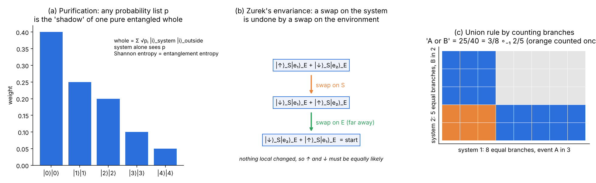

- **Purification (a).** Any list of probabilities is the "shadow" of a single pure state of the system together with
  something outside it; the Shannon entropy equals the entanglement entropy (check A1). Chiribella, D'Ariano and
  Perinotti (2011) took this as an axiom ("every mixed state has a purification") and derived quantum theory from it.
  This is the strongest existing form of "probability is entanglement".
- **Zurek's envariance (b).** If system and environment are entangled with equal weights, a swap on the system can be
  undone by a swap on the far-away environment, so nothing local changed and the outcomes must be equally likely
  (A2). Unequal weights are first split into equal-weight branches with an extra system ("fine-graining", A3),
  which gives the Born rule for rational weights, then all weights by continuity. Criticism: it assumes probabilities
  depend only on the local state and that probabilities of exclusive outcomes add (Schlosshauer and Fine 2005).
- **Where our union rule is (c).** Two independent systems, each fine-grained to equal branches, form a grid; "A or B"
  is the L-shaped region, and counting it gives exactly p ∘₋₁ q (A4). That is the whole appearance of ∘₋₁ in these
  derivations: honest inclusion–exclusion, nothing more.
- **Deutsch–Wallace** (1999, 2007, 2012): in a many-worlds reading, a rational agent must bet with Born weights;
  the dispute is over the rationality axioms. **Self-locating uncertainty** (Vaidman 1998; Sebens and Carroll 2018):
  after a branching, "which branch am I on?" gets Born weights from an "epistemic separability" principle. Both use
  the same engine as Zurek (equal-amplitude branches plus a symmetry), so they add no new place for ∘ₖ.
- **Gleason (1957)**: in 3 or more dimensions, any consistent way to assign probabilities to yes/no tests must be
  the Born rule. It uses no entanglement at all; the square comes from Hilbert-space geometry. So entanglement
  explains *that* parts look random and *which* outcomes are equal; the *square* comes from the geometry.

## 2. The union rule is the fingerprint of "no correlation" (elementary; our framing)

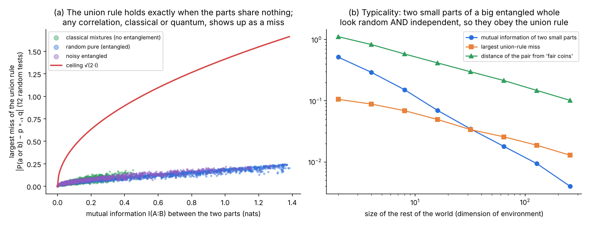

- For yes/no tests on two different parts, the "or" test is literally P + Q − PQ (B1): our ∘₋₁ at the operator
  level. For a product state the probabilities obey p ∘₋₁ q (B2).
- The miss P(a or b) − p ∘₋₁ q equals minus the covariance, and is at most √(2·I(A:B)) (Wolf, Verstraete, Hastings
  and Cirac 2008), checked in 48,000 tests (B3, panel a). Classical mixtures and entangled states both miss; only
  states sharing nothing never miss (B4). On one system with non-commuting tests, P + Q − PQ is not even a yes/no
  test (B5): the union rule needs the two questions to be compatible.
- **Typicality (panel b, known: Page 1993; Popescu, Short and Winter 2006; Goldstein, Lebowitz, Tumulka and Zanghì
  2006).** Two small parts of a big random entangled whole look like fair coins *and* like independent coins: their
  mutual information falls like 1/(size of the rest) (C1, C2). This is monogamy at work: being entangled with the
  world leaves nothing to share with each other. So the union rule is what entanglement with a large environment
  *produces* between small parts. That is the honest sense in which "probability is entanglement" connects to ∘₋₁.

## 3. Time from entanglement (known)

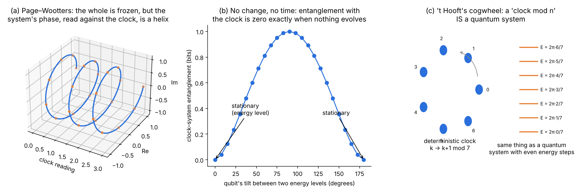

- **Page–Wootters (1983).** The whole universe can be frozen (it satisfies H|Ψ⟩ = 0), yet conditioning on a clock's
  reading gives a system state that evolves exactly as e^(−iHt)|ψ₀⟩ (D1). Plotted against the clock reading, the
  system's phase traces a helix (panel a). Clock–system entanglement is zero exactly when nothing changes and is
  largest when the system changes most (D2, D3, panel b): no change, no time.
- Known objections and fixes: Kuchař (1992) showed naive two-time questions give wrong answers; Giovannetti, Lloyd
  and Maccone (2015) fixed this by having the measurement leave a record. Moreva et al. (2014) built a two-photon
  version in the lab. Höhn, Smith and Lock (2021) showed Page–Wootters, relational observables and "deparametrizing"
  are one theory (the "trinity"). With interacting clocks, gravitational time dilation appears (Smith and Ahmadi
  2019; Castro-Ruiz, Giacomini, Belenchia and Brukner 2020).
- **'t Hooft's cogwheel (panel c).** A deterministic clock that steps k → k+1 mod n *is* a quantum system with
  evenly spaced energies 2πk/n (D4). Brennan's "computer clock mod n" is exactly this object, and it is the ideal
  Page–Wootters clock.
- **Thermal time (Connes and Rovelli 1994).** A part's own state ρ = e^(−K) defines a flow, "modular time", generated
  by K. For a region of empty spacetime this flow is a geometric boost (Bisognano–Wichmann 1975; for a ball or an
  interval, Hislop–Longo and Casini–Huerta–Myers 2011). So **one object, a part's reduced state, gives both its
  probabilities (the eigenvalues) and its time (the flow K generates).** This is the known meeting point of
  "probability from entanglement" and "time from entanglement".

## 4. The small loop (known for everyday probability)

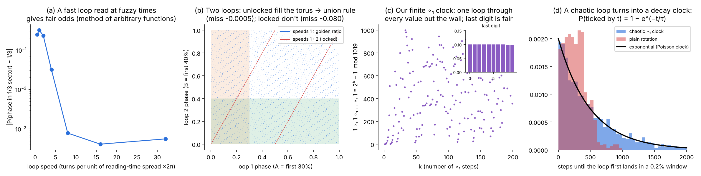

- **(a) Method of arbitrary functions** (Poincaré 1896; Hopf 1934; Keller 1986; Diaconis, Holmes and Montgomery
  2007). A fast loop read at slightly fuzzy times gives fair odds whatever the fuzz looks like (E1). The last digit
  of a tick counter is uniform when the reading time is spread over many ticks, and not when it is sharp (E2). This
  is Brennan's mod-operator idea, and it is the accepted explanation of why coins, dice and roulette are random.
- **(b) Two loops.** If their speeds are unlocked (golden ratio), the joint reading fills the torus and the events
  combine by the union rule; locked speeds (1 : 2) miss by 0.08 (E3).
- **(c) Our finite ∘₁ clock.** 1 ∘₁ 1 ∘₁ … ∘₁ 1 = 2ᵏ − 1 mod p (E4) is one loop through every value except the wall
  −1 when 2 is a primitive root (p = 1019, E5); its last digit is fair (E6).
- **(d) Loop → decay clock.** A *chaotic* ∘₁ clock (step 16806 mod 2³¹−1) waits an exponential time to land in a
  small window (E7; the Poisson law for mixing systems, Hirata 1993); a plain rotation does not (E8). Two separate
  windows combine by ∘₋₁ (E9). So a loop gives the decay-clock law x = 1 − e^(−t), which is exactly the form of the
  AdS₃ cross-ratio in section 6.

## 5. Can a loop give quantum odds? Born rule, Bell, and the whole path

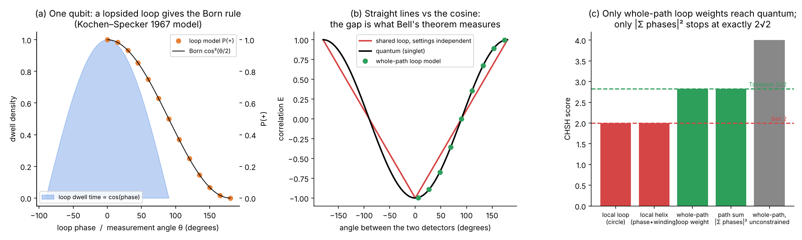

- **One qubit, yes (a).** A loop whose dwell time is ∝ cos(phase), read by "which half-circle", gives exactly
  cos²(θ/2) (F1; Kochen and Specker 1967). Averaging a fast relative phase removes interference terms (F2), but the
  square itself is put in by hand.
- **Entangled pairs, the wall (b, c).** Any loop read locally, with its value independent of the detector settings,
  scores CHSH ≤ 2 (F3, G1); the best is straight-line correlations. Quantum mechanics follows the cosine and reaches
  2√2. A helix (phase plus winding) read locally is no better (I6): Bell's bound holds for *any* hidden variable.
- **The whole-path model (ours, toy).** Let the loop's weight depend on both ends of the path, w(φ | a, b), while each
  detector still reads only its own setting. This reproduces the singlet exactly (G2) and reaches 2√2 (G3). It drops
  **measurement independence**, not locality; the loop "knows" the settings by only about 0.05 bits (G6). This is
  the all-at-once / retrocausal family (Price; Wharton; Sutherland; Cramer's transactions; Aharonov's two-state
  vector; review: Wharton and Argaman 2020) and, read forwards in time, superdeterminism ('t Hooft). Small
  measurement dependence is known to suffice (Brans 1988; Degorre, Laplante and Roland 2005; Hall 2010; Barrett and
  Gisin 2011).
- **Brennan's "same thing" (G7).** A nonlocal Bohm-like model (loop independent of settings, but one reading uses the
  far setting) gives the identical outcome table. In a block-universe "whole path" view, "depends on the far
  detector" and "depends on the future setting" are two descriptions of one constraint on the path. That part holds
  up. What does not: the same whole-path freedom also produces a Popescu–Rohrlich box with CHSH = 4 (G4). Only the
  rule "weight = |sum of the path phases|²" stops at exactly 2√2 (G5), and that rule is quantum mechanics written as
  a path sum. So the whole-path loop **reformulates** quantum correlations; it does not yet **explain** them. The
  missing piece is a principle that forces |Σ|²; known candidates are information causality (Pawłowski et al. 2009)
  and Gleason's theorem.
- **"Not susceptible to entropy" (G8–G10).** A closed loop's winding number survives noise in every run while an open
  phase spreads; this is why topological quantities (winding numbers, Aharonov–Bohm and Berry phases) are
  entropy-proof. But a single global phase is unobservable (G9): a universal clock can only show up as phase
  *differences* between paths. Composing path segments, the loop phasors E(iθ) = e^(iθ) − 1 combine by ∘₁ (G10),
  which is our height flow at imaginary height.

## 6. The AdS₃ cross-ratio is a clock probability (reading ours, ingredients known)

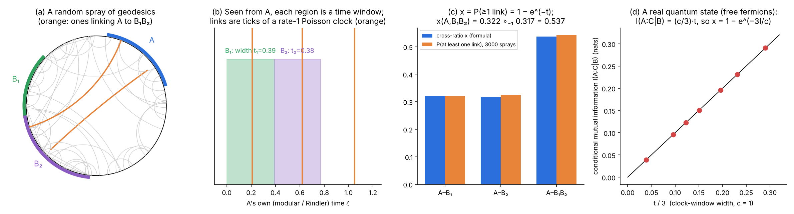

This answers the brief's question "can the cross-ratios be given a genuine probability meaning?" Yes:

1. **t = −log(1 − x) is the width of region B measured in region A's own modular (Rindler) time** (H1, 2,000 random
   arc configurations). A's modular time is the flow its entangled state generates (section 3).
2. t is also the Crofton measure of geodesics joining A to B (H2; kinematic space, Czech, Lamprou, McCandlish and
   Sully 2015; bit threads built this way: Agón, de Boer and Pedraza 2019).
3. So scatter geodesics at random at rate 1 per unit of that measure (a Poisson process). Then **x = P(at least one
   random geodesic links A to B) = 1 − e^(−t)**: panel (a), checked over 3,000 random universes (H3, panel c).
4. Links to B₁ and B₂ are independent (correlation −0.01), so gluing B₁ and B₂ is the ordinary union rule
   x(A, B₁B₂) = x(A,B₁) ∘₋₁ x(A,B₂) (H4). **That is why ∘₋₁ appeared in the exploration:** it is memorylessness of a
   steady random clock on adjacent time windows (panel b), not a coincidence.
5. **A real quantum state agrees (panel d).** On a lattice of free fermions (a c = 1 conformal field theory) the
   conditional mutual information of three neighbouring blocks equals t/3 to four decimals (H5). In any 2D conformal
   vacuum, I(A:C|B) = (c/3)·t, because it only involves single-interval entropies (Calabrese–Cardy). Hence
   **x = 1 − e^(−3·I(A:C|B)/c)**: the cross-ratio is fixed by an entanglement quantity, and its odds X = E(t) = e^t − 1
   have the form of a Doppler shift whose rapidities add (H6; composition by ∘₁). Moving B along A's modular time
   leaves x unchanged (H7): x measures a clock *interval*, not a clock reading.

Known vs ours: the cross-ratio formulas, kinematic space, bit threads and the CMI formula are known. Reading x as the
"at least one tick" probability of a Poisson clock on A's modular time, and so explaining the ∘₋₁ gluing law, is
ours; I did not find it stated. It is a reformulation, not yet a prediction.

## 7. The helix

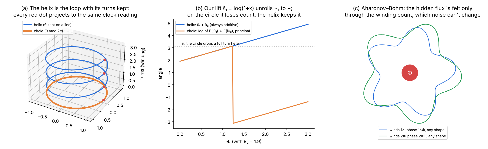

- The helix is the loop with its turns kept: θ on a line maps to e^(iθ) on the circle, and unrolling recovers θ up
  to one constant turn (I1). Every turn of the helix lands on the same clock reading (panel a).
- **Our lift ℓ₁ = log(1 + x)** turns ∘₁ into + on the line. On the circle, its principal branch drops a full turn
  when angles pass π (I2), and the dropped piece is exactly 2πi × the winding number (I3, panel b). So the helix is
  precisely what makes our lift work on loops; the height flow E rolls the helix up, ℓ₁ unrolls it.
- The finite tan-law clock over F₁₉ is a loop of 20 steps (I4); counting steps on the integers is its helix.
- **Aharonov–Bohm (panel c).** A path winding n times around a hidden flux picks up n × flux whatever its shape (I5):
  a hidden thing felt only through a winding count, which noise cannot change. This is the best existing example of
  Brennan's "single loop the universe depends on in a way you couldn't see", and it is local in the gauge field.
- Other known helices: de Broglie's internal clock (1924), Schrödinger's Zitterbewegung (1930) and Hestenes'
  helical electron model (1990); claimed observations (Catillon et al. 2008; the "Compton clock" of Lan et al. 2013)
  are contested. The Hopf fibration's linked circles (Urbantke 2003) are the geometric home of the qubit's phase.
  None of these gets past Bell's bound as a local hidden variable.

## 8. The merged picture

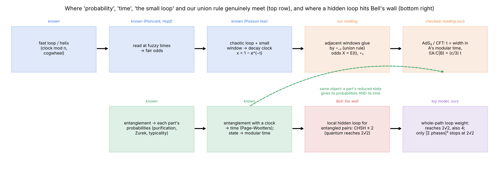

Top row, where the ideas genuinely converge: a fast loop (cogwheel, clock mod n) read coarsely gives fair odds; a
chaotic loop hitting a small window becomes a decay clock, x = 1 − e^(−t); decay clocks on adjacent windows glue by
∘₋₁ with odds composing by ∘₁; and in AdS₃ that is exactly the cross-ratio, with t the width of a region in another
region's modular time and (c/3)·t its conditional mutual information. Bottom row: entanglement gives each part its
probabilities and, through the same reduced state, its time; but a hidden local loop for entangled pairs stops at
CHSH 2, and a whole-path loop reaches quantum only with the |Σ phases|² rule, which it does not yet derive.

## Known vs ours

| Piece | Status | Source |
|---|---|---|
| Purification; purification as an axiom of quantum theory | Known | standard; Chiribella, D'Ariano, Perinotti, PRA 84, 012311 (2011) |
| Born rule from envariance | Known, assumptions disputed | Zurek, PRL 90, 120404 (2003); PRA 71, 052105 (2005); Schlosshauer and Fine, Found. Phys. 35, 197 (2005) |
| Decision-theoretic Born rule | Known, disputed | Deutsch, Proc. R. Soc. A 455, 3129 (1999); Wallace, Stud. Hist. Phil. Mod. Phys. 38, 311 (2007) |
| Self-locating uncertainty | Known | Vaidman (1998); Sebens and Carroll, BJPS 69, 25 (2018) |
| Gleason's theorem | Known | Gleason, J. Math. Mech. 6, 885 (1957) |
| Canonical typicality; Page scaling | Known | Popescu, Short, Winter, Nat. Phys. 2, 754 (2006); Goldstein et al., PRL 96, 050403 (2006); Page, PRL 71, 1291 (1993) |
| Covariance bounded by mutual information | Known | Wolf, Verstraete, Hastings, Cirac, PRL 100, 070502 (2008) |
| Union rule = no correlation; miss ≤ √(2I) in our terms | **Ours (framing of known facts)** | checks B1–B5 |
| Page–Wootters; fixes and experiments | Known | Page and Wootters, PRD 27, 2885 (1983); Giovannetti, Lloyd, Maccone, PRD 92, 045033 (2015); Moreva et al., PRA 89, 052122 (2014); Höhn, Smith, Lock, PRD 104, 066001 (2021) |
| Thermal / modular time; geometric modular flow | Known | Connes and Rovelli, CQG 11, 2899 (1994); Bisognano and Wichmann (1975); Casini, Huerta, Myers, JHEP 05 (2011) 036 |
| Cogwheel model | Known | 't Hooft, The Cellular Automaton Interpretation of QM (2016) |
| Method of arbitrary functions | Known | Poincaré (1896); Hopf (1934); Keller, Am. Math. Monthly 93, 191 (1986); Diaconis, Holmes, Montgomery, SIAM Rev. 49, 211 (2007) |
| Poisson law for chaotic return times | Known | Hirata, Ergodic Th. Dyn. Sys. 13, 533 (1993) |
| Finite ∘₁ clock 2ᵏ − 1; chaotic ∘₁ clock as a Poisson clock | **Ours (examples of known facts)** | checks E4–E9 |
| One-qubit hidden-variable model; Bell; Kochen–Specker | Known | Kochen and Specker, J. Math. Mech. 17, 59 (1967); Bell, Physics 1, 195 (1964) |
| Measurement-dependent models reproduce the singlet | Known | Brans (1988); Degorre, Laplante, Roland, PRA 72, 062314 (2005); Hall, PRL 105, 250404 (2010) |
| Whole-path loop toy model; same table as a nonlocal model; reaches 4 without |Σ|² | **Ours (toy, illustrates known trade-offs)** | checks G1–G7 |
| PR box; information causality | Known | Popescu and Rohrlich, Found. Phys. 24, 379 (1994); Pawłowski et al., Nature 461, 1101 (2009) |
| Kinematic space / Crofton; bit threads from it | Known | Czech et al., JHEP 10 (2015) 175; Agón, de Boer, Pedraza, JHEP 05 (2019) 075 |
| t = width in A's modular time; I(A:C\|B) = (c/3)t | Known ingredients, checked here | checks H1, H2, H5 |
| **Cross-ratio = P(≥ 1 tick of a rate-1 Poisson clock on A's modular time); ∘₋₁ gluing = independent ticks** | **Ours (reading)** | checks H3, H4, H7 |
| Helix as universal cover; ℓ₁ needs the winding | Known math, our lift stated on it | checks I1–I3 |
| Aharonov–Bohm, Berry phase | Known | Aharonov and Bohm, Phys. Rev. 115, 485 (1959); Berry, Proc. R. Soc. A 392, 45 (1984) |

## What looks worth following next

1. **The clock reading of the cross-ratio, under stress (done in section 9).** In a thermal state on a line (BTZ), modular time for one
   interval is still geometric, so the Poisson reading should survive; check it. In an excited state, modular time is
   no longer geometric, and the Poisson reading may break. Whether the ∘₋₁ gluing law survives there is a sharp,
   computable test (free fermions again).
2. **More than three regions.** For n neighbouring regions the ticks are still independent; see whether the
   five-region holographic rules from the exploration become statements about one Poisson clock.
3. **A principle for |Σ|².** If the whole-path loop is to explain, not restate, quantum correlations, it needs a
   reason to stop at 2√2. Information causality is the obvious first candidate to translate into loop language.

---

## 9. Stress tests: heat, excitation, pressure, spin; the bath and the dial k (DRAFT, second pass)

Asked for after the first pass: test the clock reading and the ∘₋₁ gluing in a heated state, an excited state (heavy
particle, local quench), a pressure state ("compression at fairly low heat, like a star's core"), and a spinning state
as its own test; then put the cube in a bath with knobs (β, μ or P, Ω) and ask whether the dial k of ∘ₖ moves, first
with the knobs as dials and then with the bath as a bigger cube that is traced out.

Checks: `checks2.py` → `checks2_output.txt` (**41 of 41 pass**). Pictures: `figures2.py` → `figures/fig9`–`fig14`.

### The result in plain words

The union-rule dial stays at k = −1 in every heated, squeezed, spinning and excited state we tested, because gluing is
just the chain rule of conditional mutual information, which holds in any quantum state. What the environment changes
is the clock's speed and how far its geometric (modular-time) reading reaches. The dial only moves if you forget the
bath: a two-state bath turns ∘₋₁ into ∘ₖ′ with k′ = −(1 + e^{β(Δ−μ−ΩJ)}), minus one over the Fermi occupation (ours, toy).

| Test | Clock reading x = 1 − e^(−t) | Gluing by ∘₋₁ | Checks |
|---|---|---|---|
| **Heated** (thermal line) | Holds, with the thermal (sinh) clock; the vacuum clock is wrong | Holds | H1–H3 |
| **Heated black hole on a circle** (BTZ) | Holds until A+B+C nearly wraps the circle (plateau at 1.93π here), then breaks upward | Holds for the true entropies | B1–B3 |
| **Heavy particle** (conical defect) | Holds for exactly half the circle, then the pure-state flip takes over | Holds | C1–C3 |
| **Local quench** (one added fermion) | Holds, then jumps by 2 ln 2 while the two halves sit in A and C, then returns | Holds | Q0–Q4, G1 |
| **Spinning** (β_L ≠ β_R) | Splits into a left and a right clock, each at half speed: x = y_L ∘₋₁ y_R | Holds | P1, P2 |
| **Chemical potential** | μ drops out; only the Fermi velocity sets the thermal length | Holds | P3 |
| **Compression at low heat** | Heavy matter squeezed to the black-hole threshold keeps the reach at exactly half the circle; cold dense fermions hold until the hole spacing nears the block size | Holds | K1–K5 |
| **Tunnelling** (optional) | Barrier exponents add, so "blocked" glues by ∘₋₁ up to an edge term that fades (13% → 2%). Corrected Nov 26: for separated barriers averaged over the loop phase the gluing is exact, ∘₁ on the typical odds and ∘₂ on the mean (closed-leads-fresh-look F4; tunnelling/) | Exactly, once phase-averaged | T1 |

### What breaks and what replaces it

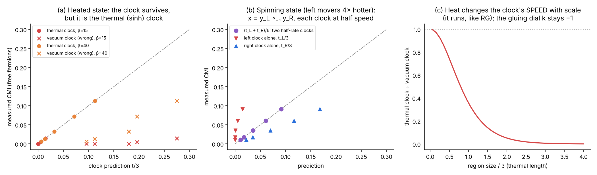

Heat does not break the clock; it swaps it. Positions w go to e^(2πw/β) before the cross-ratio is taken, which is our
height flow E(x) = eˣ − 1 applied at scale 2π/β (check D5). The clock's speed relative to the vacuum clock runs from 1
at short distances to 0 beyond the thermal length, like a coupling under RG (D4). Spin gives two clocks: left movers
and right movers each run their own thermal clock at half speed, and the link probability is their union (P1, P2).

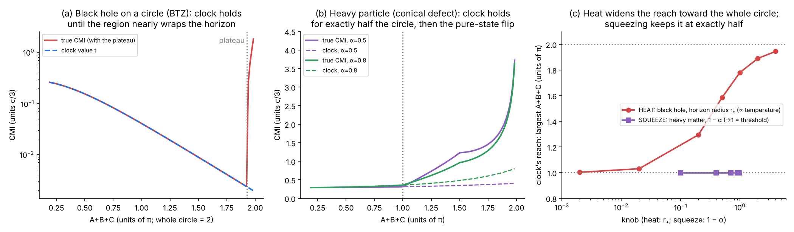

The geometric reading, t = a region's width in another region's modular time, is what breaks. It fails past the BTZ
plateau, where the whole region's entropy switches to "complement plus horizon", and past half the circle in a pure
heavy state, where S(region) = S(complement). Panel (c) is the heat-versus-pressure answer: heat widens the clock's
reach toward the whole circle, while squeezing heavy matter all the way to the black-hole threshold keeps it at exactly
half. At the threshold the two meet (K1–K3).

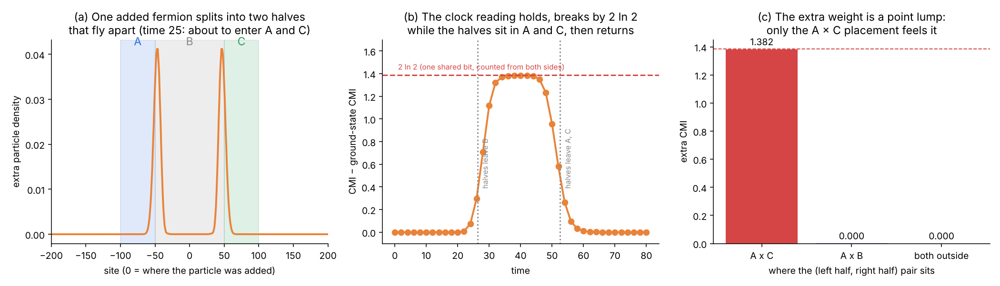

A local quench breaks the reading by a point lump: one shared bit, counted from both A and C, adds 2 ln 2 only while
the particle's two halves sit in A and C (Q2, Q4). This is the quasiparticle picture. Gluing still holds there, because
it never depended on geometry.

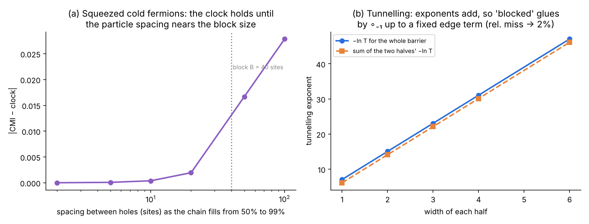

Under strong compression at zero temperature the clock survives until the spacing between holes approaches the block
size, where the continuum description itself fails (K4, K5). Tunnelling fits the clock reading loosely: the Gamow
exponent adds over slices, so "no transmission" behaves like "at least one tick", up to edge factors.

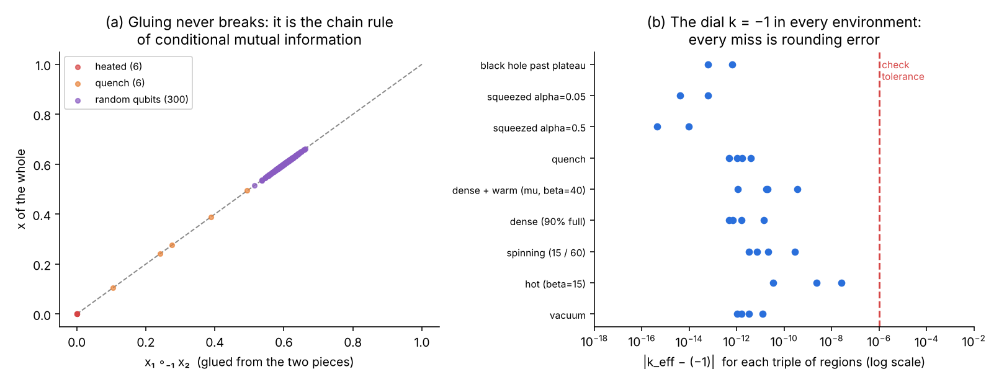

The law that never breaks: define x = 1 − exp(−3I(A:C|B)/c) from the true entropies. Then
x(A:C₁C₂|B) = x(A:C₁|B) ∘₋₁ x(A:C₂|BC₁) in every state, because that is the chain rule of conditional mutual
information, and strong subadditivity keeps x in [0, 1) (G1, G2). Across nine environments, including past the
plateau, every triple of regions gives k = −1 to rounding error (D1).

### The bath and the dial k

Turning a knob changes the clock's rate: x → 1 − (1 − x)^λ. Every such map commutes with ∘₋₁ (D2), so the knobs act as
symmetries of the union rule, not as changes of k. The only way to move k is to change the ceiling, y = s·x, which
gives k = −1/s; since x is a probability, s = 1 (D3).

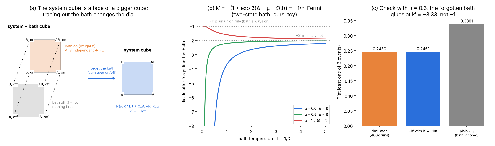

Treat the bath as one more axis of the cube. Given the bath's state, events are independent and glue by ∘₋₁. Forget
the bath, summing over its states with weights set by (β, μ, Ω), and the events become correlated through the shared
bath. For a two-state bath that is "on" with probability π, the reduced rule is exactly ∘ₖ′ with k′ = −1/π, for any
number of events and for the corner sum too (E1, Monte Carlo E2). With the on level at energy Δ (and spin J),
π is the Fermi occupation, so k′ = −(1 + e^{β(Δ−μ−ΩJ)}): −2 when infinitely hot, −∞ when cold with Δ > μ, −1 when cold
with Δ < μ (E3, E4). A bath with three or more levels leaves the ∘ₖ family altogether (E5). Remembering the bath
(conditioning on it) restores −1 (E6), which is exactly why the CMI-based gluing above stays at −1: conditioning on B
is remembering.

### Known vs ours (second pass)

| Piece | Status | Source |
|---|---|---|
| Thermal entanglement entropy (sinh form) | Known | Calabrese and Cardy, J. Stat. Mech. (2004) P06002 |
| Free-fermion entropies from the correlation matrix | Known | Peschel, J. Phys. A 36, L205 (2003) |
| Thermal modular Hamiltonian of an interval | Known | Cardy and Tonni, J. Stat. Mech. (2016) 123103 |
| BTZ entanglement plateau | Known | Hubeny, Maxfield, Rangamani, Tonni, JHEP 08 (2013) 092 |
| Rotating BTZ, left and right temperatures | Known | Hubeny, Rangamani, Takayanagi, JHEP 07 (2007) 062 |
| Heavy states (conical defect) and local quenches in holography | Known | Asplund, Bernamonti, Galli, Hartman, JHEP 02 (2015) 171 |
| Local quench; quasiparticle excess entanglement | Known | Calabrese and Cardy, J. Stat. Mech. (2007) P10004; Castro-Alvaredo et al., PRL 121, 170602 (2018) |
| Chain rule; strong subadditivity | Known | Lieb and Ruskai, J. Math. Phys. 14, 1938 (1973) |
| Mixtures that inflate zeros / shared hidden risk | Known | Lambert, Technometrics 34, 1 (1992); Vaupel, Manton, Stallard, Demography 16, 439 (1979); Clayton, Biometrika 65, 141 (1978) |
| Averaging over a fluctuating bath parameter | Known | Beck and Cohen, Physica A 322, 267 (2003) (superstatistics); de Finetti mixtures |
| Tracing out an environment; coarse-graining | Known (analogy) | Breuer and Petruccione, The Theory of Open Quantum Systems (2002); Kadanoff block-spin RG (1966) |
| Spinning state as two half-speed clocks joined by ∘₋₁ | **Ours (reading)** | checks P1, P2 |
| Heat as our height flow E at scale 2π/β; the clock's speed runs with scale while k stays −1 | **Ours (reading)** | checks D4, D5 |
| Heat widens the clock's reach, squeezing keeps it at half | **Ours (framing of known entropies)** | checks K1–K3 |
| Knobs as automorphisms x → 1 − (1 − x)^λ of ∘₋₁; k moves only with the ceiling | **Ours (elementary)** | checks D2, D3 |
| k′ = −1/π = −(1 + e^{β(Δ−μ−ΩJ)}) for a forgotten two-state bath; three levels leave the family | **Ours (toy)** | checks E1–E6 |

Not done: a collapsing shell (the dynamical version of compression). The tunnelling check is a one-dimensional sketch.

### What looks worth following next (second pass)

1. **Many-level baths.** A bath with three or more levels gives a reduced rule outside the ∘ₖ family. Finding what
   family it does land in (a mixture of ∘ₖ's, one per bath level) would say what "forgetting" does in general.
2. **A collapsing shell** in AdS₃ (Vaidya), to see the clock's reach move from half the circle to the plateau as matter
   falls in and a horizon forms.
