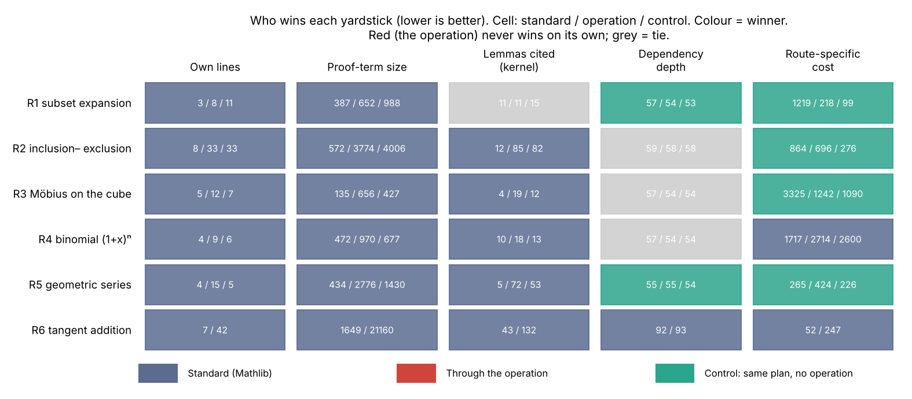
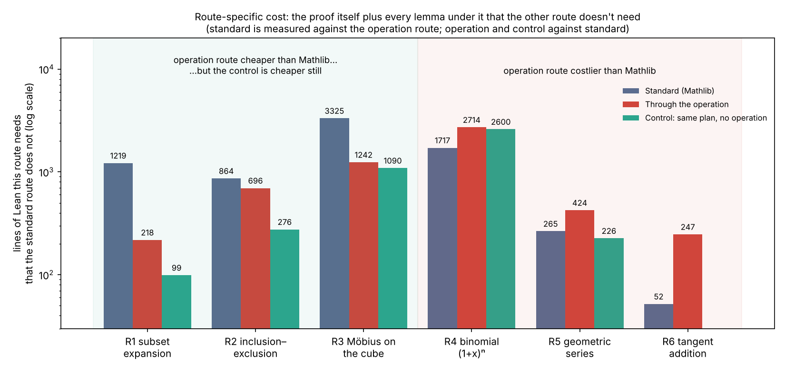
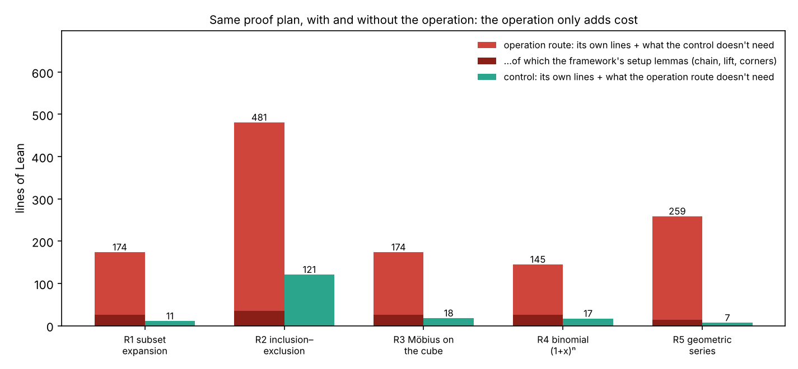
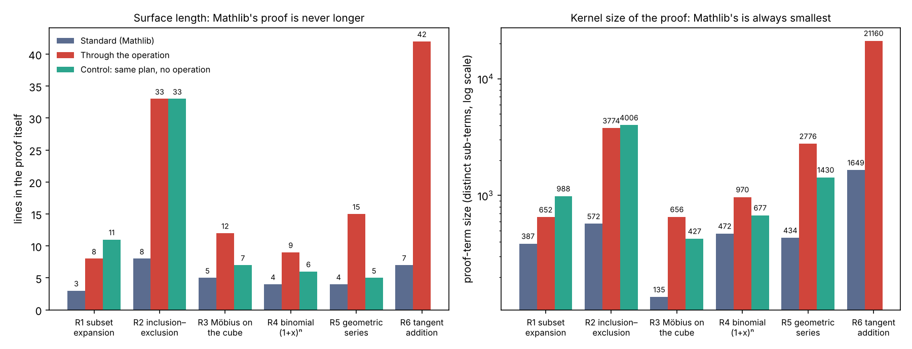
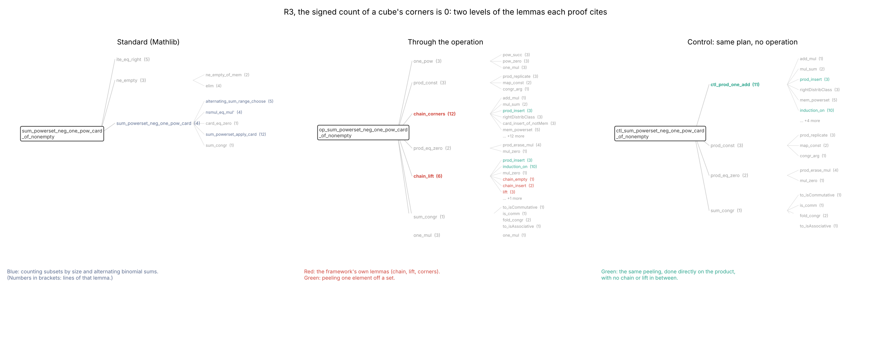

# Do proofs through the operation come out shorter than standard proofs?

**Verdict: no.** We can't claim it, and this test is evidence against it. Six known results were each proved
three ways, all with the same statement:

- the standard way, Mathlib's own proof;
- through the circle operation;
- a **control**: the same proof plan as the operation proof, with the operation taken out.

All 17 proofs compile against Mathlib with no gaps. The operation proof **never beat the control on any yardstick**:
every time it beat Mathlib, the control beat it too. Mathlib's proof is the shortest one on the page every time, and
its proof term is the smallest. So the operation doesn't make proofs shorter. Where the operation route looked
cheaper, the saving came from the proof plan (peel off one element at a time, or multiply complements). Those plans
are textbook plans that work just as well without the operation. Adding the operation only adds its setup.

This doesn't open a lead worth following as a selling point. The one interesting by-product is a known fact: Mathlib's
own inclusion–exclusion proof already uses the k = −1 chain in disguise (it writes the union's indicator as
1 − ∏(1 − indicator)).

## What was measured

Every number is computed from the compiled proofs by `lean/ProofComplexity/Measure.lean`, not counted by hand.

| Yardstick | What it counts |
|---|---|
| **Own lines** | Lines of the theorem's own declaration (statement and proof). |
| **Proof-term size** | Distinct sub-terms of the proof the kernel checks, including the helper lemmas tactics generated for it. |
| **Lemmas cited** | Distinct theorems the proof term uses directly, including those that tactics like `ring` cite behind the scenes. |
| **Dependency depth** | The longest chain of theorems underneath the proof, down to Lean's core. |
| **Route-specific cost** | The fair total. It is the proof's own lines plus the lines of every theorem in its dependency closure that the other route's closure doesn't contain. It counts the framework's setup lemmas (the chain, its lift, the corners), and it counts the big Mathlib lemmas a short standard proof leans on. |

The route-specific cost is what makes the comparison fair. Mathlib's proofs are short because they cite big general
lemmas, so their own lines hide most of the work. Our proofs cite the framework, so their own lines hide the setup.
Counting only what each route needs and the other doesn't puts both on the same footing.

## The six results

| # | Known result | Mathlib's proof | Reached through the operation by |
|---|---|---|---|
| R1 | Subset expansion ∏(1 + fᵢ) = Σ over subsets t of ∏ over t of fᵢ | `Finset.prod_one_add` (from `Finset.prod_add`, a bijection proof) | the lift turns the k = 1 chain into the product; the cube's corners give the sum |
| R2 | Inclusion–exclusion for the size of a union | `Finset.inclusion_exclusion_card_biUnion` (from `inclusion_exclusion_sum_biUnion`) | on the union, the k = −1 chain of indicators is 1; its corners are the alternating intersections |
| R3 | The signed count of a non-empty cube's corners is 0 (the heart of Möbius inversion on the Boolean lattice) | `Finset.sum_powerset_neg_one_pow_card_of_nonempty` (via alternating binomial sums) | −1 is the absorbing element of ∘₁, since 1 + 1·(−1) = 0 |
| R4 | Binomial theorem (1 + x)ⁿ = Σ C(n, m) xᵐ | Mathlib's `add_pow`, specialised (Pascal induction) | n equal steps, lifted, with the corners counted by rank |
| R5 | Geometric series (Σ xⁱ)(x − 1) = xⁿ − 1 | `geom_sum_mul` | the chain of n copies of x − 1 unrolls to the sum; its lift is xⁿ |
| R6 | Tangent addition (complex, with cos x, cos y, cos(x + y) ≠ 0) | sine and cosine addition, then clear denominators (as Mathlib's `Complex.tan_add` does) | the plane law at (k, d) = (0, 1) with α = i, β = −i; the lift sends tan θ to exp(iθ)² |

**Dropped: Fibonacci.** The operation reaches Fibonacci numbers only as the weights U_m(1, −1) in our two-dial corner
formula. That formula is proved only for chains of 3 so far. No standard Fibonacci theorem has a route through the
operation that doesn't first need the general formula, so a comparison would be unfair to both sides.

**Fixed sizes are a tie.** For a fixed chain of 3 or 4 (like `incl_excl3` or `chain4_corners` in the library), both
routes are a one-line `ring` or `grind`, so there is nothing to compare.

## Results, picture by picture

**R1 to R3: the operation route is cheaper than Mathlib's, but the control is cheaper still.** The saving comes
from the plan, not the operation. For R1, Mathlib proves the subset expansion through a general bijection between
choice functions and subsets (`Finset.prod_add`). Peeling one element off at a time is much lighter. For R3, Mathlib
goes through counting subsets by size and alternating binomial sums. Taking the product ∏(1 − 1) = 0 is much lighter.
Both lighter plans are textbook proofs and need nothing from the framework.

**R4 to R6: the operation route is costlier than Mathlib's.** R4 needs the count of subsets by size, which pulls in
more than Pascal's rule does. R5's chain proof needs two facts where the standard proof needs one induction. R6 is the
clearest case: Mathlib's tangent proof is 7 lines, and the route through the lift is 42 lines and 5 times the cost.

**Head to head, the operation only adds cost.** In every case it needs the framework's setup lemmas (the dark red
part, 14 to 35 lines). The rest is tactic machinery: each step through the chain needs a `ring` normalisation that the
direct proof doesn't, plus the `Finset.fold` lemmas that chains are built on.

**At the surface, Mathlib always wins.** Its own proofs are 3 to 8 lines because they cite big general lemmas. Ours
are 8 to 42 lines, and their proof terms are 1.7 to 13 times larger.

**One example in detail (R3).** Mathlib's proof cites one big lemma, which brings in binomial-coefficient machinery
(blue). The operation proof cites the chain's lift and corners (red), which are built on peeling an element off a set
(green). The control cites that same peeling directly, with no chain in between. **Dependency depth is a tie
everywhere** (within 4 levels of each other, all around 54 to 59; R6 is around 92 because complex analysis sits
underneath). All three routes stand on the same foundations.

## Numbers

Route-specific lines (own lines + lines only this route needs). Standard is measured against the operation route;
the operation route and control against standard.

| Result | Standard | Operation | Control | Cheapest |
|---|---:|---:|---:|---|
| R1 subset expansion | 1,219 | 218 | 99 | control |
| R2 inclusion–exclusion | 864 | 696 | 276 | control |
| R3 Möbius heart | 3,325 | 1,242 | 1,090 | control |
| R4 binomial | 1,717 | 2,714 | 2,600 | standard |
| R5 geometric series | 265 | 424 | 226 | control |
| R6 tangent addition | 52 | 247 | — | standard |

Full data: `yard.json` (every yardstick, every route, with the lemmas each proof cites). `checks.py` asserts every
comparison made on this page: 37 checks, all passing (`checks_output.txt`).

## How fair is this?

- **Same statements.** R1, R2, R3 and R5 use Mathlib's exact statements. R4 and R6 use one statement for both routes.
  In R6 the standard proof turned out not to need the hypothesis cos(x + y) ≠ 0, and ours does.
- **Same library.** Both routes may use Mathlib's general library (finite sets, sums, `ring`). The operation route
  must go through `HCT.chain`, its lift or its corners.
- **Setup counted.** The framework's definitions and lemmas (`Framework.lean`, `FrameworkPlane.lean`) are in the
  operation route's closure, so they count.
- **The control guards against my own bias.** I wrote both the operation proofs and the controls in the same style,
  so a style advantage would show up in both. Mathlib's proofs were written by others for generality, not shortness.
  A skilled Lean author could probably shorten any of the three.
- **Small sample.** Six results, all from algebraic combinatorics plus one from trigonometry, because those are the
  known results the operation genuinely reaches (see the Boolean lattice page).
- **Lines are a proxy.** "Route-specific lines" counts the declaration lines of every lemma a route needs, however
  general that lemma is. The proof-term size and lemma counts don't depend on formatting and point the same way.

## Known versus ours

- **Known:** all six results; Mathlib's proofs; the control proofs (standard textbook inductions and the
  product-of-complements trick, which Mathlib's inclusion–exclusion already uses).
- **Ours:** the six proofs written through the operation, the general-n chain lemmas (`chain_lift`, `chain_corners`
  for any finite set, not just chains of 3 or 4), and the measurement itself.

## Files and how to rebuild

- `lean/ProofComplexity/Framework.lean`: the operation `circK`, chains over finite sets, the lift, the cube's corners.
- `lean/ProofComplexity/FrameworkPlane.lean`: the two-dial plane law's lift.
- `lean/ProofComplexity/Operation.lean`, `Tangent.lean`: the six proofs through the operation (plus the standard
  tangent proof). `Standard.lean`: the standard binomial wrapper. `Control.lean`: the five controls.
- `lean/ProofComplexity/Measure.lean`: computes every yardstick and writes `yard.jsonl`. `Tree.lean` writes `tree.tsv`.
- `figures.py`, `checks.py`: figures and checks from `yard.json` and `tree.tsv`.

This is a separate scratch project with Mathlib at tag v4.37.0-rc1 (commit 31ce06e), Lean 4.37.0-rc1. The core library
stays core-only and is untouched. Every theorem uses only the standard axioms (propext, Classical.choice, Quot.sound).
To rebuild, put the `lean/` folder in a fresh directory, run `lake exe cache get` (or build Mathlib from source,
as was done here because the cache server was unreachable), then `lake build ProofComplexity.Measure`.

**Not built by CI.** These Lean files need Mathlib, so the repo's main CI (core Lean only) doesn't build them, and the Mathlib build workflow builds only `lean-library-mathlib/` on the `mathlib-port` branch. They do fit that build: same Lean 4.37.0-rc1 and the same Mathlib commit (31ce06e, tag v4.37.0-rc1), and they import only Mathlib and each other. So they could be added there as a second Lake project or library. Nothing has been merged or added to that branch.
