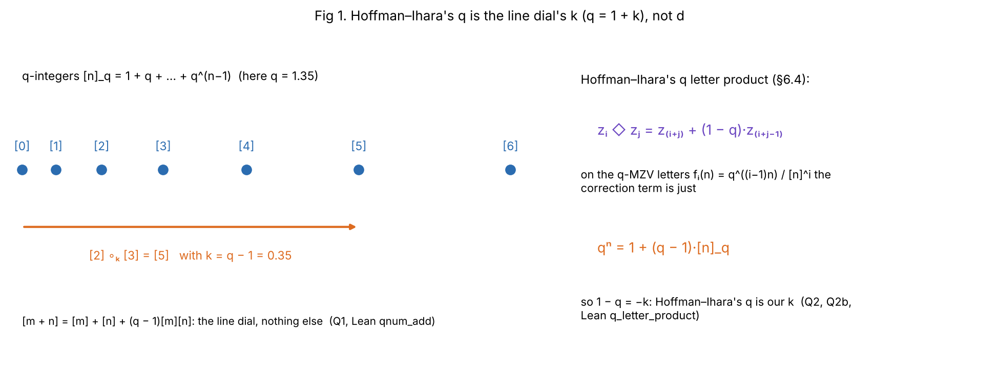
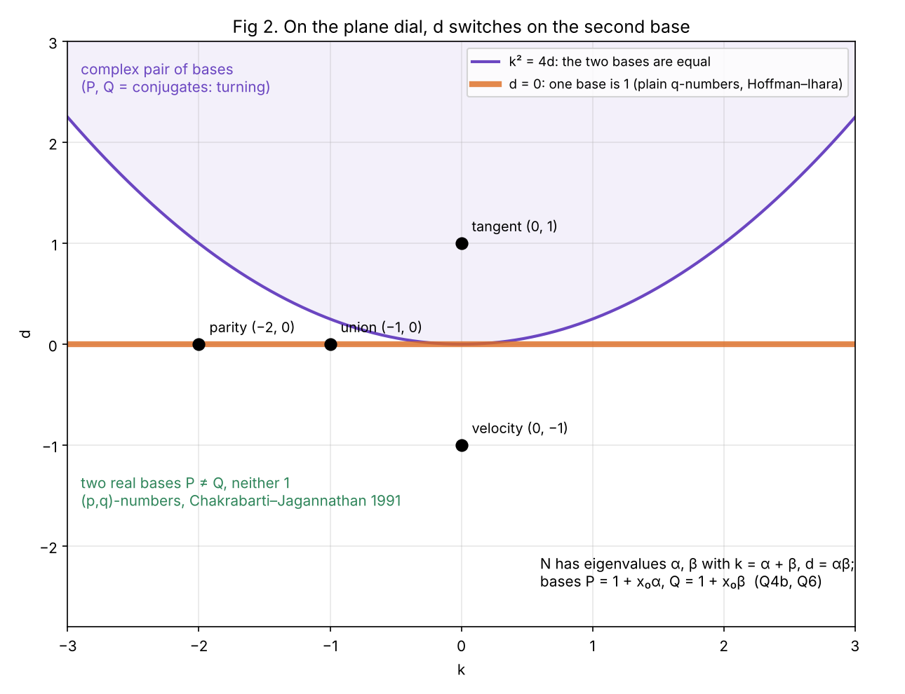
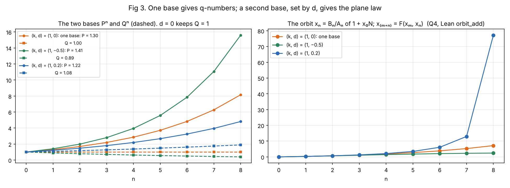

# DRAFT: Is the plane dial's d Hoffman–Ihara's q-deformation? (Nov 27, 2026)

**Result in two sentences.** No: Hoffman–Ihara's q is our line dial's k (q = 1 + k), and their letter product's
correction term is exactly the line law, so no q-deformation with number-valued letters can produce d. The plane
dial's d does have a known home: it switches on a **second base**, and the plane law is the addition law of
(p,q)-numbers (twin-basic numbers; Chakrabarti and Jagannathan 1991), with d = 0 exactly when one base is 1.

Asked by Brennan (Nov 27, 05:02Z): "Let's prove that the plane dial's d is Hoffman ihara's q-deformation." The
statement turned out false, so this page proves what is true instead. It follows `cube-weighting-names/`, which named
k^(m−1) as the weight-k quasi-shuffle and left this as its next test.

`checks.py`: **9/9 pass** (exact, sympy). `QDeformationDial.lean`: 13 theorems for Mathlib, not yet built (sent to
CI's report-only Mathlib step).

---

## 1. Their q is our k

*Fig 1. Left: q-integers add by our line law with k = q − 1. Right: Hoffman–Ihara's q letter product, and the identity
that makes it work, qⁿ = 1 + (q − 1)[n]_q, which is the line dial again.*

- [m + n]_q = [m]_q + [n]_q + (q − 1)[m]_q[n]_q (Q1; Lean `qnum_add`). So q-integers are the line dial with k = q − 1.
- Hoffman–Ihara's §6.4 letter product, zᵢ ◇ zⱼ = z_(i+j) + (1 − q)z_(i+j−1), holds on Bradley's q-MZV letters
  fᵢ(n) = q^((i−1)n)/[n]^i (Q2; Lean `q_letter_product`). The only fact used is qⁿ = 1 + (q − 1)[n]_q (Q2b; Lean
  `pow_eq`), so the correction coefficient 1 − q is −k.

**Why d can't come from it (Q3).** In a quasi-shuffle whose letters are numbers, two one-letter words combine to
x + y + k·(x ◇ y), and a product of numbers is c·xy. That is always a line law. The plane law has an x²y term equal
to d, so for d ≠ 0 it is not a polynomial and no number-valued quasi-shuffle produces it. Hoffman–Ihara's q changes
the letter product but keeps it a polynomial, so it moves k and never d.

## 2. Where d actually lives: a second base

*Fig 2. The plane dial (k, d). On the orange line d = 0 one base is 1: plain q-numbers, where Hoffman–Ihara's q
lives. Everywhere else both bases move. Above the purple border the bases are a complex pair.*

Write the dial as jets a + bN with N² = kN − d (the 2×2 matrix of `corner-weights/`). Jets multiply, and the ratio
b/a combines by the plane law F(x, y) = (x + y + kxy)/(1 − dxy) (Lean `jet_ratio`). Let N have eigenvalues α and β,
so k = α + β and d = αβ. Then:

- The powers of one jet, (1 + x₀N)ⁿ = Aₙ + BₙN, give an orbit xₙ = Bₙ/Aₙ that adds exactly by the plane law:
  x_(m+n) = F(x_m, xₙ) (Q4; Lean `orbit_add`).
- Bₙ = x₀·[n]_(P,Q), the (p,q)-number with the two bases P = 1 + x₀α and Q = 1 + x₀β (Q4b; Lean
  `orbit_two_bases`).
- With d = 0, Q = 1, Aₙ = 1 and Bₙ = x₀[n]_q with q = 1 + kx₀: one base, the q-numbers (Q5; Lean `orbit_d_zero`).
- d = (P − 1)(Q − 1)/x₀², so d measures how far the second base sits from 1. For x₀ ≠ 0, d = 0 exactly when one
  base is 1 (Q6; Lean `d_zero_iff_base_one`).

*Fig 3. Left: the two bases Pⁿ (solid) and Qⁿ (dashed). With d = 0 the second base stays at 1. Right: the orbits.
Each adds by its own plane law. The blue one (d > 0) runs into the wall, where Aₙ = 0.*

**A Möbius footnote (Q7).** Each plane orbit is also a q-orbit with q = P/Q, seen through the Möbius map
u ↦ u/(Q − βx₀u). So d can be traded for a change of coordinates, but then q depends on both eigenvalues and the map
depends on d. d is not the q itself.

## 3. Known vs ours

| Piece | Status |
|---|---|
| q-integers and their addition rule; qⁿ = 1 + (q − 1)[n] | Known, classical |
| Hoffman–Ihara's q letter product (§6.4) | Known (Hoffman and Ihara 2017; Bradley's q-MZVs) |
| (p,q)-numbers [n]_(p,q) = (pⁿ − qⁿ)/(p − q) | Known (Chakrabarti and Jagannathan 1991; also Arik et al.'s Fibonacci oscillator) |
| The plane law as the jet ratio, and its Lucas weights | Known, folklore level (see `corner-weights/`) |
| q = 1 + k: Hoffman–Ihara's q is our line dial | Ours as a reading. It is a one-line identity |
| d as the second base, with d = 0 iff one base is 1, and the no-go for number-valued letters | Ours as a reading. Elementary |

## 4. What it contributes, and what would make it a lead

- **It settles the question with a proof, and the answer is no.** Hoffman–Ihara's q is k. Their framework has one
  base, so it lives on the line d = 0.
- **It places d.** d is the second base of the twin-basic numbers. That is a second, independent route to the
  same place as the matrix N, and it says d needs two layers: letters have to carry a jet (a + bN), not a number.
  That matches Brennan's jet rule from the same evening.
- **The open part, and where a lead could be.** I found no two-base version of Hoffman–Ihara's letter product, that
  is, a quasi-shuffle whose letters are jets with N² = kN − d (searched "(p,q)-analogue multiple zeta values
  quasi-shuffle"; only one-parameter q-models came back). Building it would give d its own quasi-shuffle and a
  two-parameter family of multiple zeta values that reduces to Bradley's at d = 0. That is not done and needs
  Brennan's go-ahead.

## Files

- `checks.py` → `checks_output.txt`, `checks.json` (9/9).
- `QDeformationDial.lean` (13 theorems, Mathlib, unbuilt).
- `figures.py` → fig1 to fig3.

## Sources

- M. E. Hoffman and K. Ihara, Quasi-shuffle products revisited, J. Algebra 481 (2017); arXiv 1610.05180, §6.4.
- D. M. Bradley, Multiple q-zeta values, J. Algebra 283 (2005).
- R. Chakrabarti and R. Jagannathan, A (p,q)-oscillator realization of two-parameter quantum algebras,
  J. Phys. A 24 (1991) L711–L718.
- M. Arik et al., Fibonacci oscillators, Z. Phys. C 55 (1992).
