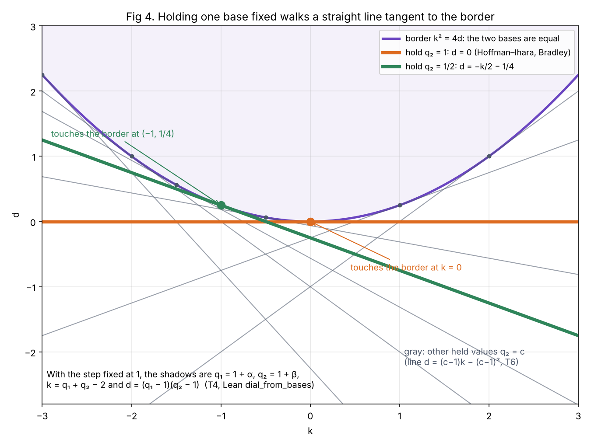
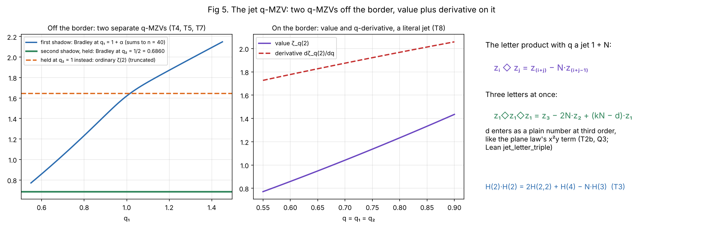
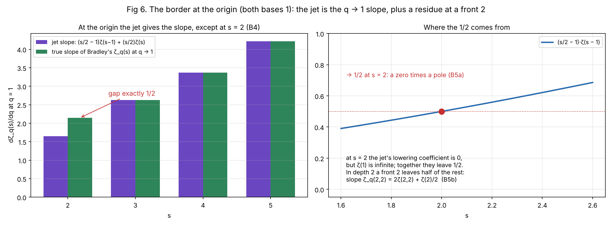
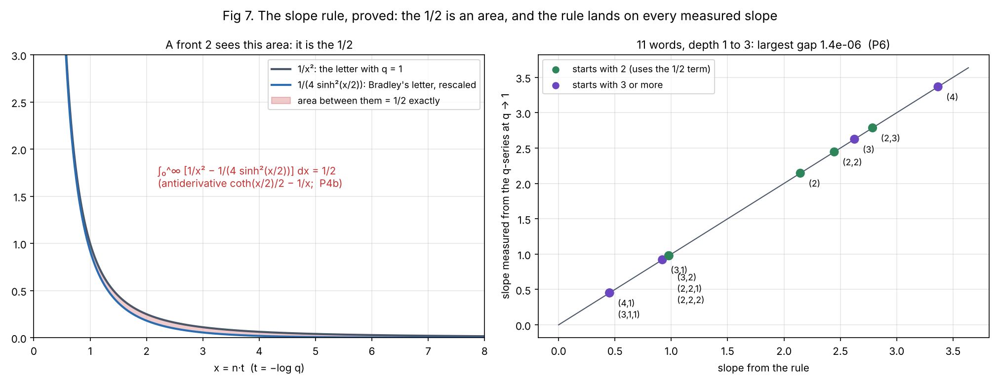

# DRAFT: Is the plane dial's d Hoffman–Ihara's q-deformation? (Nov 27, 2026)

**Result in two sentences.** No: Hoffman–Ihara's q is our line dial's k (q = 1 + k), and their letter product's
correction term is exactly the line law, so no q-deformation with number-valued letters can produce d. The plane
dial's d does have a known home: it switches on a **second base**, and the plane law is the addition law of
(p,q)-numbers (twin-basic numbers; Chakrabarti and Jagannathan 1991), with d = 0 exactly when one base is 1.

Asked by Brennan (Nov 27, 05:02Z): "Let's prove that the plane dial's d is Hoffman ihara's q-deformation." The
statement turned out false, so this page proves what is true instead. It follows `cube-weighting-names/`, which named
k^(m−1) as the weight-k quasi-shuffle and left this as its next test.

`checks.py`: **9/9 pass** (exact, sympy). `QDeformationDial.lean`: 13 theorems for Mathlib, **builds clean** (CI's report-only Mathlib step, run
45946216764, warnings only).

---

## 1. Their q is our k

*Fig 1. Left: q-integers add by our line law with k = q − 1. Right: Hoffman–Ihara's q letter product, and the identity
that makes it work, qⁿ = 1 + (q − 1)[n]_q, which is the line dial again.*

- [m + n]_q = [m]_q + [n]_q + (q − 1)[m]_q[n]_q (Q1; Lean `qnum_add`). So q-integers are the line dial with k = q − 1.
- Hoffman–Ihara's §6.4 letter product, zᵢ ◇ zⱼ = z_(i+j) + (1 − q)z_(i+j−1), holds on Bradley's q-MZV letters
  fᵢ(n) = q^((i−1)n)/[n]^i (Q2; Lean `q_letter_product`). The only fact used is qⁿ = 1 + (q − 1)[n]_q (Q2b; Lean
  `pow_eq`), so the correction coefficient 1 − q is −k.

**Why d can't come from it (Q3).** In a quasi-shuffle whose letters are numbers, two one-letter words combine to
x + y + k·(x ◇ y), and a product of numbers is c·xy. That is always a line law. The plane law has an x²y term equal
to d, so for d ≠ 0 it is not a polynomial and no number-valued quasi-shuffle produces it. Hoffman–Ihara's q changes
the letter product but keeps it a polynomial, so it moves k and never d.

## 2. Where d actually lives: a second base

*Fig 2. The plane dial (k, d). On the orange line d = 0 one base is 1: plain q-numbers, where Hoffman–Ihara's q
lives. Everywhere else both bases move. Above the purple border the bases are a complex pair.*

Write the dial as jets a + bN with N² = kN − d (the 2×2 matrix of `corner-weights/`). Jets multiply, and the ratio
b/a combines by the plane law F(x, y) = (x + y + kxy)/(1 − dxy) (Lean `jet_ratio`). Let N have eigenvalues α and β,
so k = α + β and d = αβ. Then:

- The powers of one jet, (1 + x₀N)ⁿ = Aₙ + BₙN, give an orbit xₙ = Bₙ/Aₙ that adds exactly by the plane law:
  x_(m+n) = F(x_m, xₙ) (Q4; Lean `orbit_add`).
- Bₙ = x₀·[n]_(P,Q), the (p,q)-number with the two bases P = 1 + x₀α and Q = 1 + x₀β (Q4b; Lean
  `orbit_two_bases`).
- With d = 0, Q = 1, Aₙ = 1 and Bₙ = x₀[n]_q with q = 1 + kx₀: one base, the q-numbers (Q5; Lean `orbit_d_zero`).
- d = (P − 1)(Q − 1)/x₀², so d measures how far the second base sits from 1. For x₀ ≠ 0, d = 0 exactly when one
  base is 1 (Q6; Lean `d_zero_iff_base_one`).

*Fig 3. Left: the two bases Pⁿ (solid) and Qⁿ (dashed). With d = 0 the second base stays at 1. Right: the orbits.
Each adds by its own plane law. The blue one (d > 0) runs into the wall, where Aₙ = 0.*

**A Möbius footnote (Q7).** Each plane orbit is also a q-orbit with q = P/Q, seen through the Möbius map
u ↦ u/(Q − βx₀u). So d can be traded for a change of coordinates, but then q depends on both eigenvalues and the map
depends on d. d is not the q itself.

## 3. Known vs ours

| Piece | Status |
|---|---|
| q-integers and their addition rule; qⁿ = 1 + (q − 1)[n] | Known, classical |
| Hoffman–Ihara's q letter product (§6.4) | Known (Hoffman and Ihara 2017; Bradley's q-MZVs) |
| (p,q)-numbers [n]_(p,q) = (pⁿ − qⁿ)/(p − q) | Known (Chakrabarti and Jagannathan 1991; also Arik et al.'s Fibonacci oscillator) |
| The plane law as the jet ratio, and its Lucas weights | Known, folklore level (see `corner-weights/`) |
| q = 1 + k: Hoffman–Ihara's q is our line dial | Ours as a reading. It is a one-line identity |
| d as the second base, with d = 0 iff one base is 1, and the no-go for number-valued letters | Ours as a reading. Elementary |

## 4. What it contributes, and what would make it a lead

- **It settles the question with a proof, and the answer is no.** Hoffman–Ihara's q is k. Their framework has one
  base, so it lives on the line d = 0.
- **It places d.** d is the second base of the twin-basic numbers. That is a second, independent route to the
  same place as the matrix N, and it says d needs two layers: letters have to carry a jet (a + bN), not a number.
  That matches Brennan's jet rule from the same evening.
- **The open part.** I found no two-base version of Hoffman–Ihara's letter product in print (searched
  "(p,q)-analogue multiple zeta values quasi-shuffle"; only one-parameter q-models came back). Brennan said yes to
  building it; section 5 does.

## 5. The two-base letter product (added Nov 27)

**Result in two sentences.** Let Hoffman–Ihara's q be a jet, q = 1 + N with N² = kN − d: the letter product becomes
zᵢ ◇ zⱼ = z_(i+j) − N·z_(i+j−1), it stays commutative and associative, and d shows up as a plain number the first time
three letters meet. But apart from the border, this jet version is two of Bradley's q-MZVs side by side, at
q₁ = 1 + α and q₂ = 1 + β, so holding one base at 1/2 pairs a free q-MZV with Bradley's values at q = 1/2, a
well-studied family, and gives no new identity.

Asked by Brennan (Nov 27): "Yes" to building it, then "Because you could hold one base constant" and "At 1/2
perhaps?". `two_base_checks.py`: **13/13 pass** (exact fractions and sympy). `TwoBaseLetters.lean`: 9 theorems for
Mathlib, **builds clean** (CI run 45955736148).

*Fig 4. With the step fixed at 1, the two shadow bases are q₁ = 1 + α and q₂ = 1 + β, so k = q₁ + q₂ − 2 and
d = (q₁ − 1)(q₂ − 1). Holding q₂ fixed walks a straight line that touches the border k² = 4d at one point. Orange:
q₂ = 1, the line d = 0, which is Hoffman–Ihara's own case. Green: q₂ = 1/2, the line d = −k/2 − 1/4, touching the
border at (−1, 1/4).*

**What holds.**

- Letters. Bradley's letters q^((s−1)n)/[n]_q^s make sense with q = 1 + N, because qⁿ = 1 + (q − 1)[n]_q holds in
  any commutative ring (Lean `pow_eq_ring`). They obey zᵢ ◇ zⱼ = z_(i+j) − N·z_(i+j−1) (T1; Lean `letter_mul`,
  `jet_letter_mul`). Hoffman–Ihara's (1 − q) becomes the jet −N.
- d at third order. z₁◇z₁◇z₁ = z₃ − 2N·z₂ + (kN − d)·z₁ (T2b; Lean `jet_letter_triple`). Two letters only see N.
  Three letters see N², and N² = kN − d is where d enters as a number. That matches the plane law, whose first d
  term is the x²y coefficient (Q3). It answers the no-go in section 1: d needs letters that carry a jet.
- Harmonic sums. Truncated sums multiply by the jet quasi-shuffle, for example
  H(2)·H(2) = 2H(2,2) + H(4) − N·H(3) (T3, sums up to n = 6, words up to depth 2 by 1).

**What it is, region by region.**

*Fig 5. Left: off the border the jet holds two separate values. Here the second base is held at q₂ = 1/2 (green)
while q₁ moves (blue). Middle: on the border the jet holds Bradley's value and its q-derivative. Right: the letter
rules.*

- Two real bases (d < k²/4). Sending N to α or to β is a ring map, and it sends the jet q-MZV to Bradley's q-MZV at
  q₁ or q₂ (T4; Lean `letter_map`). The jet ring then splits as two copies of the numbers, so the jet carries
  exactly two q-MZVs and no more.
- Hold one base at 1 (d = 0). The pair is Bradley's q-MZV at q = 1 + k and the ordinary MZV (T5). This is
  Hoffman–Ihara's setting with its q → 1 limit carried alongside.
- Hold one base at 1/2. The second shadow is Bradley at q = 1/2, whose letters are 2^(n−s)/(2ⁿ − 1)^s (T7). Its
  weight-2 value is ¼·Σσ(m)/2^m ≈ 0.686008 (T7b), a quarter of the q-analogue of ζ(2) in Zudilin 2002, which credits
  Duverney with its irrationality for q = 1/p. In the other usual normalization the weight-1 sum Σ1/(2ⁿ − 1) is the
  Erdős–Borwein constant (T7c), proved irrational by Erdős in 1948. So 1/2 is the classic test point for q-zeta
  values. In the dial itself, though, every held value c ≠ 1 gives the same kind of tangent line (T6; Lean
  `hold_base_tangent`, `hold_half`). Only c = 1 is special there, because it is the one held value that doesn't
  depend on the step size.
- The border (d = k²/4, the two bases equal). The jet ring is the dual numbers, and the jet q-MZV is the pair
  (value, q-derivative) at q = 1 + k/2 (T8). That is a jet in the calculus sense, the case Brennan's jet rule points
  at.
- A complex pair (d > k²/4). The jet q-MZV is Bradley's at a complex q, for example q = 1 + i at (k, d) = (0, 1)
  (T9).
- Negative control. With d ≠ 0, putting the number −k in place of the jet −N breaks the letter product (T10).

**Known vs ours.**

| Piece | Status |
|---|---|
| Quasi-shuffle products over any commutative coefficient ring; Hoffman–Ihara's q letter product | Known (Hoffman 2000; Hoffman–Ihara 2017) |
| Bradley's q-MZVs; ζ_q(2) at q = 1/p is irrational | Known (Bradley 2005; Duverney, as cited in Zudilin 2002) |
| Erdős–Borwein constant Σ1/(2ⁿ − 1), irrational | Known (Erdős 1948) |
| A quadratic ring splits into two copies when its roots are distinct, and is the dual numbers when they meet | Known, standard algebra |
| Taking q to be the jet 1 + N, d as the third-order term, and the held-base lines as tangents to the border | Ours as a reading. Elementary once q is allowed to be a jet |

**What it contributes, and what would make it a lead.**

- It gives d a quasi-shuffle home and shows why d needed one more layer: d first appears when three letters meet.
- It is honest about size. Off the border the two-base product is two one-base products glued together. Holding a
  base at 1/2 does not create new relations; it attaches a well-studied number family to the second slot.
- A lead would need a relation that mixes the two shadows, one that holds for the jet but not for each Bradley copy
  alone. The border is the one place that can happen, because there the second slot is a derivative. A test would
  be whether known q-MZV relations, differentiated in q, give anything new. Section 6 runs that test.

## 6. The border: value plus q-derivative (added Nov 27)

**Result in two sentences.** Away from q = 1 the border adds nothing: its second slot is the ordinary q-derivative,
so it only repeats known q-relations differentiated. At the dial's origin, where both bases are 1, the jet gives the
first-order q → 1 correction of Bradley's q-MZVs by a simple rule, but it misses one term: a residue worth exactly
1/2 at ζ_q(2), and half of the remaining value whenever a word starts with 2.

Asked by Brennan (Nov 27, 05:31Z): "Yes" to testing the border. `border_checks.py`: **9/9 pass** (exact where
possible; the q → 1 slopes are numerical, agreeing to about 5 parts in 10⁷).

*Fig 6. Left: at the origin the jet's slope (purple) matches the true slope of Bradley's ζ_q(s) as q → 1 (green) for
s = 3, 4, 5, and falls short by exactly 1/2 at s = 2. Right: the jet's lowering coefficient s/2 − 1 is zero at s = 2,
but ζ(s − 1) has a pole there; continued in s, their product is 1/2.*

- **Off q = 1 (B1).** On the border the second slot is the q-derivative, and the sums converge nicely, so any
  relation that holds for every q also holds differentiated. Bradley's q-analogue of Euler, ζ_q(2,1) = ζ_q(3), holds
  to machine precision at q = 0.3, 0.5 and 0.8, and so does its derivative. Nothing new can come from this part.
- **At the origin, the jet rule (B2, B3).** With q = 1 + ε and ε² = 0, each letter's second slot is its derivative
  at q = 1: (s/2 − 1)/n^(s−1) + (s/2)/n^s. So the jet's slope of a word is (weight/2) times its value plus a
  lowering term that lowers one index at a time with coefficient s/2 − 1. It obeys the second slot of the jet
  quasi-shuffle exactly, for example 2H(2)·dH(2) = 2dH(2,2) + dH(4) − H(3).
- **The true slope (B4, B5).** For words that don't start with 2, the jet's slope is the true slope of the q-series
  at q → 1 (s = 3, 4, 5; (3,1); (3,2)). A word that starts with 2 gets one extra term. Lowering that 2 has
  coefficient zero, but it lands on a divergent sum, and the two together leave half of what remains:
  1/2 for ζ_q(2), and ζ(2)/2 for ζ_q(2,2), whose true slope is 2ζ(2,2) + ζ(2)/2.
- **A consistency test it passes (B6).** For ζ_q(2,1) the rule produces two divergent ζ(1) pieces with opposite
  signs. They cancel, whatever value is given to ζ(1), and the slope comes out equal to the slope of ζ_q(3), as
  Bradley's q-Euler requires.

**On the 1/2.** This 1/2 is a residue: s/2 − 1 vanishes at s = 2 at the same rate that ζ(s − 1) blows up. It is
not the base held at 1/2 from section 5. The two coincide only in the number.

**Known vs ours.**

| Piece | Status |
|---|---|
| Bradley's q-MZVs tend to MZVs as q → 1; his q-analogue of ζ(2,1) = ζ(3) | Known (Bradley 2005) |
| Full q → 1 expansions for related q-zeta brackets | Known (Zudilin, "Multiple q-zeta brackets", 2015) |
| The jet rule at the origin, and the front-2 residue in Bradley's first-order correction | Ours as far as I found. Searched for an explicit first-order term for Bradley's model and didn't find one; it may follow from the bracket method |

**What it contributes, and what would make it a lead.** (Section 7 proves the rule.)

- It closes the border question honestly: off q = 1, nothing new. At q = 1, the jet is nearly the q → 1 slope. It
  is wrong by one clean, predictable term.
- It is not yet a lead. The derivative relations it gives are relations among ordinary MZVs, and every MZV relation
  at these weights is already known. A lead would need the rule to predict something checkable that isn't known,
  such as a closed form for the full first-order correction at every depth, proved rather than measured.
  Section 7 proves it, except for words that start with 2, 1.

## 7. Proof of the slope rule (added Nov 27)

**Result in two sentences.** The slope rule from section 6 is now proved for every word that doesn't start with 2, 1,
at any depth: as q → 1, Bradley's ζ_q(s) = ζ(s) + (q − 1)·D(s) + o(1 − q). The 1/2 is an area: the area between the
curves 1/x² and 1/(4 sinh²(x/2)).

Asked by Brennan (Nov 27, 05:38Z): "Yes" to proving the rule at every depth. `slope_proof_checks.py`: **9/9 pass**.
The proof below is written out by hand and checked numerically. It is not refereed and not in Lean.

*Fig 7. Left: after rescaling, Bradley's letter for s = 2 is 1/(4 sinh²(x/2)) where the q = 1 letter is 1/x². The
area between them is exactly 1/2, and a word that starts with 2 picks it up. Right: the rule against the measured
slope for 11 words of depth 1 to 3. They agree to 1.4 × 10⁻⁶.*

**Theorem.** Let s = (s₁, …, s_r) be positive integers with s₁ ≥ 2, and suppose s doesn't start with 2, 1. Let
w = s₁ + … + s_r. As q → 1⁻,

ζ_q(s) = ζ(s) + (q − 1)·D(s) + o(1 − q), where

D(s) = (w/2)·ζ(s) + Σᵢ (sᵢ/2 − 1)·ζ(s with sᵢ lowered by 1) + [s₁ = 2]·½·ζ(s₂, …, s_r).

A lowered 1 becomes a letter 0 (a factor n⁰ = 1), and ζ of the empty word is 1. Examples: D(2) = ζ(2) + 1/2,
D(2,2) = 2ζ(2,2) + ζ(2)/2, D(3) = (3/2)ζ(3) + ζ(2)/2.

**Proof.**

1. *Rescaling (P1, P2).* Put q = e^(−t) and u = (1 − q)/t = 1 − t/2 + O(t²). Each letter factors as
   q^((s−1)n)/[n]^s = uˢ·n^(−s)·h_s(nt), with h_s(x) = ((x/2)/sinh(x/2))ˢ·e^((1 − s/2)x). So
   ζ_q(s) = u^w·S(t), where S(t) = Σ over n₁ > … > n_r of Πᵢ nᵢ^(−sᵢ)·h_(sᵢ)(nᵢt). Since u^w = 1 − (w/2)t + O(t²), it
   is enough to show S(t) = ζ(s) − t·E + o(t), with E = D − (w/2)ζ.
2. *What we know about h (P2, P3).* h_s(x) = 1 + (1 − s/2)x + R_s(x) with |R_s(x)| ≤ C·min(x, x²). For s ≥ 2,
   0 < h_s ≤ 1, and h_s decays like e^(−(s−1)x) times a power of x. Also h₁(x) = x/(1 − e^(−x)) ≤ 1 + x, and
   h₂(x) = 1 − x²/12 + …
3. *The convergence condition (P5).* For s₁ ≥ 2, "not starting with 2, 1" is the same as s₁ + … + sᵢ ≥ i + 2 for
   every i ≥ 2. Then lowering the exponents by a total of at most 1 + θ, for any θ < 1 (and at the first place by
   less than s₁ − 1), still gives a convergent multiple sum. This uses the standard test: Σ Π nⱼ^(−aⱼ) converges
   exactly when a₁ + … + a_k > k for every k.
4. *Telescope with the damping kept.* Write Π hⱼ − 1 = Σᵢ (hᵢ − 1)·Π_(j<i) hⱼ. In the i-th piece, the outer factors
   keep their h's and the inner ones are 1.
5. *One letter moves, i ≥ 2 or s₁ ≥ 3.* Replace the outer h's by 1 (step 6 bounds what that costs). What remains is
   Σ Π nⱼ^(−sⱼ)·(hᵢ(nᵢt) − 1) = (1 − sᵢ/2)·t·ζ(s↓i) + O(t^(1+θ)), because |Rᵢ| ≤ C(nᵢt)^(1+θ) and lowering sᵢ by
   1 + θ still converges (step 3). This gives −(sᵢ/2 − 1)·t·ζ(s↓i).
6. *Two letters move.* Replacing outer h's by 1 costs terms where two places m < i both move. Bound
   |h_m − 1|·|hᵢ − 1| by C·(n_m t)^a·(nᵢt)^b with a + b = 1 + θ′ for some θ′ > 0. Any extra powers of (nⱼt) are moved
   onto the outer index, since inner indices are smaller, and absorbed into the decay of the kept outermost
   h_(s₁)(n₁t). Step 3 makes the sums converge, so each such term is O(t^(1+θ′)) = o(t).
7. *A front 2 (s₁ = 2).* The first piece is Σ_(n₁) n₁^(−2)(h₂(n₁t) − 1)·T(n₁), where T(n₁) is the inner sum, which
   tends to ζ(s₂, …, s_r) with a tail of size O(n₁^(−1/2)). The tail costs C·Σ n^(−2)·min(1, n²t²)·n^(−1/2) =
   O(t^(3/2)). The main part is ζ(s₂, …, s_r)·t·[t·Σ g(nt)] with g(x) = (h₂(x) − 1)/x² = 1/(4 sinh²(x/2)) − 1/x².
   The function g increases from −1/12 to 0 (P4a), so its Riemann sums converge: t·Σ g(nt) → ∫₀^∞ g = −1/2 (P4b,
   P4c; antiderivative 1/x − coth(x/2)/2). This piece is −(t/2)·ζ(s₂, …, s_r).
8. Adding steps 5 to 7 gives S(t) = ζ(s) − t·E + o(t), and with step 1, ζ_q = ζ − t·D + o(t). Since q − 1 = −t + O(t²),
   that is the theorem. ∎

**Words that start with 2, 1.** For these, steps 5 and 7 each produce a divergent ζ(1)-type piece. Section 6 (B6)
shows that for ζ_q(2,1) the two pieces cancel, whatever value is given to ζ(1), and the slope matches ζ_q(3) as
Bradley's q-Euler requires. A proof for the whole (2, 1, …) family would need that cancellation in general. That is
not done.

**Checks (9/9).** P1 the rescaled letter; P2 expansions of h and u; P3 the bounds, with constant under 2 for
s = 1 to 6; P4a to P4c the area −1/2 three ways; P5 the condition equals "not starting with 2, 1"; P6 the theorem
against measured slopes for (2), (3), (4), (2,2), (3,1), (2,3), (3,2), (4,1), (2,2,1), (3,1,1), (2,2,2), largest gap
1.4 × 10⁻⁶; P7 control, dropping the 1/2 term misses every word that starts with 2 by at least 0.3.

**Known vs ours.** The method, rescaling by n·t and comparing a sum with an integral, is standard for q → 1 limits
(compare Zudilin 2015 for brackets). I didn't find this first-order formula for Bradley's model in print, so the
formula and its front-2 area are ours as far as I found.

**What it contributes, and what would make it a lead.** It turns the measured rule into a theorem with one clean
exclusion, and explains the 1/2 as an area. It still gives no new MZV relations. A lead would need either the full
(2, 1, …) case or the second-order term, if those predict something not already known.

## Files

- `checks.py` → `checks_output.txt`, `checks.json` (9/9).
- `QDeformationDial.lean` (13 theorems, Mathlib, builds clean in CI run 45946216764).
- `figures.py` → fig1 to fig3.
- `two_base_checks.py` → `two_base_checks_output.txt`, `two_base_checks.json` (13/13).
- `TwoBaseLetters.lean` (9 theorems, Mathlib, builds clean in CI run 45955736148).
- `two_base_figures.py` → fig4, fig5, fig6.
- `border_checks.py` → `border_checks_output.txt`, `border_checks.json` (9/9).
- `slope_proof_checks.py` → `slope_proof_checks_output.txt`, `slope_proof_checks.json` (9/9); fig7 from `two_base_figures.py`.

## Sources

- M. E. Hoffman and K. Ihara, Quasi-shuffle products revisited, J. Algebra 481 (2017); arXiv 1610.05180, §6.4.
- D. M. Bradley, Multiple q-zeta values, J. Algebra 283 (2005).
- R. Chakrabarti and R. Jagannathan, A (p,q)-oscillator realization of two-parameter quantum algebras,
  J. Phys. A 24 (1991) L711–L718.
- M. Arik et al., Fibonacci oscillators, Z. Phys. C 55 (1992).
- M. E. Hoffman, Quasi-shuffle products, J. Algebraic Combin. 11 (2000).
- W. Zudilin, On the irrationality measure for a q-analogue of ζ(2), Sbornik: Mathematics 193:8 (2002); cites Duverney for irrationality at q = 1/p.
- W. Zudilin, Multiple q-zeta brackets, Mathematics 3 (2015) 119–130; arXiv 1412.0163.
- P. Erdős, On arithmetical properties of Lambert series, J. Indian Math. Soc. 12 (1948).
