# DRAFT · Q#'s body, Adjoint and Controlled on our shapes

**DRAFT, Nov 26 2026.** Part of Affine Composition Theory (repo: fused-hyperoperation-algebra).
Asked for by Brennan (his "Yes." to mapping Q#'s operation forms onto our shapes). Ideas from the voice call, tested
here as hypotheses: single-qubit operations live on the 3-sphere S³, Adjoint is the "mirror point", and Controlled
acts on one Hopf fiber.

Builds on `hypersphere/` (i, π and the sphere of i's on S³, curvature dial = 1/R², the swap rule as curvature) and
`polar-recast/` (corner weights, the right shape per family). Checks: `checks.py` → `checks_output.txt`,
**39 of 39 pass** (numpy only), plus `trotter/checks_trotter.py` (**19 of 19**) and `zx/checks_zx.py` (**15 of 15**), each ending with a polishing step (section 10). Pictures: `figures.py` → `figures/`. Colour key: **orange = known**, **blue = ours** (a
reading, not a new theorem), **red = does not hold**. "Proved" below means a short algebraic proof written here and
checked numerically; no Lean was compiled (no Lean on this machine).

## The short answer

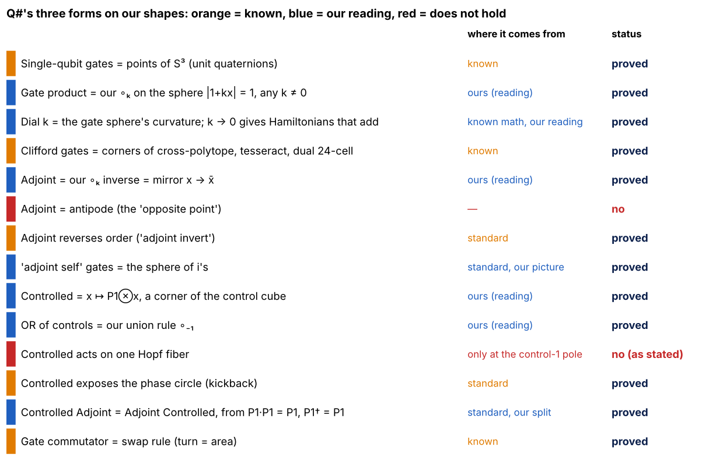

*Figure 9. Every claim tested, where it comes from, and whether it holds.*

- **The body is our core law on a sphere.** Single-qubit gates are the sphere |1 + kx| = 1 (centre −1/k, radius
  1/|k|), and composing gates is exactly a ∘ₖ b there, for every k ≠ 0. The dial k is that sphere's curvature
  (d = k²); as k → 0 the sphere flattens onto the plane of Hamiltonians, where ∘₀ is plain adding.
- **Adjoint is our ∘ₖ inverse, and it is a mirror.** On the gate sphere the ∘ₖ inverse of x is its conjugate x̄, the
  reflection through the real axis. It is **not** the antipode: −U is the same gate up to a phase of −1. The mirror
  reverses order, which is why Q# builds an Adjoint by running the steps backwards.
- **Controlled is a cube corner.** In our coordinates Controlled is x ↦ P1 ⊗ x. It survives ∘ₖ only because
  P1·P1 = P1, which is why Q# can push Controlled into every step. Several controls light one corner of the control
  cube; "control on a OR b" is our union rule ∘₋₁.
- **They commute because the corner is a mirror-symmetric projector** (P1† = P1). The two properties do separate jobs:
  P1·P1 = P1 gives "distribute", P1† = P1 gives "commutes with Adjoint" (both shown failing one at a time).
- **"Controlled acts on one Hopf fiber": no, as stated.** It holds only when the control is surely 1. What is true and
  standard is the reverse direction: Controlled turns a move along the target's phase circle into a visible turn of
  the control (phase kickback).
- **The Clifford gates are corners of our shapes on S³:** the Paulis are the cross-polytope's 8 corners, the
  axis-cycling Cliffords the tesseract's 16, and H, S and friends the 24 corners of the dual 24-cell. T sits on none.

- **The k³ and k⁴ error terms (section 8): corner terms, not rungs.** Every Trotter error term is a sum over the
  orderings of the cube's corner (its n! order simplices), each ordering weighted by (−1)^d / (n·C(n−1, d)) where d
  counts its descents. The orderings with the same weight fill exactly one slab of the cube cut across its long
  diagonal, and the weights cancel at every level, which is why commuting gates leave no error. Nothing climbs a rung:
  one log at the start, then plain polynomials.
- **Next to the ZX-calculus (section 9): mostly the same ideas, no cheaper circuit.** Spider fusion, the adjoint,
  parity, phase gadgets and phase folding are our core law, mirror, ∘₋₂ and corner expansion. Ours is simpler to state
  in one place (merging any run of single-qubit gates is one product on S³), unifies AND/OR/XOR controls on one dial,
  and gives error terms ZX does not. ZX has multi-qubit rewrites (bialgebra, local complementation) we have nothing
  for. In every circuit tested, both give the same gate counts.

Most of this is standard quantum computing in our language. What is ours is the dictionary: body = ∘ₖ, Adjoint = ∘ₖ
inverse, Controlled = multiply by a corner projector, the dial k = curvature between Hamiltonians and gates.

---

## 1. The body: gates are the sphere |1 + kx| = 1

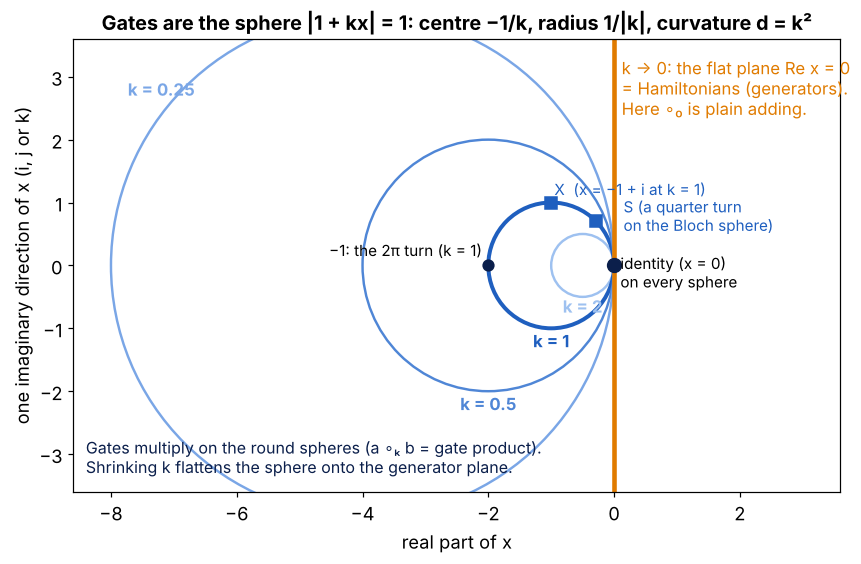

*Figure 1. A slice through the real axis and one imaginary direction. Each round sphere is the set of gates for one k;
all pass through the identity at x = 0. As k → 0 they flatten onto the orange plane Re x = 0, the Hamiltonians.*

Match quaternion units to qubit gates by i ↔ −iσx, j ↔ −iσy, k ↔ −iσz. Then unit quaternions multiply exactly as
SU(2) gates (check B1). A Bloch turn by θ about axis n is the quaternion cos(θ/2) + sin(θ/2) n, at distance θ/2 from 1
on S³; a full 2π turn lands on −1, distance π (B4). This is the hypersphere page's "π and spin" again.

**In our coordinates.** The lift u = 1 + kx turns ∘ₖ into multiplication. A gate is a lift with |u| = 1, so in x the
gates fill the sphere |x + 1/k| = 1/|k|. Composing two gates is a ∘ₖ b, and the result stays on the sphere because
sizes multiply (B2, for k = ±1, 0.5, 2, 0.1). So **the body is ∘ₖ, restricted to one sphere.**

**The dial is curvature.** That sphere has radius 1/|k|, so by the hypersphere page's rule its curvature dial (the plane dial) is
**d = k²**. As k → 0 it flattens onto Re x = 0, and x = (e^{kh} − 1)/k tends to the generator h itself. There ∘ₖ
becomes plain adding: the error falls exactly in half each time k halves (B3). So one dial runs from **Hamiltonians
that add** (k = 0, flat) to **gates that multiply** (k ≠ 0, round).

**Known:** SU(2) = unit quaternions = S³; the Lie algebra is the flat tangent space at 1 (İnönü–Wigner contraction is
the same flattening). **Ours:** reading that flattening as our dial k going to 0. **Status: proved.**

## 2. The Clifford gates are corners of our shapes

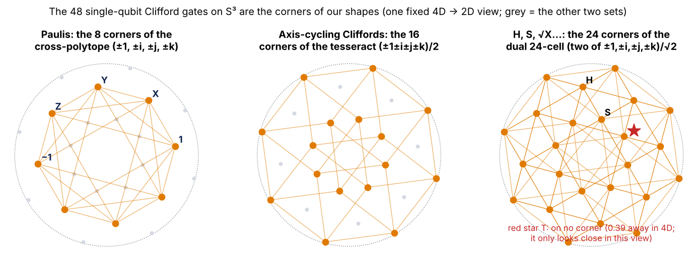

*Figure 2. The same 48 points of S³ in one fixed view, split into three shapes. Orange: the shape named above each
panel. Grey: the other two.*

Generating the single-qubit Clifford group from H and S gives 48 points of S³ (C1):

| Gates | Points on S³ | Our shape |
|---|---|---|
| ±1, X, Y, Z (the Paulis) | ±1, ±i, ±j, ±k | the 8 corners of the **cross-polytope** |
| the gates that cycle X → Y → Z | (±1 ± i ± j ± k)/2 | the 16 corners of the **tesseract** |
| H, S, √X and the rest | two of ±1, ±i, ±j, ±k, over √2 | the 24 corners of the **dual 24-cell** |

The cross-polytope and the tesseract together are the 24-cell (the Hurwitz units). The ℓp dial (the roundness dial) on the
polar-recast page ran cross-polytope → sphere → cube; here those exact shapes sit inside the sphere as the gates that
are easy to make. T is 0.39 from the nearest corner (C4), and H with T keeps producing new points (1,398 different
ones from words up to length 14): leaving the corners is what makes a gate set universal.

**Known:** the Clifford group mod phase is the binary octahedral group, whose 48 elements are the vertices of a
24-cell and its dual. **Ours:** naming the pieces with our shapes. **Status: proved (counted).**

## 3. Adjoint: our ∘ₖ inverse, which is a mirror

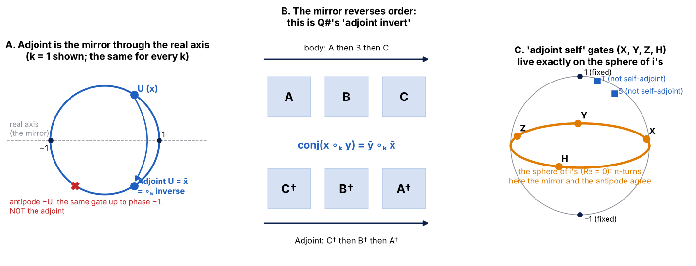

*Figure 3. A: U, its Adjoint (the mirror image through the real axis) and its antipode (red). B: the mirror reverses
order. C: the gates that are their own Adjoint lie on the sphere of i's.*

**Adjoint = ∘ₖ inverse = x̄.** Solve x ∘ₖ y = 0: y = −(1 + kx)⁻¹x. On the gate sphere, (1 + kx)⁻¹ is the conjugate of
1 + kx, and the size condition 2·Re x = −k|x|² turns this into **y = x̄** for every k. Its lift is U† (A1). So the
voice-call idea "Adjoint is the inverse" is our ∘ₖ inverse exactly.

**It is a mirror, not the opposite point.** x ↦ x̄ keeps the real axis and reverses the three imaginary directions:
a reflection of R⁴ (determinant −1) whose only fixed gates are 1 and −1 (A2). The antipode −U is something else: it
moves every state exactly as U does, because −1 is only a phase (A3). So if "mirror point" meant the opposite point,
that part is **no**.

**The mirror reverses order.** conj(x ∘ₖ y) = ȳ ∘ₖ x̄, and the same order misses (A4). So the Adjoint of a
five-step body is the five Adjoints run backwards (A5): this is Q#'s `adjoint invert` (the default), derived from
the core law.

**Which gates are their own Adjoint?** Up to phase, exactly the points with Re x = 0: the sphere of i's from the
hypersphere page, the π-turns. There the mirror and the antipode agree. X, Y, Z and H are on it; S and T are not
(A6). These are the gates Q# marks `adjoint self`.

**Known:** U† = U⁻¹, the quaternion conjugate, the order reversal. **Ours:** that this is our ∘ₖ inverse for every k,
and the shape reading. **Status: proved.**

## 4. Controlled: multiply by a corner of the control cube

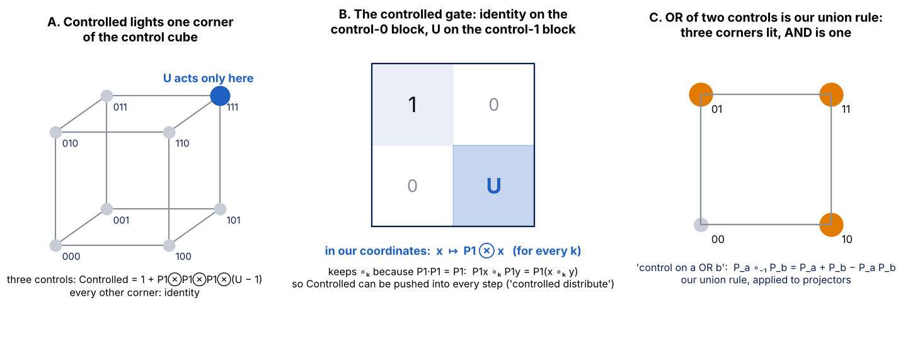

*Figure 4. A: with three controls, U acts only at corner 111. B: the controlled gate as blocks. C: "a OR b" lights
three corners, and the projector for it is our union rule.*

Controlled U = 1 + P1 ⊗ (U − 1), with P1 = |1⟩⟨1|. Subtract 1 and divide by k: **in our coordinates Controlled is
x ↦ P1 ⊗ x**, the same for every k (K2). That keeps ∘ₖ, because

  P1x ∘ₖ P1y = P1x + P1y + k·P1x·P1y = P1(x ∘ₖ y), using P1·P1 = P1.

So Controlled(UV) = Controlled(U)·Controlled(V) (K1), and Q# can build the Controlled form of a body by controlling
each step: `controlled distribute`, derived. Replace P1 by something with e·e ≠ e (half of P1, or a nilpotent) and it
breaks, by 1.8 and 7.3 (K2).

**Several controls are a cube corner.** Two controls are 1 + P1 ⊗ P1 ⊗ (U − 1) (K3). The 2ⁿ control patterns are the
corners of the control cube: their projectors never overlap and add to 1, which is the cube's own expansion
(P0 + P1)ⁿ (K4). "Control on zero" picks another corner. "Control on a OR b" uses P_a ∘₋₁ P_b =
P_a + P_b − P_aP_b = 1 − P0 ⊗ P0, our union rule, and it is again a projector (K5).

**Known:** the block form, controlled-on-zero, OR built from projectors. **Ours:** Controlled as "multiply x by a
corner projector", and OR as ∘₋₁. **Status: proved.**

## 5. Why Adjoint and Controlled commute

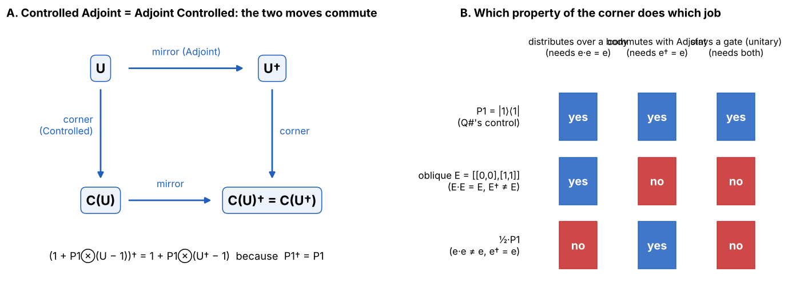

*Figure 5. A: the square closes. B: which property of the corner does which job.*

(1 + P1 ⊗ (U − 1))† = 1 + P1 ⊗ (U† − 1), because P1† = P1. So Controlled Adjoint = Adjoint Controlled (D1). It does
follow from our algebra, and it needs two separate facts about the corner:

- **P1·P1 = P1** gives "distributes over a body".
- **P1† = P1** gives "commutes with Adjoint".

Tested one at a time: an oblique projector E (E·E = E, E† ≠ E) still distributes but stops commuting with Adjoint and
stops being a gate (D2); half of P1 (Hermitian, but e·e ≠ e) commutes with Adjoint but does not distribute (D3).
Q#'s control needs both, and that is exactly an orthogonal projector.

**Known:** the commuting is standard. **Ours:** splitting it into the two corner properties. **Status: proved.**

## 6. Controlled and the Hopf circle: testing the hypothesis

*Figure 6. A: an eigenstate of U only slides round its phase circle. B: the control turns by that angle. C: for
random targets the control's Bloch vector shrinks, so this is not "one fiber".*

The Hopf circle over a qubit state is its phase. A global phase moves a state only round that circle and is invisible
(H1). Controlled makes it visible: Controlled(e^{iφ}·1) is a turn of the **control** about Z by φ (H2). If the target
is an eigenstate of U, the target only slides round its own circle and that angle is handed to the control (H3):
phase kickback, the engine of phase estimation.

**The hypothesis as stated fails.** For a random target, branch 1's Bloch point moves (not just its phase) in all
2,000 trials, and the control ends up entangled (mean Bloch length 0.66 instead of 1) (H4).

*Figure 7. Two qubits on S⁷, drawn on the quaternionic Hopf base S⁴. Height is the control's population difference.*

**Where it does hold.** Write two qubits as a pair of quaternions (q0, q1) on S⁷ (with C² = H, every gate is left
multiplication by a unit quaternion, H5). The quaternionic Hopf map sends S⁷ to S⁴ with S³ fibers. Controlled-U
sends each fiber to a fiber, keeps the height |q0|² − |q1|², and turns the rest of S⁴ about that axis (H6). At the
pole where the control is surely 1, it acts entirely inside one S³ fiber (H7). So "acts on one Hopf fiber" is exactly
true there and nowhere else.

**Known:** kickback (Cleve, Ekert, Macchiavello and Mosca 1998); the quaternionic Hopf fibration. **Ours:** the S⁴
picture of Controlled as a turn about the control axis. **Status: "one fiber" no as stated; kickback and the S⁴ turn
proved.**

One structural point falls out: the body and Adjoint only see S³ (phase does not matter), but Controlled needs the
full U(2), the S³ plus its phase circle. That is why Q# keeps track of global phase at all.

## 7. The swap rule for gates

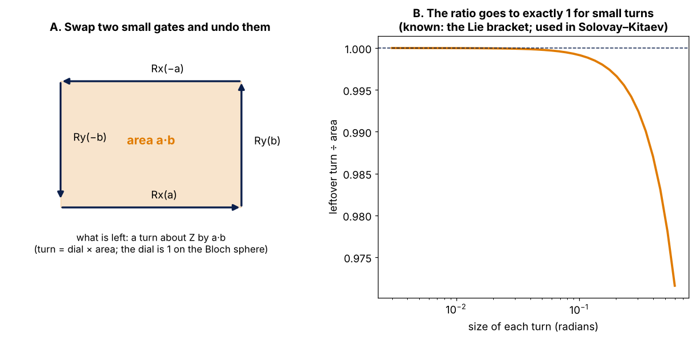

*Figure 8. A: turn about x, about y, undo both: a turn about z is left. B: leftover ÷ area goes to 1.*

Rx(a) Ry(b) Rx(−a) Ry(−b) leaves a turn about Z of size a·b (W1: ratio 0.99999 at small sizes). That is the swap rule
"turn = dial × area" on the Bloch sphere. **Known** (the Lie bracket; it is the trick inside the Solovay–Kitaev
algorithm). **Status: proved.**

**In our law the order cost is exact:** x ∘ₖ y − y ∘ₖ x = k[x, y] (W2). And splitting a Hamiltonian A + B into a
step of A then a step of B, each of size k, misses the true gate by (k²/2)·|[A, B]| (W3: ratio 1.0000). Read on the
gate sphere, the step size k is the dial, k² is the sphere's curvature d, and the miss is d times the swap-rule
commutator. **Known:** first-order Trotter error. **Ours:** that it is the swap rule with d = k². **Status: proved.**

## 8. The k³ and k⁴ error terms: corner terms, not rungs

Brennan asked whether the higher Trotter error terms (the price of splitting a Hamiltonian into steps) match our rungs
or our corner terms. **Corner terms.**

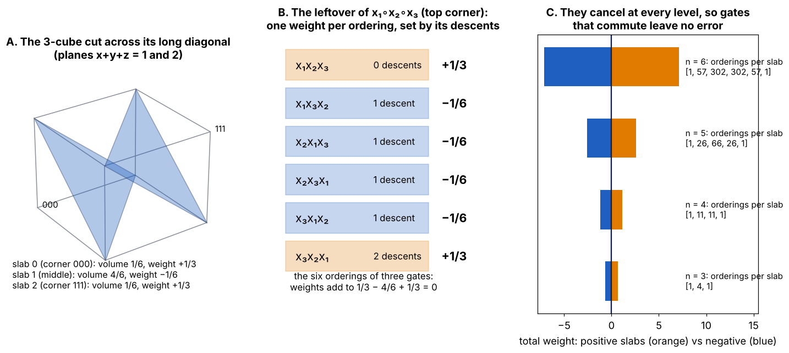

*Figure 10. A: the 3-cube cut by the planes x+y+z = 1 and 2 into three slabs. B: the six orderings of three gates
and their weights. C: positive and negative weights cancel at every level.*

**The set-up in our law.** Compose N gates: 1 + k(x₁ ∘ₖ … ∘ₖ xₙ) = (1 + kx₁)⋯(1 + kxₙ), one term per corner of the
N-cube. The generator of the result (its radius, one log) is where the error lives. Expanding that log exactly, the
top-level part is a sum over **all N! orderings** of the gates, each with weight

  (−1)^d / (N · C(N−1, d)),  d = the number of descents in the ordering

checked exactly for N = 2 to 6 (E1). For three gates: +1/3 for 123, −1/6 for the four orderings with one descent,
+1/3 for 321. The weights add to zero at every level (E2, N = 2 to 8): if the gates commute, all orderings are the same
word and the error vanishes, which is "the radius adds".

**Where the shape comes in.** The number of orderings with d descents is the Eulerian number (1, 4, 1; 1, 11, 11, 1;
…), and n! times the volume of the cube's d-th slab between the planes Σx = d and Σx = d+1 is exactly that number
(E3, and E3b samples the 4-cube: 1, 11, 11, 1 over 24). So the error weights are **one weight per slab of the cube cut
across its long diagonal**.

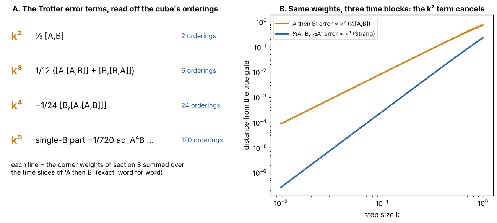

*Figure 11. A: the error terms of "A then B". B: the error falls like k² for "A then B" and like k³ for the
symmetric "½A, B, ½A".*

**The k³ and k⁴ terms.** Feeding "A for time 1, then B for time 1" through those weights gives, word for word (T1–T3):

- k²: ½[A, B]
- k³: (1/12)([A,[A,B]] + [B,[B,A]])
- k⁴: −(1/24)[B,[A,[A,B]]]

and a fit of log(e^{kA}e^{kB}) on real qubit gates matches them to 10⁻⁹ (T4). The same weights on three blocks
(½A, B, ½A) kill the k² term and give the symmetric splitting's k³ term −(1/24)[A,[A,B]] + (1/12)[B,[B,A]] (T5). So
every Trotter scheme's error is the same corner weights, read on that scheme's time blocks.

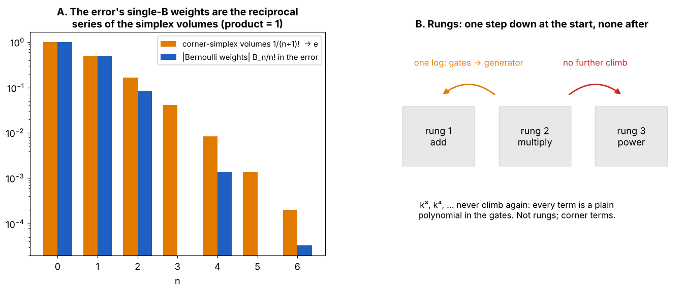

*Figure 12. A: the error's single-B weights against the corner-simplex volumes. B: one step down the rungs at the
start, none after.*

**Why not rungs.** Every term is a plain polynomial in the gates of degree n (R3): one log turns gates into a
generator, and nothing after that takes another log or power. One more tie to earlier pages: the part of each term
with a single B has the Bernoulli weights 1/2, 1/12, 0, −1/720 (R1; that is why the k⁴ term has no [A,[A,[A,B]]]),
and that series is exactly the reciprocal of the corner-simplex volumes 1/(n+1)! that gave e on the hypersphere page
(R2).

**Known:** the descent weights are Solomon's Eulerian idempotent (1968), used for the Magnus expansion by Mielnik and
Plebański (1970) and Strichartz (1987); Eulerian numbers as slab volumes go back to Laplace (Stanley 1977); the
Bernoulli part of BCH is standard. **Ours:** reading the whole error series on the cube (orderings, slabs, corner
simplex). **Status: proved and checked; corner terms yes, rungs no.**

## 9. Next to the ZX-calculus

Brennan's aim (from the call): if there is a framework for quantum computing that does not already exist, it might
make things simpler. The ZX-calculus is the existing graphical language for simplifying circuits, so the test is
where ours matches it, where it adds nothing, and where it does better.

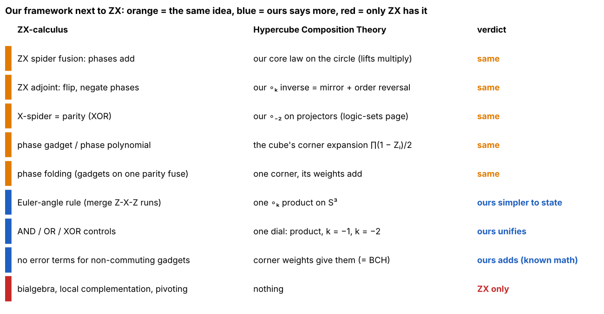

*Figure 13. ZX's moves next to ours.*

**The same idea (checks M1–M5).**

- ZX spider fusion (phases add) is our core law on the circle.
- ZX's adjoint (flip the diagram, negate phases) is our mirror plus order reversal.
- ZX's X-spider computes parity; on projectors our dial already gives the logic: ∘₋₁ = OR, ∘₋₂ = XOR, product = AND
  (the logic-sets page), and Pauli Z is the k = −2 lift of the projector P1.
- A CCZ gate is the cube's corner expansion (1/8)∏(1 − Zᵢ): 7 phase gadgets of angle ±π/8, T-count 7, which is how
  ZX and phase-polynomial methods write it.

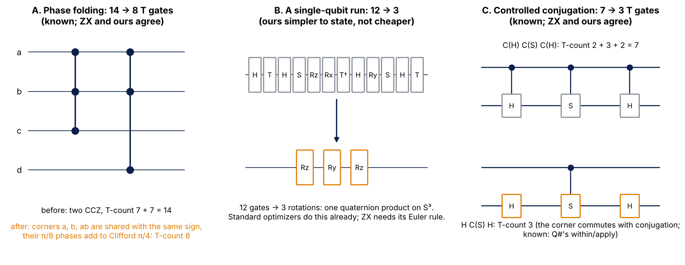

*Figure 14. Three circuits, before and after, with gate counts.*

**Concrete circuits (C1–C4).**

| Circuit | Before | After | Who finds it |
|---|---|---|---|
| CCZ(a,b,c) then CCZ(a,b,d) | T-count 14 | T-count 8 (corners a, b, ab merge into Clifford phases) | ZX and ours equally; known as phase folding |
| 12-gate single-qubit run | 12 gates | 3 rotations (one product on S³) | ours in one step; ZX needs its Euler-angle rule; every optimizer already does it |
| Controlled(H S H) | T-count 7 | T-count 3 (only the middle needs control) | both; known (Q#'s within/apply) |
| Control on a OR b | — | one doubly-controlled gate plus X's | union rule = de Morgan; same cost as AND |

**Where ours says more.** Merging any run of single-qubit gates is one product on S³, where ZX needs a rule with
trigonometry in it; but standard optimizers already merge this way, so it is simpler to state, not cheaper. AND, OR
and XOR controls are one dial instead of separate constructions (the ZH-calculus also handles AND natively). And for
non-commuting phase gadgets our corner weights give the error terms (D1), which ZX rewriting does not produce; that is
the BCH series of section 8, known math.

**Where ZX has more.** The bialgebra law, local complementation and pivoting rewrite multi-qubit entangling structure
and cut CNOT and T counts in large circuits. We have nothing for those.

**Verdict:** a clean dictionary to ZX and a unified notation, but in every circuit tested no cheaper circuit than ZX
or a standard optimizer. A real simplification would have to come from something ZX lacks, and the only candidate here
is the error side: a rewrite system that carries Trotter error terms along with the circuit.

---

## 10. Polishing step on every method

Each check script now ends with a cheap polish that swaps an estimate for an exact form, or sharpens a limit. Total cost: about 16 ms across all three scripts.

| Was | Polish | Result | Cost |
|---|---|---|---|
| Slab volumes of the 4-cube from 2 million random points (to 3 digits) | Exact Irwin–Hall formula in fractions | 1/24, 11/24, 11/24, 1/24 exactly, also for n = 3, 5 | under 1 ms |
| k³, k⁴ Trotter terms read off a least-squares fit (to 1e-8) | Exact power series of log(e^{kA}e^{kB}) in rational arithmetic | k², k³, k⁴ match the corner-weight terms with zero error; Strang k² exactly 0 | about 13 ms |
| Swap-rule turn and Trotter ratio read at the smallest step (miss up to 1e-4) | Richardson extrapolation to step 0 | miss 2e-7 or smaller | under 1 ms |
| T-counts with a floating tolerance | Angles kept as exact fractions of π | 7 and 14 → 8, no tolerance | under 1 ms |
| Euler angles for the 12-gate run | One Newton step | unchanged; already exact to rounding | under 1 ms |

The other checks compare exact identities and already agree to about 1e-15, so polishing them changes nothing.

## Leads, judged on their own merits

1. **The dial k as the knob between Hamiltonians and gates (sections 1, 7 and 8).** Tested: the whole Trotter error
   series is corner terms on the cube (orderings weighted by descents, one weight per slab), not rungs. It is known
   math in a new picture. What would make it a real lead is section 9's open point: a circuit rewrite system that
   carries these error terms along, which ZX does not have. Worth trying only if Brennan wants the applied direction.
5. **ZX comparison (section 9).** A dictionary, not a simplification: same gate counts in every tested circuit.
2. **Controlled as "multiply by a corner projector" (sections 4 and 5).** Worth following for its reach, not for new
   physics. It says which algebraic facts any "controlled" construction needs (e·e = e for distributing, e† = e for
   Adjoint), and it ties multi-controls and OR-controls to the cube and the union rule we already have. It would make
   a clean Lean file in our library.
3. **Clifford gates as corners of our shapes (section 2).** A good picture and a good teaching hook; known, no new
   result.
4. **The Hopf-fiber reading of Controlled (section 6).** Not worth pursuing as stated. The true parts are standard.

## Next (offered, not started)

- Try the open point in section 9: rewrite rules that carry Trotter error terms through a circuit, on a small
  Hamiltonian-simulation example, and see whether any gate count drops.
- Write the Lean file for sections 3 to 5 (∘ₖ inverse on the gate sphere, order reversal, idempotent homomorphism,
  the commuting square) on the library's ring structures.

## Files

- `README.md`: this write-up
- `checks.py` → `checks_output.txt` (39/39)
- `figures.py` → `figures/fig1` … `fig9`; `figures_part2.py` → `fig10` … `fig14`
- `trotter/`: `checks_trotter.py` (19/19), `trotter_lib.py`
- `zx/`: `checks_zx.py` (15/15)
- `page_build.py` → `index.html`

## References

- W. R. Hamilton, quaternions, 1843; the SU(2) ≅ S³ correspondence in any quantum mechanics text.
- H. S. M. Coxeter, *Regular Polytopes*, 1973 (the 24-cell and the binary polyhedral groups).
- D. Gottesman, "The Heisenberg representation of quantum computers", 1998 (the Clifford group).
- R. Cleve, A. Ekert, C. Macchiavello, M. Mosca, "Quantum algorithms revisited", Proc. R. Soc. A 1998 (phase kickback).
- E. İnönü, E. P. Wigner, "On the contraction of groups and their representations", PNAS 1953.
- C. M. Dawson, M. A. Nielsen, "The Solovay–Kitaev algorithm", 2005.
- L. Solomon, "On the Poincaré–Birkhoff–Witt theorem", J. Comb. Theory 1968; B. Mielnik, J. Plebański, "Combinatorial approach to Baker–Campbell–Hausdorff exponents", 1970; R. S. Strichartz, "The Campbell–Baker–Hausdorff–Dynkin formula and solutions of differential equations", J. Funct. Anal. 1987; C. Reutenauer, *Free Lie Algebras*, 1993.
- R. Stanley, "Eulerian partitions of a unit hypercube", 1977.
- B. Coecke, R. Duncan, "Interacting quantum observables", 2011 (ZX-calculus); R. Duncan, A. Kissinger, S. Perdrix, J. van de Wetering, "Graph-theoretic simplification of quantum circuits with the ZX-calculus", Quantum 2020; A. Kissinger, J. van de Wetering, "Reducing the number of non-Clifford gates in quantum circuits", PRA 2020; R. Vilmart, "A near-minimal axiomatisation of ZX-calculus for pure qubit quantum mechanics", LICS 2019.
- M. Amy, D. Maslov, M. Mosca, "Polynomial-time T-depth optimization of Clifford+T circuits via matroid partitioning", 2014 (phase polynomials, phase folding).
- Microsoft, Q# language documentation: functors Adjoint and Controlled, specializations `adjoint invert`, `adjoint self`, `controlled distribute`.

Page: https://claude.ai/artifact/VeVmLnshwkAUSvqFcvXof4 (slug e7fc20f4-1f9e-4a5e-bdfa-fffe89815177, version 1795656952-2106).
Not yet pushed to the repo (BrennanRPope/fused-hyperoperation-algebra): the repo thread does that.
