# DRAFT · Quantum action: what action really is, seen through our shapes, dials and swap rule

> **Names:** some words or symbols on this page (⊕) also mean something else in standard math, physics or computing, or inside this project. [NAMING-COLLISIONS.md](../../NAMING-COLLISIONS.md) says which meaning is in play.

Nov 26, 2026. Asked for by Brennan on a voice call: "let's do a deep dive in the concept of action and see how we can model
it using any of these shapes, basically our entire model, and see if there's any way to get a clearer picture of what
action really is." He then asked to call it **quantum action** and to fold in quantum gravity ("I'm kind of wondering if
action minimization might yield a theory of quantum gravity"). Checks: `checks.py` → `checks_output.txt`, **27/27 pass**
(numpy, scipy, sympy, mpmath). Lean: `lean/QuantumAction.lean`, 18 theorems plus 2 ext lemmas, **compiled into the library as `Topics/QuantumAction` on Nov 26** (it was written with no Lean toolchain in
this session); every identity in it is checked by `lean_identities_check.py` (10/10). Pictures: `figures.py` → `figures/`.

Builds on and does not repeat: `quantum-to-classical/` (the action coordinate a = E(ks)/k with k = i/ħ, the path-sum dial),
`why-i/` (Feynman's dial, Wick rotation, Maslov phase for the oscillator), `precession/` (turn = d × area),
`hypersphere/` (d = 1/R², Kepler orbits are great circles on S³, Archimedes), `polar-coordinates/` (moment maps),
`why-i/e-i-pi/asymptotic-safety/` (the flow of G is our operation; D − 2 is the dial).

## The picture in one line

**Action is area.** It is the area a motion sweeps out in the plane of position and momentum, and ħ is the exchange
rate that turns that area into a turn of the quantum clock. That is the same swap rule that gives precession: doing two
moves in the other order costs a turn equal to dial × area. For gravity the "area" becomes size × bend, summed over
the creases of space (Regge), and in 3D quantum gravity that sum really does come back out of a sum over spins.

**Strongest lead.** In the one quantum gravity that fully works (3D), turning on the q dial curves every building block
and adds a cosmological constant, exactly (check E3, correlation 0.999). Our q is the swap rule's face weight and our
curvature dial (the plane dial) is 1/R², so this is the place where the theory's own dials land inside a working quantum gravity. The
physics is known (Turaev–Viro 1992; Mizoguchi–Tada 1992). It is worth following because it gives a concrete, checkable
next step: our swap rule yx = q·xy is the "quantum plane", and the quantum-group 6j symbols are its recoupling numbers,
so we can test whether the identities that make 3D quantum gravity independent of how space is cut up follow from our
face weights. It does **not** by itself say why Einstein's action fails in 4D.

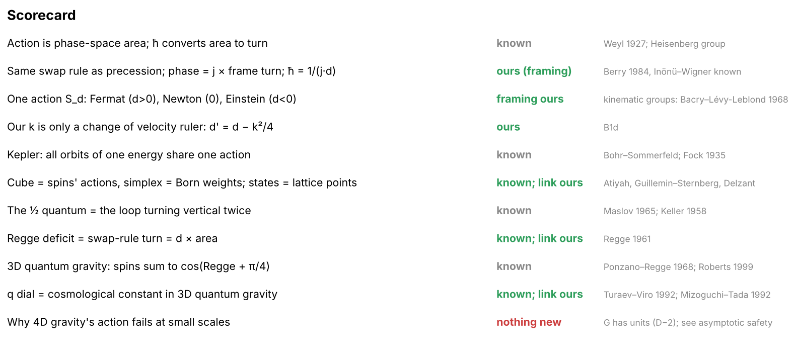

*Fig 11. What each finding is and whether it is known. Green = ours (framing or result), gray = known, red = nothing new.*

---

## 1. Action is area, and the swap rule is where it comes from (fundamental)

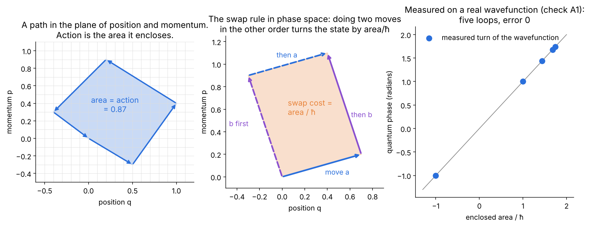

*Fig 1. Left: a closed path in the plane of position q and momentum p; its action is the area it encloses. Middle: two
moves done in the two orders end at the same place, but the quantum state differs by a turn of (parallelogram area)/ħ.
Right: measured on a real wavefunction on a 4,096-point grid: five loops, including a reversed one and a pentagon; the
turn equals area/ħ to machine precision (A1, A1b).*

- **What it says.** Move a quantum state by a in position-momentum space, then by b, and compare with b then a. The
  two land in the same place, but one is turned relative to the other by (a × b)/ħ, the parallelogram's area divided
  by ħ (A1b). Go round any closed loop and the state comes back turned by the enclosed area/ħ (A1). That turn per unit
  area is the whole meaning of ħ.
- **One line, no action.** Moves along one line commute and cost nothing (Lean `parallel_no_cost`). Action, like
  precession, needs two directions: here they are position and momentum.
- **Lean.** `swap_costs_area`, `triangle_loop`, `quad_loop`: a closed triangle or quadrilateral of moves returns with
  phase exactly its shoelace area. The moves form the Heisenberg group (`mul_assoc`, `mul_inv`).
- **Known:** Weyl 1927 (the Weyl relations), the Heisenberg group, Aharonov–Bohm (a magnetic field is the same law with
  qB in place of 1). **Ours:** nothing new in the math; the reading "ħ is the price of a swap per unit area" ties it to
  the swap rule.

## 2. One swap rule, three readings: precession, spin, ħ

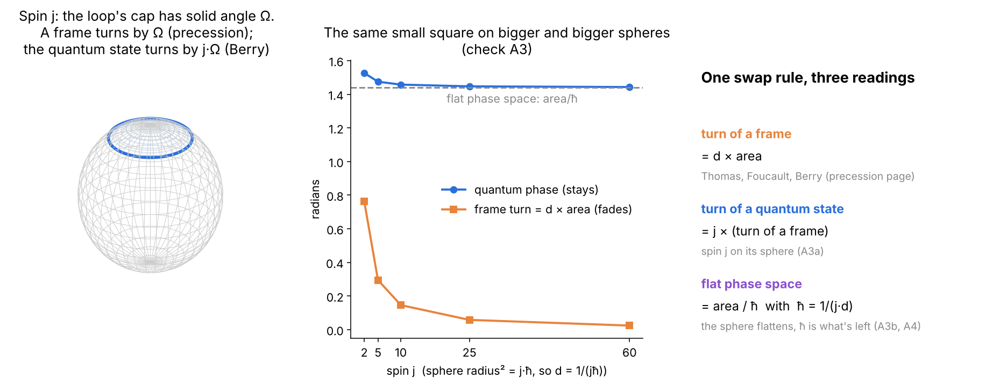

*Fig 2. Left: a loop on a sphere encloses solid angle Ω. Middle: the same small square drawn on bigger and bigger spin
spheres. The frame's turn (orange, = d × area) fades away; the quantum phase (blue) stays and settles on the flat value
area/ħ. Right: the three readings.*

- **On a sphere, the quantum phase is the spin times the frame's turn.** A spin-j state carried round a loop turns by
  j·Ω (A2, 15 loops, Berry 1984), while a frame carried round the same loop turns by Ω = d × area, the precession law.
  The ratio is exactly j (A3a: 2.000, 5.000, 10.000, 25.000, 60.000).
- **ħ is what's left when the sphere goes flat.** Give spin j's sphere radius² = j·ħ, so its dial is d = 1/(jħ). As j
  grows the sphere flattens, the frame's turn d × area goes to zero, but the phase j × (d × area) = area/ħ stays, with a
  gap that shrinks like 1/j (A3b, slope −1.00). Near the top of a big spin, [J_x, J_y]/j → i·ħ: the Heisenberg rule is
  the flattened swap rule (A4).
- So the three facts are one: **turn = d × area** (Thomas, Foucault, Berry; precession page), **phase = j × turn**, and
  **phase = area/ħ with ħ = 1/(j·d)** in flat phase space.
- **Known:** Berry 1984; Inönü–Wigner contraction and Holstein–Primakoff (spin → oscillator). **Ours:** stating ħ as
  1/(j·d), the same dial d that runs the precession page.
- **Lead?** Modest. It is a clean bridge for the write-ups, and it makes "ħ" and "curvature" two ends of one number,
  but it predicts nothing new.

## 3. Action is also length: one dial for Fermat, Newton and Einstein

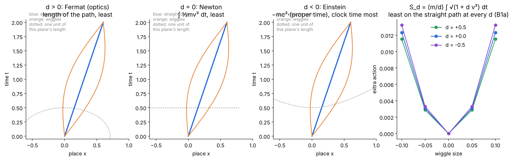

*Fig 3. Paths drawn in the (place, time) plane for three settings of the curvature dial d. Dotted: points one unit of that
plane's "length" from the start (circle, flat line, hyperbola). Right: every wiggle raises the action at every d.*

- One formula covers all three: **S_d = (m/d) ∫ √(1 + d v²) dt**.
  - d > 0: it is the ordinary length of the path in a Euclidean plane, the quantity light minimizes (Fermat; Snell's
    law falls out, B4).
  - d → 0: S_d − mT/d becomes Newton's ∫ ½mv² dt (B1b; Lean `newton_from_dial`).
  - d = −1/c²: it is −mc² × the clock time along the path, Einstein's free-particle action.
- The action is least on the straight path at every d (B1a). The length it measures is shortest for d > 0 and
  **longest** for d < 0: that flip is the twin paradox, where the straight path carries the most clock time.
- **The symmetry of S_d adds velocities by our plane law** (u + v)/(1 − d·u·v) (B1c; Lean `boost_keeps_form`,
  `boost_compose`). Rotations for d > 0, Lorentz boosts for d < 0, plain addition at d = 0 (`galilean_compose`).
- **Our k is only a change of ruler (B1d, ours).** The full law (x + y + kxy)/(1 − dxy) becomes the k = 0 law with
  **d′ = d − k²/4** after x ↦ x/(1 + (k/2)x) (Lean `k_is_a_slide`). So for free motion k adds nothing physical: Newton
  sits on the whole parabola d = k²/4, not just at d = 0, circles (Fermat-like) inside it, hyperbolas (Einstein-like)
  outside.
- **Kepler, the 3-sphere and light.** At one energy every Kepler ellipse, round or thin, has the same action 2πk√(m/−2E)
  (B2, four eccentricities, equal to 10⁻⁶). That equal action is why hydrogen's levels are shared, and it is the action
  reading of the hypersphere page's result that orbits are great circles on S³ (all great circles have the same
  length). Maupertuis's principle turns orbits into the shortest paths of a "lens" n = √(2m(E − V)), and Maxwell's
  fish-eye lens n = 2/(1 + r²) shows the same thing for light: its rays are circles that lift to great circles of a
  sphere (B3).

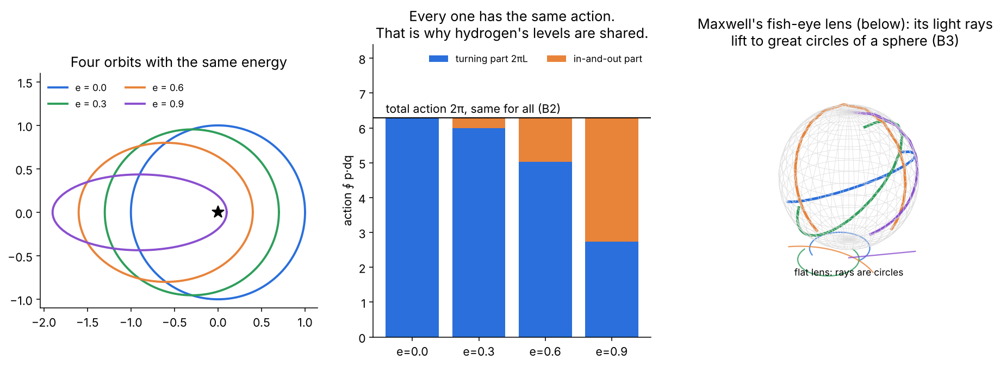

*Fig 4. Left: four Kepler orbits with the same energy. Middle: their action split into the turning part 2πL (blue) and the
in-and-out part (orange); the total is the same 2π every time. Right: Maxwell's fish-eye lens (flat circles below) and its
rays lifted onto the sphere, where they are great circles.*

- **Three bodies (from the three-body page, not redone here).** With equal masses and period 2π, minimizing the action from 40 random starts found only two orbits: Lagrange's circle (action 19.604) and the figure-eight (action 24.372, Chenciner–Montgomery 2000). See `three-body/`.
- **Known:** Fermat, Maupertuis, Jacobi; Einstein's proper-time action; possible kinematics (Bacry–Lévy-Leblond 1968);
  Fock 1935, Moser 1970; Maxwell's fish-eye 1854. **Ours:** the single dial formula tied to our plane law, and the
  k-is-a-slide result.
- **Lead?** The dial formula is a good organizing picture, not new physics. The k-is-a-slide result is small but
  useful: it says which dial setting matters for motion (only d − k²/4), which tidies future physics pages.

## 4. The shapes of action: cube, simplex, and quantum states as lattice points

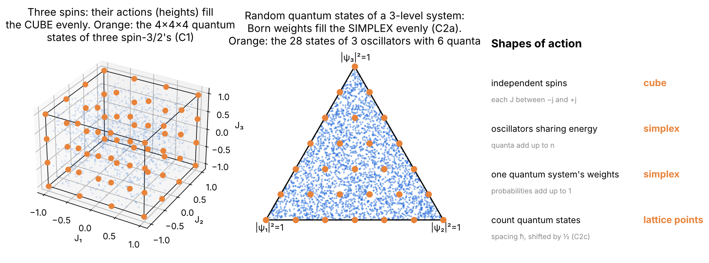

*Fig 5. Left: three spins with random directions; their actions (heights J_z) fill the cube evenly, and the 4 × 4 × 4
quantum states of three spin-3/2's are the cube's lattice points. Middle: random quantum states of a 3-level system; the
Born weights |ψᵢ|² fill the simplex evenly; the 28 states of three oscillators sharing 6 quanta are its lattice points.*

- When a motion has several independent turnings, each has its own action (its own area), and the list of actions
  fills a shape. **Independent spins fill the cube** (C1a; Archimedes' hat-box theorem, Duistermaat–Heckman).
  **Oscillators sharing energy, and the Born weights of one quantum system, fill the simplex** (C2a).
- **Quantum states are the lattice points of that shape**, spaced by ħ: (2j + 1)³ for three spins (C1b), C(n + N − 1,
  N − 1) for N oscillators with n quanta (C2b). The shape's volume counts the states once each oscillator pays its half
  quantum (C2c: 10,660 states vs volume 10,667).
- So the theory's two main shapes, the cube and the simplex, are the two basic shapes of action. **Known:**
  Atiyah, Guillemin–Sternberg 1982 (convexity), Delzant 1988, "quantization commutes with reduction"; the polar
  coordinates page already had the moment maps. **Ours:** the reading of the shape gallery as an action gallery.
- **Lead?** It unifies the gallery's story but adds no new result. Worth one paragraph in the README, not a project.

## 5. The half quantum is the loop's own turning

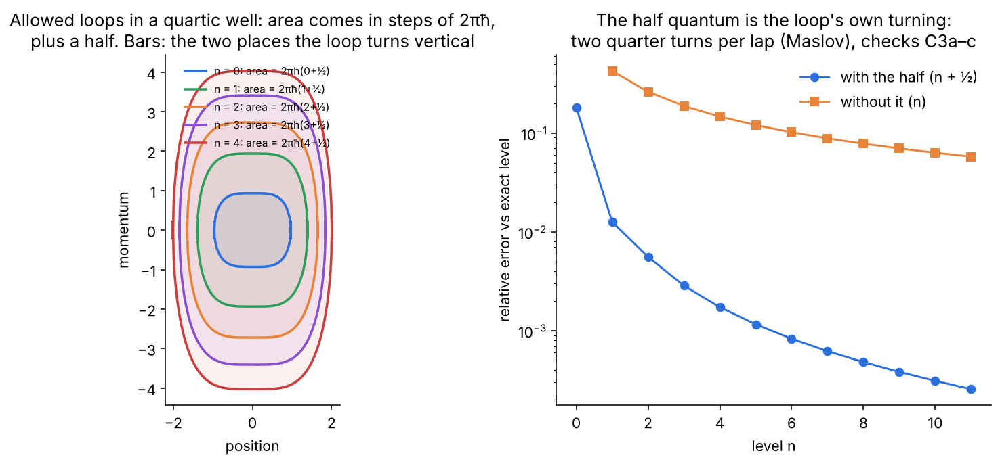

*Fig 6. Left: the allowed loops in a quartic well; each encloses 2πħ(n + ½). Bars mark the two places per lap where the
loop turns vertical. Right: error of this rule against the exact levels, with the half (blue) and without it (orange).*

- The rule "loop area = 2πħ(n + ½)" gives the quartic well's levels to 1% at n = 1 and 0.03% at n = 11 (C3a). Without
  the half it is off by 12 to 43% (C3b).
- The half is two quarter turns: the loop's tangent turns vertical twice per lap (C3c), and each such turn costs a
  quarter of a cycle (the Maslov index). It shows up again in quantum gravity as the π/4 in section 7.
- **Known:** Bohr–Sommerfeld; Einstein–Brillouin–Keller (Keller 1958); Maslov 1965. **Ours:** nothing new; included
  because it is the clearest picture of where zero-point energy comes from.

## 6. Quantum versus least action is one dial

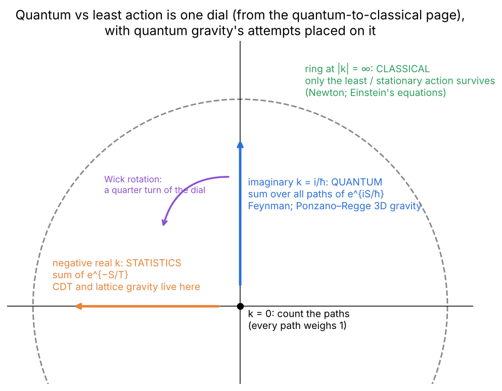

*Fig 7. The path dial from the quantum-to-classical page, with quantum gravity's attempts placed on it.*

- Brennan's question was whether action *minimization* might give quantum gravity. Quantum mechanics does not minimize
  action: it adds up every path, each weighted by a turn e^{iS/ħ}. Only when action is huge compared with ħ do the
  turns cancel everywhere except near the least (stationary) action path. On our dial that is the imaginary axis
  (quantum) running out to the ring at infinity (classical). This was shown on the quantum-to-classical page (36/36),
  where ∘ₖ with its partner ⊕ₖ is a semiring at every k and the classical end is Maslov's tropical limit.
- **Where quantum gravity sits.** Ponzano–Regge 3D gravity (section 7) lives on the quantum axis. Causal dynamical
  triangulations (CDT) and lattice gravity first turn the dial a quarter turn (Wick rotation) and live on the
  statistics axis, summing e^{−S}. Einstein's equations are the ring at infinity. So "minimizing action" is the
  classical end of every quantum gravity attempt, not a theory of quantum gravity by itself.

## 7. Gravity's action, and 3D quantum gravity (Brennan's added question)

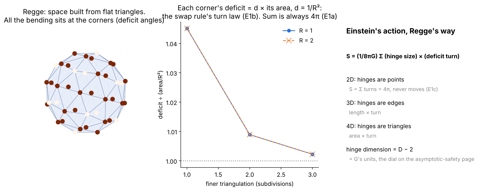

*Fig 8. Left: a sphere built from flat triangles; all the bending sits at the corners (darker = bigger deficit). Middle:
each corner's deficit angle equals (1/R²) × its share of the area, better and better as the triangles shrink. Right:
Einstein's action in Regge's form.*

- **Regge's form of Einstein's action** is S = (1/8πG) × Σ (hinge size) × (deficit turn): build space from flat
  pieces; the bending sits on the "hinges" (corners in 2D, edges in 3D, triangles in 4D); each hinge contributes its
  size times the turn a vector makes going round it.
- **That turn is the swap rule's turn.** On a triangulated sphere every deficit = d × its area with d = 1/R² (E1b),
  and the deficits always add to 4π (E1a, Gauss–Bonnet). So Einstein's action is literally "size × swap-rule turn",
  summed.
- **2D gravity never moves.** In 2D the hinges are points and the action is just the sum of turns, which is 4π for
  any triangulated sphere. 214 random flips changed the local curvature every time and the total never moved (E1c;
  Lean `regge2d_total`, `regge2d_flip`, `regge2d_sphere`).
- **The hinge dimension is D − 2**, which is exactly G's units and the dial strength found on the asymptotic-safety page.

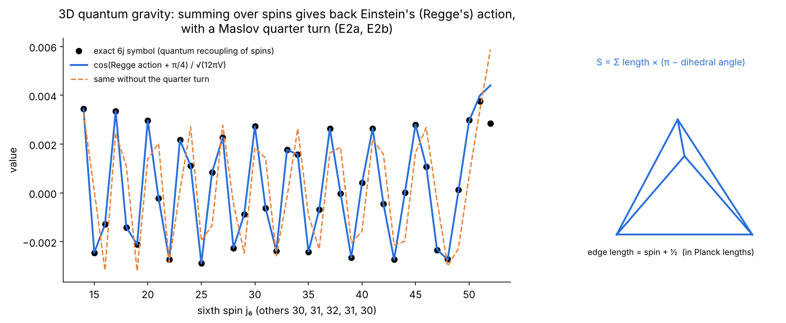

*Fig 9. 3D quantum gravity. Black: exact 6j symbols (the numbers for recoupling quantum spins). Blue: cos(Regge action of a
tetrahedron with edge lengths spin + ½, plus π/4) divided by √(12π × volume). Orange dashed: the same without the quarter turn.*

- **In 3D, the quantum sum over spins gives Einstein's action back.** Ponzano and Regge's 1968 model sums over spins
  on the edges of tetrahedra. For large spins each 6j symbol is cos(Regge action + π/4)/√(12πV), where the Regge action
  is Σ edge length × outside angle. Checked against exact values: within 1% at 6× and 8× scale (E2a); the quarter turn is
  needed (correlation 0.993 with it, 0.73 without, E2b). The π/4 is the same kind of Maslov quarter turn as section 5.
- **Spins are areas.** A spin j is the area of its phase-space sphere in units of ħ (section 2), and here it is a
  length in Planck units. In 4D loop gravity spins label areas. That is the same dictionary.

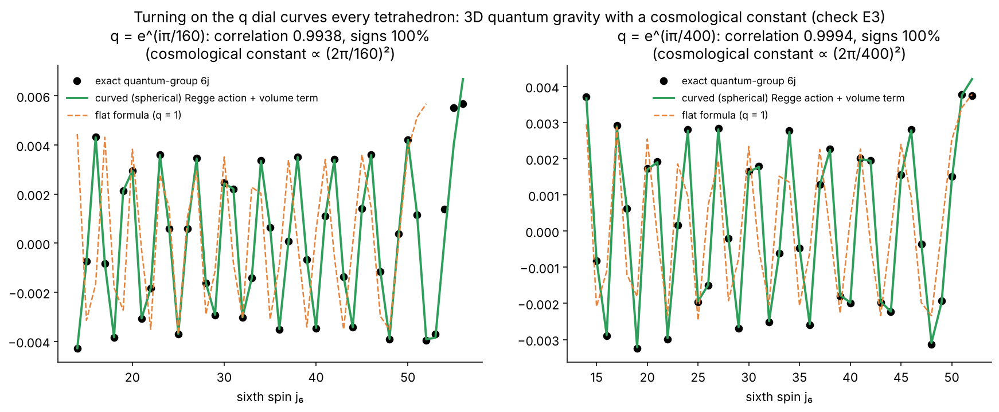

*Fig 10. Turning on the q dial, q = e^{iπ/r}. Black: exact quantum-group 6j symbols. Green: cos of the Regge action of a
curved (spherical) tetrahedron plus a volume term, plus π/4. Orange dashed: the flat q = 1 formula. Left r = 160, right r = 400.*

- **The q dial is the cosmological constant (E3).** Replace each whole number n in the 6j formula by its q-number
  sin(nπ/r)/sin(π/r). Then the tetrahedra are no longer flat: the exact values follow the Regge action of a tetrahedron
  on a sphere of radius ∝ r, plus a volume term, which is 3D gravity with a positive cosmological constant
  Λ ∝ (2π/r)². Correlation 0.9938 at r = 160 and 0.9994 at r = 400, every sign right; without the volume term or with
  the flat formula it fails (0.03 to 0.75).
- **Known:** Regge 1961; Ponzano–Regge 1968 (proved by Roberts 1999); Turaev–Viro 1992; Mizoguchi–Tada 1992;
  Taylor–Woodward 2005. **Ours:** reading the deficit as the swap-rule turn, the spin as an action area, and q as our
  face weight whose curvature dial is 1/R².
- **Lead: yes, worth following.** Our face weights are q-commuting inputs (yx = q·xy), which is the "quantum plane",
  and the quantum group whose 6j symbols these are is the symmetry of that plane. The identity that makes 3D quantum
  gravity independent of how you cut space into tetrahedra (the Biedenharn–Elliott "pentagon" identity, and the
  Turaev–Viro invariant) is concrete and checkable. If it follows cleanly from our face weights, the theory has a
  working quantum gravity in 3D built from its own swap rule, with the cosmological constant as its dial.

### Why does Einstein's action fail at small scales? (honest answer)

- Nothing new from our side. The standard reason holds: in D dimensions the hinge has dimension D − 2, so G carries
  D − 2 units of length. In 3D that makes gravity have no waves of its own, which is why the Ponzano–Regge sum works.
  In 4D, G has units of area, each new loop of quantum corrections brings more powers of energy² × G, and the sum
  cannot be tamed by a finite number of constants (non-renormalizable; 't Hooft–Veltman 1974, Goroff–Sagnotti 1986).
- In Regge terms: a 4D hinge contributes (area/ℓ_P²) × turn/(8π) to S/ħ. Once hinges reach Planck area, each one's
  turn is a quantum guess of order one, and there is no classical shape left to expand around.
- Our dials restate this rather than fix it: the asymptotic-safety page already found that D − 2 is the dial strength
  of G's flow, and that a possible fix is a fixed point where G loses its units (spacetime acting 2D at the smallest
  scales, as CDT also finds). The 3-sphere picture gives the cosmological constant as a curvature 1/R² (and section 7
  shows it entering as q), which is the part of gravity that does behave well.

## 8. What action is, in plain words

1. **Area.** Action is the area a motion sweeps out in the plane of position and momentum. It needs two directions.
2. **A price for order.** It is the turn you pay for doing two moves in the other order: the swap rule, read in phase
   space. ħ is the price per unit area.
3. **Length.** For free motion it is a length of the path, in a plane whose shape the dial d picks: Fermat's length,
   Newton's kinetic energy, Einstein's clock time.
4. **Shape.** Several independent turnings make a shape of actions: cube or simplex, with quantum states as its
   lattice points and a half step from the loop's own turning.
5. **Gravity.** For space itself it is size × bend, summed over the creases. In 3D the quantum sum over spins gives it
   back, and the q dial adds the cosmological constant.

## Known work used

Weyl 1927; Fermat 1662; Maupertuis 1744; Hamilton 1834; Jacobi 1837; Maxwell 1854 (fish-eye); Bohr–Sommerfeld 1913–16;
Fock 1935; Feynman 1948; Keller 1958; Regge 1961; Maslov 1965; Bacry and Lévy-Leblond 1968; Ponzano and Regge 1968;
Moser 1970; 't Hooft and Veltman 1974; Atiyah 1982; Guillemin and Sternberg 1982; Duistermaat and Heckman 1982; Berry
1984; Goroff and Sagnotti 1986; Delzant 1988; Turaev and Viro 1992; Mizoguchi and Tada 1992; Ambjørn and Loll 1998 (CDT);
Roberts 1999; Taylor and Woodward 2005; Lauscher and Reuter 2005. Citations are from memory; check before any paper.

## Files

- `checks.py` → `checks_output.txt` (27/27), `results.json`
- `figures.py` → `figures/fig1` … `fig11`
- `lean/QuantumAction.lean` (18 theorems + 2 ext lemmas, compiled into the library as `FusedAlgebra/Topics/QuantumAction.lean` on Nov 26; two proofs needed a closing `grind`)
- `lean_identities_check.py` (sympy check of every Lean identity, 10/10)
- `polish.py` → `polish_output.txt`
- `cut-independence/` (DRAFT, Nov 26): follow-up to section 7. Cut-independence of 3D quantum gravity follows from the swap rule's q weight at a root of unity (11/11 checks; 14 Lean theorems compiled as `FusedAlgebra.Topics.CutIndependence`). Known mathematics; it closes the question and opens no new direction.

Polish (Nov 26): the Snell crossing point in B4 (bounded Brent search) was refined by Newton on dOPL/dx: x 0.62319978 → 0.62319980, Snell gap 3e-8 → 1e-16, in under a millisecond. No number quoted on this page changes; B4 still passes.
