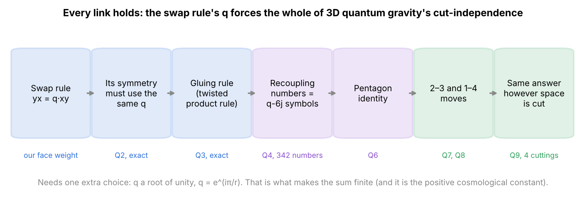
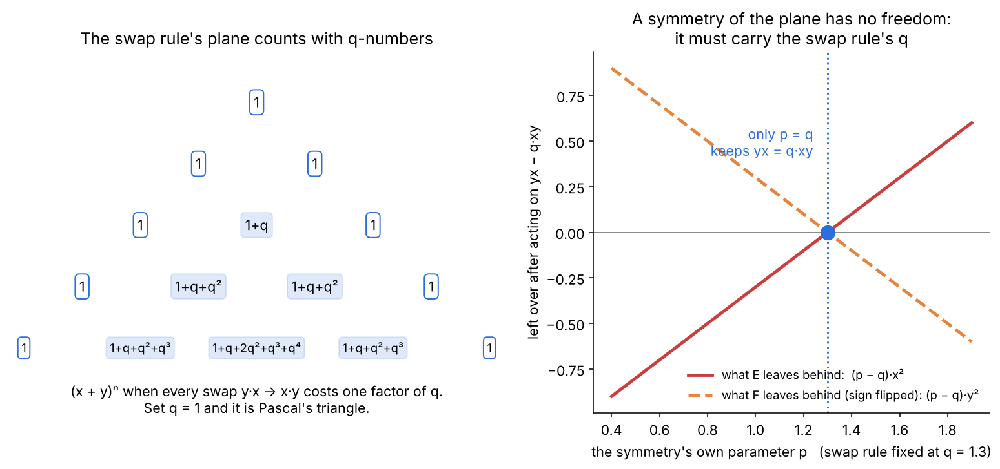
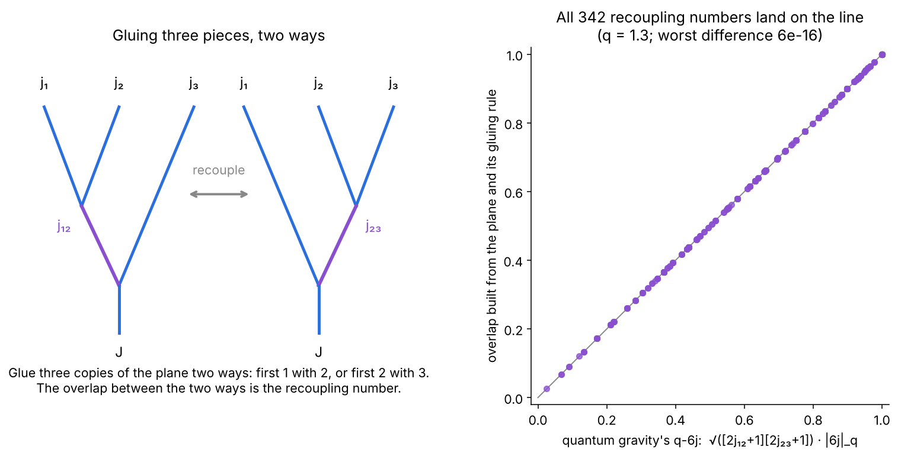
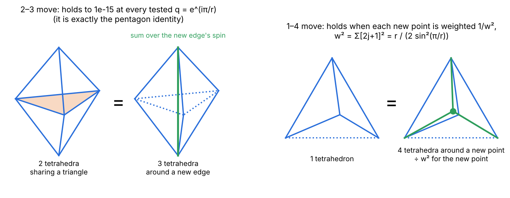
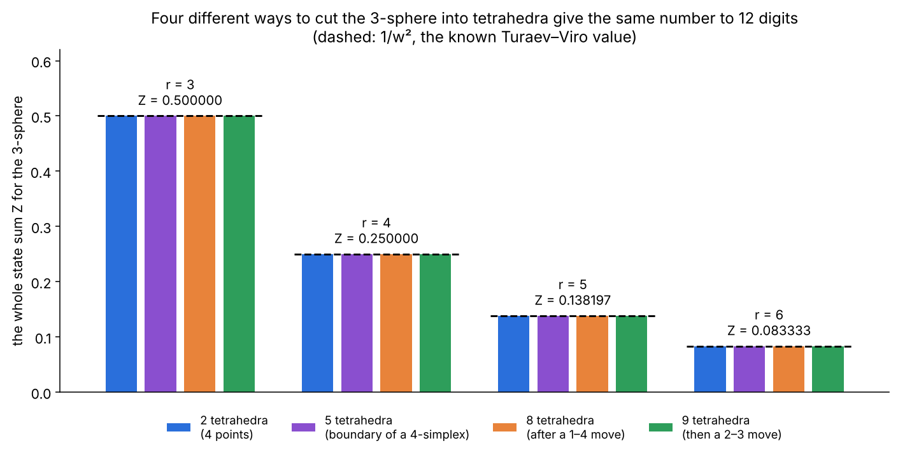
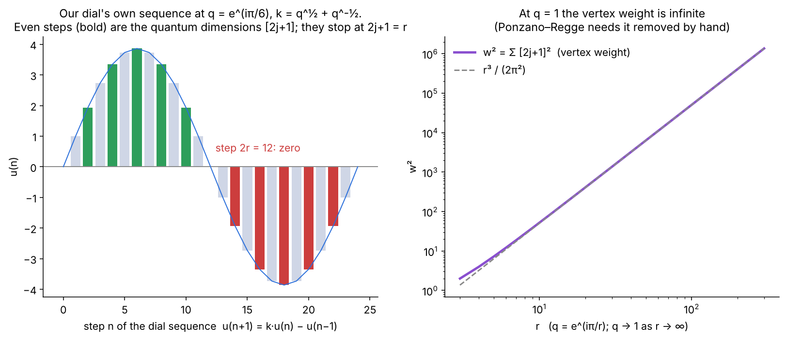
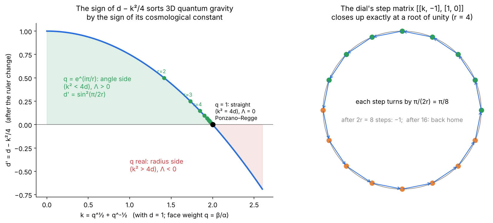
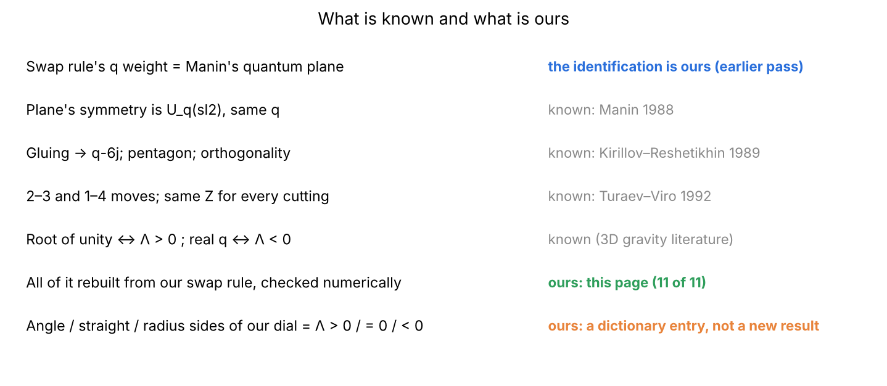

# Cut-independence from the swap rule's q weights (DRAFT, Nov 26 2026)

**Result.** Yes: 3D quantum gravity's rule that the answer doesn't depend on how space is cut into
tetrahedra follows from our swap rule's face weight q, once q is set to a root of unity. Every link of
the chain checks out (11 of 11 checks). Four different cuttings of the 3-sphere give the same number to
12 digits, and to 50 digits in the polish step. Each link after the first is known mathematics (Manin, Kirillov–Reshetikhin,
Turaev–Viro), so this confirms that our swap rule sits inside known 3D quantum gravity. It is a solid
foundation, not a new result. The part that is ours is a dictionary: the three sides of our dial (angle,
straight, radius) are 3D gravity with a positive, zero and negative cosmological constant.

**Is it a lead worth following on its own merits?** Not as a new direction. It closes the question
cleanly and gives the earlier "q is the cosmological constant" lead a proved footing. It does not
point anywhere new, because the 4D state sum built the same way (Crane–Yetter) is known not to give gravity.

Companion to the quantum action page (`../README.md`, section 8: the q-6j and the cosmological constant).

---

## 1. The question in one picture

3D quantum gravity (the Turaev–Viro state sum) cuts space into tetrahedra, gives each edge a spin,
gives each tetrahedron a number (a q-6j symbol), and adds up over all spins. The famous fact is that the
total is the same however you cut space up. Any two cuttings are linked by two local moves (the
Pachner 2–3 and 1–4 moves), so the rule comes down to two identities.

The question was whether those identities follow from our swap rule: swapping y past x costs a factor
q, yx = q·xy. The chain above is the route, and each box is a check.

## 2. The swap rule fixes its own symmetry (checks Q1–Q3)

- **Q1.** Expanding (x + y)ⁿ with the swap rule gives the q-version of Pascal's triangle (Gauss's
  q-binomials), exactly, for every n up to 8. At q = 1 it is the ordinary triangle.
- **Q2.** Take a symmetry that raises y to x (E), lowers x to y (F) and scales them (K), with its own
  parameter p. Act on a product with the twisted product rule (the coproduct): E(fg) = E(f)K(g) + f·E(g),
  F(fg) = F(f)·g + K⁻¹(f)F(g). Acting on yx − q·xy leaves (p − q)·x² and (p − q)·y² behind. So the
  symmetry respects the swap rule **only when p = q**. The swap rule has no room for any other q.
- **Q3.** With p = q, that symmetry is the quantum group U_q(sl2) on every degree: K E = q²·E K and
  E F − F E = (K − K⁻¹)/(q − q⁻¹), exactly, for spins ½ to 3.

## 3. Gluing pieces gives quantum gravity's numbers (check Q4)

Glue three copies of the plane with the twisted product rule, in two orders: first 1 with 2, or first 2
with 3. The overlap between the two orders is a recoupling number. Built only from the plane and its
gluing rule (q = 1.3), all **342** recoupling numbers for spins up to 3/2 equal quantum gravity's q-6j
symbol, √([2j₁₂+1][2j₂₃+1])·|6j|_q, to 6·10⁻¹⁶. The norms come from the plane too (E's adjoint is
F·K), and every spin is unitary in them to 4·10⁻¹⁵.

## 4. Orthogonality and the pentagon (checks Q5–Q6)

- **Q5.** The q-6j symbols are orthogonal: Σₓ [2x+1][2f+1]{a b x; c d f}{a b x; c d g} = δ_fg, for q = 1.3
  (1,523 sums) and for q = e^(iπ/r), r = 3 to 7, worst error 3·10⁻¹⁵.
- **Q6.** The pentagon (Biedenharn–Elliott) identity holds for real q and at roots of unity, worst error
  10⁻¹⁵. It comes from the gluing rule being associative: five ways to bracket four pieces, and two
  routes between them must agree.
- **Control.** At a root of unity the pentagon holds only if every triangle obeys the cut
  j₁ + j₂ + j₃ ≤ r − 2. Drop the cut and the identity fails by about 1.

## 5. The two moves (checks Q7–Q8)

Each tetrahedron gets the q-6j of its six edge spins, times the standard Ponzano–Regge phase
(−1)^(sum of the six spins). Each edge gets (−1)^(2j)[2j+1]. Each point gets 1/w².

- **Q7, the 2–3 move.** Two tetrahedra sharing a triangle equal the sum, over a new edge's spin, of three
  tetrahedra around that edge. It holds for every boundary labelling at r = 3, 4, 5 (752 labellings at
  r = 5) and sampled ones at r = 6, 7, to 6·10⁻¹⁶. With these weights it is exactly the pentagon.
- **Q8, the 1–4 move.** One tetrahedron equals the sum over four new edges of four tetrahedra around a
  new point, divided by w². The ratio comes out the same for every labelling, and it is forced to be
  w² = Σ [2j+1]² = r / (2 sin²(π/r)). That fixes the weight of a point.

## 6. Same answer for every cutting (check Q9 and the polish step)

The whole state sum on four triangulations of the 3-sphere (2, 5, 8 and 9 tetrahedra, linked by a 1–4
move, another 1–4 move and a 2–3 move) gives the same Z for r = 3, 4, 5, 6. It equals 1/w², the known
Turaev–Viro value: 0.5, 0.25, (5 − √5)/20 = 0.138196…, and 1/12.

**Polish.** The checks run in ordinary double precision, so an agreement to 10⁻¹⁵ could in principle
hide a tiny real gap. `polish.py` reran the 2–3 and 1–4 moves (every labelling at r = 5, sampled at
r = 7) and the 3-sphere sum at 50 digits. Every difference fell to about 10⁻⁵⁰, so these are exact
identities, not near misses. Z at r = 5 matches (5 − √5)/20 to all 30 printed digits.

## 7. Why a root of unity (check Q10)

In our dial convention (from the genus pass in `polar-recast`), 1 + kx + dx² = (1 + αx)(1 + βx) and the
face weight is q = β/α. With d = 1 that gives k = q^½ + q^-½. The dial's own sequence
u(n+1) = k·u(n) − d·u(n−1) then carries the quantum dimensions on its even steps: [n] = u(2n)/u(2),
to 3·10⁻¹¹.

At q = e^(iπ/r) the sequence first hits zero at step 2r, so [2j+1] first vanishes at 2j+1 = r. That
zero is what stops the spins and makes the sum finite. As q → 1 the vertex weight w² grows like
r³/(2π²) without bound. That is the Ponzano–Regge infinity, which has to be removed by hand.

## 8. The dictionary in our dials (check Q11)

The action page showed that k is only a change of ruler: it turns the plane law into the k = 0 law with
d' = d − k²/4. With d = 1 and the face weight q:

- **Angle side (k² < 4d):** q = e^(iπ/r), d' = sin²(π/2r) > 0. 3D gravity with Λ > 0 (Turaev–Viro).
- **Straight (k² = 4d):** q = 1, d' = 0. Λ = 0 (Ponzano–Regge).
- **Radius side (k² > 4d):** q real, d' < 0. Λ < 0.

The dial's step matrix [[k, −1], [1, 0]] closes up exactly at a root of unity (M^(2r) = −1, checked for
r = 2 to 39) and grows without bound for real q. And d' falls like 1/r², the way Λ does
(r²·d' → π²/4). The constant in front depends on the unit of length, so only the scaling is claimed.

The angle/radius split itself is just whether q sits on the unit circle. What is ours is that it is the
same split as our dial's three regimes.

## 9. Known and ours

- **Known:** the quantum plane and its U_q(sl2) symmetry (Manin 1988); q-6j symbols, orthogonality and
  the pentagon from U_q(sl2) (Kirillov and Reshetikhin 1989); the 2–3 and 1–4 moves and the invariant
  state sum (Turaev and Viro 1992); q at a root of unity ↔ positive cosmological constant, and its
  semiclassical limit (Mizoguchi and Tada 1992). The coproduct convention is Kassel's.
- **Ours, earlier:** our swap rule's face weight is the quantum plane's q.
- **Ours, here:** the whole chain rebuilt from the swap rule alone and checked end to end, including
  Q2's "no other q is possible", and the dictionary in section 8.
- **Not claimed:** anything about 4D gravity. The 4D state sum built from the same q-numbers (Crane–Yetter) is
  topological and carries no local degrees of freedom, so this route does not reach the 4D question from the action page.

## Checks

| Check | What it tests | Result |
|---|---|---|
| Q1 | (x+y)ⁿ with yx = q·xy gives Gauss q-binomials, n ≤ 8 | exact |
| Q2 | symmetry keeps the swap rule only if its p = q | exact |
| Q3 | U_q(sl2) relations on spins ½ to 3 | exact |
| Q4 | 342 glued recoupling numbers = q-6j | 6·10⁻¹⁶ |
| Q5 | 6j orthogonality, real q and r = 3..7 | 3·10⁻¹⁵ |
| Q6 | pentagon, real q and r = 4..7; fails without the root-of-unity cut | 10⁻¹⁵ |
| Q7 | 2–3 move, r = 3..7 | 6·10⁻¹⁶ |
| Q8 | 1–4 move, w² = r/(2 sin²(π/r)), r = 3..6 | 10⁻¹⁵ |
| Q9 | same Z on 2, 5, 8, 9 tetrahedra, r = 3..6 | 12 digits |
| Q10 | dimensions = even steps of the dial sequence; zero at step 2r; w² ~ r³ | 3·10⁻¹¹ |
| Q11 | sign of d − k²/4 = sign of Λ; step matrix closes at roots of unity | exact |
| polish | moves and 3-sphere sum at 50 digits | 10⁻⁵⁰ |

## Files

- `checks.py` → `checks_output.txt`, `results.json` (11 of 11 pass, about 10 s)
- `polish.py` → `polish_output.txt` (50-digit rerun)
- `figures.py` → `figures/fig1` … `fig8`
- `lean/CutIndependence.lean`: 14 theorems, compiled in the library as `FusedAlgebra.Topics.CutIndependence` (Nov 26, no changes needed) (plane associativity, p = q, Cassini for the dial
  sequence, truncation and w² at the two roots of unity with whole-number [2], the step matrix closing,
  q = 1 never truncating). Every statement is also mirrored in `lean_identities_check.py` (11 of 11). The q-binomial theorem and the U_q(sl2) commutator are already
  in the library (`QAcross/QCounting.lean`) and are not repeated.

## References

Yu. I. Manin, *Quantum Groups and Non-commutative Geometry*, CRM Montréal (1988). A. N. Kirillov and
N. Yu. Reshetikhin, "Representations of the algebra U_q(sl(2)), q-orthogonal polynomials and invariants
of links", in *Infinite-Dimensional Lie Algebras and Groups* (1989). V. G. Turaev and O. Ya. Viro,
"State sum invariants of 3-manifolds and quantum 6j-symbols", Topology 31, 865 (1992). S. Mizoguchi and
T. Tada, "Three-dimensional gravity from the Turaev–Viro invariant", Phys. Rev. Lett. 68, 1795 (1992).
G. Ponzano and T. Regge, "Semiclassical limit of Racah coefficients" (1968). C. Kassel, *Quantum Groups*,
Springer (1995).
