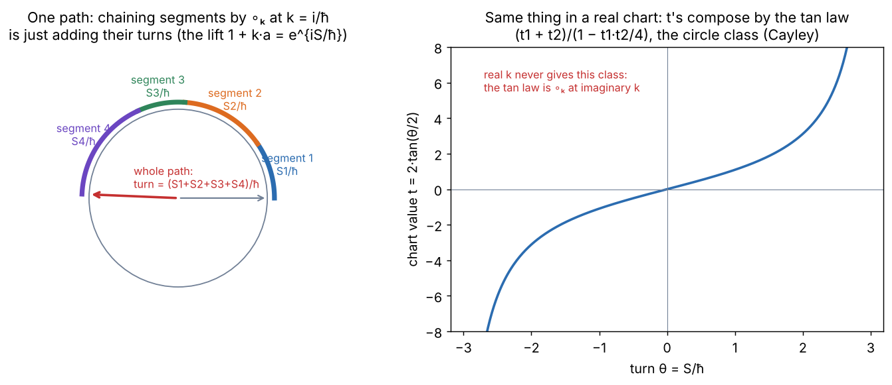
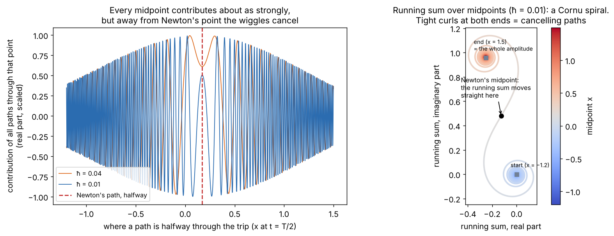
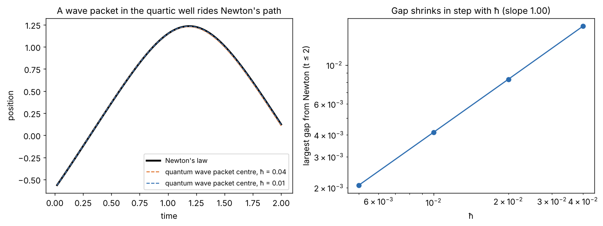
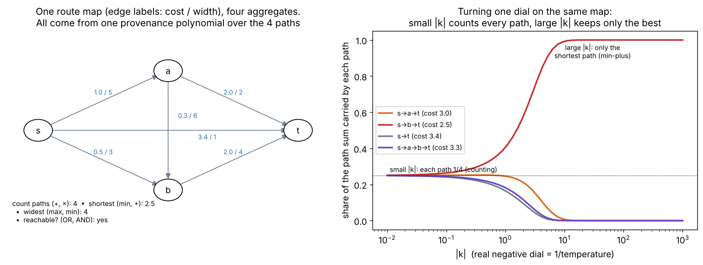
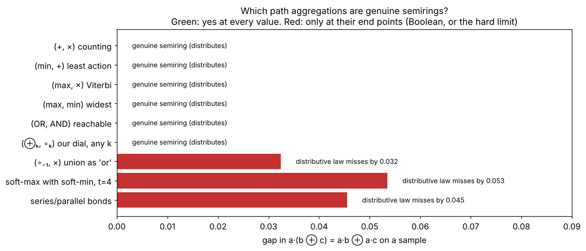
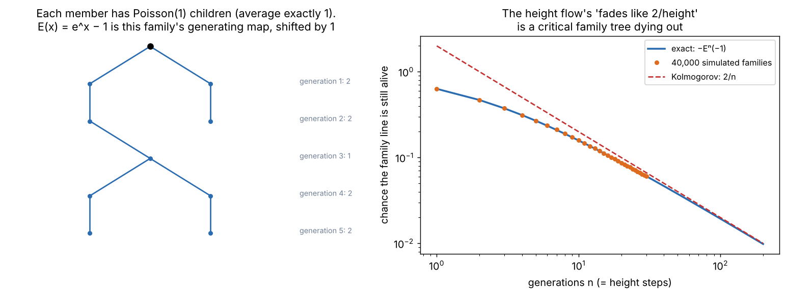
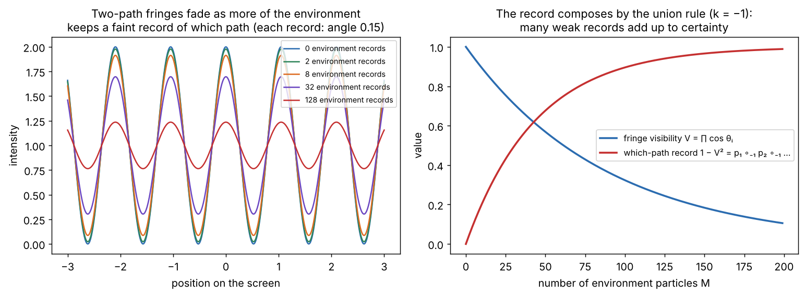
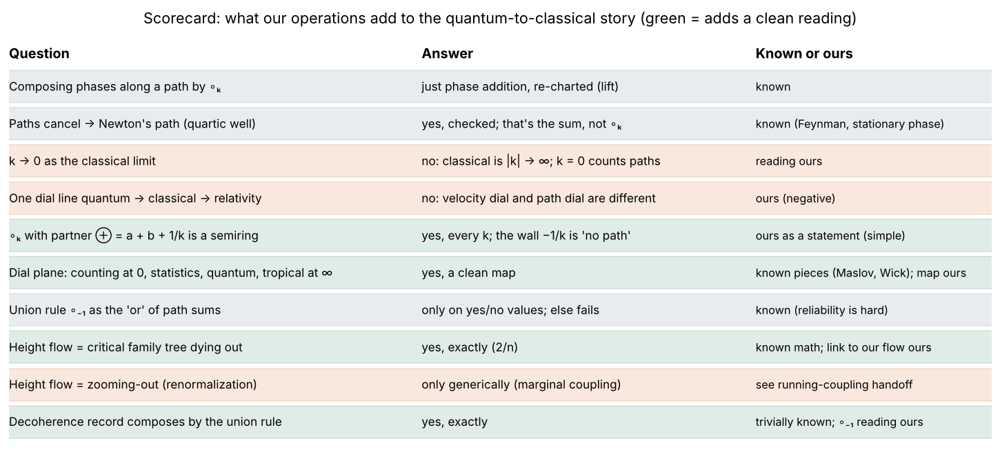

# DRAFT · How quantum paths add up to everyday laws, and path sums as database aggregates

Nov 25, 2026. Asked for by Brennan on a voice call ("is there any way to use our paths to show how the quantum
mechanical effects aggregate into real world sized laws"), then widened with his yes to path sums as aggregate
functions ("is this already a whole branch of math?"). Checks: `checks.py` → `checks_output.txt`, **36/36 pass**
(numpy, scipy, sympy). Pictures: `figures.py` → `figures/`. Pushed to the repo Nov 25 as a DRAFT so it isn't lost; CI runs `checks.py`.

Builds on, and does not repeat: `why-i/` section 5 (a chain of steps is a product integral; Feynman's case is the dial
k = −i/ħ; Wick rotation as a turn of the dial), `why-i/e-i-pi/chain-resolves/` (stationary phase for the oscillator,
Morse index, Maslov phase), `combinatorics/` (E twice = Bell numbers), `operations-catalog/` (rescale → Maslov's
tropical limit), `height-running-coupling/HANDOFF.md` (the height flow is a generic marginal running coupling).

## The answer in plain words

Our operation does the bookkeeping along each path, but the canceling that turns quantum paths into Newton's laws
happens in the *sum over paths*, which is ordinary addition. So ∘ₖ adds no new physics to the quantum-to-classical step.
What it does add is a clean map of the whole family of "path aggregates": one dial whose ends are counting, least action
(shortest path), most-likely path, quantum amplitudes and statistical weights. The surprise on the dial: the classical
world sits at |k| → ∞, not at k = 0, so there is no single dial line from quantum through classical to relativity.

Leads worth following, on their own merits: **the dial-plane map (section 4)** is a tidy, correct way to place the
tropical, statistical and quantum path sums on one picture, useful for the write-ups and the 1.0 story; **the height
flow is a critical family tree (section 5)**, which gives the "fades like 2/height" law a concrete population reading.
Neither is a route to new physics.

## 1. Along one path, ∘ₖ is just adding turns

- Give each short segment the weight e^{iS/ħ}. With the dial k = i/ħ and a = (weight − 1)/k, chaining segments by ∘ₖ gives
  exactly e^{i·(total action)/ħ} (check A1). This is the lift 1 + k·a at work: it turns ∘ₖ into multiplication.
- In the action coordinate, a = E(k·s)/k with E(x) = eˣ − 1, the height-flow map, and ∘ₖ becomes plain + on actions (A1b).
- **Correction to the brief.** Real k > 0 is *not* the circle or tan-law side: for real k the law is always in the line
  class (discriminant k² > 0, A3). The tan law (t₁ + t₂)/(1 − t₁t₂/4) for t = 2 tan(θ/2) is ∘ₖ at *imaginary* k seen
  through the slide x ↦ x/(1 + (k/2)x), which is the Cayley map (A2, A2b).
- *Known:* phases add (de Moivre); the circle class and the Cayley chart (Coleman–McGuinness 1991, already cited on the
  operations-catalog page).

## 2. Summing over paths: the canceling picks Newton's path

Test system: a quartic well V = x²/2 + 0.5x⁴ (not Gaussian, so stationary phase is not exact), from x = −0.6 to
x = 0.9 in time 0.8. The quantum side is computed with no classical input: a split-step chain (the ∘ₖ chain on the
weights) carries narrow starts forward from each end, and the overlap at the halfway time gives the contribution of
every path through each midpoint.

- The phase of those contributions is stationary exactly at Newton's midpoint 0.17212 (found independently by shooting
  with Newton's law), at ħ = 0.08, 0.04, 0.02, 0.01 (B1, offsets ≤ 4·10⁻⁵).
- The phase curvature grows like 1/ħ (curvature·ħ = 4.58 at all four ħ), so the strip of paths that matter narrows
  like √ħ (B2). A strip of ±3√ħ gives the whole amplitude to within 10% (B3).
- **The canceling, in numbers (B5):** at ħ = 0.01 the strips either side of Newton's point carry contributions about 90%
  as large as at Newton's point, yet each nets about 3% of the answer. The middle strip nets 101%.

- **Ehrenfest (B4):** a minimal wave packet launched along Newton's path stays on it; the largest gap over t ≤ 2 shrinks
  in exact step with ħ (slope 1.003).
- **Is ∘ₖ just a rewrite of phase addition here?** Yes. All of the canceling is in the + of the sum over paths.
- *Known:* Feynman 1948, Feynman–Hibbs 1965; stationary phase (Kelvin, Stokes); WKB; Ehrenfest 1927. *Ours:* nothing
  beyond this non-Gaussian numerical check.

## 3. The homothety dial k (the k dial): ħ-like and 1/c²-like are two different dials

- In relativity, ∘ composes *velocities*, the dial is −1/c², and Galilean physics is k → 0 (C4).
- In path sums, ∘ composes *weights*, the dial is i/ħ, and classical physics is ħ → 0, which is **|k| → ∞** (C2, C3, B2).
- k = 0 on the path dial is ħ → ∞: every path weighs 1, nothing cancels, and the path sum just **counts paths** (C1, C5).
- So there is no single dial line quantum → classical → relativistic. Classical sits at k = 0 on one dial and at
  infinity on the other. A relativistic quantum particle needs both dials at once (velocity and weight), set
  independently.
- *Ours (negative result):* the two readings of k are different quantities composed, not one dial.

## 4. Path sums as aggregates: the database view (his widened question)

Brennan's database picture is exactly right and is a whole branch of math. A path sum is "multiply along each path,
aggregate over paths" (a GROUP BY over paths), and the rules it needs are a **semiring**: an "and" (⊗, along a path) that
distributes over an "or" (⊕, across paths). Swap the pair and the same computation answers a different question.

| Pair (⊕, ⊗) | Question it answers | Name and source |
|---|---|---|
| (+, ×) | how many paths, total probability | counting / probability |
| (min, +) | least action, shortest path | tropical; Bellman–Ford, Dijkstra |
| (max, ×) | most likely path | Viterbi 1967 |
| (max, min) | widest bottleneck | Pollack 1960 |
| (OR, AND) | is there any path | Boolean, Warshall 1962 |
| (log-sum-exp, +) | soft shortest path at a temperature | log semiring; Maslov dequantization |
| (+, ×) on complex phases | quantum amplitude | Feynman path integral |

All pass every semiring axiom (D4). The general theory is the **algebraic path problem** (Carré 1971; Gondran and
Minoux, *Graphs, Dioids and Semirings*, 2008; Mohri 2002). In databases it is **provenance semirings** (Green,
Karvounarakis and Tannen, PODS 2007): compute one polynomial over the paths and every aggregate is an evaluation of it
(D7 does this on the route map: count 4, shortest 2.5, widest 4).

### Is ∘ₖ one dial that slides between them?

- **∘ₖ has a partner "or" that makes a genuine semiring at every k:** a ⊕ₖ b = a + b + 1/k, with ⊗ = ∘ₖ (D1, checked
  at eight real and complex k). Its zero ("no path") is the wall −1/k and its one is 0. The lift carries it to ordinary
  (+, ×) (D2), so every finite k is the *same* arithmetic re-charted.
- Pulled back to actions by a = E(ks)/k, ⊕ₖ is log-sum-exp at temperature 1/|k| (D6). That is Maslov's family.
- **New rules appear only at the ends:** k = 0 counts paths; k → −∞ gives min-plus (least action); k → +∞ gives
  max-plus (Viterbi after a sign flip); k along the imaginary axis is quantum, and its far end is stationary phase,
  which picks Newton's path (sections 2 and 3). The real negative axis is statistics, and Wick rotation is the 90° turn
  between the two (why-i section 5).
- **What the dial cannot reach.** Bottleneck (max, min) and Boolean need a second softened operation, and every
  in-between value fails distributivity (D5). The union rule ∘₋₁ used as the "or" with × as the "and" distributes only
  on yes/no values, where it is OR/AND (D3). That failure is the known reason network reliability is hard to compute
  (Valiant 1979; Provan and Ball 1983): paths share edges, so their successes are not independent.

- *Known:* every pair in the table; Maslov dequantization and idempotent analysis (Litvinov and Maslov; Litvinov 2005);
  Viterbi as a tropicalization (Pachter and Sturmfels 2004). *Ours:* writing the whole family as ∘ₖ with its partner
  ⊕ₖ (the wall as "no path"), and the dial-plane map with counting at 0 and the classical world on the ring at infinity.
  The semiring itself is transport of structure, so it is certainly implicit in the literature; the map is the useful part.

## 5. Zooming out: the height flow is a critical family tree

- E(x) = eˣ − 1 is the Poisson(1) offspring generating function e^{y−1}, shifted by one (x = y − 1). Each height step
  is one generation. So **Eⁿ(−1) = −(chance a family line survives n generations)**, exactly (E1, n up to 2000), and the
  height flow's "fades like 2/height" is Kolmogorov's 1938 law for a critical tree, 2/(σ²n) with σ² = 1 (E2;
  simulation agrees, E3).
- Two heights is a set of nonempty sets: Bell numbers, the GROUP BY of a set (E4; already on the combinatorics page).
  So Brennan's "aggregate over a set of a set" is literally rung 2 of the height flow.
- Fractional heights: the half-height E^{1/2} has coefficients of both signs (1/4, 1/48, 0, 1/3840, −7/92160, …; E9)
  and a divergent series (Baker 1958), so no plain continuous-time family-tree reading is claimed.
- **Renormalization.** The 1-D Ising chain's own zoom-out is linear (u = −ln tanh K doubles per 2× zoom, E8), not
  E's marginal fade. Bonds in parallel combine their tanh values by **relativistic velocity addition**, bonds in series
  multiply them (E5, E6), and the two do not distribute (E7: they are different networks). The height flow matches
  renormalization only in the generic way the running-coupling handoff found.
- *Known:* branching processes and iterated generating functions (Harris 1963; Athreya and Ney 1972); Kolmogorov 1938;
  decimation (Kadanoff 1966; Wilson 1971; Nelson and Fisher 1975); Curtright and Zachos 2011 for RG as functional
  iteration. *Ours:* the identification of the project's height flow with the critical Poisson tree.

## 6. Decoherence: the which-path record composes by the union rule

- If path 2 nudges each environment particle so its overlap with the path-1 state is cos θᵢ, fringe visibility is
  V = ∏ cos θᵢ (F2, brute-force 64-dimensional check), and the which-path record **1 − V² = p₁ ∘₋₁ p₂ ∘₋₁ …** with
  pᵢ = sin²θᵢ, exactly (F1). Many weak records add up to certainty, like the union of many small chances (F3).
- When V = 0, probabilities add instead of amplitudes (F4): the (+, ×) semiring on amplitudes has become the (+, ×)
  semiring on probabilities. That is the aggregation step from quantum to classical bookkeeping.
- *Known:* Joos and Zeh 1985; Zurek 2003 (*Rev. Mod. Phys.* 75, 715). *Ours:* the union-rule reading.

## 7. Scorecard

## Known work used

Feynman 1948; Feynman and Hibbs 1965; stationary phase (Kelvin 1887); WKB (1926); Ehrenfest 1927; Wick 1954;
Kac 1949; Joos and Zeh 1985; Zurek 2003; Kadanoff 1966; Wilson 1971; Nelson and Fisher 1975; Curtright and Zachos,
*Phys. Rev. D* 83, 065019 (2011); Kolmogorov 1938; Harris 1963; Athreya and Ney 1972; Baker 1958; Carré 1971;
Gondran and Minoux 2008; Mohri 2002; Green, Karvounarakis and Tannen 2007; Viterbi 1967; Pollack 1960; Warshall 1962;
Litvinov and Maslov (idempotent mathematics; Litvinov 2005); Pachter and Sturmfels 2004; Valiant 1979; Provan and
Ball 1983; Coleman and McGuinness 1991. Citations are from memory except those already checked on the why-i,
operations-catalog and running-coupling pages; check before any paper.

## Files

- `checks.py` → `checks_output.txt` (36/36), `results.json`
- `figures.py` → `figures/fig1` … `fig9`

Polish (Nov 26): the stationary points in B1 were re-found with a cubic plus Newton instead of linear interpolation on the grid; they moved by at most 1.2·10⁻⁹, so "offsets ≤ 4·10⁻⁵" is confirmed (4.0·10⁻⁵ → 4.0·10⁻⁵). The offsets fall by a factor 4.00 each time ħ halves, so they are a real ħ² shift of the stationary point, not grid error. Cost 2.7 s of CPU (`polish.py`, `polish_output.txt`).
