# Similarity-ratio survey: which proved laws slide into one another (DRAFT)

**DRAFT, Nov 26 2026.** Part of Affine Composition Theory (repo: fused-hyperoperation-algebra).
Asked for by Brennan: "I'd like similar surveys for the other dials as well", after the shape-dial survey, whose ask was
"a survey of all of our laws that we've proven to see if the shape dial is able to move from one to another, not just
these 2, but really all of them", then "check all laws using the shape dial to see if a new law emerges and what it
might be for", and "add a polishing step to all of our methods, as long as it doesn't take too much effort from the
computer". This page does the same for **the similarity ratio r**.

The dial: a piece is a shrunken copy of the whole, a homothety with ratio r ([`affine-names/`](../affine-names/) §6).
Ratios multiply down a tree. The dimension D is a reading: it solves Moran's equation Σ rᵢᴰ = 1. I turned r two ways:
(a) all N pieces together, so D = log N / log(1/r), and (b) one piece alone.

Checks: `checks.py` → `checks_output.txt`, **45 of 45 pass** (numpy, scipy, sympy, mpmath), including 2 polish checks at
30 digits that cost **0.7 seconds** together. Law list: `laws.py` → `laws.json`. Pictures: `figures.py` → `figures/`.
No new Lean in this pass. Colour key: **blue = our reading, orange = already known, grey = endpoints and background.**

## The result

I sorted the 65 law groups of [`dial-catalog/`](../dial-catalog/) by what turning r does, with every other dial held still:

- **3 groups slide** into another proved law: powers into fractional boxes, fractional boxes along D, and Kraft's sum
  into Moran's wall.
- **2 groups survive on part of the dial:** the two-piece dust (fine up to r = 1/2, then the pieces overlap), and the
  capped-copies ladder behind Stefan–Boltzmann's 7/8 (it counts something only at r = 1/2, 1/3, 1/4, ...).
- **1 group is plausible:** Rényi entropy carried into the Rényi dimension.
- **4 groups are another dial in disguise:** the core law and corner expansion (the k dial), thermodynamics (the
  temperature), and the two-loop flows (the curvature dial d).
- **1 group is the dial itself** (the zoom dial, which sits in group 4).
- **54 groups don't depend on r.** They are plane-dial or shape laws, or they have no piece with a size to turn.

The leads, conclusion first:

1. **The weight rᴰ is not a k slide at the true dimension (C3).** At a fixed trial exponent s, rˢ really is the
   homothety k (the library's `circK_scale`). But at the Moran dimension every piece weighs exactly 1/N however r is
   turned, so k does not move at all. Turning one piece alone moves the weights around the simplex instead: that is the
   odds dial, not k. This sharpens a sentence in `affine-names/` §6 ("the weight rᴰ acts as the homothety dial k"),
   which is true only at a fixed s. Worth fixing in the wording; it is not a new result.
2. **Kraft's sum slides into Moran's wall (C4, slides).** The library proves every full binary tree has Kraft sum 1
   (`kraft_one`, ratio 1/2) and every uniform-depth word list weighs 1 at Moran's D (`wall_every_depth`). One
   statement holds both: give every branch its own ratio, and every full tree weighs 1 at Moran's D. Checked on 40
   random trees and 5 ratio pairs. The proof is `kraft_one`'s induction with 1/2 replaced by rᵢᴰ. Small and clean;
   worth adding to Lean. I did not find it stated in my search, but it is close to folklore.
3. **Box layers slide with D (C2, slides).** Newton's layers C(D, k) carry the cube (D = n) into the half box
   (D = 1/2) and every D between, exactly. New reading: the "Moran box" of side 1/r holds exactly N pieces, but its
   layer sum converges only when r ≥ 1/2. Tidy; mostly known.
4. **Stefan–Boltzmann's 7/8 is the first stop of a ratio ladder (C5, partly).** Capping copies at m leaves the same
   set at size m + 1, a copy at ratio r = 1/(m + 1). The share it takes is r^β: 1/8 at r = 1/2 in space (the 7/8),
   1/27 at r = 1/3, and so on to 0 (Bose). Gentile's statistics (1940) are known; this ratio form is a two-line
   consequence I did not find stated. Modest.
5. **Two pieces (C1, partly)** and **the clock (C6, disguise)** are known structure, sorted here.
6. **Fractal strings and the Riemann hypothesis (lead 4): the repo does not touch it.** The zoom dial has complex
   dimensions, the poles of 1/(1 − Σ rᵢˢ). Nothing in the repo reaches Lapidus and Maier's 1995 link between the inverse
   spectral problem for fractal strings and the Riemann hypothesis. A plain negative.

**New laws at in-between settings (section N).** Five laws appear only at special in-between ratios. None is new
mathematics. Two give our existing results a picture they lacked: **two pieces at ratio 2^(−1/D) are a box of dimension
D**, and at D = 2 the natural measure is literally the square seen edge-on (Wintner 1935); and **two half boxes join
into a stick only from one direction**: the four-corner set's shadow along (2, 1) is the whole segment, along (1, 1) a
dust of dimension log 3/log 4 (both proved here by splitting digits). The others: the sum set C_r + C_r becomes an interval
exactly at r = 1/3, the Cantor set; golden and tribonacci ratios drop the measure's dimension below 1 through exact
overlaps (I recompute 0.99571 and 0.98041, matching the literature); and turning one piece alone flips between lattice
and non-lattice on a dense set of ratios.

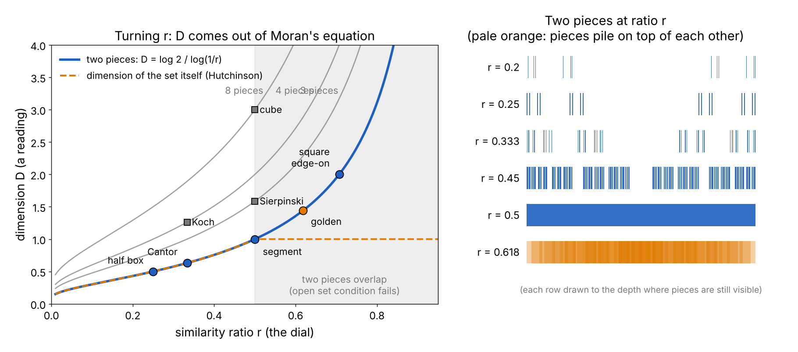

*Figure 0. Left: the dimension D that comes out as r is turned. Blue is two pieces; grey curves are 3, 4 and 8 pieces.
Proved stops: half box (r = 1/4), Cantor (1/3), segment (1/2), Sierpinski and the cube (r = 1/2), Koch (1/3). Past
r = 1/2 two pieces overlap. The set is then the whole segment (orange dashes), and D stops being its dimension. Right: the
pieces themselves at six ratios.*

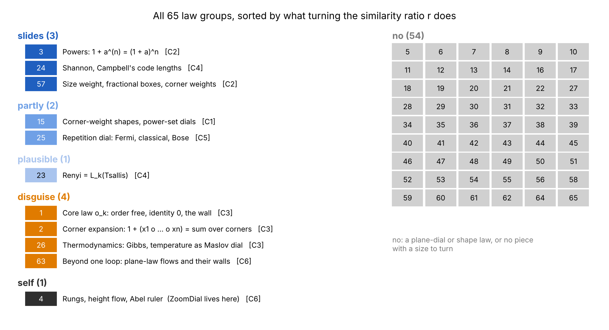

*Figure 1. All 65 groups, sorted by verdict. The candidate section for each is in brackets.*

---

## How I tested a slide

For each group I asked whether a piece with a size enters its proof. If it does, I turned r with everything else held,
uniformly and one piece alone, and followed what moves. A link counts as **slides** when both ends are proved (Lean or
a checked page) and the quantity that carries one into the other is checked along the whole path. Where a closed form
exists, the check is exact. **Partly** means it holds on part of the dial only. **Disguise** means the move is really
another dial. **Plausible** means the numbers slide but the law in between isn't proved in the repo.

One fact is used everywhere. With N equal pieces, Moran's equation is N rᴰ = 1, so D = log N / log(1/r). It is a
reading of r, never an input.

---

## C1. Two pieces: half box, Cantor, segment, then overlap (partly)

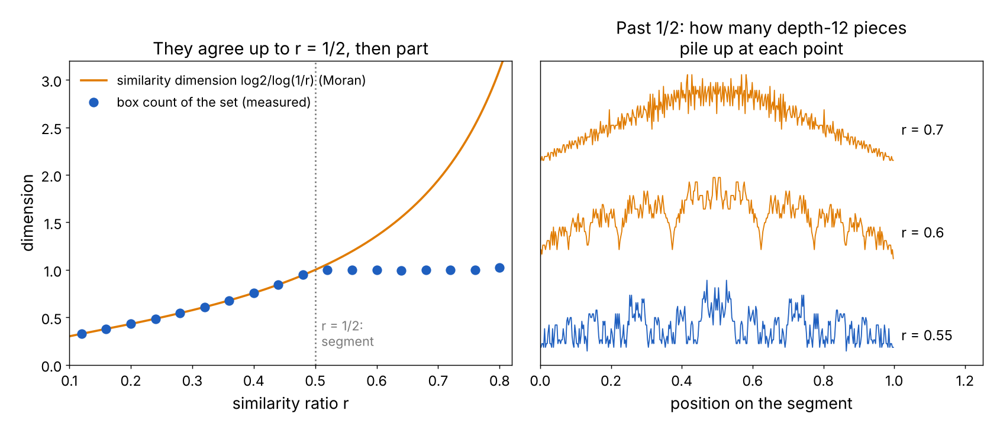

*Figure 2. Left: Moran's similarity dimension (orange) and the measured box count of the set (blue dots). They agree up
to r = 1/2 and part after it. Right: past 1/2, how many deep pieces pile up at each point of the segment.*

- **Both ends:** the half box (two pieces at 1/4, D = 1/2; `FractalDials.half_dimension_certificates`), the Cantor set
  (two at 1/3, D = log 2/log 3; `affine-names` check R1) and the segment (two at 1/2, D = 1; `ZoomDial.half_box_walls`).
- **Formula along the dial:** D = log 2 / log(1/r), matched by Moran's root at 49 settings (A1, A2).
- **Where it breaks:** the gap between the two pieces is 1 − 2r (A3). Below 1/2 the box count matches D (0.5000 at
  r = 1/4, 0.757 at r = 0.4; A4). Above 1/2 the set is the whole segment. Its box slope is 1, while Moran gives 1.357 at
  r = 0.6 (A5).
- **Known:** Moran (1946) for the equation; Hutchinson (1981) for the open set condition, under which D is the
  Hausdorff dimension. That condition fails exactly past r = 1/2 here.
- **Ours:** nothing beyond the placement. The other piece counts slide the same way (B1, B2): Sierpinski log 3/log 2,
  Koch log 4/log 3, the n-cube's D = n log 2/log(1/r).
- **Verdict: known structure, correctly sorted.** The interesting part is past 1/2, where the set stops changing but
  its natural measure doesn't (section N4).

## C2. Box layers slide with D (slides)

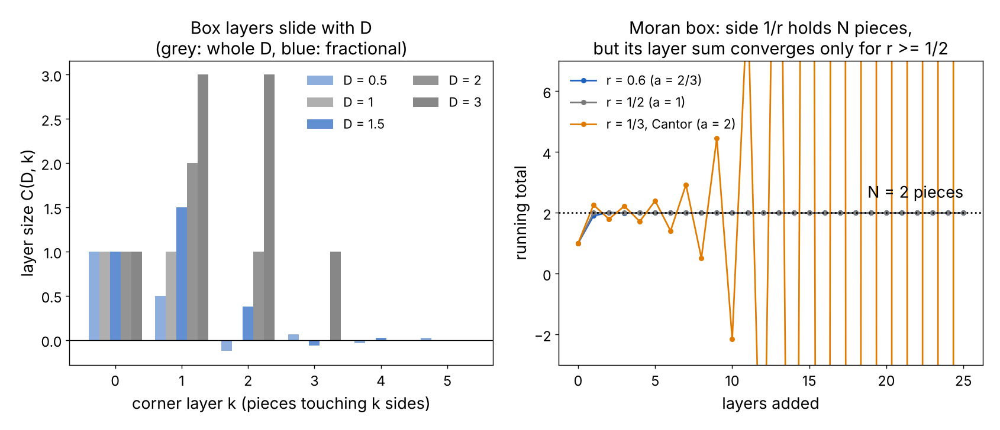

*Figure 3. Left: corner layers C(D, k) for D = 1/2, 1, 3/2, 2, 3. Fractional D gives negative layers from k = 2 on.
Right: the Moran box of side 1/r. Its layers add to N = 2 when r ≥ 1/2. At the Cantor ratio 1/3 they swing apart,
though (1/r)ᴰ = 2 still holds as a number.*

- **Both ends:** the cube's Pascal layers (`FractalBoxes.cube_layers`, Base's powers (1 + a)ⁿ) and the half box's
  1, 1/2, −1/8, 1/16, −5/128, 7/256 (`half_layers`). Checks L1, L2.
- **What turns:** with N = 2ⁿ pieces fixed, turning r moves D = n log 2/log(1/r), and the layers C(D, k) move with it.
  Newton's binomial (1 + a)ᴰ = Σ C(D, k) aᵏ carries them exactly. Polished to 30 digits at five D and two a: error
  8e-31 (L3, 0.2 s).
- **Joining:** at a common ratio, joining adds D. Two half boxes (2 at 1/4) make 4 at 1/4, D = 1. That is
  `half_join_stick` read as Moran. Three 1/3-boxes (2 at 1/8) make 8 at 1/8, D = 1 (`third_join_stick`). A 1/2-box and
  a 3/2-box make a square (`half_and_three_halves`). Checks L6, L7. At unequal ratios the product isn't self-similar,
  so this reading needs a common ratio.
- **Ours (a reading, checked):** the **Moran box**. Give a box of dimension D the side 1/r. Then (1/r)ᴰ = N exactly
  (L4). Its layer series Σ C(D, k)(1/r − 1)ᵏ converges only for r ≥ 1/2. At the Cantor ratio the terms grow like 2ᵏ
  (L5). So the corner-layer picture of a self-similar set works on the overlap side of the dial and fails on the
  dust side. The convergence fact is Newton's and Abel's; the reading is ours.
- **Verdict: tidy, mostly known.** Worth a line in `fractal-boxes/`: the box number 2ᴰ is the piece count of two
  pieces at ratio 2^(−1/D) (section N1).

## C3. The weight rᴰ: a k slide only at a fixed exponent (disguise)

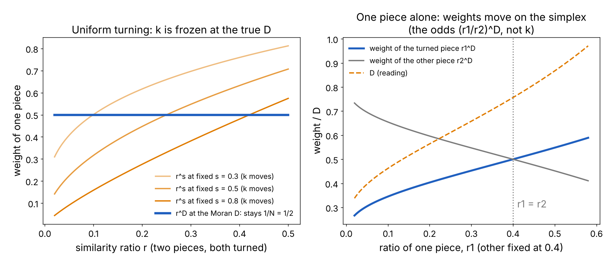

*Figure 4. Left: at a fixed trial exponent s the weight rˢ moves with r (orange; this is k moving), but at the Moran
dimension it stays at 1/N (blue). Right: turning one piece alone keeps the two weights on the simplex (they add to 1)
and trades weight between them.*

- **Known (orange):** a weight w gives w(t ∘_w u) = (wt) ∘₁ (wu). This is `circK_scale` in Base, used as
  `ZoomDial.zoom_is_twist` and `SizeDialResidual.weight_is_twist` (W1). The weights rᵢᴰ are the natural measure of the
  set. Moran's equation says the free energy is zero: Bowen's equation (1979), the soft maximum of log rᵢ at
  temperature 1/D is exactly 0 (W5).
- **Ours (blue):** three readings, all checked.
  - **Uniform turning freezes k.** At the Moran dimension every piece weighs rᴰ = 1/N whatever r is (W2, 90 settings).
    So the uniform r dial moves only the reading D. The weight that acts as k never moves.
  - **At a fixed s, rˢ is k.** Only when the exponent is held at a trial value s does turning r move the weight (W3).
    That is the k dial in disguise. Affine-names' check R3 is this case.
  - **One piece alone moves the odds.** The weights stay on the simplex. Their odds are (r₁/r₂)ᴰ, and the chance
    t/(1 + t) is the weight (W4). That is the odds dial t, not k.
- **The word series** of the zoom dial (all depths, weight 1/(1 − x) with x = Σ rᵢˢ) is the k = −1 element. It hits its
  wall exactly at s = D (W6). Turning r at fixed s moves x, which is that element's odds.
- **Verdict: a useful negative.** "The weight rᴰ acts as k" is true at a fixed s and false at the true dimension.
  `affine-names/` §6 should say which. Groups 1 and 2 (core law, corner expansion) are the k dial in disguise; group 26
  (thermodynamics) is the temperature in disguise.

## C4. Kraft's sum slides into Moran's wall; Rényi entropy into Rényi dimension (slides; plausible)

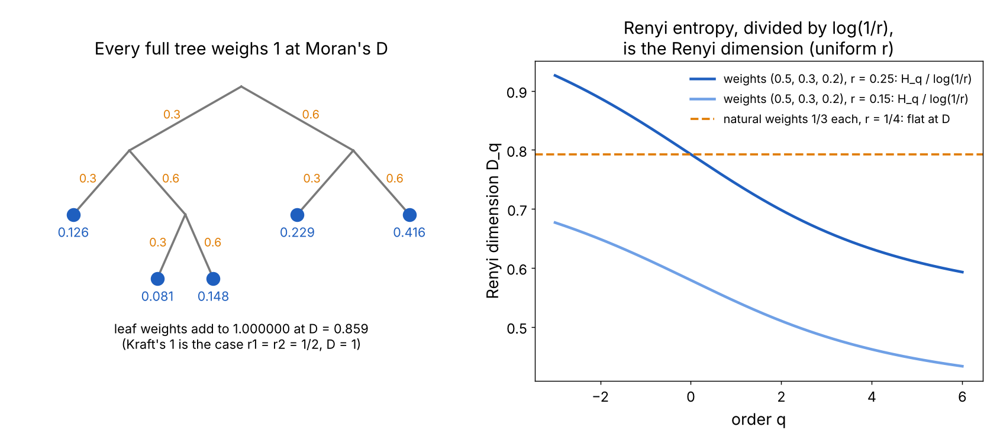

*Figure 5. Left: a full binary tree whose left branches have ratio 0.3 and right branches 0.6. At Moran's D = 0.859 its
leaf weights add to exactly 1. Kraft's sum is the case where both ratios are 1/2 and D = 1. Right: Rényi dimensions of a
uniform-ratio measure are Rényi entropies divided by log(1/r). Natural weights make them flat at D.*

- **Both ends (slides):** `InformationFull.kraft_one` (every full binary tree has Kraft sum 1) and
  `ZoomDial.wall_every_depth` (all depth-n words weigh 1 at Moran's D). Check K1 re-proves `kraft_one` on 40 random
  trees in exact fractions.
- **The law in between:** give left and right branches their own ratios r₁, r₂. Then every full tree weighs
  Σ over leaves of Π rᴰ = 1 at the Moran D, and not at D + 0.1 (K2: 5 ratio pairs × 40 trees). The induction is
  `kraft_one`'s with 1/2 replaced by rᵢᴰ, so it is a few lines of Lean. With c + 1 branches at ratio 1/(c + 1) it gives
  D = 1 for every c (`dary_full`'s tree; K3).
- **Rényi (plausible):** at a uniform ratio the Rényi dimension is D_q = H_q(p)/log(1/r), exactly (K4). Natural
  weights pᵢ = rᵢᴰ make every D_q equal D (K5). With unequal ratios the multifractal formalism takes over:
  Σ pᵢ^q rᵢ^(−τ) = 1, τ(0) = −D, τ′(1) = the information dimension (K6, Cawley–Mauldin 1992). The repo's Rényi law
  (group 23) is proved; the multifractal law between is not, so this is plausible.
- **Known:** Kraft (1949), McMillan (1956); Moran (1946); Hentschel–Procaccia (1983), Halsey et al. (1986),
  Cawley–Mauldin (1992).
- **Ours:** the one statement that holds `kraft_one` and `wall_every_depth` both. Not found stated in my search (queries
  below); it is close to folklore, since a prefix code is a self-similar tree.
- **Verdict: worth adding to Lean.** It is small, it joins two proved modules, and it costs little.

## C5. The capped-copies ladder: Stefan–Boltzmann's 7/8 at r = 1/2 (partly)

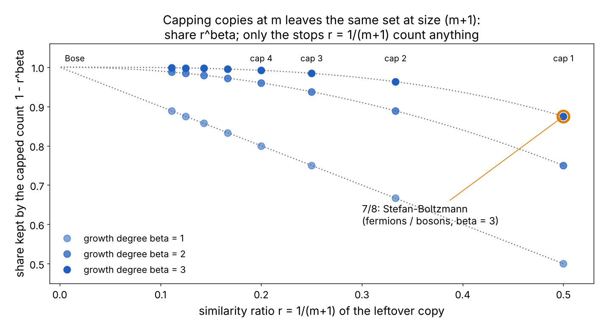

*Figure 6. The share 1 − r^β kept by a count capped at m copies, at r = 1/(m + 1), for growth degree β = 1, 2, 3. The
first stop at β = 3 is Stefan–Boltzmann's 7/8. Dotted lines join the stops; between stops nothing is counted.*

- **Both ends:** "at most once" leaves the same set again at double size, share 2^(−β) (`SizeDialResidual.alt_doubling`,
  `at_most_one`; `affine-names` check B2). Unlimited copies (Bose) leave nothing. `at_most_m` proves the cap identity
  (1 − x)(1 + … + x^m) = 1 − x^(m+1) (G1). `repetition-dial/` already notes that a cap of m is "an any-number element
  at size 1 divided by one at size m + 1" (Gentile 1940).
- **What turns:** the leftover is the same set at size m + 1, a copy at ratio r = 1/(m + 1). The growth degree β is a
  setting. The share is r^β, so the capped count keeps 1 − r^β. Polished to 30 digits for β = 1, 2, 3 and m = 1, 2, 3:
  error 1e-31 (G2, 0.3 s). Energy density in space: 7/8, 26/27, 63/64 (G3). Dirichlet form:
  Σ (1 − m[m | n]) n^(−s) = (1 − m^(1−s)) ζ(s), so m = 2 is η (G4).
- **Where it breaks:** only r = 1/2, 1/3, 1/4, ... count anything. Between them the integral identity still holds, but
  no occupancy rule gives it. Hence partly.
- **Known:** Gentile (1940) for the statistics; the 7/8 is textbook. **Ours:** the ratio form 1 − (m + 1)^(−β). It is a
  two-line consequence, and I did not find it stated in my search.
- **Verdict: modest.** It tells you the 7/8 is one stop on a ladder of ratios. That is honest and small. Where the
  growth degree meets r is exactly here: the doubling weight 2^(−β) is ratio 1/2 at D = β (`ZoomDial.halving_weight`).

## C6. The clock: rungs and the height flow (self; disguise)

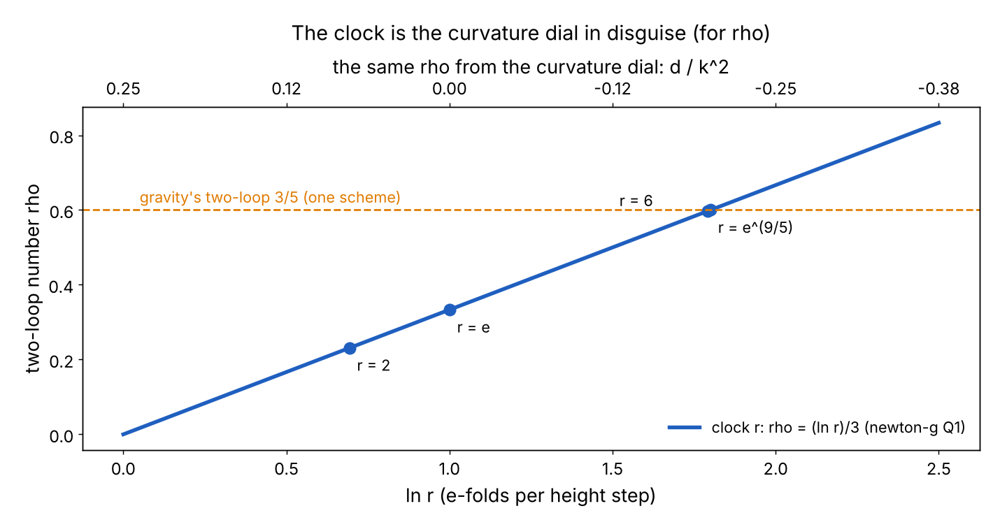

*Figure 7. If one height step multiplies the energy scale by r, the two-loop number of the height flow is (ln r)/3
(blue; newton-g check Q1). The top axis gives the curvature setting d/k² that produces the same ρ.*

- **Group 4 is "self"** because the zoom dial (`ZoomDial`) sits in it. The rung laws in the same group meet r only as
  the clock of the flow.
- **The clock is d in disguise for ρ:** ρ = (ln r)/3 equals the plane law's ρ = 1/3 − 4d/(3k²) at d = k²(1 − ln r)/4,
  for every k (T1; `newton-g/` check P8 has the case k = 1). The parabola d = k²/4 gives ρ = 0 for every clock, the only
  clock-free value (T2; newton-g Q4). Group 63 (two-loop flows) is therefore the curvature dial in disguise.
- **Known:** the renormalization-group fact that ρ = b₁/b₀² depends on the unit of RG time. **Ours:** already in
  `newton-g/` §7.3. This survey only sorts it.
- **Verdict: no new lead.** The fractional rungs and height flow use no similarity ratio of their own.

## Fractal strings and the Riemann hypothesis (lead 4, no)

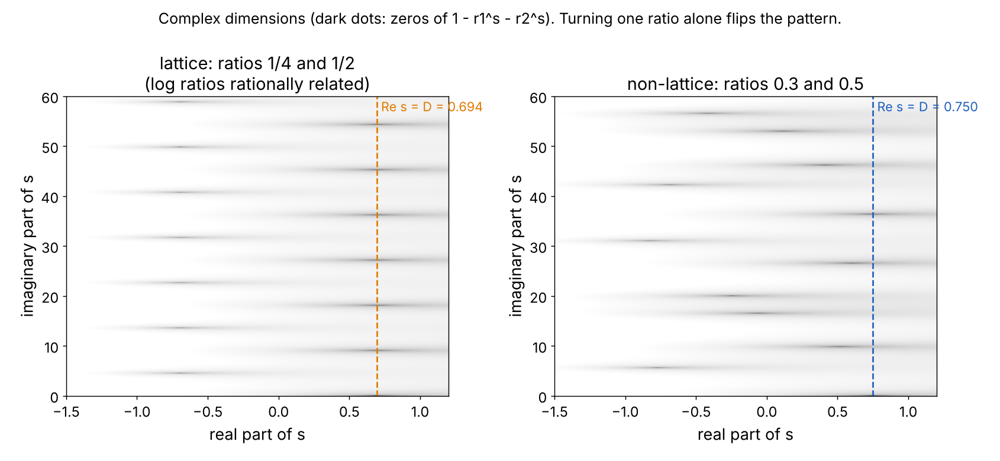

*Figure 8. Zeros of 1 − r₁ˢ − r₂ˢ, the complex dimensions. Left (lattice, ratios 1/4 and 1/2): a column on the line
Re s = D, every 2π/log 2. Right (non-lattice, 0.3 and 0.5): nothing on that line except D itself.*

- **What the repo has:** the zoom dial's complex dimensions, the poles of the word series 1/(1 − Σ rᵢˢ)
  (`zoom-dial/`, figure 3). They are Lapidus and van Frankenhuijsen's complex dimensions of a self-similar string.
  Checked here: the Cantor column D + 2πin/log 3 (Z1), the Cantor string's geometric zeta 1/(3ˢ − 2) (Z2), and
  Lapidus's factorization: the spectral zeta of a string is ζ(s) times its geometric zeta (Z3).
- **What it does not have:** anything about the Riemann zeta's zeros. Lapidus and Maier (1995) showed that the inverse
  spectral problem for fractal strings is solvable for every dimension D in (0, 1) other than 1/2 exactly when the
  Riemann hypothesis holds, and that it fails at D = 1/2. That needs the spectral zeta ζ(s)·ζ_L(s) and arbitrary strings,
  not self-similar ones, and nothing in `riemann/` or `zoom-dial/` touches it.
- **Verdict: a plain negative.** The repo touches fractal strings only through the complex dimensions of self-similar
  ones. I make no claim toward the Riemann hypothesis.

---

## N. New laws at in-between settings

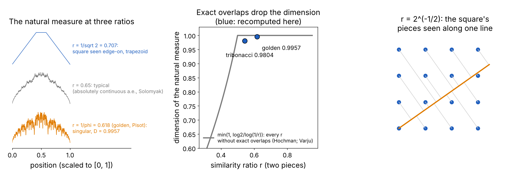

*Figure 9. Past r = 1/2 the set is always the segment, but its natural measure (each piece weighing 1/2) is not. Left:
the measure at the golden ratio is spiky, at 0.65 it is typical, and at 1/√2 it is a trapezoid. Middle: its dimension
is min(1, D) except where exact overlaps pull it down. Right: two pieces at ratio 2^(−1/2) are the pieces of a square,
seen along one line.*

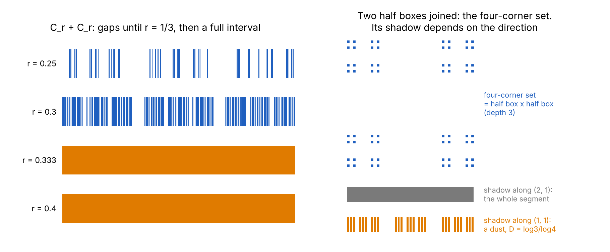

*Figure 10. Left: C_r + C_r has gaps below r = 1/3 and is a full interval from r = 1/3 on. Right: the product of two half
boxes is the four-corner set. Its shadow along (2, 1) is the whole segment; along (1, 1) it is a dust.*

**N1. Two pieces at r = 2^(−1/D) are a box of dimension D (proved).** Moran gives D directly (N1). At whole D = n the
natural measure is the n-cube seen along one line. Split the digits by their position mod n, and the sum
Σ εᵢ rⁱ becomes U₀ + r U₁ + … + r^(n−1) U_(n−1) with each Uⱼ uniform. At n = 2 its Fourier transform is
sinc(2ξ) sinc(√2 ξ), a trapezoid density (N2, checked at four ξ to 1e-9). *Known:* Wintner (1935) showed absolute
continuity at r = 2^(−1/n); Garsia (1962) extended it. *Ours:* the reading that the fractional box number 2ᴰ of
`fractal-boxes/` is the piece count of this two-piece system, a dust for D ≤ 1 and an overlapping shadow above.
*What it might be for:* a geometric home for the box ladder of C2 at every D.

**N2. Two half boxes join into a stick only from one direction (proved).** At r = 1/2 split the digits into even and
odd. The segment is exactly (2/3)·C₁/₄ + (1/3)·C₁/₄ (N3, exact at depth 6, 4096 points). But (1/2)(C₁/₄ + C₁/₄) has
only 3ⁿ points at depth n, because of an exact overlap. It is a dust of dimension log 3/log 4 = 0.79 (N4). So
`half_join_stick` (the layers of two half boxes add to a stick) is the four-corner set's shadow in direction (2, 1).
Along the diagonal the same product casts a dust. *Known:* the four-corner set and its zero Favard length
(`fractal-boxes/` finding 3); projections of such product dusts are studied in the literature (Kenyon 1997 for the
related one-dimensional Sierpinski gasket). *Ours:* the link to `half_join_stick`. *What it might be for:* it says the
box law's "join" is a choice of direction, which `fractal-boxes/` left implicit. Worth a Lean statement at finite depth.

**N3. The sum set of the dust becomes an interval exactly at the Cantor ratio (proved).** C_r + C_r is the self-similar
set with three maps, shifts 0, 1 − r, 2(1 − r). Its images cover [0, 2] exactly when 2r ≥ 1 − r, that is r ≥ 1/3
(N5: largest gap 0.1 at r = 0.3, none at 1/3 and 0.4). Below 1/3 it is a dust of dimension log 3/log(1/r). *Known:*
C + C = [0, 2] for the middle-third set is usually credited to Steinhaus (1917); Newhouse's thickness gives the general
criterion. *What it might be for:* a sharp stop on the dial, where adding two copies of the dust first fills a line.

**N4. Golden and tribonacci ratios: exact overlaps drop the measure's dimension (checked).** At r = 1/φ the relation
1 = r + r² makes pieces coincide. n digits give F(n + 3) − 1 distinct points, not 2ⁿ (N6). Counting with multiplicity
(Garsia's entropy) gives the natural measure's dimension 0.995713 (N7, 0.5 s). The tribonacci ratio 0.5437 gives 0.980409
(N8). *Known:* Erdős (1939), the measure is singular at every Pisot reciprocal; Alexander and Zagier (1991) computed the
golden value 0.9957; Grabner, Kirschenhofer and Tichy computed the tribonacci value 0.9804 (as quoted by Hare and Sidorov).
Solomyak (1995): absolutely continuous for almost every r in (1/2, 1). Hochman (2014): for algebraic r that is not a root of a polynomial with coefficients −1, 0, 1 (so no exact
overlaps), the dimension is min(1, log 2/log(1/r)); the folklore conjecture that only exact overlaps can lower it is
still open in general. Varjú (2019): dimension 1 for every transcendental r in (1/2, 1). *Ours:* only the
recomputation, which matches. *What it might be for:* the repo's exact-arithmetic style (integer vectors in ℤ[r]) is the
right tool. A check page could track these numbers, but the mathematics is settled where it is settled and hard where it
is open.

**N5. One piece alone: lattice or not, on a dense set of ratios (checked).** With two ratios r₁, r₂, the complex
dimensions form a column on Re s = D exactly when log r₁/log r₂ is rational. Otherwise only D sits on that line (Z4:
the non-lattice pair (0.3, 0.5) stays at least 0.01 from zero up to height 120). The lattice settings are dense and have
measure zero, so this law lives only at special in-between ratios. *Known:* Lapidus and van Frankenhuijsen; Falconer
(1995) on Minkowski measurability (non-lattice sets are Minkowski measurable, lattice ones are not); the repo's
`FractalDials.uneven_not_lattice` and the "wobbles / settles" column in `fractal-dials/`. *Ours:* nothing new.

**What turned up nothing.** I looked for an in-between law in the uniform N = 2 dial between 1/3 and 1/2 (beyond N3)
and found none: below 1/2 every ratio gives a homeomorphic dust (Brouwer), and the only stops are where an overlap or a
covering starts.

## Assumptions

- Self-similar sets here are attractors of maps x ↦ rᵢx + bᵢ on the line (and products of them). The open set
  condition is assumed wherever D is read as a Hausdorff dimension. It holds for two pieces exactly when r ≤ 1/2.
- "Natural measure" means each piece weighs 1/N, or rᵢᴰ when ratios differ.
- C5 assumes a mode count growing like X^β (growth degree β, a setting) and independent modes. The statistics apply
  only at whole m.
- C6 takes newton-g's definition of the clock (one height step multiplies the energy scale by r).
- **Numeric only:** A4, A5 (box counts at finite depth), K2 (random trees; a proof is an induction not yet written),
  K4 to K6, G2 to G4 (quadrature and partial sums, polished to 30 digits for G2), Z3 and Z4, N2 (Fourier product at four
  points; the digit split behind it is a proof), N5 (finite depth), N7 and N8 (entropy differences at depth 24 and 21).
  Exact: A1 to A3 in closed form, L1, L2, L6, L7, W1, K1, G1, N3, N4, N6.
- Polish cost: L3 and G2 at 30 digits took 0.7 seconds in all.

## Known vs new

| Item | Known (who, when) | Ours |
|---|---|---|
| D = log N/log(1/r), stops | Moran 1946; Mandelbrot 1977; Hutchinson 1981 (open set condition) | sorting only |
| Box layers C(D, k) | Newton's binomial series | the Moran box and its r ≥ 1/2 convergence boundary (a reading) |
| Weight rᴰ and k | `circK_scale` (Base); Bowen 1979 (pressure zero) | the weight is frozen at 1/N at the true D; one piece alone moves the odds |
| Kraft ↔ Moran | Kraft 1949, McMillan 1956, Moran 1946 | one statement holding `kraft_one` and `wall_every_depth` (not found stated) |
| Rényi dimension | Hentschel–Procaccia 1983; Halsey et al. 1986; Cawley–Mauldin 1992 | sorting only |
| Cap ladder | Gentile 1940; Stefan–Boltzmann 7/8 textbook | the share (m + 1)^(−β) = r^β read as a ratio (not found stated) |
| Clock | RG time units | already in `newton-g/` |
| Fractal strings, RH | Lapidus–van Frankenhuijsen 2000/2006/2013; Lapidus–Maier 1995 | the repo does not touch it |
| r = 2^(−1/n) a.c. | Wintner 1935; Garsia 1962 | box-ladder reading |
| Half boxes join by direction | four-corner set, Favard length 0 (in `fractal-boxes/`) | link to `half_join_stick` |
| C_r + C_r at 1/3 | Steinhaus 1917 (as usually credited); Newhouse thickness | none |
| Pisot overlaps | Erdős 1939; Alexander–Zagier 1991; Grabner–Kirschenhofer–Tichy; Solomyak 1995; Hochman 2014; Varjú 2019 | recomputed 0.995713, 0.980409 |
| Lattice / non-lattice | Lapidus–van Frankenhuijsen; Falconer 1995 | none |

**Searches run (Nov 26, 2026):** "Lapidus Maier 1995 Riemann hypothesis inverse spectral problem fractal strings";
"Alexander Zagier 1991 entropy infinitely convolved Bernoulli measure golden ratio dimension 0.9957"; "Varjú 2019 Annals
dimension of Bernoulli convolutions all transcendental parameters; Hochman 2014"; "Gentile statistics blackbody radiation
Stefan-Boltzmann ratio 1 - 1/(n+1)^3 maximum occupation"; "Gentile statistics photon gas energy density ratio 7/8
generalization"; "Kraft inequality Moran equation similarity dimension prefix code self-similar set"; "middle Cantor set
sum C+C interval iff ratio at least 1/3 Steinhaus 1917 Newhouse thickness"; "Garsia 1962 Bernoulli convolution
absolutely continuous 2^(-1/k); Erdős 1939 Pisot singular; Solomyak 1995". The search corrected one attribution: the
2^(−1/n) case is Wintner's (1935), with Garsia (1962) extending it. Neither the Gentile ratio form nor the Kraft–Moran
statement turned up; that is "not found in my search", not "not in print". I did not retrieve Steinhaus's 1917 paper.

## Sources

- P. A. P. Moran, Additive functions of intervals and Hausdorff measure, Proc. Cambridge Philos. Soc. 42 (1946).
- J. E. Hutchinson, Fractals and self-similarity, Indiana Univ. Math. J. 30 (1981).
- B. Mandelbrot, Fractals: Form, Chance and Dimension (1977).
- R. Bowen, Hausdorff dimension of quasi-circles, Publ. Math. IHÉS 50 (1979).
- L. G. Kraft, MIT thesis (1949); B. McMillan, IRE Trans. Inform. Theory (1956).
- H. G. E. Hentschel and I. Procaccia, Physica D 8 (1983); T. C. Halsey et al., Phys. Rev. A 33 (1986);
  R. Cawley and R. D. Mauldin, Multifractal decompositions of Moran fractals, Adv. Math. 92 (1992).
- G. Gentile, Nuovo Cimento 17 (1940).
- M. L. Lapidus and M. van Frankenhuijsen, Fractal Geometry, Complex Dimensions and Zeta Functions (Springer, 2006;
  2nd ed. 2013), and Fractal Geometry and Number Theory (2000).
- M. L. Lapidus and H. Maier, The Riemann hypothesis and inverse spectral problems for fractal strings, J. London Math.
  Soc. (2) 52 (1995) 15–34.
- K. J. Falconer, On the Minkowski measurability of fractals, Proc. Amer. Math. Soc. 123 (1995).
- A. Wintner, On convergent Poisson convolutions, Amer. J. Math. 57 (1935); A. Garsia, Arithmetic properties of
  Bernoulli convolutions, Trans. Amer. Math. Soc. 102 (1962).
- P. Erdős, On a family of symmetric Bernoulli convolutions, Amer. J. Math. 61 (1939).
- J. C. Alexander and D. Zagier, The entropy of a certain infinitely convolved Bernoulli measure, J. London Math. Soc.
  (2) 44 (1991).
- P. Grabner, P. Kirschenhofer and R. Tichy (multinacci entropies), as quoted in K. Hare and N. Sidorov, A lower bound
  for Garsia's entropy for certain Bernoulli convolutions, arXiv:0811.3009.
- B. Solomyak, On the random series Σ ±λⁿ (an Erdős problem), Ann. of Math. 142 (1995).
- M. Hochman, On self-similar sets with overlaps and inverse theorems for entropy, Ann. of Math. 180 (2014).
- P. Varjú, On the dimension of Bernoulli convolutions for all transcendental parameters, Ann. of Math. 189 (2019)
  1001–1011.
- H. Steinhaus (1917), as usually credited for C + C = [0, 2]; S. Newhouse, thickness and the gap lemma (1970s).
- R. Kenyon, Projecting the one-dimensional Sierpinski gasket, Israel J. Math. 97 (1997).
- In this repo: `fractal-dials/`, `zoom-dial/`, `fractal-boxes/`, `size-dial-residual/`, `repetition-dial/`,
  `newton-g/` §7.3, `affine-names/` §6; Lean modules FractalDials, ZoomDial, FractalBoxes, SizeDialResidual,
  InformationFull, RepetitionDial, Base.
