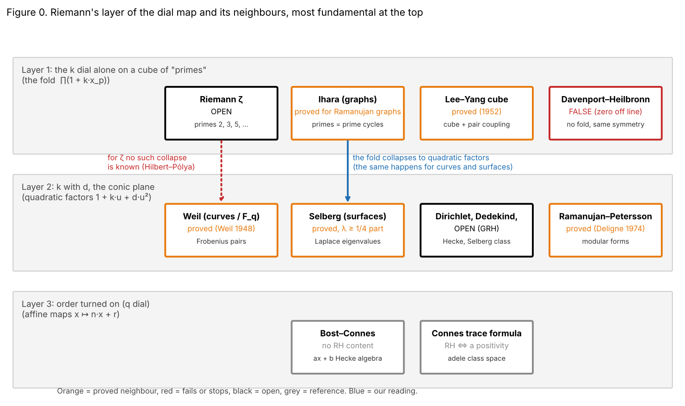
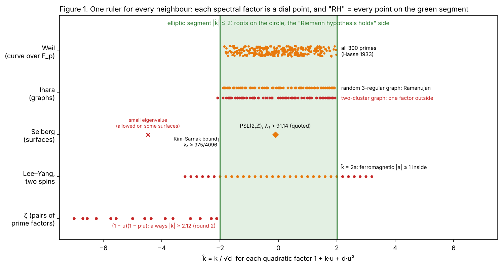
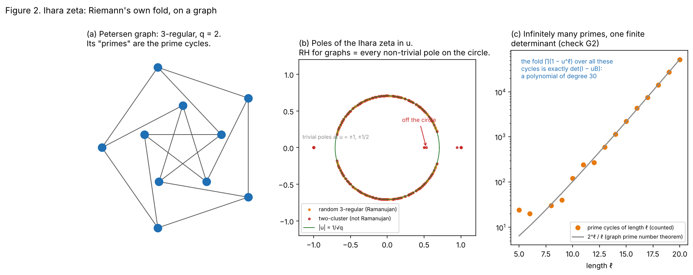
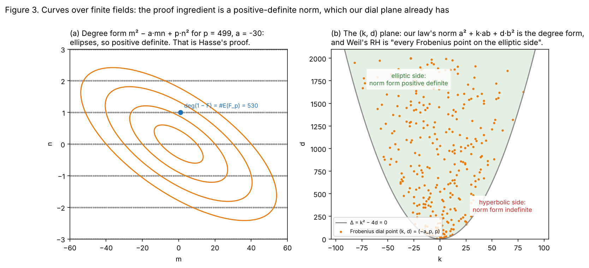
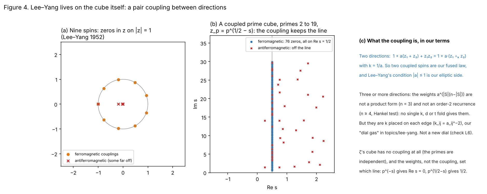
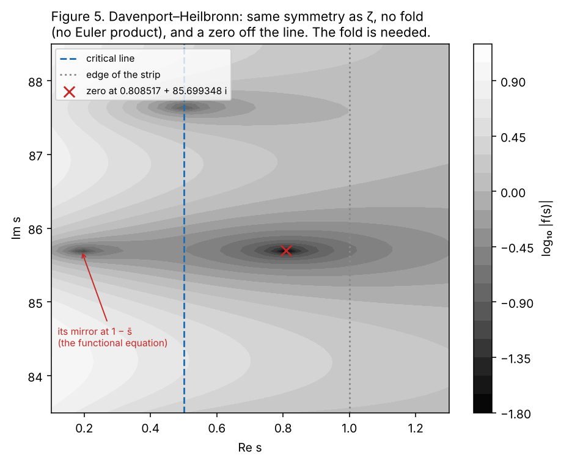
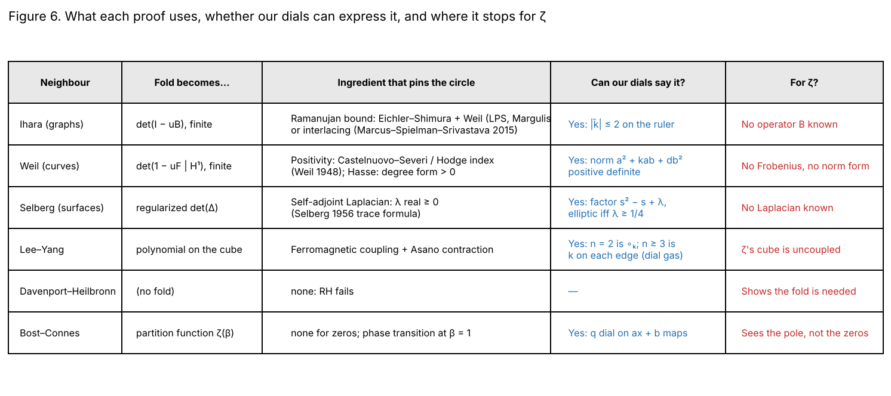
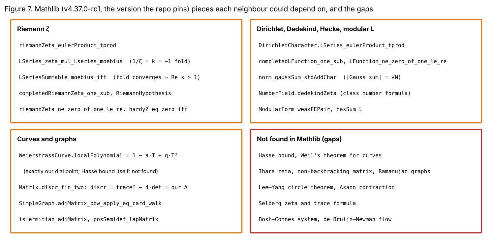
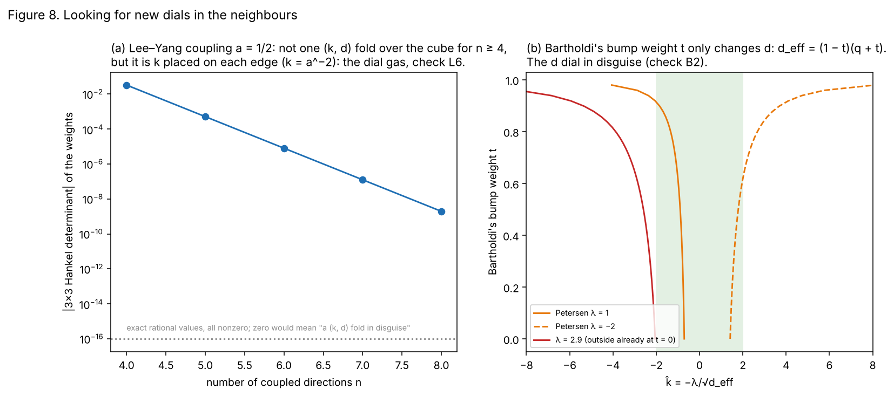

# Riemann's neighbours on the dial map (DRAFT, Nov 26 2026)

**Short answer.** In every neighbour where a Riemann-type statement is actually proved (graphs, curves over finite fields, hyperbolic surfaces, Lee–Yang magnets), the proof does the same two things: it makes the prime fold finite (the determinant of an operator, or for Lee–Yang a polynomial on a coupled cube), and then a positivity fact puts every factor on the elliptic side of our (k, d) plane. Our dials can say the positivity half for ζ but not the operator half, which is exactly the old Hilbert–Pólya gap, so this is not a lead toward RH; what it gives us is one picture of the whole family and a list of Mathlib theorems to build on. No new dial turned up: the candidates were existing dials in disguise (the Lee–Yang coupling is k placed on each edge, Bartholdi's weight is d).

Status: DRAFT. Everything numerical here was computed in this folder and checked (`checks.py`: 29 of 29 pass, a few seconds). The proofs we lean on are other people's and are named below. The Lean file is compiled in the shared library as `FusedAlgebra.Topics.RiemannNeighbours` (9 theorems, no proof changed).

Colour key in every picture: **blue** = computed or said in our terms, **orange** = known result, **grey** = reference line, **red** = where it stops or fails.

---

## 0. Where the neighbours sit



The dial map ([../dial-map](../dial-map/README.md)) puts the Riemann hypothesis on three layers:

- **Layer 1, the cube.** k alone, folded over a cube of "primes": `1 + k·fold = ∏(1 + k·p^(−s))`. At k = −1 the fold is 1/ζ(s) (Möbius signs).
- **Layer 2, the conic plane.** k with d: each local factor is a quadratic `1 + k·u + d·u²`, with Δ = k² − 4d. On the elliptic side (Δ ≤ 0) both roots sit on the circle |u| = d^(−1/2). Normalised ruler: k̂ = k/√d, elliptic exactly when |k̂| ≤ 2.
- **Layer 3, order.** The q dial: affine maps x ↦ n·x + r.

The neighbours are the other problems that live on the same layers. The order below goes from the most finite and fundamental (everything is a polynomial and the proof is complete) to the most derived.

### The one-ruler picture



Every proved neighbour puts its local factors on the same ruler, inside |k̂| ≤ 2. That is the single most useful thing the map shows: *Weil's RH, the Ramanujan bound for graphs, Selberg's λ ≥ 1/4 and the Lee–Yang circle are the same statement in four costumes*, "every dial point is on the elliptic side". For ζ we only have pairs of factors, and they fall outside (|k̂| ≥ 2.12, from [round 1](../riemann/README.md)), because ζ's local factors are degree 1, not degree 2. The proved neighbours all have an operator whose eigenvalues *pair up* the primes into degree-2 factors. ζ does not have one we know of.

---

## Pass 1: our own tools on each neighbour

### 1. Ihara zeta of a graph (proved, finite, the cleanest case)



**Where on the map.** Layer 1 to Layer 2 in one step. The "primes" are prime cycles of the graph (closed non-backtracking walks that are not repeats). The k = −1 fold over them is the Ihara zeta's reciprocal.

**What we computed.**
- On the Petersen graph the fold over prime cycles, computed by exact integer recursion from the walk counts, **is a polynomial of degree 30** and equals det(I − uB), where B is the 30 × 30 non-backtracking (Hashimoto) matrix. Coefficients past degree 30 are exactly zero. So the infinite Euler product collapses to a finite determinant (check G2).
- Bass's formula det(I − uB) = (1 − u²)^(m−n) det(I − uA + u²(D − I)) holds to 1e-15 on three graphs (G1, G5). Closed non-backtracking walks of length 5 and 6 counted by brute search (120 and 120) match tr B⁵ and tr B⁶ (G6).
- So each adjacency eigenvalue λ gives a quadratic factor 1 − λu + qu², which is our dial point (k, d) = (−λ, q). The Ramanujan bound |λ| ≤ 2√q is **literally |k̂| ≤ 2** (G3).
- Of 40 random 3-regular graphs on 200 vertices, **31 (77.5%) are Ramanujan**: every nontrivial pole on the circle |u| = 1/√2. A two-cluster graph (two random halves joined by one swapped edge pair) has λ₂ = 2.949 > 2√2 and **2 poles off the circle**, on the hyperbolic side (G4). This is the graph version of an RH failure, and it is easy to build.

**Key proof ingredient.** For specific graphs, the Ramanujan bound comes from the Ramanujan–Petersson conjecture for weight-2 modular forms (Eichler–Shimura plus Weil's RH for curves): Lubotzky–Phillips–Sarnak and Margulis, 1988. For existence in every degree (bipartite), Marcus–Spielman–Srivastava 2015 used interlacing families, a pure positivity argument.

**Can our dials say it for ζ?** The positivity, yes (it is |k̂| ≤ 2). The operator B, no: nobody knows a "graph" whose prime cycles are the primes.

### 2. Curves over finite fields: Hasse and Weil (proved)



**Where on the map.** Layer 2. A curve E over F_p has a Frobenius F with F² − a_p F + p = 0, the dial point (k, d) = (−a_p, p).

**What we computed** on y² = x³ + x + 1:
- a_p² < 4p for all **300 good primes below 2000** (W1). Every Frobenius dial point is inside the parabola (picture b).
- Point counts over F_{p²}, counted directly, equal p² + 1 − (a_p² − 2p), read off the dial point, for p = 7, 11, 19, 23, 43, 47 (W2).
- **The proof ingredient is our law's norm form.** Weil's degree form deg(m − nF) = m² − a_p·mn + p·n² is exactly our norm a² + k·ab + d·b² at (k, d) = (−a_p, p). Completing the square, 4(m² + kmn + dn²) = (2m + kn)² + (4d − k²)n², so the norm is positive definite **exactly on the elliptic side** (W3, W4; Lean: `four_normForm`). Hasse's proof is: the degree form is positive (degrees of maps are never negative), so the dial point is elliptic, so |a_p| ≤ 2√p.

**Key proof ingredient.** Positivity of degrees: Hasse 1933 for elliptic curves; Weil 1948 for all curves via the Castelnuovo–Severi inequality (Hodge index on C × C); Deligne 1974 for all smooth projective varieties.

**Can our dials say it for ζ?** The positivity half is already our elliptic side. What ζ lacks is a Frobenius: there is no known "curve" over a "field with one element" whose degree form would be our norm. That is the F₁ programme, open.

### 3. Selberg zeta of a hyperbolic surface (proved)

**Where on the map.** Layer 2. The primes are closed geodesics. Each Laplace eigenvalue λ gives the factor s² − s + λ, which is the dial point (k, d) = (−1, λ), so k̂ = −1/√λ. It is on the elliptic side exactly when λ ≥ 1/4, and then its roots sit on Re s = 1/2 (S1, S2; Lean: `selberg_complete_square`).

**What we used** (quoted, not computed): for PSL(2, ℤ) the first cusp form has r₁ = 9.5337, λ₁ = 1/4 + r₁² ≈ 91.14, far inside. The ruler in picture 1 also shows where the Kim–Sarnak bound λ₁ ≥ 975/4096 ≈ 0.238 sits for congruence surfaces.

**Key proof ingredient.** The Laplacian is self-adjoint and non-negative, so λ is real. Selberg's trace formula (1956) makes the geodesic fold equal a regularised determinant. Exceptional eigenvalues 0 < λ < 1/4 do exist on some surfaces; they are zeros *off* the line, on the hyperbolic side. For congruence surfaces, Selberg's conjecture λ₁ ≥ 1/4 is still open (best: 975/4096, Kim–Sarnak 2003).

**Can our dials say it for ζ?** The factor, yes. The Laplacian whose spectrum would be ζ's zeros is the Hilbert–Pólya operator, unknown.

### 4. Lee–Yang: zeros on the circle from a coupling on the cube itself (proved)



**Where on the map.** Layer 1, but with something our cube does not have: a **pair coupling** a_ij between directions. This is the one neighbour that lives on the cube rather than on the conic plane.

**What we computed.**
- Nine spins with ferromagnetic couplings: every zero of the partition function is on |z| = 1, to 1e-15. Antiferromagnetic: zeros leave the circle, some far off (L1, L1b).
- **Two spins are our law.** 1 + a(z₁ + z₂) + z₁z₂ = 1 + a·(z₁ ◯ₖ z₂) with k = 1/a (L2; Lean: `leeYang_two`). In a uniform field this is z² + 2az + 1, the dial point (2a, 1), elliptic exactly when |a| ≤ 1. So Lee–Yang's two-spin condition is our elliptic side.
- **Three or more spins are k on each edge.** The weights a^(|S|(n−|S|)) are not one fold over the cube: not a product form for n = 3 unless a² = 1 (L3), and for n = 4 to 8 the Hankel determinants are nonzero, so no single (k, d) recurrence produces them (L3b). But they are exactly our k dial placed on each pair, k_ij = a_ij^(−2), after rescaling each z (L6, exact). That is the "dial gas" already in [../lee-yang](../lee-yang/README.md) (Nov 25). So the coupling is not a new dial; it is a different *placement* of k: one k per edge instead of one k folded over the whole cube.
- **A coupled prime cube.** Put the primes 2 to 19 on an 8-direction cube with z_p = p^(1/2 − s) and ferromagnetic couplings: **all 76 zeros found sit on Re s = 1/2** (worst deviation 6e-17, one refined at 40 digits, L4, L5). With p^(−s) instead they sit on Re s = 0 (L4c), and with antiferromagnetic couplings they leave the line (L4b).

**Key proof ingredient.** Lee and Yang 1952; the cleanest proof is Asano's contraction (1970): multi-affine polynomials with no zeros in the unit polydisc stay that way when you merge variables.

**Can our dials say it for ζ?** The positivity, yes (ferromagnetic means k_ij > 1 on every edge). For ζ, no, and the reason is instructive: ζ's cube is *uncoupled* (the primes are independent, which is what the Euler product says), and in the coupled cube it is the **weights**, not the coupling, that choose which line. Coupling the primes builds a different function with a proof of RH, not ζ. A version of this idea is Knauf's number-theoretic spin chain (1993), which is worth a second look later.

### 5. Davenport–Heilbronn: the warning case (RH false)



A combination of two Dirichlet L-functions mod 5, f = ((1 − iκ)/2)·L(s, χ) + ((1 + iκ)/2)·L(s, χ̄), has the same kind of functional equation as ζ (its completed version is real on the line, H2) but **no Euler product**. We found its zero off the line at **s = 0.808517 + 85.699348 i**, held at 50 digits (H1, H3), with its mirror at 0.1915.

**Lesson for the map.** The functional equation (the reciprocal-pair symmetry of our quadratic factor) is not enough. The fold, Layer 1, is needed. Any approach that only uses Layer 2 symmetry would also "prove" RH for this function, so it must be wrong. Epstein zetas of class number > 1 fail the same way; the Riemann thread's round 6 is computing that case ([../riemann/round6](../riemann/round6/), in progress).

### 6. The open zoo: Dirichlet, Dedekind, Hecke, the Selberg class (open)

Same layers as ζ: a fold with degree-1 (Dirichlet) or degree-n (Dedekind, Hecke) local factors, plus a functional equation. GRH for all of them is open, for the same reason as ζ: no operator. We checked one numerically only: L(s, χ₋₄) has its first zero on the line at t = 6.0209 (D1). These are not neighbours to learn a proof from; they are the problems that would fall *with* RH.

### 7. Bost–Connes and the primon gas (on the order dial)

**Where on the map.** Layer 3: the Bost–Connes system is built on the ax + b maps (multiplication by n and adding r), which is our q dial (via the Laca–Raeburn Hecke algebra). Its partition function is ζ(β), with a phase transition at β = 1.

**Can our dials say it?** Yes, it is the q dial, nothing new. But it sees ζ's **pole**, not its zeros. Connes later (1999) rephrased RH as a positivity (Weil's explicit-formula positivity) on a related space, which brings it back to the same missing piece: a positivity we can state, on an operator we do not have.

### The pattern, in one table



Every proved row has an operator (B, Frobenius on H¹, the Laplacian) whose determinant equals the fold, and a positivity that puts the factors on the elliptic side. For ζ the right-hand column is red in every row for the same reason.

---

## Pass 2: the literature, who proved what

- **Ihara zeta.** Ihara 1966 (p-adic groups, the tree of PGL₂(ℚ_p)); Hashimoto 1989 and Bass 1992 (the determinant formulas); Sunada (graph version, 1986). Ihara's zeta is the p-adic analogue of Selberg's, on the Bruhat–Tits tree.
- **Ramanujan graphs.** Lubotzky–Phillips–Sarnak 1988 and Margulis 1988 (explicit, from Ramanujan–Petersson); Alon–Boppana (2√q is optimal; written up by Nilli 1991); Marcus–Spielman–Srivastava 2015 (bipartite Ramanujan graphs of every degree, interlacing families). For random graphs, Huang, McKenzie and Yau (2024) report that about 69% of large random regular graphs are Ramanujan; our 31 of 40 at 200 vertices is a small sample at small size, in the same range.
- **Curves over finite fields.** Hasse 1933 (elliptic curves); Weil 1948 (all curves); Deligne 1974 (Weil conjectures in full). Bombieri–Stepanov gave an elementary proof for curves (1973–74).
- **Selberg.** Selberg 1956 (trace formula, Selberg zeta); 3/16 bound (Selberg 1965); 975/4096 (Kim–Sarnak 2003); λ₁ ≥ 1/4 for congruence subgroups open.
- **Lee–Yang.** Lee and Yang 1952; Asano 1970 (contraction proof); Ruelle 1971 (extensions). Borcea and Brändén 2009 classified the linear maps that preserve "no zeros in a region", which is the modern home of this kind of argument.
- **Davenport–Heilbronn.** 1936 (infinitely many zeros with Re s > 1); the zero near 0.8085 + 85.6993 i is the standard example (Spira, Balanzario and Sánchez-Ortiz).
- **Bost–Connes.** Bost and Connes 1995; Connes 1999 (trace formula, RH ⇔ a positivity).
- **Hilbert–Pólya.** The idea that ζ's zeros are the spectrum of a self-adjoint operator, early 20th century, never written down by either as a theorem; Montgomery–Odlyzko statistics (1973, 1987) support it.

---

## Mathlib: what each neighbour could build on



All names below were checked in the Mathlib version this repo pins (v4.37.0-rc1).

| Neighbour | Mathlib already has | Missing |
|---|---|---|
| ζ itself | `riemannZeta_eulerProduct_tprod` (the k = −1 fold's reciprocal), `RiemannHypothesis` (the statement), `completedRiemannZeta_one_sub` (functional equation), `riemannZeta_ne_zero_of_one_le_re` (no zeros on Re s ≥ 1), `hardyZ`, `riemannZetaZeros`, `LSeries_zeta_mul_Lseries_moebius` (1/ζ is the k = −1 fold), `LSeriesSummable_moebius_iff` (the fold converges exactly for Re s > 1: our wall) | everything about zeros inside the strip |
| Dirichlet L | `DirichletCharacter.LSeries_eulerProduct_tprod`, `completedLFunction_one_sub`, `LFunction_ne_zero_of_one_le_re`, `norm_gaussSum_stdAddChar` (\|Gauss sum\| = √N), `gaussSum_sq` | GRH |
| Dedekind, Hecke | `NumberField.dedekindZeta`, its residue at 1 (class number formula), Hecke L-functions (local values) | functional equation for Hecke in general |
| Modular forms | `ModularForm` L-functions with a weak functional-equation pair, `hasSum_L` | Ramanujan–Petersson |
| Curves (Weil) | `WeierstrassCurve.localPolynomial = 1 − a·X + q·X²`, **exactly our dial point (−a_p, p)**, and `WeierstrassCurve.LFunction` | the Hasse bound itself; Weil's theorem |
| Graphs (Ihara) | `SimpleGraph.adjMatrix_pow_apply_eq_card_walk` (walk counts), `isHermitian_adjMatrix`, `posSemidef_lapMatrix`, `Matrix.discr_fin_two` (discriminant = trace² − 4·det, our Δ) | non-backtracking matrix, Ihara zeta, Bass formula, Ramanujan graphs |
| Selberg, Lee–Yang, Bost–Connes | nothing direct | all |

The cheapest real formalisation target is the **Hasse bound** for elliptic curves: Mathlib already has the curve, the local polynomial in our exact (k, d) form and the discriminant identity, and the proof is our `four_normForm` plus positivity of degrees. That would be a genuine Mathlib contribution, not just a rephrasing; it is also a sizable project, because "degree of an isogeny is non-negative and quadratic" needs real algebraic geometry.

---

## New-dial lookout



Brennan asked to watch for new dials in the same vein as affine composition. Three candidates came up; each was checked against the existing dials, and **all three turned out to be existing dials in disguise.**

1. **Lee–Yang pair coupling a: the k dial on each edge.** For two directions it *is* our law (k = 1/a). For three or more it is not one fold over the cube (picture a: Hankel determinants nonzero for n = 4 to 8), which at first looked like a new dial. It is not: the cut weights equal the dial-gas weights with k_ij = a_ij^(−2) on each pair, after rescaling each variable (check L6, exact rational arithmetic, random couplings). The repo already has this as the dial gas in [../lee-yang](../lee-yang/README.md). What the check does add is a distinction worth keeping on the map: a dial can be *folded* over the whole cube (ζ's Euler product) or *placed* on each edge (Lee–Yang). Only the edge placement has a theorem putting zeros on a circle.
2. **Bartholdi's bump weight t: an existing dial in disguise.** Bartholdi's generalised Ihara zeta counts backtracks with weight t. Per eigenvalue it only changes d: d_eff = (1 − t)(q + t) (B1, B2, picture b; Lean: `bartholdi_d_eff`). At t = 1 the circle collapses. So t is the d dial, not a new one.
3. **Bost–Connes ax + b: the existing q dial.** Nothing new.

---

## Proposal: listing each problem's neighbours on the dial map

Each problem on the dial map gets a short **Neighbours** table with the same six columns:

| Column | What goes in it |
|---|---|
| Neighbour | the problem's name |
| Where | same layer, one layer up, or one layer down |
| Status | proved (by whom, year), open, or false |
| Key ingredient | the one idea that makes the proof work, or why it fails |
| Can our dials say it? | yes / partly / no, with the dial |
| Mathlib | the theorems it could build on, and the main gap |

The rule for who counts as a neighbour: same layer and same shape of statement (here, "every local factor on the elliptic side"). Proved neighbours first, because those are the ones we can learn a method from; then false ones, because they rule methods out; then open ones. The text to add to the dial map, with Riemann as the first example, is in [dial-map-neighbours-section.md](dial-map-neighbours-section.md).

---

## What's new, plainly

- **Not a lead toward RH.** The gap is the known one: an operator for ζ. Nothing here closes or narrows it. No entry for the Promising leads list.
- **Useful for the map.** The one-ruler picture (picture 1) is a clean way to say what the proved neighbours share, in our own terms, and it shows where ζ sits relative to them.
- **Small observations, probably folklore.** That Lee–Yang's two-spin condition is our elliptic side, and that Weil's degree form is our law's norm, are each a line of algebra. They are almost certainly known in substance; we have not found them stated in these words, and we do not claim they are new.
- **No new dial.** The Lee–Yang coupling looked like one but is k placed on each edge, already our dial gas; Bartholdi's weight is d; Bost–Connes is q.
- **One distinction for the map:** folding a dial over the cube (ζ) versus placing it on each edge (Lee–Yang). The proved circle theorem belongs to the second.
- **No new fact here that is not in print**, so nothing to carry to the quantum-gravity questions.

## Assumptions

- "Neighbour" means: lives on the same layer of the dial map and has a statement of the form "every zero or factor on the elliptic side". Other choices (by analytic method, by symmetry group) would give a different list.
- The Selberg numbers for PSL(2, ℤ) (r₁ = 9.5337) and the Kim–Sarnak bound are quoted, not computed here.
- The coupled prime cube is our toy: finite (primes to 19), with couplings chosen ferromagnetic by us. It shows the mechanism, not anything about ζ.
- Numerical results are floating point with high-precision refinement where noted (40 and 50 digits). The Petersen fold and the Hankel determinants are exact integer and rational arithmetic.
- The Lean file is compiled in the shared library (9 theorems, no proof changed, `leeYang_two` included).

## Known vs new

**Known:** every theorem named in Pass 2, with its authors; the Bass and Bartholdi formulas; Hilbert–Pólya; the Davenport–Heilbronn zero; the observation that proved RH-analogues all come from a spectral or positivity interpretation (this is a standard theme, for example in Sarnak's and Connes's surveys).

**Ours:** the computations in this folder; saying all four proved cases on one k̂ ruler; checking the Lee–Yang coupling and Bartholdi weight against our dials (the first is k on each edge, the second is the d dial); the Mathlib inventory against our dial point; the neighbours-table format for the map.

## How to rerun

```
python3 compute.py     # writes results.json (a few seconds)
python3 checks.py      # 29 checks, prints PASS / FAIL
python3 figures.py     # writes figures/
```

Needs numpy, scipy, mpmath, sympy, networkx, matplotlib.

## Files

- `compute.py`, `results.json`, `compute_log.txt`: the computations.
- `checks.py`, `checks_output.txt`: 29 checks, all pass.
- `figures.py`, `figures/`: pictures 0 to 8.
- `lean/RiemannNeighbours.lean`: the algebraic identities (norm form, Selberg factor, Bartholdi d, Lee–Yang two spins), core Lean, compiled in the shared library as `FusedAlgebra.Topics.RiemannNeighbours` (namespace `CircleOp.RiemannNeighbours`).
- `dial-map-neighbours-section.md`: the section to add to the dial map.

## Related

- [The Riemann hypothesis, first look](../riemann/README.md) and its rounds 3 to 6.
- [The dial map](../dial-map/README.md).
- [Lee–Yang zeros on the dial](../lee-yang/README.md): the dial gas, where the Lee–Yang coupling already lives.
