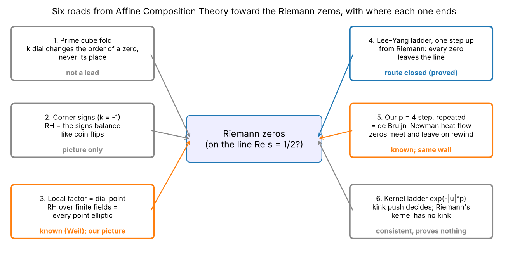
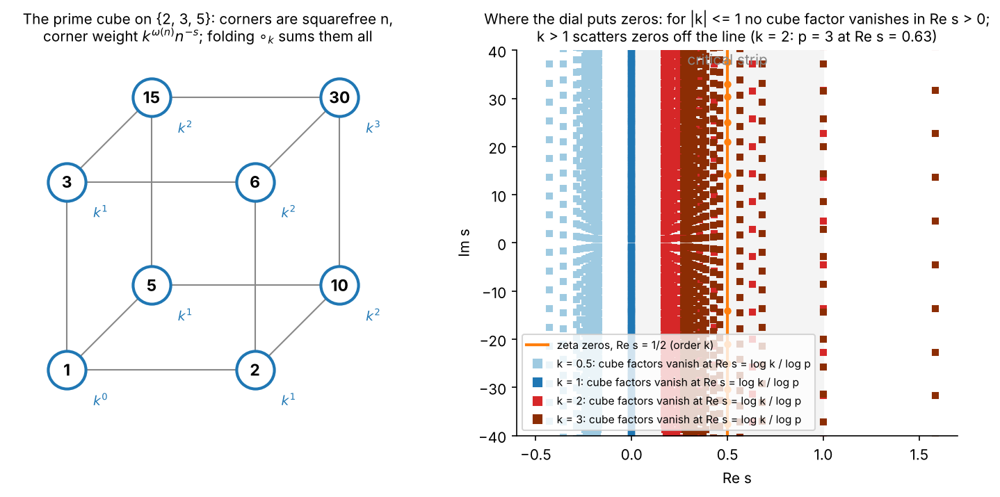
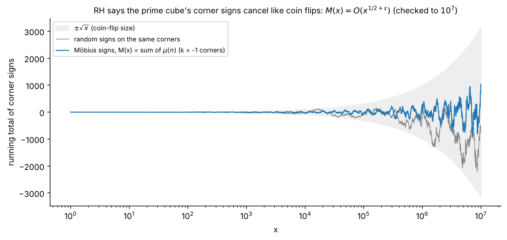
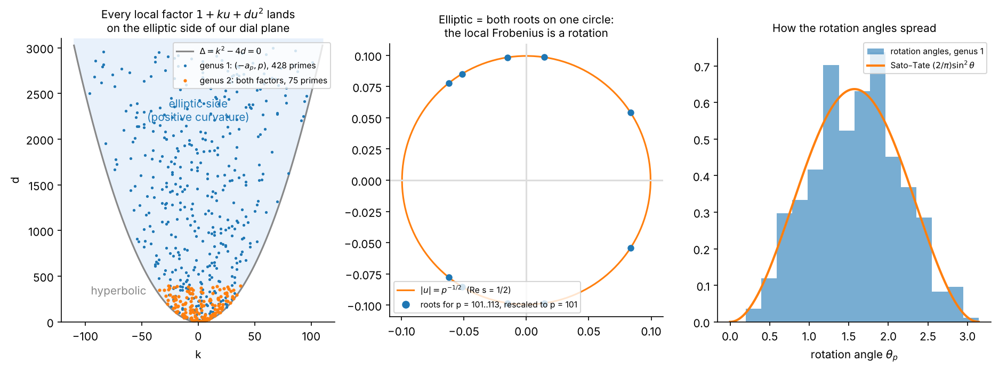
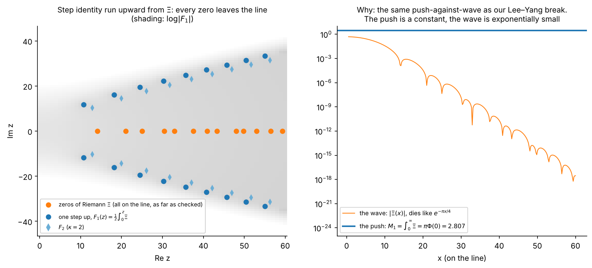
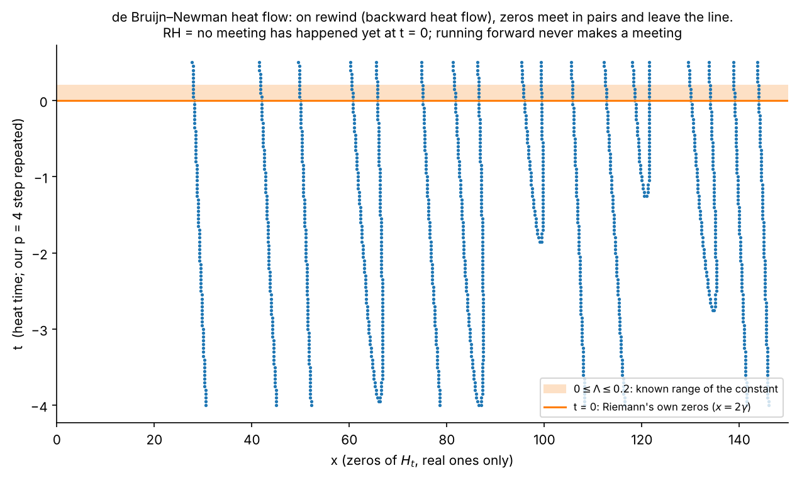
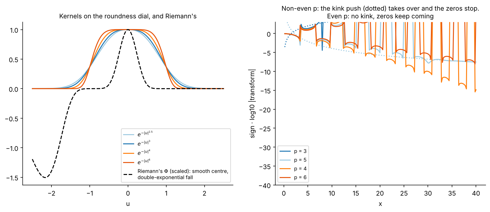
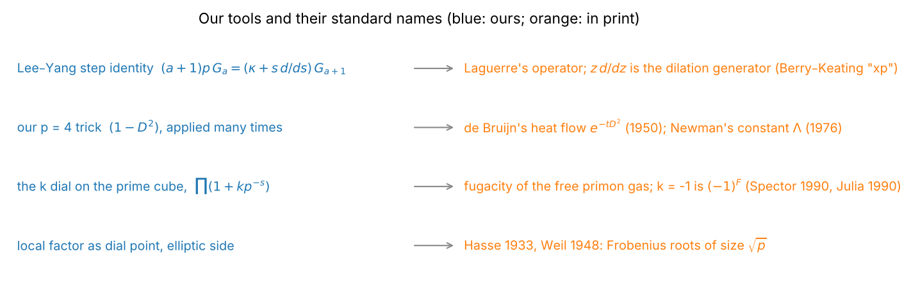

# DRAFT · The Riemann hypothesis through Affine Composition Theory

**DRAFT, Nov 26 2026.** Part of Affine Composition Theory, built on Fused Hyperoperation Algebra (repo: fused-hyperoperation-algebra).
Follow-up: [`elliptic-object/`](elliptic-object/README.md) tries the "elliptic object" (all local factors elliptic) and the positivity and precession questions.

Round 3: [`round3/`](round3/README.md) tries the fused rewind, the Kerr turn, the barrier chain, the Lee–Yang far zone and the Liebig knob.

Asked for by Brennan (voice): "let's look at the Riemann hypothesis", with the method he set just before: first "from a
fresh perspective... without looking at existing work", then "a second pass with the existing work".
Checks: `checks.py` → `checks_output.txt`, **20 of 20 pass** in 144 s, including 7 polish checks (marked POLISH). Pictures: `figures.py` → `figures/`.
Lean: `lean/Riemann.lean`, 10 short statements, compiled in the shared library as `FusedAlgebra.Topics.Riemann` (built by CI).
Colour key in every picture: **blue = our reading, orange = already known, grey = reference.**

## The result in two sentences

Our tools don't open a road to proving the Riemann hypothesis: every road I tried either turns out to be a known road
in our notation, or ends at the same wall the known roads end at. One small thing is new and proved: running our
Lee–Yang step identity *upward* from Riemann's function throws every zero off the line, so that route is closed, and the
reason is the same "push beats wave" mechanism we found on the Lee–Yang page.

*Figure 0. Six roads from our framework toward the Riemann zeros, ordered from the most fundamental (left top) to the
most derived (right bottom), and where each one ends.*

What the hypothesis says, in one line: Riemann's function ξ(s) has all its zeros on the line Re s = 1/2. Written in
t with s = 1/2 + it, that is "the function Ξ(t) has only real zeros", which is exactly the kind of statement our
Lee–Yang work proves for other functions.

---

## Pass 1. Our own tools only

I did this pass without reading anything on the Riemann hypothesis, only our own pages (`lee-yang/`,
`shape-dial-survey/` section N3, `primes/`, `number-theory-geometries/`, `conics/`, `boolean-lattice/`).

### 1. The prime cube and its fold (most fundamental)

*Figure 1. Left: the cube on the primes 2, 3, 5. Its corners are the squarefree numbers, and folding ∘ₖ over the
corner weights p^−s sums every corner with weight k^(number of primes). Right: where the dial k puts zeros.*

- **What it is.** Put one direction of the cube on each prime, with weight x_p = p^−s. The lift of our law gives
  1 + k·(x₂ ∘ₖ x₃ ∘ₖ x₅ ∘ₖ …) = ∏ (1 + k p^−s) = Σ k^ω(n) n^−s over squarefree n, where ω(n) counts primes (check A1,
  gap 0). At k = 1 this is ζ(s)/ζ(2s); at k = −1 it is 1/ζ(s), with the Möbius signs as corner signs (A3).
- **What the dial does.** In the region Re s > 1/2 the fold is ζ(s)^k times a factor that is analytic there and
  vanishes only where one prime's own factor 1 + k p^−s does (A2). So **turning k changes the order of each zeta zero
  (a zero of order k, a pole when k < 0), never its place.** The dial can't push a zero onto the line.
- **The prime factors' own zeros** sit on the lines Re s = log k / log p (A4). For |k| ≤ 1 they all sit at Re s ≤ 0,
  outside the strip. For k > 1 they scatter through the strip off the line (k = 2: p = 3 at Re s = 0.63). So k = 1 is
  the largest dial setting whose cube adds no zeros of its own in Re s > 0.
- **Verdict: not a lead.** The fold is the Euler product in our notation. It only lives where the product converges
  (Re s > 1), and the zeros are in the strip, where it doesn't.

### 2. The corner signs (k = −1)

*Figure 2. Running total of the k = −1 corner signs (the Möbius function) up to ten million, against ±√x and a walk
with random signs on the same corners.*

- **What it is.** At k = −1 each squarefree corner carries the sign (−1)^(number of primes). Their running total M(x)
  stays inside about 0.57·√x all the way to 10⁷ (check B1, M(10⁷) = 1037).
- **The reading.** The Riemann hypothesis is equivalent to M(x) growing no faster than x^(1/2 + ε) for every ε > 0: **the
  prime cube's corner signs cancel as well as fair coin flips would.** (Pass 2 says who proved that equivalence.) The
  picture is honest about one thing: 10⁷ is nothing, and the stronger "always under √x" is known to be false far out.
- **Verdict: a picture, not a lead.** It's the cleanest way to say what the hypothesis means in our cube language.

### 3. A local factor is a point of our dial plane

*Figure 3. Left: local factors 1 + k·u + d·u² placed as points (k, d) of our conic dial plane. All 428 from a genus-1
curve and all 150 from a genus-2 curve land on the elliptic side. Middle: on the elliptic side both roots lie on one
circle, which is the line Re s = 1/2. Right: how the rotation angles spread.*

- **What it is.** Our conic dial plane has the discriminant Δ = k² − 4d, with curvature −Δ/4. A degree-2 factor
  1 + k·u + d·u² with u = p^−s and d = p has both roots on the circle |u| = p^−1/2 (that is, on Re s = 1/2) **exactly
  when Δ ≤ 0: the elliptic side.** Then the factor is a rotation by an angle θ_p, scaled by √p. The two roots are
  swapped by the reflection u ↦ 1/(d·u), which fixes that circle (Lean `localFactor_reciprocal`).
- **Where this is a whole proof.** For a curve over a finite field, the zeta function is a finite product of such
  factors (one per unit of genus). I counted points on y² = x³ + x + 1 (primes up to 3000) and y² = x⁵ − x + 1
  (primes up to 400, counting over F_p and F_p²): every factor is on the elliptic side (checks C1, C2, C3), and the
  angles spread like (2/π)sin²θ (C4). So over finite fields the hypothesis reads **"every local dial point has
  positive curvature"**.
- **Where it stops.** Zeta itself has degree-1 factors 1 − p^−s, whose zeros sit at Re s = 0. Its zeros on the line come
  from the whole product at once, not from any factor, so this picture has nothing to place for zeta.
- **Verdict: a known theorem in our picture** (pass 2), and a fair picture of what a proof for zeta would have to
  find: an object whose "factors" are all elliptic.

### 4. The Lee–Yang ladder, run upward from Riemann's function (new, proved)

*Figure 4. Left: zeros of Riemann's Ξ (orange, on the line) and of the unique function one rung above it on our
ladder, F₁ (blue) and F₂ (light blue). Every one is off the line. Right: why. The push is a constant; the wave is
exponentially small.*

- **The setup.** Like our Lee–Yang G, Riemann's Ξ is a cosine transform of a weight: Ξ(t) = 2∫₀^∞ Φ(u) cos(tu) du,
  with Φ built from the theta series. Our step identity from `shape-dial-survey/` N3,
  (a+1)p·G_a = (κ + s·d/ds) G_(a+1), carries "all zeros real" **downward**, from rung a + 1 to rung a. So the natural
  question is whether Ξ sits one rung below some function that is known to have only real zeros.
- **The answer is no, for every rung height κ.** Solving (κ + z·d/dz) F = Ξ gives exactly one entire function,
  F_κ(z) = ∫₀¹ τ^(κ−1) Ξ(zτ) dτ. On the real line it equals z^−κ (M_κ − ∫_z^∞ t^(κ−1) Ξ(t) dt), where
  M_κ = ∫₀^∞ t^(κ−1) Ξ(t) dt.
  - The **push** M_κ is a constant: M₁ = πΦ(0) = 2.8067 (check D1, to 15 digits), M₂ = 9.84, M₃ = 52.6.
  - The **wave** ∫_z^∞ t^(κ−1) Ξ dies like e^(−πz/4).
  - So past some point F_κ has the sign of M_κ and stops crossing zero. F_κ is even, of order 1 and not a polynomial, so
    it has infinitely many zeros; only finitely many can be real, so **infinitely many are off the line.**
- **For κ = 1 it's worse: no real zeros at all.** F₁ stays positive on the whole real line (checked to 100; past that
  the wave is below 10^−30, check D2), and the argument principle finds no zeros in the box 0.5 ≤ Re z ≤ 60,
  |Im z| ≤ 8 (D4, polish). The zeros it does have lie on two rising curves, Im z from 12 at Re z = 11 to 33 at
  Re z = 55 (D3, D5).
- **How this ties to our Lee–Yang page.** It is the same mechanism as the proved breaking half of N3: a steady push
  against a decaying wave, and the push wins. The difference is the size of the wave. Our p-ball weights have a rim, so
  their wave falls only like a power, and stepping up can survive (it does for p ≥ 2, where the zeros alternate).
  Riemann's weight has no rim and is smooth everywhere, so its wave is exponentially small, and **no upward step of
  this kind can survive.**
- **Verdict: a route closed, proved for κ = 1 and for every κ with M_κ ≠ 0** (checked for κ = 2, 3). It isn't a lead
  toward the hypothesis. It is worth knowing for the Lee–Yang strip work: any upward argument has to use the rim.

### 5. Our p = 4 step, repeated, is a heat flow

*Figure 5. Real zeros of H_t as the heat time t changes (x up to 150, t from −4 to 0.5). Rewinding the heat flow
(backward heat flow, t decreasing), neighbouring zeros meet and leave the line in pairs; running it forward, they never meet. Shaded: the range where the known bounds put the
critical time.*

- **What it is.** The p = 4 proof in N3 used one fact: multiplying a weight by 1 + u² acts on its transform as
  1 − D² = (1 − D)(1 + D), and each factor keeps zeros real (Lean `heat_step_factor`). Do it m times with
  1 + (t/m)u² and let m grow: the weight gets multiplied by e^(tu²), and the transform runs a heat flow in t.
- **What the numbers show.** I computed H_t(x) = ∫₀^∞ e^(tu²) Φ(u) cos(xu) du to 40+ digits. At t = 0 it matches Ξ(x/2)/8 to a relative 10^−26 or better (`dbn_test.py`), and the first zero to 20
  digits with half the nodes (check E4). For t from −1.2 up to 0.5, all 18 zeros in view stay real. Below that they leave in pairs:
  near t = −1.25 (x ≈ 121), −1.85 (x ≈ 99.5), −2.75 (x ≈ 134) and −3.95 (E2). A start off the line at t = 0.2 falls
  back onto it (E3, polish).
- **The wall.** Heat steps only ever keep zeros real running the flow **forward** in t. The hypothesis is the statement that no pair
  has met yet at t = 0, which is a statement about the **rewind** (backward heat flow) from t > 0 to t = 0. It's the same direction problem as in section 4,
  and the same one the Lee–Yang strip has.
- **Verdict: a known road** (pass 2), and here our p = 4 trick is a special case of it.

### 6. The kernel ladder along the ℓp exponent p (most derived)

*Figure 6. Left: the weights e^(−|u|^p) along the ℓp exponent p, with Riemann's Φ for comparison. Right: their transforms.
For non-even p the kink at the centre pushes (dotted line) and the zeros stop; for even p they keep coming.*

- **What it is.** Our N3 rule says a kink at the centre pushes with size Γ(p+1)sin(πp/2)·x^−(p+1). With no rim the
  smooth part of these weights decays faster than any power, so for non-even p the push wins: p = 2.5, 3, 3.5 and 5 have
  1, 3, 3 and 10 real zeros in [0, 40], and at x = 40 the transform equals the push to within 0.5% (check F1). At
  p = 3 the last two real zeros are a close pair about to leave (F2, polish). Even p = 4, 6 keep their zeros coming.
- **Where Riemann sits.** Φ is smooth at the centre (no kink, so no push) and falls double-exponentially, faster than
  every weight on this dial. Our rule therefore doesn't force any zeros off the line, which is consistent with the
  hypothesis but proves nothing.
- **Verdict: consistent, not a lead.**

---

## Pass 2. With the existing work

*Figure 7. Each of our tools next to its standard name in the Riemann literature.*

| Our section | What's in print | What's ours |
|---|---|---|
| 1. Prime cube fold | Euler product (Euler 1737). Σ k^ω(n) n^−s behaving like ζ^k is the Selberg–Delange method (Selberg 1954, Delange 1959). As physics: the free "primon" or Riemann gas, whose partition function is ζ; our k is its fugacity, and k = −1 with Möbius signs is the (−1)^F operator (Spector, *Comm. Math. Phys.* 127, 1990; Julia 1990). | Only the cube placement. |
| 2. Corner signs | RH ⟺ M(x) = O(x^(1/2+ε)): Littlewood (1912). The coin-flip reading: Denjoy (1931). The stronger "|M(x)| < √x" (Mertens' conjecture) is false: Odlyzko and te Riele (1985). | Nothing. |
| 3. Dial plane | Hasse (1933) for elliptic curves, Weil (1948) for all curves over finite fields, Deligne (1974) in general: Frobenius roots have size √q, which is our elliptic side. The angle law is Sato–Tate, proved for elliptic curves without complex multiplication around 2008–2011 (Clozel, Harris, Shepherd-Barron, Taylor; Barnet-Lamb, Geraghty, Harris, Taylor). | Reading Hasse's bound as the sign of our discriminant, and Weil's theorem as "every dial point has positive curvature". |
| 4. One step up | That Riemann's Ξ is a cosine transform and RH means "only real zeros" is Riemann (1859) and Pólya (1926). The Laguerre–Pólya class is closed under differentiation (Laguerre), which is our step identity's downward direction. Our operator κ + z·d/dz is the dilation generator, the same "xp" Berry and Keating (1999) proposed as a Hilbert–Pólya candidate. | The upward statement: the unique function one rung above Ξ has infinitely many non-real zeros (none real at κ = 1), with the push being the moment M_κ. I didn't find it stated (one search); it is the sort of fact an expert would call routine. |
| 5. Heat flow | de Bruijn (1950): the flow keeps zeros real going up in t, and all are real for t ≥ 1/2. Newman (*Proc. AMS* 61, 1976) defined the critical time Λ, connected it to the Lee–Yang theorem, and conjectured Λ ≥ 0. Rodgers and Tao proved Λ ≥ 0 (*Forum Math. Pi* 8, 2020). Polymath 15 gave Λ ≤ 0.22 (2019), and Platt and Trudgian Λ ≤ 0.2 (2021). So RH is exactly Λ = 0. Newman and Wu's survey (*Bull. AMS*, 2020) covers the Lee–Yang side. | That our p = 4 trick is one step of this flow. |
| 6. Kernel ladder | Pólya (1918, 1926): e^(−u^(2n)) has only real zeros. He also proved a one-term version ξ* of Riemann's function has only real zeros. The non-even tail is the standard endpoint asymptotic. | Applying the N3 push rule here. I didn't find the "non-even p has finitely many real zeros" statement for these weights spelled out (one search). |

**Other known roads, and whether our tools touch them.**
- *Hilbert–Pólya* (zeros as the eigenvalues of a self-adjoint operator): only through the xp remark in row 4.
- *Weil's positivity criterion and Li's criterion (1997)*: these are positivity statements about sums over zeros. Our
  corner sums at k = −1 are the nearest thing we have, and they don't reach it.
- *Jensen polynomials* (Griffin, Ono, Rolen and Zagier, PNAS 2019, proved hyperbolicity for each degree, all large
  shifts): these are polynomial truncations with real zeros, a cousin of section 5. We have nothing new there.
- *Connes' adelic approach and the Bost–Connes system (1995)*: these are the serious attempts to build, for zeta, the
  geometric object section 3 says is missing. Our cube is the free gas at the start of that story, not the hard part.
- *Montgomery–Odlyzko spacing statistics*: not touched.

## What's new, plainly

1. **Proved (κ = 1; and for every κ with M_κ ≠ 0, checked for κ = 2, 3):** the step identity can't climb from
   Riemann's Ξ. The unique function one rung up has infinitely many non-real zeros, and at κ = 1 none at all on the
   line. The mechanism is N3's push-beats-wave, with the push equal to the moment M_κ. The likely status is folklore.
2. **Unifying, not new mathematics:** our Lee–Yang step identity is Laguerre's operator, our p = 4 trick is one step of
   the de Bruijn–Newman heat flow, and our prime-cube dial is the primon gas fugacity. All three of our open or
   finished Lee–Yang questions and the Riemann hypothesis hit the same wall: the tools that keep zeros real only run
   one way.

**Lead verdict:** no lead toward the Riemann hypothesis. Item 1 closes a route; it is useful to the Lee–Yang strip
work ("an upward step has to use the rim"), not to Riemann. I'd add item 2 to the README's "Where it unifies" and add
nothing under "Promising leads".

## Lean

`lean/Riemann.lean`, core Lean 4 against `FusedAlgebra.Base`, no `sorry`. It was compiled in the shared library on
Nov 26 as `FusedAlgebra.Topics.Riemann` (old names updated to `circK` and `foldCirc`, one proof step fixed; the
statements are as written). It has 10 statements:

- the fold lift `cubeFold_lift` and `cubeFold_one`;
- `boson_times_fermion`: ∏(1+x)·∏(1−x) = ∏(1−x²), the finite form of ζ/ζ(2s)·1/ζ = 1/ζ(2s);
- `step_identity_kernel` and `heat_step_factor`;
- `localFactor_reciprocal`: the roots pair as u and 1/(du);
- `elliptic_no_int_root`: on the elliptic side there's no integer root;
- `genus1_p5_elliptic`: a worked example;
- two helpers.

Nothing about the zeros of zeta is in Lean: that needs complex analysis that core Lean doesn't have. Library path:
[`lean-library/FusedAlgebra/Topics/Riemann.lean`](../../lean-library/FusedAlgebra/Topics/Riemann.lean).

## Checks

`checks.py` → `checks_output.txt`. Groups:
- **A:** prime cube.
- **B:** corner-sign walk.
- **C:** dial plane and curves.
- **D:** one step up, polished by the argument principle and re-found zeros.
- **E:** heat flow, polished by halving the quadrature nodes and refining from off the line.
- **F:** kernel ladder, polished by refining the close pair.

Heavy computations are cached:
- `up_step_grid*.py` → `up_step_grid*.pkl`, then `up_step_refine.py` → `up_step.json`;
- `dbn_scan.py` → `dbn.json`;
- `cube.py`, `weil.py`, `ladder.py` → their `.json`.

`dbn_test.py` and `up_step_moment.py` are the first accuracy probes. Conventions: Ξ(t) = 2∫₀^∞ Φ cos with
Titchmarsh's Φ (a factor 2 on the theta sum). H_t follows Rodgers–Tao, with H₀(x) = Ξ(x/2)/8.
