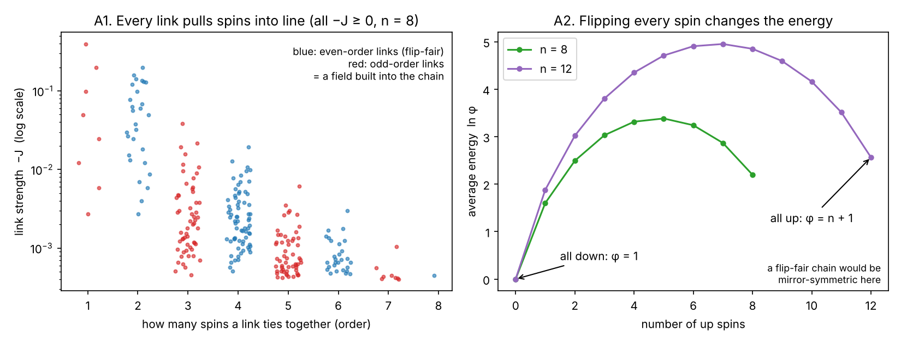
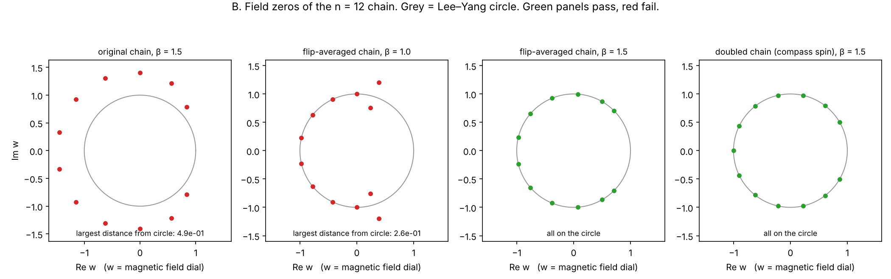
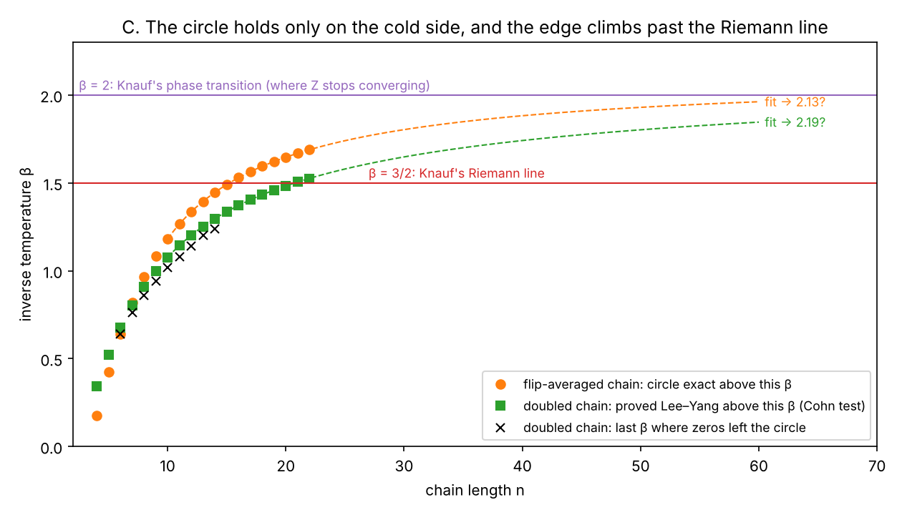
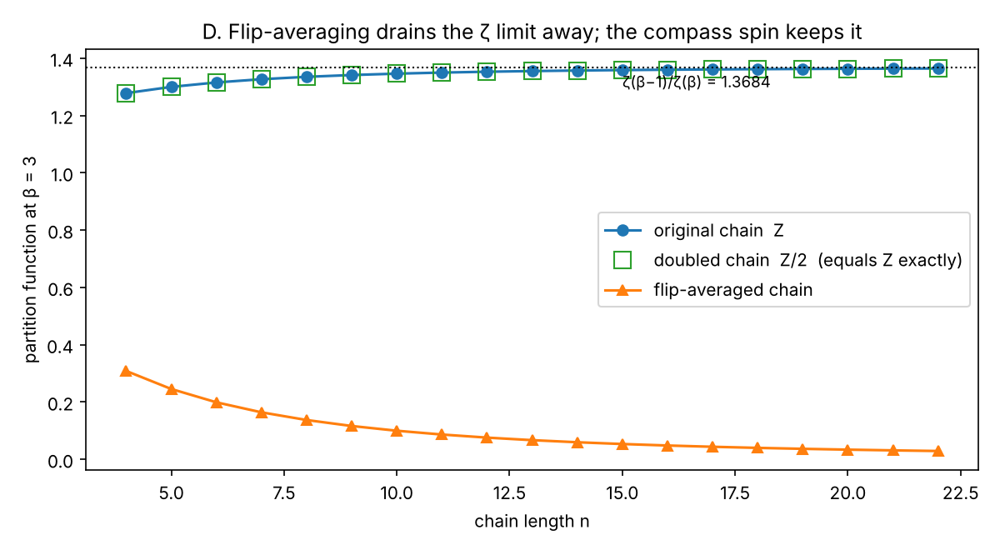

# DRAFT: Fixing Knauf's chain so it passes Lee–Yang

**Status: DRAFT.** Numbers checked by `checks.py` (19/19 pass, `checks_output.txt`). Nothing here proves RH.

**The plain result.** Yes, the chain can be fixed, but the fix only works on the cold side. Adding one extra
"compass" spin makes Knauf's chain flip-symmetric, keeps every link ferromagnetic and keeps its partition function
exactly (twice Knauf's, so the ζ limit survives). The fixed chain then passes the Lee–Yang circle test exactly, but
only above an inverse temperature that climbs with chain length: past Knauf's Riemann line β = 3/2 at n = 21, and
heading toward about 2, Knauf's phase transition. So the circle covers the absolutely convergent (ℓ¹) side and does
not reach the ℓ² edge where RH lives. And this circle is about field zeros; RH is about temperature zeros.

In this folder β is Knauf's temperature variable (usually written s), written β so it isn't confused with our height
dial s. Temperature is our roundness dial p read on the height ruler (knauf-field Fig A), so β is that p.

## Fig A. Why the original chain fails: a ferromagnet with a built-in field

- **A1.** Writing the energy ln φ as a sum of links (each link ties a set of spins together), every link pulls its
  spins into line (C1). That's the ferromagnet condition, and it is known (Knauf 1993; Contucci–Knauf 1997).
- The red links tie an odd number of spins. Flipping every spin flips their sign, so together they act as a field
  built into the chain, and a lumpy one: it is not the same push on every spin.
- **A2.** That's why flipping every spin changes the energy: all down has φ = 1, all up has φ = n + 1 (C2). Lee–Yang's
  theorem needs flip symmetry, so the field zeros of the original chain sit on a ring off the circle (Fig B, first panel).

## Fig B. Two fixes, tested on the n = 12 chain

- **Fix 1, flip-averaging.** Replace the energy by the average of it and its flipped self. That deletes the odd links.
  The field zeros go onto the circle exactly once β is large enough (third panel; C13), but not at β = 1 (second
  panel). The catch is in Fig D: this chain no longer turns into ζ.
- **Fix 2, the compass spin.** Add one spin τ and let it multiply the odd part: energy = even part + τ × odd part.
  With τ up you get Knauf's chain; with τ down you get Knauf's chain with every spin flipped, which has the same
  partition function. So Z = 2 × Knauf's Z exactly (C3). Flipping every spin, τ included, changes nothing (C4); every
  link is still ferromagnetic (C5); and no odd links are left (C6). Fourth panel: all zeros on the circle at β = 1.5.
- **This is the answer to "add a function to the field condition".** For up/down spins, any smoothing weight on a
  single spin is just a field in disguise (C15), so it can't smooth anything. The function that works is the compass
  spin: it multiplies the chain's own lumpy field, which makes that field flip-symmetric.

**Why the circle is exact, not just numerically close.** The field polynomial of the doubled chain is
Q(w) = P(w) + w^(n+1) P(1/w), where P is the original chain's (C7). If P has no zeros in the closed unit disk, then
inside the disk |w^(n+1) P(1/w)| < |P(w)|, so Q has no zeros there, and Q's symmetry under w → 1/w rules out the outside.
So every zero is on |w| = 1. This is a standard self-inversive polynomial fact (Schur–Cohn type). The test "P has no
zeros in the closed disk" is what we scanned in β (C8). It is slightly cautious: the circle really breaks only about
0.03 to 0.06 lower (C9, C10, the crosses in Fig C).

## Fig C. The circle holds only on the cold side, and the edge keeps climbing

- Both fixes pass Lee–Yang only above a threshold β, and the threshold rises with every added spin (C11).
- Doubled chain: 0.34 at n = 4, 1.077 at n = 10, 1.483 at n = 20, 1.505 at n = 21 and 1.525 at n = 22. So it passes at
  Knauf's Riemann line β = 3/2 up to n = 20 (C12) and stops passing from n = 21.
- Where it is heading: a power-law fit gives limits 2.13 (flip-averaged) and 2.19 (doubled), and the fitted limits
  fall as more lengths are added (`fitlim.json`). A geometric fit gives 1.81 and 1.68 but fits about three times worse. So the limit is
  somewhere near 2, which is Knauf's phase transition, where the chain's Z stops converging. The fits can't settle
  whether it is exactly 2.
- In our language: β = 2 is the ℓ¹ edge of the chain's level weights and β = 3/2 is the ℓ² edge (knauf-field Fig B).
  The circle seems to live exactly on the ℓ¹ side.

## Fig D. Does the fixed chain still turn into ζ?

At β = 3 Knauf's chain climbs to ζ(2)/ζ(3) = 1.3684 (C16). The doubled chain's Z/2 equals it at every length. The
flip-averaged chain drains toward 0 (C14), because its smallest energy grows like ln(n+1). So only the compass fix
keeps ζ.

## Graded two ways

| Result | Worth following? | Could reach a proof? |
|---|---|---|
| Compass-spin fix: symmetric, ferromagnetic, keeps ζ exactly (Fig B, D) | **Yes.** It's the right repaired object: a genuine Lee–Yang ferromagnet whose Z is ζ(β−1)/ζ(β) in the limit. | No by itself. It controls zeros in a field at real temperature; RH is about zeros in complex temperature at zero field. Nothing yet carries one to the other. |
| Circle threshold climbing toward 2 (Fig C) | **Yes, as a clean side question.** Something new to bound: prove the threshold tends to exactly 2, which would say the doubled chain is a Lee–Yang ferromagnet throughout its convergent phase. | No for RH: the proven region ends at the ℓ¹ edge (about 2) and never reaches the ℓ² edge (3/2) in long chains. It tells nothing about true versus false for RH. |
| Flip-averaging (Fix 1) | No: it passes the circle but loses ζ. | No. |
| Per-spin smoothing | No for up/down spins (it's only a field). It would matter for continuous spins, where our p-ball rule decides which single-spin weights keep Lee–Yang, but that changes the energy and loses the exact ζ. | No as it stands. |

## Known versus ours

| Piece | Status |
|---|---|
| Knauf's chain, its ζ limit, phase transition at β = 2 | Known: Knauf, CMP 153 (1993); J. Stat. Phys. 73 (1993). |
| The chain is ferromagnetic | Known: Knauf 1993; Contucci–Knauf, Forum Math. 9 (1997). |
| Lee–Yang circle theorem; it needs flip symmetry and pair ferromagnetism; many-spin links can break it | Known: Lee–Yang 1952; Newman 1974 and later work on many-spin couplings. |
| Replacing a field by one extra spin coupled to it ("ghost spin") | Known trick: Griffiths 1967. Our compass spin is that trick applied to the chain's lumpy many-spin field. |
| Self-inversive polynomials: P(w) + w^(n+1)P(1/w) has all zeros on the circle when P is zero-free in the disk | Known (Schur–Cohn type). |
| Applying flip-averaging and the compass spin to Knauf's chain; Z = 2 × Knauf exactly; the measured thresholds and their climb toward about 2 | Ours. |
| Reading the threshold limit as the ℓ¹ edge (circle on the ℓ¹ side, RH on the ℓ² edge) | Ours, as a reading. |

## Next routes this opens

- Bound the threshold: prove it tends to 2 (or find the true limit). That would be a clean theorem about Knauf's
  chain, though not RH.
- Find a bridge from field zeros to temperature zeros for this doubled chain, for instance a Lee–Yang statement in a
  two-variable polynomial in (w, β). That is the only way this line touches RH.

## Files

- `probe.py`: link (Walsh) decomposition; ferromagnet and flip checks.
- `circle_even.py` → `circle_even.json`: flip-averaged chain, field zeros at n = 8, 10, 12.
- `threshold.py`, `threshold_hi.py` → `threshold.json`, `threshold_hi.json`: flip-averaged circle threshold, n = 4..22.
- `even_probe.py`: flip-averaged Z draining.
- `doubled.py` → `doubled_threshold.json`: compass-spin chain, Cohn-test threshold, n = 4..22.
- `doubled_direct.py` → `doubled_direct.json`: where the doubled chain's zeros really leave the circle, n = 6..14.
- `fitlim.py` → `fitlim.json`: large-n fits. `figs.py` → `figures/`. `checks.py` → `checks_output.txt`.
