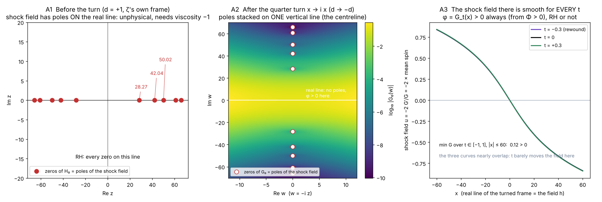
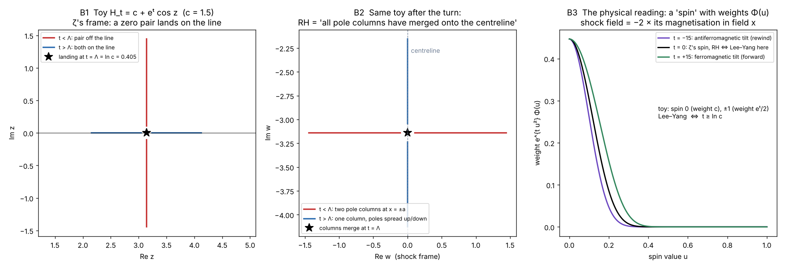
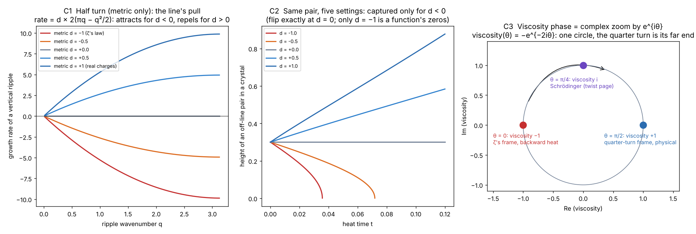

# Dial-Wick: turn a dial into the shock picture, answer there, turn back (DRAFT)

**Result.** One of our dials does it: the **d dial** (curvature dial). Turning d to −d is a Wick turn (x → i x, tan addition ↔ tanh addition). On ζ's zeros it is a quarter turn of the plane, and it makes the shock picture **physical**: backward heat becomes forward heat, viscosity −1 becomes +1, and the Burgers field has no poles on the real line, at every heat time. In that frame RH says one thing: **all the shock field's poles sit on one vertical line**, the centreline. In physics language, a "spin" whose values have weights Φ(u) obeys the Lee–Yang rule. Turning back is exact, because the quarter turn is a symmetry.

It does **not** settle RH. The turned question is Newman's 1976 Lee–Yang form of RH, which is still open. Being physical turns out to be automatic (it follows from Φ > 0) and holds whether RH is true or false, so it carries no information back. **Not a lead.** What it gives is the right physical picture: rewinding the heat flow = making the spin's coupling antiferromagnetic, and Λ = how much antiferromagnetic coupling ζ's spin can take before it loses the Lee–Yang property.

The other two turns (the d value in the metric only, and the viscosity phase) either break exactly at d = 0 or land on the twist page. Neither carries anything back.

15/15 checks pass (`checks.py`, output in `checks_output.txt`).

---

## 1. The turn: d → −d is x → i x

Our plane law is x ↦ (x + a)/(1 − d·a·x) at k = 0. Put i x and i a in: the law at d becomes i × (the law at −d) (W15). At d = +1 that is tan addition (rotations; the plane number squares to −1, so ζ's own complex plane is d = +1). At d = −1 it is tanh addition (boosts, light). So **the Wick turn of the d dial is x → i x**. Nothing else is needed.

Applied to the heat-flow function H_t(z) = ∫ e^{tu²} Φ(u) cos(zu) du, which runs dH/dt = −H_zz (backward heat):

- G_t(w) = H_t(i w) = ∫ e^{tu²} Φ(u) **cosh**(wu) du (W1, an identity).
- G runs **forward** heat: dG/dt = +G_ww (W2).
- Zeros move by a quarter turn: a real zero z becomes w = −i z on the imaginary axis.

**A1.** ζ's frame. The shock field u = −2 ∂ log φ has its poles at the zeros. Under RH they all sit on the real line, so the field blows up on the line: unphysical Burgers, which needs viscosity −1. **A2.** After the turn: the same zeros (white) stacked on one vertical line, the centreline. The real line is pole-free. **A3.** The shock field on the turned real line is smooth for every t. The smallest value of φ = G_t(x) over t ∈ [−1, 1], |x| ≤ 60 is 0.12 (W3). It satisfies u_t + u u_x = u_xx with viscosity +1 (W4). The pole heights match 2γ for the first five zeros to 7e-5 (W5).

## 2. The question in the shock frame, and its answer there

**What RH becomes.** In the turned frame a pair of zeros off the critical line (a quadruple ±a ± ib in ζ's frame) becomes **two pole columns sitting at x = ±b beside the centreline**, at height a. The pole law is the standard viscous-Burgers pole law dw/dt = −2Σ 1/(w_j − w_k) (W9). Poles at the same height attract sideways, and poles in the same column repel up and down. So:

- RH ⇔ at t = 0 every pole column has already merged onto the centreline.
- Λ = the time of the **last sideways merger**.

The exact toy H_t = c + e^t cos z shows it with nothing hidden (Figure B, W7–W8). Its zero pair lands on the line at exactly t = Λ = ln c. In the turned frame, two pole columns at x = ±arccosh(c e^{−t}) close in and merge on the centreline at that same moment.

**B1.** The toy in ζ's frame: the zero pair (red) lands at t = ln 1.5 = 0.405 and then splits along the line (blue). **B2.** The same event in the shock frame: two side columns merge onto the centreline, then spread up and down. **B3.** The physical reading. G_t(x) = ∫ e^{xu} e^{tu²}Φ(u) du is the partition function of one "spin" with value u and weight e^{tu²}Φ(u), placed in a field x. G′/G is its mean spin (magnetisation), so the shock field is −2 × magnetisation, increasing in the field as it must be (W6). The tilt e^{tu²} is a mean-field coupling: t > 0 is ferromagnetic, t < 0 (rewinding) is antiferromagnetic. For the toy, the spin is 0 with weight c and ±1 with weight e^t/2 each, and it has the Lee–Yang property exactly when t ≥ ln c.

**Can it be settled there?** No. Three reasons:

1. **Physical is free.** φ = G_t(x) > 0 because Φ > 0 (Pólya). This holds for every t, including t far below Λ, so "the frame is physical" says nothing about RH.
2. **The real content is the column condition**, i.e. whether ζ's spin is Lee–Yang at t = 0. That is exactly Newman's 1976 reformulation, and it is open.
3. **What physics adds is a tool, not an answer.** The Lee–Yang theorem says ferromagnetic coupling keeps the Lee–Yang property. That is why forward heat time keeps zeros real (de Bruijn's direction) and why Λ is a threshold. To get RH you would have to build ζ's spin out of Lee–Yang pieces joined only by ferromagnetic couplings. That is Newman's programme, and nobody has done it.

**Carrying back.** Exact and free. G_θ(w) = H(e^{iθ}w) is a whole function for every angle θ from 0 to π/2, so the continuation never breaks. That is also why it can't help: a symmetry moves the problem without changing it.

The Hill-radius threshold d* = √(2/S) carries over unchanged, because the turn keeps distances. In the shock frame it is the gap under which two neighbouring pole columns merge against the crowd's strain. No dial changes gap/d* except heat time itself: zoom (k) rescales both together.

## 3. The other turns

**C1–C2. Half turn, metric only.** ζ's law is the gradient of 2 log(distance) in the metric dx² + d·dy² with d = −1. Real charges are the same with d = +1. For any d the law splits exactly as v = (1 − d)/2 · (ζ's holomorphic law) + (1 + d)/2 · (its mirror image) (W11). Only d = −1 is the zero flow of a function.

- A vertical ripple on a crystal grows at d × 2(πq − q²/2) (W12): the line attracts for d < 0 and repels for d > 0.
- An off-line pair is captured for d < 0 (time ∝ 1/|d|: 0.036 at d = −1, 0.072 at d = −0.5), frozen at d = 0, and escapes for d > 0 (W13).

So the question can be settled at d = +1 (nothing is ever captured), but the answer flips sign exactly at d = 0 and cannot be carried back.

**C3. Viscosity phase.** The only combination in Burgers is viscosity × time. A real zoom (k) rescales viscosity by a positive factor. A complex zoom by e^{iθ} rotates its phase: viscosity(θ) = −e^{−2iθ} (W14).

- θ = 0: viscosity −1, ζ's frame.
- θ = π/4: viscosity i, Schrödinger. This is the twist page: zeros leave the line and nothing maps back.
- θ = π/2: viscosity +1, the quarter turn of §1.

So the viscosity dial is derived (zoom plus clock), and its one physical point is the d-dial quarter turn.

**Other dials.**
- **s (height):** picks which zeros you look at; it does not change the law.
- **p (ℓp exponent):** turning y → iy flips the sign of the y term only at p = 2, which is the metric case above.
- **t (odds), q, r:** none acts on viscosity, on the metric sign, or on the threshold. q and r are derived (the dial audit).

## 4. Link to the reflection-positivity thread

That page found that reflection positivity holds on the real k axis, fails off it, and that the Wick turn brings in one shared i, its (A4). The quarter turn here is the same kind of move made on the zero plane. In both cases the positive side (reflection positivity there, φ > 0 and Lee–Yang here) lives on one side of the turn. It is linked here, not repeated.

## Known vs ours

**Known (tools applied):**
- Cole–Hopf, and that the poles of viscous Burgers move by dw/dt = −2Σ 1/(w_j − w_k) (Choodnovsky & Choodnovsky 1977; Calogero 1978).
- G(x) = ∫Φ cosh(xu) du > 0, from Φ > 0 (Pólya 1926).
- A spin measure is Lee–Yang ⇔ its Fourier transform has only real zeros, and Λ as the threshold of the Gaussian tilt (Newman, Proc. AMS 61 (1976) 245–251). Survey: Newman & Wu, Bull. AMS 57 (2020) 595–614 (arXiv 1901.06596).
- Lee–Yang theorem (1952): ferromagnetic couplings keep the property.
- In mean-field (Curie–Weiss) models, the magnetisation solves Burgers, and phase transitions are shocks (Genovese & Barra, J. Math. Phys. 50 (2009), arXiv 0812.1978; Barra, Di Lorenzo, Guerra, Moro, arXiv 1407.5009).
- Wick rotation tan ↔ tanh.

**Ours:**
- Reading the d-dial Wick turn as this quarter turn of ζ's zero plane, and so as the bridge from ζ's backward heat to forward, physical Burgers.
- The observation that this frame is physical at every t, RH or not, so physicality carries nothing back (immediate from the known facts).
- RH as "all pole columns merged on the centreline", and Λ as the last sideways merger.
- Rewinding read as antiferromagnetic coupling, as a picture. Newman–Wu's framing is close; we have not checked whether they say it in these words.
- The metric-dial split v = (1 − d)/2 · Hol + (1 + d)/2 · conj(Hol), the ripple law d × 2(πq − q²/2), and the flip at d = 0.
- The viscosity-phase circle ν(θ) = −e^{−2iθ} tying together the twist page and this page.
- The toy c + e^t cos z is a textbook-style example; we make no claim to it.

## Files

- `dialwick.py`: all computations, writing `dialwick.json`, `frames.npz`, `toy_tracks.npz`, `merger.npz`, `dispersion.npz`, `kappa_pairs.json`.
- `figs.py`: the three figures. `checks.py`: 15 checks, with output in `checks_output.txt`.
