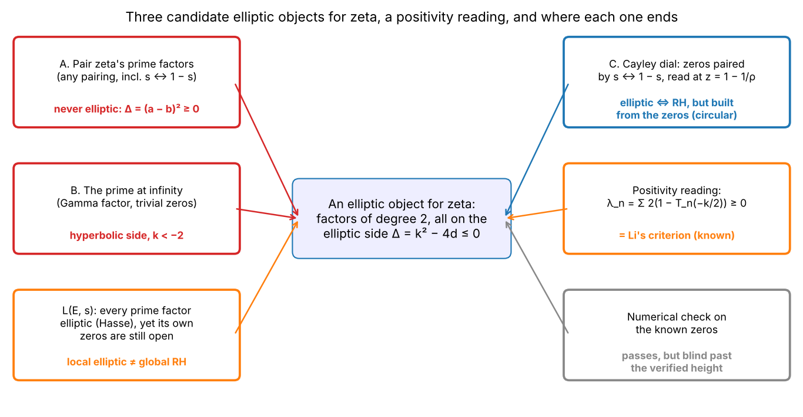
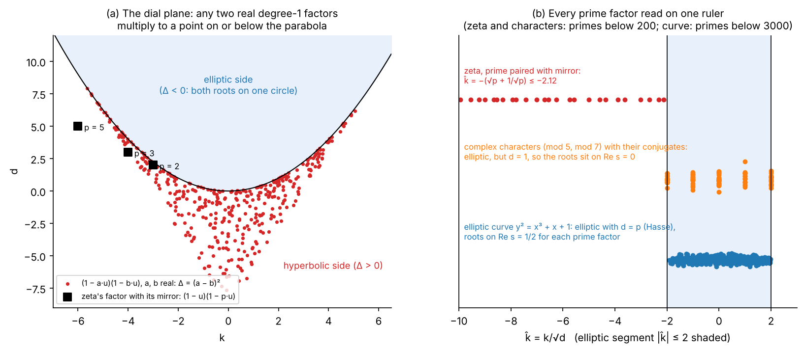
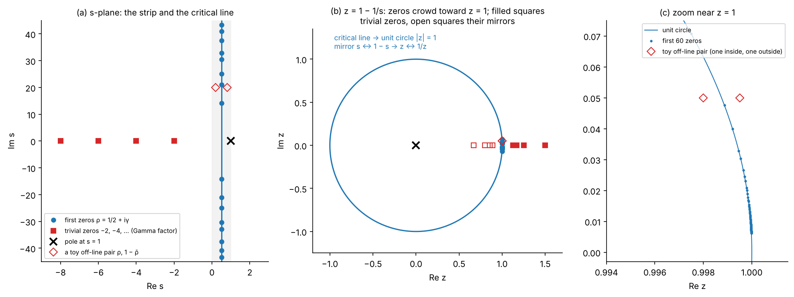
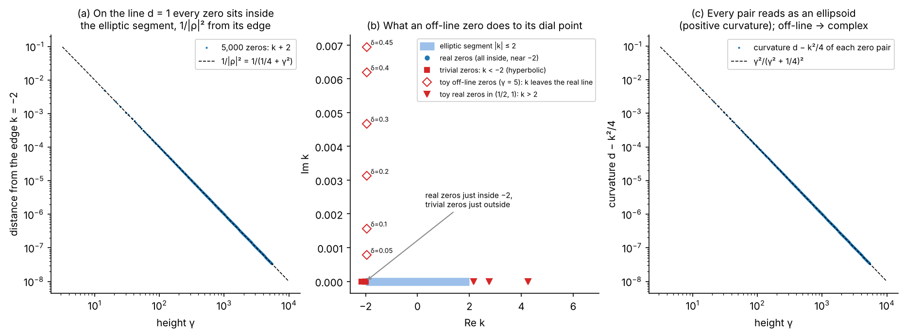
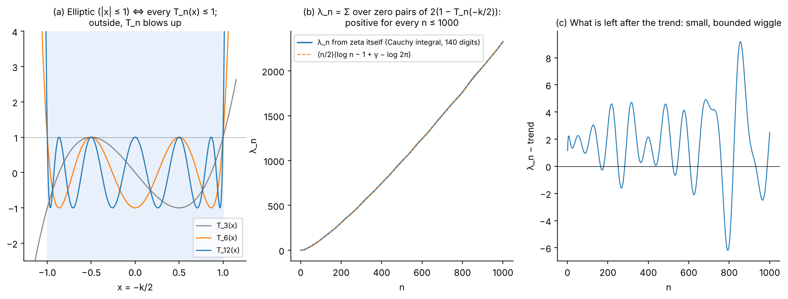
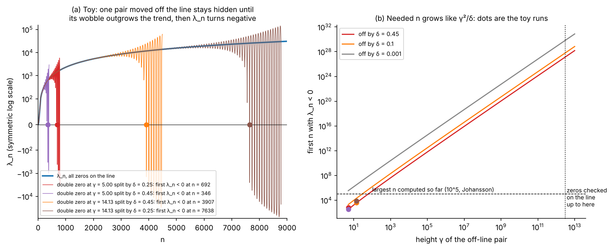
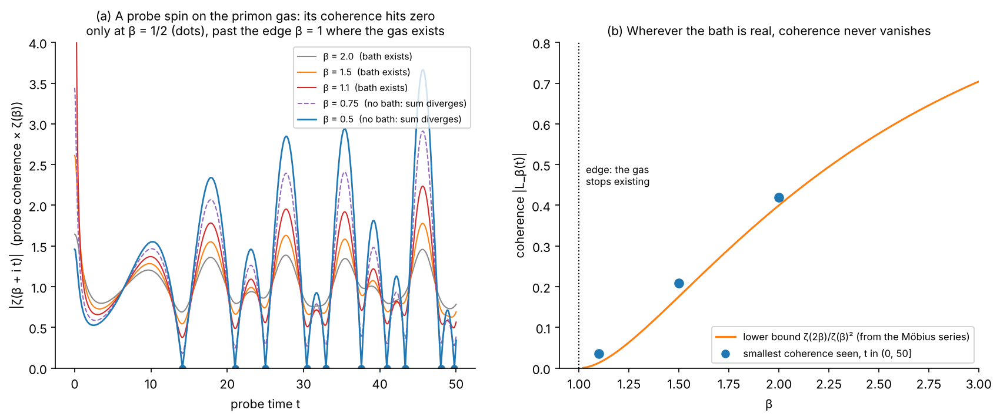
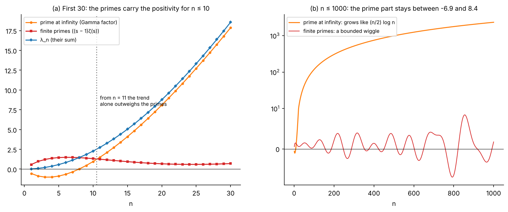
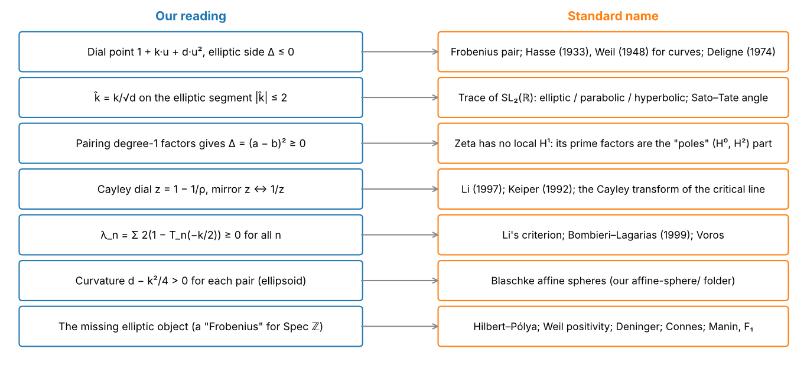

# DRAFT · Is there an elliptic object for zeta? (Riemann, second look)

**DRAFT, Nov 26 2026.** Part of Affine Composition Theory, built on Fused Hyperoperation Algebra. Brennan picked this
from three missing pieces ("Try the elliptic object"), then asked two follow-ups on the same call: whether our prime
work has a positivity like Lee–Yang's lined-up spins, and whether our precession results give a probe-spin picture.
Both are folded in as section 7.
Checks: `checks.py` → `checks_output.txt`, **31 of 31 pass** (24 math, 7 polish). Lean: `lean/EllipticObject.lean`,
11 statements (10 theorems and 1 definition), compiled in the shared library as `FusedAlgebra.Topics.RiemannElliptic`. First look: `../README.md`.

## The answer

**No candidate built with our tools gives zeta degree-2 factors on the elliptic side, except one built from the
zeros themselves.** For that one, "every factor elliptic" is the Riemann hypothesis restated: it is Li's criterion,
which our dial reads as Chebyshev traces. This is **not a lead** toward a proof.

Here is exactly where each candidate breaks:

- **Zeta's prime factors:** they have degree 1, and any pairing of two real degree-1 factors gives Δ = (a − b)² ≥ 0.
- **The prime at infinity:** it sits on the hyperbolic side.
- **Prime factors that are elliptic** (as for an elliptic curve's L-function): they bound each factor, not the zeros
  of the product.
- **The positivity check:** it passes on the known zeros, but a numerical check like this can't see past the height
  where zeros have already been verified.
- **Our prime work and our precession results:** neither supplies a positive coupling among primes. In our
  prime cube the primes are fully independent.

*Figure 0. Three candidates (left and top right), the positivity reading (middle right) and what a numerical check
can do (bottom right). Red: breaks. Orange: known. Blue: our reading. Grey: reference.*

The dial plane from the first look: a quadratic factor 1 + k·u + d·u² is a point (k, d). Its discriminant is
Δ = k² − 4d, and the factor is elliptic (both roots on the circle |u| = d^(−1/2)) when Δ ≤ 0. For a curve over a
finite field, Weil's theorem says every factor of its zeta numerator is elliptic. The question was whether zeta has
such factors.

## Pass 1: our own tools (fundamental first)

### 1. Pairing zeta's prime factors never reaches the elliptic side

*Figure 1. (a) Products of two real degree-1 factors (red dots) all land on or below the parabola Δ = 0. Zeta's
factor paired with its mirror (black squares) is among them. (b) Every factor on one ruler k̂ = k/√d, where the
elliptic segment is |k̂| ≤ 2.*

- **The lemma.** (1 − a·u)(1 − b·u) is the dial point k = −(a + b), d = a·b, with Δ = (a − b)² ≥ 0 (G1, Lean
  `pair_disc`). Two real roots never make a complex pair, however you pair them.
- **Zeta with its mirror.** Pairing 1 − u with the s ↔ 1 − s mirror 1 − p·u gives (1 − u)(1 − p·u), with
  Δ = (p − 1)² and k̂ = −(√p + 1/√p) ≤ −2.12 (G2, Lean `mirror_pair`). This is exactly the denominator of a curve's
  zeta over F_p, the part that makes its poles. So locally, zeta has the pole part and nothing else. The part that
  holds a curve's zeros has no counterpart in any prime factor of zeta.
- **Complex characters do go elliptic, on the wrong circle.** A character paired with its conjugate gives
  1 − 2Re χ(p)·u + u², with Δ ≤ 0 but d = 1, so the roots sit on Re s = 0 (G3). The weight d sets the circle. Roots
  on Re s = 1/2 need d = p, which only an object like an elliptic curve has (G4: all 428 good primes below 3000 obey
  Hasse's bound).
- **Verdict: can't work** (proved, and elementary).

### 2. Factors that are elliptic at every prime still don't settle the zeros

The elliptic curve y² = x³ + x + 1 has an elliptic factor at every good prime (G4, blue in Figure 1b). Even so, the
Riemann hypothesis for its own L-function is open, just like zeta's. An elliptic factor puts that factor's own
zeros on a circle. The zeros of the infinite product come from continuing the product into the strip, which no
single factor sees. Over a finite field the whole zeta is a finite product of elliptic factors, which is why Weil
could finish there. **Verdict: this is the gap** between Weil's setting and zeta's.

### 3. The prime at infinity sits on the hyperbolic side

The Gamma factor's roots are the trivial zeros s = −2, −4, … Read through the Cayley map of section 4, each one
pairs with its mirror at k < −2. That is the hyperbolic side, approaching the edge −2 from outside (G11; k = −2.17
for s = −2). **Verdict: wrong side.**

### 4. The Cayley dial: the one candidate that is elliptic

*Figure 2. (a) The s-plane. (b) z = 1 − 1/s maps the critical line onto the unit circle. The mirror s ↔ 1 − s
becomes z ↔ 1/z. The zeros crowd toward z = 1, and trivial zeros land on the real axis outside the circle.
(c) Zoom: a toy off-line pair splits into one point inside the circle and one outside.*

- **The map.** z = 1 − 1/ρ. Since |ρ − 1|² − |ρ|² = 1 − 2·Re ρ, |z| = 1 exactly on the critical line (G5, G6,
  Lean `cayley_circle`). The mirror ρ ↦ 1 − ρ is z ↦ 1/z (G5).
- **The factor.** Pair each zero with its mirror: (1 − z·w)(1 − w/z) = 1 − (z + 1/z)·w + w². Every pair sits on the
  line d = 1, and its discriminant is (z − 1/z)² (Lean `pair_factor`, `pair_factor_disc`). It is elliptic exactly
  when |z| = 1, so **the Riemann hypothesis says every pair is elliptic**, the same statement as Weil's for a curve,
  with q = 1.

*Figure 3. (a) All 5,000 computed zeros sit inside the elliptic segment, at distance 1/|ρ|² from its edge k = −2.
(b) A toy zero off the line lifts its dial point off the real axis. A toy real zero lands at k > 2. (c) Each pair's
curvature d − k²/4 is positive, which our affine-sphere page reads as an ellipsoid.*

- **On the line, k = −2 + 1/|ρ|² and the curvature is γ²/(γ² + 1/4)²** (G7, G8; exact). For all 5,000 zeros,
  |k| < 2 and the formula holds to 10⁻¹⁵ (G9). The affine-sphere page showed every setting (k, d) has one affine
  sphere, with affine mean curvature 2^(3/2)(d − k²/4). So each zero pair is an ellipsoid.
- **Off the line, k stops being real.** With ρ = 1/2 + δ + iγ, the pair's k picks up an imaginary part of about
  δ/γ³, and its curvature goes complex (G10, Figure 3b). A real zero in (1/2, 1) would sit at k > 2: hyperbolic.
- **Verdict: elliptic exactly when the hypothesis holds, so it's circular.** We can only draw this object from the
  zeros. A proof would need to build it some other way, the way Weil had a curve and its Frobenius. Nothing in our
  law builds it.

### 5. "Every factor elliptic" as a positivity: Chebyshev traces

*Figure 4. (a) The Chebyshev polynomials Tₙ stay at or below 1 on the elliptic segment and blow up outside it.
(b) λₙ computed straight from zeta, with no zeros used, for n = 1 to 1000 (blue), against its trend (orange).
(c) What is left after the trend: a small wiggle.*

- **The reading.** Elliptic means |k| ≤ 2, which means every Chebyshev value Tₙ(−k/2) is at most 1. Summed over
  the zero pairs, λₙ = Σ 2(1 − Tₙ(−k/2)) ≥ 0 for every n (G16, Lean `dickson_pair`, `li_term`). If some pair is
  off the elliptic segment, Tₙ grows without bound for that pair and λₙ eventually goes negative. This is Li's
  criterion (pass 2), rewritten in our dial.
- **The same shape for a curve.** Over F_5, #E(F_{5ⁿ}) = 5ⁿ + 1 − 2·5^(n/2)·Tₙ(a/(2√5)), and the Weil bound is
  the statement that every Tₙ stays at most 1 (G18). Zeta's λₙ is the same test, with the zeros in place of
  Frobenius.
- **The numbers.** We computed λₙ for n ≤ 1000 from log ξ by a Cauchy integral at 140 digits.
  λ₁ = 0.0230957089661210338, matching 1 + γ/2 − ½log 4π to 25 digits (G12). λ₂ matches its closed form (G13). Every
  λₙ is positive (G14). Rebuilt from the 5,000 dial points plus a density tail, λₙ agrees to 10⁻⁵ relative (G15).
  It follows the trend (n/2)(log n − 1 + γ − log 2π) within √n (G17).
- **Verdict: a true positivity, and the right one.** It is equivalent to the hypothesis, and it is known.

### 6. How far can a numerical check see?

*Figure 5. (a) Toy runs: a double zero at height γ split off the line by δ. λₙ stays positive until the pair's
wobble outgrows the trend. (b) The first negative λₙ comes at about (γ²/δ)·log(trend). Dots are the toy runs.
Zeros are checked on the line up to 3·10¹²; the largest n anyone has computed is 10⁵.*

- **Toy runs.** Splitting a double zero at γ = 5 by δ = 0.45 first turns λₙ negative at n = 346; by δ = 0.25, at
  n = 692. At γ = 14.13 it takes n = 3907 and n = 7638 (G19, within 30% of the formula).
- **Reach.** A pair just above the verified height 3·10¹² would first show at n > 10²⁶ (G20).
- **Verdict:** the check passes on the known zeros (G14), but it can't add anything past what zero-checking has
  already verified.

### 7. Positivity among primes, and a probe spin (Brennan's follow-ups)

**Lee–Yang's positivity is spins that like to line up** (a ferromagnetic coupling, J ≥ 0, between pairs). I looked
for that among primes in our prime cube and its dial k, the k = −1 corner signs, the primes and number-theory-geometries
folders, and the Lee–Yang work.

- **None of it has a coupling among primes.** In the lift, every prime factor just multiplies:
  1 + k·(fold) = ∏(1 + k·p^(−s)). That is independence, which means coupling zero. The sign of k does order
  things, since k > 0 makes the cube supermodular and k < 0 submodular (number-theory-geometries, B1). But that comes
  from the same product, not from primes interacting.
- **Precession needs two inputs that don't commute.** Our precession page proved that a swap turns the result by
  k·(ab − ba). Zeta's prime factors are numbers, so they all commute, and the holonomy is zero.

*Figure 6. (a) A probe spin coupled to the primon gas (one mode per n, frequency log n, weight n^(−β)) has
coherence ζ(β + it)/ζ(β). It reaches zero only at β = 1/2 (dots: the zeros), past the edge β = 1 where the gas
exists. (b) Wherever the gas exists, the coherence stays above ζ(2β)/ζ(β)².*

- **The probe-spin picture.** This is the same reading the 2015 Lee–Yang experiment used: coherence equals the
  partition function at an imaginary field. A probe on the primon gas has coherence ζ(β + it)/ζ(β), and its zeros
  are exactly zeta's zeros on the line Re s = β (G22). But the gas only exists for β > 1, where the sum of n^(−β)
  converges. There the coherence never vanishes: it stays above ζ(2β)/ζ(β)², which comes from the Möbius series
  (G21). **So a probe that could exist never sees a zero, and the zeros sit where no gas exists.**

*Figure 7. Li's λₙ split by source: the prime at infinity (the Gamma factor, orange) and the finite primes
((s − 1)ζ(s), red). (a) For n ≤ 10 the primes carry the positivity. (b) From n = 11 on, the trend from the prime at
infinity outweighs them. The prime part stays a bounded wiggle up to n = 1000.*

- **Where the positivity comes from.** The prime-at-infinity part is negative for n ≤ 7. For n ≤ 10, the finite
  primes carry λₙ. From n = 11 to 1000, the prime-at-infinity part alone outweighs the primes, and the prime part
  stays between −6.9 and 8.4 (G23, G24). The hypothesis is the statement that this wiggle never outgrows the trend,
  for every n.
- **Verdict: no positive pairwise coupling among primes in our work, and the probe can't reach the zeros.**

## Pass 2: the existing work

*Figure 8. Each of our readings next to its standard name.*

| Our piece | Known | What's ours |
|---|---|---|
| Elliptic dial points for curves | Hasse (1933), Weil (1948), Deligne (1974). The normalized trace k̂ is the SL₂(ℝ) trace classification; the angles are Sato–Tate. | The picture (first look). |
| Pairing lemma; zeta's prime factor = the pole part | Zeta has no local "H¹": the analogy of Spec ℤ with a curve and the missing cohomology is Deninger's program (ICM 1998; foliated spaces, 2007), Manin's lectures (Spec ℤ over the field with one element, 1991–92) and Kurokawa. The cohomology has not been built. | The one-line dial form Δ = (a − b)². |
| Cayley map, λₙ ≥ 0 | Keiper (1992), Li (1997), Bombieri–Lagarias (1999). Asymptotics (n/2)(log n − 1 + γ − log 2π): Keiper, Voros, Arias de Reyna (2011). Computed to n = 10⁵ by Johansson. | Reading λₙ as Chebyshev traces of dial points, k + 2 = 1/|ρ|², and the curvature γ²/(γ² + 1/4)². These are elementary. I didn't find them in this form (one search). |
| Weil positivity | Weil (1952): the explicit formula's quadratic form is positive exactly when RH holds. Bombieri (2000): with finitely many off-line zeros, the number of negative eigenvalues is half their count. Yoshida: positive on short intervals. | None. Li's λₙ is one slice of it. |
| Splitting λₙ by place | Bombieri–Lagarias split λₙ into an archimedean part and a prime part. | Our numbers (primes carry n ≤ 10, the trend from n = 11). Not new in substance. |
| Detection reach | Li's asymptotics imply it. Voros describes the non-tempered growth an off-line zero would cause. | The explicit toy and the γ²/δ reach curve. |
| Ferromagnetic primes | Knauf (1993): a number-theoretic spin chain that is ferromagnetic, with partition function ζ(β − 1)/ζ(β). Its couplings are many-body, so the Lee–Yang theorem doesn't apply. Contucci–Knauf (1995): one phase transition, at β = 2. Primon gas: Julia, Spector (1990). Bost–Connes (1995): a quantum system with partition function ζ(β) and a phase transition at β = 1. | That our prime cube has coupling exactly zero. |
| Probe spin | Wei–Liu (2012) and Peng et al. (2015): probe-spin coherence equals the partition function at an imaginary field, and its zeros are the Lee–Yang zeros. Creffield–Sierra (2015): a periodically driven cold-atom system whose quasienergies read off zeta's zeros on the line. | The bound showing the probe can't vanish wherever the gas exists. |
| The missing object | Hilbert–Pólya (an operator with the zeros as spectrum), Connes' trace formula on adele classes (1998–99), Connes–Consani, Deninger. | None. |

Other sources: Platt and Trudgian, "The Riemann hypothesis is true up to 3·10¹²" (2021).

## What's new, plainly

All of it is elementary, and none of it moves the hypothesis.

- The pairing lemma in dial form. Zeta's prime factor paired with its mirror is exactly a curve's pole part.
- The Cayley dial formulas: k + 2 = 1/|ρ|² and curvature γ²/(γ² + 1/4)², read as one ellipsoid per zero pair.
- Li's sum written as Chebyshev traces 2(1 − Tₙ(−k/2)) of dial points, the same shape as the Weil bound for a curve.
- The bound showing the probe spin on the primon gas can't vanish anywhere the gas exists.
- The numbers: λₙ for n ≤ 1000 from zeta itself, and its split by place.

## Is it a lead?

**No.** The elliptic object would have to be built without using the zeros, the way Weil had a curve and its
Frobenius. Our law gives zeta only commuting, independent, degree-1 prime factors. Those can't pair into elliptic
factors, can't produce a holonomy, and carry no positive coupling. The one positivity that does reach the zeros
(Weil's, through Li's λₙ) is known and equivalent to the hypothesis. Our reading adds a picture, not a handle.

For the theory's README: no Promising-leads entry. A possible "Where it unifies" line: *Riemann's zeros, seen
through the Cayley map z = 1 − 1/ρ, are dial points on the line d = 1. Li's criterion says each one is elliptic,
with the same Chebyshev traces as Weil's bound for curves.*

## Lean (`lean/EllipticObject.lean`, compiled)

There are 11 statements (10 theorems and 1 definition) in core Lean 4 with `grind`, importing `FusedAlgebra.Base`, with no `sorry`:

- `pair_product`, `pair_disc`, `mirror_pair`: the pairing lemma.
- `cayley_circle`: the Cayley map, without division.
- `pair_factor`, `pair_factor_disc`: the pair factor on d = 1.
- `dickson`, `dickson_pair`, `li_term`: zⁿ + z'ⁿ as a fixed polynomial in the dial value, which is Li's term.
- `genus1_p5_elliptic'`, `genus1_p25_count`: two integer checks on y² = x³ + x + 1.

Nothing here touches the zeros, which need analysis that core Lean doesn't have. It was compiled in the shared
library on Nov 26 as
[`FusedAlgebra.Topics.RiemannElliptic`](../../../lean-library/FusedAlgebra/Topics/RiemannElliptic.lean) (namespace
`CircleOp.RiemannElliptic`), with every statement as written.

## Checks (`checks_output.txt`)

**G1–G11, exact or exact-plus-data:**
- the pairing lemma and the mirror pair;
- characters and the elliptic curve;
- the Cayley map and its mirror;
- k + 2 = 1/|ρ|² and the curvature;
- all 5,000 zeros inside the segment;
- off-line toys and trivial zeros.

**G12–G20, Li:**
- λ₁ and λ₂ against closed forms;
- positivity for n ≤ 1000;
- the zero-side rebuild;
- the Chebyshev identity and the trend;
- the Weil-bound shape over F_5;
- detection toys and reach.

**G21–G24, follow-ups:**
- probe coherence bound;
- probe zeros at β = 1/2;
- Li split.

**P1–P7, polish:**
- DRAFT and the theory's name;
- every picture shown and present;
- no overclaiming phrases;
- the wording rule (backward heat flow; "rewind" only as a picture);
- the answer first;
- quoted numbers match the data;
- Lean marked uncompiled.

## Files

| File | What |
|---|---|
| `zeros.py` → `zeros.json` | first 5,000 zeros (mpmath, 22 digits) |
| `li.py` → `li.json` | λₙ, n ≤ 1000, from log ξ by a Cauchy integral (|z| = 0.8, 4096 points, 140 digits) |
| `li_split.py` → `li_split.json` | the same, split into the prime-at-infinity part and the finite-primes part |
| `dial.py` → `dial.json` | every candidate's dial points, λₙ from the zeros plus a density tail, toys |
| `toy_dense.py` | detection toys at every n (rewrites `dial.json`'s toy entries) |
| `probe.py` → `probe.json` | probe-spin coherence |
| `figures.py` → `figures/` | 9 pictures |
| `checks.py` → `checks_output.txt` | 31 checks |
| `lean/EllipticObject.lean` | 11 statements, uncompiled |

Run order: zeros, li, li_split, dial, toy_dense, probe, figures, checks.

## Conventions

- ρ = 1/2 + iγ is a nontrivial zero, and z = 1 − 1/ρ.
- A pair factor is 1 − (z + 1/z)·w + w², so k = −(z + 1/z) and d = 1.
- λₙ = Σ_ρ (1 − (1 − 1/ρ)ⁿ), summed over ρ and its conjugate together.
- ξ(s) = ½s(s − 1)π^(−s/2)Γ(s/2)ζ(s).
- k̂ = k/√d normalizes any factor to d = 1.
