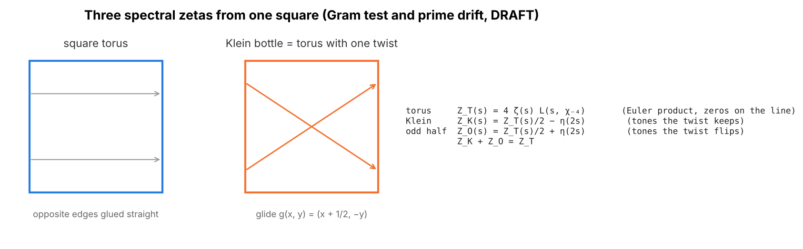
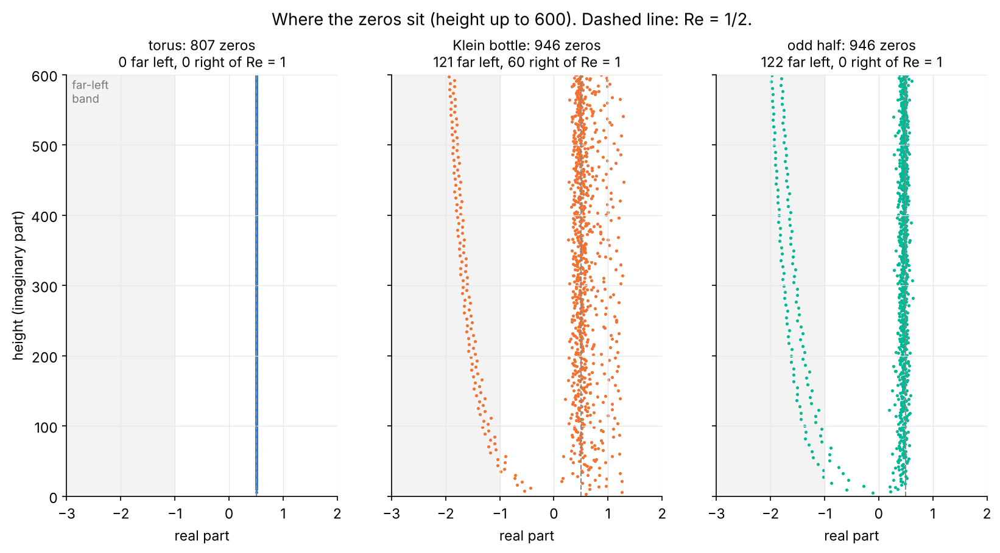
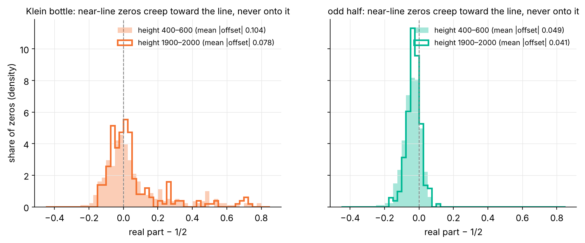
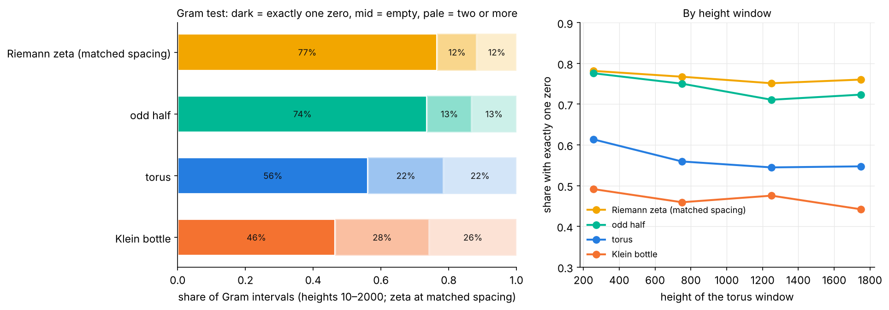
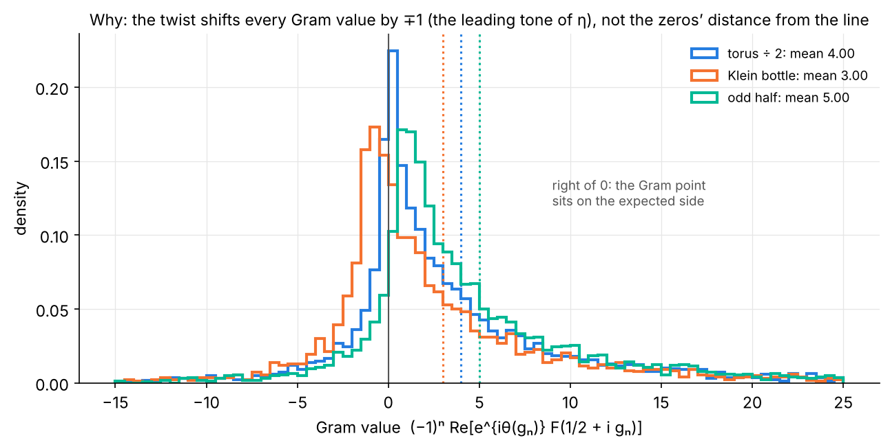
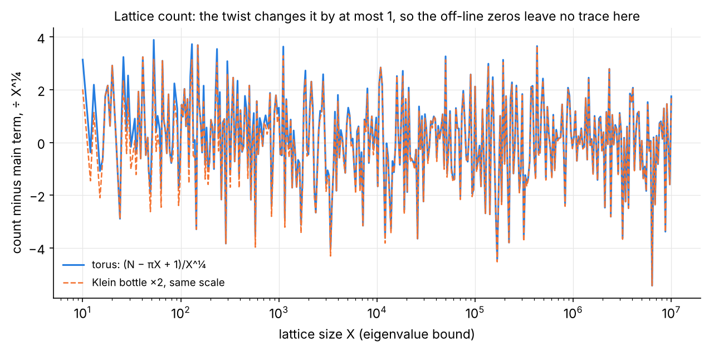
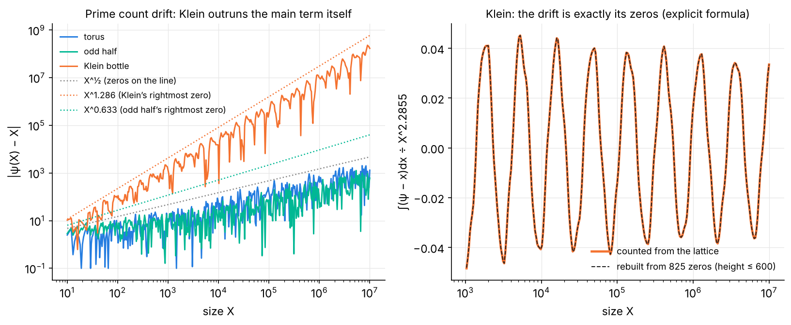

# DRAFT · Gram's law and prime drift on the torus and the Klein bottle

> **Names:** some words or symbols on this page (twist) also mean something else in standard math, physics or computing, or inside this project. [NAMING-COLLISIONS.md](../../../NAMING-COLLISIONS.md) says which meaning is in play.

*Affine Composition Theory, built on Fused Hyperoperation Algebra. DRAFT, Nov 27 2026. Follows [Riemann round 8 §3a](../round8/README.md) (the twist takes the torus's spectral zeros off the line) and the [Klein-bottle flow pages](../../klein-flow/README.md). Gram's law background: [round 9 §6](../round9/README.md) and its [literature table](../round9/gram-literature.md).*

Asked for by Brennan ("Yes" to running the Gram test and the prime-drift picture on the torus and the Klein bottle as a task of its own). The guess going in: the Klein bottle's zeros left the line, so its Gram intervals should often come up empty, and its count should drift.

Checks: `checks.py` → `checks_output.txt`, **18/18 pass**. Pictures: `figures.py` → `figures/`. Colour key: **blue = torus, orange = Klein bottle, green = odd half, yellow = Riemann zeta.**

## The result in three sentences

1. **Gram's law does not see zeros leaving the line.** The Klein bottle does fail it more often than the torus (46% of Gram intervals hold exactly one zero, against 56%), but the odd half, whose zeros are just as far off the line, passes it *more* often than the torus (74%). What sets the rate is the first tone of each spectrum: the average Gram value is exactly 8, 3 and 5 for torus, Klein bottle and odd half, so the twist moves every Gram value by ∓1.
2. **The lattice count doesn't drift at all.** Counting eigenvalues up to X, the Klein bottle has exactly half the torus's count, minus 0 or 1. Zeros never enter a lattice count; only poles do.
3. **The prime count drifts enormously.** The Klein bottle's prime count (the log-derivative of its zeta) runs away from its main term like X^1.286, the real part of its rightmost zero, and its zeros rebuild that drift almost exactly. This is the Davenport–Heilbronn effect (no Euler product, zeros right of Re s = 1), known since 1936.

*Figure 0. One square, glued two ways. The Klein zeta keeps the tones the twist leaves unchanged; the odd half keeps the tones the twist flips. Added together they give back the torus.*

## 1. The three zetas

The square torus R²/Z² has Laplace eigenvalues 4π²(m² + n²). Its spectral zeta (dropping (2π)^(−2s)) is Z_T(s) = Σ r₂(n) n^(−s) = 4ζ(s)L(s, χ₋₄), the Dedekind zeta of the Gaussian integers times 4. The glide g(x, y) = (x + ½, −y) splits the tones into those g keeps (the Klein bottle) and those it flips (the odd half):

- **Klein bottle:** Z_K(s) = Z_T(s)/2 − η(2s)
- **odd half:** Z_O(s) = Z_T(s)/2 + η(2s)
- where η(2s) = (1 − 2^(1−2s))ζ(2s) = 1 − 4^(−s) + 9^(−s) − … comes from the line n = 0, where the half-step x + ½ keeps even m and flips odd m.

The torus has an Euler product and the functional equation s ↔ 1 − s. The η(2s) part reflects about s = ¼ instead, so neither Z_K nor Z_O has a functional equation or an Euler product (check C12: the Klein "prime count" is nonzero at the composite 10).

## 2. Where the zeros are

*Figure 1. Every zero with −3 < Re s < 2.5 up to height 600. The torus: 807 zeros, all on the line. Klein bottle and odd half: 946 each, in three families.*

- **Near-line family.** Same count as the torus, one per Gram interval on average (checks C7). Klein's lean right of the line, the odd half's lean left.
- **Right family (Klein only).** 60 zeros up to height 600 with Re s > 1; the rightmost is ρ = 1.2855 + 447.2147i (checked with mpmath, C13). They keep coming: 10 more between heights 1900 and 2000.
- **Far-left band (both).** An extra family drifting slowly left (Re ≈ −1 at height 50, ≈ −1.9 at 600). Its density is log 2/π ≈ 0.22 per unit height (measured 0.21 to height 600, C8; 0.216 to height 2000). That is the rate at which the factor 2^(−2s) turns, so this band is the half-step of the glide showing up in the zeros. All the extra zeros the twist adds live here.

*Figure 2. The near-line family's distance from Re s = ½, at heights 400–600 (filled) and 1900–2000 (outline). Klein: mean 0.104 → 0.078. Odd half: 0.049 → 0.041. The torus part grows with height while η stays near 1, so its pull shrinks slowly; none lands on the line.*

## 3. The Gram test

Gram points g_n are where θ(g_n) = nπ, with θ(t) = arg Γ(½ + it) − t log π the torus's phase. Klein and odd half have no real Hardy function, so they use the torus's Gram points (same Γ factor, same smooth count) and we count zeros of any real part in each Gram interval by the argument principle on rectangles (every winding number an integer to 10⁻³, C4). For Riemann zeta we used the height whose zero spacing matches each torus window (H = 2t²/π, via Riemann–Siegel).

| Heights 10–2000 (3472 Gram intervals) | exactly one zero | empty | two or more | weak Gram law (sign) |
|---|---|---|---|---|
| Riemann zeta, matched spacing (4 × 3000 intervals) | 76.5% | 11.8% | 11.7% | — |
| odd half | **73.6%** | 13.1% | 13.3% | 86.5% |
| torus | 56.2% | 22.3% | 21.5% | 75.7% |
| Klein bottle (zeros right of Re = −1) | **46.5%** | 27.8% | 25.8% | 59.1% |

*Figure 3. Left: the shares over the whole range. Right: the share with exactly one zero, window by window. The order odd half > torus > Klein holds in every window.*

**Why.** The weak Gram law asks whether (−1)ⁿ Re[e^(iθ(gₙ)) F(½ + i gₙ)] is positive. For the torus the n = 1 term of the approximate functional equation contributes 2·a(1) = 8 at every Gram point and everything else averages out, so the average Gram value is 8 (Titchmarsh's theorem for ζ, where it is 2; extended to Hecke L-functions by Weishäupl). Halve it and add the twist: η(1 + 2it) averages 1 (its leading tone), with no reflected part because its centre is at ¼. So Klein averages 4 − 1 = 3 and the odd half 4 + 1 = 5. Measured over 3473 Gram points: **7.998, 2.999, 4.999** (C9).

*Figure 4. Histograms of the Gram values. The twist slides the whole distribution left (Klein) or right (odd half) by the size of η's first tone. That, not the zeros' distance from the line, is what moves the Gram rates.*

So the guess was half right: Klein's intervals do come up empty more often (28% against the torus's 22%), but for a reason that would make an equally off-line function pass more often if the sign were flipped, and the odd half shows exactly that.

## 4. The drift

**Lattice count.** N(X) = number of eigenvalues m² + n² ≤ X. Because η(2s) has coefficients only at squares,

  N_K(X) = N_T(X)/2 − [⌊√X⌋ odd],  N_O(X) = N_T(X)/2 + [⌊√X⌋ odd]

exactly (C10, every X ≤ 2·10⁵; drift.py checks to 10⁷). The torus count is Gauss's circle problem, πX − 1 plus an error of size about X^¼; the Klein bottle carries the same error, halved. Perron's formula shows why: the count is ∫ F(s) X^s ds/s, whose only poles are F's poles. Zeros of F appear only in 1/F or F′/F.

*Figure 5. Count minus main term, scaled by X^¼. Torus (solid) and twice the Klein count (dashed) lie on top of each other.*

**Prime count.** Write −F′/F = Σ c(n) n^(−s) and ψ(X) = Σ_{n≤X} c(n). For the torus, c is the von Mangoldt function of the Gaussian primes (C11), and ψ_T(X) − X stays at the √X scale, as the Riemann hypothesis for Q(i) says it must. For the Klein bottle, c lands on composites too (c(10) = −9.21), and the explicit formula ψ(X) = X − Σ X^ρ/ρ + … is dominated by the rightmost zero: |ψ_K(X) − X| grows like X^1.286 and passes X itself (C16; at X = 10⁷ the drift is 1.7·10⁸). Integrating once makes the zero sum converge absolutely; the 825 zeros up to height 600 rebuild the integrated drift to within 0.03% of its swing across X = 10³–10⁷ (C15 checks 2% at five sizes). The odd half's zeros stay left of 0.64, so at these sizes its drift is still at the √X scale.

*Figure 6. Left: |ψ(X) − X| on log-log axes, with guide slopes ½ and the rightmost real parts. Right: Klein's integrated drift, counted from the lattice (orange) and rebuilt from its zeros (dashed), scaled by X^2.2855.*

## 5. Grade

**Worth following?** As a road to the Riemann hypothesis, no. On its own merits it is a clean, useful negative result: a Gram-interval test cannot tell a function with all zeros on the line from one with none, because its pass rate follows the first Dirichlet coefficient against the spread of values, not where the zeros sit. Anyone hoping to use Gram statistics as a detector of off-line zeros can stop here. The prime count *is* such a detector, but that is von Koch's equivalence (RH ⇔ ψ(X) − X = O(√X log²X)) and the Davenport–Heilbronn phenomenon, both classical. What would make it a lead: a statistic of the zeros themselves, computable from a finite stretch, that separates the torus from the odd half. Gram statistics, spacing in the near-line family, and the lattice count all failed to; only the prime count separates them, and it is equivalent to the hypothesis.

**Could it reach a proof?** No. Gram's law fails a positive proportion of the time even for ζ (Trudgian 2011), and here we see why no Gram-based argument could certify zeros on the line: the odd half passes Gram's test better than the torus with every zero off the line. Turing's method uses Gram points only as scaffolding around a real Hardy function, which the twisted zetas don't have. The far-left band's density log 2/π, and the exact mean Gram values 3 and 5, are small facts we could prove; neither carries over to ζ, which has no twist to undo.

## Assumptions

- Zeros are located numerically: Euler–Maclaurin Hurwitz zeta (relative error below 2·10⁻⁷ up to height 1800, C3), argument-principle counts on rectangles, Newton refinement. Zeros left of Re s = −3.5 are not searched; the far-left band sits right of −2 up to height 600 and its measured density matches log 2/π, so none should be missing, but that is not proved.
- Gram intervals for the Klein bottle and odd half use the torus's Gram points; there is no canonical choice for a function without a functional equation.
- The split at Re s = −1 between the far-left band and the rest, and at Re s = 1 between near-line and right families, is a convention; the totals don't depend on it.
- Riemann zeta comparisons use Riemann–Siegel with the C0 and C1 corrections (error below 10⁻⁶ at the heights used, C17), 3000 Gram intervals per window.
- The mean Gram values 3 and 5 are derived here by the approximate-functional-equation argument and checked numerically to 0.001; not proved in Lean.
- All counts are numeric evidence, not proofs.

## Known vs new

| Item | Status | Source |
|---|---|---|
| Klein and odd-half spectral zetas, all zeros off the line | Ours (round 8), elementary | [round 8](../round8/README.md) |
| Zeros right of Re s = 1 when there is no Euler product | **Known** (Davenport–Heilbronn 1936, for Epstein zetas of class number > 1) | Davenport & Heilbronn, J. London Math. Soc. 11 (1936); survey in arXiv:1204.6297 |
| Gram's law fails a positive proportion; ~72.6% at 1.5·10⁹ zeros; GUE model ~66% | **Known** | Trudgian, Acta Arith. 2011 (arXiv:0811.0883); Brent–van de Lune–te Riele–Winter; Fujii; see [round 9](../round9/gram-literature.md) |
| Mean of (−1)ⁿZ(gₙ) is 2 for ζ | **Known** (Titchmarsh 1934) | Cao–Tanigawa–Zhai, Acta Arith. 199 (2021), arXiv:2003.11360 |
| Same for Hecke L-functions (torus: 8) | **Known** | Weishäupl, arXiv:2201.08898 |
| Mean Gram values 3 and 5 for the twisted halves; Gram rate follows a(1), not line-membership | **Not found in print**; a short consequence of the above | this page, C9 and Figure 4 |
| Lattice-count identity N_K = N_T/2 ∓ [⌊√X⌋ odd] | Elementary; not found stated | this page, C10 |
| Far-left band of density log 2/π from the glide's half-step | **Not found in print**; argument-principle consequence of the 2^(−2s) factor | this page, C8 |
| von Koch: RH ⇔ ψ(X) − X = O(√X log²X) | **Known** (1901) | standard |

No zeros, Gram tables or spectral zetas of the Klein bottle were found in print (two searches); the zeta-determinant of the Klein bottle is computed in arXiv:2407.06609, which does not study zeros.

## Files

- `zetas.py`: the three zetas, θ and Gram points. `fastl.py`: vectorised Hurwitz zeta (from round 7).
- `zerofind.py`, `zeros.py` → `zeros.json`: every zero to height 600, the window 1900–2000.
- `gram.py` → `gram_2000.json`: argument-principle Gram counts. `gram_windows.py` → `gram_windows.json`: by window, against ζ (`riemann_siegel.py`), and the Gram values.
- `drift.py` → `drift.json`: lattice and prime counts to X = 10⁷.
- `figures.py` → `figures/`. `checks.py` → `checks_output.txt` (18/18, about 25 s).
