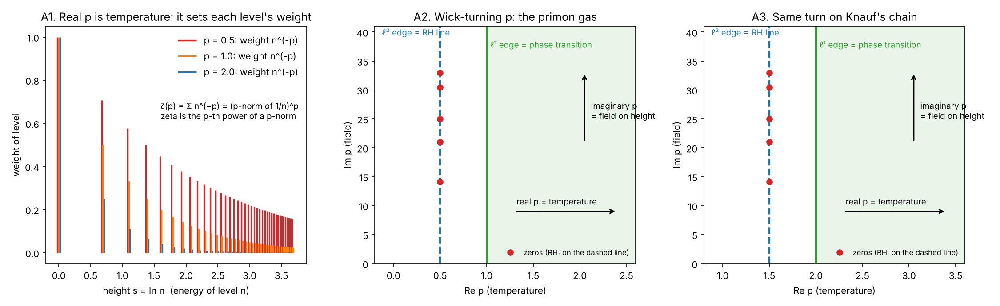
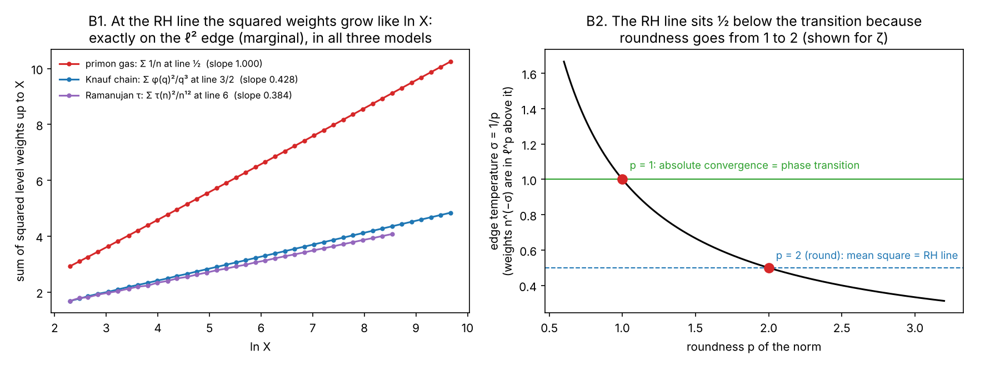
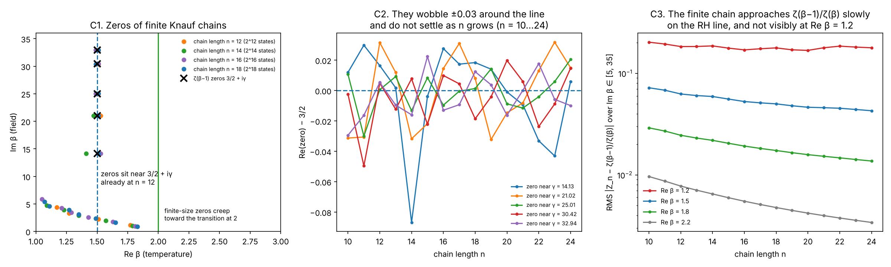
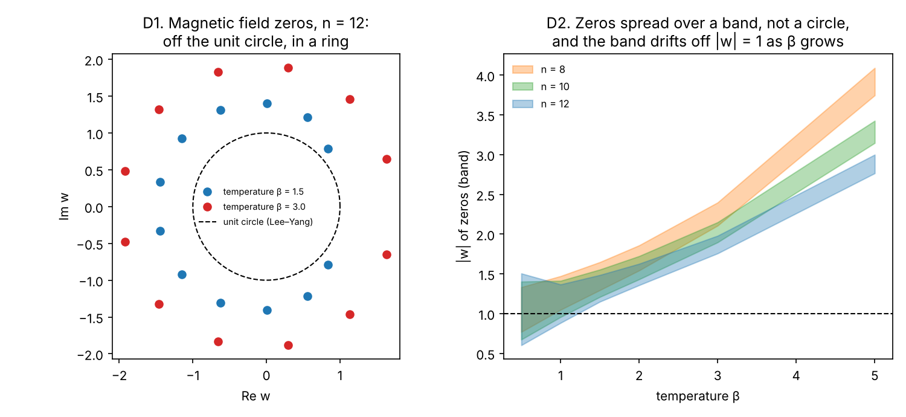

# DRAFT: Knauf's temperature as a field, via our roundness dial p

**Status: DRAFT.** Numbers checked by `checks.py` (16/16 pass, `checks_output.txt`). Nothing here proves RH.

**The plain result.** Temperature is our roundness dial p read on the height ruler (we found this earlier on the
Liebig page: there h = 1/p is a temperature, and on the shape-dials page the temperature route is face-power's far
edge). So Knauf's temperature already is p. Turning p imaginary (a Wick turn of p) turns temperature into a field
on height, and RH becomes: the zeros in that field sit on one line. Two new readings follow, and one test of Knauf's
bridge:

1. **Why the RH line sits ½ below the phase transition:** the transition is where the level weights stop being in
   ℓ¹ (roundness 1), and the RH line is exactly where they stop being in ℓ² (roundness 2, the round ball). Checked on
   three models: the primon gas, Knauf's chain and Ramanujan's τ.
2. **Finite Knauf chains already have zeros next to 3/2 + iγ** from 2^10 states up, but they wobble about ±0.02
   around the line on both sides and do not settle by 2^24 states.
3. A magnetic-field Lee–Yang circle test on the chain fails (zeros spread over a band): adding a field by hand
   meets the field condition but the spins have no flip symmetry.

In this folder β is Knauf's and the primon gas's temperature variable (the Dirichlet variable, usually written s),
written β so it isn't confused with our height dial s.

## Fig A. Temperature is roundness p; turning it imaginary makes it a field

- **A1.** ζ(p) = Σ n^(−p) is the p-th power of the p-norm of the sequence 1/n. On the height ruler each level n sits
  at height s = ln n, and real p sets its weight e^(−p·s). That is what a temperature does, with temperature 1/p.
- **A2, A3.** Write p = σ + ih. The real part weights the levels; the imaginary part multiplies level n by
  e^(−ih·s), a phase that grows with height. That is a field coupled to height. Knauf's chain is the same with
  heights E = ln φ (check K5: Z(3/2 − h) = Σ φ^(−3/2) e^(h·E)). The green line is the phase transition
  (β = 1 for the gas, β = 2 for the chain); the dashed line is the RH line (½ and 3/2).

## Fig B. The ½ is roundness 1 going to roundness 2

- **B1.** At each model's RH line, the sum of squared level weights up to X grows like ln X, which is exactly the
  edge of ℓ². Slopes: primon gas 1.000; Knauf chain 0.4281, matching Π(1 − 2/p² + 1/p³) = 0.4283 (K12); Ramanujan τ
  0.384, a steady line (K13).
- **B2.** For ζ, the weights n^(−σ) lie in ℓ^p exactly when σ > 1/p. Roundness 1 gives the transition at 1, roundness
  2 gives the RH line at ½. For Knauf's chain the same two edges are 2 and 3/2, which is why both models put the
  RH line ½ below their transition (an open question from the spin-build piece).
- **Control (K16):** the Davenport–Heilbronn function has coefficients of the same size, so the same ℓ² edge ½, and
  it has a zero at 0.8085 + 85.6993i, off the line. So the ℓ² edge says where zeros gather, not that they must sit
  on it. The Euler product is what the edge alone doesn't see.

## Fig C. Zeros of finite Knauf chains

- **C1.** Zeros of Z_n(β) = Σ over 2^n spin states of φ^(−β), found by phase winding on a grid. Next to every
  3/2 + iγ (γ = 14.13, 21.02, 25.01, 30.42, 32.94) there is a finite-chain zero, already at n = 12. A second family
  of finite-size zeros creeps toward the phase transition at β = 2 as n grows (K15), the usual pinching of
  complex-temperature zeros at a transition.
- **C2.** Newton-refined, the five zeros sit at Re 1.497 on average with spread 0.021, 38 of 75 to the right of the
  line (K6–K8). The spread at n = 20..24 (0.017) is close to that at n = 10..14 (0.026) (K7). So finite chains don't
  give a zero-free region on either side.
- **C3.** Away from the real axis the finite chain does approach ζ(β−1)/ζ(β): RMS error over Im β ∈ [5, 35] falls
  from 0.072 to 0.043 at Re β = 1.5 (K9), faster further right, and not visibly at Re β = 1.2 (K10).

## Fig D. Magnetic-field Lee–Yang circle test

Putting a field w on the number of up-spins, the zeros in w at real temperature form a ring off the unit circle
(K14) and the ring drifts outward as β grows. The chain is ferromagnetic (Knauf 1993) but its spins have no flip
symmetry: all spins down has φ = 1 and all spins up has φ = 4 at n = 3, so the field zeros don't pair as w and 1/w.
The spin-build table said the chain misses the field condition (its own variable is a temperature). Adding a field by
hand meets that condition, and the chain then fails the symmetry condition instead.

## Graded two ways

| Result | Worth following? | Could reach a proof? |
|---|---|---|
| Temperature = p; Wick-turning p gives the field (Fig A) | **Yes.** It puts RH on our p dial, where our Lee–Yang rule for roundness lives (all zeros real when a ≤ p; proved at every even p for every a and for 1.1 ≤ p ≤ 8, open at non-even p past 8; see shape-dial-survey N3). | Not by itself: it's a change of variables, so it doesn't tell true from false. It gives grip only if a p-ball spin can be matched to ζ's height spin. |
| RH line = ℓ² edge, transition = ℓ¹ edge (Fig B) | **Yes**, as a guide: the zeros sit at the round temperature of the weights. It answers why both models put the line ½ below the transition. | No. The Davenport–Heilbronn control has the same edge and an off-line zero, so the edge can't tell true from false without the Euler product. |
| Finite-chain zeros (Fig C) | **Yes**, it's the most concrete bridge so far: real finite systems with zeros at the right place. | Only if the wobble is proved to shrink to 0 (Knauf reduced this to spectra of Ramanujan-type graphs). Something new to bound: the wobble, measured here at about 0.02. |
| Magnetic circle (Fig D) | No: fails for a known reason. | No. |

## Known versus ours

| Piece | Status |
|---|---|
| Knauf's chain, Z → ζ(β−1)/ζ(β), multiplicities φ(q), ferromagnetism | Known: Knauf, CMP 153 (1993) 77–115; J. Stat. Phys. 73 (1993) 423–431. |
| Finite chains approximate ζ in the strip; a proof would give RH | Known empirically: Knauf, CMP 196 (1998) 703–731. Our wobble and error-decay numbers are new measurements. |
| Complex-temperature zeros pinching at a transition | Known physics (Fisher 1965). |
| Primon gas ζ as a partition function | Known: Julia 1990; Spector 1990; Bost–Connes 1995. |
| Mean-square (ℓ²) edge of a Dirichlet series; σ = ½ for ζ | Known: Carlson's mean value theorem (1922); Rankin–Selberg (Rankin 1939, Selberg 1940); square-root cancellation heuristic for RH (Denjoy 1931). |
| Davenport–Heilbronn off-line zero | Known: Davenport–Heilbronn 1936; zero 0.808517 + 85.699348i is the standard example. |
| Temperature as our roundness p on the height ruler, and the Wick turn of p as the field | Ours (the dial reading; Maslov dequantization itself is known: Litvinov–Maslov). |
| "½ below the transition" read as roundness 1 → 2, unifying the primon gas, Knauf's chain and τ | Ours as a reading; each edge separately is known. |

## Next routes this opens

- Match ζ's height spin (Riemann's Φ on the height ruler) to the p-ball spins of our Lee–Yang rule, with p as
  temperature: if Φ is a limit of p-ball spins on the holding side, Hurwitz's theorem carries real zeros to the limit.
- Bound the finite-chain wobble: find what controls its size (n, height γ, the spectral gap of the chain's transfer
  operator).

## Files

- `knauf.py`: chain, level counts, finite-chain zeros by phase winding → `finite_zeros.json`.
- `refine.py`: Newton-refined zeros near 3/2 + iγ for n = 10..24 → `refined.json`.
- `errscan.py`: RMS distance to ζ(β−1)/ζ(β) → `errscan.json`. `aitken.py`: extrapolation probe (exploratory).
- `l2edge.py`: ℓ² edge for ζ, Knauf, τ → `l2edge.json`. `circle.py`: magnetic circle test → `circle.json`.
- `probe.py`: first chain check. `figs.py` → `figures/`. `checks.py` → `checks_output.txt` (16/16).
