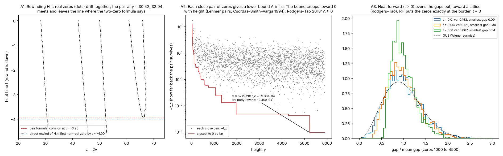
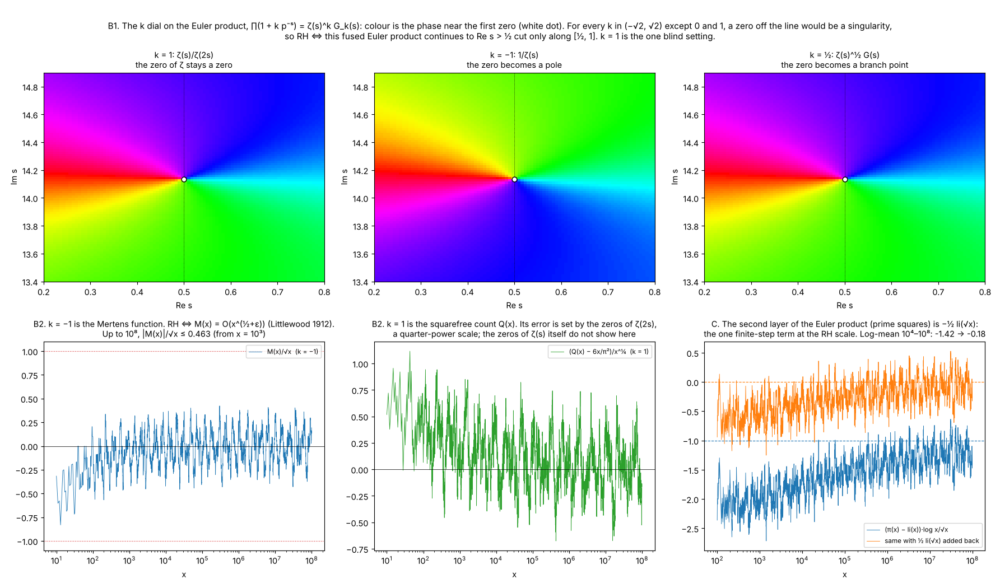
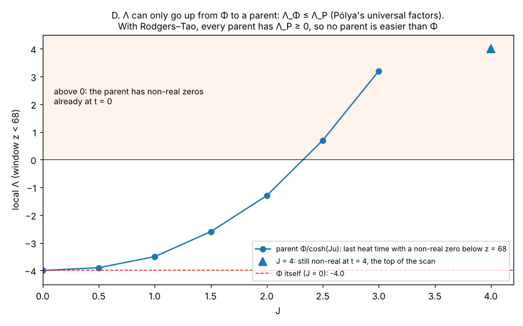

# DRAFT: What the known tools do for the Riemann hypothesis (Nov 27, 2026)

**Every one of the five known pieces applies to the zeros, and one is worth following as a tool: the rewind of the
heat flow, which turns each pair of zeros into a number that says how close RH comes to failing there.** None of the
five proves RH, because each reduces it to the same open step: showing the zeros sit exactly at the border Λ = 0.
What each one does:

| piece | what it does for RH | how far our tools push it | worth following? |
|---|---|---|---|
| A. Newman's Λ and the rewind | each close pair of zeros gives a lower bound Λ ≥ t_c; RH ⇔ Λ ≤ 0 | closest pair in our 5500 zeros (γ ≈ 5229.20) gives t_c = −0.00094; the two-zero formula matches a direct rewind and an N-body rewind | **yes, as our measuring tool**; it cannot reach RH, which needs the upper side |
| B. The k dial on the Euler product, ∏(1 + k p^{−s}) | RH ⇔ this product continues to Re s > ½ cut only along [½, 1], for every k in (−√2, √2) except 0 and 1 | k = −1 (Mertens) computed to 10⁸: \|M(x)\|/√x ≤ 0.463 | a correct reformulation, not a route: every k needs the same step |
| C. The finite-step layer (Liouville) | the prime-square layer is −½ li(√x), the one step-structure term at the RH scale | (π(x) − li(x))·log x/√x has log-mean −1.42 to 10⁸; adding back ½ li(√x) moves it to −0.18 | explains the bias; not a route |
| D. Real-rooted parents | Λ_Φ ≤ Λ_P for every parent by a universal factor, so with Rodgers–Tao every parent has Λ_P ≥ 0 | bath parents Φ/cosh(Ju): the local Λ rises with J, from −4.0 at J = 0 to above +4 at J = 4 | closes the parent route: no parent can be easier than Φ |
| E. The phase-border match | RH puts the zeros exactly at the border between leaving the line (t < 0) and freezing into a lattice (t > 0) | forward flow to t = 0.2 shrinks the gap variance from 0.153 to 0.067 | a true picture; adds no bound |

Task (Brennan, Nov 27, after round 10): "Just because something is known doesn't mean it doesn't apply to Riemann."
So for each known piece the recent rounds turned up: what it proves or bounds about the zeros, what it reduces RH to,
and how far it goes with our tools, judged on what it does for Riemann rather than on whether it is new.

## A. Newman's Λ, applied: the rewind of the heat flow

H_t(z) = ∫ e^{tu²} Φ(u) cos(zu) du has zeros at z = 2γ when t = 0. As t changes the zeros move by

> dz_j/dt = 2 Σ_{k≠j} 1/(z_j − z_k)  (de Bruijn; Csordas–Smith–Varga; Rodgers–Tao),

so going forward they push apart and going back (the rewind) they pull together. A close pair at gap d₀, with the
other zeros as a background S = Σ 1/(m − z_k)², obeys (d²)′ = 8 − 4S d², which gives the collision time

> t_c = −ln(1/(1 − S d₀²/2)) / (4S),  when S d₀² < 2  (≈ −d₀²/8 for a very close pair).

A collision at t_c means H_t has non-real zeros just before t_c, so Λ ≥ t_c. This is how Lehmer pairs gave the old
lower bounds (Csordas–Odlyzko–Smith–Varga 1993: −5.9×10⁻⁹; Csordas–Smith–Varga 1994; Saouter–Gourdon–Demichel
2011: −1.15×10⁻¹¹), before Rodgers and Tao proved Λ ≥ 0 (2018; Forum Math. Pi 2020).

What our tools give:
- **The formula holds.** Low down, the pair at γ = 30.42, 32.94 collides at t = −3.95 by the formula; a direct
  rewind of H_t finds the first non-real zero between t = −3.75 and −4.00 (A1). High up, the closest pair, at
  γ = 5229.199 and 5229.242, collides at t_c = −9.36×10⁻⁴ by the formula and −9.40×10⁻⁴ by an N-body rewind of the
  300 nearest zeros.
- **The bound creeps toward 0 with height** (A2), as the closest pairs get closer. This is the picture behind
  Rodgers–Tao: if Λ were negative, the zeros at t = 0 would already be nearly evenly spaced, and their known
  statistics rule that out.
- **What it reduces RH to:** Λ ≤ 0. The rewind side only ever gives lower bounds, and Λ ≥ 0 is already proved. The
  upper side is where RH lives: Λ ≤ 0.22 (Polymath 15, 2019), Λ ≤ 0.2 (Platt–Trudgian 2021), each needing the zeros
  checked far above our 5500.

*A1: real zeros of H_t as t is rewound; the pair at 60.85 and 65.87 (z units) meets where the formula says. A2: −t_c
for every pair that collides on its own (grey) and the closest to 0 so far (red). A3: forward heat flow evens the gaps
out (A3 is section E).*

**Why it is worth following.** It gives us a number per zero pair, it matches the published method and a direct
computation, and it measures any kernel we build (parents, 5D slices, baths) on the same scale as ζ. It will not prove
RH: it is the instrument, not the route.

## B. The k dial on the Euler product

Rung 2 over the primes is F_k(s) = ∏_p (1 + k p^{−s}) = Σ μ²(n) k^{ω(n)} n^{−s} (round 10). Write F_k = ζ(s)^k G_k(s).
For |k| < √2, G_k is holomorphic and nonzero for Re s > ½ (its factors are 1 + O(p^{−2s}) and none vanishes there).
So a zero ρ of ζ with Re ρ > ½ is, for F_k:
- a **zero** when k = 1 (F₁ = ζ(s)/ζ(2s)),
- a **pole** when k = −1 (F₋₁ = 1/ζ(s)),
- a **branch point** for every k that is not an integer.

Hence, for every k in (−√2, √2) other than 0 and 1:

> RH ⇔ the fused Euler product ∏(1 + k p^{−s}) continues single-valued to Re s > ½, cut only along [½, 1].

k = 1 is the one blind setting: there the zeros of ζ(s) stay zeros, and the error of the squarefree count is set by
the zeros of ζ(2s) instead. At k = −1 the partial sums are the Mertens function, and RH ⇔ M(x) = O(x^{½+ε})
(Littlewood 1912). Up to 10⁸, |M(x)|/√x ≤ 0.463 (from x = 10³; M(10⁸) = 1928, the known value). For other k the
partial sums have main terms x(log x)^{k−1}(c₀ + c₁/log x + …) (Selberg–Delange), so their √x-scale error needs the
whole Hankel term subtracted; we did not compute it.

The single-k statements at k = ±1 are classical. We did not find the statement for the whole dial in print; it follows
in a few lines from Selberg–Delange, so treat it as a remark, not a theorem of ours.

**What it does for RH:** it gives a one-parameter family of equivalent statements, all needing the same continuation.
Not a route.

## C. The finite-step layer, applied to primes

Round 10 found that the integral limit of the fused product keeps only the trace layer P (Liouville's formula), while
a finite step keeps the higher layers. For the Euler product the layers are log ζ(s) = Σ_m P(ms)/m, with P the prime
zeta function. The second layer, P(2s)/2, is the prime squares, and in the prime count it is −½ li(√x): the same size
as the RH error, √x/log x. The third layer is x^{1/3}, already invisible. So:

- The step structure of the Euler product contributes **exactly one term at the RH scale**, and the integral limit
  drops exactly that term.
- That term is the bias: (π(x) − li(x))·log x/√x stays negative from 10⁴ to 10⁸ with log-mean −1.42, and adding back
  ½ li(√x) moves it to −0.18 (the rest is the oscillation from the zeros). The same term drives Chebyshev's bias
  (Rubinstein–Sarnak 1994).
- RH in this language (von Koch 1901): π(x) = li(x) + O(√x log x). The second layer fits inside that bound by a factor
  log² x, so it neither helps nor hurts.

*Top: the phase of ζ(s)^k near the first zero for k = 1 (zero), −1 (pole) and ½ (branch point; the colour jumps
across the cut to its left). Bottom left: M(x)/√x to 10⁸. Bottom middle: the squarefree error over x^¼. Bottom right:
the second layer.*

## D. The parents, applied: Λ can only go up

Pólya (1927): if U(u) = φ(iu) with φ in the Laguerre–Pólya class, then multiplying a kernel by U preserves real zeros
(a universal factor). Apply it to e^{tu²}P, where P = Φ/U is a parent:

> e^{tu²}P real-rooted ⇒ e^{tu²}Φ real-rooted, so **Λ_Φ ≤ Λ_P for every parent P.**

With Rodgers–Tao (Λ_Φ ≥ 0), every parent has Λ_P ≥ 0. So no parent sits strictly inside the real-rooted region, and
no parent is easier than Φ: proving a parent real-rooted for all heights is at least as hard as RH. This explains,
after the fact, why the round's parents either lost zeros or held only low down.

Local check: for the bath parents P = Φ/cosh(Ju) (U = cosh(Ju) = cos(iJu) is a universal factor), the largest heat
time at which H_t of the parent still has a non-real zero below z = 68 rises with J, as the bound requires J = 0, 0.5, 1,
1.5, 2, 2.5, 3 give −4.0, −3.9, −3.5, −2.6, −1.3, +0.7, +3.2, and J = 4 is still non-real at t = 4, the top of the
scan. From J = 2.5 on the parent has non-real zeros already at t = 0, which is the zero loss the parent hunt saw.

**What it does for RH:** a rigorous negative. It closes the parent route as a way to an easier problem.

## E. The phase-border match, applied

The Lee–Yang thread found its gas transition is exactly the pendulum's separatrix (shape-dial survey, fig 29). For ζ
the analogue is the heat time t. Forward (t > 0) the zeros freeze toward a lattice: here the gap variance drops from
0.153 at t = 0 to 0.067 at t = 0.2, and the smallest gap (in mean gaps) rises from 0.09 to 0.54 (A3). Backward
(t < 0) pairs leave the line. RH says ζ sits exactly at t = 0, on the border, and Rodgers–Tao's Λ ≥ 0 says it cannot
sit inside the safe side ("the Riemann hypothesis, if true, is only barely so"). At t = 0 the gaps follow GUE, between
the two.

**What it does for RH:** a correct picture of where RH puts the zeros. It adds no bound.

## Quantum gravity

One try. In jet-river the field equation is the second layer Q of a single step, and here (C) the second layer of the
Euler product is the one step-structure term at the RH scale. Both are finite-step effects that the integral limit
erases. That is a shared shape, not a shared mechanism, and it gives nothing to compute.

## Verdict

Every known piece applies. The rewind (A) is worth following as our instrument for measuring how close any kernel,
including ζ's, comes to losing its real zeros. None of the five is a route to a proof with our tools, because each
reduces RH to the same open step, Λ ≤ 0, and the parent bound (D) shows that step cannot be dodged through a parent.

## Files

- `rewind.py`, `rewind.json`, `rewind_snaps.npz`: zero dynamics, pair collision times, the direct and N-body checks,
  the forward flow. `rewind_fig.py` draws `fig_rewind.png`.
- `euler_dial.py`, `euler_dial.json`: the k dial, Mertens and squarefree sums to 10⁸, the second layer; draws
  `fig_euler_dial.png`.
- `parents_lambda.py`, `parents_lambda.json`: local Λ of the bath parents (`fig_parents_lambda.png`).
- `checks.py`, `checks_output.txt`.
- No Lean this round: the statements are analytic (flows, continuation, universal factors).

Uses `../unified-hypothesis/kern.py` and `../round9/zeros.json`.

## References

- N. G. de Bruijn, "The roots of trigonometric integrals", Duke Math. J. 17 (1950).
- C. M. Newman, "Fourier transforms with only real zeros", Proc. AMS 61 (1976).
- G. Csordas, A. Odlyzko, W. Smith, R. Varga, "A new Lehmer pair of zeros and a new lower bound for the de
  Bruijn–Newman constant Λ", ETNA 1 (1993).
- G. Csordas, W. Smith, R. Varga, "Lehmer pairs of zeros, the de Bruijn–Newman constant Λ, and the Riemann
  hypothesis", Constr. Approx. 10 (1994).
- Y. Saouter, X. Gourdon, P. Demichel, "An improved lower bound for the de Bruijn–Newman constant", Math. Comp. 80
  (2011).
- B. Rodgers and T. Tao, "The de Bruijn–Newman constant is non-negative", Forum Math. Pi 8 (2020).
- D. H. J. Polymath, "Effective approximation of heat flow evolution of the Riemann ξ function, and a new upper bound
  for the de Bruijn–Newman constant", Res. Math. Sci. 6 (2019).
- D. Platt and T. Trudgian, "The Riemann hypothesis is true up to 3·10¹²", Bull. LMS 53 (2021) (with Λ ≤ 0.2).
- G. Pólya, universal factors (1927).
- J. E. Littlewood, on the Möbius sum and RH (1912); H. von Koch (1901).
- G. Tenenbaum, Introduction to Analytic and Probabilistic Number Theory, II.5 (Selberg–Delange).
- M. Rubinstein and P. Sarnak, "Chebyshev's bias", Experiment. Math. 3 (1994).

Page numbers left out where not checked.
