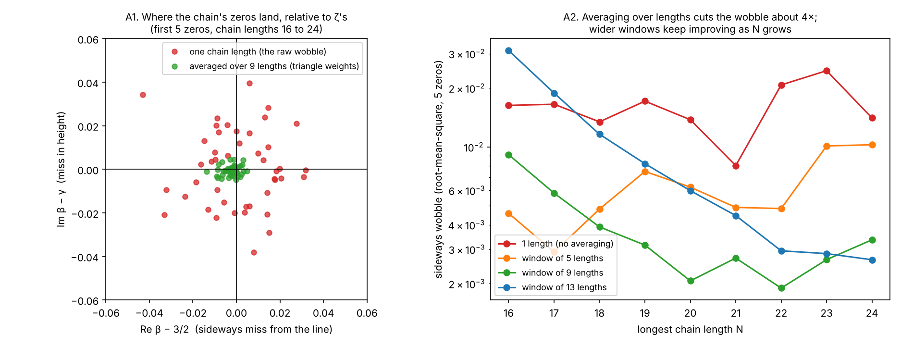
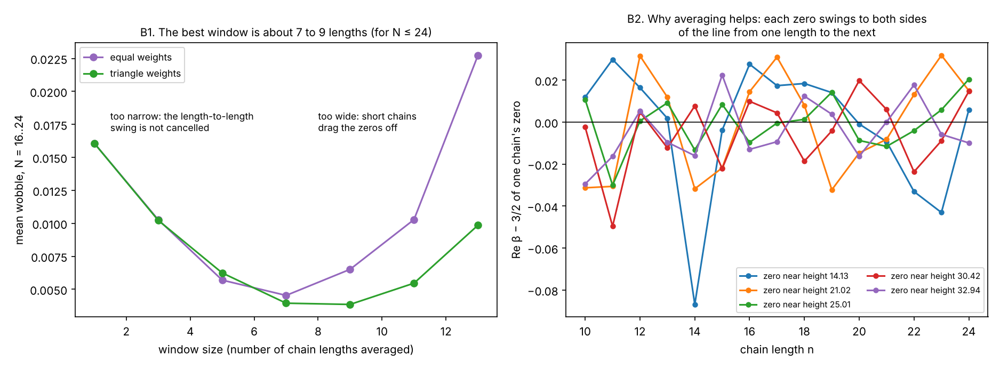

# Length smoothing: averaging Knauf chains over length shrinks the wobble  (DRAFT)

**Plain result.** Finite Knauf chains already have zeros right next to ζ's zeros (on the line
Re β = 3/2), but each one misses by about ±0.02 and the miss does not shrink with length (n up to
24, from knauf-field). Averaging the chain over a window of neighbouring lengths cuts the miss
about **4×**, sideways and in height, at every length tested. The reason is visible: a single
chain's zero swings to both sides of the line from one length to the next, and averaging cancels
the swing. Windows that are too wide drag the zeros off again, because short chains are poor
approximations; but the widest window tried keeps improving as the chain grows.

Knauf reduced RH for his chain to showing the wobble goes to 0. This finds the first thing that
makes it smaller, and points at what to bound next: the smoothed wobble, not the raw one.

## Grades

| | worth following? | could reach a proof? |
|---|---|---|
| Averaging over chain length | **Yes.** It is the first lever on the wobble, the measured gap between finite chains and RH. Next: find the law of the length-to-length swing (which part of the chain's transfer operator drives it) and test whether a window that grows with N sends the wobble to 0. | Not by itself. Proving the smoothed wobble vanishes at every height would still be as hard as RH. But it is a cleaner target than the raw wobble, which doesn't shrink at all. |

Limits: lengths only up to 24 (2^24 states), first 5 zeros, numerical.

## Pictures

**A1** Where the chain's zeros land relative to ζ's first five zeros, for lengths 16 to 24. Red:
one chain length. Green: averaged over 9 neighbouring lengths. The cloud shrinks toward the exact
spot in both directions. **A2** Sideways miss against the longest length N, for windows of 1, 5,
9 and 13 lengths (log scale). The 13-length window starts badly (it reaches short chains) and
improves at every step.

**B1** Average miss against window size: a U shape with its bottom at about 7 to 9 lengths for
N ≤ 24. **B2** The mechanism: for each of the five zeros, one chain's sideways miss flips sign
from length to length, so neighbouring lengths cancel.

## How it is built

Z_n(β) = Σ φ^(−β) over the chain's 2^n states. Each Z_n is divided by its growth 1.153^n at
β = 3/2 (measured), then neighbouring lengths are averaged with equal or triangle weights. The
zeros are found by Newton's method started at 3/2 + iγ. Chain length here is a setting, not a
dial; the smoothing is the same idea as the smoothing function on each spin, applied to length.

## Known vs ours

**Known.** Knauf's chain and its link to ζ(β−1)/ζ(β) (Knauf 1993, 1998; Contucci–Knauf 1997);
Knauf's reduction of RH to spectra of the chain's operators; Cesàro-style averaging as a way to
tame sequences that don't converge (classical).
**Ours (numerical, n ≤ 24).** The wobble measurement over n = 10..24 (knauf-field); that
averaging over length cuts it about 4×; the U-shaped window curve; the sign-swing mechanism.

## Files

`probe.py` → `probe.json` (first look), `windows.py` → `windows.json` (all windows), `figs.py`,
`checks.py` (8 checks; reads ../knauf-field/refined.json and imports ../knauf-field/knauf.py).
