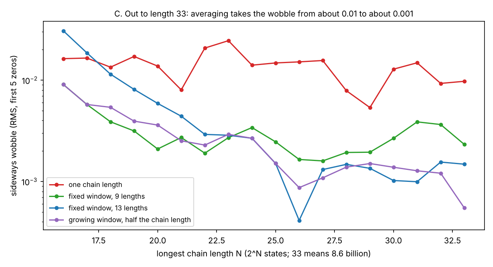
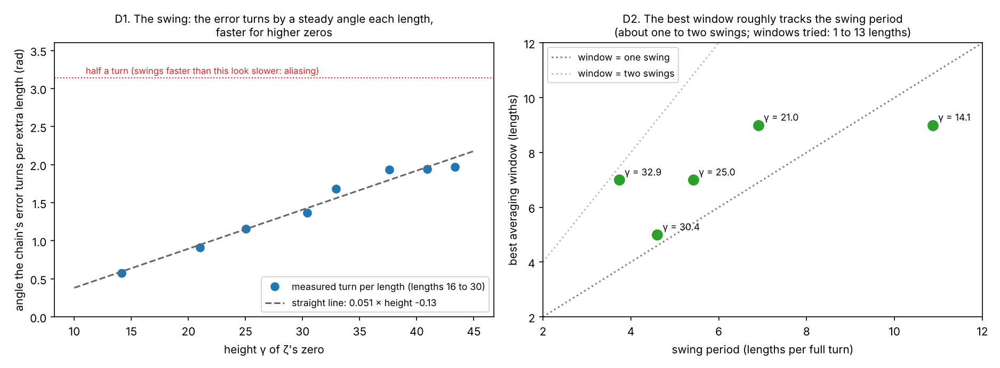

# Length smoothing: averaging Knauf chains over length shrinks the wobble  (DRAFT)

**Plain result.** Finite Knauf chains already have zeros right next to ζ's zeros (on the line
Re β = 3/2), but each one misses by about ±0.02 and the miss does not shrink with length (n up to
24, from knauf-field). Averaging the chain over a window of neighbouring lengths cuts the miss
about **4×**, sideways and in height, at every length tested. The reason is visible: a single
chain's zero swings to both sides of the line from one length to the next, and averaging cancels
the swing. Windows that are too wide drag the zeros off again, because short chains are poor
approximations; but the widest window tried keeps improving as the chain grows.

**Follow-up, out to length 33** (8.6 billion states, counted without storing them): a window that
grows with the chain (half its length) takes the wobble from about 0.01 to about 0.001, and keeps
it under 0.002 at every length from 26 to 33, while single chains stay above 0.005. The swing has
a law: at each zero the chain's error turns by a steady angle per extra length, about 0.05 × the
zero's height (radians), so higher zeros swing faster; the best window roughly tracks one to two
swings. Whether the smoothed wobble goes all the way to 0 is not settled at these lengths: from
about length 26 it hovers near 0.001.

Knauf reduced RH for his chain to showing the wobble goes to 0. This finds the first thing that
makes it smaller, and points at what to bound next: the smoothed wobble, not the raw one.

## Grades

| | worth following? | could reach a proof? |
|---|---|---|
| Averaging over chain length | **Yes.** It is the first lever on the wobble, the measured gap between finite chains and RH: about 10× smaller by length 30, with a clean law for the swing it cancels. Next: explain the 0.05 × height turn from the chain's transfer operator, and use a height-matched window. | Not by itself. Proving the smoothed wobble vanishes at every height would still be as hard as RH. But it is a cleaner target than the raw wobble, which doesn't shrink at all. |

Limits: lengths up to 33, first 5 zeros (8 for the swing law), numerical; the floor near 0.001 may be real or may still fall.

## Pictures

**A1** Where the chain's zeros land relative to ζ's first five zeros, for lengths 16 to 24. Red:
one chain length. Green: averaged over 9 neighbouring lengths. The cloud shrinks toward the exact
spot in both directions. **A2** Sideways miss against the longest length N, for windows of 1, 5,
9 and 13 lengths (log scale). The 13-length window starts badly (it reaches short chains) and
improves at every step.

**B1** Average miss against window size: a U shape with its bottom at about 7 to 9 lengths for
N ≤ 24. **B2** The mechanism: for each of the five zeros, one chain's sideways miss flips sign
from length to length, so neighbouring lengths cancel.

**C** Out to length 33. Red: one chain. Green and blue: fixed windows of 9 and 13 lengths. Purple:
a window of half the chain's length. Averaging brings the wobble down about 10×, to near 0.001.

**D1** At each of ζ's first eight zeros, the chain's error Z_n(ρ) turns by a nearly steady angle
from one length to the next, close to a straight line in the height (0.051 × γ − 0.13 rad); the top
few bend because turns near half a circle start to alias. **D2** The best averaging window
against the swing period (lengths per full turn): it roughly tracks one to two swings.

## How it is built

Z_n(β) = Σ φ^(−β) over the chain's 2^n states. Each Z_n is divided by its growth 1.153^n at
β = 3/2 (measured), then neighbouring lengths are averaged with equal or triangle weights. The
zeros are found by Newton's method started at 3/2 + iγ. Chain length here is a setting, not a
dial; the smoothing is the same idea as the smoothing function on each spin, applied to length.

## Known vs ours

**Known.** Knauf's chain and its link to ζ(β−1)/ζ(β) (Knauf 1993, 1998; Contucci–Knauf 1997);
Knauf's reduction of RH to spectra of the chain's operators; Cesàro-style averaging as a way to
tame sequences that don't converge (classical).
**Ours (numerical, n ≤ 33).** The wobble measurement (knauf-field); that averaging over length cuts
it about 4× at a fixed window and about 10× with a growing one; the U-shaped window curve; the
swing law (turn per length ≈ 0.05 × height); the streaming count of long chains.

## Files

`probe.py` → `probe.json` (first look), `windows.py` → `windows.json` (all windows), `figs.py`.
Follow-up: `stream.py` counts chain levels to length 33 by walking Stern–Brocot pairs
(u, v) → (u, u+v), (u+v, v) without storing states (counts go to a scratch folder, not the repo);
`wide.py` → `wide.json` (to 33; `wide30.json` is the run to 30); `swing.py` → `swing.json`;
`figs2.py`. `checks.py`: 14 checks (one needs the scratch counts and is skipped without them).
