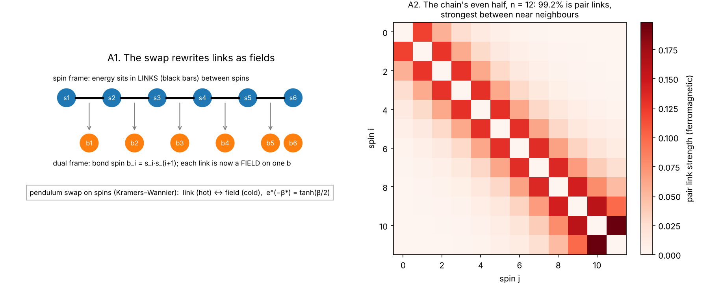
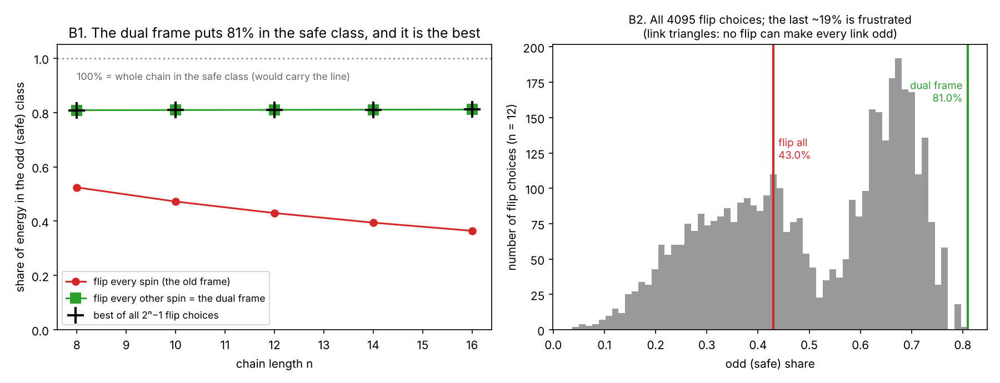
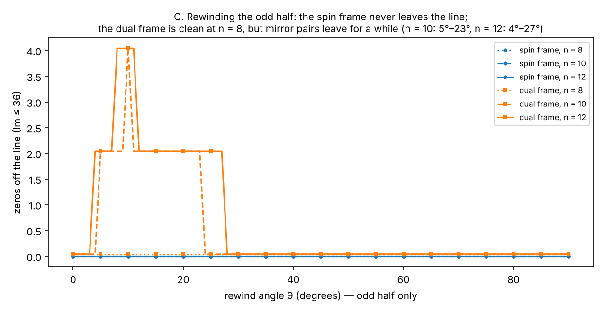
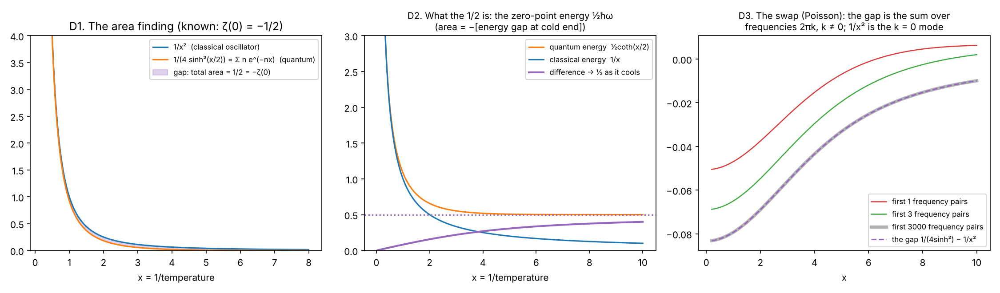
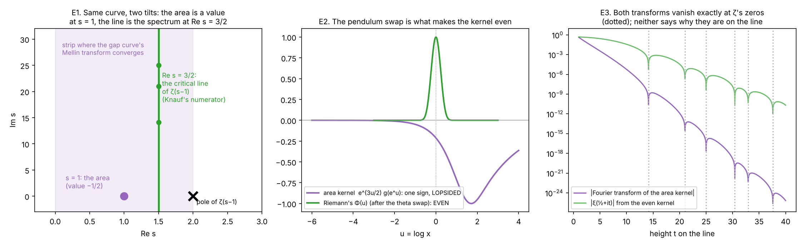

# Pendulum swap: can a hot–cold swap carry the line through the chain's even half?  (DRAFT)

**Plain result.** The pendulum swap, done on the chain's spins, is the classical hot–cold
(Kramers–Wannier) duality. In the swapped ("dual") frame 81% of the chain's energy lands in the
half that rewinds safely, and no other way of flipping spins does better. That is not enough.
Rewinding the dual frame's safe half still pushes a few zeros off the line for small angles
(n = 10 and 12; they return by about 30°), while the old spin frame's smaller safe half stays on the line at every degree.
The last ~19% can't be moved by any flip, because the chain's links form triangles.

**The "½ is an area" finding**, tested here too, is a true and pretty reading, but it does not
pin zeros to the line. The ½ is ζ(0) = −½ in disguise: physically, the zero-point energy ½ħω of a
quantum oscillator. Its curve's transform runs straight up the critical line of ζ(s−1), the same
line as Knauf's chain. But the ½ is a *value* at s = 1, beside the line, not the line's *place*.
What it does give us is a clean picture of the gap: the area's kernel is lopsided, and the
pendulum swap is exactly the step that would make it even.

## Grades

| piece | worth following? | could reach a proof? |
|---|---|---|
| Swap on spins (dual frame) | Yes, as a tool: it measures how much of the chain is "safe" and shows the ceiling (81%). | Not as it stands. The dual frame's safe half itself leaves the line, and 19% can't be moved by any frame. |
| ½ as an area | Modestly: it names the missing step (make the kernel even) and gives the zero-point picture. | No, not by itself. It is a value at s = 1; the classical identity says nothing about where zeros sit. |

What RH needs from a swap is a **reflection in temperature** (the functional equation, centre
3/2 for ζ(β−1)). A spin duality reflects couplings, not temperature. On the chain side the
temperature reflection comes only from completing ζ(β−1) with its Γ factor. That is the next
piece to build, and it is also where the real difficulty of RH lives: Davenport–Heilbronn
functions have the same kind of reflection and zeros off the line, so a proof also needs the
prime (Euler-product) structure.

## Pictures

**A1** The swap on a line of spins: each link between neighbours (hot) becomes a field on one
bond spin (cold), with e^(−β*) = tanh(β/2). **A2** The chain's even half (the part that pushed
zeros off the line in the rewind-dial piece) is 99.2% pair links, strongest between neighbours,
so the swap has something to act on.

**B1** Share of the energy in the safe (odd) class. Flipping every spin gives 52% → 36% and
falls with length. Flipping every other spin, which is the dual frame, gives a steady 81%.
**B2** All 4095 flip choices at n = 12: the dual frame is the very best. Reaching 100% would need
every link to be cut by the flip; links in triangles (range-1 and range-2 pairs) can't all be.

**C** Rewinding only the safe half from the field (0°) to temperature (90°), every degree.
Spin frame: no zero leaves the line at n = 8, 10, 12. Dual frame: clean at n = 8; at n = 10 one or
two mirror pairs leave between 5° and 23° and come back; at n = 12 the same happens between 4° and 27°.
By 90° everything is back on the line in both frames.

**D1** The finding: the gap between 1/x² and 1/(4 sinh²(x/2)) has area exactly ½ (= −ζ(0)).
**D2** What the ½ is: the quantum oscillator's energy ½coth(x/2) minus the classical 1/x tends to
½ as it cools, the zero-point energy. The area is minus that gap at the cold end.
**D3** The swap, Poisson style: the gap equals the sum over frequencies 2πk, k ≠ 0, and the
subtracted 1/x² is the k = 0 mode. This is the Wick-rotated (Matsubara) view of the same curve.

**E1** One curve, two tilts. Weighting the gap by x^(s−1) gives Γ(s)ζ(s−1), valid on the whole
strip 0 < Re s < 2. The area is the value at s = 1; the critical line of ζ(s−1), Re s = 3/2, sits
inside the strip. **E2** On that line the curve becomes a kernel in u = log x. It has one sign but
is lopsided. Riemann's Φ, made from the theta function after the pendulum (Jacobi) swap, is even.
**E3** Both transforms vanish exactly at ζ's zeros. Neither picture says why the zeros are there.

## Known vs ours

**Known.** Kramers–Wannier duality (1941) and its 1-D form; Griffiths' ghost spin (1967);
Jacobi theta inversion = Poisson summation = the functional equation (Riemann 1859);
ζ(0) = −½ and zeta regularisation of zero-point energies (Casimir-type);
1/(4 sinh²(x/2)) = Σ n e^(−nx) = Σ_k 1/(x + 2πik)²; its Mellin transform Γ(s)ζ(s−1);
Riemann's Φ kernel and Pólya's programme on Fourier transforms with real zeros;
Davenport–Heilbronn counterexamples; Knauf's chain (1993, 1998); Contucci–Knauf (1997).

**Ours (new here, as far as we can tell; all numerical, small n).**
- Reading the pendulum swap as the frame change on the chain, and showing the best frame is the
  staggered flip, found as a weighted MAX-CUT over all 2ⁿ − 1 flip sets (one Hadamard transform).
- The 81% ceiling, steady with length, and its cause (frustrated link triangles).
- The finding that a larger safe share does not mean a safe rewind: the dual frame's odd half
  leaves the line where the spin frame's does not.
- The tilt reading of the area (s = 1 value vs Re s = 3/2 spectrum of one curve) and the
  observation that the area kernel's missing evenness is precisely what the swap supplies.

## Files

- `probe.py`: even-half link power by order and the pair-link matrix.
- `frames.py` → `frames.json`: spin vs dual frames; field condition, circle test, first-order speed.
- `bestflip.py` → `bestflip.json`: safe share for every flip set.
- `oddrewind_dual.py` → `oddrewind_dual.json`; `linecount.py`, `linecount12.py` →
  `linecount_8_10.json`, `lc12_*.jsonl`, merged in `linecount.json`: zeros on vs off the line, every degree.
- `area.py` → `area.json`: the ½-area checks.
- `figs.py`: all pictures. `checks.py`: all checks (run `python3 checks.py`).

Dial used: p (roundness, read as temperature; the rewind's far end is p's Wick turn). The rewind
angle θ, the flip set, the frame and the tilt are settings, not dials.
