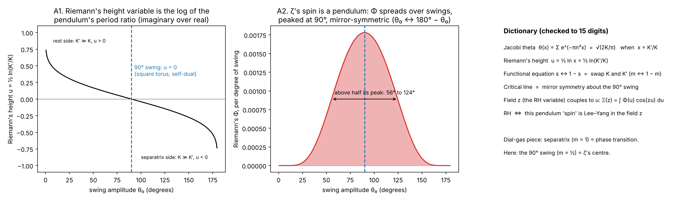
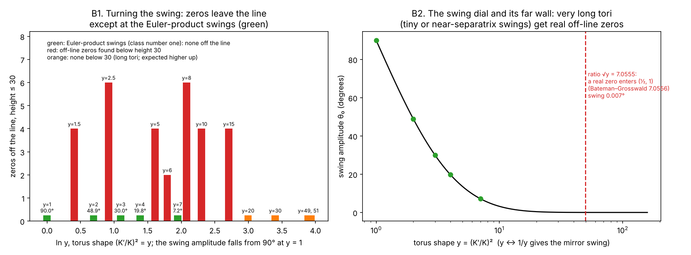

# DRAFT: ζ as a pendulum, and the swing dial

> **Names:** some words or symbols on this page (wall) also mean something else in standard math, physics or computing, or inside this project. [NAMING-COLLISIONS.md](../../../NAMING-COLLISIONS.md) says which meaning is in play.

**Status: DRAFT.** Checks: `checks.py` → `checks_output.txt`, 13/13 pass (mpmath 20–50 digits). Nothing here proves RH.

**The plain result.** ζ already is a pendulum. Riemann's own height variable u (the one RH puts a field on) is the
log of a pendulum's period ratio, u = ½ ln(K′/K), and his weight Φ is a spread of swings peaked at the 90° swing.
The functional equation is the swap of the pendulum's real and imaginary periods, so the critical line is the
mirror symmetry about the 90° swing. Fixing one swing instead of averaging gives a lattice zeta (Epstein's), and
turning that swing is a dial: up to height 30, zeros stay on the line only at the five swings with an Euler product
(90°, 48.9°, 30°, 19.8°, 7.2°) and leave it at every other swing tested.

This builds on the pendulum work: the elliptic-modulus page (curvature reading κ = cos θ₀, the separatrix as the
wall) and the shape-dial survey's N3 pendulum section (the dial gas transition is the separatrix).

## Fig A. ζ's spin is a pendulum

- **A1.** Jacobi: θ(x) = Σ e^(−πn²x) equals √(2K/π) when x = K′/K, with K and K′ the pendulum's real and imaginary
  quarter periods (P1). Riemann wrote ξ as an integral of θ over x, and set x = e^(2u). So his height u is half the
  log of the period ratio. The 90° swing (m = ½) is the square torus, u = 0 (P3). Small swings sit at u > 0, swings
  near the separatrix at u < 0.
- **A2.** Writing Riemann's integral over swings (Legendre's relation, P2), Φ becomes a weight per degree of swing.
  It peaks at 90°, is above half its peak from 56° to 124°, and dies off very fast toward rest and toward the
  separatrix. It is mirror-symmetric, θ₀ ↔ 180° − θ₀ (P4, P5).
- **Reading.** Ξ(z) = ∫ Φ(u) cos(zu) du puts the field z on the log period ratio. RH ⇔ this pendulum spin is Lee–Yang
  in z. That is Newman's form again (dial-wick piece), now in pendulum terms. In the dial-gas piece the separatrix
  (m = 1) was the phase transition; here the 90° swing (m = ½) is ζ's centre.

## Fig B. The swing dial on lattice zetas

- One swing is one rectangular torus with K′/K = √y, and its zeta is Epstein's Z(s; y) = Σ′ (m² + y n²)^(−s),
  computed by the Chowla–Selberg formula (checked against the raw lattice sum, P6). y ↔ 1/y gives the mirror swing
  and the same zeros.
- **The 90° swing** gives 4·ζ(s)·β(s), Riemann's zeta times Dirichlet's β (P7).
- **B1.** Zeros of the completed Λ(s) = (√y/π)^s Γ(s) Z(s) with height 0.5 ≤ t ≤ 30, all zeros counted by the argument
  principle and those on the line by sign changes (P13 checks Λ is real on the line). None leave the line at y = 1, 2,
  3, 4, 7 (P10), the class-number-one forms, which have Euler products. Off-line zeros appear at y = 1.5, 2.5, 5, 6, 8,
  10, 15 (P11), always in pairs σ, 1 − σ (P12). For the long tori y = 20, 30, 49, 51 none show up below height 30.
- **B2.** The swing amplitudes of the clean swings: 90°, 48.94°, 30° exactly (y = 3, m = sin²15°, P8), 19.76°, 7.18°.
  At torus ratio √y = 7.0555 a real zero enters (½, 1) (P9), matching Bateman–Grosswald's 7.0556. That is a swing of
  only 0.007°, or its mirror next to the separatrix.

## Graded two ways

| Result | Worth following? | Could reach a proof? |
|---|---|---|
| ζ as a pendulum (Fig A) | **Yes.** It puts ζ's spin into the pendulum language where our curvature reading κ = cos θ₀ lives, and says what the critical line is: the mirror about the 90° swing. | Not by itself: it's a change of variables, so it doesn't tell true from false. |
| Swing dial on lattice zetas (Fig B) | **Yes.** It's a dial that moves through RH territory, and it shows exactly what makes the 90° swing special: an Euler product, not the shape alone. | No as it stands. The clean swings are clean for arithmetic reasons the dial doesn't see. Something new to bound: how close to 90° the nearest off-line zero comes at each height. |

## Known versus ours

| Piece | Status |
|---|---|
| θ₃² = 2K/π, the nome q = e^(−πK′/K) | Known: Jacobi (1829). |
| ξ as an integral of θ; Φ and Ξ | Known: Riemann (1859); Pólya (1926). |
| Epstein zeta, Chowla–Selberg formula | Known: Epstein (1903); Chowla–Selberg (1949, 1967). |
| Off-line zeros of Epstein zetas without an Euler product | Known: Potter–Titchmarsh (1935), Davenport–Heilbronn (1936); tracked against the lattice shape by McPhedran (arXiv:1601.01724) and Bétermin–Šamaj–Travěnec (arXiv:2110.09368). |
| Real zero in (½, 1) past ratio 7.0556 | Known: Bateman–Grosswald, Acta Arith. 9 (1964) 365–373. |
| Singular modulus at y = 3 (k = sin 15°) | Known. |
| Riemann's height as the log of a pendulum's period ratio; Φ as a weight over swing amplitudes peaked at 90°; the critical line as the 90° mirror | Ours as a reading (each identity is classical). |
| The swing dial picture: clean only at the five Euler-product swings, as pendulum amplitudes | Ours as a picture; the underlying facts are the known results above. |

## Files

- `epstein.py`: Epstein zeta by Chowla–Selberg, and the brute lattice sum.
- `pend.py`: pendulum identities and the real-zero threshold → `pend.json`. `thresh.py`: threshold scan.
- `swingdensity.py`: Φ per degree of swing → `swingdensity.json`.
- `zeros.py y T`: zeros on and off the line for one swing → `zeros_y*.json` (run for 16 values of y, T = 30).
- `figs.py` → `figures/`. `checks.py` → `checks_output.txt` (13/13).
