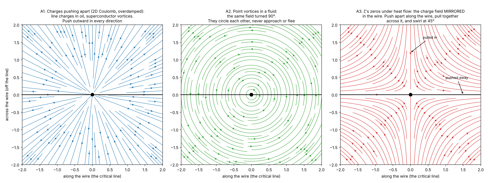
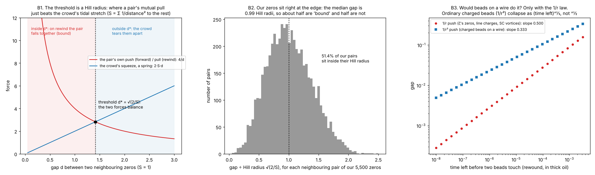
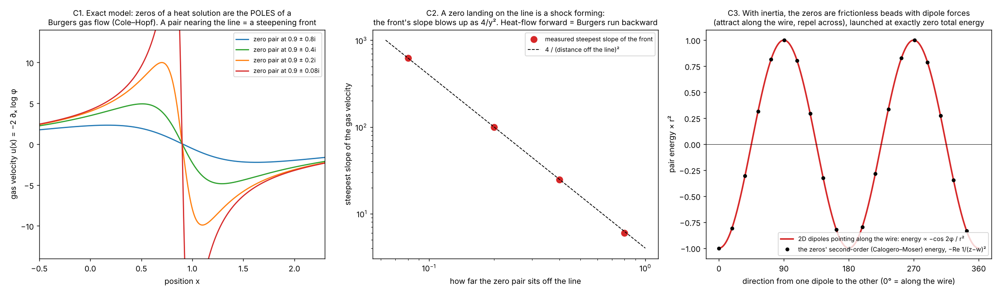

# DRAFT · A real physical model for ζ's zeros under heat flow (Nov 27, 2026)

> **Names:** some words or symbols on this page (twist) also mean something else in standard math, physics or computing, or inside this project. [NAMING-COLLISIONS.md](../../../NAMING-COLLISIONS.md) says which meaning is in play.

Asked for by Brennan: "What is the threshold in physical terms?" "Would an actual wire with beads behave this
way?" "I'm looking for a physical model." Script: `phys.py` → `phys.json`, `burgers.npz`, `collapse.npz`.
Pictures: `figs.py` → `figures/`. Checks: `checks.py` → `checks_output.txt`, **13/13 pass**. Companion to
`../pressure-blowup-twist/` and `../potential/`.

## Result

**There is an exact physical model. It isn't beads, it's shock waves.** ζ's zeros under heat flow are exactly the
poles of a Burgers gas flow, the standard one-line model of a gas forming shocks (the Cole–Hopf link). A pair of
zeros landing on the line is a front steepening into a shock.

- **Beads on a wire match only on the wire.** You need the 1/distance push: parallel charged rods sliding in thick
  oil, or superconductor vortices in a channel. Ordinary charged beads push as 1/distance², and they collapse with
  a different law.
- **Off the wire, no bead system can ever match.** ζ's rule is the charge push *mirrored* in the wire: push apart
  along it, pull together across it. Every force that comes from an energy in ordinary space has the opposite
  handedness. That's a theorem, not a missing gadget.
- **The threshold in physical terms is a Hill radius.** On a rewind, two neighbouring zeros pull each other in while
  the crowd around them stretches them apart, like a moon held by a planet against the Sun's tidal pull. Our
  zeros sit right at that radius: half are inside it.
- **Is the across-the-wire flip a Wick rotation?** Partly. It is exactly the charge rule with the across-the-wire
  direction of the geometry flipped in sign (y → iy in the metric). But the force law itself stays the ordinary
  one, so it is a half Wick rotation. It is also a reflection, so no twist angle produces it.

**Is it a lead?** As a picture, yes: the Burgers link is exact, and it gives the zeros a physical meaning off the
line (front width = distance off the line). As a route to Λ = 0, no. In the gas, all zeros on the line means
infinite spikes in the velocity, which is the unphysical sector. So physics doesn't favour RH's configuration.
The Cole–Hopf link and pole dynamics are classical (Choodnovsky–Choodnovsky 1977; Calogero 1978;
Thual–Frisch–Hénon 1985).

## 1. The rule, drawn against real force laws

*How a second zero moves near one at the centre. A1. Charges pushing apart with the 1/r law of 2D electrostatics:
line charges, superconductor vortices. A2. Point vortices in a fluid: the same field turned 90°. A3. ζ's zeros: the
charge field mirrored in the wire (checks Q1–Q4).*

| candidate | on the wire | off the wire |
|---|---|---|
| **Charged beads on a wire in oil** (3D point charges) | Partly. They push as 1/r², not 1/r, so a rewound pair collapses as (time left)^⅓, not ^½ (Fig B3, Q12). | Fails: pushes apart in every direction. |
| **Laser-cooled ions in a linear trap** | Partly. Same 1/r² law, and they have inertia (laser cooling damps them, not thick oil). | Fails, same reason. |
| **Parallel charged rods in a slot, in viscous fluid** (2D electrostatics) | **Exact**: 1/r push, overdamped, evenly spaced crystal as the rest state. | Fails: pushes apart in every direction. |
| **Superconductor vortices in a channel** (Abrikosov lines; Bardeen–Stephen 1965 drag) | **Exact** at spacings below the penetration depth, where their energy is log r. They are naturally overdamped. A real lab system. | Fails, same reason. |
| **Point vortices in a fluid** | Fails: two like vortices circle each other rather than push apart. | Fails: the field is turned 90°, not mirrored. |
| **2D dipoles pointing along the wire, frictionless** | **Exact for the second-order form** (Fig C3, Q9–Q11). Differentiating the flow gives z″ = −8Σ 1/(z−w)³, the Calogero–Moser system. The heat flow is its zero-energy surface. The pair energy is −cos 2φ / r², exactly the dipole law. | Fails: mirrored again (Q5). |
| **Colloids in a nematic liquid crystal** (Poulin et al. 1997) | Pattern-alike: they attract along one axis and repel across it. Wrong falloff (1/r³ or faster) for the first-order flow. | Fails: mirrored again. |
| **Burgers gas flow (shock waves)** | **Exact** | **Exact** (Fig C1–C2, Q7–Q8) |

**Why every bead system fails off the wire (Q5).** A force that comes from an energy V = Re g(z) in ordinary space is
−conj(g′(z)). That is anti-holomorphic: it bends the opposite way to ζ's rule 2/(z − w), which is holomorphic. Only
on the wire, where everything is real, do the two agree. The coordinator's call summary had the mirror right. Two
details need correcting there. Point charges and trapped ions push as 1/r², not 1/r. And the dipole falloff is
wrong only for the first-order flow: it is exactly right for the second-order (Calogero–Moser) form.

## 2. The threshold in physical terms, and beads on a wire

*B1. Forward in heat time, a pair pushes apart with force 4/d, and the crowd around it acts like a spring, 2·S·d,
where S = Σ 1/distance² to every other zero. They balance at d* = √(2/S). On a rewind both forces reverse. Inside
d* the pair falls together. Outside, the crowd's tidal stretch wins. B2. Our 5,500 zeros: median gap 0.99 Hill
radii, 51.4% inside (Q13). B3. Two beads rewound to contact in thick oil: 1/r push gives (time left)^½ (ζ's law),
1/r² push gives ^⅓ (Q12).*

- **In one sentence.** The threshold is the Hill radius: the distance inside which two zeros' mutual pull beats the
  tidal stretch from all the others. It is the same balance that decides whether a moon stays bound to a planet.
  The force law is 1/r instead of 1/r², and the time direction is reversed.
- **Would an actual wire with beads do this?** On the wire, yes, if the beads push as 1/distance and sit in thick
  oil. Charged rods or superconductor vortices do; charged balls don't. Pushed into rewind, such a wire would show
  exactly this threshold and the gap² = 8 × time-left collapse. Nothing on a wire can show what happens off it.

## 3. The exact model: Burgers shocks, and the half Wick rotation

*C1. Burgers' equation u_s + u·u_x = u_xx is solved by u = −2 ∂ₓ log φ with φ any heat solution (Cole–Hopf), so
the zeros of φ are the poles of u. Here a conjugate zero pair at 0.9 ± yi moves toward the line, and the gas
velocity forms a steep front. C2. The front's steepest slope is 4/y² to within 5% (Q8). C3. 2D dipole pair energy
against the zeros' second-order energy, the same curve.*

- **The match.** Poles of the Burgers velocity move exactly as heat-solution zeros do, checked to 10⁻¹³ (Q7). With
  s = −t, de Bruijn–Newman time forward is Burgers time backward. A zero pair landing on the line is a front
  sharpening to a shock. A real zero is a point where the gas velocity is infinite.
- **What it says about RH.** Physical Burgers flows (Cole–Hopf with φ > 0) have no real poles. Every pole sits off
  the line. RH's configuration, every zero on the line, is the unphysical extreme. So the physical model reads the
  heat flow faithfully, but it gives no push toward Λ = 0.
- **Wick rotation, precisely (Q6).** ζ's rule is the gradient of the charge energy 2 log r taken in the metric
  dx² − dy²: uphill along the wire and downhill across it, or the reverse. That is exactly what you get from the
  ordinary metric by y → iy, a Wick rotation of the across-the-wire direction. It is only half a Wick rotation,
  because the energy log r is still the ordinary-space one. A full Wick rotation would also change the force law
  (the 1+1 wave equation has no log Green's function). And it is a reflection, not a rotation: the twisted
  heat-time page showed that turning heat time by an angle rotates velocities. No angle turns the charge rule into
  this one.

## Known work used

Cole 1951, Hopf 1950 (Cole–Hopf); Choodnovsky–Choodnovsky 1977 and Calogero 1978 (pole dynamics); Thual–Frisch–Hénon
1985 (pole decomposition of Burgers); Calogero 1971, Moser 1975 (Calogero–Moser); Csordas–Smith–Varga 1994 (zero
dynamics of H_t); Rodgers–Tao 2018; Bardeen–Stephen 1965 (vortex drag); Abrikosov 1957; Poulin–Stark–Lubensky–Weitz
1997 (nematic colloids); Hill 1878 (Hill sphere).

## Files

- `phys.py`: Burgers poles, Calogero–Moser identity and energy, dipole match, the anti-holomorphic theorem,
  bead collapse laws, Hill radii of our zeros.
- `figs.py`: `figA_fields.png`, `figB_threshold_beads.png`, `figC_exact_models.png`.
- `checks.py`, `checks_output.txt`: 13/13. No Lean.
