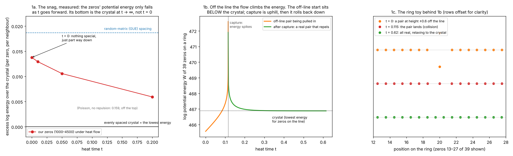
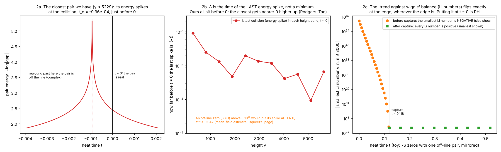
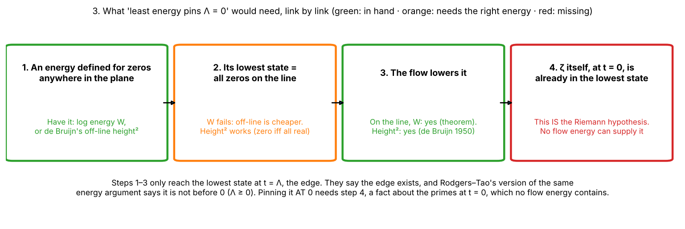

# DRAFT · Is the Riemann hypothesis a least-energy statement? Potential energy of the zeros under heat flow (Nov 27, 2026)

Asked for by Brennan on a voice call: "I think it's action minimization." … "Well, I think maybe it's potential
energy." Script: `potential.py` → `potential.json`, `ring_traj.npz`, `toy_traj.npz`. Pictures: `figs.py` →
`figures/`. Checks: `checks.py` → `checks_output.txt`, **12/12 pass**. Uses our 5,500 zeros and their heat-flow
snapshots from `../known-tools/rewind_snaps.npz`. Companion to `../spin-orbit/LAMBDA.md`.

## Result

**The zeros do have a natural potential energy, and the heat flow is exactly "roll downhill" in it. But its lowest
point is not at t = 0, so least energy can't pin Λ = 0.**

- The energy is the log (Coulomb-gas) energy W = −Σ log|zᵢ − zⱼ|. For zeros on the line, heat flow is pure gradient
  descent of W. W keeps falling forever, toward an evenly spaced crystal at t → ∞. Measured on our zeros, t = 0 is
  just partway down (Fig 1a). That is the snag from the call, and it is real.
- Off the line it gets worse. An off-line zero has *lower* log energy than the perfect crystal. Pulling it onto the
  line is uphill, and the energy spikes at the moment it lands (Fig 1b).
- The edge Λ shows up as the time of the **last energy spike** (the last collision), not as a minimum (Fig 2).
- The "balance of two pulls" (smoothing trend against prime wiggle, read through Li's numbers) does tip over exactly
  at the edge, but at the edge wherever it sits. Saying it sits at t = 0 is the Riemann hypothesis restated (Fig 2c).

**Is it a lead?** Not toward a proof. What it buys is a clean energy reading of the known results. Rodgers–Tao's
proof that Λ ≥ 0 is itself an energy argument: if Λ were negative, the zeros at t = 0 would already have relaxed
almost to the crystal, and they haven't (Fig 1a: GUE-like, not crystal). So energy gives the bound that says RH is
at best barely true, and never the bound that would prove it. One genuinely clarifying fact came out: off the line,
log energy prefers zeros *off* the line. So whatever holds ζ's zeros on the line, it is not the minimisation of this
energy.

## 1. The snag, measured

*1a. Excess log energy of our zeros 1000–4500 over an evenly spaced crystal, measured as the average of
−log(span/average span) over each zero's 10 nearest spans. This is ≥ 0 by Jensen's inequality, and 0 only for the
crystal (check P1). It falls from 0.0138 at t = 0 to 0.0059 at t = 0.2 (P7). For scale, random-matrix (GUE)
spacing gives 0.0187 and independent (Poisson) spacing 0.159 (P8). 1b. A ring of 39 zeros with one off-line pair
at height ±0.6. The ring stops the crowd from simply spreading out, so the crystal is the true lowest state for
zeros on the line. The off-line start sits 1.3 below the crystal. Capture climbs to a spike at t = 0.115, matching
the pair formula to within 1.1% (P6). Then the real pair repels and the energy rolls back to the crystal (P4).
1c. Positions in that run.*

- **Theorem (classical, checked P2).** For real zeros, dz_j/dt = 2Σ 1/(z_j − z_k) gives dW/dt = −2Σ F_j² ≤ 0, with
  F_j = Σ 1/(z_j − z_k). So W never has a minimum at finite time on the line. Rodgers–Tao note that the equilibrium
  of this system is an arithmetic progression (the crystal). They compare it to Dyson Brownian motion and to
  Erdős–Schlein–Yau relaxation.
- **Off the line (P3).** The same formula holds in general: dW/dt = −2 Re Σ F_j². F_j² can have a negative real
  part, so W can rise, and it does whenever a captured pair dominates (ring start: +13.4).
- **No floor off the line (P5).** Lifting a pair off the line keeps lowering W without limit. A least-energy
  principle built on W would push zeros off the line, not onto it.

## 2. Where the edge shows up instead

*2a. Our closest pair (γ ≈ 5229). Its energy −log|gap| spikes at the collision t_c = −9.4·10⁻⁴. That is just
before 0, so the pair is real at t = 0 (P9). 2b. Latest collision in each height band. All are before 0 (P10).
Rodgers–Tao proved they reach 0 in the limit (Λ ≥ 0). A worst-case off-line zero above 3·10¹² would instead spike
after 0, near t ≈ 0.04 (mean-field estimate from the squeeze page). 2c. Toy: 76 mirrored zeros with one off-line
pair. Li's numbers λ_n (Bombieri–Lagarias form, valid for any multiset of zeros) include a negative one until the
pair lands at t = 0.118. After that all are positive (P11).*

- In energy language, **Λ is the time of the last spike of W**: the last collision of a pair, read forward. RH says
  the last spike is at or before 0. Newman / Rodgers–Tao say spikes pile up just before 0. Our data show the same
  thing (2b).
- **Brennan's "balance of two pulls".** Li's criterion (Li 1997) and its general form (Bombieri–Lagarias 1999) say:
  all λ_n ≥ 0 if and only if every zero is on the line. Each λ_n is a smooth trend (the Gamma factor) plus a prime
  wiggle (the explicit formula). Applied to H_t, the trend just outweighs the wiggle for every n exactly when
  t ≥ Λ. So the balance point exists, and it sits at Λ. Putting it at t = 0 is the same statement as RH.

## 3. What "least energy pins Λ = 0" would need, and where it breaks

1. **An energy for zeros anywhere in the plane.** In hand.
2. **Lowest state = all zeros on the line.** The log energy W fails this (P5). De Bruijn's off-line height²,
   max (Im z)², works: it is 0 exactly when all zeros are real, and the flow lowers it (de Bruijn 1950, P12).
3. **The flow lowers it.** Yes for both on the line. Yes for height² everywhere.
4. **ζ's own zeros at t = 0 are already in the lowest state.** This is where it breaks. Steps 1–3 only say the
   lowest state is reached by t = Λ and stays reached afterwards. A plateau, not a point. Nothing in the flow knows
   where t = 0 is. What singles out t = 0 is the primes: only H₀ = Ξ has an Euler product. For t ≠ 0 the primes
   enter H_t only approximately (Polymath 15 used an Euler-product mollifier as a numerical barrier). So a
   "prime-side pressure" term in an energy along t has no exact meaning except at t = 0. There it is just ζ.

**Where the snag sits numerically.** The minimum of W along the flow is at t → ∞ (the crystal). The last spike is
at Λ. Rodgers–Tao put Λ ≥ 0, and the proved upper bound is Λ ≤ 0.2. A balance that cancelled exactly at t = 0 would
have to be built in by hand. Its required size is set by the zeros at t = 0 themselves, as dW/dt there. It doesn't
come out of the dynamics.

## How this ties to our action work

`../../action/` reads action as area and least action as the classical end of the path-sum dial. Here the heat
flow is first order (overdamped): there is no kinetic term and no action to make stationary, only an energy to roll
down. A true action for the zeros would need inertia. The closest real version is the Calogero–Moser system (zeros
of a moving polynomial as particles with 1/r² forces). Its stationary points are again evenly spaced or Hermite-type
configurations: crystals, not ζ.

## Known work used

de Bruijn 1950 (strip shrinks: height² falls); Newman 1976; Csordas–Smith–Varga 1994 (zero dynamics);
Rodgers–Tao 2018 / Forum Math. Pi 2020 (Λ ≥ 0 by relaxation to an arithmetic progression); Dobner 2020
(simplified proof); Li 1997; Bombieri–Lagarias 1999; Polymath 15 2019; Platt–Trudgian 2021; Stieltjes 1885 and
Calogero 1977 (electrostatic equilibria are Hermite zeros).

## Files

- `potential.py`: excess energy of our zeros, real, finite and ring toys, collision spikes, Li numbers on a toy.
- `figs.py`: `fig1_snag.png`, `fig2_edge.png`, `fig3_what_it_needs.png`.
- `checks.py`, `checks_output.txt`: 12/12. No Lean: the statements are about flows over zero sets.
