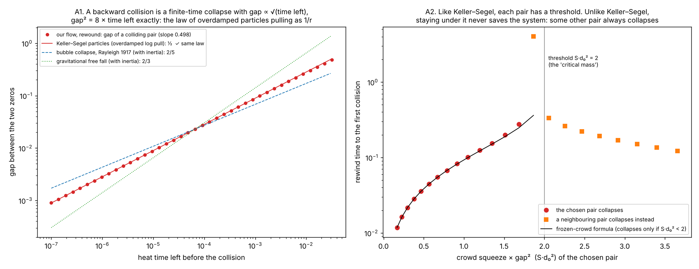
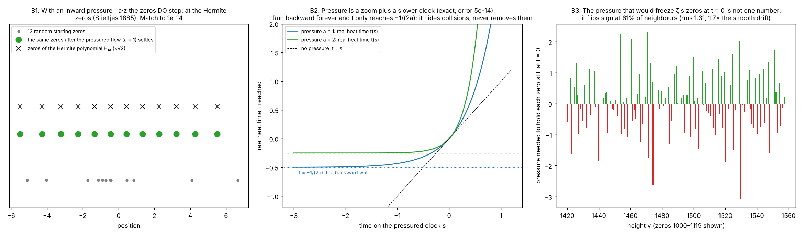
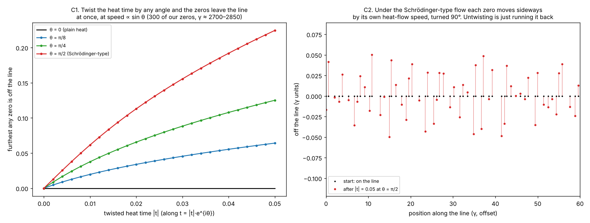

# DRAFT · Blow-up, outside pressure and a twisted heat time, mapped onto the zeros' backward flow (Nov 27, 2026)

Asked for by Brennan on a voice call, as three linked ideas:

1. Forward-time models where heat piles up at a point might show how ζ's heat flow behaves run backward.
2. "An outside pressure … could stabilize it, so there could be a dial that would make heat flow run in either
   direction … an equilibrium where the pressure is exactly the right amount to make the heat stop."
3. A twist: "link 2 different worlds, and then we could just map it back. By removing the twist."

Script: `pbt.py` → `pbt.json`, `collapse.npz`, `velocity.npz`, `twist_traj.npz`. Pictures: `figs.py` → `figures/`.
Checks: `checks.py` → `checks_output.txt`, **13/13 pass**. Uses our zeros' heat-flow snapshots
(`../known-tools/rewind_snaps.npz`). Companion to `../potential/` and `../spin-orbit/LAMBDA.md`.

## Result

**All three maps hold in part, and all three break at the same place: none can say where t = 0 sits relative to the
edge Λ.**

- **Blow-up.** Rewinding the heat flow really is a finite-time collapse, with an exact law: gap² = 8 × the time left.
  That is the law of two Keller–Segel particles pulling each other in, and each pair even has a "critical mass"
  threshold. Unlike Keller–Segel, staying under the threshold never saves the system: some pair always collapses.
- **Pressure.** An inward pressure does make the zeros stop, at the Hermite zeros. But a uniform pressure is exactly
  a zoom plus a slower clock, and the pressure that would freeze ζ's own zeros at t = 0 isn't one number. It is
  the zeros' own velocity, flipping sign zero to zero. So pressure is derived, not a new dial. RH also doesn't mean
  the zeros stand still at t = 0. They don't stand still at any heat time.
- **Twist.** Rotating heat time by any angle knocks every zero off the line at once. Removing the twist just runs
  the same family back, so nothing proved in the twisted world comes back for free.

**Is any of it a lead?** Not toward Λ = 0. The collapse law and the per-pair threshold are good tools: they sharpen
the rewind we already flagged on the known-tools page. The physics version of Brennan's "map it back" is real.
Wick rotation turns positivity in imaginary time into unitarity in real time (Osterwalder–Schrader 1973). The
number-theory version is Weil's positivity criterion on one side and a Hilbert–Pólya operator on the other. That
bridge is known, and it is the open problem itself. The twisted heat flow of Ξ is not that bridge.

## A. Blow-up: does a backward collision look like a forward finite-time blow-up?

*A1. A close pair (gap 0.35 among unit spacing, ring of 40) rewound to its collision. Gap against time left: slope
0.498, and gap²/time left = 8.00 (K1). Reference slopes: overdamped log-pull particles (Keller–Segel) ½, bubble
collapse 2/5, free fall 2/3. A2. Rewinding with the chosen pair's crowd squeeze × gap² swept from 0.2 to 3.7. Below
the threshold, the chosen pair collapses at the frozen-crowd time to within 10% (K2). Above it, the pair survives,
but a neighbouring pair collapses instead, in every run (K3).*

| forward model | what maps | where it breaks |
|---|---|---|
| **Keller–Segel** (Patlak 1953; Keller–Segel 1970) | Same force (log pull, overdamped), so the same collapse law, d² = 8(T − t). A per-pair threshold S·d₀² = 2 plays the role of the critical mass 8π (Jäger–Luckhaus 1992; Blanchet–Dolbeault–Perthame 2006). | In Keller–Segel, mass under the threshold is safe forever. Here only the perfect crystal is safe: about half our pairs sit under the threshold (51.4%, K4), and the rest push their neighbours under. The colliding zeros also don't merge. They turn and leave the line as a complex pair. |
| **u_t = Δu + uᵖ** (Fujita 1966; Giga–Kohn 1985) | Shares the heat scaling: the blow-up region shrinks like √(T − t). The pull 1/d grows like (T − t)^(−½), formally the p = 3 rate. | The match is only the scaling that every heat-driven blow-up has. There is no source term here, and the blow-up is of a gap, not a temperature. |
| **Negative heat capacity** (Lynden-Bell–Wood 1968; Thirring 1970) | Gravity-like clumping does appear in the rewind. | Negative heat capacity needs a conserved energy and inertia. This flow is first order and only dissipates (see `../potential/`), so there is no heat capacity at all. |
| **Adiabatic compression, sonoluminescence** (Rayleigh 1917 bubble collapse) | Finite-time collapse to a point. | Those laws come from inertia (exponent 2/5). Ours is overdamped (exponent ½). |

**Could a threshold sit at t = 0?** The threshold is per pair at a given time. At t = 0 about half our pairs are under
it, so any rewind breaks some. That is Λ ≥ 0 again (Rodgers–Tao). A threshold placing the edge exactly at 0 would be
the statement "no zero is off the line at t = 0". That is RH, not a threshold.

## B. Pressure: a dial that runs heat either way, with an equilibrium where it stops?

*B1. Add an inward pressure −a·z to the flow. Twelve random zeros settle exactly at the zeros of the Hermite
polynomial H₁₂, scaled by √(2/a) (Stieltjes 1885; Calogero 1977), to 10⁻¹⁴ (K5). B2. With pressure a, the flow is
exactly the plain heat flow zoomed by e^(−as) and run on the clock t = (e^(2as) − 1)/(2a) (K6, error 5·10⁻¹⁴). Run
backward forever and the real heat time only reaches −1/(2a) (K7). B3. The force that would hold each of ζ's
zeros still at t = 0 (zeros 1000–1119 shown, smooth drift removed). It flips sign at 61% of neighbours, and its rms
is 1.7 times the smooth drift (K8). It shrinks as heat time goes on: 1.31, 1.11, 0.80 (K9).*

- **The equilibrium exists.** An inward pressure stops the zeros at the Hermite configuration. This is the classical
  electrostatic picture, Stieltjes 1885. Hermite polynomials are also what heat flow does to xⁿ, so the
  equilibrium is a heat-flow solution seen in a shrinking frame.
- **The pressure is a zoom and a clock, so it's derived.** A uniform pressure doesn't change what happens. It changes
  how fast you watch it, and at what magnification. Backward with pressure looks stable forever only because the
  clock never reaches the collision. The collision is at the same heat time as before, so Λ is unchanged. Under
  Brennan's rule for dials, the pressure doesn't earn a place: it is t again, reparametrised.
- **A general pressure is circular.** To freeze any given set of zeros you need force V′(z_j) = 2Σ 1/(z_j − z_k) at
  every zero. That is the zeros' own heat velocity. For ζ at t = 0 that field fluctuates zero to zero (B3). The
  pressure that stops ζ is read off ζ.
- **Correction to what was said on the call.** RH does not mean ζ sits at a balance where pressure cancels heat and
  the zeros stand still. Under the heat flow the zeros keep moving at t = 0 and at every t. RH means t = 0 is at or
  after the edge Λ, the time of the last collision.
- **Known.** Stabilised backward diffusion is studied as an approximation scheme: quasi-reversibility
  (Lattès–Lions 1967), Tikhonov regularisation, forward–backward heat equations (Höllig 1983; Perona–Malik 1990).
  These change the solution to make the backward problem well posed. They don't find an exact balance.

## C. The twist: rotate heat time into the complex plane, then map back

*C1. 300 of our zeros (γ ≈ 2700–2850, on a ring) flowed in heat time t = |t|·e^{iθ}. At θ = 0 every zero stays
real (K10). Any θ > 0 moves zeros off the line at once, starting at a speed proportional to sin θ (K11). C2. At
θ = π/2 (Schrödinger-type flow), each zero moves sideways by its own heat-flow speed turned through 90°.*

- **What is easy in the twisted world.** The flow is unitary on the Fourier side (|e^{iσu²}| = 1). Σz is
  conserved, and Σz² grows exactly linearly in complex time (K12). Removing the twist returns the zeros to the line
  exactly (K13).
- **Why nothing maps back.** H_t for complex t is one analytic family, and removing the twist just runs it back. A
  fact proved at twisted time comes back to t = 0 only if the path back preserves it. The property that matters,
  all zeros real, is preserved only along real t increasing (Pólya's universal factors: e^(−αD²) keeps zeros real
  only for real α ≥ 0). The twisted world loses the line at once, so it has nothing to carry back.
- **Our own twisting tools.** The rotation here is the same Wick-rotation dial as Feynman's dial in `../../why-i/`
  and the quantum-action page. That is a clean fit of language. Precession (turn = d × area) doesn't apply: there is
  no loop and no area, just a rotated velocity.
- **The real version of "link two worlds and map back".** In physics, Osterwalder–Schrader turn reflection positivity
  in imaginary time into unitarity in real time. For ζ, the analogue is Weil's positivity criterion (RH ⇔ a
  quadratic form built from the explicit formula is positive; Weil 1952) on one side, and a self-adjoint
  Hilbert–Pólya operator, or Connes's trace formula (1999), on the other. That bridge is known, and both sides
  are open. A quick search found no work using complex de Bruijn–Newman time for RH. I didn't search exhaustively.

## Where every map breaks

Each picture says something true about the flow: collapse laws, thresholds, equilibria, conserved quantities. The
flow moves zeros. It cannot say where they start. Λ = 0 is the statement that ζ's zeros start on the line, a fact
about the primes at t = 0. The same break shows up on the potential-energy and squeeze pages.

## Known work used

de Bruijn 1950; Newman 1976; Csordas–Smith–Varga 1994; Rodgers–Tao 2018 (Forum Math. Pi 2020); Patlak 1953;
Keller–Segel 1970; Jäger–Luckhaus 1992; Blanchet–Dolbeault–Perthame 2006; Fujita 1966; Giga–Kohn 1985;
Lynden-Bell–Wood 1968; Thirring 1970; Rayleigh 1917; Stieltjes 1885; Calogero 1977; Lattès–Lions 1967; Höllig
1983; Perona–Malik 1990; Pólya 1927 (universal factors); Osterwalder–Schrader 1973; Weil 1952; Connes 1999.

## Files

- `pbt.py`: collapse law, threshold scan, pressure equilibria and clock map, ζ's velocity field, twisted flow.
- `figs.py`: `figA_blowup.png`, `figB_pressure.png`, `figC_twist.png`.
- `checks.py`, `checks_output.txt`: 13/13. No Lean.
