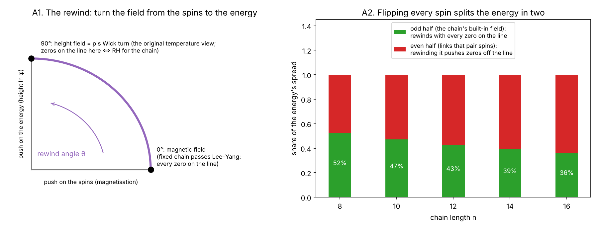
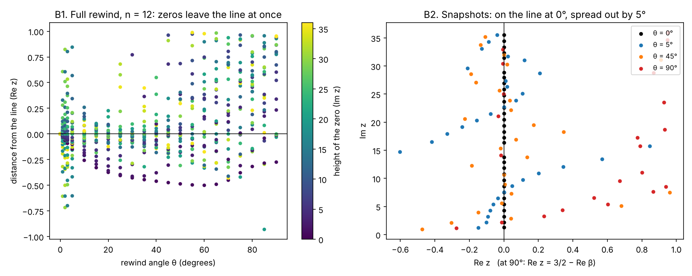
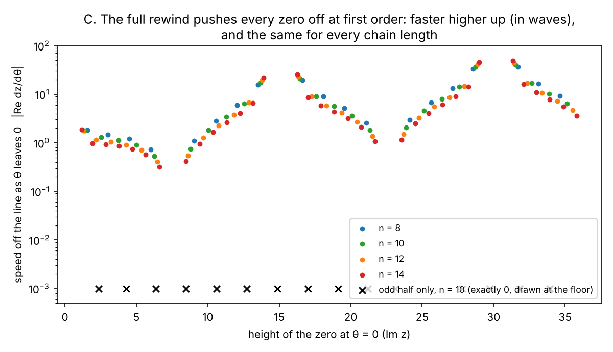
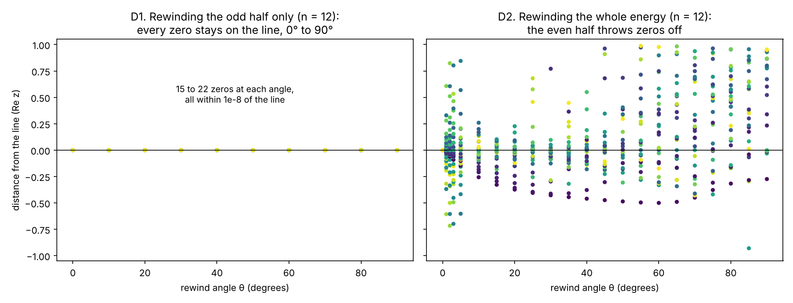

# DRAFT: The rewind dial, from the magnetic circle back to the temperature view

**Status: DRAFT.** Numbers checked by `checks.py` (15/15 pass, `checks_output.txt`). Nothing here proves RH.

**The plain result.** The rewind works for half of the energy and breaks for the other half. Flipping every spin
splits the chain's energy into an odd half (the chain's built-in field) and an even half (the links that pair spins
up). Turning the dial on the odd half keeps every zero exactly on the line, all the way from the magnetic view to the
temperature view. Turning it on the even half pushes zeros off the line the moment the dial moves, mostly faster
for higher zeros, and longer chains don't calm it. So the whole RH question for the chain now sits in the even half.

This piece runs on the fixed (compass-spin) chain from chain-fix, at Knauf's Riemann temperature β = 3/2. β is our
roundness dial p read on the height ruler (knauf-field Fig A).

## Fig A. The rewind dial

- **A1.** At angle 0 the field pushes on the spins (a magnetic field). There the fixed chain passes Lee–Yang: every
  zero is on the line (chain-fix). At 90° the field pushes on the energy instead. That is exactly what the Wick turn
  of p does (knauf-field Fig A), so 90° is the original temperature view, and zeros on the line there means RH for
  the chain (check R9: the 90° function is 2 Z(3/2 − z)). In between, the field is a blend: cos θ × spins +
  sin θ × energy. θ is a setting of the rewind, not a new dial; its far end is p's Wick turn. This is a rotation in
  the plane of the two fields, which is why it is "like a Wick rotation".
- **A2.** Flipping every spin splits the energy into two halves. The odd half changes sign under the flip; it is
  the chain's built-in field, and 98.3% of it is a plain uneven push on each spin (R8). The even half doesn't change
  under the flip; it is the links that pair spins. The odd half's share of the energy's spread falls with chain
  length, from 52% at n = 8 to 36% at n = 16.

## Fig B. Rewinding the whole energy

- **B1.** Each dot is a zero at one angle, its height shown by colour. At 0° all of them are on the line (R1). By 5°
  most are already off it (R5), and they spread out as the angle grows.
- **B2.** Snapshots at 0°, 5°, 45° and 90°. At 90° a few zeros sit next to 3/2 + iγ for the first ζ zeros, as Knauf's
  finite chains do (R10), but most of the zeros in the window are the chain's own extra zeros, far from the line.

## Fig C. Why it breaks: first order, and faster with height

As θ leaves 0, a zero at height y moves at the speed dz/dθ = −z·G(z)/F′(z), with G the energy-weighted sum. On the
line, F is real, F′ is imaginary, and z is imaginary. So the motion is purely sideways, straight off the line, when
the energy part is flip-even (R3), and purely along the line when it is flip-odd (R6). For the full energy the
sideways speed grows with height overall, in waves, and is almost the same for every chain length (R4). The black crosses are the odd half
alone: speed exactly zero.

**The rule (ours, short proof above):** along the rewind, the odd half of what you turn toward only slides zeros along
the line; only the even half can push them off, and it does so at first order.

## Fig D. Rewinding the odd half only

- **D1.** Turning the dial from the spins to the odd half of the energy, every zero stays on the line at every angle
  from 0° to 90°, for n = 8, 10 and 12: 13 to 22 zeros in the window at each angle, all within 10^−8 of the line (R7). At 90° that is the temperature view for the odd half: the odd half of
  Knauf's energy gets the complex temperature while the even half stays at 3/2.
- **D2.** The same picture for the whole energy, for comparison.
- Why D1 holds: the first-order rule above keeps zeros on the line to first order, and 98% of the odd half is an
  uneven push on each spin, where Lee–Yang's theorem for uneven fields applies once the circle holds spin by spin.
  We have that circle only for a uniform push (chain-fix), so D1 is a numerical finding, not yet a proof.

## Graded two ways

| Result | Worth following? | Could reach a proof? |
|---|---|---|
| The rewind, from the magnetic circle to p's Wick turn (Fig A) | **Yes.** It's the bridge from what the fixed chain proves (field zeros) to what RH needs (temperature zeros). | Only through the even half: the odd half already makes it. |
| First-order rule: the odd half slides zeros along the line, the even half pushes them off (Fig C) | **Yes.** It locates exactly what breaks, and it's a short exact argument. | It tells true from false for the chain's own zeros only through the even half. |
| Odd-half rewind keeps every zero on the line to 90° (Fig D1) | **Yes.** Something new to prove: a spin-by-spin circle for the fixed chain, which would make D1 a theorem. | Not by itself: the odd half's share shrinks with chain length. |
| Even half (Fig B, D2) | **Yes, as the target.** To rewind it we need a symmetry that carries the line through the even half. At 90° the only candidate is ζ's own functional equation (the pendulum's m ↔ 1 − m swap from pendulum-zeta), which finite chains don't have. | Could reach a proof only if such a symmetry can be built into the dial path. We don't have one yet. |

## Known versus ours

| Piece | Status |
|---|---|
| Knauf's chain and its ζ limit; finite-chain zeros near 3/2 + iγ | Known: Knauf 1993, 1998. |
| Lee–Yang circle; Lee–Yang for uneven (site-dependent) fields | Known: Lee–Yang 1952 and its standard multi-variable form. |
| Wick rotation as a turn between two directions in a plane | Known idea in physics. |
| The rewind dial between the magnetic field and p's Wick turn on the fixed chain | Ours. |
| The first-order rule (odd half slides, even half pushes off) | Ours, with a short proof; the ingredients are standard. |
| Odd-half rewind keeping every zero on the line; the shrinking odd share | Ours, numerical. |

## Next routes this opens

- Prove the spin-by-spin circle for the fixed chain, which turns Fig D1 into a theorem.
- Find a symmetry for the even half. The natural place to look is the pendulum swap (m ↔ 1 − m), which is ζ's
  functional equation; the question is whether a chain can carry it.

## Files

- `rotate.py`: the rewind function (its own tracking run lost zeros at n = 12, so its output was dropped; `movie.py` replaces it).
- `movie.py` → `movie_n10.json`, `movie_n12.json`: zeros at each angle, found independently (phase winding, then Newton).
- `firstorder.py` → `firstorder.json`: first-order speeds. `smalltheta.py`: small-angle probe.
- `oddpath.py` → `oddpath_8_10.json`; `oddpath12_rest.py` → `oddpath_12.json` (n = 12 on a 0.02 grid, merged): the odd-half rewind.
- `figs.py` → `figures/`. `checks.py` → `checks_output.txt`.
