# DRAFT: Round 10, the repo's prime results against the zeros, the prime lifecycle, and hyper integrals (Nov 27, 2026)

> **Names:** some words or symbols on this page (fused, rung) also mean something else in standard math, physics or computing, or inside this project. [NAMING-COLLISIONS.md](../../../NAMING-COLLISIONS.md) says which meaning is in play.

**Not a lead.** Every prime result in the repo that had not yet been tried on the Riemann zeros either restates the
sieve or reaches the zeros by a road that is already in print (Montgomery's pair correlation, Rubinstein–Sarnak's
bias, Cramér's gaps). The life of a prime as N grows runs in six stages, each drawn below, and each matches the
literature. The hyper integrals work as expected: rung 2 is Volterra's product integral (e^{k∫f} − 1)/k, and on primes
it is ∏(1 + k p^{−s}), which is ζ(s)/ζ(2s) at k = 1 and 1/ζ(s) at k = −1. Rung 3 runs to zero on primes. Against the
jet layers of the jet-river page: the integral limit keeps only the trace layer P, while on primes every layer survives.

Task (Brennan, via the project chat): inventory every prime result in the repo; apply the untried ones to the zeros,
the Euler product, the explicit formula and S(t), one line each (tried before or new, lead or not); draw the prime
lifecycle as N grows, one figure per stage, with a literature check (Cramér, Hardy–Littlewood); build hyper integrals,
fused Riemann sums with ∘_k and higher hyperoperations, push to higher levels, and compare with the full-jets work.

| piece | status |
|---|---|
| inventory of prime results (29 READMEs, the primes scripts, the toric page) | done, `inventory.md` |
| untried results on RH | 18 lines below; none a lead |
| lifecycle, six stages | all six match known results |
| rung-2 hyper integral = Volterra product integral | known (Volterra 1887) |
| rung-2 over primes = ∏(1 + k p^{−s}), layers by number of prime factors | known (Euler product, Landau 1909, Sathe–Selberg) |
| rung 3 = multiplication in log coordinates; dies on primes | ours as a reading, elementary |
| hyper integral against jet layers: only P survives the limit | known fact (Liouville's formula), ours as the comparison |
| checks | 28 of 28 pass (`checks.py`) |

## 1. The untried results, one line each

All were new on RH in this repo (the inventory found no earlier attempt). "Known" means the link to the zeros is in print.

| ID | result | where it meets ζ | verdict |
|---|---|---|---|
| P1 | sieve hops | Euler product, nothing past it | restates the sieve; not a lead |
| P2 | wave product ∏\|sin(πx/p)\| | its zero set is the composites, an indicator of the sieve | folklore; carries no zero information; not a lead |
| P4/P5 | primorial wheel and its gap populations | gap statistics (§3, fig) | neither Poisson nor GUE; reduced-residue gaps are Montgomery–Vaughan 1986; not a lead |
| P6 | next-spoke guess, hit rate | short-interval primes, via the explicit formula | not computed; the route is Selberg's short-interval work under RH (1943); not a lead |
| P7/P8 | Legendre layers, 2e^{−γ} overcount | Mertens' product at √x (stage 3) | 1.1226 measured vs 1.1229; Mertens 1874, used by Maier 1985 and Granville 1995; not a lead |
| P9/P10/P13 | Hardy–Littlewood tuples, twin constant as a ∘₁ fold | pair correlation of zeros (§3, fig) | Montgomery 1973, Goldston–Montgomery 1987, Bogomolny–Keating 1996; not a lead |
| P11 | Cramér record gaps | RH gives gaps O(√p log p) | Cramér 1920 and 1936; records here stay under 0.74 (log p)²; not a lead |
| O6 | the 50% plain-½ share for primes | the share's approach to 50% carries π(x) − li(x) | not computed; says no more than the prime number theorem's error term; not a lead |
| O7 | Gaussian binomials at prime powers | zetas of Grassmannians over F_q | their RH is Weil–Deligne, finite fields; no route to ζ; not a lead |
| O8/O9 | p-adic clock points, product formula | adeles; Tate's thesis (1950) | gives the functional equation, not the zeros; not a lead |
| O10/O11 | Frobenius congruence (AKS), windings p + 1 | the zeta of the projective line over F_p | that zeta has no zeros; no route; not a lead |
| O12 | toric zetas as shifted ζ | zeros of ζ(s − j) on shifted lines | restates RH; not a lead |
| O13 | Fermat cubic counts | the Hasse–Weil L-function of a CM elliptic curve | its RH is open and of the same kind; no new route; not a lead |
| O14 | Chebyshev's bias mod 12 and mod 7 | zeros of L(s, χ), not ζ (§3, fig) | Rubinstein–Sarnak 1994; not a lead |
| O17 | FLT, Frey's bad primes | modularity continues L(E, s) | says nothing about where zeros sit; not a lead |

Already applied in earlier rounds (not repeated): P3, P12, P14, the zero half of P15, O1, O2, O4, O15, O16, O18,
R1–R13. Closed earlier as known: O3.

## 2. The life of a prime as N grows

Six stages, one figure each. All figures from `r10.py` (sieve to 10⁸, 5500 zeros from round 9).

**Stage 1, birth.** p appears as a gap in the sieve.

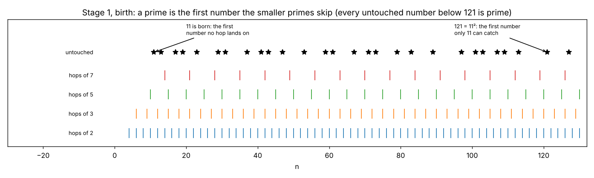

**Stage 2, first catch.** p starts removing numbers only at p², and its share of the composites climbs toward
(1/p)∏_{q<p}(1 − 1/q). At 10⁸ the shares of 11 and 101 sit within 1% of that limit; 1009 is still 16% above it.

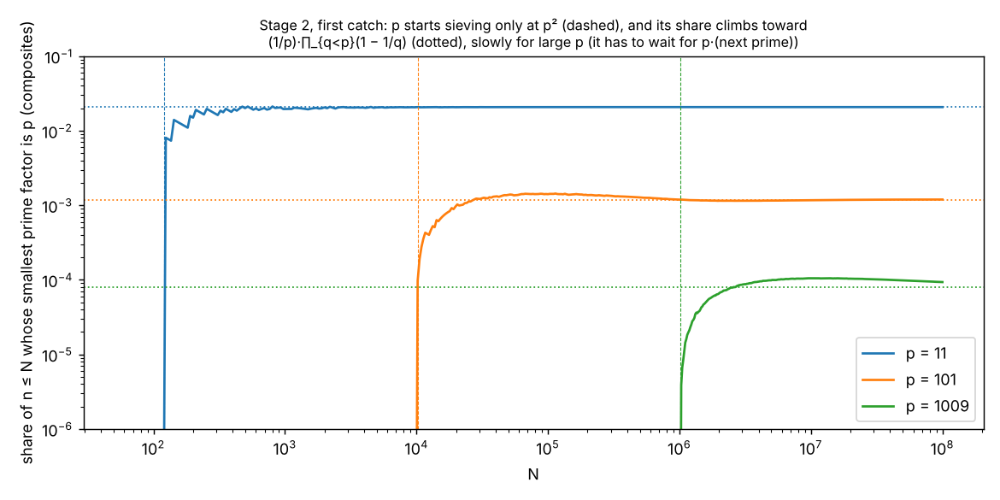

**Stage 3, the wheel.** p closes 1/p of the open spokes. The wheel certifies every number below p², yet its density
there is 2e^{−γ}/log x, so it overcounts the primes it certifies by 12%. This is Mertens' theorem (1874) read at √x,
the reason the plain sieve of Eratosthenes cannot give the prime number theorem, and the constant behind Maier 1985
and Granville 1995.

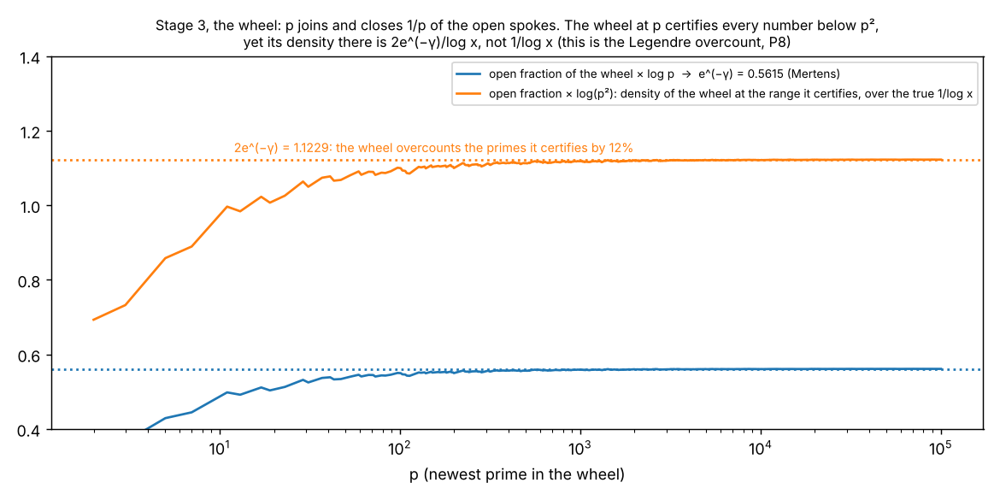

**Stage 4, gaps.** The gap after p is log p on average. Record gaps up to 10⁸ stay below (log p)² (largest ratio
0.739 above 10³; the largest known anywhere is about 0.92). Cramér's model (1936) predicts (log p)²; Granville
(1995) conjectured the limsup is at least 2e^{−γ}, from Maier's theorem. RH alone promises only √p log p (Cramér 1920).

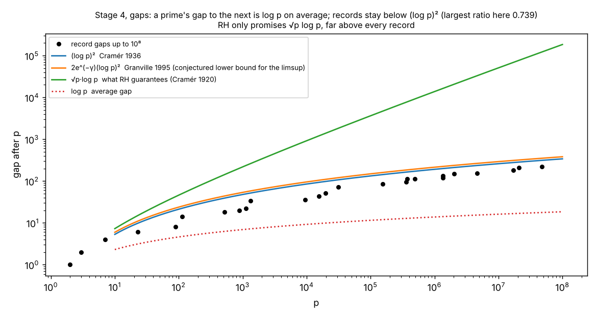

**Stage 5, heard by the zeros.** The sum Σ_{γ≤T} cos(γ log x) has a spike −(T/2π)Λ(x)/√x at every prime power (Landau
1912). Normalised, the spike reads 0.998 at p = 11 and 0.990 at p = 101 with 5500 zeros; 1009 (0.89) and 10007 (1.10)
need more zeros before they settle.

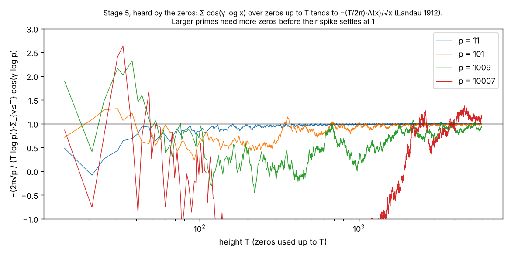

**Stage 6, one voice among many.** Each prime adds about 1/(2p) to the variance of log|ζ(½ + it)|, and the total grows
like ½ log log t (Selberg's central limit theorem). Near t = 5000 the prime 2 alone explains 17% of the variance, primes
to 101 explain 60%, primes to 10007 explain 78%. What the Euler factors miss is carried by the nearby zeros, which is
the hybrid product of Gonek, Hughes and Keating (2007).

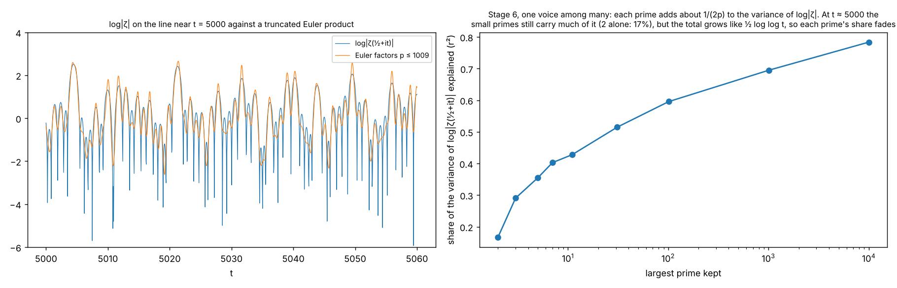

## 3. Three of the untried results, drawn

**P4/P5.** The wheel's spoke gaps sit on a few values, prime gaps near 10⁷ are close to Poisson, and the zero spacings
repel as GUE predicts. Small-gap fractions (below half the mean): zeros 0.087, wheel 0.258, primes 0.358. The wheel's
gap statistics say nothing about the zeros' spacing.

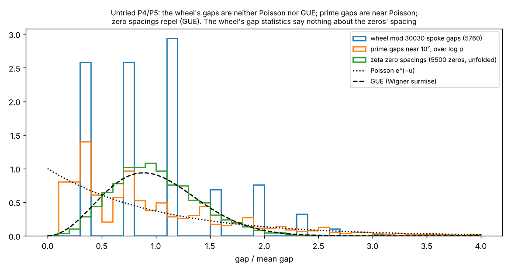

**O14.** The non-squares lead for 99.96% of primes up to 10⁸ mod 4 and for all of them mod 3 (the first mod-3 crossing
is far beyond 10⁸). Rubinstein and Sarnak (1994), assuming GRH and linear independence of the zeros, give 99.59% and
99.90% in logarithmic density. Their zeros are those of L(s, χ), not ζ.

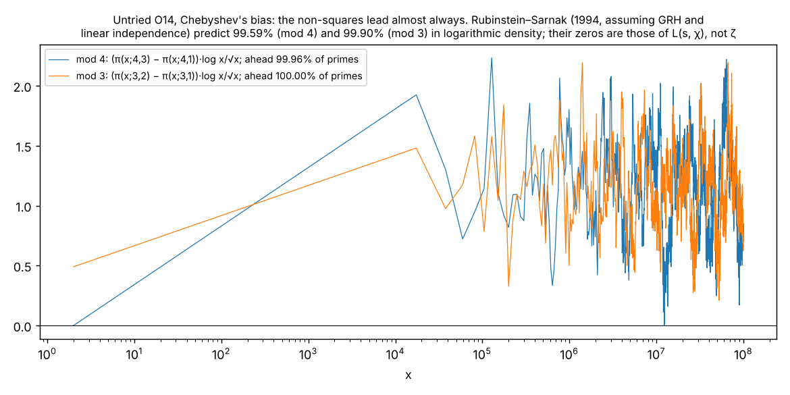

**P9/P10.** The Hardy–Littlewood tuple constants reach the zeros through pair correlation: Montgomery's
1 − (sin πu/πu)² fits the first 5500 zeros, and the corrections from the singular series are Bogomolny–Keating 1996.

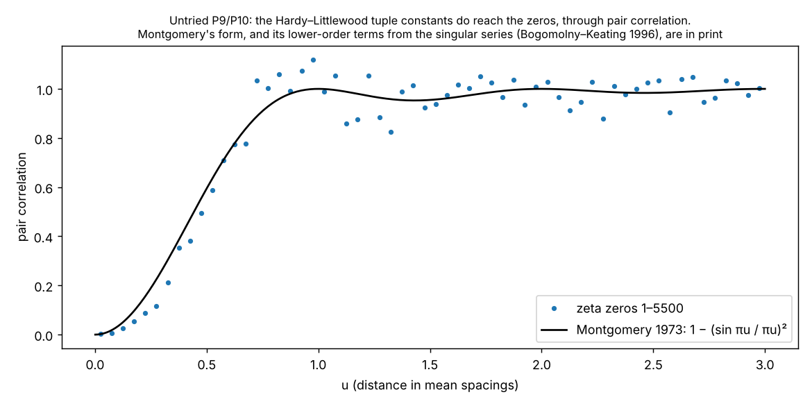

## 4. Hyper integrals

A fused Riemann sum replaces + with the rung-k operation. On [0, 1] with n steps of width Δ:

- **Rung 2** (∘_k, a ∘_k b = a + b + k ab): the sum ∘_k f(x_i)Δ converges to (e^{k∫f} − 1)/k, Volterra's product
  integral (1887). Error about 1/n at k = 1, −0.5, 2.
- **Rung 3** (multiplication) is rung 2 read in log coordinates. With heights scaled by Δ the product collapses to 0
  or 1; with Δ as an exponent, ∏ g(x_i)^Δ, it converges to exp(∫ log g). For g = log(1 + f) this gives
  exp(∫ log log(1 + f)) = 0.040338, matched to 10⁻¹¹.
- **On primes** there is no Δ: the rung-2 fold of p^{−s} is ∏(1 + k p^{−s}) − 1. At k = 1 this is ζ(s)/ζ(2s) − 1
  (0.519818 at s = 2, matched to 10⁻⁷). At k = −1 it is 1/ζ(s) − 1. The rung-3 fold ∏ log(1 + p^{−s}) runs to 0 and
  has no Dirichlet series.

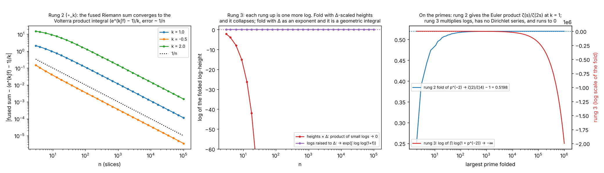

### Against the jet layers

The repo has no topic named "full jets" or "frame lagging"; the closest is
[`gravity-from-theory/jet-river`](../../gravity-from-theory/jet-river/). There one step of a 3D flow has det(I + hS) = 1 + hP + h²Q + h³R, and the river's
field equation is the Q layer, Q = 8πGρ. Our rung-2 fold is the same fold of the eigenvalues, ∏(1 + h λ_i).

- **A. In the integral limit only P survives.** For a 3×3 flow S(x), the matrix product ∏(I + hS(x_i)) converges to
  the ordered exponential, and its determinant to exp(∫ tr S) (Liouville's formula). The Q and R parts total about
  1/n over all steps and vanish.
- **B. On primes every layer survives**, because there is no step to shrink:
  ∏(1 + k p^{−s}) = Σ_m e_m k^m, with e_m the sum of n^{−s} over squarefree n with exactly m prime factors. The layers
  sum to ζ(2)/ζ(4) at k = 1 and 1/ζ(2) at k = −1 (both to 10⁻⁷ with primes to 10⁶).
- **C. In the dial k the prime product has only real zeros**, at k = −p^s. So its layers obey Newton's inequalities,
  e_m² ≥ (1 + 1/m) e_{m−1} e_{m+1}, at every m tested (1 to 9, s = 2 and 3). This is the classical fact that a
  real-rooted product gives a Pólya frequency sequence (Aissen–Schoenberg–Whitney 1952). It is a real-rooted parent
  in k, but a trivial one: its zeros are the primes, not the Riemann zeros.

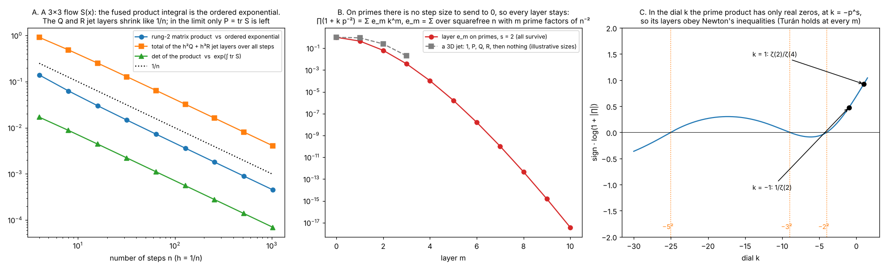

Higher rungs: the top jet layer R = λ₁λ₂λ₃ is the rung-3 fold (the product) of the eigenvalues, while the whole box is
the rung-2 fold of hλ. On primes the rung-3 fold is ∏ p^{−s} = 0, the same collapse as above. We did not build rung 4; on
primes it would start from a rung-3 fold that is already 0.

## 5. Quantum gravity

One new reading, not a new fact. In jet-river the field equation is the h² layer Q of a single step. The integral
limit of the same fold, along time, keeps only P (panel A): the accumulated volume of a cell never sees Q. So in that
picture gravity lives in the finite step, the fused sum, and not in its integral. The fact underneath is Liouville's
formula; the reading is ours. On primes the analogue of Q is e₂, the squarefree numbers with two prime factors, and it
carries nothing about the zeros' positions. The dial k as a fugacity per prime is the fermionic primon gas (Julia 1990,
Spector 1990), already used in O2.

## 6. Verdict

Not a lead. The inventory is closed: every prime result in the repo has now been tried on the zeros, and each one
either restates the sieve or meets the zeros along a known road. The lifecycle and the hyper integrals are clean
pictures of known mathematics.

## Files

- `inventory.md`: the working list of prime results (P = primes scripts, O = other topics, R = Riemann rounds).
- `r10.py`, `r10.json`, `r10_output.txt`: sieve to 10⁸, lifecycle stages, untried results, hyper integrals.
- `jets.py`, `jets.json`: the comparison with the jet layers.
- `checks.py`, `checks_output.txt`: 28 checks.
- `lean/RiemannRound10.lean`: wheel spoke counts (`wheel6`, `wheel30`, `wheel210`), the layer identities
  (`jet2`, `jet3`, `fold_at_minus_one`), `newton2`, `rung3_log_mult`.
  Compiled in the shared library as `FusedAlgebra.Topics.RiemannRound10` (namespace `CircleOp.RiemannRound10`), all
  8 theorems, standard axioms only. One proof changed, statement unchanged: core Lean has no `Int.mul_self_nonneg`, so
  `newton2` gets 0 ≤ (a − b)² from `Int.mul_nonneg` by cases on the sign, then `grind`.
- `figures/`: 11 figures.
- The inventory and the jet comparison read files already in this repo: `topics/primes/`, the topics listed in `inventory.md`, and `topics/gravity-from-theory/jet-river/`. The working copies in `inputs/` are not committed.

## References

- H. Cramér, "On the order of magnitude of the difference between consecutive prime numbers", Acta Arith. 2 (1936).
- H. Cramér, on prime gaps under RH (1920).
- G. H. Hardy and J. E. Littlewood, "Some problems of 'Partitio numerorum' III", Acta Math. 44 (1923).
- E. Landau, the sum of x^ρ over zeros (1912).
- F. Mertens, J. reine angew. Math. 78 (1874).
- H. Maier, "Primes in short intervals", Michigan Math. J. 32 (1985).
- A. Granville, "Harald Cramér and the distribution of prime numbers", Scand. Actuar. J. (1995).
- A. Selberg, short intervals under RH (1943); the central limit theorem for log|ζ| (1946).
- H. L. Montgomery, "The pair correlation of zeros of the zeta function", Proc. Sympos. Pure Math. 24 (1973).
- D. A. Goldston and H. L. Montgomery, pair correlation and primes in short intervals (1987).
- E. Bogomolny and J. Keating, "Random matrix theory and the Riemann zeros II", Nonlinearity 9 (1996).
- H. L. Montgomery and R. C. Vaughan, "On the distribution of reduced residues", Ann. of Math. 123 (1986).
- M. Rubinstein and P. Sarnak, "Chebyshev's bias", Experiment. Math. 3 (1994).
- S. M. Gonek, C. P. Hughes and J. P. Keating, "A hybrid Euler–Hadamard product for the Riemann zeta function", Duke
  Math. J. 136 (2007).
- V. Volterra, product integration (1887).
- M. Aissen, I. J. Schoenberg and A. Whitney, "On the generating functions of totally positive sequences", J. Analyse
  Math. 2 (1952).
- B. Julia, "Statistical theory of numbers" (1990); D. Spector, "Supersymmetry and the Möbius inversion function",
  Comm. Math. Phys. 127 (1990).

Page numbers left out where not checked.
