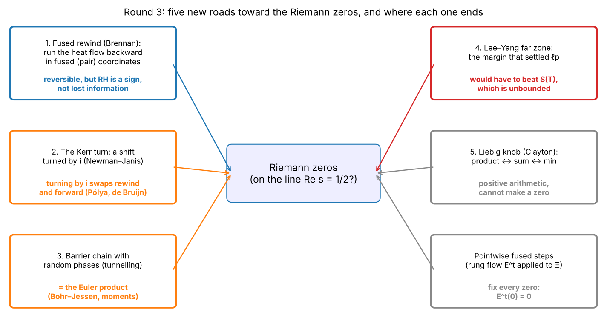
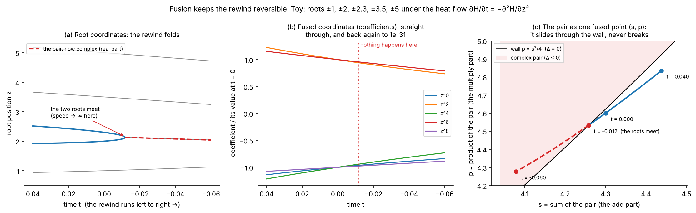
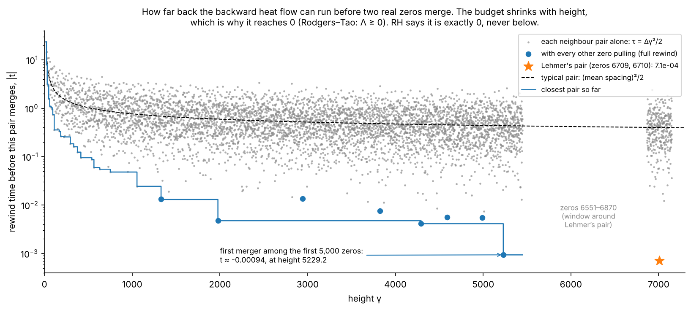
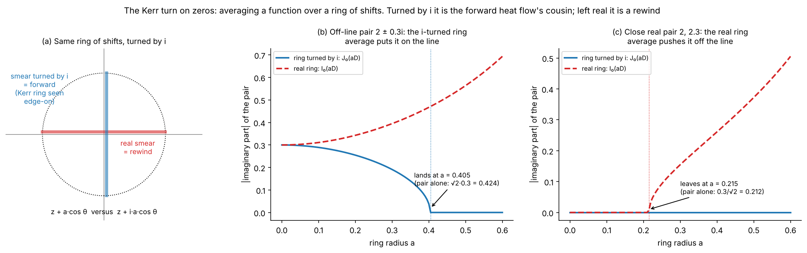
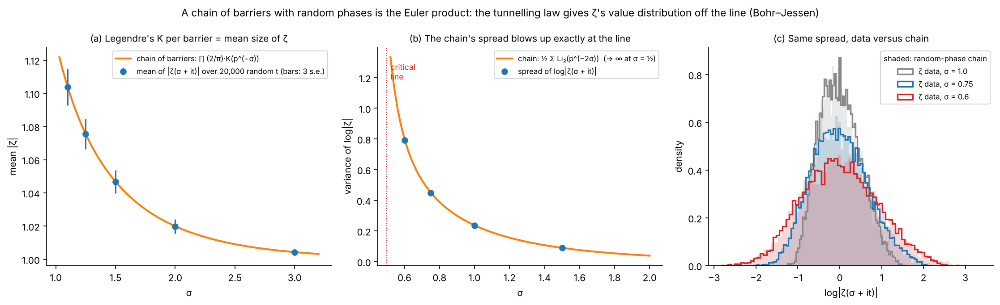
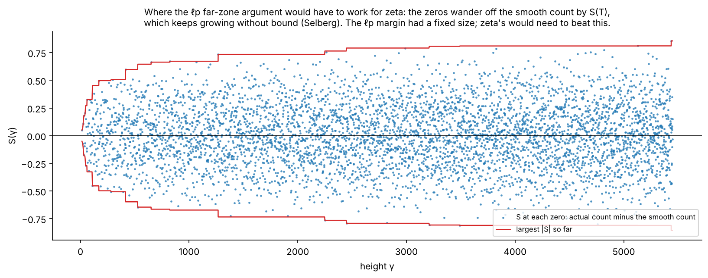
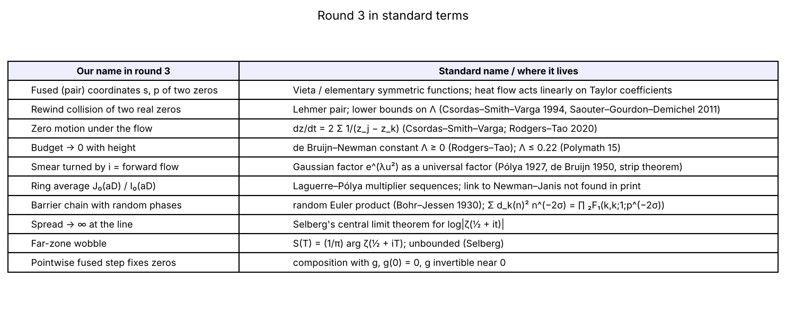

# DRAFT · The Riemann hypothesis, round 3: the fused rewind, the Kerr turn and the barrier chain

**DRAFT, Nov 26 2026.** Part of Affine Composition Theory, built on Fused Hyperoperation Algebra.
Asked for by Brennan: "Please keep working on Riemann hypothesis". In this thread he added: "I do think fused
hyperoperations could serve the reversibility we are looking for" and "That is the whole point of fusion".
Method as before: our own tools first, then the literature, then a polishing step.
Checks: `checks.py` → `checks_output.txt`, **23 of 23 pass** (16 math, 7 polish). Pictures: `figures.py` → `figures/`.
Lean: `lean/RiemannRound3.lean`, 10 short statements, compiled in the shared library as `FusedAlgebra.Topics.RiemannRound3`.
Earlier rounds: [`../README.md`](../README.md) (first look), [`../elliptic-object/`](../elliptic-object/README.md) (second look).
Colour key in every picture: **blue = our reading, orange = already known, grey = reference, red = where a road stops.**

## The answer

**Fusion does make the rewind reversible, but reversibility turns out not to be what is missing.** Kept in fused
coordinates (each pair of zeros as its sum and its product, or the whole function as its coefficients), the
backward heat flow is a straight, lossless flow. It passes through the moment two real zeros meet without anything
breaking, and running it forward again gives back the start to 1e-31. But the de Bruijn–Newman flow was already
reversible in that sense. What the Riemann hypothesis needs is a **sign**: at t = 0, no pair's fused point may have
crossed the wall Δ = 0 into the complex side. On the real zeros the rewind first pushes a pair across at
t ≈ −0.00094 among the first 5,000 zeros (zeros 4765 and 4766), and at t ≈ −0.00071 for Lehmer's famous pair
(zeros 6709 and 6710). That budget keeps shrinking with height, which is the picture behind Rodgers and Tao's
theorem Λ ≥ 0. So this road is **not a lead** toward a proof, but it pins the missing piece down again as
positivity, the same piece rounds 1 and 2 found.

The four other roads, each judged on its own:
- **The Kerr turn:** turning a shift by i, the Newman–Janis move behind Kerr, swaps the rewind and the forward flow.
  That is known (Pólya, de Bruijn). Not a lead.
- **The barrier chain:** a chain of tunnelling barriers with random phases *is* the Euler product. The per-barrier
  Legendre K law gives zeta's mean size off the line to within 0.02%. That is a real bridge for the "Where it
  unifies" list, and known math (Bohr–Jessen). Not a lead for RH, because the chain blows up exactly on the line.
- **The Lee–Yang far zone:** the margin that settled the ℓp cases would have to beat S(T), which is unbounded. Not a lead.
- **The Liebig knob:** it is positive arithmetic, and positive arithmetic can't make a zero. Not a lead.

**Fig 0.** The five roads and where each one ends.

---

## Pass 1 (our own tools)

### 1. The fused rewind (Brennan's road)

**Fig 1.** A toy with roots ±1, ±2, ±2.3, ±3.5, ±5 under the heat flow ∂H/∂t = −∂²H/∂z², run backward (right to
left). (a) In root coordinates the close pair 2, 2.3 runs together and folds into a complex pair at
t = −0.01171, close to the pair-alone time −0.3²/8 = −0.01125. Their speed goes to infinity there. (b) The
coefficients, the fused description of the whole function, move along smooth curves. Nothing happens at the
collision, and running forward again returns them to 1e-31. (c) The pair as one fused point (s, p) = (sum,
product): it slides straight through the wall p = s²/4 and stays real on both sides.

- **What "fused" means here.** It keeps the add part and the multiply part of two roots together, as Vieta's pair
  (s, p) = (a + b, a·b). Two real roots and a complex pair x ± iy are both one real point, the second being
  (2x, x² + y²). Nothing is lost when the roots meet, so the fused flow can always be undone.
- **On one pair the flow is a straight line.** The pair's discriminant is (gap)² + 8t (Lean `heat_pair_gap`).
  The rewind slides the fused point toward the wall at a steady rate, and through it.
- **Why that doesn't prove anything.** Crossing the wall loses no information, which is why the flow stays
  reversible. What changes is a sign, Δ ≥ 0 versus Δ < 0, and RH is a statement about that sign at t = 0. Fusion
  gives reversibility for free; it doesn't give the sign.
- **Pointwise fused steps can't help either.** Apply the rung flow E^t, or any step that sends 0 to 0 and nothing
  else to 0, to the values of Ξ, and every zero stays exactly where it was (Lean `pointwise_fixes_zeros`). To move
  zeros you have to act on the function as a whole, which is what the heat flow does.

### 2. How far the rewind can run on the real zeros

**Fig 2.** For each neighbouring pair of zeros, how far back the backward heat flow can run before that pair
merges. Grey: each pair alone, τ = Δγ²/2. Blue: the full rewind, with every other zero pulling. Orange star:
Lehmer's pair. Dashed: a typical pair, which gets closer with height as the zeros crowd together.

- **The motion.** In the standard convention (zeros at z = 2γ when t = 0), each zero moves by
  dz/dt = 2 Σ 1/(z_j − z_k). Run forward, the zeros push apart; rewind, and they pull together.
- **The first mergers.** Among the first 5,000 zeros, the earliest merger is zeros 4765 and 4766 (heights
  5229.199 and 5229.242, gap 0.0433) at t ≈ −0.00094. The next are near heights 4292.7 (t ≈ −0.0041) and 1977.2
  (t ≈ −0.0048). Lehmer's pair (7005.0629 and 7005.1006, gap 0.0377) merges at t ≈ −0.00071. For these close
  pairs, the full rewind agrees with the pair-alone time to within 2%: the neighbours barely matter.
- **The budget shrinks with height.** The median rewind time falls in every block of 1,000 in height. Higher up,
  ever-closer pairs appear, so any rewind below t = 0, however small, eventually merges some pair. That is
  Rodgers and Tao's theorem Λ ≥ 0. RH is the statement Λ ≤ 0, so given their theorem, RH says t = 0 is
  *exactly* the edge.
- These numbers are numerical estimates from the known zeros, not rigorous bounds.

### 3. The Kerr turn

**Fig 3.** (a) Average a function over a ring of shifts, either along the real line, or turned by i (the
Newman–Janis move that makes Kerr's ring from a point source). (b) An off-line pair 2 ± 0.3i: the i-turned
average puts it on the line at a = 0.405 (the pair alone would need √2·0.3 = 0.424). (c) A close real pair 2,
2.3: the real average pushes it off the line at a = 0.215 (the pair alone: 0.3/√2 = 0.212). The i-turned ring
never pushes it off.

- **The ring averages are fixed operators.** The real ring average is I₀(aD), and the ring turned by i is J₀(aD),
  where D is d/dz. Both were checked against the ring average itself to 1e-9.
- **The Gaussian version is the heat flow exactly.** Smearing along i with a Gaussian of width σ is the forward
  heat flow at t = σ²/2. Smearing along the real line is the backward heat flow. So "turn by i" is time reversal
  for this flow, which matches the why-i result that time reversal is complex conjugation.
- **On one pair:** the real ring raises the product by a²/2, which is a rewind step. The turned ring lowers it,
  which is a forward step (Lean `real_ring`, `turned_ring`).
- **Not a lead.** The turned ring is the easy, forward direction, which is already known to make zeros real.
  The rewind is the real ring, and it does what the backward heat flow does.

### 4. The barrier chain is the Euler product

**Fig 4.** (a) Mean of |ζ(σ + it)| over 20,000 random heights t, against tunnelling's chain law
∏ (2/π)·K(p^(−σ)), one Legendre K per prime. (b) The spread of log|ζ|, against the chain's ½ Σ Li₂(p^(−2σ)),
which grows without bound at σ = ½. (c) The distribution itself, data against a simulated chain with random
phases.

- **The dictionary.** Each prime is one barrier, with reflection amplitude p^(−σ) and phase t·log p. For a random
  height t the phases behave independently, so ζ off the line is a chain of barriers with random phases.
- **Tunnelling's per-barrier law is zeta's mean size.** The mean of 1/|1 − r·e^(iφ)| over the phase is
  (2/π)·K(r). The chain's product matches the data at σ = 3, 2, 1.5, 1.25 and 1.1 to within 0.02%.
- **The spread blows up on the critical line.** The chain's spread matches the data at σ = 1.5, 1.0, 0.75 and
  0.6, and it goes to infinity as σ → ½. The critical line is exactly where the chain becomes infinitely long.
- **A bridge, not a lead.** The chain describes zeta's statistics off the line. RH is about exact zeros on the
  line, where the chain diverges.

### 5. The Lee–Yang far zone

**Fig 5.** S(γ) at each of the first 5,000 zeros: how far the actual count of zeros has wandered from the smooth
count. The red envelope is the largest |S| so far.

- **What worked for ℓp.** The Lee–Yang proof's far zone used a fixed margin, 1 − |sin(πp/2)|/p^(p−1), set by
  the kernel's kink.
- **Riemann's kernel has no kink.** Its far-zone wobble comes from the primes instead, and that wobble is S(T).
  S stays inside ±0.86 for these 5,000 zeros, but it is known to grow without bound (Selberg). A fixed margin can't
  absorb it, and a margin that grows with S is as hard as RH itself.
- **The kernel's leading term alone is known.** Pólya (1926) showed it gives only real zeros. The rest of the
  kernel is where the primes, and the difficulty, live. Not a lead.

### 6. The Liebig knob (no picture)

The Clayton copula runs from multiplying (θ → 0) through adding to the minimum (θ → ∞). It acts on numbers
between 0 and 1. Combining positive numbers never gives 0 unless one of them is 0, while zeta's zeros come from
cancellation among complex terms, where the Euler product doesn't even converge. Its minimum end is the tropical
end, and the phase average of log|1 − p^(−s)| is 0 for σ > 0 (Jensen), which sees no zeros. Not a lead.

---

## Pass 2 (the literature)

**Fig 6.** Round 3 in standard terms.

| Our reading | Known as | Where |
|---|---|---|
| Fused pair (s, p); coefficients flow linearly | Vieta; heat flow is linear on Taylor coefficients | standard |
| Zero motion dz/dt = 2 Σ 1/(z_j − z_k) | zero dynamics of H_t | Csordas–Smith–Varga 1994; Newman–Wu survey (arXiv 1901.06596) |
| Rewind merger of a close pair | Lehmer pairs, lower bounds on Λ | Csordas–Smith–Varga 1994 (Λ ≥ −4.379·10⁻⁶); Saouter–Gourdon–Demichel 2011 (Λ > −1.14541·10⁻¹¹) |
| Budget → 0 with height | Λ ≥ 0 | Rodgers–Tao 2020 (Forum Math. Pi); upper bound Λ ≤ 0.22, Polymath 15 |
| Smear turned by i = forward flow | Gaussian universal factor; strip theorem | Pólya 1927; de Bruijn 1950 (Duke Math. J. 17) |
| Ring averages J₀(aD), I₀(aD) | Laguerre–Pólya multipliers | Pólya–Schur; the Newman–Janis reading was not found in print |
| Barrier chain with random phases | random Euler product, value distribution | Bohr–Jessen 1930–32 |
| Chain law ∏ ₂F₁(k, k; 1; p^(−2σ)) | mean of \|ζ\|^(2k): Σ d_k(n)² n^(−2σ) | proved for σ > 1 and for k = 1, 2 in the strip (Ivić); conjectured otherwise |
| Spread → ∞ at the line | Selberg's central limit theorem | Selberg 1946 |
| Far-zone wobble | S(T), unbounded | Selberg |
| Leading kernel term only | Pólya's Ξ*, only real zeros | Pólya 1926 |

## What's new here

- **The fused reading of the rewind.** A merger of two zeros is the pair's fused point crossing the dial's wall
  Δ = 0, with the flow smooth in fused coordinates. The ingredients are standard; the dial picture is ours.
- **The Kerr turn.** The Newman–Janis move (shift turned by i) is Pólya's forward direction, and the same ring
  left real is the rewind. We didn't find this link in print.
- **Tunnelling's per-barrier Legendre K is the first-moment factor of the Euler product.** The identity is
  classical; putting it on our tunnelling page is ours.

## Is it a lead?

**No.** None of the five roads opens a way to a proof. Reversibility was never the obstacle. Positivity is: a
reason why every pair's fused discriminant is still ≥ 0 at t = 0, at every height. Given Rodgers–Tao, that is
the same as RH.

Suggested "Where it unifies" line (no Promising-leads entry): *A chain of tunnelling barriers with random phases
is zeta's Euler product: the per-barrier Legendre K gives the mean size ∏ (2/π)·K(p^(−σ)) of ζ off the line
(Bohr–Jessen), and the chain's spread blows up exactly on the critical line.*

## Lean (`lean/RiemannRound3.lean`, compiled)

There are 10 theorems in core Lean 4 with `grind`, importing `FusedAlgebra.Base`, with no `sorry`:

- `fused_pair`, `fused_disc`, `conj_pair`, `conj_disc`: the fused pair, and a conjugate pair as a real fused point.
- `heat_pair_disc`, `heat_pair_gap`: on one pair, the flow moves the discriminant along a straight line, (gap)² + 8t.
- `real_ring`, `turned_ring`: the ring average adds v², or with v turned by i, subtracts w².
- `barrier_sq`: one barrier with a phase, |1 − r·e^(iφ)|² = 1 + r² − 2r·cos φ.
- `pointwise_fixes_zeros`: a step that fixes 0, and only 0, leaves every zero in place.

Nothing here touches the zeros of zeta, which need analysis that core Lean doesn't have. It was compiled in the shared
library on Nov 26 as `FusedAlgebra.Topics.RiemannRound3` (namespace `CircleOp.RiemannRound3`), with no proof changed.

## Checks (`checks_output.txt`)

- **C1–C8:** the fused rewind is reversible; the toy collision; the fused point stays smooth; slope 8; the full
  rewind against the pair-alone times; the first merger; Lehmer's pair; the shrinking budget.
- **C9–C11:** the ring averages are J₀(aD) and I₀(aD); the i-turned Gaussian smear is the forward flow; where
  pairs land and leave.
- **C12–C14:** zeta's mean size and spread against the barrier chain; the spread blows up toward the line.
- **C15:** S(T) at the first 5,000 zeros.
- **C16:** the Lean statements, checked numerically.
- **P1–P7 (polish):** DRAFT and the theory's name; pictures shown match pictures made; no overclaim phrases;
  wording (backward heat flow, rewind); the answer comes first; numbers match the data; the Lean file says it is
  compiled in the shared library.

## Files

| File | What |
|---|---|
| `zeros_lehmer.py` → `zeros_lehmer.json` | zeros 6551–6870, around Lehmer's pair |
| `rewind.py` → `rewind.json` | the rewind of the first 5,000 zeros and of Lehmer's window |
| `roads.py` → `roads.json` | the toy fused rewind, the Kerr turn, the barrier chain, S(T) |
| `figures.py` → `figures/` | 7 pictures |
| `checks.py` → `checks_output.txt` | 23 checks |
| `lean/RiemannRound3.lean` | 10 theorems, compiled in the shared library |

The first 5,000 zeros come from `../elliptic-object/zeros.json`.

## Conventions

- Heat flow: H_t(z) = ∫ e^(tu²) Φ(u) cos(zu) du, ∂H/∂t = −∂²H/∂z², zeros at z = 2γ when t = 0. Forward is t
  increasing. The **rewind** is the backward heat flow, t decreasing.
- Fused pair: (s, p) = (sum, product) of two roots; wall Δ = s² − 4p = 0.
- Barrier chain: one barrier per prime, reflection amplitude p^(−σ), phase t·log p.
