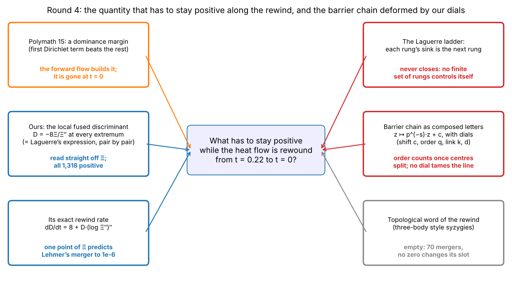
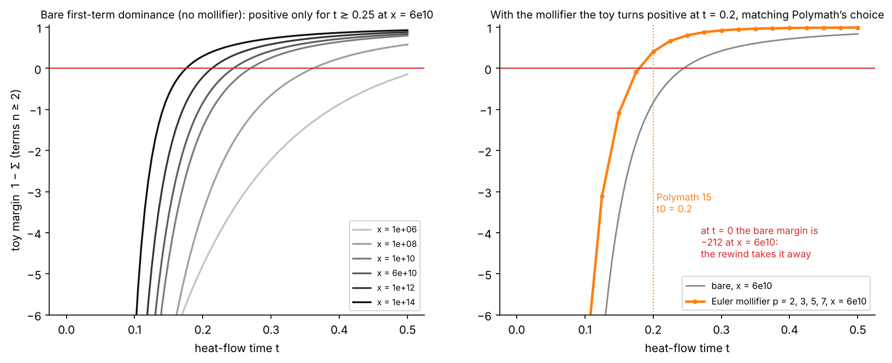
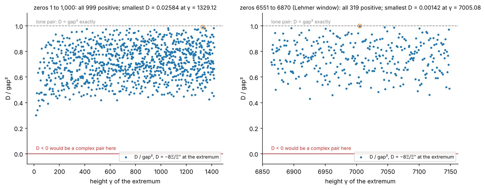
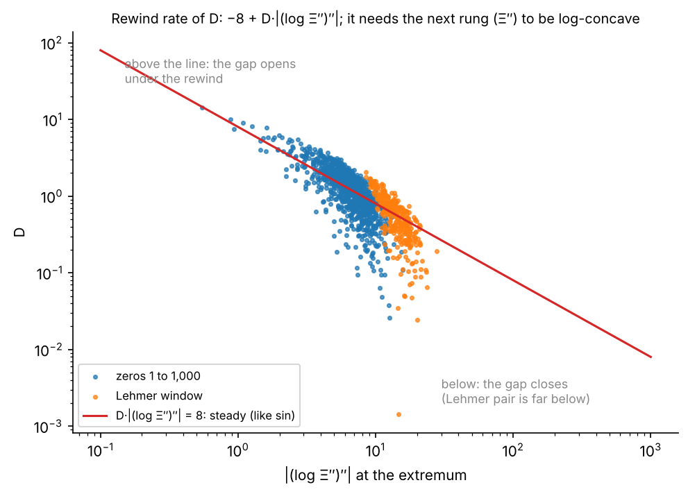
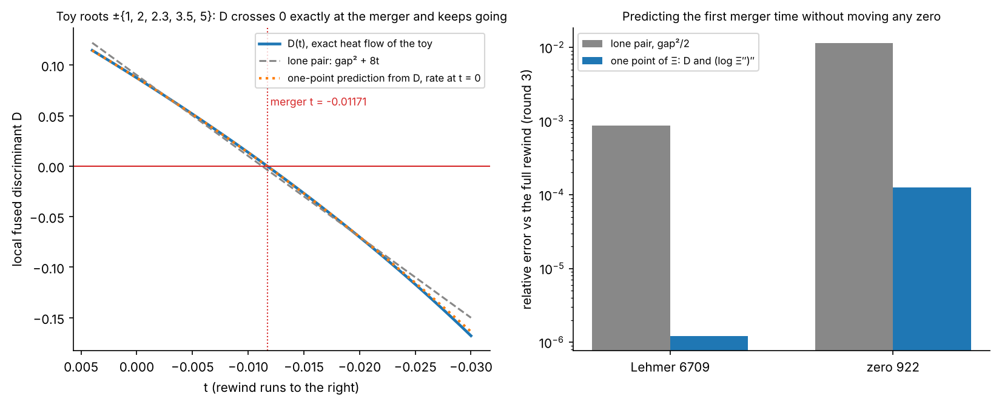
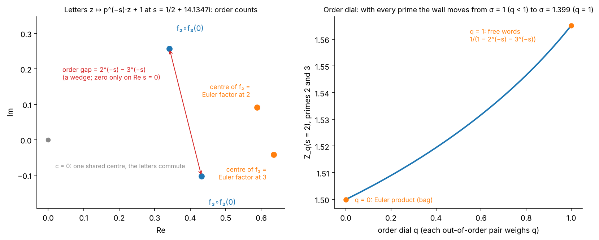
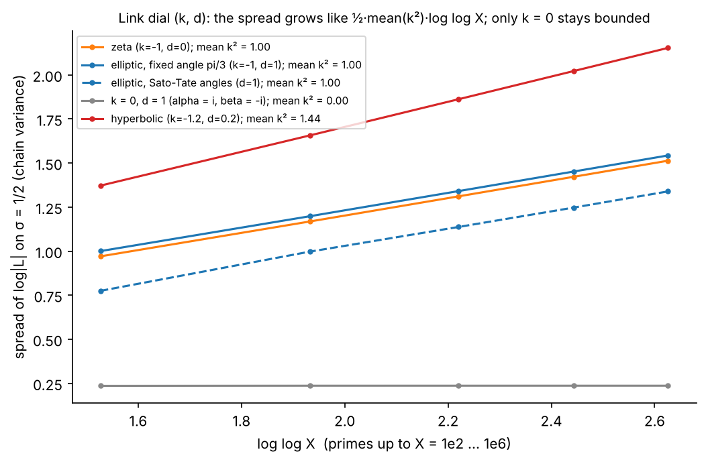
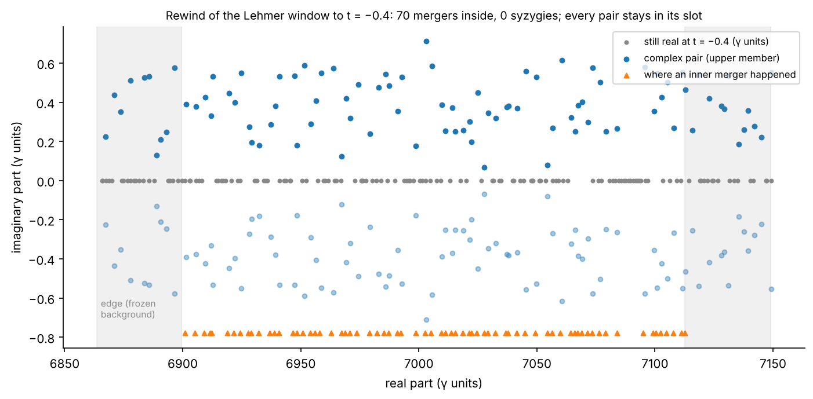
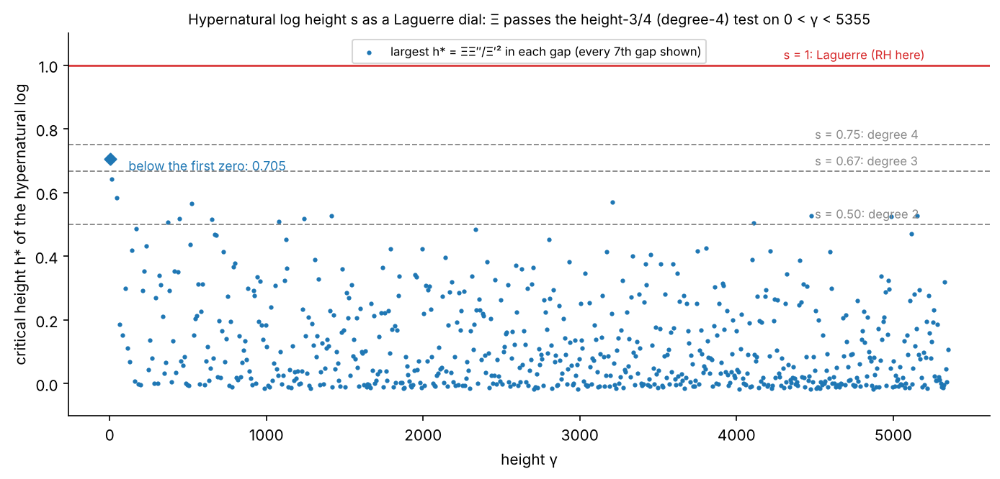

# Riemann, round 4: what has to stay positive along the rewind, and the barrier chain under our dials (DRAFT)

*Affine Composition Theory, built on Fused Hyperoperation Algebra. DRAFT, Nov 26 2026. Rounds 1 to 3: [round 1](../README.md), [the elliptic object](../elliptic-object/README.md), [round 3](../round3/README.md).*

## The answer

**The quantity is the local fused discriminant D = −8·Ξ/Ξ″ at every extremum of Ξ on the line.** It is Laguerre's expression read pair by pair. For a lone pair it equals the fused discriminant s² − 4p exactly. A complex pair sitting near an extremum makes D negative there, so D > 0 at every extremum is a local RH check. It can miss a pair far off the line. D can be read straight off Ξ, with no zeros needed. Its rewind rate is exact: dD/dt = 8 + D·(log Ξ″)″. From one point of Ξ, that rate predicts the merger time of Lehmer's pair to 1.2 parts in a million of the full 300-zero rewind.

**Not a lead toward a proof.** Two things block it:

- **The rate needs the next rung.** It depends on Ξ″, so keeping D positive along the rewind needs the next rung of the Laguerre ladder, which needs the one after it. The ladder never closes, and that is the positivity we are missing.
- **Polymath's quantity doesn't survive the rewind.** Polymath 15's positive quantity is a dominance margin that the forward flow builds. In our toy it falls from positive at t = 0.2 to −212 at t = 0, so the rewind takes it away.

**The barrier chain (your questions).**

- **Composed functions?** Yes. Its letters z ↦ p^(−s)·z + c are composed maps.
- **Shift dial c.** At c = 0 all the maps share one centre and commute. That case is the Euler product, and it is why order drops out. At c = 1 each centre is that prime's Euler factor, and order counts by a wedge.
- **Order dial q.** It runs from the Euler product (q = 0) to free words (q = 1). Turning q up pushes the chain's wall right, from σ = 1 to σ = 1.399, which is the wrong way.
- **Link dial (k, d).** No setting of it tames the chain on the critical line unless k averages to 0.
- **Topological word.** The three-body style word of the rewind is empty. Over 70 mergers, no zero ever leaves its slot.

**The hypernatural logarithm.** Its height s is a dial on Laguerre's expression: −(ln_s f)″ is proportional to s·f′² − f·f″.

- **At an extremum the height drops out**, so D is the same at every height.
- **s = 1 − 1/n is Laguerre's classical inequality for real-rooted polynomials of degree n.**
- **On 0 < γ < 5,355, Ξ passes the s = 3/4 test**, the degree-4 inequality. The largest critical height is 0.705, below the first zero.
- **Only s = 1 turns the Euler product into a sum.** That is why the barrier chain (Bohr–Jessen, Selberg's CLT) lives at height 1.

This is a measurement, not a road to a proof.

---

## Pass 1: our own tools

### 1. How Polymath 15 got Λ ≤ 0.22

Polymath 15 never rewinds. It works at t₀ = 0.2 and uses de Bruijn's strip theorem: if H_t₀ has no zeros with imaginary part at least y₀ = 0.2, then Λ ≤ t₀ + y₀²/2 = 0.22. It proves that zero-free region in three regimes:

- **Small x:** numerical RH verification of ζ up to X = 6·10¹⁰ + 83952 − 0.5.
- **The barrier:** no zero crosses a thin strip at x ≈ X for any 0 ≤ t ≤ t₀, checked by the argument principle. The shift 83952 − 0.5 makes the Euler product over p ≤ 11 large there.
- **Large x:** an effective Riemann–Siegel approximation. H_t/B_t equals Σ_{n≤N} b_n^t / n^(s*) + γ·(...) + errors, with b_n^t = exp((t/4) log² n) (their Theorem 1.3).

Above X, the positive quantity is a **dominance margin**: the first Dirichlet term has to beat all the others. Our toy keeps only the B-sum and the triangle inequality: m(t) = 1 − Σ_{n=2}^{N} n^(−(1+y)/2)·exp(−(t/4)·log n·log(N²/n)). The factor exp(−(t/4)·log n·log(N²/n)) is the forward flow damping the higher terms.

- **Bare:** at x = 6·10¹⁰ the margin is positive only past t ≈ 0.25.
- **Mollified:** with the Euler mollifier ∏_{p ≤ 7}(1 − b_p p^(−s)) it turns positive at t = 0.2, matching Polymath's choice.
- **At t = 0:** the bare margin is −212 at x = 6·10¹⁰, and it gets more negative as x grows.

So the forward flow builds the margin, and the rewind takes it away, at the rate x^(−ct) that Polymath states. This is the far-zone margin from our ℓp Lee–Yang work again. It cannot be carried down to t = 0.

### 2. Our quantity: the local fused discriminant at each extremum

Between two neighbouring zeros, Ξ on the line has an extremum (Ξ′ = 0). Define **D = −8·Ξ/Ξ″** there.

- **Lone pair, exact.** For H = (x − a)² − c (roots a ± √c, fused point s = 2a, p = a² − c), D = 4c = s² − 4p, the fused discriminant. Laguerre's expression H′² − H·H″ is 2(x − a)² + 2c, so its least value is D/2.
- **Its sign is a local RH check.** D > 0 means Ξ·Ξ″ < 0 at the extremum (the gap is a real gap). D < 0 is a minimum of |Ξ| above zero: a complex pair sitting there. A complex pair far from the line, compared with the spacing, can leave every D positive, so this is a local test only. When all zeros are real, D = 8/Σ_k 1/(x − z_k)², so D ≤ gap² (the two nearest zeros alone give that).
- **Read off Ξ, not off the zeros.** We computed D from Ξ = F·Z: the Hardy Z-function and its derivatives, with F = (γ² + 1/4)|Γ(1/4 + iγ/2)|. The zeros only bracket each extremum.

All 1,318 extrema have D > 0, with D/gap² between 0.30 and 0.9996.

- **Smallest D among zeros 1 to 1,000:** 0.02584, at γ = 1329.12, between zeros 922 and 923.
- **Lehmer's pair:** D = 0.0014206.
- **Cross-check:** at sampled extrema, D from Ξ matches D from the 5,000 zeros plus a tail to 5 digits.

### 3. The exact rewind rate, and what it needs

Follow D along the moving extremum under the flow ∂H/∂t = −H″ (z units); running t backward is the backward heat flow. The result is exact (sympy, and Lean statement `local_disc_rate`):

**dD/dt = 8 + D·κ,  κ = (log H″)″ at the extremum.**

- **Lone pair:** κ = 0, so D = D₀ + 8t, the round-3 line.
- **sin:** D·κ = −8, so the zeros never move (sin is a steady state).
- **All 1,318 extrema:** κ < 0, which is what Ξ″ having real zeros nearby gives.
- **Under the rewind:** D changes at −8 + D·|κ|. The gap opens if D·|κ| > 8 and closes if D·|κ| < 8. 487 of 999 and 163 of 319 extrema are on the opening side.

Freeze κ and integrate the rate once. That gives a merger time from **one point of Ξ**: t* = (1/κ)·log(8/(8 + κD)). We compared it with the full rewinds of round 3 (every zero in a ±150 window moving):

| pair | full rewind (round 3) | one point of Ξ | lone pair gap²/2 |
|---|---|---|---|
| Lehmer, zeros 6709 and 6710 | −0.00071120370 | −0.00071120457 (1.2e-6) | −0.00071059 (8.7e-4) |
| zeros 922 and 923 | −0.0131931 | −0.0131915 (1.3e-4) | −0.0130413 (1.2e-2) |
| toy roots ±{1, 2, 2.3, 3.5, 5}, pair (2, 2.3) | −0.011712 (exact) | −0.011688 (2e-3) | −0.01125 |

(γ units for the first two rows, z units for the toy.) On the toy, D crosses 0 exactly at the merger and keeps going smoothly, the fused continuation from round 3. The rate formula matches a numerical derivative of D to 6 digits (6.955620 vs 6.955624).

**Where it stops.** The rate needs κ, so keeping D positive needs Ξ″ log-concave at the same spots. The same holds for the full Laguerre expression L = H′² − H·H″, which obeys the exact **ladder identity**:

L_t = −L″ + 2·L(H′),  L(H′) = H″² − H′H‴.

Under the rewind this reads L_s = L″ − 2·L(H′). That is a heat equation, which on its own would keep L's minimum from falling, plus a sink equal to twice the next rung. For a lone pair the sink wins 2 to 1 (4 against 8). Every rung's sink is the rung above it. The full set of rungs is the Csordas–Varga criterion (below): f is in the Laguerre–Pólya class exactly when all the generalized Laguerre expressions are ≥ 0. No finite piece of that ladder controls itself under the rewind. That is the missing positivity, stated exactly.

### 4. The barrier chain as composed maps, deformed by our dials

Round 3 found that the barrier chain is the Euler product: mean |ζ| = ∏ (2/π)K(p^(−σ)) (Bohr–Jessen). In the order-dial language ([order-dial](../../order-dial/README.md)), each prime is a stretch-and-shift letter

f_p(z) = p^(−s)·z + c.

**Shift dial c.**

- **c = 0:** every letter scales about 0. They share one centre, so they commute (order-dial's `commute_iff`). The chain is the Euler product, and order drops out.
- **c = 1:** the centre of f_p is 1/(1 − p^(−s)), the Euler factor itself (Lean `letter_centre`). The centres split, and the two orders differ by a wedge: f₂∘f₃ − f₃∘f₂ = 2^(−s) − 3^(−s). That vanishes only where (3/2)^s = 1, on Re s = 0 at s = 2πik/log(3/2) (15.496i, 30.992i, …). In the strip the letters never commute.

**Order dial q.** This is the quantum-plane weight from order-dial §4: each ordering of a factorization counts q^(inversions).

- **q = 0:** one ordering per integer, which is the Euler product ∏ 1/(1 − p^(−s)), a bag of letters.
- **q = 1:** every ordering counts, which gives the free words 1/(1 − Σ_p p^(−s)) (ordered prime factorizations).
- **In between, two primes:** Z_q = Σ_a x^a / ∏_{j=0}^{a}(1 − q^j y), with x = 2^(−s), y = 3^(−s). Checked to 12 digits.
- **All primes:** the wall stays at σ = 1 for q < 1, and the pole at s = 1 strengthens. The summed weights grow like x·(log x)^β, with β rising with q: fits 0.32, 0.86 and 1.96 at q = 0.25, 0.5, 0.75, against the Selberg–Delange guess q/(1 − q) = 1/3, 1, 3, not converged at x = 2·10⁶. At q = 1 the wall jumps to σ₀ = 1.39943, where Σ_p p^(−σ₀) = 1.

Letting order count adds words, so the chain grows faster. That moves the wall the wrong way for RH.

**Link dial (k, d).** Replace each link by a degree-2 factor 1/(1 + k u + d u²), u = p^(−s), with roots α, β, so α + β = −k and αβ = d. On σ = 1/2 the spread of log|L| is ½ Σ_p Σ_m |α^m + β^m|² p^(−m)/m². Its m = 1 term is k²/(2p), so

**the chain is bounded on the line only if Σ_p k_p²/p converges.**

| link setting | spread at X = 10² | at 10⁶ |
|---|---|---|
| ζ (k = −1, d = 0) | 0.97 | 1.51 |
| elliptic, Sato–Tate angles (d = 1) | 0.78 | 1.34 |
| hyperbolic (k = −1.2, d = 0.2) | 1.37 | 2.15 |
| k = 0, d = 1 | 0.237 | 0.237 |

Elliptic or hyperbolic makes no difference. The divergence lives on the k dial alone. For a real L-function Σ |a_p|²/p diverges like log log X (Rankin–Selberg), so no dial setting that is still an L-function tames the chain on the line. This is the chain form of Selberg's central limit theorem.

### 5. A topological word for the rewind

In the three-body problem, the topological word records the syzygies, the moments when the three bodies line up. Our analogue: rewind the zeros past their mergers in fused coordinates, so each merged pair continues as a complex pair s/2 ± i·√(p − s²/4). A letter is written whenever the centre of a complex pair passes a real zero or another pair's centre (they line up vertically).

- **To t = −0.06:** 11 mergers in the inner window, starting with Lehmer's pair.
- **To t = −0.4:** 70 mergers, and **0 syzygies**. Every complex pair rises straight up from its slot, and the real zeros on either side never slip under it.

The word is empty: through the reach of this rewind, the order along the line is frozen. Under RH the forward word from t = 0 is empty too, since nothing ever leaves the line. So a word could only record how zeros move once they are off the line. It carries no positivity.

The non-commuting letters of §4 do give real words. A word f_{p₁} f_{p₂} … applied to 0 sums n^(−s) over the prefix products, a path in the lattice of prime exponents. The Euler product is that structure's abelian shadow, and turning the order back on is the order dial's q = 1 end.

### 6. The hypernatural logarithm as a Laguerre dial

The hypernatural log is ln_s(X) = E^(−s)(X − 1), with E(x) = eˣ − 1 ([e at every height](../../fractional-rungs/e-every-height/README.md)). At every height it starts ln_s(1 + u) = u − (s/2)u² + …. Normalise f at a point (g = f/f(x₀)). Then

**−(ln_s g)″ = (s·f′² − f·f″)/f²** (sympy, and Lean `height_is_degree`).

- **s = 1:** Laguerre's expression, the n = 1 rung of section 3.
- **At an extremum (f′ = 0):** every height gives −f″/f, so D = −8f/f″ is the same at every height (Lean `height_free_at_extremum`). The local fused discriminant doesn't care which logarithm you use.
- **s = 1 − 1/n:** n·(s·f′² − f·f″) = (n − 1)·f′² − n·f·f″. That is Laguerre's classical inequality, which every real-rooted polynomial of degree n satisfies (checked on random ones of degree 3, 5 and 8). So the height is a degree dial: s → 1 is n → ∞, an entire function.

The smallest height that keeps the expression positive at x is the **critical height** h*(x) = f·f″/f′². When all zeros are real, h* = 1 − 1/N_eff, where N_eff = (Σ a_k)²/Σ a_k² and a_k = 1/(x − z_k): roughly how many zeros pull together at x. So h* < 1 everywhere, and a complex pair near the line would push h* past 1.

We measured h* across all 4,900 gaps up to γ = 5,355, from the zeros, and spot-checked it against Ξ itself to 2%.

- **Typical gap:** the largest h* is 0.07 (median).
- **Highest in a gap:** 0.64, in the first gap.
- **Highest overall:** 0.705, on the stretch below the first zero (N_eff = 3.39).
- **Trend:** block maxima drift from 0.64 to about 0.55 with height.

So on this whole stretch Ξ passes the height-3/4 test: it satisfies Laguerre's inequality as if it were a real-rooted polynomial of degree 4. We don't expect that to hold at every height. Random-matrix spacings allow rare clusters with N_eff as large as you like, so the bound is a measurement of this range, not a law. For evenly spaced zeros (sin), h* = −tan² ≤ 0 everywhere.

Products: ln_s(XY) = B_(1−s)(ln_s X, ln_s Y) (proved in the e-every-height work). Only s = 1 turns the Euler product into a sum of independent pieces, which is what Bohr–Jessen and Selberg's CLT use. At other heights the chain combines by B_(1−s) and no central limit theorem applies directly.

---

## Pass 2: the literature

| Our piece | Known as | Status |
|---|---|---|
| Polymath's route (§1) | Polymath 15, *Effective approximation of heat flow evolution of the Riemann ξ function, and a new upper bound for the de Bruijn–Newman constant*, Res. Math. Sci. 2019 (arXiv 1904.12438): Theorems 1.2 to 1.4, mollifier §8.5 | known; our margin is a toy of their B-sum bound |
| D > 0 at every extremum, Laguerre's expression | Laguerre inequality H′² − H·H″ ≥ 0 for the Laguerre–Pólya class; generalized Laguerre expressions L_n: Patrick (necessity), Csordas and Varga (sufficiency), as restated by Cardon | known |
| D from a pair, the merger time | Csordas, Smith, Varga, *Lehmer pairs of zeros, the de Bruijn–Newman constant Λ, and the Riemann hypothesis*, Constr. Approx. 10 (1994): gap² times g_k = Σ 1/(x_k − x_j)² + Σ 1/(x_{k+1} − x_j)², built from the zeros | same idea from the zeros; we did not find the one-point form from Ξ itself, but it is a short step from theirs |
| The rate dD/dt = 8 + D·(log H″)″ and the ladder identity | follows from the heat equation; not found in what we read | a two-line calculation, likely folklore |
| Turán-type positivity at the origin | Csordas, Norfolk, Varga 1986 (Turán inequalities for Ξ's Taylor coefficients); Griffin, Ono, Rolen, Zagier, PNAS 2019 (Jensen polynomials hyperbolic for large shift) | known; the ladder at one point |
| Letters, order gap, commute iff shared centre | the affine group; our order-dial README | known; reading the Euler factor as a letter's centre is ours |
| q = 1 end | ordered prime factorizations, Dirichlet series 1/(1 − P(s)) (OEIS A008480), wall where P(σ) = 1 | known |
| q in between | quantum-plane weighting of factorizations | not found in what we read |
| Link dial obstruction | Rankin–Selberg (Σ \|a_p\|²/p ~ log log X), Selberg's central limit theorem for log\|L\| | known |
| Height s = 1 − 1/n | Laguerre's inequality (n − 1)f′² − n·f·f″ ≥ 0 for real-rooted degree-n polynomials (classical); s-concavity (Borell, Brascamp–Lieb) is a different family | known inequality; reading it as the hypernatural-log height, and measuring h* for Ξ, is ours |
| Topological word | Montgomery, syzygy sequences for the three-body problem | known for three bodies; our rewind version is new but empty |
| Λ ≥ 0, Λ ≤ 0.22 | Rodgers–Tao 2020; Polymath 15 2019 | known |

## What's new here

- **The local fused discriminant D = −8Ξ/Ξ″, read straight off Ξ.** It is exact for a pair and positive at all 1,318 extrema checked.
- **Its exact rewind rate, dD/dt = 8 + D·(log Ξ″)″.** It gives a one-point merger predictor, good to 1.2e-6 for Lehmer's pair.
- **The ladder identity L_t = −L″ + 2·L(H′)**, which says plainly why the positivity doesn't close.
- **The barrier chain as letters whose centres are the Euler factors**, plus the order dial between the Euler product and free words, and the statement that only the k dial carries the divergence on the line.
- **An empty topological word for the rewind:** no zero changes its slot through 70 mergers.
- **The hypernatural log height as Laguerre's degree dial** (s = 1 − 1/n), with D unchanged at every height, and the measurement that Ξ passes the degree-4 test up to γ = 5,355.

## Is it a lead?

**No.** The one-point merger predictor is a good computational tool, but the Lehmer-pair lower bounds it would speed up were made moot by Rodgers–Tao's Λ ≥ 0. The positivity we need is the whole Laguerre ladder carried along the rewind. Every rung's rewind rate leans on the next rung, so a proof would have to control all of them at once, which is RH again. No dial on the barrier chain tames it on the critical line.

**Suggested line for "Where it unifies":** *Laguerre's expression at an extremum is the fused discriminant of the nearest pair; its rewind rate leans on the next rung of the Laguerre ladder.* No Promising-leads entry.

## Lean

`lean/RiemannRound4.lean`: **12 theorems**, core Lean 4 with `grind`, importing FusedAlgebra.Base. compiled in the shared library as `FusedAlgebra.Topics.RiemannRound4` (namespace `CircleOp.RiemannRound4`; no proof changed). Each statement is a ring identity:

- **Lone pair:** `pair_local_disc`, `pair_laguerre`, `pair_flow_disc`.
- **Ladder:** `laguerre_ladder`, `pair_ladder_rates`.
- **Rate:** `local_disc_rate`, `sin_steady`.
- **Letters:** `letter_order_gap`, `letter_centre`.
- **Link dial:** `link_split`.
- **Hypernatural log:** `height_free_at_extremum`, `height_is_degree`.

## Checks

`checks.py` → `checks_output.txt`: **24 of 24 pass** (math checks C1 to C17, polish P1 to P7).

## Files

- `identities.py` → `identities.json`: sympy proofs of the identities.
- `extrema.py` → `extrema.json`: D and κ from Ξ at 1,318 extrema.
- `rewind4.py` → `rewind4.json`: toy and Lehmer-window D through the rewind.
- `polymath.py` → `polymath.json`: the dominance-margin toy.
- `barrier.py` → `barrier.json`: letters, order dial, link dial.
- `hyperlog.py` → `hyperlog.json`: the hypernatural log as a Laguerre dial.
- `braid.py`, `braid_deep.py` → `braid.json`, `braid_deep.json`: the topological word.
- `figures.py` → `figures/` (9 pictures).
- `checks.py`.
- `lean/RiemannRound4.lean`.

## Conventions

- **Flow:** H_t(z) = ∫ e^(tu²) Φ(u) cos(zu) du, so ∂H/∂t = −∂²H/∂z². At t = 0 the zeros are at z = 2γ.
- **Backward heat flow:** t decreasing, the true heat equation in s = −t. As a picture we call it the rewind.
- **γ units:** D_γ = −8Ξ/Ξ_γγ ≈ gap_γ², and a lone pair merges at t = −D_γ/2. In γ units the rate reads dD_γ/dt = 2 + D_γ·κ_γ/4.
- **Picture colours:** blue ours, orange known, grey reference, red where a road stops.
